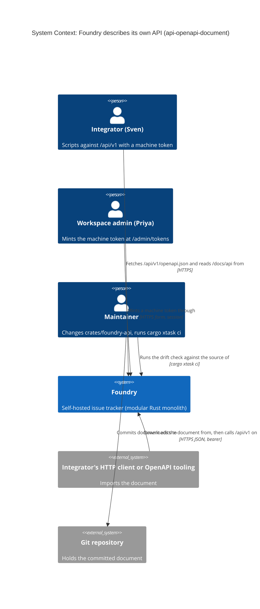
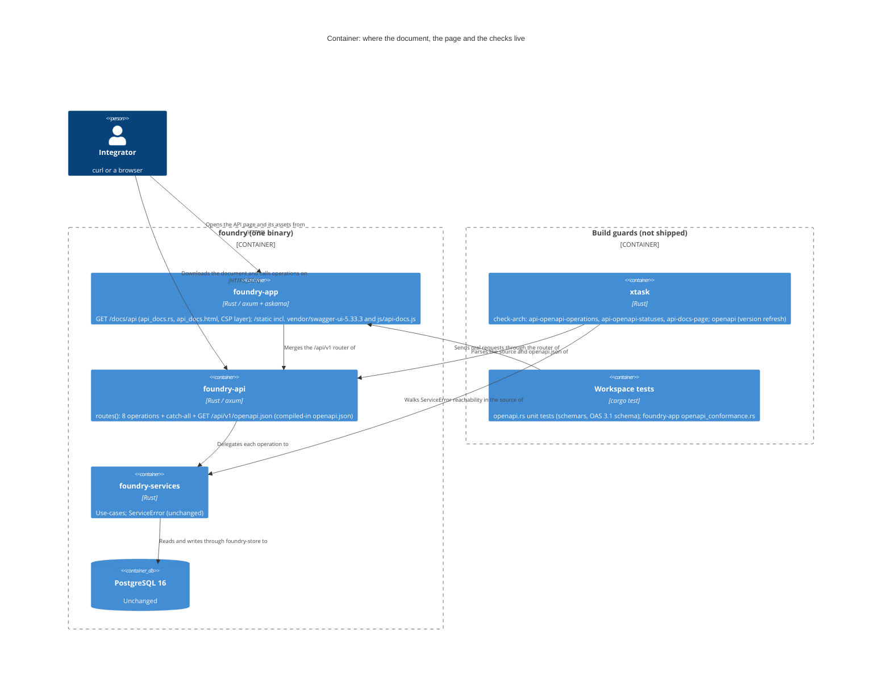
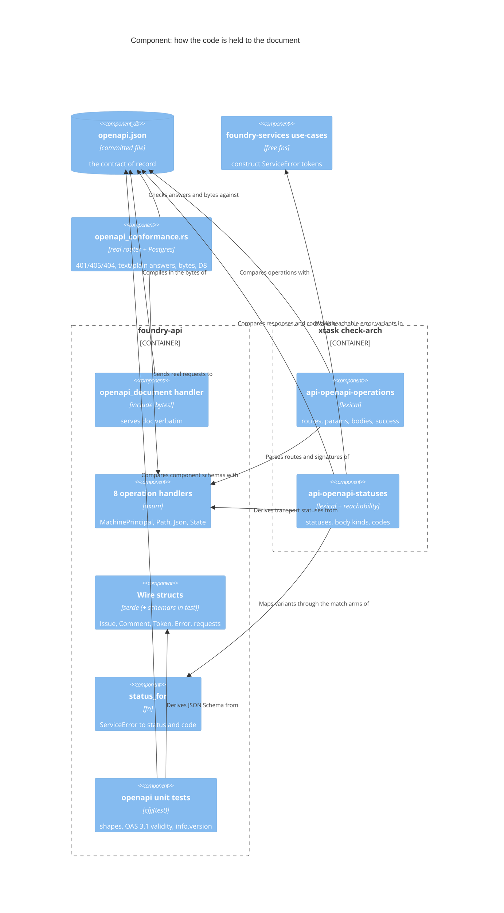

<!-- markdownlint-disable MD024 -->
# Feature Delta: api-openapi-document

Foundry describes its own JSON API. Every instance serves an OpenAPI document
for all of `/api/v1` at `/api/v1/openapi.json`, with no token, and the same
document is committed in the repository. Each instance also serves an
interactive Swagger UI page, built from vendored assets, where an integrator can
read every operation and try one with a machine token they paste in. CI fails
when the document stops matching the code. Today the contract is prose
(`docs/feature/web-tier-extraction/design/api-contract.md` plus
`docs/feature/token-management-api/design/api-contract.md`), and the prose has
already drifted from the code in at least eleven places (see [REF] Contract
Findings).

## Wave: DISCUSS

Product owner: Luna (nw-product-owner) | Date: 2026-10-18 | Feature type:
backend (one browser page) | Walking skeleton: yes, evaluated and adopted
(slice 01: the served document for one route plus the drift check) | UX depth:
lightweight, happy path plus the main failure paths | JTBD: yes, a new job |
Density: lean, Tier-1 [REF] only, `expansion_prompt = ask-intelligent` |
Requirements readiness: four decisions locked by the user (D1-D4), the rest
explored here.

### [REF] Prior Wave Consultation

| Artifact | Status | Note |
|---|---|---|
| `docs/feature/web-tier-extraction/design/api-contract.md` | ✓ | The prose contract: route surface, resource shapes, status table, error envelope, versioning, the 2026-10-15 amendment (membership or scope refusal became the uniform 404). It says "No OpenAPI/SDK generation in Feature A (deferred, `out-of-scope.md`); the snapshot test + this document ARE the contract." This feature is that deferred item. Read against the code: eleven findings, [REF] Contract Findings. |
| `docs/feature/web-tier-extraction/discuss/out-of-scope.md:118-122, :156` | ✓ | "OpenAPI / generated SDK / API documentation generation … Target: post-feature enhancement once the contract has stabilized." Re-evaluation trigger: "Contract stable; external integrators want generated clients". **The trigger has fired:** the contract has had 8 routes and one envelope since token-management-api (2026-06) and the 2026-10-15 amendment, and the user asked for the document. This feature covers documentation only. SDK generation stays out (Out of Scope). |
| `docs/feature/web-tier-extraction/discuss/jobs.yaml` `jtbd-web-4` | ✓ | "Drive Foundry programmatically through a first-class JSON API", `primary_persona: integrator`. Its anxiety ("Will the API stay stable as the UI evolves?") is the push for D3. The new job builds on it. |
| `docs/feature/token-management-api/` (discuss and design) | ✓ | The token routes' contract (`design/api-contract.md` §1-§6: 200/204/401/403/404/429/500, `TokenJson` with no value field, 204 on revoke), `rate-guardrail.md` (429 `rate_limited`), and `no-mint-boundary.md`: the API never mints. There is no `POST …/tokens` route, and the check-arch rule `check_api_no_mint_route` keeps it that way. The document must not imply minting, and it must say where a token comes from (`/admin/tokens`, signed-in workspace admin). Its integrator persona, Sven Aarø (`discuss/jobs.yaml`), is promoted here (see [REF] Persona). |
| `crates/foundry-api/src/lib.rs` | ✓ | **The source of truth for the document** (D3). `routes()` at `:290-341`: 8 operations on 7 paths plus the `/api/v1/{*rest}` catch-all. Wire structs at `:62-208`. `status_for` at `:214-233`. The adapter-local 429 at `:260-268`. `MachinePrincipal` at `:609-629`. |
| `crates/foundry-services/src/{issues,comments,tokens}.rs` | ✓ | Which `ServiceError` each operation can actually raise, and the 422 codes: `title_required`, `description_too_long`, `invalid_state`, `comment_empty`, `comment_too_long`. No `/api/v1` use-case raises `Conflict`. |
| The "v1 contract snapshot test" (api-contract.md §Versioning) | ✓ | **No recorded snapshot exists.** The nearest nets are: (a) us-w05a's step `each entry carries the issue's key, title, and state` (`feature_a_programmatic.rs:668`), which parses into a lenient `ApiIssue` struct (`:1159`, no `deny_unknown_fields`), so it catches a removed or renamed issue field but not an added one; (b) the `TokenJson` exact-key-set unit test (`foundry-api/src/lib.rs:772`); (c) us-tma's "Every token-route refusal carries a stable machine-readable code". Nothing covers the comment, history or create shapes. The drift check (D3, US-AOD-02) generalizes these nets. It does not delete them. |
| `docs/product/architecture/brief.md`, `xtask/src/check_arch.rs` | ✓ | `check_api_no_html` (`:192-219`) flags `Html(`, `Html::`, `Html<`, `response::Html` and `text/html` anywhere in `crates/foundry-api/src`. A Swagger UI page is HTML, so it **cannot** be served from foundry-api (System Constraints, OQ-3). `check_static_asset_integrity` (`:1577`) enforces ADR-CANZAN-THEME-003 R1-R3 on `crates/foundry-app/static/`, and R3 re-hashes every `VENDOR.md` row. |
| `docs/product/architecture/adr-canzan-theme-002/003`, `crates/foundry-app/static/VENDOR.md` | ✓ | Three row shapes (upstream-verbatim, authored-in-tree, derived), sha256 per row, "NO Node, NO bundler, NO package.json, NO CDN at runtime", "the acceptance suite asserts zero cross-origin requests" (`VENDOR.md:244`). The swagger-ui blobs are upstream-verbatim rows. Its initializer is an authored-in-tree row. |
| CSP | ✓ | **Foundry sends no `Content-Security-Policy` header today.** Not in any crate, and not in `deploy/k8s/foundry-ingress.yaml`. "CSP-safe" is a posture of the app's own scripts (external same-origin files, `addEventListener` only, no inline handlers: `static/js/*.js` headers, ADR-MODAL-CLOSE-001). It is not an enforced policy. See OQ-4. |
| `docs/product/architecture/brief.md:414-428` (release-version footer) | ✓ | The footer shows `Foundry v<version>` from `views::RELEASE_VERSION` (`CARGO_PKG_VERSION`). That is the source for `info.version` (OQ-8). |
| `docs/product/jobs.yaml`, `docs/product/personas/persona-instance-operator.yaml`, `docs/product/journeys/*` | ✓ | No job covers "learn the API's contract without reading the source". `job-api-machine-readable-contract` is appended. `persona-api-integrator` is added, thin and back-declared. `journey-api-openapi-document.yaml` is added. |
| DIVERGE (`docs/feature/api-openapi-document/diverge/*`), DISCOVER, `docs/product/vision.md` | ⊘ | None exists. Grounded in the user's locked decisions (D1-D4), the web-tier-extraction re-evaluation trigger and code reading. **Recorded risk** (see Wave Decisions), as in every sibling feature. |

### [REF] Contract Findings (api-contract.md versus the code)

The user's rule: the document describes what the code does. Each finding below
says what the document will say. None of them changes code. C4 is the one that
might deserve a fix (OQ-9). "Eleven" in this section is the DISCUSS-time count
(C1-C11); DESIGN added C12 and C13 (2026-10-19, rows below).

| # | api-contract.md says | The code does | The document will say |
|---|---|---|---|
| C1 | Issue example carries `"priority": "none"` (§Issue) | `IssueJson` is `key`, `number`, `title`, `state` (`lib.rs:76-81`). No priority. | The four fields. |
| C2 | Comment example carries `created_at` (§Comment) | `CommentJson` is `id`, `author_email`, `body_html`, `edited` (`lib.rs:118-123`). No timestamp. | The four fields. |
| C3 | `state` is the closed enum `backlog, todo, in_progress, done, cancelled` | `state` is a lane slug of the issue's project. Lanes are per project and can be inserted (board-lane-overflow-menu), so the set is open. `in-progress` and `canceled` fold to their canonical spelling. Anything else gets 422 `invalid_state` (`foundry-services/src/issues.rs:67-148`). | `state` is a string naming one of the project's lanes, not an enum. Its examples use the five default lanes, and it says they are defaults. |
| C4 | Malformed JSON body → `400` with envelope `invalid_json` | No `invalid_json` exists anywhere. axum's `Json` extractor refuses with **text/plain**: 400 (syntax), 415 (no `Content-Type: application/json`), 422 (a missing or mistyped field). A path segment that does not parse (`{number}` not an integer, `{comment_id}` or `{jti}` not a UUID) is a text/plain 400. None of these carries the envelope. | Each of these statuses, with a `text/plain` body. Fixing them to the envelope is OQ-9. |
| C5 | Route surface: 5 routes | 8 operations: plus `GET …/issues/{number}/history` (issue-change-history), `GET …/tokens` and `DELETE …/tokens/{jti}` (token-management-api), plus the `/api/v1/{*rest}` 404 catch-all (web-provisioning-flow fix). | All 8, plus the catch-all (D4), plus the document's own route (OQ-10). |
| C6 | Status table has no 204, 405, 429 or 500 | Revoke answers 204. Revoke can answer 429 `rate_limited`. Any operation can answer 500 `internal`. A known path with the wrong method answers 405 with an empty body (axum's method router; for example `GET …/issues/{number}`). | Every one of them, per operation. |
| C7 | `title_required` for an empty title | An empty title **and** a title over 256 characters both answer 422 `title_required`, "Title is required" (`issues.rs:163-169`). | Both cases under the same code, as the code does. |
| C8 | Create-issue request is `{ "title" }` | It also takes an optional `description` that defaults to `""` (new-issue-dialog-description, `lib.rs:93-94`). Over 262,144 characters answers 422 `description_too_long`. | `title` is required and `description` is optional. |
| C9 | A non-author edit's `message` carries the UI copy "You may only edit your own comments." | `status_for` maps `Forbidden` to the message `"forbidden"` (`lib.rs:217`). The same holds for `unauthorized` and `not found`. | The messages the code sends. |
| C10 | The slice-1 note: the read route may accept the browser session | Every handler takes `MachinePrincipal`. A bearer token is the only credential (`lib.rs:360-364`). | Every operation except the document's own route requires the bearer scheme. |
| C11 | §Versioning: "a recorded v1 response for the board endpoint is asserted structurally" | No recorded snapshot exists (see Prior Wave Consultation). | Not applicable. The drift check (US-AOD-02) is the net from now on. |
| C12 (DESIGN, 2026-10-19) | No body-size refusal | A `Json` body over axum's default 2 MB answers **413** `text/plain` before the handler runs. | 413 `text/plain` on the four body-taking operations, beside 400/415/422 (C4). Joins OQ-9's follow-up. |
| C13 (DESIGN, 2026-10-19) | 401 means a bad, expired or revoked token | It also answers 401 when the token registry cannot be read (fail-closed). | The 401 description also covers "the token cannot be checked". |

Also noted, not a contradiction: there is no single-issue `GET` route.
project-lifecycle's US-PL-03 says a script "reads SPIKE-2" through the API. The
code answers that path 405 for `GET`. The document says so, and a read-one-issue
route is out of scope.

One ordering fact the document must convey: `MachinePrincipal` runs before
`Path` and `Json` (`lib.rs:360-364, 387-392`). A request with no valid token
therefore gets 401 before any 400, 415 or 422 extractor refusal. An unrouted
`/api/v1` path gets 404 with no authentication at all.

### [REF] Persona

**Choice: a thin, back-declared integrator persona, with Priya as the person who
measures.** The integrator already exists as a feature-local persona, Sven Aarø
in `docs/feature/token-management-api/discuss/jobs.yaml` (2026-06). That file
and web-tier-extraction's `jtbd-web-4` (`primary_persona: integrator`) are its
only sources. This wave promotes him to the product SSOT as
`persona-api-integrator`, carrying only what those two files state and marked
thin. Reusing Priya alone would fit the homelab instance, but it would hide the
fact that the document is for whoever scripts against Foundry, whether or not
they operate it. Priya stays what she is: the instance operator who mints the
token at `/admin/tokens` and runs the dogfood. Her persona states that every
measurement is "a store query, an acceptance assertion, or her own report", and
this feature's KPIs follow that rule.

- **Sven Aarø** (`persona-api-integrator`, new, thin): a platform or DevOps engineer who wires integrations and CI pipelines to `/api/v1` with a bearer machine token and provisions credentials in automation, not by clicking a UI. Nothing else is claimed: no tools, languages or client generators.
- **Priya Raman** (`persona-instance-operator`): workspace admin of Canzan Labs and instance operator. She mints the token Sven uses (`/admin/tokens`), and on a single-operator instance she is often the one scripting. She gains a reference and the job id only.
- **The Foundry maintainer**: whoever changes `crates/foundry-api` and runs `cargo xtask ci`. They are the actor of US-AOD-02. Referenced by role only, with no persona details.
- **A link from someone else**: a URL like `/docs/api?url=https://attacker.example/spec.json` sent to Priya. It is the foil for the UI's spec-source rule (US-AOD-06).

### [REF] JTBD

**job_id: `job-api-machine-readable-contract`** (appended to `docs/product/jobs.yaml`).

One-liner: *When I am about to script against a Foundry instance, I want to get
that instance's exact API contract (every route, every field, every status,
every error code) in a form my tools read, and try a call before I write code,
so I can build an integration without reading Foundry's Rust source, and know the
contract I read is the one the server enforces.*

Job stories:

1. When I start an integration against `foundry.unintelligent-design.us`, I want to download the API's description from that instance, so the description I code against matches the version running there.
2. When my script gets a 404 or a 422, I want to look up what that status and `error.code` mean for that route, so I can branch on it instead of guessing.
3. When I'm deciding which call to make, I want to try it in a browser with my token, so I can see the real response before I write code.
4. (Maintainer) When I change a handler, I want CI to tell me the description no longer matches, so integrators never read a description that lies.

Dimensions. **Functional**: a machine-readable OpenAPI document for all of
`/api/v1`, served by every instance and committed in the repo, kept true by CI,
plus a page that renders it and can send calls. **Emotional**: integrating stops
being archaeology through `lib.rs` and two prose contracts that disagree with it,
and becomes reading a contract the build guarantees. **Social**: "works with
Foundry" can be claimed against a published, checkable contract.

Four forces:

- **Push**: the contract is spread over two prose documents and the source, and the prose is wrong in eleven places (C1-C11). A script written from api-contract.md would send `priority`, expect `created_at`, hard-code five states and parse an `invalid_json` envelope that never arrives.
- **Pull**: one OpenAPI document at a known URL, which tools import, plus a page with "Try it out".
- **Anxiety**: that the document drifts from the code like the prose did. That a public description helps an attacker. That pasting a token into a web page leaks it. That the page phones home to a CDN or a validator.
- **Habit**: reading `crates/foundry-api/src/lib.rs` and trial-and-error with `curl`. The document has to be more trustworthy than the source, not just more convenient, and the drift check is what makes it so.

### [REF] Scope Assessment: PASS (6 stories, 3 contexts, about 7-8 days)

| Oversized signal | Fired? | Evidence |
|---|---|---|
| More than 10 user stories | No | 6 |
| More than 3 bounded contexts or modules | No (exactly 3) | the JSON API adapter (the document and its route), the web tier (the UI page and its vendored assets), the build guards (`xtask` check-arch and CI drift check) |
| Walking skeleton needs more than 5 integration points | No | 3: a new `/api/v1` route, a committed file, one CI check |
| More than 2 weeks of effort | No | about 7-8 days (DISCUSS estimated about 6; revised by DESIGN Changed Assumption 4) |
| Multiple independent outcomes that could ship separately | **Yes** | Two outcomes: the document (slices 01+02, released in one tag, DEVOPS gate R4: no tag may contain `PENDING_OPERATIONS`) and the page (slice 03, in the same tag or a later one). Slice 03 is the only separately shippable increment |

One of five signals fires, so this is **one feature**. The UI (slice 03) could
split into its own feature with no rework, but it is useless without the full
document and small on its own (2 days). Slices 01 and 02 are not separately
shippable: they reach users together, in one tag (R4). The user asked for both together, so it stays here as
the last slice.

### [REF] Locked Decisions

| ID | Decision | Source |
|---|---|---|
| D1 | **Location.** Foundry serves the OpenAPI document at `/api/v1/openapi.json` with no token required. The same document is committed in the repository. Integrators fetch it from whatever version they run. | **User** |
| D2 | **Swagger UI: yes, self-hosted.** Foundry serves an interactive Swagger UI page (the user's working name was `/api/docs`; the path is `/docs/api`, per OQ-3) that renders the document, including "Try it out". swagger-ui's assets are vendored, never loaded from a CDN, and satisfy the asset-provenance rules (ADR-CANZAN-THEME-002/003, `VENDOR.md`) and the CSP posture (OQ-4). | **User** |
| D3 | **Accuracy.** CI fails when the document drifts from the code: route, method, path parameters, status codes, request and response shapes, the error envelope. Whether the document is generated from the code or hand-written and checked by a conformance test is DESIGN's decision. | **User** |
| D4 | **Coverage: all of `/api/v1`.** The 8 operations in `foundry_api::routes()`: list issues, create issue, change issue state (PATCH), issue history (GET), create comment, edit comment, list tokens, revoke token (DELETE). Plus the bearer JWT (EdDSA machine token) security scheme, the `{"error":{"code","message"}}` envelope, and every status each operation can return, including the uniform non-enumerable 404 and the unrouted-`/api/v1` 404 catch-all. | **User** |
| D5 | Backend feature. UX depth lightweight. JTBD yes. Walking skeleton evaluated and adopted: slice 01. | User (type, depth); PO (skeleton) |
| D6 | **The code is the truth.** Where api-contract.md and the code disagree, the document describes the code (C1-C11). This feature changes no `/api/v1` behaviour. Every existing API acceptance scenario stays green, unchanged. | User ("the spec must describe what the code does") |
| D7 | **The document contains nothing about the instance.** Every caller, on every instance running the same release, gets the same bytes. No host name, no workspace, team, project or user from the database, no token, no configuration. Examples are fictional and fixed (`acme`, `backend`, `auth`, `AUTH-2`, `ci-issue-filer`, `mei@acme.com`, taken from the shipped contracts). | PO: required for D1's "the same document is committed" to hold |
| D8 | **The document's route evaluates no credential.** A request with no `Authorization`, an invalid bearer token, a revoked one, or a browser session cookie all get the same 200 and the same bytes. It never answers 401. | PO: D1 says no token required. A route that 401s on a bad token still evaluates the token, and an integrator debugging a broken token needs the document most. |
| D9 | **The document states where a token comes from and that the API cannot mint.** The security scheme's description says: a workspace admin mints a machine token, signed in, at `/admin/tokens`, and the value is shown once; the API lists and revokes tokens but has no operation that creates one. No `POST …/tokens` operation appears. | no-mint-boundary.md; user brief |
| D10 | **The UI shows only this instance's document, and a pasted token goes only to this instance.** The page loads the document from its own origin and never from a URL in its query string. It sends "Try it out" requests only to its own origin. It keeps a pasted token only in memory: never in local storage, session storage, a cookie or the URL, so a reload forgets it. It makes no request to any other origin (no CDN, no validator, no telemetry). | User brief ("never persisted, never sent anywhere other than this origin"); VENDOR.md "No CDN, ever" |
| D11 | **Swagger UI's assets are vendored under the shipped provenance rules.** Every blob gets a `VENDOR.md` row with its version, upstream canonical URL, retrieval date and sha256, and check-arch R3 re-hashes it. The upstream release files are upstream-verbatim rows. Foundry's own initializer, which sets D10's options, is an authored-in-tree row. No Node, no bundler, no `package.json`. | ADR-CANZAN-THEME-002/003; VENDOR.md:3-4 |
| D12 | **Only the docs page loads swagger-ui.** No other page's requests change, so the board, the dashboard and sign-in keep their exact asset sets. | PO: swagger-ui's bundle is about 1 MB, larger than every other asset combined |
| D13 | **The walking skeleton documents one API operation completely**, `GET …/issues`, plus the document's own route, and carries the full drift check. The other 7 API operations sit on an explicit "not yet documented" list that the drift check honours: `POST …/issues`, `PATCH …/issues/{number}`, `GET …/issues/{number}/history`, `POST …/issues/{number}/comments`, `PATCH …/issues/{number}/comments/{comment_id}`, `GET …/tokens`, `DELETE …/tokens/{jti}` (all under `/api/v1/teams/{team_slug}/projects/{project_slug}`). Slice 02 must empty the list. Once it lands, an `/api/v1` operation missing from the document fails CI. | PO: the skeleton must be green without pretending coverage |
| D15 | **Counting.** "The 8 API operations" are the 8 method-and-path pairs in `routes()` (D4). "The 9 documented operations" are those 8 plus `GET /api/v1/openapi.json` (OQ-10). The `/api/v1/{*rest}` catch-all is not an operation; it is documented as the uniform 404. | PO, after peer review (the count was used both ways) |
| D14 | **Copy is locked** where it is user-visible: see [REF] Copy. DESIGN may change paths, not strings. | PO, for testable ACs |

### [REF] Copy (D14)

- Security scheme name: `machineToken`. Description: "A machine token: an EdDSA-signed JWT sent as `Authorization: Bearer <token>`. A workspace admin mints one, signed in to Foundry, at /admin/tokens; the value is shown once. This API lists and revokes tokens but cannot create one."
- Error envelope schema name: `Error`. Description: "Every JSON error answer has this shape. `code` is stable and machine-readable; `message` is for people."
- The uniform 404's **response description** in the document (not the response body): "Not found. The same answer, byte for byte, for a team, project, issue or comment that does not exist, one your token cannot reach, and a path that is not part of the API." The 404 **body** stays what the code sends, `{"error":{"code":"not_found","message":"not found"}}` (D6).
- `state` description: "The lane the issue is in, by its slug. Each project has its own lanes; the defaults are backlog, todo, in_progress, done and cancelled. `in-progress` and `canceled` are accepted as aliases."
- UI page title: "Foundry API". Heading line under it: "Foundry API v{version}. The OpenAPI document is at /api/v1/openapi.json." (`{version}` is the release version, as in the footer.)
- UI page with scripting disabled: "This page needs JavaScript. The OpenAPI document is at /api/v1/openapi.json." with that path as a link.
- UI page when the document fails to load: swagger-ui's own failure message, with the heading line above it unchanged, so the `/api/v1/openapi.json` link stays visible.
- Version in examples: `0.17.0` stands for the release that ships this feature (the latest tag today is v0.16.0). Scenarios use it as "the running release", not as a fixed number.
- UI token field (swagger-ui's Authorize dialog, label set by the initializer): "Machine token". Hint under it: "Kept in this tab only and sent only to this Foundry. Reloading forgets it."

### [REF] Open Questions (each has a recommended answer; the stories assume it)

These need the user's answer before DESIGN. Each names the stories it touches.

**Answered 2026-10-18 (user): all eleven confirmed as recommended.** The user chose OQ-2 (public page), OQ-3 (`/docs/api`), OQ-8 (release version in `info.version`) and OQ-9 (document the plain-text bodies now, fix in a follow-up) explicitly, and accepted the recommendations for the other seven. No AC needed editing.

- **OQ-1: The document is public (locked, D1). Does it leak anything that matters? (US-AOD-01)** *Recommended: no, provided D7 and D8 hold (this feature-delta records them; US-AOD-01 asserts them).* API paths are not secret: the source is in the repository and the routes are visible in any browser's network tab. The document adds route templates, field names, status codes and error codes, all of which are in the committed file anyway. What could leak, and is ruled out: instance data (D7), the existence of a team or project (no example comes from the database, and the document's 404 text says the 404 is uniform), a credential (none in examples; D9's text names `/admin/tokens` but not a token), and authentication behaviour (D8: no oracle on token validity). One thing is disclosed: `info.version` gives the release. The footer already shows that on every page, the sign-in page included, so the version is already visible to anyone. If the user considers the version sensitive, OQ-8's alternative (`info.version` = the API version) removes it.
- **OQ-2: Is the Swagger UI page public, or does it need a signed-in session? (US-AOD-05, -06)** *Recommended: public, like the document*, under D10's rules. It shows nothing the public document does not, and "Try it out" works only with a pasted machine token, never with the session cookie (bearer-only routes, C10). A session gate would protect no data, and it would lock out the integrator who has a token but no browser account on the instance (Sven). The real risk is not who can open the page. It is that the page runs a large third-party bundle **on Foundry's own origin**, next to the session cookie. A swagger-ui XSS (it has had advisories around loading a spec or config from a query-string URL) would run as Foundry. Mitigations, all requirements: D10 (no spec or config from the query string; the spec URL is fixed in Foundry's initializer), OQ-4 (a restrictive policy on this page), D11 (a pinned version, recorded in `VENDOR.md` with the date it was checked against swagger-ui's published advisories), and "Try it out" for every method, including `DELETE …/tokens/{jti}`, because the token's own authorization applies (a non-admin's revoke answers 403). If the user prefers a session gate, US-AOD-05 gains one scenario (signed out → the uniform not-found page) and nothing else changes.
- **OQ-3: Where does the UI page live, given the api≠HTML guard? (US-AOD-05)** *Recommended: in the web tier (foundry-app), at a path outside `/api` entirely, for example `/docs/api`.* `check_api_no_html` forbids foundry-api from constructing HTML, so the page cannot be a foundry-api handler, and that guard must stay unchanged. The user's working name `/api/docs` would technically pass the guard if foundry-app served it, but api-contract.md promises that "a request to `/api/v1/…` is JSON", and both readers and the guard's premise treat `/api` as the JSON tree. A path outside `/api` keeps the promise without exceptions. DESIGN picks the path and whether the page is a template, a static file under `/static`, or something else. The copy and D10-D12 hold whichever is picked.
- **OQ-4: What content policy does the page carry? (US-AOD-05, -06)** Finding: Foundry sends **no** `Content-Security-Policy` header today, on any page (Prior Wave Consultation). *Recommended: the docs page gets its own restrictive policy now, and a site-wide policy is a follow-up.* This page is the one that most needs it, because it runs third-party code and handles a token. The policy's outcome is a requirement; its exact directives are DESIGN's. The outcome: the browser refuses any script, style, image, font, frame or connection from another origin, and refuses to let another site frame the page. What swagger-ui needs, so DESIGN can plan: its stock `index.html` has an inline `<script>` (moved to the external, authored-in-tree initializer, D11, so no inline script is needed); it renders with inline `style` attributes (React), so styles need inline allowance, unless DESIGN finds a build that avoids them; it draws icons as `data:` images; and it must have its validator badge turned off, because by default that badge sends the document to `validator.swagger.io` (D10). If the user declines a page policy, D10's "no cross-origin request" still holds and is asserted by acceptance; the policy is defence in depth.
- **OQ-5: OpenAPI 3.0 or 3.1? (US-AOD-01)** *Recommended: 3.1.0.* It aligns schemas with JSON Schema 2020-12, which expresses this API's present-but-null fields (`old`, `scope_team_id`, `last_used_at`, `minted_by`) directly (`type: [string, "null"]`), where 3.0 needs the non-standard `nullable`. swagger-ui 5 renders 3.1. If DESIGN's chosen mechanism can only emit 3.0.x, 3.0.3 is acceptable. The requirement is "a document a standard OpenAPI validator accepts", and the version is recorded in DESIGN.
- **OQ-6: How are the committed copy and the served copy kept identical? (US-AOD-01, -02)** *Recommended: they are the same bytes, and CI proves it on every run.* The served response body equals the committed file byte for byte. If DESIGN generates the document, regenerating the committed copy is one documented command, and CI fails, naming the command, when the committed file is stale. If DESIGN hand-writes the document, the committed file is what is served. Either way, a release cannot ship a served document that differs from the file at its tag.
- **OQ-7: Does `servers` use a relative URL? (US-AOD-01, -06)** *Recommended: yes.* A single entry, `/`, so every path resolves against the origin the document was fetched from: `https://foundry.unintelligent-design.us` on dev, `https://foundry.jeffbailey.us` on prod, `http://localhost:3000` locally. Paths are written in full (`/api/v1/teams/{team_slug}/…`), mirroring `routes()` one to one, which also makes the drift check's comparison direct. An absolute URL would break D7 (no host) and the committed copy.
- **OQ-8: `info.version` versus the release version versus `/api/v1`. (US-AOD-01)** *Recommended: `info.version` is the Foundry release version, the same value the footer shows (for example `0.17.0`), and the API's major version stays in the path (`/api/v1`) and in `info.title` ("Foundry API v1").* Integrators fetch the document "from whatever version they run" (D1), so the document should say which release it describes. The cost: the release commit that bumps `CARGO_PKG_VERSION` must also refresh the committed copy, and the drift check fails if it does not (so the cost is visible, not silent). The alternative is `info.version` = a hand-maintained API version (for example `1.4.0`, minor bumped on additive changes). It never moves with releases, but it is a second version number someone must remember to bump, with nothing to check it.
- **OQ-9: Malformed-request refusals bypass the envelope (C4). Fix now or document? (US-AOD-03)** *Recommended: document the truth now, and fix it as a small follow-up feature.* Today, a malformed body or path answers text/plain 400, 415 or 422, a wrong method answers an empty 405, and api-contract.md promises a `400 invalid_json` envelope. D6 says this feature changes no behaviour, and the user's rule is to describe the code. The document will list those answers with `text/plain` bodies, so integrators know they exist. The follow-up "every `/api/v1` refusal carries the envelope" is a behaviour change with its own acceptance scenarios. If the user prefers to fold it in, it becomes a seventh story of about 1 day in slice 02, and the document then describes the envelope instead.
- **OQ-10: Does the document describe its own route? (US-AOD-01)** *Recommended: yes*, as `GET /api/v1/openapi.json` with no security requirement (`security: []`) and a `200` whose body is the document. It is an `/api/v1` route, so once slice 02 lands, D13's rule that every `/api/v1` operation is documented covers it too, with no exception.
- **OQ-11: What happens to api-contract.md? (all)** *Recommended: the OpenAPI document becomes the contract of record for wire shapes and statuses. The two api-contract.md files each gain a dated amendment at the top pointing to it and listing C1-C11, and keep their design rationale (path-prefix choice, PATCH semantics, versioning policy).* Deleting them would lose the reasoning. Leaving them unamended would leave a second, wrong contract. DESIGN writes the amendment.

### [REF] Journey (lightweight: happy path plus main failure paths)

Emotional arc, **from archaeology to trust**: unsure (two prose contracts, a
source file, and `curl` guesswork) → oriented (one document, fetched from the
instance itself) → confident (the page shows every operation; a real call with a
real token returns real data) → trusting (the maintainer's CI refuses a document
that lies). The full journey is
`docs/product/journeys/journey-api-openapi-document.yaml`.

```text
[Where]                                          [Does]                                     [Sees]                                                                 [Feels]
shell (Sven)                                     curl …unintelligent-design.us              200 application/json; "openapi": "3.1.0", "info.version": "0.17.0",     oriented
                                                 /api/v1/openapi.json   (no token)          paths for every /api/v1 operation, components.securitySchemes.machineToken
shell (Sven)                                     imports the file into his HTTP client      9 operations listed; GET …/issues answers 200 [Issue] | 401 | 404 | 500 informed
/admin/tokens (Priya, signed in)                 mints "ci-issue-filer", copies the value   the value, shown once (shipped)                                        (unchanged)
/docs/api (Sven, browser)                        opens the page                             "Foundry API v0.17.0. The OpenAPI document is at /api/v1/openapi.json." confident
                                                                                            every operation, grouped; no request to any other origin
/docs/api → Authorize                            pastes the token into "Machine token"      "Kept in this tab only and sent only to this Foundry. Reloading forgets it." reassured
/docs/api → GET …/teams/backend/projects/auth/issues  Try it out → Execute                    200 [{"key":"AUTH-7","number":7,"title":…,"state":"in_progress"}]      confident
/docs/api                                        reloads                                    Authorize is empty again                                               reassured
shell (maintainer)                               adds a field to IssueJson, runs            CI fails: the document and the code disagree for GET …/issues 200      trusting
                                                 cargo xtask ci                             (names the route, the status and the field)
```

Main failure paths:

| Step | What happens | Sees |
|---|---|---|
| Sven fetches the document with an expired token still in his client's `Authorization` | answered as without one (D8) | 200 and the same bytes |
| Sven fetches `/api/v1/openapi.yaml` or `/api/v1/openapi` | not a route | the API's uniform 404 envelope (catch-all) |
| Sven tries `GET …/issues` with no token pasted | the API refuses | 401 `{"error":{"code":"unauthorized","message":"unauthorized"}}`, as documented |
| Sven's token is scoped to team Ops and he tries `GET …/teams/backend/projects/auth/issues` | the API refuses | 404 `not_found`, which the document describes as uniform |
| Sven posts a create with `{"titel":"x"}` (typo) | axum refuses before the handler | 422 `text/plain`, as documented (C4, OQ-9) |
| Priya opens `/docs/api?url=https://attacker.example/spec.json` from a link | the query string is ignored (D10) | this instance's own document |
| The page is opened with scripting disabled | no UI | "This page needs JavaScript. The OpenAPI document is at /api/v1/openapi.json." |
| The maintainer adds a route `GET …/projects` and no document entry | CI fails | names the undocumented operation |
| The release commit bumps the version but not the committed copy (OQ-8) | CI fails | names the stale `info.version` and the command that refreshes it |

### [REF] Shared Artifacts

| Artifact | Source of truth | Consumers | Risk |
|---|---|---|---|
| The route table | `foundry_api::routes()` (`lib.rs:290-341`) | the document's `paths`, the drift check, the UI's operation list | **HIGH: the reason for D3** |
| Wire shapes | `IssueJson`, `CreateIssueRequest`, `PatchIssueRequest`, `CommentBodyRequest`, `CommentJson`, `IssueHistoryJson`, `TokenJson`, `ErrorBody` (`lib.rs:62-208`) | the document's schemas, the drift check | **HIGH** |
| Statuses and error codes | `status_for` (`lib.rs:214`), `rate_limited_response` (`:260`), the `ServiceError::Validation` codes in `foundry-services`, axum's extractor refusals and 405 | the document's `responses`, the drift check | **HIGH: the hardest to check mechanically** |
| `${version}` | `views::RELEASE_VERSION` (`CARGO_PKG_VERSION`) | footer (shipped), `info.version` (OQ-8), the UI heading | MEDIUM: must match the footer exactly |
| The document's bytes | the committed file (OQ-6) | `GET /api/v1/openapi.json`, the UI | **HIGH: served ≠ committed would break D1** |
| `${doc_path}` = `/api/v1/openapi.json` | D1 | the UI initializer, the UI heading and `<noscript>` copy, integrators' scripts | MEDIUM: fixed by D1 |
| `${docs_page}` (proposed `/docs/api`) | DESIGN (OQ-3) | none outside the page itself | LOW |
| Mint location `/admin/tokens` | `foundry-app/src/lib.rs:719` | the security scheme's description (D9) | MEDIUM: if the route moves, the description lies, and the drift check does not cover the web tier. Covered by an acceptance assertion (US-AOD-04). |
| Vendored swagger-ui version and hashes | `crates/foundry-app/static/VENDOR.md` | check-arch R3, the page's script and style references (R1) | MEDIUM: enforced by check-arch |

### [REF] Story Map and Slices

Backbone: **Find the contract → Read it → Trust it → Try it**

| | Find the contract | Read it | Trust it | Try it |
|---|---|---|---|---|
| Walking skeleton (slice 01, proven on the branch; released with slice 02 in one tag, R4) | `GET /api/v1/openapi.json`, public, same bytes as the repo (US-AOD-01) | one operation, `GET …/issues`, fully described | the drift check, with the "not yet documented" list (US-AOD-02, D13) | (curl with the documented token scheme) |
| Release 1 (slice 02, same tag as slice 01) | | every issue and comment operation, every status (US-AOD-03) | the list emptied; an undocumented operation fails CI | |
| | | the token operations, where a token comes from, no mint (US-AOD-04) | | |
| Release 2 (slice 03, same tag or later) | `/docs/api`, linked from nothing yet (OQ-3) | the page renders every operation (US-AOD-05) | | Try it out with a pasted token that goes nowhere else (US-AOD-06) |

| Slice | Stories | What it adds | Est. | Brief |
|---|---|---|---|---|
| 01 | US-AOD-01, US-AOD-02 | The served, committed document for `GET …/issues`, the security scheme and the envelope. CI fails on drift. Proven on the branch; first reaches users with slice 02 (R4). | about 3 d (DESIGN Changed Assumption 4) | `slices/slice-01-served-document-and-drift-check.md` |
| 02 | US-AOD-03, US-AOD-04 | Every `/api/v1` operation and every status, including the catch-all, the 405s and the text/plain refusals. The "not yet documented" list is empty. | 2-2.5 d | `slices/slice-02-every-operation-every-status.md` |
| 03 | US-AOD-05, US-AOD-06 | The self-hosted Swagger UI page, vendored, with "Try it out" and D10's token rules. | 2-2.5 d (DESIGN effort table) | `slices/slice-03-swagger-ui-try-it-out.md` |

### [REF] Priority Rationale

1. **01 first, as the walking skeleton.** It carries the riskiest assumption: that a drift check can catch everything D3 lists, **statuses included**, for at least one operation, without false positives. If it cannot (statuses are the hard part: a 500 or a 405 is not visible in a handler's signature), the user needs to know before 7 more operations are documented by a mechanism that won't hold. It is proven on the branch (the drift check and the served route run in local CI and acceptance). It does not reach users alone: dev deploys only release tags, and no tag may contain `PENDING_OPERATIONS` (DEVOPS gate R4), so slice 01 first reaches Sven together with slice 02, in one tag.
2. **02 next.** Highest value per day: it turns a one-route sample into the contract of record, and it closes C1-C13 for integrators. It has low uncertainty once 01's mechanism holds, since it applies the same mechanism to 7 more operations.
3. **03 last.** It depends on the full document (a UI over one operation is a demo, not a tool), and it carries the second risk, the third-party bundle on Foundry's origin (OQ-2, OQ-4). It is the only separately shippable increment: it can ship in the same tag as 01-02 or in a later one, with no loss.

Taste tests: no slice ships 4 or more new components; no slice is
infrastructure only (every slice changes something Sven or the maintainer
sees); every slice names what it disproves; the dogfood uses dev's real
instance and a real token.

### [REF] User Stories

#### US-AOD-01: An integrator downloads the API's description from the instance they are scripting against

`job_id: job-api-machine-readable-contract` | slice 01

##### Elevator Pitch

Before: to script against `foundry.unintelligent-design.us`, Sven reads `crates/foundry-api/src/lib.rs` and two prose contracts, and the prose tells him an issue has a `priority` it doesn't have.
After: `curl https://foundry.unintelligent-design.us/api/v1/openapi.json` with no token returns 200 `application/json`: `"openapi": "3.1.0"`, `"info": {"title": "Foundry API v1", "version": "0.17.0"}`, `"servers": [{"url": "/"}]`, a `machineToken` bearer scheme, an `Error` schema, and `GET /api/v1/teams/{team_slug}/projects/{project_slug}/issues` with its `200`, `401`, `404` and `500` answers.
Decision enabled: Sven imports the file into his client and writes the issue-list call from it, without opening the source.

##### Problem

Sven has no machine-readable contract. The prose ones disagree with the server,
so he cannot tell which fields and statuses are real without reading Rust.

##### Who

- Sven Aarø, integrator | a shell or HTTP client, no Foundry browser account needed | wants the contract of the version he is calling.

##### Domain Examples

1. **Happy path**: Sven runs `curl -s https://foundry.unintelligent-design.us/api/v1/openapi.json` → 200, `Content-Type: application/json`, a document a standard OpenAPI validator accepts, `info.version` `0.17.0`, matching dev's footer "Foundry v0.17.0".
2. **Same release, other host**: Priya fetches the same path from `https://foundry.jeffbailey.us` once prod runs 0.17.0 → byte-identical to dev's, and to the file committed at tag v0.17.0 (`shasum -a 256` equal).
3. **A stale token in the client**: Sven's client still sends `Authorization: Bearer <an expired ci-issue-filer token>` → the same 200 and the same bytes, never 401 (D8).
4. **Wrong name**: `GET /api/v1/openapi.yaml` → 404 `{"error":{"code":"not_found","message":"not found"}}`, the catch-all, unchanged.
5. **Nothing about the instance**: the document mentions no `canzan-labs`, no `backend` team from the database, no `@canzan.dev` email and no host name. Its examples are the fixed fictional ones (`acme`, `AUTH-2`, `mei@acme.com`).

##### UAT Scenarios (BDD)

###### Scenario: An integrator fetches the API description without a token

- Given Foundry 0.17.0 runs at foundry.unintelligent-design.us
- When Sven requests /api/v1/openapi.json with no credential
- Then Sven gets 200 with a JSON OpenAPI 3.1 document that a standard validator accepts
- And it describes listing a project's issues, the machine-token scheme and the error envelope
- And its version reads 0.17.0, the same as the page footer

###### Scenario: The served description is the one committed in the repository

- Given the repository at Foundry's current commit holds the committed API description
- When Sven fetches /api/v1/openapi.json from a Foundry built from that commit
- Then the bytes he receives equal the committed file exactly

###### Scenario: A bad or stale credential does not change the answer

- Given Sven's client sends an expired machine token, a forged one, or a browser session cookie
- When Sven requests /api/v1/openapi.json
- Then each request gets the same 200 and the same bytes as a request with no credential

###### Scenario: The description reveals nothing about the instance serving it

- Given the dev instance holds workspace Canzan Labs, team Backend and user priya@canzan.dev
- When Sven fetches /api/v1/openapi.json
- Then the document names no workspace, team, project, user, host or token of that instance
- And two instances running the same release serve identical bytes

###### Scenario: Unknown API paths still answer the API's not-found

- Given the instance serves its API description at /api/v1/openapi.json
- When Sven requests /api/v1/openapi.yaml
- Then Sven gets the API's not-found answer, exactly as before this feature

##### Acceptance Criteria

- [ ] `GET /api/v1/openapi.json` answers 200 `application/json` with no credential: an OpenAPI 3.1 document (OQ-5) a standard validator accepts (the published OAS 3.1 JSON Schema 2025-11-23 accepts its structure, and every schema in it equals a generated draft 2020-12 schema: DESIGN DDD-11/12, worded by DISTILL), describing at least `GET …/issues`, the `machineToken` scheme (D14 copy) and the `Error` envelope (scenario 1; D1, D4).
- [ ] `info.version` equals the release version the footer shows; `info.title` is "Foundry API v1"; `servers` is the single relative entry `/` (scenario 1; OQ-7, OQ-8).
- [ ] The served body equals the committed file byte for byte (scenario 2; OQ-6).
- [ ] No credential, an invalid one, a revoked one or a session cookie all yield the same status and bytes (scenario 3; D8).
- [ ] The document holds no instance data, and two instances on one release serve the same bytes (scenario 4; D7).
- [ ] Any other unrouted `/api/v1` path, and any method other than GET or HEAD on `/api/v1/openapi.json`, answers the catch-all 404 envelope, and every existing API scenario stays green, unchanged (scenario 5; D6; DESIGN Changed Assumption 1, applied by DISTILL 2026-10-19).
- [ ] The document describes its own route with no security requirement (OQ-10).

##### Outcome KPIs

AOD-KPI-1, AOD-KPI-3, AOD-KPI-4.

##### Technical Notes

- The route is a foundry-api route merged outside the session and CSRF layers like the rest of `/api/v1`, and it is more specific than the `/api/v1/{*rest}` catch-all. It must not take `MachinePrincipal` (D8).
- `check_api_no_html` is unaffected: the answer is JSON.
- "A standard validator accepts it" is checked in CI by a pinned, containerised or Rust-native validator (DESIGN picks; no `brew install`, no Node in the build).
- Verification of scenario 4: assert the document contains none of the seeded fixture's names, and compare the bytes from two app instances with different seeded data.

##### Size

1 day | 5 scenarios | slice 01

#### US-AOD-02: The maintainer cannot merge a change that makes the API description lie

`job_id: job-api-machine-readable-contract` | slice 01

##### Elevator Pitch

Before: api-contract.md drifted from the code eleven times (C1-C11) and nothing noticed, because the only nets are a lenient issue-list parse and one unit test on `TokenJson`.
After: the maintainer adds `pub priority: String` to `IssueJson` and runs `cargo xtask ci` → it fails with a message naming `GET /api/v1/teams/{team_slug}/projects/{project_slug}/issues`, status `200`, and the field `priority` the document lacks. Updating the document (or regenerating it, per DESIGN) turns it green.
Decision enabled: the maintainer either documents the change or reverts it before merge. Integrators never get a document that disagrees with the server.

##### Problem

A hand-kept contract drifts. Foundry's already has. Without a check, the new
document would drift the same way, and integrators would trust it more than the
prose, which makes drift worse.

##### Who

- The Foundry maintainer | edits `crates/foundry-api`, runs `cargo xtask ci` before push | wants the contract to stay true without remembering to check it.

##### Domain Examples

1. **Added field**: `priority` added to `IssueJson`, document untouched → CI fails naming the operation, status and field.
2. **New status**: the list-issues handler starts returning `409` from a new `ServiceError::Conflict` path → CI fails naming the operation and the undocumented `409`.
3. **New operation**: `GET /api/v1/teams/{team_slug}/projects` is added with no document entry → CI fails naming it (once slice 02 empties D13's list; during slice 01 the 7 listed operations are tolerated, and nothing else is).
4. **Stale committed copy**: the release commit bumps the version to `0.17.1` but the committed document still says `0.17.0` → CI fails naming `info.version` and, if generated, the command that refreshes the file.
5. **No false alarm**: a doc-only edit to an operation's `description` text that changes no shape, status or path → CI passes.

##### UAT Scenarios (BDD)

###### Scenario: A response field the description lacks fails the build

- Given the API description documents listing a project's issues
- When the maintainer adds a field "priority" to the issue answer and runs the CI check
- Then the check fails and names the list-issues operation, its 200 answer and the field "priority"

###### Scenario: A status the description does not list fails the build

- Given the API description lists 200, 401, 404, 405 and 500 for listing a project's issues
- When the maintainer makes listing issues able to answer 409 and runs the CI check
- Then the check fails and names the list-issues operation and the undocumented 409

###### Scenario: An API operation missing from the description fails the build

- Given every operation that slice 02 has not yet documented is on the "not yet documented" list
- When the maintainer adds an operation that lists a team's projects and runs the CI check
- Then the check fails and names that operation as undocumented

###### Scenario: A committed description that differs from the served one fails the build

- Given the committed description and the served one are identical at version 0.17.0
- When the release version moves to 0.17.1 and the committed description still says 0.17.0
- Then the check fails, names the version mismatch, and says how to refresh the committed file

###### Scenario: A wording-only change to the description passes

- Given the CI check passes on the current tree
- When the maintainer rewords an operation's description without changing any path, method, parameter, status or shape
- Then the check passes

##### Acceptance Criteria

- [ ] CI fails when a documented operation's path, method or path parameters differ from the code (scenario 3; D3).
- [ ] CI fails when a request or response shape (a field added, removed, renamed, retyped or made nullable) differs between the code and the document, naming the operation, the status and the field (scenario 1; D3).
- [ ] CI fails when an operation can answer a status the document does not list for it, or the document lists one the operation cannot answer (scenario 2; D3, D4).
- [ ] CI fails when the error envelope's shape differs between the code and the document (D3).
- [ ] CI fails when the served document and the committed file differ, including `info.version` after a release bump (scenario 4; OQ-6, OQ-8).
- [ ] Every failure names what differs, and where. A change that alters no checked aspect passes (scenario 5).
- [ ] Until slice 02, only the operations on D13's list may be undocumented; after it, the list is empty and does not exist (scenario 3; D13).
- [ ] The check runs at the gates that actually block a release: local `FOUNDRY_XTASK_INCLUDE_DOCKER=1 cargo xtask ci` before push, and `cargo xtask openapi --check` in the Dockerfile builder stage, so no image builds from a stale document (DEVOPS R2). GitHub CI gives only the `check-arch` step's verdict, which covers the drift rules `api-openapi-operations`, `api-openapi-statuses` and `api-docs-page`. Its unit tests and conformance test do not finish there today (DEVOPS "GitHub CI baseline").

##### Outcome KPIs

AOD-KPI-2, AOD-KPI-3.

##### Technical Notes

- **The mechanism is DESIGN's** (D3): generated from code annotations, or hand-written with a conformance test. Whichever is picked must cover statuses, which no struct can show: 401 from the extractor, 404 from the catch-all, 405 from the method router, 429 from the guardrail, 500 from `Internal`, the text/plain refusals (C4). A shapes-only check is a partial pass and must be named as one.
- Statuses an operation "can answer" are defined from the code: `status_for`'s mapping limited to the `ServiceError` variants the operation's use-case can raise, plus the transport answers above. DESIGN states how the check knows which variants each use-case raises.
- Gold test, as check-arch's rules do: a planted drift (scenarios 1-3) makes the check fail and name it.
- The existing nets stay: us-w05a's parse, the `TokenJson` key-set test, us-tma's code scenario. The check generalizes them; DISTILL decides whether any becomes redundant.

##### Size

2 days | 5 scenarios | slice 01 (the mechanism is most of the slice's risk; the extra day over DISCUSS's estimate is the status-reachability rule, DESIGN Changed Assumption 4. Slice 01 = US-AOD-01's 1 day + this story's 2 days = about 3 days)

#### US-AOD-03: The description tells an integrator every issue and comment operation's real answers

`job_id: job-api-machine-readable-contract` | slice 02

##### Elevator Pitch

Before: Sven's script, written from api-contract.md, parses a `400 invalid_json` envelope that never arrives and hard-codes five states, so it breaks on Backend's custom "review" lane.
After: `/api/v1/openapi.json` describes create issue (`201` with `Location`, `422` `title_required` or `description_too_long`, `400`/`413`/`415`/`422` text/plain for a malformed or oversized body), change state (`200`, `422` `invalid_state`, a `state` that is any of the project's lanes), history (`200`, an array oldest first, `old` may be null), create comment (`201`, `422` `comment_empty`/`comment_too_long`), edit comment (`200`, `403`, `410`, `404`), each with `401`, the uniform `404` and `500`, and `405` for a wrong method on each path.
Decision enabled: Sven writes one branch per documented answer and drops his guesswork.

##### Problem

The issue and comment operations answer more statuses, in more shapes, than the
prose says. An integrator can only learn them by triggering each one.

##### Who

- Sven Aarø, integrator | writing a script that files and moves issues and comments | wants every answer listed with its body shape.

##### Domain Examples

1. **Create**: `POST …/teams/backend/projects/auth/issues` with `{"title":"Refresh token rotation broken on Safari"}` → documented `201`, an `Issue` body with `key` `AUTH-8`, and a `Location: /api/v1/teams/backend/projects/auth/issues/8` header. An empty or 257-character title → `422` `title_required` (C7). `{"titel":"x"}` → `422` text/plain (C4).
2. **State**: `PATCH …/issues/7` with `{"state":"in-progress"}` → `200`, state `in_progress` (alias). `{"state":"review"}` on a project with a review lane → `200`. On one without → `422` `invalid_state` (C3).
3. **History**: `GET …/issues/7/history` → `200`, `[{"actor":"mei@acme.com","field":"state","old":"backlog","new":"in_progress","at":"2026-10-12T09:30:00Z"}]`, oldest first; `old` documented as nullable; an issue never changed → `[]`.
4. **Comment edit**: Sven's token is bound to `mei@acme.com`; editing a comment by `devansh@acme.com` → `403` `forbidden`, message `forbidden` (C9). A deleted comment → `410` `gone`. A comment of another issue → `404`.
5. **Wrong method and bad path**: `GET …/issues/7` → `405`, empty body (no single-issue read). `PATCH …/issues/seven` → `400` text/plain.

##### UAT Scenarios (BDD)

###### Scenario: Every issue and comment operation is described with every answer it can give

- Given Sven has fetched the API description from the dev instance
- When Sven reads the API description
- Then it describes creating an issue, changing its state, reading its history, commenting and editing a comment
- And each lists every status that operation can answer, each with the shape of its body

###### Scenario: The described shapes are the ones the server sends

- Given the acceptance suite creates AUTH-8, moves it to in progress, comments on it and edits the comment through the API
- When each answer is checked against the API description
- Then every status and every body matches what the description says for that operation

###### Scenario: An issue's state is described as one of its project's lanes, not a fixed list

- Given Backend's "auth" project has a custom "review" lane besides the five default lanes
- When Sven reads how an issue's state is described
- Then it says the state is a lane of the issue's project, names the five default lanes as defaults, and lists the aliases in-progress and canceled

###### Scenario: Malformed requests are described as they really answer

- Given Sven's client posts new issues to Backend's "auth" project with a valid token
- When Sven reads what creating an issue answers for a body that is not valid JSON, has no JSON content type, or misses the title
- Then the description lists 400, 415 and 422 answers with plain-text bodies, distinct from the 422 error envelope for a refused title

###### Scenario: Refusals that must not reveal anything are described as uniform

- Given Sven's token is scoped to team Ops, and team Backend exists
- When Sven reads the 404 answer of any issue or comment operation
- Then its body is the not_found error envelope, and its description says the same answer is given for anything that does not exist, anything his token cannot reach, and any path outside the API

###### Scenario: A wrong method on a known path is described

- Given Sven wants to read the single issue AUTH-7
- When Sven reads the description of the path for one issue
- Then it shows that only changing its state is offered there, and that any other method answers 405

##### Acceptance Criteria

- [ ] The document describes the 5 issue and comment operations with every status each can answer and the body of each (scenario 1; D4).
- [ ] An acceptance check sends a real request for each documented status that can be produced deterministically (all except 500), and validates the answer's status and body against the document (scenario 2; D3). The 500 is documented and checked by the drift check only. (US-AOD-04's 429 is produced by revoking past the guardrail's per-principal budget, as us-tma's shipped burst scenario does.)
- [ ] Shapes match the code (C1, C2, C8). `state` carries the D14 copy (C3). Request bodies mark `title` required and `description` optional (scenario 3).
- [ ] The text/plain 400, 413, 415 and 422 extractor refusals and the empty 405 are documented as such, on the 8 shipped operations' paths (the description's own operation lists the 404 envelope instead) (scenarios 4, 6; C4, C6, C12; OQ-9; DESIGN Changed Assumptions 1-2, applied by DISTILL 2026-10-19).
- [ ] Every 404 response's body is documented as the code's `{"error":{"code":"not_found","message":"not found"}}`, and its response description is the D14 uniform text. 401 is documented once, on the scheme, and referenced by every operation (scenario 5).
- [ ] After this story and US-AOD-04, D13's list is empty.

##### Outcome KPIs

AOD-KPI-1, AOD-KPI-2.

##### Technical Notes

- Which `ServiceError` each use-case can raise, from code reading (DESIGN re-confirms): create issue: NotFound, Validation (`title_required`, `description_too_long`), Internal. Change state: NotFound, Validation (`invalid_state`), Internal. History: NotFound, Internal. Create comment: NotFound, Validation (`comment_empty`, `comment_too_long`), Internal. Edit comment: NotFound, Validation (same two), Gone, Forbidden, Internal. No `/api/v1` use-case raises Conflict, so no 409 is documented.
- Order of refusals (one fact the document states): 401 precedes every extractor refusal; an unrouted path's 404 needs no credential.
- `body_html` is documented as sanitized HTML inside a JSON string (the api≠HTML guard's carve-out).

##### Size

1.5 days | 6 scenarios | slice 02

#### US-AOD-04: The description covers the token operations, says where a token comes from, and offers no way to mint one

`job_id: job-api-machine-readable-contract` | slice 02

##### Elevator Pitch

Before: Sven finds `GET …/tokens` and `DELETE …/tokens/{jti}` only in a second prose contract, and nothing tells him how to get a token in the first place.
After: `/api/v1/openapi.json` describes listing tokens (`200` `[TokenJson]` with no value field, `401`, `403`, `404`, `500`) and revoking one (`204`, `401`, `403`, `404`, `429` `rate_limited`, `500`, `400` text/plain for a `{jti}` that is not a UUID), shows no create-token operation, and the `machineToken` scheme reads "A workspace admin mints one, signed in to Foundry, at /admin/tokens; the value is shown once. This API lists and revokes tokens but cannot create one."
Decision enabled: Sven asks Priya for a token at `/admin/tokens` instead of searching the API for a mint call, and builds his rotation job on the documented 204 and 429.

##### Problem

The token operations are documented apart from the rest, and the one thing every
integrator needs first (how to get a token) is not in any API description.

##### Who

- Sven Aarø, integrator | building a rotation job | wants the token operations' answers and the token's origin.
- Priya, workspace admin | the person who mints it.

##### Domain Examples

1. **List**: `GET …/teams/backend/projects/auth/tokens` with Priya's admin-bound token → documented `200`, entries like `{"jti":"0190a5c1-2b3d-7e4f-8a9b-1c2d3e4f5a6b","label":"ci-issue-filer","scope_team_id":null,…}`. The schema has exactly the 8 `TokenJson` keys and no `value`, `token`, `secret` or `hash`.
2. **Non-admin**: a token bound to `mei@acme.com` (member) → documented `403` `forbidden`, decided before the address is read.
3. **Revoke**: `DELETE …/tokens/0190a5c1-…` → `204`, no body; again → `204` (idempotent). An eleventh revoke inside the guardrail window → `429` `rate_limited`.
4. **No mint**: the document has no `POST` on `…/tokens`. A `POST` there answers `405` (documented on the path).
5. **Where tokens come from**: the scheme's description names `/admin/tokens`, and an acceptance check confirms that a signed-in workspace admin reaches that page (so the description cannot quietly go stale).

##### UAT Scenarios (BDD)

###### Scenario: The token operations are described with every answer they can give

- Given Sven is building a rotation job for the "ci-issue-filer" token
- When Sven reads the API description
- Then it describes listing and revoking tokens, each with every status it can answer, including the 204 of a revoke and the 429 of too many revokes

###### Scenario: The description never shows a token's value

- Given Canzan Labs has the tokens "ci-issue-filer" and "scratch-rotation"
- When Sven reads the shape of a listed token
- Then it has exactly jti, label, scope_team_id, scope_team_name, expires_at, revoked, last_used_at and minted_by, and nothing that could hold a token value

###### Scenario: The description offers no way to create a token, and says where one comes from

- Given Sven has no machine token yet
- When Sven looks for a way to get a machine token in the API description
- Then no operation creates one, a create request on the token path is described as answering 405
- And the token scheme says a workspace admin mints one at /admin/tokens and the value is shown once

###### Scenario: The place the description sends people to mint a token exists

- Given Priya is a signed-in workspace admin of Canzan Labs
- When Priya opens /admin/tokens
- Then she reaches the page where machine tokens are minted

###### Scenario: Every API address answers the way the description says

- Given the API description is complete
- When each documented operation and an unrouted /api/v1 path are called the way the description says they answer
- Then every answer matches the description, and no /api/v1 operation in the code is missing from it

##### Acceptance Criteria

- [ ] The two token operations are documented with every status each can answer, including 204, 403 (admin gate, address-independent), 429 `rate_limited` and the 400 text/plain malformed `{jti}` (scenario 1; token api-contract §4).
- [ ] The `TokenJson` schema has exactly the 8 keys and no credential-material key (scenario 2; NFR-TMA-SEC-02).
- [ ] No create-token operation exists in the document; `POST …/tokens` is documented as 405; the scheme carries the D14 copy (scenario 3; D9; no-mint-boundary.md).
- [ ] `/admin/tokens` answers a signed-in workspace admin, asserted in acceptance (scenario 4; D9's shared artifact).
- [ ] The `/api/v1/{*rest}` catch-all is documented as the uniform 404 (D4). Every operation in `routes()` is in the document, and D13's list is gone (scenario 5; D13).

##### Outcome KPIs

AOD-KPI-1, AOD-KPI-2.

##### Technical Notes

- The 403-versus-429 ordering on revoke (the guardrail fires after authentication and before the admin gate, `lib.rs:574-591`) means a throttled non-admin can get 429 first. The document lists both on revoke without promising an order between them.
- How the catch-all appears in OpenAPI (a templated path cannot express "any other path") is DESIGN's call: for example a description on the `Error`'s 404 plus a top-level note. The drift check must not treat the catch-all as an operation.
- `check_api_no_mint_route` is unaffected and must stay green.

##### Size

1 day | 5 scenarios | slice 02

#### US-AOD-05: An integrator reads the API in a page served by their own instance, with nothing loaded from elsewhere

`job_id: job-api-machine-readable-contract` | slice 03

##### Elevator Pitch

Before: to browse the contract, Sven pastes `/api/v1/openapi.json` into a public online viewer, which sends the description to a third party and cannot call his instance anyway.
After: Sven opens `https://foundry.unintelligent-design.us/docs/api` (path per OQ-3) → a page titled "Foundry API" showing "Foundry API v0.17.0. The OpenAPI document is at /api/v1/openapi.json.", every operation grouped by path, with its parameters, bodies, answers and the `machineToken` scheme. The browser makes no request to any other origin.
Decision enabled: Sven picks the operation his script needs and reads its answers in one place, on the instance he will call.

##### Problem

A JSON document is for tools. A person choosing which call to make wants to read
it, and the usual readers are hosted by third parties.

##### Who

- Sven Aarø, integrator | desktop browser, no Foundry account required (OQ-2) | wants to read the API on his own instance.

##### Domain Examples

1. **Happy path**: Sven opens `/docs/api` on dev → all 9 operations listed, the heading says v0.17.0, the footer-equal version.
2. **Nothing from elsewhere**: the page's network log shows requests to `foundry.unintelligent-design.us` only: the page, the vendored script and style files under `/static/`, and `/api/v1/openapi.json`. No CDN, no `validator.swagger.io`, no font host.
3. **Prod**: Priya opens `/docs/api` on `foundry.jeffbailey.us` → the same page for prod's release.
4. **Scripting disabled** (Priya's `env-hardened-profile`): "This page needs JavaScript. The OpenAPI document is at /api/v1/openapi.json.", with the path as a working link.
5. **Other pages untouched**: the board `/team/backend/project/auth` loads the same assets it did before the feature, with no swagger-ui file (D12).

##### UAT Scenarios (BDD)

###### Scenario: An integrator reads every API operation in a page on their own instance

- Given Foundry 0.17.0 runs at foundry.unintelligent-design.us
- When Sven opens the API page
- Then he sees "Foundry API v0.17.0. The OpenAPI document is at /api/v1/openapi.json."
- And every operation of the API description is listed with its parameters, bodies and answers

###### Scenario: The API page loads nothing from another site

- Given Sven's browser records every request it makes
- When Sven opens the API page and it finishes loading
- Then every request the browser made went to the instance's own origin

###### Scenario: Another site cannot frame the API page or inject code into it

- Given a page on attacker.example embeds the API page in a frame and tries to load a script into it
- When Sven's browser opens that page
- Then the browser refuses to frame the API page, and the API page runs no script from another origin

###### Scenario: The API page tells a visitor without scripting where the document is

- Given Priya's browser has scripting disabled
- When Priya opens the API page
- Then she reads "This page needs JavaScript. The OpenAPI document is at /api/v1/openapi.json." and the path is a link to the document

###### Scenario: The API page says so when the description cannot be loaded

- Given the API page is open and the request for /api/v1/openapi.json fails
- When the page finishes loading
- Then Sven sees that the description could not be loaded, and a link to /api/v1/openapi.json

###### Scenario: Other pages do not carry the API page's code

- Given Backend's board loaded a known set of files before this feature
- When Lena opens Backend's board after this feature ships
- Then the board loads exactly the files it loaded before, and none of the API page's

##### Acceptance Criteria

- [ ] The page (working name `/docs/api`; DESIGN may rename it, OQ-3) answers an anonymous request with 200, outside `/api/v1`, and every existing `/api/v1` answer stays JSON and unchanged (scenario 1; OQ-2 recommended answer; SC-1). If the user answers OQ-2 "session required", this AC becomes "a signed-out request answers the uniform not-found page".
- [ ] It renders every operation of the served document and the D14 title and heading, with the footer's version (scenario 1).
- [ ] Zero requests to any other origin, asserted in the browser lane (scenario 2; D10, D11).
- [ ] The page's response carries a browser-enforced content policy under which a script, style, image, font, connection or frame from another origin is refused, and another site cannot frame the page (scenario 3; OQ-4).
- [ ] With scripting disabled, the D14 `<noscript>` copy and link show (scenario 4; NFR-AOD-4).
- [ ] If the document fails to load, the page says so and links to `/api/v1/openapi.json` (scenario 5).
- [ ] No other page's request set changes (scenario 6; D12).
- [ ] Every swagger-ui file is recorded with its version, upstream URL, retrieval date and sha256, and the recorded hashes are verified on every CI run (D11, SC-4).

##### Outcome KPIs

AOD-KPI-5, AOD-KPI-6.

##### Technical Notes

- swagger-ui ships as release files (`swagger-ui-bundle.js`, `swagger-ui.css`, and so on). They are vendored upstream-verbatim from a pinned release; the initializer that sets the spec URL and D10's options is authored in tree. Cache policy: pinned vendored files can take `immutable` only at a version-addressed URL (`static_cache_control`, ADR-B03); the initializer is `no-cache` like the app's own scripts. DESIGN picks.
- The page's content policy follows OQ-4.
- **Open dependency of slice 03: OQ-U4 (DESIGN DDD-19).** The policy grants no eval. If the slice 03 probe finds that swagger-ui needs eval, the user chooses between (a) `'unsafe-eval'` on `/docs/api` only, and (b) declining slice 03. Slice 03 does not proceed past the probe until the user answers.
- The browser lane is `@needs-browser`, which `xtask ci` skips without Docker (memory: set `FOUNDRY_XTASK_INCLUDE_DOCKER=1`). The DoD names it.

##### Size

1 day | 6 scenarios | slice 03

#### US-AOD-06: An integrator tries a real call from the API page, and the token they paste goes nowhere else

`job_id: job-api-machine-readable-contract` | slice 03

##### Elevator Pitch

Before: to see a real answer, Sven hand-builds a `curl` with his token, guessing headers and body from prose.
After: on `/docs/api`, Sven clicks Authorize, pastes his `ci-issue-filer` token into "Machine token", opens `GET /api/v1/teams/{team_slug}/projects/{project_slug}/issues`, enters `backend` and `auth`, clicks Try it out → Execute, and sees `200` with `[{"key":"AUTH-7","number":7,…}]` and the `curl` line that produced it. After a reload, Authorize is empty.
Decision enabled: Sven confirms the call and its answer before writing his script, and copies the generated `curl` into it.

##### Problem

Reading a contract is not the same as seeing it answer. Pasting a credential into
a web page is a real risk unless the page is strict about where the credential
goes and how long it stays.

##### Who

- Sven Aarø, integrator | the API page, a machine token minted by Priya | wants to try one call safely.
- Priya | receives a link to the page from someone else.

##### Domain Examples

1. **Happy path**: Sven pastes the token, tries list issues for `backend`/`auth` → `200`, AUTH-7 among the entries; the request went to `foundry.unintelligent-design.us` with `Authorization: Bearer …`.
2. **No token**: Sven tries list issues without authorizing → `401` `{"error":{"code":"unauthorized","message":"unauthorized"}}`, shown as the documented 401.
3. **Reload forgets**: Sven reloads → Authorize is empty; local storage, session storage and cookies hold no trace of the token; the URL never carried it.
4. **A link with someone else's spec**: Priya opens `/docs/api?url=https://attacker.example/spec.json` (or `?configUrl=…`) → the page shows this instance's own document, and the browser makes no request to `attacker.example`.
5. **A write**: Priya, with her admin-bound token, revokes a scratch token `scratch-rotation` from the page → `204`; with a member's token the same call → `403`.

##### UAT Scenarios (BDD)

###### Scenario: An integrator lists a project's issues from the API page with a pasted token

- Given Priya minted the machine token "ci-issue-filer" for Canzan Labs and Backend has AUTH-7
- When Sven pastes it into the API page and tries listing Backend's "auth" project issues
- Then he sees a 200 answer listing AUTH-7, and the call went to the instance's own origin

###### Scenario: Trying a call without a token shows the documented refusal

- Given Sven has opened the API page and given no token
- When Sven tries listing issues
- Then he sees the 401 answer with the unauthorized error envelope

###### Scenario: A refused call from the page shows the documented answer

- Given Sven pasted the revoked token "old-ci-issue-filer", and Mei's member-bound token is at hand
- When Sven tries listing issues with the revoked token, and then revoking "scratch-rotation" with Mei's token
- Then he sees the 401 unauthorized envelope for the first, and the 403 forbidden envelope for the second, each as the description lists it

###### Scenario: A pasted token is forgotten on reload and never stored

- Given Sven pasted his token and made a call
- When Sven reloads the API page
- Then no token is filled in, and the browser's local storage, session storage, cookies and the page address hold no trace of it

###### Scenario: A pasted token is never sent to another site

- Given Sven's browser records every request it makes
- When Sven pastes his token and tries every operation once
- Then every request the page made went to the instance's own origin

###### Scenario: A link cannot make the API page show someone else's description

- Given attacker.example serves its own description and configuration files
- When Priya opens the API page from a link that names another site's description or configuration
- Then the page shows the instance's own API description and makes no request to that site

##### Acceptance Criteria

- [ ] "Try it out" sends the request to the page's own origin with the pasted token as `Authorization: Bearer`, and shows the status, body and a `curl` line (scenario 1; D2).
- [ ] Without a token, the documented 401 envelope is shown (scenario 2).
- [ ] A revoked, expired or forged token gets the documented 401; a member's revoke gets the documented 403; a revoke past the guardrail gets the documented 429. "Try it out" is available for every method, and the API's own authorization decides (scenario 3; OQ-2).
- [ ] After a reload, no token is present: none in local storage, session storage, cookies or the URL at any point (scenario 4; D10).
- [ ] Zero requests to another origin, the token's requests included (scenario 5; D10).
- [ ] A spec or configuration address in the page's query string is ignored; the page loads only `/api/v1/openapi.json` (scenario 6; D10, OQ-2).

##### Outcome KPIs

AOD-KPI-5, AOD-KPI-6.

##### Technical Notes

- swagger-ui options that bear on D10 (DESIGN confirms against the pinned version): `persistAuthorization` off (its default), `queryConfigEnabled` off (its default since 4.1.3), `validatorUrl` set to `"none"` (its default calls `validator.swagger.io`; DESIGN Changed Assumption 3), the spec `url` fixed in the initializer, `withCredentials` off so the session cookie is not relied on. A browser does not attach the cookie to bearer routes in any useful way, because the routes ignore it (C10).
- The token lives in swagger-ui's in-memory state only. Asserted by reading the storages and cookies from the browser lane after a call and after a reload.

##### Size

1 day | 6 scenarios | slice 03

### [REF] System Constraints

Requirements for DESIGN. They name the risks and do not choose mechanisms.

- **SC-1 (api≠HTML stays):** `check_api_no_html` is not weakened, allow-listed or bypassed. The UI page is served outside `crates/foundry-api` (OQ-3). The document's route answers JSON.
- **SC-2 (no new credential path):** the document's route evaluates no credential (D8), and no `/api/v1` route starts accepting a session cookie. `check_api_no_adhoc_authz`, `check_api_no_mint_route` and `check_jwt_alg_pin` stay green, unchanged.
- **SC-3 (no behaviour change, D6):** every existing `/api/v1` answer (status, headers, bytes) is unchanged. If OQ-9 is answered "fix now", that story is the only exception and has its own scenarios.
- **SC-4 (asset provenance, D11):** every swagger-ui file is a `VENDOR.md` row with sha256; check-arch R1-R3 cover it. No Node, bundler, `package.json` or network fetch at build or run time. No CDN.
- **SC-5 (no cross-origin traffic, D10):** the UI page makes no request to another origin under any input, the query string included.
- **SC-6 (one document, D1, OQ-6):** the served bytes are the committed bytes. There is no second copy, for example a separate document for the UI.
- **SC-7 (dev tooling):** any validator or generator CI uses is a Rust crate or a pinned container image (memory: containerise dev dependencies), never a host install.
- **INV-AOD-1 (truth):** for every operation in `routes()`, the document's path, method, parameters, statuses and shapes equal the code's, and CI enforces it (D3).
- **INV-AOD-2 (completeness, after slice 02):** every `/api/v1` operation in the code is in the document, and the document has no operation the code lacks.
- **INV-AOD-3 (sameness):** every caller of `/api/v1/openapi.json` on one release gets identical bytes (D7, D8).

### [REF] Non-Functional Requirements

- **NFR-AOD-1 (security):** D7-D10, SC-1, SC-2, SC-5, and US-AOD-05's content-policy AC. Pass criterion for the vendored version: at vendoring time, swagger-ui's published security advisories list no unresolved advisory against the pinned version; the version, the check date and that result are recorded in `VENDOR.md`. A vendored version with an open advisory fails review.
- **NFR-AOD-2 (performance):** the document is fixed per release, so serving it needs no database query and no per-request work that grows with data. Target: on the smoke lane (localhost, release build), 100 sequential `GET /api/v1/openapi.json` requests each answer within 50 ms. Homelab scale.
- **NFR-AOD-3 (asset weight):** swagger-ui's files are fetched only by the UI page (D12). Their total uncompressed size stays under 2.5 MB (a pinned swagger-ui 5 release is about 1.6 MB), recorded in `VENDOR.md` as the fonts' is. Over the ceiling fails review.
- **NFR-AOD-4 (scripting disabled):** the UI page shows the D14 `<noscript>` copy and a working link to the document (the shipped scripting-disabled lane).
- **NFR-AOD-5 (accessibility):** the page's own markup (language, title, heading line, `<noscript>` copy and link) meets WCAG 2.2 AA. swagger-ui's widgets are upstream's and out of scope for this level. No other page regresses.
- **NFR-AOD-6 (reliability):** the drift check is deterministic: the same tree gives the same verdict on every run, with no network access.

### [REF] Outcome KPIs

Objective: an integrator builds against Foundry from its published contract
alone, and that contract never lies.

| # | Who | Does What | By How Much | Baseline | Measured By | Type |
|---|-----|-----------|-------------|----------|-------------|------|
| AOD-KPI-1 | Integrators (on this instance, in practice Priya scripting) | Write a working `/api/v1` call from the document without opening `crates/foundry-api` | The first script after release is written with 0 lookups in the Rust source or api-contract.md | Every integration so far read `lib.rs` (api-contract.md is wrong in 11 places) | The user's report at the dogfood | North star (leading) |
| AOD-KPI-2 | The document | Describes every operation and every status truthfully | 9 of 9 documented operations (D15), plus the catch-all; 100% of the statuses the acceptance suite produces are documented for their operation; 0 on D13's list after slice 02 | 0 (no document) | CI drift check plus the US-AOD-03/04 acceptance checks | Guardrail |
| AOD-KPI-3 | Changes to `crates/foundry-api` | Reach main only with a matching document | 0 commits on main where the drift check fails | api-contract.md drifted 11 times unnoticed | CI on main (GitHub CI is red for unrelated reasons, so the measure is the drift check's own job, not the run's overall colour) | Guardrail |
| AOD-KPI-4 | Served documents | Equal the committed file | 100% byte-identical in every CI run; dev and prod on the same release give equal `shasum -a 256` | Not applicable | CI assertion; `curl \| shasum` on dev and prod at the dogfood | Guardrail |
| AOD-KPI-5 | The UI page | Leaks nothing | 0 cross-origin requests and 0 persisted token traces, across all US-AOD-05/06 scenarios | Not applicable | Browser-lane assertions | Guardrail |
| AOD-KPI-6 | Integrators trying a call | Get a real answer from the page | A Try-it-out call with a real dev token returns live data at the dogfood | Not applicable | The user's report at the dogfood | Leading |
| AOD-KPI-7 | Existing API clients | Notice nothing | 0 changed bytes in any existing `/api/v1` answer; every existing API acceptance scenario green, unchanged | All green | Acceptance lanes | Guardrail |

At homelab scale the KPIs are verified by CI and acceptance assertions and the
user's report, never by analytics. There is no request telemetry on the document
or the page, and none is added.

### [REF] DoD

1. All UAT scenarios pass: 5 + 5 + 6 + 5 + 6 + 6 = 33 story-level scenarios, which DISTILL turned into 53 scenario declarations, executed as about 159 rows (DISTILL is still adding a few rows, so the row count is approximate). The neighbouring lanes stay green: us-w05a/b/c, us-tma, issue-change-history, us-mwt slices 03-06 (API boundary, non-enumerability, provisioning), new-issue-dialog-description, project-lifecycle 02 (deleted projects on the API), us-b02 (vendored assets), and the default lane.
2. The drift check's gold tests: planted drift of each kind (field, status, operation, envelope, committed copy) fails and names it.
3. D13's list is empty and removed at the end of slice 02.
4. `cargo xtask check-arch` and `cargo xtask smoke` pass before each commit. `FOUNDRY_XTASK_INCLUDE_DOCKER=1 cargo xtask ci` passes before push, so the browser lane (US-AOD-05/06) actually runs. Mutation kill rate at least 80% on modified files.
5. **Dogfood**, after the user releases (dev auto-deploys release tags; prod is held for approval): `curl` the document from dev and prod and compare hashes with the tagged file; open the page on dev, mint a scratch token at `/admin/tokens`, try list issues and revoke the scratch token from the page, reload and confirm the token is gone; check the browser's network log for other origins.
6. Documentation: a CHANGELOG `[Unreleased]` entry; the two api-contract.md files amended per OQ-11 (DESIGN); `brief.md` gains the document and the page in its inventory (DESIGN); `jobs.yaml`, the persona and the journey were done here.

### [REF] Out of Scope

- Generated client SDKs (web-tier-extraction's deferral covered "OpenAPI / SDK generation"; this feature takes the document only).
- Any change to `/api/v1` behaviour, including enveloping the extractor refusals (OQ-9, unless the user folds it in) and a single-issue `GET`.
- New API resources (projects CRUD, attachments, search: web-tier-extraction's separate deferral).
- CORS: the document and the API are same-origin only. A third-party web viewer fetching the document cross-origin is not supported.
- A site-wide Content-Security-Policy (OQ-4 covers the docs page only).
- A YAML rendition of the document, or more than one document version per instance.
- Linking the page from Foundry's navigation (the page is reached by its URL; a link is a later product choice).
- Telemetry on who fetches the document or opens the page.

### [REF] Follow-ups (recorded, not in scope)

- **Every `/api/v1` refusal carries the envelope** (OQ-9): wrap the `Json` and `Path` extractor refusals and the 405 so they answer `{"error":{"code","message"}}`; update the document in the same change.
- **A site-wide content policy** (OQ-4), starting from the docs page's.
- **A read-one-issue route** (`GET …/issues/{number}`), which project-lifecycle's US-PL-03 text assumed exists.
- **Client SDK generation** from the document, when the re-evaluation trigger's "external integrators want generated clients" is reported.

### [REF] WS Strategy

Brownfield, with a walking skeleton (D5). `/api/v1`, the bearer extractor, the
envelope, the static asset pipeline, check-arch and the browser lane all ship.
Slice 01 is the skeleton: one new route, one committed file, one CI check,
proving the drift mechanism end to end on one operation, statuses included.
Slices 02-03 build on it. Every slice runs on real adapters (the real router, real
Postgres for the answers checked in US-AOD-03/04, a real browser for 05/06), with
no environment-switched seam.

### [REF] Driving Ports

1. `GET /api/v1/openapi.json` (new): US-AOD-01. Public, JSON.
2. `cargo xtask ci` (delta): the drift check, US-AOD-02.
3. Every shipped `/api/v1` operation and the catch-all (unchanged): checked against the document, US-AOD-03/04.
4. `GET /admin/tokens` (unchanged): asserted reachable for a signed-in workspace admin, US-AOD-04.
5. `GET /docs/api` (new, path per OQ-3): US-AOD-05/06, in a browser.

Paths are proposals except D1's. The copy is locked (D14).

### [REF] Pre-requisites

- Shipped: `/api/v1` (8 operations and the catch-all), `MachinePrincipal`, `status_for`, the revoke guardrail, `/admin/tokens` mint, `views::RELEASE_VERSION` and the footer, check-arch R1-R3 and `VENDOR.md`, the browser and scripting-disabled lanes.
- Dev has a workspace admin able to mint a scratch token at `/admin/tokens` for the dogfood.
- The OQs are answered before DESIGN of the slices they touch: OQ-1, OQ-5, OQ-6, OQ-7, OQ-8, OQ-10 before slice 01; OQ-9 and OQ-11 before slice 02; OQ-2, OQ-3 and OQ-4 before slice 03, plus OQ-U4 (DESIGN DDD-19) at slice 03's step-1 eval probe: if the probe finds swagger-ui needs eval, the user decides (`'unsafe-eval'` on `/docs/api` only, or decline slice 03) before the slice continues.

### [REF] DoR Validation

| DoR item | AOD-01 | AOD-02 | AOD-03 | AOD-04 | AOD-05 | AOD-06 | Evidence |
|---|---|---|---|---|---|---|---|
| 1. Problem in domain language | PASS | PASS | PASS | PASS | PASS | PASS | No machine-readable contract; prose that drifted; undocumented answers; no word on where a token comes from; third-party viewers; credential risk |
| 2. Persona specific | PASS | PASS | PASS | PASS | PASS | PASS | Sven (integrator, thin, sourced), Priya (admin and operator), the maintainer (role), the foreign link |
| 3. 3+ domain examples, real data | PASS (5) | PASS (5) | PASS (5) | PASS (5) | PASS (5) | PASS (5) | dev and prod hosts, v0.17.0, AUTH-7, AUTH-8, `ci-issue-filer`, jti `0190a5c1-…`, mei@acme.com, `attacker.example` |
| 4. UAT 3-7 scenarios | PASS (5) | PASS (5) | PASS (6) | PASS (5) | PASS (6) | PASS (6) | Business-outcome titles; every scenario has Given, When and Then (fixed after review) |
| 5. AC from UAT | PASS | PASS | PASS | PASS | PASS | PASS | Each AC cites its scenarios or decisions |
| 6. Right-sized | PASS | PASS | PASS | PASS | PASS | PASS | 1-2 days each (US-AOD-02 is 2 days after DESIGN Changed Assumption 4; the others 1-1.5), 5-6 scenarios. Slice 01 about 3 days, slice 02 2-2.5 days, slice 03 2-2.5 days: 3 + 2-2.5 + 2-2.5 = about 7-8 days (DESIGN Changed Assumption 4 and effort table). Still within 1-3 days per story and under 2 weeks per feature |
| 7. Technical notes | PASS | PASS | PASS | PASS | PASS | PASS | Per story, plus SC-1..7, INV-AOD-1..3, NFR-AOD-1..6 |
| 8. Dependencies tracked | PASS | PASS | PASS | PASS | PASS | PASS | Shipped prerequisites listed; each story's OQs named in Pre-requisites; the stories are written to the recommended answers |
| 9. Outcome KPIs | PASS | PASS | PASS | PASS | PASS | PASS | AOD-KPI-1..7, each a CI or acceptance assertion or the user's report |
| job_id + Elevator Pitch | PASS | PASS | PASS | PASS | PASS | PASS | `job-api-machine-readable-contract`. Every After line names a real URL or command and the exact output seen. |

DoR status: **PASSED** (the OQ condition was met 2026-10-18: every OQ was confirmed as recommended). If any OQ is answered against its
recommendation, the affected ACs are edited before DESIGN. Peer review: see
[REF] Peer Review.

### [REF] Alternatives Considered

- **A hosted third-party viewer** (pointing an online Swagger editor at the document). Rejected: it sends the document to a third party, cannot call a same-origin-only API (no CORS, Out of Scope), and contradicts D2 ("self-hosted").
- **A session-gated docs page.** Not recommended (OQ-2): it protects no data the public document does not already show, and it locks out an integrator who has a token but no account. Kept as the user's option.
- **Serving the page from foundry-api.** Rejected: `check_api_no_html` forbids it, and weakening that guard would undo web-tier-extraction's main structural rule (SC-1).
- **Serving the page under `/api/docs`.** Not recommended (OQ-3): it passes the guard if the web tier serves it, but it breaks api-contract.md's "a request to `/api/…` is JSON" promise.
- **Generated versus hand-written document.** Not decided here (D3 leaves it to DESIGN). Both must meet US-AOD-02, statuses included.
- **Changing the code to match api-contract.md** (adding `priority`, `created_at`, an `invalid_json` envelope). Rejected: D6, and the user's rule that the document describes the code. The envelope fix is OQ-9's follow-up.

### [REF] Wave Decisions

- Feature type: backend, with one browser page. UX depth lightweight. JTBD: a new job, `job-api-machine-readable-contract`. Walking skeleton: evaluated (brownfield) and adopted, slice 01, because the drift mechanism is the riskiest assumption and must be proven on one operation before seven more are documented.
- **Risk: no DIVERGE or DISCOVER artifacts.** No `recommendation.md` or `job-analysis.md` exists. The job is grounded in the user's locked decisions, web-tier-extraction's re-evaluation trigger, token-management-api's integrator persona and code reading, not interviews. Probability medium, impact low (single-operator homelab; the user is the customer). Mitigation: every OQ goes to the user before DESIGN.
- **Risk: statuses are hard to check mechanically** (US-AOD-02 Technical Notes). If DESIGN's mechanism cannot cover them, D3 is only partly met. That must be said at DESIGN, not discovered at DELIVER.
- **Risk: third-party code on Foundry's origin** (OQ-2, OQ-4). Mitigated by D10, D11 and the page policy. Residual: an unknown swagger-ui flaw. Accepted by recommending the page; the user can decline slice 03.
- Persona: `persona-api-integrator` (Sven Aarø) promoted from token-management-api, thin, every field sourced. Priya keeps her role. Reason in [REF] Persona.
- Density: lean, `ask-intelligent`. Triggers evaluated:
  - **Cross-context complexity: fired.** Three contexts (API adapter, web tier, build guards). Suggests `alternatives-considered` for D3's mechanism, which belongs to DESIGN.
  - **Multi-stakeholder need: not fired.** One integrator, one operator, one maintainer role.
  - **Compliance or regulatory: not fired.**
  - **AC ambiguity: fired on one point.** "Every status each operation can answer" needs a definition, given in US-AOD-02's Technical Notes.
  - **WS strategy = D: not fired.**
  - No expansion is rendered. All are offered at handoff.
- Upstream changes: closes web-tier-extraction's deferred "OpenAPI / API documentation generation" item (SDK generation stays deferred). Surfaces C1-C11 against both api-contract.md files (amendment per OQ-11, at DESIGN). Records that Foundry sends no CSP header (OQ-4).
- SSOT updated here: `docs/product/jobs.yaml` (`job-api-machine-readable-contract`), `docs/product/personas/persona-instance-operator.yaml` (`persona-api-integrator` added; Priya gains a reference and the job), `docs/product/journeys/journey-api-openapi-document.yaml` (new).

### [REF] Peer Review

Reviewer: nw-product-owner-reviewer, 2026-10-18.

- **Iteration 1: rejected pending revisions** (1 critical, 5 high, 8 medium, 7 low). The Elevator Pitch gate, JTBD traceability and slice composition all passed. Contract findings C1-C11 were checked against the code and confirmed (C4's text/plain and 415 details are axum behaviour, to be confirmed by DESIGN against the pinned axum version). All critical and high items were edit-level and are fixed:
  - critical, an uncheckable AC tied to OQ-2 (US-AOD-05): replaced by a checkable AC under the recommended answer, with the alternative AC stated;
  - high, 17 of 30 scenarios had no Given: every scenario now has Given, When and Then;
  - high, 8 versus 9 operations used both ways: D15 defines "8 API operations" and "9 documented operations", and D13 now lists the 7 pending operations;
  - high, no AC for the page's content policy: US-AOD-05 gains the AC and a framing/injection scenario;
  - high, missing error paths in the page: US-AOD-06 gains a refused-call scenario (revoked token 401, member 403, guardrail 429 in the AC), and US-AOD-05 gains a document-fails-to-load scenario and copy;
  - high, the 404 description versus the 404 body: D14 and US-AOD-03 now separate the D14 response description from the code's `not found` body, and the journey mockup shows the body.
- Medium items applied: NFR-AOD-1, -2, -3 and -5 now have pass criteria (no open advisory; 50 ms per request on the smoke lane; a 2.5 MB ceiling; WCAG 2.2 AA for the page's own markup); the 429 trigger is named; [REF] Alternatives Considered added; mechanism names removed from US-AOD-05/06 ACs (kept in SC-1 and the Technical Notes); slice 02 re-estimated at 2-2.5 days.
- Low items applied: OQ-1 wording; the `/docs/api` working name stated in the AC; 0.17.0 stated as the target release.
- Not applied: the maintainer stays a role, not a persona (medium M-2). Prior waves establish nothing about them, and the persona file's rule forbids inventing details. The role is concrete: whoever changes `crates/foundry-api` and runs `cargo xtask ci`.
- Approval condition (M-5): OQ-1 to OQ-11 must be answered or confirmed by the user before DESIGN. The stories are written to the recommended answers.
- Iteration 2 was not run: no critical or high item remained after the fixes, and each fix is mechanical. Max-2-iterations rule respected.

## Wave: DESIGN

Architect: Morgan (nw-solution-architect) | Date: 2026-10-18 | Scope: application | Mode: propose
(orchestrator-dispatched; D1-D15 and OQ-1 to OQ-11 were confirmed by the user on 2026-10-18 and are
not reopened) | Paradigm: OOP (CLAUDE.md, unchanged) | Density: lean, Tier-1 [REF] only | Per-wave
review: nw-solution-architect-reviewer (see [REF] Design Review).

### [REF] Prior Wave Consultation

| Artifact | Status |
|---|---|
| DISCUSS above: D1-D15, OQ-1 to OQ-11 (confirmed), C1-C11, SC-1..7, INV-AOD-1..3, NFR-AOD-1..6, US-AOD-01..06, DoD | ✓ No decision reopened. Two new contract findings (C12, C13) and four story-level wording changes (see Changed Assumptions). |
| `slices/slice-01..03` | ✓ All three read in full. Slice 01's learning hypothesis ("can one mechanism catch statuses?") is answered by DDD-9 and ADR-API-OPENAPI-002. |
| `docs/product/architecture/brief.md` (Application Architecture, "Colour enters the stylesheet at one seam; assets are hash-honest by construction", "Every full page names the build serving it", Crate graph) | ✓ Extended with a new section, "The JSON API describes itself, and CI holds it to the code". |
| `adr-canzan-theme-002/003` | ✓ Reused unchanged: upstream-verbatim and authored-in-tree rows, R1-R3, gold tests as xtask unit tests. No new row shape. |
| `docs/feature/web-tier-extraction/design/api-contract.md`, `docs/feature/token-management-api/design/api-contract.md` | ✓ Both amended (OQ-11): a dated block at the top, written in this wave. |
| `docs/feature/project-lifecycle/feature-delta.md` DESIGN | ✓ The format precedent, followed section for section. |
| `deny.toml`, `Cargo.toml`, `Cargo.lock`, `Dockerfile`, `RELEASING.md`, `.github/workflows/release.yml` | ✓ Ban list, licence allow list, axum 0.8.9, schemars 1.2.1 already in the lock (transitive), no utoipa, image built from `crates/` only, release steps, release workflow runs no tests. |
| Web (primary sources, via nw-researcher, 2026-10-18) | ✓ swagger-ui 5.33.3 (2026-10-15) and its advisories; swagger-ui option defaults and the `localStorage` write path; utoipa 6.0.0 / utoipa-axum 0.3.0 / utoipa-swagger-ui 10.0.1; schemars 1.2.3; jsonschema 0.59.0; OAS 3.1 schema iteration 2025-11-23; axum 0.8 rejection statuses. Unverified items are marked where they are used (DDD-19). |
| CodeGraph (`codegraph explore`), the dual-graph MCP | ⊘ This session has neither shell nor MCP tools. Code was read with Read and Grep, aimed at the files the brief named. |
| DIVERGE, DISCOVER | ⊘ None exist (the DISCUSS risk stands). |

Code read:

- `foundry-api/src/lib.rs` (whole):
  - wire structs `:62-208`;
  - `status_for` `:214`;
  - `rate_limited_response` `:260`;
  - `routes()` `:290-341`;
  - handlers `:349-596`;
  - `MachinePrincipal` `:609`;
  - `token_auth` `:635`;
  - the two shape tests `:705-820`.
- `foundry-api/Cargo.toml`.
- `foundry-services/src/lib.rs`:
  - the `Services` facade `:40-225`;
  - `ServiceError` `:541`;
  - `auth::resolve_active_token` `:637-661`;
  - `board::list_board_issues` and `resolve_board_project` `:707-789`.
- `foundry-services/src/issues.rs`, `comments.rs`, `tokens.rs` (every `ServiceError` construction,
  by grep).
- `foundry-app/src/lib.rs`:
  - `FromRef` impls `:199-234`;
  - `static_dir` and the cache policy `:245-380`;
  - `build_router` `:383-844`.
- `foundry-app/tests/api_comment_scoping.rs` (harness idiom).
- `foundry-app/static/VENDOR.md`; `templates/base.html` (scripts); a grep of inline handlers and
  styles in the templates.
- `xtask/src/main.rs` (`ci`, `smoke`).
- `xtask/src/check_arch.rs`:
  - module doc `:1-39`;
  - `source_violations` `:84`;
  - `check_api_no_html` `:192`;
  - `check_api_no_mint_route` `:267`;
  - static integrity R1-R3 `:1540-1775`.
- `xtask/Cargo.toml`.

Grep facts:

- foundry-services has **no** `impl From<…> for ServiceError` and no `#[from]`. Every variant is a
  literal token. Validation codes are string literals beside `code:`.
- `/api/v1` handlers call one `Services` method each. Each facade method delegates to one free
  function.
- No `/api/v1` path reaches `ServiceError::Conflict`.
- Under `/api/v1`, axum's default `DefaultBodyLimit` (2 MB) applies to `Json` bodies, because the
  `/api/v1` group is merged after the session and CSRF layers and carries no body limit of its own
  (`lib.rs:821-835`). A larger body answers **413 text/plain**. This is C12.
- `auth::resolve_active_token` maps a store **error** to `Unauthorized` (`lib.rs:645`). When the
  token registry cannot be read, every bearer call answers 401, not 500. This is C13.
- `templates/partials/settings_action_result.html:5` (inline `onclick`) and
  `partials/issue_card.html:1` (inline `style`) are the shared-template blockers for a site-wide CSP
  (ADR-API-OPENAPI-004 decision 3).
- `release.yml` runs no `cargo test`, so the release commit is the last place a stale
  `info.version` can be caught before the tag.

### [REF] Contract Findings added by DESIGN

| # | api-contract.md says | The code does | The document will say |
|---|---|---|---|
| C12 | No body-size refusal | A `Json` body over axum's default 2 MB answers **413** `text/plain` before the handler runs (`DefaultBodyLimit`, applied to `Bytes`/`Json`). A 262,145-character ASCII description (256 KiB) still reaches the handler and gets 422 `description_too_long`. | 413 `text/plain` on the four body-taking operations (create issue, change state, create comment, edit comment), beside 400/415/422 (C4). |
| C13 | 401 means a bad, expired or revoked token | It also answers 401 when the token registry cannot be read (fail-closed, `resolve_active_token` maps a store error to `Unauthorized`). | The 401 description says: "Also answered when the token cannot be checked." A 500 is never answered for an authentication failure. |

Neither changes code (D6). C13 is a reasonable fail-closed posture. C12 joins OQ-9's follow-up (envelope every refusal).

### [REF] DDD List (design decisions)

| ID | Decision | Options | Verdict | One-line rationale |
|---|---|---|---|---|
| DDD-1 | **How the document is produced (D3)** | (a) utoipa 6 derives and path annotations, generated into the file; (b) a hand-written committed file, with the code checked against it in three layers; (c) a hybrid: hand-written paths plus `schemars`-generated components, merged by a generator | **(b)** (user, OQ-U1, 2026-10-18) | No option derives statuses, so every option needs a status check against the code. Comparing code facts to JSON is simpler than parsing utoipa's macro DSL. (b) adds no production crate, writes the text/plain answers, the catch-all and the open `state` as they are, and keeps the bytes stable across dependency bumps. ADR-API-OPENAPI-001. |
| DDD-2 | **Committed copy location** | (a) `crates/foundry-api/openapi.json`; (b) `docs/api/openapi.json`; (c) both, with a sync test | **(a)** | The image build copies `crates/` and not `docs/` (`Dockerfile:53-55`), so `include_bytes!` from `docs/` breaks the release build. One copy (SC-6). |
| DDD-3 | **Served = committed (OQ-6)** | (a) `include_bytes!("../openapi.json")` served verbatim; (b) generated at runtime plus a test; (c) read from disk at runtime | **(a)** | True by construction: there is no second copy to diverge. (c) adds a runtime file dependency, a new way for the deploy to lie. |
| DDD-4 | **The document's route (D1, D8, OQ-10)** | `GET /api/v1/openapi.json` in `foundry_api::routes()`. The handler takes no `MachinePrincipal`, no `State` and no extractor. It answers 200 with `Content-Type: application/json` and `Cache-Control: no-cache`. axum serves `HEAD` too. **Every other method answers the uniform 404 `not_found` envelope**, through a method-router fallback on this route only (`get(openapi_document).fallback(api_not_found_handler)`, the catch-all's handler). The answer is byte-identical to the catch-all, as before the route existed. Every other `/api/v1` path keeps axum's 405 | **Locked (user, 2026-10-18)** | D8 holds structurally: the handler cannot evaluate a credential it never extracts. The route is more specific than `/api/v1/{*rest}`, so matchit prefers it. The user chose to keep the pre-feature answer for non-GET methods (Changed Assumption 1). `check_api_no_html` is unaffected. |
| DDD-5 | **Document skeleton** | `openapi: "3.1.0"`; `info` (`title` "Foundry API v1", `version` = release, `description` with the catch-all and refusal-order notes); `servers: [{url: "/"}]`; top-level `security: [{machineToken: []}]`; the doc route overrides with `security: []`; `components.securitySchemes.machineToken` = `{type: http, scheme: bearer, bearerFormat: JWT}` with the D14 description; `components.schemas` (`Error`, `ErrorDetail`, `Issue`, `CreateIssueRequest`, `PatchIssueRequest`, `CommentBodyRequest`, `Comment`, `IssueHistoryEntry`, `Token`); `components.responses` reused across operations (`Unauthorized`, `NotFound`, `MethodNotAllowed`, `Internal`, `BadPath`, `BadBody`, `PayloadTooLarge`, `UnsupportedMediaType`, `UnprocessableBody`) | **Locked** | Shared answers are written once and `$ref`'d, so the uniform 404 and the 401 have one text each (US-AOD-03 AC 5). Paths are full `/api/v1/teams/{team_slug}/…` templates, one-to-one with `routes()` (OQ-7). |
| DDD-6 | **Component naming** | Component name = the Rust struct name with the `Json` suffix removed, except `ErrorBody` → `Error` (D14) and `IssueHistoryJson` → `IssueHistoryEntry` | **Locked** | One documented mapping, used by both the shape test and `api-openapi-operations`. No Rust name leaks into the public document. |
| DDD-7 | **How each answer kind is written** | Envelope answers: `application/json`, `$ref: Error`, plus an `examples` map **keyed by `error.code`** holding the exact body the code sends (C9 messages). Extractor answers: `text/plain`, `type: string`, with a description naming the cause (C4, C12). 405: no content, an `Allow` header. 204: no content. 201 create issue: an `Issue` body and a `Location` header | **Locked** | The `examples` keys make the error codes machine-checkable per operation (DDD-9). Plain-text bodies get no fixed example, because axum's text is not a contract. |
| DDD-8 | **`state`, nullability, catch-all** | `state`: `type: string` with the D14 description and default-lane examples, no `enum` (C3). `old`, `scope_team_id`, `scope_team_name`, `last_used_at`, `minted_by`: `type: [string, "null"]`, listed in `required` (present-but-null). Catch-all: not a path. Its text is in `info.description` and in the shared `NotFound` response description (the D14 uniform text) | **Locked** | An OpenAPI path cannot express "any other path". The drift rules skip `/api/v1/{*rest}` and require the shared `NotFound` (D15). |
| DDD-9 | **The drift check: three orthogonal layers** | Structural: check-arch `api-openapi-operations` and `api-openapi-statuses` (with its soundness clause). Type-derived: foundry-api unit test `wire_shapes_match_document` (`schemars`). Behavioural: `foundry-app/tests/openapi_conformance.rs` (real router, real Postgres, inside `cargo test --workspace`) plus the US-AOD-03/04 acceptance checks | **Locked** | Each layer answers what the others cannot: does the source say it, does the type say it, does the running server do it. The structural and type-derived layers (check-arch, the foundry-api unit tests) need no Docker and run in every `smoke` and `ci`. Only the behavioural layer needs Docker (testcontainers). Without it, the conformance test fails loudly rather than skipping, and the acceptance step is skipped unless `FOUNDRY_XTASK_INCLUDE_DOCKER=1` is set (US-AOD-02 AC 8). The authoritative gate is a local `FOUNDRY_XTASK_INCLUDE_DOCKER=1 cargo xtask ci`. GitHub CI gives a check-arch verdict only (DEVOPS environment matrix; Changed Assumption 7). ADR-API-OPENAPI-001 decision 3. |
| DDD-10 | **Status derivation** | (a) a conservative lexical reachability rule over foundry-services, mapping through `status_for`; (b) behavioural only (acceptance produces each status); (c) per-operation error enums, exhaustive at compile time | **(a)** (user, OQ-U2, 2026-10-18) | Only (a) fails US-AOD-02 scenario 2 (a planted 409) deterministically, without a database. (b) is a named partial pass of D3, about 1 day cheaper. (c) is the strongest, but it refactors eight use-cases shared with the web tier, so it is a follow-up. ADR-API-OPENAPI-002. |
| DDD-11 | **Shape test** | `schemars` 1.x (MIT, emits draft 2020-12, so `Option<String>` → `["string","null"]`) as a **dev-dependency** of foundry-api. `#[cfg_attr(test, derive(schemars::JsonSchema))]` on the nine wire structs. A unit test in `src/openapi.rs` compares each struct's normalised schema (property names, type sets, `format`, `required`, `$ref` targets; descriptions and examples ignored) with its component. A failure names the component, the field, and every operation and status that references the component | **Locked** | The production binary gains no crate. `schemars` follows serde (`default`, `Option`), so the request and response shapes come from the same source the wire uses. The two shipped shape tests (`:705-820`) stay (DISCUSS: generalise, do not delete). |
| DDD-12 | **Validity (US-AOD-01 AC 1)** | The OAS 3.1 JSON Schema, iteration `2025-11-23`, vendored at `crates/foundry-api/tests/fixtures/oas-3.1-schema-2025-11-23.json` (sha256 pinned in the test), validated with the `jsonschema` crate (MIT, 0.59.x, default features off) as a foundry-api dev-dependency. Default features off means no HTTP resolver, so an unresolvable `$ref` fails the test rather than reaching the network | **Locked** | Rust-native, offline, deterministic (SC-7, NFR-AOD-6). What it proves (stated plainly after review M5): the document's structure is valid OAS 3.1. That iteration does not validate Schema Objects against the OAS dialect. The document's schemas are instead proven equal to the `schemars`-derived schemas (DDD-11), which are draft 2020-12, the 3.1 dialect's base. "A standard validator accepts it" therefore means: the published 3.1 schema accepts the document, and every schema in it is a generated 2020-12 schema. |
| DDD-12a | **Dependency gate (review M6)** | DELIVER records the `Cargo.lock` diff for slice 01: the crates `schemars_derive` and `jsonschema` add, each with its licence. It also records a passing `cargo deny check`. Production crates added: **0**. Dev-only crates: `schemars` (already locked at 1.2.1), `schemars_derive`, `jsonschema` and its closure | **Locked** | The ADR's licence claim covers the top-level crates. The gate covers the closure. |
| DDD-13 | **`info.version` and refresh (OQ-8)** | The version is a literal in the file. A unit test asserts it equals `env!("CARGO_PKG_VERSION")`, and its failure message names both values and **`cargo xtask openapi`**. That one documented command rewrites `info.version` from `crates/foundry-api/Cargo.toml` and nothing else. **`cargo xtask openapi --check`** (DEVOPS R2) is its read-only mode: it compares the two values, writes nothing, and exits non-zero with both values and the fix. Release flow:<br>- RELEASING step 1 becomes `FOUNDRY_XTASK_INCLUDE_DOCKER=1 cargo xtask ci`;<br>- step 3 gains `cargo xtask openapi` and `cargo xtask smoke`;<br>- step 4's `git add` gains `crates/foundry-api/openapi.json`;<br>- the Dockerfile builder stage runs `openapi --check` before building `foundry` (R2, a DELIVER edit) | **Locked** (amended 2026-10-19, Changed Assumptions 6 and 8) | The crates are bumped together (RELEASING.md step 3), so this equals the footer. Neither publish workflow (`release.yml`, Forgejo `build-and-publish.yml`) runs tests, a tag alone builds and deploys to dev, and GitHub CI never reaches the foundry-api unit tests. The guards are therefore the release-commit `smoke` (R1) and the Dockerfile `--check` (R2). Until R2 lands, the guard is local discipline only (ADR-API-OPENAPI-001 decision 6). |
| DDD-14 | **D13's "not yet documented" list** | A `const PENDING_OPERATIONS: &[(&str, &str)]` inside `api-openapi-operations`, holding exactly the 7 (method, path) pairs D13 names. Slice 02 deletes the const and its references in the same commit as the last operation's entry. A pending operation also skips `api-openapi-statuses` | **Locked** | The skeleton is green without pretending coverage, and there is one place to empty. A gold test proves an operation outside the list fails. |
| DDD-15 | **The API page's route (OQ-2, OQ-3)** | `GET /docs/api`, a foundry-app handler (`api_docs::show`). It is mounted **after** `.layer(session_layer)` in `build_router`, beside the `.merge(foundry_api::routes())` call (`lib.rs:835`), so neither the session layer nor `csrf_middleware` wraps it. Public. (Corrected after review H1. `Router::layer` wraps every route registered before it, so `/static`, `/healthz` and `/readyz` (`lib.rs:418-421`) **are** inside both layers, and "beside `/static`" would have put the page inside them too.) | **Locked** | It reads no session and sets no cookie, so nothing about the caller can change it. The conformance test asserts that a request with no cookie and a request with a signed-in session both get no `Set-Cookie`. SC-1 holds, with `check_api_no_html` untouched. **Mount-order constraint:** the route must also be registered **before** `.layer(metrics_server::request_tracking_layer())` (`lib.rs:842`). A route merged after that layer is not counted, and DDD-23's metrics claim would fail. |
| DDD-16 | **Page template** | A standalone askama `templates/api_docs.html`. It does **not** extend `base.html`. It holds `lang="en"`, the D14 title and heading (with `views::RELEASE_VERSION`), the D14 `<noscript>`, `#swagger-ui`, and three external `defer` references. No inline script, handler or style in Foundry's markup | **Locked** | D12: no other page's asset set changes, and this page loads no htmx or app scripts. ADR-API-OPENAPI-003. |
| DDD-17 | **Vendored swagger-ui** | **5.33.3** (2026-10-15, Apache-2.0; no open advisory: GitHub advisories and Snyk, checked 2026-10-18). Files: `static/vendor/swagger-ui-5.33.3/{swagger-ui-bundle.js, swagger-ui.css, LICENSE.txt, NOTICE.txt}`, upstream-verbatim `VENDOR.md` rows. About 1.79 MB in total, against the 2.5 MB ceiling. Not vendored: the standalone preset (its URL box), `.map` files, `index.html`, the stock initializer (petstore), `oauth2-redirect.*` | **Locked** | A version-addressed directory makes the shipped `immutable` policy honest (ADR-B03). The renamed `.txt` licence files are enrolled by R3 (the `OFL-*.txt` precedent). Apache-2.0 §4(d) requires redistributing NOTICE. |
| DDD-18 | **Initializer** | `static/js/api-docs.js`, an authored-in-tree row, `no-cache` (the `/js/` path). It calls `SwaggerUIBundle` with `url: "/api/v1/openapi.json"`, `dom_id`, `layout: "BaseLayout"`, `queryConfigEnabled: false`, `validatorUrl: "none"`, `persistAuthorization: false`, `withCredentials: false`, `deepLinking: false`, `tryItOutEnabled: false`, every one set explicitly. There is no `urls`, `spec` or `configUrl` | **Locked** | `persistAuthorization` is swagger-ui's only `localStorage` write path. `validatorUrl` unset means swagger.io. `queryConfigEnabled` was the 4.1.3 advisory. Pinning each explicitly survives a default change in a future release. |
| DDD-19 | **The page's CSP (OQ-4)** | `default-src 'none'; script-src 'self'; style-src 'self' 'unsafe-inline'; img-src 'self' data:; connect-src 'self'; base-uri 'none'; form-action 'none'; frame-ancestors 'none'; object-src 'none'`, plus `X-Frame-Options: DENY`, `X-Content-Type-Options: nosniff`, `Referrer-Policy: no-referrer`, `Cache-Control: no-cache`. Set by `middleware::from_fn(api_docs_headers)` on the `/docs/api` route only, from the constant `API_DOCS_CSP`. `'unsafe-eval'` is **not** granted. Slice 03 step 1 probes it (unverified for 5.33.x), and an `eval` violation goes to the user (OQ-U4) | **Locked** (eval contingent) | Inline styles are a hard swagger-ui need (issue #10655), so `style-src` must allow them. `script-src` never gets `'unsafe-inline'`. The layer is the seed of the site-wide follow-up. ADR-API-OPENAPI-004. |
| DDD-20 | **Authorize dialog copy (D14)** | (a) a swagger-ui plugin in the initializer that overrides the bearer branch of `HttpAuth` to show the "Machine token" label and the D14 hint; (b) the stock dialog ("Value"), with the D14 hint shown in the page heading area | **(a)** (user, OQ-U3, 2026-10-18) | D14 locks the strings, and swagger-ui offers no label option. (a) couples about 40 lines to swagger-ui's internal component contract, and the browser lane pins it. (b) has no coupling but moves D14's copy (a Changed Assumption if chosen). |
| DDD-21 | **check-arch** | Three new rules (see [REF] check-arch Rules): `api-openapi-operations`, `api-openapi-statuses`, `api-docs-page`. `check_api_no_html`, `check_api_no_mint_route`, `check_api_no_adhoc_authz` and R1-R3 stay unchanged | **Locked** | The structural layer of Earned Trust. Each rule has injected-violation gold tests as xtask unit tests (ADR-CANZAN-THEME-003). xtask gains a `serde_json` edge (a workspace crate already in the graph). |
| DDD-22 | **api-contract.md (OQ-11)** | A dated amendment block at the top of both files: the OpenAPI document is the contract of record for wire shapes and statuses; C1-C13 listed; the design rationale is kept | **Written in this wave** | Neither deleted nor left wrong. |
| DDD-23 | **Logging and telemetry** | Nothing new is logged for the document or the page, and no metric is added. The shipped `http_requests_total` layer counts them as it counts every route. That holds **only if** both routes are registered before `.layer(metrics_server::request_tracking_layer())` (`lib.rs:842`). The `/api/v1` merge (`:835`) already is, and `/docs/api` must be mounted between `:825` and `:842` (DDD-15) | **Locked** | DISCUSS Out of Scope (no telemetry). The mount-order pin is from DEVOPS. |

### [REF] Statuses (per operation, as the document will list them)

`E` = `application/json` `Error` envelope (codes in brackets); `T` = `text/plain`; `∅` = no body.
Every operation except the document's own also lists `405 ∅ (Allow)` for the methods its path does
not offer.

| Operation | Success | Refusals |
|---|---|---|
| `GET /api/v1/openapi.json` | 200 document | 404 E[not_found] for any other method, through the route's method fallback, byte-identical to the catch-all (user, 2026-10-18). No 405, no 401 (D8), no 500 (there is no fallible step) |
| `GET …/issues` | 200 `[Issue]` | 401 E[unauthorized], 404 E[not_found], 500 E[internal] |
| `POST …/issues` | 201 `Issue` + `Location` | 400 T, 413 T, 415 T, 422 T, 401 E, 404 E, 422 E[title_required, description_too_long], 500 E |
| `PATCH …/issues/{number}` | 200 `Issue` | 400 T (path or body), 413 T, 415 T, 422 T, 401 E, 404 E, 422 E[invalid_state], 500 E |
| `GET …/issues/{number}/history` | 200 `[IssueHistoryEntry]`, oldest first | 400 T (path), 401 E, 404 E, 500 E |
| `POST …/issues/{number}/comments` | 201 `Comment` | 400 T, 413 T, 415 T, 422 T, 401 E, 404 E, 422 E[comment_empty, comment_too_long], 500 E |
| `PATCH …/issues/{number}/comments/{comment_id}` | 200 `Comment` | 400 T, 413 T, 415 T, 422 T, 401 E, 403 E[forbidden], 404 E, 410 E[gone], 422 E[comment_empty, comment_too_long], 500 E |
| `GET …/tokens` | 200 `[Token]`, newest first | 401 E, 403 E[forbidden], 404 E, 500 E |
| `DELETE …/tokens/{jti}` | 204 ∅ | 400 T (path), 401 E, 403 E[forbidden], 404 E, 429 E[rate_limited], 500 E |

422 appears twice on four operations, as one response with two media types: `text/plain` for the
extractor's refusal and `application/json` for the envelope. OpenAPI keys a response by status, so
both kinds sit under one `422` with two `content` entries. `api-openapi-statuses` checks both kinds.

Order the document states (`info.description` and the `Unauthorized` description):
1. An unrouted `/api/v1` path answers 404 with no authentication.
2. On a routed path, a wrong method answers 405 with no authentication. The exception is the
   document's own path, which answers the 404 envelope.
3. On a routed path, a missing or bad token answers 401 before any 400, 413, 415 or 422.
4. On revoke, 429 can precede 403 (`lib.rs:574-591`). No order is promised between them.

### [REF] Contract Shapes (Principle 12)

| Component | Shape | Universe / assertion |
|---|---|---|
| `openapi_document` handler | pure function: no extractor, no state, returns the compiled-in constant | same bytes for any request (conformance test, D8) |
| `foundry_api::openapi::DOCUMENT` | an immutable compile-time constant | the shape and validity tests read the same constant the handler serves |
| `api_docs::show` (foundry-app) | pure render: `RELEASE_VERSION` in, HTML out; no session, no store | the byte test of the D14 copy |
| `api_docs_headers` layer | bounded-change: adds exactly the five headers to `/docs/api` responses | the header-set test on `/docs/api`, and a negative check that `/`, `/static/…` and `/api/v1/openapi.json` carry no CSP |
| `cargo xtask openapi` | bounded-change: one JSON string value (`info.version`) in one file | a test proves every other byte is unchanged and that a second run is a no-op |
| `cargo xtask openapi [--check] [--root <dir>]` (`--check` from DEVOPS R2) | read-only; it reads the `crates/foundry-api/Cargo.toml` version and `info.version` in `openapi.json`. `--root` is optional and defaults, like `check-arch --root` (`check_arch.rs` `parse_root`/`workspace_root`), to the workspace root inferred from xtask's `CARGO_MANIFEST_DIR`. The same signature applies to the rewrite mode | exits 0 when the versions are equal, non-zero with both values and the fix otherwise; writes nothing. A gold test asserts the file's bytes are unchanged after a failing run |
| the three check-arch rules | pure functions of a directory (`fn(&Path) -> Vec<String>`) | gold tests on staged trees |
| swagger-ui in the browser | an untrusted capability, confined by the CSP | zero violations, zero cross-origin entries, no token trace (browser lane) |

No new driven port and no new external integration. The document route and the page touch neither
`Store` nor `Services`. **Earned Trust**, the substrate lies this design probes:

- **The image omits `static/`.** Swagger assets 404 and the page is blank. The shipped `no-store` on
  error responses keeps the 404 out of CDN caches. The acceptance lane GETs every vendored file.
- **A browser that ignores CSP.** `X-Frame-Options` covers framing. D10's options do not depend on
  the CSP.
- **swagger-ui needs `eval`.** Probed at slice 03 step 1 (DDD-19).
- **The lexical rules are fooled by source shape.** The conformance test exercises the real router.
- **The vendored OAS schema is swapped.** Its sha256 is pinned in the test.

### [REF] check-arch Rules (DDD-21)

1. **`api-openapi-operations`** (slice 01, ADR-API-OPENAPI-001).
   - It scans `crates/foundry-api/src` for `.route("<literal>", <methods>)` blocks, the same block
     parser `check_api_no_mint_route` uses, and parses `crates/foundry-api/openapi.json`. It
     asserts:
     - (i) the code's (method, path) set, minus `/api/v1/{*rest}` and minus `PENDING_OPERATIONS`
       (DDD-14), equals the document's operation set, and the document has no operation the code
       lacks;
     - (ii) each path template's `{params}` equal the operation's `in: path` parameters (all
       `required: true`), typed from the handler's `Path<(…)>` tuple in template order: `String` →
       `string`; `i32` → `integer`, `format: int32`; `uuid::Uuid` → `string`, `format: uuid`;
     - (iii) a handler taking `Json<T>` has a required `application/json` request body `$ref` to
       T's component (DDD-6), and a handler without one has no request body;
     - (iv) the success status (200; or 201 / 204 when the body names `StatusCode::CREATED` /
       `StatusCode::NO_CONTENT`) and its body: `Json<Vec<T>>` → an array of T, `Json<T>` → T,
       `NO_CONTENT` → none. When the handler returns an untyped `Response` (create issue,
       `lib.rs:392`), the body type is read from the struct literal the success `Json(…)` wraps
       (`let body = IssueJson {` at `:407`). If no single type can be read, the rule **fails**;
     - (v) every path in `routes()` starts with `/api/v1/`;
     - (vi) **no route literal outside `crates/foundry-api/src` starts with `/api`**. This is in
       slice 01, so an `/api/v1` route mounted from foundry-app is caught from the skeleton on
       (review M3);
     - (vii) **fail closed:** a `.route(` whose path is not a string literal, a method other than
       `get`/`post`/`patch`/`put`/`delete` chained on it, or an `any(` other than the
       `/api/v1/{*rest}` catch-all is a violation. A chained `.fallback(` is a violation **except**
       `.fallback(api_not_found_handler)` on the `/api/v1/openapi.json` route (user decision,
       2026-10-18). A gold test plants the same fallback on another route and expects it to be
       named.
   - Every failure names the method, the path and the difference.
   - `HEAD` is implicit on every GET route (axum). It is not an operation in the document (OpenAPI
     tooling treats it as implied) and is not checked by the rule. The conformance test asserts
     `HEAD /api/v1/openapi.json` → 200 with no body.
   - Gold tests:
     - an undocumented `GET …/projects` route;
     - a documented operation removed from the code;
     - `{number}` documented as a string;
     - a renamed path parameter;
     - a new `Json<…>` on history;
     - `NO_CONTENT` changed to `OK` on revoke;
     - a pending operation passes, and a non-pending one fails;
     - a clean tree passes.
2. **`api-openapi-statuses`** (slice 01, ADR-API-OPENAPI-002). The transport set from the handler,
   the domain set by conservative reachability through `status_for`, compared in both directions
   with status keys, body kinds and `examples` code keys.
   - The walk also starts at the extractor's `Services::resolve_active_token`. Tokens are collected
     from foundry-services **and** foundry-api: handler bodies, `token_auth`, and their crate
     callees. The catch-all handler is the one excluded body.
   - A call is followed when a crate `fn` of that name exists, with same-named definitions
     unioned. Non-crate names and store-receiver chains are not followed. That is sound because
     `From` conversions are banned.
   - **The soundness clause fails closed:** a `From` conversion or `#[from]`; a handler call to a
     `Services` method that does not exist; a non-literal Validation `code`; a glob or alias
     reference to `ServiceError`; a guarded or wildcard `status_for` arm. Each is a violation, never
     an empty contribution (ADR-API-OPENAPI-002, corrected after review iterations 1 and 2).
   - There is a reviewed exemption list of (operation, status, reason), empty at design time.
   - Gold tests: the ones listed in the ADR, fail-closed cases included.
3. **`api-docs-page`** (slice 03, ADR-API-OPENAPI-003/004).
   - (i) The docs route literal is `/docs/api`. The general "no `/api` route outside foundry-api"
     clause lives in rule 1 (vi), from slice 01.
   - (ii) Only `templates/api_docs.html` references `/static/vendor/swagger-ui-` (D12).
   - (iii) `static/js/api-docs.js`, with comments stripped:
     - contains no `http:`, `https:` or protocol-relative `//host` string literal;
     - contains the string `"/api/v1/openapi.json"` exactly once;
     - contains `validatorUrl: "none"`, `persistAuthorization: false` and
       `queryConfigEnabled: false`;
     - contains none of `urls:`, `configUrl`, `spec:`, `localStorage`, `sessionStorage` or
       `document.cookie`.
   - (iv) `templates/api_docs.html` has no `<script>` with a body, no `on<event>=` attribute and no
     `style=` attribute.
   - (v) The `API_DOCS_CSP` constant's `script-src` contains neither `'unsafe-inline'` nor `*`.
   - (vi) The vendored `swagger-ui.css` contains no `@import`, no `@font-face`, and no `url(` whose
     argument is not a `data:` URI. This is a static, non-browser check of the "loads no font, no
     remote stylesheet" fact (review H3).
   - Gold tests: one per clause, plus a clean tree.

`check_api_no_html` stays byte-for-byte unchanged. The module doc of `check_arch.rs` and the
`Passed` line in `run` gain the three rule names (the ADR-CANZAN-THEME-003 precedent).

### [REF] Component Decomposition (per slice)

| Slice | Component | Path | Change |
|---|---|---|---|
| 01 | The document: skeleton, list issues fully described, the doc route, scheme, `Error`, shared responses | `crates/foundry-api/openapi.json` | CREATE |
| 01 | `openapi` module: `DOCUMENT` (`include_bytes!`), the handler, the route in `routes()`; `#[cfg(test)]` shape, validity and version tests; `cfg_attr(test, derive(JsonSchema))` on the nine structs | `crates/foundry-api/src/openapi.rs`, `lib.rs`, `Cargo.toml` (dev-deps `schemars`, `jsonschema`), `tests/fixtures/oas-3.1-schema-2025-11-23.json` | CREATE / EXTEND |
| 01 | `openapi_conformance.rs`: served bytes, D8, 401/405/404 per documented operation, transport statuses with a real token | `crates/foundry-app/tests/openapi_conformance.rs` | CREATE |
| 01 | `api-openapi-operations` (with `PENDING_OPERATIONS`), `api-openapi-statuses`, gold tests; the `openapi` subcommand | `xtask/src/check_arch.rs`, `xtask/src/main.rs`, `xtask/Cargo.toml` (`serde_json`) | EXTEND |
| 01 | Release steps | `RELEASING.md` | EXTEND |
| 02 | The other 7 operations, C1-C13 as the code answers; `PENDING_OPERATIONS` removed | `openapi.json`, `check_arch.rs` | EXTEND |
| 02 | Acceptance: each deterministic status produced for real and validated against the document (`jsonschema` dev-dep in foundry-acceptance); `/admin/tokens` reachable | `crates/foundry-acceptance` (DISTILL places it) | EXTEND |
| 03 | Vendored swagger-ui 5.33.3 (4 files); `api-docs.js`; `VENDOR.md` rows and note | `crates/foundry-app/static/…` | CREATE / EXTEND |
| 03 | `api_docs::show`, `api_docs_headers`, `API_DOCS_CSP`, the `/docs/api` route; `api_docs.html` | `crates/foundry-app/src/api_docs.rs`, `lib.rs`, `templates/api_docs.html` | CREATE / EXTEND |
| 03 | `api-docs-page` and gold tests | `xtask/src/check_arch.rs` | EXTEND |
| 03 | `api_docs_page.rs`: headers, no `Set-Cookie`, copy, subresources, page-only CSP | `crates/foundry-app/tests/api_docs_page.rs` | CREATE |

No slice ships more than four new components: slice 01 has the file, the module, the conformance
test and the two rules, counted as one guard. No new production crate.

**Effort, stated plainly.** DISCUSS estimated about 6 days. This design comes to about **7-8
days**:

| Slice | DISCUSS estimate | DESIGN estimate | Why |
|---|---|---|---|
| 01 | 2 d | about 3 d | The status-reachability rule and its gold tests add about 1 day. If OQ-U2 = (b), slice 01 returns to about 2 days. |
| 02 | 2-2.5 d | unchanged | |
| 03 | 2 d | 2-2.5 d | The Authorize-copy plugin and the CSP probe. OQ-U3 = (b) removes about half a day. |

### [REF] Driving Ports

1. `GET /api/v1/openapi.json` (new, slice 01).
2. Build-time commands:
   - `cargo xtask check-arch` (delta: two rules in slice 01, one in slice 03);
   - `cargo xtask openapi [--check] [--root <dir>]` (new). This is one signature in every wave.
     `--check` comes from DEVOPS R2. `--root` is optional and defaults, as `check-arch --root`
     does, to the workspace root inferred from xtask's `CARGO_MANIFEST_DIR`. The Dockerfile
     builder runs `cargo run … -p xtask -- openapi --check` with `WORKDIR /work` (`Dockerfile:16`),
     the copied repo root, so its line is valid without `--root`. DISTILL's subprocess scenarios
     pass `--root <copy>`;
   - `cargo test --workspace` (delta: the foundry-api unit tests and the foundry-app conformance
     test).
3. Every shipped `/api/v1` operation and the catch-all (unchanged; checked against the document).
4. `GET /admin/tokens` (unchanged; asserted reachable, US-AOD-04).
5. `GET /docs/api` (new, slice 03), in a browser.

### [REF] Driven Ports and Adapters

None new. The document route and the page touch neither `Services` nor `Store`. External
integrations: none at runtime. swagger-ui is a vendored file, not a service. **No contract tests are
needed.** The one consumer-facing contract is Foundry's own API, and this feature's drift check is
its provider-side contract test.

### [REF] Technology Choices

| Choice | Version | Licence | Where | Status of evidence |
|---|---|---|---|---|
| swagger-ui (swagger-ui-dist release files) | 5.33.3 (2026-10-15) | Apache-2.0 (+ NOTICE) | vendored, runtime, browser only | release list and advisories (GHSA-qrmm-w75w-3wpx and CVE-2021-46708 are both fixed in 4.1.3; Snyk: none affect 5.33.3), checked 2026-10-18 |
| schemars | 1.x (1.2.3 latest; 1.2.1 already in the lock) | MIT | foundry-api dev-dependency | docs.rs: 2020-12 by default, `Option` → `type: [T, "null"]` |
| jsonschema | 0.59.x, `default-features = false` | MIT | foundry-api and foundry-acceptance dev-dependency | crates.io metadata. Draft 2020-12 support is claimed; slice 01's validity test is its probe |
| OAS 3.1 JSON Schema | iteration 2025-11-23 | published by the OpenAPI Initiative (Apache-2.0) | test fixture, sha256-pinned | spec.openapis.org |
| serde_json | workspace | MIT/Apache-2.0 | new xtask edge | already in the graph |
| Not chosen | utoipa 6.0.0, utoipa-axum 0.3.0, utoipa-swagger-ui 10.0.1 (build-time download), oas3 0.22, openapiv3 2.2 (3.0 only), Redoc, Scalar | | | ADR-API-OPENAPI-001/003 |

Every licence is on `deny.toml`'s allow list. No `[[bans.deny]]` entry changes: foundry-api gains
dev-dependencies only, and xtask still does not depend on any workspace crate.

### [REF] Decisions Table

| ID | Locked decision |
|---|---|
| DDD-1 | Hand-written committed document, checked against the code (user, OQ-U1) |
| DDD-2 | `crates/foundry-api/openapi.json` |
| DDD-3 | `include_bytes!`, served verbatim |
| DDD-4 | `GET /api/v1/openapi.json`, no extractor, `application/json`, `no-cache`; other methods get the uniform 404 through a route-scoped method fallback (user, 2026-10-18) |
| DDD-5 | 3.1.0 skeleton, global bearer security, doc route `security: []`, shared responses |
| DDD-6 | Component names: struct minus `Json`; `Error`; `IssueHistoryEntry` |
| DDD-7 | Envelope `examples` keyed by code; `text/plain`; 405 with `Allow`; 201 with `Location` |
| DDD-8 | `state` an open string; present-but-null fields; catch-all in descriptions only |
| DDD-9 | Three layers: check-arch, `schemars` test, real-router conformance plus acceptance |
| DDD-10 | Status set by conservative lexical reachability (user, OQ-U2) |
| DDD-11 | `schemars` dev-only shape test |
| DDD-12 | Vendored OAS 3.1 schema 2025-11-23 plus `jsonschema` |
| DDD-13 | `info.version` literal; `cargo xtask openapi` and its read-only `--check`; RELEASING steps 1 (Docker forced) and 3; the Dockerfile `--check` gate (R2) |
| DDD-14 | `PENDING_OPERATIONS` const, emptied and removed in slice 02 |
| DDD-15 | `/docs/api` in foundry-app, outside session and CSRF, public |
| DDD-16 | Standalone `api_docs.html` |
| DDD-17 | swagger-ui 5.33.3, four files, version-addressed directory |
| DDD-18 | `api-docs.js`, every risky option explicit |
| DDD-19 | Page-only CSP via a route layer; no `'unsafe-eval'` unless the user decides (OQ-U4) |
| DDD-20 | Authorize copy via plugin (user, OQ-U3) |
| DDD-21 | check-arch `api-openapi-operations`, `api-openapi-statuses`, `api-docs-page` |
| DDD-22 | api-contract.md amendments written |
| DDD-23 | No new logging or metrics |

### [REF] Reuse Analysis

| Existing component | File | Overlap | Decision | Contract shape / universe / assertion |
|---|---|---|---|---|
| `routes()` and the handlers | `foundry-api/src/lib.rs` | The route table and answers the document describes | REUSE unchanged, plus one route | the 8 answers are byte-unchanged (SC-3); acceptance lanes |
| Wire structs | `foundry-api/src/lib.rs:62-208` | Shapes | EXTEND with a test-only derive | pure data; the `schemars` comparison |
| `status_for`, `rate_limited_response` | `foundry-api/src/lib.rs` | Status vocabulary | REUSE; parsed by the rule | pure mapping; the remap gold test |
| `TokenJson` key-set and `CreateIssueRequest` tests | `foundry-api/src/lib.rs:705-820` | Shape nets | KEEP (DISCUSS); DISTILL may retire | unchanged |
| `.route(` block parser in `check_api_no_mint_route` | `check_arch.rs:267` | Route parsing | REUSE (extract a shared helper if needed) | its gold tests stay green |
| `strip_comment`, `rust_sources`, `files_with_extensions`, `sha256_hex` | `check_arch.rs` | Lexical helpers | REUSE | |
| R1-R3, `VENDOR.md` row shapes | `check_arch.rs:1540-1775`, `VENDOR.md` | Asset provenance | REUSE unchanged; 5 new rows | sha256 recompute |
| `ServeDir` `/static`, `static_cache_control` | `foundry-app/src/lib.rs:255-418` | Serving and caching | REUSE unchanged (`/vendor/` immutable, `/js/` no-cache) | the shipped policy tests |
| `middleware::from_fn` idiom | `foundry-app/src/lib.rs:305` | Per-route headers | REUSE idiom for `api_docs_headers` | header-set test |
| `views::RELEASE_VERSION` | `foundry-app/src/views.rs:22` | Version | REUSE | the footer-equality assertion |
| `api_comment_scoping.rs` harness | `foundry-app/tests` | Real router, real Postgres, minted token | REUSE idiom | |
| Browser lane: resource timings, storage reads | `foundry-acceptance/src/steps/feature_canzan_theme.rs:1165, 1667`, `browser_harness.rs` | Cross-origin and storage assertions | REUSE | zero cross-origin entries |
| `foundry-acceptance` `ApiIssue` parse (us-w05a) | `feature_a_programmatic.rs:1159` | Lenient shape check | KEEP | |

CREATE NEW, each with no existing alternative:

- `openapi.json`: no machine-readable contract exists.
- `openapi.rs`: no route serves it.
- `openapi_conformance.rs`: no router-level check of documented answers exists.
- The three check-arch rules: new subjects.
- `cargo xtask openapi`: no version refresh exists.
- `api_docs.rs`, `api_docs.html`, `api-docs.js`: no docs page exists.
- The vendored files: no viewer exists.

Zero unjustified CREATE NEW.

### [REF] C4 System Context (L1)



No third-party service is in the picture at runtime. swagger-ui is a vendored file, and nothing
calls swagger.io or a CDN (D10).

### [REF] C4 Container (L2)



### [REF] C4 Component (L3, the drift check)



### [REF] Quality Attributes / NFRs

- **Integrity (INV-AOD-1, -2; D3).**
  - Routes, methods, parameters and bodies: `api-openapi-operations`.
  - Statuses and codes: `api-openapi-statuses`.
  - Shapes and the envelope: the `schemars` test.
  - Reality: the conformance test and acceptance.
  - **Coverage, per drift class (restated after review M2):**

    | Drift class | Caught by | Limit |
    |---|---|---|
    | Route and method | rule 1 (i), (vi), (vii) and the conformance 401/405 probe | none known; non-literal routes fail closed |
    | Path parameters (names, types) | rule 1 (ii); conformance 400 probe | none known |
    | Request shapes | rule 1 (iii) (which struct) and the `schemars` test (its fields) | none known |
    | Response shapes | rule 1 (iv) (which struct; fail-closed on an untyped `Response`) and the `schemars` test | none known |
    | Statuses and codes | rule 2 (fail-closed reachability), conformance (transport), acceptance (domain) | an error produced with no lexical trace (inside a macro expansion) is caught only by acceptance |
    | Error envelope | the `schemars` test on `Error`/`ErrorDetail`, and rule 2 (codes) | none known |
    | Committed = served | `include_bytes!` (by construction) and the conformance byte test | none |
    | Headers | the conformance test (`Location` on 201, `Allow` on 405) | headers are not a D3 class; only these two are promised |
    | `HEAD` | implicit on GET (axum), not documented as an operation | not checked by the rules; conformance checks the document route only |
- **Sameness (INV-AOD-3, D7, OQ-6).** The bytes are a compile-time constant, so every caller, every
  instance and every credential gets them. The document holds only the fixed fictional examples
  (`acme`, `AUTH-2`, `mei@acme.com`). Acceptance checks the fixture names are absent.
- **Security (NFR-AOD-1, SC-1, SC-2, SC-5).**
  - The document route evaluates nothing.
  - The page reads no session, is confined by a strict page-only CSP and companion headers, pins
    every risky swagger-ui option, and uses a version with no open advisory, recorded in
    `VENDOR.md`.
  - `check_api_no_html`, `check_api_no_mint_route`, `check_api_no_adhoc_authz` and
    `check_jwt_alg_pin` are unchanged.
  - Residuals: `style-src 'unsafe-inline'` on the page; an unknown swagger-ui flaw; a possible
    `'unsafe-eval'` (OQ-U4).
  - **Residual, named (review H3): browser-only checks run only in the Docker-gated
    `@needs-browser` lane.** That lane is skipped by `smoke` and by `ci` without Docker (memory:
    xtask ci silently skips the browser lane). The following are therefore not re-checked by a
    plain pre-push gate:
    - zero cross-origin requests at runtime and zero CSP violations;
    - the token absent from storage after a reload;
    - the query string ignored at runtime;
    - the framing probe;
    - the Authorize copy;
    - **the `'unsafe-eval'` runtime probe** (DDD-19). Step 0's static grep cannot prove that no
      `eval` runs at runtime. The probe's result counts only from a recorded
      `FOUNDRY_XTASK_INCLUDE_DOCKER=1` run, and slice 03's DoD names that run as evidence.

    Mitigations:
    - everything that can be checked without a browser is checked in `smoke` and `ci`: the CSP and
      header strings, no `Set-Cookie`, the initializer's options and URL ban (rule 3 (iii)), the
      CSS URL ban (rule 3 (vi)), and the template's inline-code ban (rule 3 (iv));
    - slice 03's DoD requires a `FOUNDRY_XTASK_INCLUDE_DOCKER=1 cargo xtask ci` run (DISCUSS DoD 4
      already does);
    - making `ci` fail rather than skip when the browser lane cannot run is a cross-feature change
      to `xtask/src/main.rs`, recorded as a follow-up.
- **Performance (NFR-AOD-2).** Serving a static byte slice is microseconds, far inside 50 ms. The
  page's 1.79 MB is fetched only by `/docs/api` and is `immutable`-cached at its versioned URL.
- **Asset weight (NFR-AOD-3).** About 1.79 MB of 2.5 MB, recorded in `VENDOR.md`.
- **Reliability (NFR-AOD-6).** Every check is offline and deterministic. No network fetch at build
  or test time: `jsonschema` with default features off and a vendored meta-schema.
- **Accessibility (NFR-AOD-5).** `lang`, title, the heading as `<h1>`, a link with visible text, and
  the `<noscript>` copy. swagger-ui's widgets are upstream's and out of scope.
- **Maintainability.** The contract is one file. Its refresh is one command. Each check names what
  to edit.
- **Deployability.** No migration and no configuration. A rolling deploy serves two documents for
  the length of the rollout, each describing its own replica. That is correct, because each
  document describes the code that serves it.

### [REF] Test Seams (for DISTILL / DELIVER)

- **foundry-api unit (`src/openapi.rs`, `#[cfg(test)]`):**
  - `wire_shapes_match_document`;
  - `document_is_valid_openapi_3_1`, with the fixture sha256 asserted first;
  - `info_version_is_the_release`, whose failure names `cargo xtask openapi`;
  - `document_carries_the_d14_copy`: exact strings for the scheme, the `Error` description, the
    404 description and the `state` description;
  - `document_names_no_instance`: no host, no `canzan`, servers `[{url: "/"}]`.
- **foundry-app integration (`tests/openapi_conformance.rs`, testcontainers Postgres, the
  `api_comment_scoping.rs` idiom):**
  - GET with no header, a garbage bearer, an expired token, a revoked token and a session cookie →
    the same 200 and the same bytes as `DOCUMENT`;
  - `POST`, `PUT`, `PATCH` and `DELETE` on `/api/v1/openapi.json` → the 404 envelope, byte-identical
    to `/api/v1/openapi.yaml` and to the catch-all (user decision, 2026-10-18), and with no `Allow`
    header;
  - for each documented operation, no token → the 401 envelope;
  - for each documented path except the document's own, and each undocumented method → 405 with
    an `Allow` header equal to the
    documented methods (plus HEAD where GET);
  - with a real token on a seeded project:
    - a bad `{number}` / `{jti}` / `{comment_id}` → 400 `text/plain`;
    - no `Content-Type` → 415;
    - bad JSON → 400;
    - a missing field → 422 `text/plain`;
    - a 2 MB + 1 byte body → 413.

  Each answer's status and media type is checked against the document's entry for that operation.
  Added after review:
  - a valid create answers 201 with a `Location` header of the documented form (the one header the
    document promises);
  - `HEAD /api/v1/openapi.json` → 200 with no body;
  - the document's `info.version` equals `foundry_app::views::RELEASE_VERSION`, the footer's
    source, not only foundry-api's `CARGO_PKG_VERSION` (review L1).
- **foundry-app integration, slice 03 (`tests/api_docs_page.rs`, same harness; added after review
  H3):** these run in `smoke` and `ci` with no browser. They are not skipped, but like
  `openapi_conformance.rs` and every `api_comment_scoping.rs`-style test they **require Docker**
  (testcontainers Postgres). Without a daemon, `cargo xtask smoke` and `cargo xtask ci` fail at the
  workspace-test step. They do not pass silently. That is the shipped behaviour of that step today.
  - `GET /docs/api`, with no cookie and with a signed-in session → 200, **no `Set-Cookie`**, the
    exact `API_DOCS_CSP` string and the four companion headers;
  - the D14 title, heading (with `RELEASE_VERSION`) and `<noscript>` copy, byte-exact;
  - exactly three subresource references, all same-origin `/static/…`;
  - `GET /`, `GET /static/…` and `GET /api/v1/openapi.json` carry **no** CSP (page-only, D12, SC-3);
  - every vendored swagger-ui file and `api-docs.js` answers 200 through the real `ServeDir`.

  The browser lane keeps only what needs a browser. That residual is named under Quality
  Attributes.
- **xtask unit:** the gold tests listed under each rule.
- **Acceptance (foundry-acceptance, DISTILL owns it):**
  - US-AOD-03/04's real-request matrix (every deterministic status, each body validated with
    `jsonschema` against the operation's documented schema and, for envelopes, equal to the
    documented example for its code);
  - `/admin/tokens` for a signed-in admin;
  - two-instance byte equality with different seeds.
- **Browser lane (`@needs-browser`):**
  - a `securitypolicyviolation` recorder armed before load;
  - `performance.getEntriesByType('resource')` filtered on origin;
  - after a call and after a reload, read `localStorage`, `sessionStorage`, `document.cookie` and
    `location.href`, and assert that **none contains the token string**. `foundry.theme` may exist
    from other pages, so the check is for the token, not for empty storage;
  - `?url=` and `?configUrl=` pointing at a recorded foreign origin;
  - a framing probe from a second origin (the harness serves one on another port);
  - the D14 Authorize label and hint;
  - `<noscript>` with scripting disabled;
  - the board's request set before and after the feature (D12).

### [REF] Open Questions (for DISTILL / DELIVER)

- **OQ-D1 (DISTILL):** place the US-AOD-03/04 real-request matrix. It needs a fixture that can
  produce 403 (member token on edit and on tokens), 410 (deleted comment), 429 (the us-tma burst) and
  each 422 code. Reuse us-tma's and us-w05c's steps.
- **OQ-D2 (DISTILL):** decide whether the two shipped shape unit tests and us-w05a's lenient parse
  become redundant. DESIGN recommends keeping them (cheap, independent).
- **OQ-D3 (DELIVER, slice 03 steps 0 and 1):**
  - step 0 is the static grep of the four 5.33.3 files (ADR-API-OPENAPI-003, "Which of these facts
    were verified");
  - step 1 is the `'unsafe-eval'` probe in the browser (DDD-19).

  Record both results in `VENDOR.md`'s swagger-ui note. If step 0 finds `new Function`/`eval(` on a
  reachable path, ask OQ-U4 at once, before the template is written. DESIGN could not grep the
  bundle: this session has no web or shell tool for the 1.6 MB file.
- **OQ-D4 (DELIVER):** where `api-openapi-operations` and `check_api_no_mint_route` share the
  `.route(` block parser, extract one helper. Do not fork it.
- **OQ-D5 (DISTILL):** run `nwave-ai outcomes check-delta` (not run here, no shell). Rows for "the
  API document equals the code" and "the API page leaks nothing" are expected.

### [REF] Open Questions for the user (DESIGN)

**Answered by the user, 2026-10-18.** OQ-U1 to OQ-U3 were each answered as recommended, and the
user also decided Changed Assumption 1 against DESIGN's recommendation. OQ-U4 stays open, as
designed.

- **OQ-U1: How the document is produced (DDD-1). Answered: (b), hand-written `openapi.json`,
  checked against the code.**
  - The options were: (a) utoipa-generated; (b) hand-written plus three check layers; (c) a hybrid
    with a generator.
  - ADR-API-OPENAPI-001 is accepted.
- **OQ-U2: How hard the status check is (DDD-10). Answered: (a), the lexical reachability rule read
  from the code.**
  - The alternative was behavioural only, a named partial pass of D3.
  - ADR-API-OPENAPI-002 is accepted, and slice 01 is estimated at about 3 days.
- **OQ-U3: The Authorize dialog's D14 copy (DDD-20). Answered: (a), a small swagger-ui plugin.**
  - The alternative was the stock "Value" label, with the hint beside the heading.
  - ADR-API-OPENAPI-003 decision 6 is accepted, and the D14 copy stays in the dialog.
- **Changed Assumption 1, the non-GET answer on `/api/v1/openapi.json`. Decided by the user: force
  the 404.**
  - DESIGN had proposed axum's 405.
  - The route carries a method fallback to the catch-all's handler, scoped to that route only.
  - Every other `/api/v1` path keeps its 405, documented per C6.
  - See DDD-4, the Statuses table, check-arch rule 1 (vii), ADR-002's transport table and Changed
    Assumption 1.
- **OQ-U4 (contingent, slice 03): if swagger-ui 5.33.3 needs `'unsafe-eval'` (DDD-19). Not asked;
  open.**
  - Slice 03 step 0 (the static grep) and step 1 (the browser probe) settle it.
  - It goes to the user only if `eval` turns out to be needed. The options then would be: (a) allow
    it on `/docs/api` only, as a recorded residual; (b) decline slice 03 and ship the document only.

### [REF] Changed Assumptions

1. **Non-GET on the document's path.** Original (SC-3): *"every existing `/api/v1` answer (status,
   headers, bytes) is unchanged"*, and US-AOD-01 AC 6: *"Any other unrouted `/api/v1` path still
   answers the catch-all 404 envelope"*.
   - Before this feature, `POST /api/v1/openapi.json` (any non-GET) answered the catch-all 404
     envelope. Registering the route would by itself turn that into axum's 405 with
     `Allow: GET,HEAD`. DESIGN first proposed accepting the 405 for consistency.
   - **Decided by the user (2026-10-18): force the 404.**
     - The `/api/v1/openapi.json` route carries a method-router fallback to the catch-all's
       handler, so any method other than GET and HEAD answers the uniform 404 `not_found` envelope,
       byte-identical to the catch-all, with no `Allow` header.
     - The fallback is scoped to that route only. Every other `/api/v1` path keeps axum's 405, as
       documented per C6.
     - `HEAD` answers 200 with no body (axum serves it for GET), which is the one new answer.
   - **Effect on the DISCUSS text.** SC-3 and US-AOD-01 AC 6 hold as written, with no 405 exception.
     DISTILL adds one clause to US-AOD-01 AC 6 so it is tested: original *"Any other unrouted
     `/api/v1` path still answers the catch-all 404 envelope"*; new *"Any other unrouted `/api/v1`
     path, and any method other than GET or HEAD on `/api/v1/openapi.json`, answers the catch-all
     404 envelope"*.
   - US-AOD-03 AC 4 (*"…and the empty 405 are documented as such"*) applies to the 8 shipped
     operations' paths only. The document's own operation lists the 404 envelope instead (Statuses
     table).
   - The 8 shipped operations' answers are unchanged.
2. **More statuses than DISCUSS listed (C12, C13).** Original (US-AOD-03 Elevator Pitch and AC 4):
   *"`415`/`400`/`422` text/plain for a malformed body"* and *"The text/plain 400, 415 and 422
   extractor refusals and the empty 405 are documented as such"*.
   - New: **413 text/plain** joins them on the four body-taking operations (C12).
   - The 401 description also covers "the token cannot be checked" (C13).
   - Slice 02's IN list and the DoD's scenario count are unaffected. DISTILL adds 413 to the
     real-request matrix: a body over 2 MB is deterministic.
3. **swagger-ui option values.** Original (US-AOD-06 Technical Notes): *"`validatorUrl` null (its
   default calls `validator.swagger.io`)"*, *"`persistAuthorization` off (its default)"*.
   - New: `validatorUrl: "none"`, one of the values (`none`, `localhost`, `127.0.0.1`)
     swagger-ui's configuration docs name as disabling validation. The helper code in the 5.33.3
     bytes is checked at slice 03 step 0 (ADR-API-OPENAPI-003, review M4). If it behaves otherwise,
     `img-src`/`connect-src 'self'` still block the request.
   - Every D10-relevant option is set explicitly rather than left to defaults (DDD-18).
   - Outcome unchanged.
4. **Effort.** Original (Scope Assessment): *"about 6 days"*; slice 01 *"2 d"*. New: about 7-8 days,
   with slice 01 at about 3 days (DDD-10 and the effort table in Component Decomposition). It
   follows OQ-U2 and OQ-U3.
5. **Page path final.** D2's working name `/api/docs` is `/docs/api` (OQ-3, as recommended and
   confirmed). No AC edit: the stories already use `/docs/api`.

Changed Assumptions 6-8 were added on 2026-10-19 from what DEVOPS verified. They correct DESIGN's
own text, not DISCUSS. No decision changes.

6. **How a stale `info.version` is caught after a release bump** (source: DEVOPS release gates
   R1/R2 and environment matrix).
   - Original (ADR-API-OPENAPI-001 decision 6): *"Without it, a stale version reaches the tag and
     is caught only by main's CI after the tag is pushed."*
   - That is refuted:
     - `release.yml` and Forgejo's `build-and-publish.yml` run no tests;
     - a tag alone builds the image and rolls it to dev;
     - GitHub CI never reaches the foundry-api unit tests.
   - New: the guards are the release-commit `smoke` (RELEASING step 3, gate R1) and the Dockerfile
     builder's `cargo xtask openapi --check` (gate R2). **Until R2 lands, it is local discipline
     only.** DDD-13 and ADR-001 decision 6 and its Consequences are amended.
7. **Where the drift check runs** (source: DEVOPS environment matrix).
   - Original (DDD-9): *"Everything except acceptance runs in `smoke` and `ci` unconditionally"*.
     Original (ADR-API-OPENAPI-001 decision 3): *"runs in both `cargo xtask smoke` and
     `cargo xtask ci` and is never skipped"*.
   - New: the structural and type-derived layers (check-arch and the foundry-api unit tests) need
     no Docker and run in every `smoke` and `ci`.
   - Only the behavioural layer needs Docker (testcontainers). Without it, the conformance test
     fails loudly rather than skipping, and acceptance is skipped unless
     `FOUNDRY_XTASK_INCLUDE_DOCKER=1` is set.
   - The authoritative gate is a local `FOUNDRY_XTASK_INCLUDE_DOCKER=1 cargo xtask ci`. GitHub CI
     gives a check-arch verdict only.
   - DDD-9, ADR-001 decision 3 and its Consequences, and brief.md are amended. US-AOD-02 AC 8
     (*"runs in `cargo xtask ci` … not only in a lane the default run skips"*) still holds: the
     lane fails loudly instead of skipping.
8. **`cargo xtask openapi` gains a read-only `--check`** (source: DEVOPS R2, the Dockerfile builder
   gate).
   - Original (ADR-API-OPENAPI-001 decision 5): *"It is the only thing the command does."*
     Original (Contract Shapes): `cargo xtask openapi` is *"bounded-change: one JSON string value
     (`info.version`) in one file"*.
   - New: the command has two modes:
     - the rewrite, unchanged;
     - `--check`: read-only. It reads the `Cargo.toml` version and `info.version`, exits non-zero
       on a mismatch, and writes nothing. A gold test asserts the bytes are unchanged after a
       failing run.
   - One signature for both modes: `cargo xtask openapi [--check] [--root <dir>]`. `--root` is
     optional and defaults to the workspace root, like `check-arch --root`.
   - RELEASING step 1 runs Docker-forced (`FOUNDRY_XTASK_INCLUDE_DOCKER=1 cargo xtask ci`).
   - The Dockerfile builder stage runs `--check` before building `foundry`.
   - DDD-13, ADR-001 decisions 5 and 6, Contract Shapes, Driving Ports and Handoff are amended.

No other story's acceptance intent changes. Clarifications, with no AC edit:

- "A standard OpenAPI validator accepts it" = the published OAS 3.1 JSON Schema 2025-11-23 accepts
  the document's structure, and every schema in it equals a generated draft 2020-12 schema (DDD-12,
  DDD-11). DISTILL words US-AOD-01 AC 1's check this way.
- Page placement: the API page is mounted after the session layer, not "beside `/static`"
  (DDD-15, corrected). This is not a DISCUSS change: DISCUSS left placement to DESIGN.
- "The documented 405 on `POST …/tokens`" is the shared `MethodNotAllowed` response listed on the
  tokens path's operation. OpenAPI cannot list a method the path does not offer as an operation.

Following the house precedent (lean layout), no separate `upstream-changes.md` is created. DISTILL
applies the edits.

### [REF] For Acceptance Designer

- **Pinned seams:**
  - the Statuses table above (per operation: status, body kind, codes);
  - the D14 strings, byte-exact, in the document and on the page;
  - the CSP header string and the four companion headers on `/docs/api`, and their absence elsewhere;
  - the file set under `/static/vendor/swagger-ui-5.33.3/` and `/static/js/api-docs.js`.
- **Real-request matrix (US-AOD-03/04):**
  - one row per (operation, deterministic status), 500 excluded;
  - validate each body with `jsonschema` against the documented schema for that operation and
    status;
  - for envelopes, compare with the documented `examples[code]`.

  The extractor rows (400/413/415/422 text/plain) are already in `openapi_conformance.rs`. The
  matrix may reference rather than repeat them (OQ-D2-style economy).
- **Differential, not absolute, for D7/D8:**
  - bytes across credentials (none, garbage, expired, revoked, cookie);
  - bytes across two instances with different seeds.
- **Browser lane:** see Test Seams. "No trace of the token" means the token string is absent from
  every store, not that the stores are empty. The framing probe needs a second origin (another port
  on 127.0.0.1 counts as another origin).
- Changed Assumptions 1-2 edit US-AOD-01 AC 6's wording (non-GET on the doc path) and US-AOD-03's
  status list (413).

### [REF] For Software Crafter

- **Slice 01 order:**
  1. the document skeleton, with list issues and the doc route;
  2. `openapi.rs` and the route;
  3. the unit tests (validity first, so the skeleton is proven valid before anything compares with
     it);
  4. `api-openapi-operations` with `PENDING_OPERATIONS`;
  5. `api-openapi-statuses` and its soundness clause;
  6. `openapi_conformance.rs`;
  7. `cargo xtask openapi` and RELEASING.md.

  Each rule lands with its gold tests in the same commit.
- **Do not touch `check_api_no_html`.** The document's handler sets `application/json` and must
  never name `text/html`. The rule scans `crates/foundry-api/src` only, so `openapi.json` itself is
  not scanned. Even so, the document must not contain the text `text/html`: no response is HTML.
- **`include_bytes!("../openapi.json")`** from `src/openapi.rs`. Serve the slice. Never parse and
  re-serialise it at runtime: that would break byte identity.
- **`schemars` derives are `cfg_attr(test, …)` only.** Do not add `schemars` to `[dependencies]`.
  Normalise before comparing: drop `title`, `description`, `examples` and `$schema`, and resolve
  `$defs` against `#/components/schemas` by the DDD-6 mapping.
- **The reachability walk** starts at the `services.<method>(` in each handler and resolves it to
  the `impl Services` method. It follows qualified and unqualified calls to crate functions,
  unioning same-named functions, with a visited set. It collects `ServiceError::*` tokens and
  Validation `code:` literals. It maps through `status_for`'s parsed match arms, never through a
  hard-coded table. If a handler call cannot be resolved, the rule fails; it never assumes an empty
  set.
- **`xtask openapi`** edits only the `info.version` string. Test that the rest of the file is
  byte-identical and that a second run changes nothing.
- **Slice 03:**
  - vendor the files from `https://unpkg.com/swagger-ui-dist@5.33.3/`, hash them, and record the
    rows plus the advisory-check note and the total size;
  - first serve the page with the CSP and run the `'unsafe-eval'` probe (OQ-D3). Stop and escalate
    on a violation (OQ-U4);
  - the Authorize plugin (OQ-U3 (a)) overrides only the bearer branch, uses only `system.React`
    and `getComponent`, and keeps the stock authorize/logout behaviour.
- Paradigm: OOP (`nw-software-crafter`). Mutation kill rate ≥ 80% on modified files, per feature.
  The check-arch rules are the mutation hot spot: each clause needs a gold test that kills its
  "always pass" mutant.

### [REF] Handoff

- **DISTILL:**
  - For Acceptance Designer above;
  - OQ-D1, OQ-D2, OQ-D5;
  - Changed Assumptions 1-8;
  - OQ-U1 to OQ-U3 answered as recommended, and Changed Assumption 1 decided as "force the 404"
    (all 2026-10-18). OQ-U4 stays open until slice 03 steps 0 and 1.
- **DEVOPS** (absorbed 2026-10-19):
  - No migration, no configuration, no new environment variable.
  - RELEASING.md:
    - step 1 becomes `FOUNDRY_XTASK_INCLUDE_DOCKER=1 cargo xtask ci`;
    - step 3 gains `cargo xtask openapi` and `cargo xtask smoke`;
    - step 4's `git add` gains `crates/foundry-api/openapi.json`.
  - The Dockerfile builder stage runs `cargo xtask openapi --check` before building `foundry` (R2,
    a DELIVER edit). Until it lands, the guard is local discipline (the release-commit `smoke`).
  - **DELIVER item (round-2 review L2):** an xtask unit test asserts that the `Dockerfile` builder
    stage runs `openapi --check` **before** its `cargo build … --bin foundry` line, in the same
    `RUN`, and fails naming the Dockerfile if the line is missing or misordered. It lands with the
    Dockerfile edit in slice 01 step 7 (DISTILL roadmap step 01-05), together with R2. That gives
    the Dockerfile line a test of its own.
  - `/docs/api` is mounted after `.layer(session_layer)` and before
    `.layer(request_tracking_layer())` (DDD-15, DDD-23).
  - The authoritative gate is local `FOUNDRY_XTASK_INCLUDE_DOCKER=1 cargo xtask ci`. GitHub CI
    gives a check-arch verdict only.
  - CHANGELOG `[Unreleased]`:
    - the document URL and the page URL;
    - C12/C13 stated as documented behaviour;
    - non-GET methods on the document path answer the uniform 404, unchanged from before the route
      existed. Nothing to announce beyond the new route.
  - The browser lane needs `FOUNDRY_XTASK_INCLUDE_DOCKER=1`.
  - Dogfood per DoD 5.
  - **No external integration, so no contract tests.** The drift check is Foundry's provider-side
    contract.
  - Paradigm OOP.
- **ADRs:**
  - `docs/product/architecture/adr-api-openapi-001-hand-written-document-checked-against-the-code.md`
  - `adr-api-openapi-002-status-set-derived-from-the-code.md`
  - `adr-api-openapi-003-vendored-swagger-ui-page-in-the-web-tier.md`
  - `adr-api-openapi-004-api-page-content-security-policy.md`
- **SSOT:** `brief.md` gains "The JSON API describes itself, and CI holds it to the code".
- **Amended:** both api-contract.md files (OQ-11).

### [REF] Design Review

Reviewer: nw-solution-architect-reviewer, 2026-10-18. Max two iterations.

- **Iteration 1: conditionally approved** (0 critical, 3 high, 6 medium, 3 low). Every high and
  medium finding was revised:
  - **H1, the page's mount point was wrong.** `Router::layer` wraps the routes registered before
    it, so `/static` and `/healthz` are inside the session and CSRF layers. The page now mounts
    after `.layer(session_layer)`, beside the `/api/v1` merge. The false `/static` statement was
    corrected in ADR-003, DDD-15 and brief.md, and a no-`Set-Cookie` assertion was added.
  - **H2, the status rule could fail open.** The rule now fails closed on every unrecognised form:
    non-literal codes, glob or alias `ServiceError` references, guarded or wildcard `status_for`
    arms, and unresolved method calls. The extractor's `resolve_active_token` joins the start set.
    Gold tests were added for each case.
  - **H3, D10 and the CSP were enforced only in the gated browser lane.** A new
    `foundry-app/tests/api_docs_page.rs` checks headers, no `Set-Cookie`, the copy and the
    subresources in `smoke` and `ci`. Rule 3 (vi) checks the vendored CSS statically. The
    remaining browser-only checks are named as a residual.
  - **M1:** option B is quantified (about 25-30 signatures, 3-4 days), and the lexical choice over
    `syn` is stated.
  - **M2:** coverage is restated per drift class. The rule reads the success body type from an
    untyped `Response`, or fails. `Location` and `HEAD` are checked by the conformance test.
  - **M3:** "no `/api` route outside foundry-api" moved to rule 1 (slice 01). Non-literal routes and
    a stray `any(` fail closed.
  - **M4:** the verified and unverified swagger-ui facts are separated. A static grep of the 5.33.3
    files is slice 03 step 0, before any row lands.
  - **M5:** the validity claim is narrowed to what is checked.
  - **M6:** a dependency gate records the lock diff and `cargo deny check`.
  - **L1:** `info.version` is also asserted equal to `views::RELEASE_VERSION`.
  - **L2:** a static grep is added as step 0, ahead of the step-1 browser probe, which stays. It
    does not replace the probe.
  - **L3:** OQ-U3 stays the user's choice.
- **Iteration 2: conditionally approved** (0 critical, 2 high, 3 medium, 2 low). H1, H3, M1-M6 and
  L1 were confirmed resolved. The findings, all narrow rule-definition and text fixes, were applied
  after the review, and **no third review ran** (max-2 rule):
  - **High, collector scope.** The status walk now collects `ServiceError` tokens in foundry-api
    too: handler bodies and `token_auth`. Two gold tests were added (a `Conflict` in a handler body,
    a `Forbidden` in `token_auth`).
  - **High, call resolution undefined.** It is defined: a name with a crate `fn` is followed and
    same-named definitions are unioned; non-crate names and store-receiver chains are not followed,
    which is sound under the `From` ban. The undefinable "unresolvable `.name(`" gold test was
    replaced by a same-name union test.
  - **Medium:**
    - the eval probe is named in the browser-only residual, with a recorded Docker run as DoD
      evidence, and L2's wording is corrected;
    - ADR-004's font fact is marked "expected, confirmed at step 0";
    - the Docker prerequisite of the foundry-app tests is stated.
  - **Low:**
    - ADR-003's rule count is reworded;
    - the store-call exclusion pattern is defined as a receiver chain starting at `Store`.
- **Approval status: conditionally approved at iteration 2, with every condition applied as
  text.** The user answered OQ-U1 to OQ-U3 and Changed Assumption 1 on 2026-10-18. The four ADRs
  are "Accepted (2026-10-18)", and DISTILL may start. OQ-U4 stays open by design.

## Wave: DEVOPS

Platform architect: Apex (nw-platform-architect) | Date: 2026-10-19 | Density: lean, Tier-1
[REF] only, `ask-intelligent` | Documentation only: no code, pipeline file, Dockerfile,
RELEASING.md, xtask or manifest is changed by this wave. Each edit DELIVER must make is written out
below. Decisions 1-9 are **carried forward, not re-asked** (the user confirmed them on 2026-10-19).
Per-wave review skipped, as in project-lifecycle: there is no new deploy target, CI framework,
observability change or security control at the platform layer. The one platform edit proposed is
a single `RUN` check in the Dockerfile builder stage.

### [REF] Prior Wave Consultation

| Source | Read | What it settled for DEVOPS |
|---|---|---|
| This file, DISCUSS (D1-D15, SC-1..7, INV-AOD-1..3, NFR-AOD-1..6, AOD-KPI-1..7, DoD 1-6, Out of Scope) | ✓ | The KPIs drive *Monitoring contracts*. DoD 4 sets the Docker gate, DoD 5 the dogfood, and "no telemetry" the observability stance |
| This file, DESIGN (DDD-1..23, Statuses, check-arch Rules, Quality Attributes, Test Seams, Changed Assumptions 1-5, Handoff → DEVOPS, Design Review) | ✓ | DDD-13 sets the release flow; DDD-9 and Test Seams set the lanes; DDD-15/19 fix the page route and headers; DDD-23 says no new signal |
| This file, DISTILL | ⊘ | Being written in parallel. The `.feature` files under `crates/foundry-acceptance/tests/features/api-openapi-document-0*.feature` were read instead, for the tags (`@aod-01..03`, `@needs-browser`) |
| `slices/slice-01..03-*.md` | ✓ | Slice 03's DoD names a recorded Docker run |
| `adr-api-openapi-001..004` | ✓ | 001 decision 6 (release flow); 003 (vendored, version-addressed directory); 004 (page-only CSP, alternative B "policy in the ingress" rejected) |
| `docs/product/architecture/brief.md` ("The JSON API describes itself, and CI holds it to the code", :726) | ✓ | The deployment topology is unchanged. Not edited |
| `docs/product/kpi-contracts.yaml` (`project-lifecycle:` :544, house shape) | ✓ | `api-openapi-document:` appended by this wave |
| `docs/feature/project-lifecycle/feature-delta.md` DEVOPS (:1822-2131) | ✓ | Structural template; Decisions 1-9 table |
| `RELEASING.md`, `.github/workflows/ci.yml`, `.github/workflows/release.yml`, `.forgejo/workflows/{ci,build-and-publish,audit}.yml`, `Dockerfile`, `.dockerignore` | ✓ | See *Platform facts* |
| `xtask/src/main.rs` (ci, smoke), `xtask/src/check_arch.rs` (module header), `xtask/Cargo.toml` | ✓ | No `openapi` subcommand yet; lanes per step |
| `deploy/k8s/foundry-ingress.yaml`, `deploy/k8s/foundry-deployment.yaml` | ✓ | Not the live ingress (see *Ingress, CDN and CSP*) |
| `canzan-infrastructure/argocd/apps/foundry/{app,values}.yaml`, `argocd/modules/service/{values.yaml,templates/ingress.yaml}` | ✓ | Live workload: Traefik ingress, cert-manager annotation only, 1 replica |
| Homelab `infrastructure/modules/foundry/{main,observability}.tf`, `lat.md/foundry.md`, `lat.md/traefik.md` | ✓ | Forgejo-built zot image is what deploys; Cloudflare tunnel in front; **no log store** |
| `crates/foundry-app/src/lib.rs` (:272-299 cache policy, :835 API merge, :842 metrics layer), `metrics_server.rs` (:105, :171-194), `views.rs` (:22, :41), `Cargo.toml` files | ✓ | Metric labels, footer, set-header feature |
| GitHub Actions runs of `ci.yml` (`gh run list` / `gh run view`, 2026-10-19) | ✓ | Baseline: see *CI/CD pipeline outline* |
| Cloudflare zone settings (cache rules, HTML rewriting features) | ⊘ | Not in any repo read; dashboard-only. Flagged, with a post-deploy check |
| `discuss/`, `design/`, `devops/` sub-directories | ⊘ | Lean layout; everything is in this file |

Platform facts re-verified against the tree (2026-10-19):

- `.github/workflows/ci.yml:22-26` (push and PR to `main`), `:47` (`timeout-minutes: 45`), `:71`
  (`FOUNDRY_XTASK_INCLUDE_DOCKER: "1"`), `:96-97` (`cargo run -q -p xtask -- ci`).
- `.github/workflows/release.yml:30-34` (`main`, `v*.*.*`, `workflow_dispatch`). The whole file runs
  **no `cargo test`**: per-arch Docker builds (`:123-141`), manifest merge, cosign, SBOMs.
- `.forgejo/workflows/build-and-publish.yml:19-24` (push to `main` and `v*` tags), `:88-108`
  (Docker build and push to zot). It also runs **no tests**. This is the image the homelab deploys:
  `canzan-infrastructure/argocd/apps/foundry/app.yaml:8-9` ("a Forgejo pull mirror whose Actions push
  v* tags to <registry>/foundry"), homelab `lat.md/foundry.md:28`.
- `.forgejo/workflows/ci.yml`: lint (`:37-49`), build+test (`:51-70`, **no Docker socket**), acceptance
  (`:85-97`), deny (`:99-109`). It has **no `check-arch` step**.
- `Dockerfile:53-55` (`COPY Cargo.toml Cargo.lock …`, `COPY crates`, `COPY xtask`), `:73-78` (one
  `cargo build --locked --release -p foundry-app`), `:102` (`COPY … crates/foundry-app/static /app/static`).
  `.dockerignore:4` excludes `docs/`.
- `xtask/src/main.rs:32-34` (subcommands `ci`, `smoke`, `check-arch`; **no `openapi` yet**), `:79-102`
  (Docker auto-detect; prints a stderr note on skip and continues), `:167-171` (check-arch step),
  `:191-199` (`cargo test --workspace --exclude foundry-acceptance --release`), `:217-228` (acceptance
  `all`, only when Docker is included), `:246-284` (`smoke` = fmt, clippy, check-arch, workspace tests).
- `RELEASING.md:31-33` (step 1, `cargo xtask ci`), `:40-44` (step 3, bump and `cargo update --workspace`),
  `:46-51` (step 4, `git add CHANGELOG.md Cargo.lock crates/*/Cargo.toml`), `:64-93` (verifying a
  deployment through the footer).
- `deploy/k8s/foundry-deployment.yaml:24-31` (3 replicas, `RollingUpdate`, surge 1, unavailable 0);
  live `canzan-infrastructure/argocd/apps/foundry/values.yaml:3-8` (**`replicas: 1`**, same strategy), `:11`
  (`terminationGracePeriodSeconds: 25`), `:73-74` (`ingress.enabled: true`).
- Crate versions: every `crates/*/Cargo.toml:3` reads `0.16.0`; `views::RELEASE_VERSION` =
  `env!("CARGO_PKG_VERSION")` (`views.rs:22`).

**Contradiction check with DESIGN:** no architecture change. Three DESIGN statements are refined,
one ADR fact is corrected, and one carried-forward decision's wording is out of date. See
*[REF] Changed Assumptions*.

### [REF] Decisions 1-9 (carried forward)

| # | Decision | Value | Carried forward from |
|---|---|---|---|
| 1 | Deployment target | **On-premise homelab Kubernetes.** dev `foundry.unintelligent-design.us`, prod `foundry.jeffbailey.us` | project-lifecycle DEVOPS; card-drag-drop-feedback DEVOPS |
| 2 | Orchestration | **Kubernetes, plain YAML** in `deploy/k8s/` (no Helm/Kustomize, ADR-102); the live instances are delivered by Argo CD from `canzan-infrastructure` | `deploy/k8s/`; `canzan-infrastructure/argocd/apps/foundry` |
| 3 | CI/CD | **GitHub Actions** `ci.yml` runs one command, `cargo xtask ci`; **Forgejo** mirror runs split jobs | `ci.yml:22-26,71,96-97`; `.forgejo/workflows/ci.yml` |
| 4 | Existing infrastructure | **Yes.** This feature changes none of it (one Dockerfile check proposed, see *Release gates*) | DESIGN Driven Ports ("None new") |
| 5 | Observability | **Prometheus + Grafana, Loki logs**, unchanged; no new signal | project-lifecycle DEVOPS (see Changed Assumption 4 on Loki) |
| 6 | Deployment strategy | **Rolling** (`RollingUpdate`, `maxSurge: 1`, `maxUnavailable: 0`). Rollback is revert + the next tag | `foundry-deployment.yaml:24-31`; live `values.yaml:3-8` |
| 7 | Continuous learning | **No** flags, A/B or canary analysis | `foundry-devops` plan (ADR-104) |
| 8 | Branching | **Trunk-based on `main`**; commits stay local until the user says push; tags only on the user's go | `ci.yml:22-26`; `release.yml:30-33`; user rule |
| 9 | Mutation testing | **Per-feature, ≥80%** on modified files (`CLAUDE.md`, not rewritten) | Project `CLAUDE.md` `## Mutation Testing Strategy` |

### [REF] Environment matrix

| Environment | Where | What of this feature runs there | Preconditions |
|---|---|---|---|
| `api-unit` | `cargo test -p foundry-api --release` (`src/openapi.rs` `#[cfg(test)]`) | `wire_shapes_match_document` (schemars), `document_is_valid_openapi_3_1` (jsonschema + the vendored OAS 3.1 schema, sha256 first), `info_version_is_the_release`, `document_carries_the_d14_copy`, `document_names_no_instance` | **None** (pure, offline) |
| `check-arch` | `cargo xtask check-arch`, and `cargo test -p xtask` for the gold tests | `api-openapi-operations`, `api-openapi-statuses` (slice 01), `api-docs-page` (slice 03), and their injected-violation gold tests; `cargo xtask openapi` (and `--check`, below) tests | None |
| `app-integration` | `cargo test -p foundry-app --release --test openapi_conformance --test api_docs_page` | Served bytes = `DOCUMENT`; D8 across credentials; 401/405/404 per operation; 400/413/415/422 `text/plain`; `HEAD`; `info.version` = `RELEASE_VERSION`. Slice 03: `/docs/api` headers, no `Set-Cookie`, D14 copy, three subresources, page-only CSP, every vendored file 200 | **Docker** (testcontainers `postgres:16`). Without a daemon the step **fails**; it does not skip |
| `default` lane | `FOUNDRY_ACCEPTANCE_TAGS=aod-01` / `aod-02` `cargo test -p foundry-acceptance --release --test acceptance` (tag strings from the `.feature` files; DISTILL pins) | US-AOD-01..04: served description, drift check, every answer validated against the document with `jsonschema` 0.59 (default features off, no network resolver; DDD-12), a `[dependencies]` entry of foundry-acceptance, which is `publish = false` and test-only, so nothing ships, `/admin/tokens` reachable, two-instance byte equality. The drift-check feature (`api-openapi-document-01-drift-check.feature`) is tagged **`@slow`**: the empty-tag default lane excludes it (`acceptance.rs:317`), and it runs in the `all` lane of `cargo xtask ci` and in the single-tag selections `aod-01`/`aod-02` | Docker; P2 warm binary if a scenario runs the prebuilt `foundry` or `xtask`; P3, P5. The drift scenarios copy the repo to `target/aod-drift/` and run cargo there, so they are the lane's slowest part |
| `browser-lane` | `FOUNDRY_ACCEPTANCE_TAGS=aod-03` (the `@needs-browser` scenarios of `api-openapi-document-03-api-page.feature`, plus its non-browser ones) | US-AOD-05/06: zero cross-origin, zero CSP violations, the `'unsafe-eval'` probe, no token trace after reload, `?url=`/`?configUrl=` ignored, framing probe, Authorize copy, `<noscript>` | **Docker** (`selenium/standalone-chrome`); the lane panics, it does not skip, when the daemon is down (`main.rs:128-141`) |
| `ci-local` | `FOUNDRY_XTASK_INCLUDE_DOCKER=1 cargo xtask ci`, bounded by `timeout`, in the background | Everything above, acceptance `all`. **The authoritative gate for this feature** (see the GitHub baseline below) | Docker forced on. Auto-detect skips the acceptance step with only a stderr note and exits 0 (`main.rs:85-100,217-228`) |
| `ci-github` | `ci.yml`, `cargo xtask ci` with Docker forced on | **In practice, fmt, clippy and `check-arch` only.** The last three runs were cancelled at the 45-minute limit (`ci.yml:47`) while still compiling the workspace test binaries | Push (the user's go only) |
| `ci-forgejo` | `.forgejo/workflows/ci.yml` split jobs | Lint; `cargo test --workspace` with **no Docker socket** (so testcontainers tests cannot pass there); acceptance job; deny. **No `check-arch`.** Not a KPI gate | Mirror |
| `image-build` | Forgejo `build-and-publish.yml` (zot, **what deploys**) and `release.yml` (GHCR) | Proposed: `cargo xtask openapi --check` in the Dockerfile builder stage, so no image is built from a stale document | DELIVER edit (*Release gates* R2) |
| `dev` | `foundry.unintelligent-design.us` | DoD 5 dogfood; *Post-deploy verification* | A **release tag**: Forgejo builds it into zot and Image Updater rolls it out |
| `prod` | `foundry.jeffbailey.us` | *Post-deploy verification*; AOD-KPI-4 hash | Promoted by the user: `scripts/gitops-promote.sh --yes foundry` in the homelab repo on the mac mini |

### [REF] CI/CD pipeline outline

No pipeline file changes. `cargo xtask ci` remains the gate, and every new test lands in an
existing step:

| New check | Slice | `xtask` step it lands in (`main.rs`) | `smoke`? | Docker-gated? |
|---|---|---|---|---|
| check-arch `api-openapi-operations`, `api-openapi-statuses` | 01 | `xtask check-arch (boundary guard)` `:167-171` | yes | no |
| check-arch `api-docs-page` | 03 | same | yes | no |
| check-arch gold tests (xtask unit tests), `xtask openapi` tests | 01, 03 | `cargo test --workspace (excl. foundry-acceptance)` `:191-199` | yes | no (the tests themselves); the step as a whole needs Docker for other crates |
| foundry-api `schemars` shape test, OAS 3.1 validity test (vendored schema `crates/foundry-api/tests/fixtures/oas-3.1-schema-2025-11-23.json`, sha256-pinned), version test | 01 | same workspace step | yes | no |
| `foundry-app/tests/openapi_conformance.rs` (real router, testcontainers) | 01 | same workspace step | yes | **yes, fails loudly without Docker** |
| `foundry-app/tests/api_docs_page.rs` (same harness) | 03 | same workspace step | yes | **yes, fails loudly without Docker** |
| Acceptance `aod-01`, `aod-02` | 01, 02 | `cargo test -p foundry-acceptance (all tags…)` `:217-228` | no | **yes, silently skipped** when Docker is not detected and the env var is unset |
| Acceptance `aod-03`, browser scenarios | 03 | same | no | **yes, silently skipped** as above |

**The known trap.** `cargo xtask ci` with no `FOUNDRY_XTASK_INCLUDE_DOCKER` and no reachable daemon
prints `skipping @docker-compose acceptance group` to stderr and exits **0** (`main.rs:93-100`).
Every gate in this file therefore says `FOUNDRY_XTASK_INCLUDE_DOCKER=1`.

**Slice 03's recorded Docker run (DoD 4, DESIGN Quality Attributes "the eval probe … counts only from
a recorded run").** The evidence is a log file, not a statement:

```sh
SCRATCH=<session scratchpad>; SHA=$(git rev-parse --short HEAD)
FOUNDRY_XTASK_INCLUDE_DOCKER=1 timeout 3h cargo xtask ci 2>&1 | tee "$SCRATCH/ci-$SHA.log"
grep -c '=== xtask ci :: cargo test -p foundry-acceptance' "$SCRATCH/ci-$SHA.log"   # must be 1
grep -c 'skipping @docker-compose' "$SCRATCH/ci-$SHA.log"                          # must be 0
```

The lane summary for `aod-03` must show a **non-zero** scenario count, all passed, including
"A pasted token is forgotten on reload and never stored" and "The API page loads nothing from
another site". Record the commit SHA, the summary line, the Chrome version
(`selenium/standalone-chrome`) and the eval-probe result in DELIVER's closing notes. Record the eval
result in `VENDOR.md`'s swagger-ui note too (OQ-D3). A lane-only rerun
(`FOUNDRY_ACCEPTANCE_TAGS=aod-03`) is supporting evidence, not a substitute.

**GitHub CI baseline, stated honestly.** GitHub `ci.yml` has been red or cancelled for almost every run
since June (1 green of about 200, per the project memory). **Observed on 2026-10-19 for runs from
2026-10-18**, with `gh run list --workflow ci.yml -L 8 --json databaseId,conclusion,headSha,createdAt`
then `gh run view <id> --log | grep '=== xtask ci ::'`: the eight most recent runs all concluded
`cancelled`. The three inspected (`39159501263`, `39153875798`, `39096457752`) were **cancelled at the
45-minute job limit while the workspace-test step was still compiling** (orphaned `rustc` processes at
termination, no `test result:` line). fmt, clippy and `check-arch` passed in each. Consequences:

- A red or cancelled GitHub run is **not**, by itself, evidence of a regression from this feature.
- What GitHub CI does measure for this feature is **the `check-arch` step's verdict**: the drift rules
  `api-openapi-operations`, `api-openapi-statuses` and `api-docs-page`. That step runs third; in run `39159501263`
  it started about 5 minutes after the job (observed 2026-10-19), well before the timeout. This is AOD-KPI-3's instrument.
- The foundry-api unit tests, the conformance test, `api_docs_page.rs` and every `aod-*` scenario
  currently get **no** GitHub verdict. Their gate is `ci-local`.

| When | Command | Runs this feature? |
|---|---|---|
| DELIVER edit loop | `cargo test -p foundry-api --release`; `cargo xtask check-arch`; `FOUNDRY_ACCEPTANCE_TAGS=aod-0N cargo test -p foundry-acceptance --release --test acceptance` | That slice |
| Pre-commit | `cargo xtask smoke` and `cargo xtask check-arch` (DoD 4) | Rules, unit tests, conformance (Docker) |
| Pre-push | `FOUNDRY_XTASK_INCLUDE_DOCKER=1 timeout 3h cargo xtask ci`, in the background | Everything |
| Push to `main` (user's go) | GitHub `ci.yml` (check-arch verdict); `release.yml` and Forgejo `build-and-publish.yml` publish `:main`/`:sha-*` | No deploy |
| Tag `v*.*.*` (user's go) | Forgejo `build-and-publish.yml` → zot → Image Updater rolls **dev**; `release.yml` → GHCR | Image-build check (R2) |
| Promote prod (user) | `scripts/gitops-promote.sh --yes foundry` | n/a |

### [REF] Release flow

**DESIGN's claims, verified:**

| DESIGN claim (DDD-13, ADR-API-OPENAPI-001 decision 6) | Verdict | Evidence |
|---|---|---|
| `release.yml` runs no tests | **Verified** | No `cargo` step in the file; builds by digest (`:123-141`), merges, signs |
| Step 1's `ci` runs before the bump | **Verified** | `RELEASING.md:31-33` (ci) precedes `:40-44` (bump) and `:46-51` (commit, tag, push) |
| The image builds from `crates/` (so the document must live there) | **Verified** | `Dockerfile:53-55`; `.dockerignore:4` drops `docs/` |
| "Without it, a stale version reaches the tag and is caught only by main's CI after the tag is pushed" | **Refined** | Main's GitHub CI never reaches the unit tests today. Nothing gates publishing on CI: the tag alone makes Forgejo build the zot image and Image Updater deploy it to dev. A stale document would **reach dev**. See Changed Assumption 1 |

**The exact RELEASING.md edits** (DELIVER, slice 01, step 7 of For Software Crafter):

Step 1 (`:31-33`). Replace the `cargo xtask ci` line with:

```sh
# 1. Make sure main is green.
git checkout main && git pull --ff-only
FOUNDRY_XTASK_INCLUDE_DOCKER=1 cargo xtask ci   # full local pipeline. Docker forced on:
                                                # without it, ci skips the acceptance and
                                                # browser lanes and still exits 0.
```

Step 3 (`:40-44`). Append after `cargo update --workspace`:

```sh
# The API description (crates/foundry-api/openapi.json, served verbatim at
# /api/v1/openapi.json) carries the release in `info.version`. Rewrite that one
# value from crates/foundry-api/Cargo.toml, then re-run the pre-commit gate on the
# bumped tree: step 1 ran BEFORE the bump, and neither publish workflow runs tests.
# smoke needs Docker (the workspace tests start Postgres containers).
cargo xtask openapi
cargo xtask smoke
```

Step 4 (`:47`). Replace the `git add` line with:

```sh
git add CHANGELOG.md Cargo.lock crates/*/Cargo.toml crates/foundry-api/openapi.json
```

Step 5 (`:53-61`). Append:

```sh
#    The homelab deploys the image the Forgejo mirror builds
#    (.forgejo/workflows/build-and-publish.yml, pushed to zot), not the
#    GHCR one. Both builds run `cargo xtask openapi --check` in the
#    Dockerfile and refuse a tree whose description names another release.
```

"Verifying a deployment" (`:64-93`). Append the three checks from *Post-deploy verification* below
as a subsection, "The API description and page".

**Where the "stale document cannot publish" check belongs: the Dockerfile builder stage
(recommended).**

| Option | Guards the deploy path? | Cost | Verdict |
|---|---|---|---|
| **A. Dockerfile builder:** `cargo run --locked --release -q -p xtask -- openapi --check` inside the existing cargo `RUN` (`:73-78`), before the `foundry` build, sharing its cache mounts | **Yes**: the Forgejo zot image (deploys), the GHCR image and any local `docker build` all run it | xtask is already in the context (`:55`) and is small (`anyhow`, `sha2`, plus the `serde_json` DESIGN adds). A host-native compile, cached after the first build; not measured. Needs a read-only `--check` mode on `cargo xtask openapi` | **Recommended** |
| B. A step in `release.yml` only | **No.** GHCR images are not what the homelab pulls (`app.yaml:8-9`) | One step | Rejected: protects the image nobody deploys |
| C. A step in Forgejo `build-and-publish.yml` | Yes, for zot | The job has no Rust toolchain (`runs-on: docker`, no container), so it means a shell or `jq` re-implementation of the version read: a second encoding of DDD-13. GHCR stays unguarded | Rejected in favour of A; acceptable fallback if DELIVER cannot add `--check` |
| D. Compile-time: a `const` assertion or `build.rs` in foundry-api comparing `DOCUMENT`'s `info.version` with `CARGO_PKG_VERSION` | Yes, everywhere, including `cargo build` | Changes DDD-13's mechanism while DISTILL is writing its scenario "A committed description left behind by a release bump fails the build". A const-fn JSON scan is awkward | Not recommended now; a fair follow-up if A proves slow |

The trade-off of A: one more compile in every image build (main and tags), in exchange for a check that
cannot be skipped by any pipeline that builds the image, reusing the one Rust implementation of the
version rule. DELIVER's edit to the `Dockerfile` (`:73-78`), shown here, not applied:

```dockerfile
RUN --mount=type=cache,target=/usr/local/cargo/registry,id=cargo-registry-${TARGETARCH} \
    --mount=type=cache,target=/work/target,id=cargo-target-${TARGETARCH} \
    triple="$(cat /rust-target)" \
    && cargo run --locked --release -q -p xtask -- openapi --check \
    && rustup target add "$triple" \
    && cargo build --locked --release --target "$triple" -p foundry-app --bin foundry \
    && cp "/work/target/$triple/release/foundry" /usr/local/bin/foundry
```

`--check` contract (a small addition to DESIGN's `cargo xtask openapi`, Changed Assumption 1): it
reads `crates/foundry-api/Cargo.toml` and `info.version`, writes nothing, exits 0 when they are
equal, and otherwise exits non-zero with both values and the fix (`cargo xtask openapi`). Gold tests:
a stale file fails; the file's bytes are unchanged after a failing `--check`; a current file passes.

**Pre-existing gap, out of scope:** nothing checks that a tag `vX.Y.Z` equals the crate version. A
later `--expect "${GITHUB_REF_NAME#v}"` passed as a build-arg on tag builds would close it. It is
recorded as a follow-up, not a gate.

### [REF] Release gates

| Gate | Rule | Checked how |
|---|---|---|
| R1 **Version on the release commit** | `info.version` in the tagged `openapi.json` equals every `crates/*/Cargo.toml` version | `cargo xtask openapi` then `cargo xtask smoke` green (RELEASING step 3). Afterwards: `git show <tag>:crates/foundry-api/openapi.json \| grep -c '"version": "X.Y.Z"'` ≥ 1 |
| R2 **No image from a stale document** | Both image builds run `openapi --check` | DELIVER's Dockerfile edit; until it lands, R1 is the only guard |
| R3 **Full gate, acceptance actually run, nothing left pending** | `FOUNDRY_XTASK_INCLUDE_DOCKER=1 cargo xtask ci` green in one run on the commit to be tagged, with the acceptance step present in the log. A green run must not hide unrun checks, so before the tag: (a) `grep -rn 'pending: api-openapi-document' crates xtask` prints nothing; (b) `grep -n '@pending' crates/foundry-acceptance/tests/features/api-openapi-document-0*.feature` prints nothing; (c) the app-integration tests (`openapi_conformance`, `api_docs_page`) and the xtask gold tests report **0 ignored** in the run log's `test result:` lines, or are rerun with `-- --include-ignored` and pass; (d) the `aod-01`, `aod-02` and `aod-03` lanes each report a **non-zero** scenario count, all passed | The recorded log (*CI/CD pipeline outline*). DELIVER's closing notes record the counts: (a) and (b) 0 lines; (c) passed/ignored per test binary; (d) scenarios per lane |
| R4 **No partial document is published** | No tag whose tree still holds `PENDING_OPERATIONS` (DDD-14): a released document missing 7 of 8 operations misleads an integrator (AOD-KPI-2's "0 on D13's list") | `git grep -n PENDING_OPERATIONS <tag> -- xtask/src` is empty before the user tags. Slices 01+02 ship together; slice 03 may ship with them or later (the user's call; DISCUSS targets 0.17.0) |
| R5 **Vendored bytes frozen once served** | After a tag carrying `static/vendor/swagger-ui-5.33.3/` reaches dev, those files never change in place: the path is served `public, max-age=31536000, immutable` (`lib.rs:272-276`), and Cloudflare caches it at the edge (homelab `lat.md/foundry.md:111-117`). A fix is a new version directory | Review; R3 of check-arch already pins the sha256 |
| R6 **Advisory check current** | `VENDOR.md` records swagger-ui 5.33.3's advisory check (NFR-AOD-1). Re-check GitHub advisories for `swagger-api/swagger-ui` on the tag day; an open advisory blocks the tag | Release-day note in DELIVER's closing notes |
| R7 **CHANGELOG** | The lines below are under `[Unreleased]` before the tag | Review |

### [REF] Docker image

- **The document reaches the image compiled in.** `crates/foundry-api/openapi.json` is under
  `COPY crates ./crates` (`Dockerfile:54`) and enters the binary through `include_bytes!` at the
  `cargo build` (`:77`). The runtime stage needs no file and no `COPY` line (DDD-3). `.dockerignore`
  does not match it (`*.md` and `docs/` only).
- **The vendored swagger-ui reaches the image through the existing static `COPY`.**
  `crates/foundry-app/static/vendor/swagger-ui-5.33.3/{swagger-ui-bundle.js, swagger-ui.css, LICENSE.txt, NOTICE.txt}`
  and `static/js/api-docs.js` are under `COPY --from=builder /work/crates/foundry-app/static /app/static`
  (`:102`). `.txt` and `.js` are not ignored. **No Dockerfile change is needed for either.**
- **The OAS 3.1 schema fixture** (`crates/foundry-api/tests/fixtures/…`) is copied into the builder
  with `crates/` but is used only by tests; it is not in the binary or the runtime stage.
- **Size.** `/app/static` today is about 400 KB on disk (`du -sk crates/foundry-app/static`). It grows
  by about **1.79 MB** uncompressed (DDD-17; ceiling 2.5 MB, NFR-AOD-3), to about 2.2 MB. The binary grows by the
  document's size, small, recorded at slice 02. No runtime memory change: `ServeDir` streams
  from disk, and the document is a `&'static [u8]`. `readOnlyRootFilesystem: true` (live
  `values.yaml:22`) is unaffected; nothing is written.
- **The image-only failure class** (homelab `lat.md/foundry.md:101-109`: `/static` missing from the
  image while every probe stays green) is the one risk the in-process suites cannot see. The
  post-deploy check below GETs each vendored file through the real host.

### [REF] Ingress, CDN and CSP

The live request path: **Cloudflare tunnel → cloudflared → Traefik → foundry Service** (homelab
`lat.md/traefik.md:9-11`; `infrastructure/modules/foundry/main.tf:13-14`).

| Layer | Header or caching behaviour | Effect on `/api/v1/openapi.json` and `/docs/api` |
|---|---|---|
| foundry (origin) | Sets no security header anywhere today (grep of `foundry-app/src`, `foundry-api/src`: no CSP, `X-Frame-Options`, `nosniff`, `Referrer-Policy`, HSTS, compression layer). The page's five headers come only from DDD-19's route layer | **No duplicate or conflicting header** at the origin |
| Traefik | The live Ingress is rendered by `canzan-infrastructure/argocd/modules/service/templates/ingress.yaml` with `className: traefik` and one annotation, `cert-manager.io/cluster-issuer` (`argocd/modules/service/values.yaml:59-66`). No router middleware is referenced. Traefik's only cluster config is forwarded-header trust (and the Sablier plugin) (`lat.md/traefik.md:5-9`) | Headers pass through unchanged; no compression or caching |
| `deploy/k8s/foundry-ingress.yaml` | nginx annotations (`proxy-buffering: off`, timeouts), host `foundry.example.com` | **Not live.** Template for other operators; it adds no header either. ADR-004 alternative B stays rejected |
| Cloudflare | Caches by file extension by default. `.js`/`.css` are on the default list, so the vendored files are edge-cached under their `immutable` header, which is correct for a version-addressed path. A transient 404 is `no-store` (`lib.rs:295-299`), so the year-long 404 incident cannot recur. `.json` and extension-less HTML are not on the default list, and both responses send `Cache-Control: no-cache` (DDD-4, DDD-19) | The document and the page should be `cf-cache-status: DYNAMIC`. **Unverified:** zone Cache Rules live only in the Cloudflare dashboard. The post-deploy check reads `cf-cache-status`, and `info.version` = footer catches a stale cached document |
| Cloudflare HTML features (Email Obfuscation, Rocket Loader, bot "JS detections", Web Analytics auto-inject) | Each can inject or rewrite `<script>` in HTML responses, which `script-src 'self'` (no `'unsafe-inline'`) would block, or which would break the page | **Unverified, flagged.** The browser lane proves the origin only. Post-deploy check: the page body through Cloudflare has no `cdn-cgi` and equals the origin's script set, and the dogfood console shows zero CSP violations. If an injection is found, the fix is a Cloudflare Configuration Rule for `/docs/api`, not a weaker CSP |
| Compression | Cloudflare compresses for clients that ask. `curl` without `--compressed` gets identity bytes | AOD-KPI-4's `shasum` compares raw bytes correctly |

**Verdict: no new infrastructure, and no ingress change.** One unverifiable layer, Cloudflare's zone
settings, is covered by a post-deploy check rather than a design change.

### [REF] Post-deploy verification (dev after the tag, prod after promotion)

Extend RELEASING.md's footer check. JSON is read with `yq` from a pinned container (house rule: no
host install). `mikefarah/yq:4.44.3` (pinned; ran here on 2026-10-19) is used; a pull of
`ghcr.io/jqlang/jq:1.7.1` hung in the local Docker credential helper on 2026-10-19, so jq's image
was not verified. Every check exits non-zero on a mismatch (`set -euo pipefail` plus `fail`).
`swagger-ui-5.33.3/` and `api-docs.js` are **created by DELIVER in slice 03** (DDD-17, DDD-18); they
do not exist in the tree today.

```sh
set -euo pipefail
HOST=https://foundry.unintelligent-design.us        # then https://foundry.jeffbailey.us
TAG=vX.Y.Z; V=${TAG#v}; S=$(mktemp -d)
YQ='docker run --rm -i mikefarah/yq:4.44.3 -p json -r'
fail() { echo "FAIL: $*" >&2; exit 1; }

# 0. The rollout landed (shipped check, now machine-checked): footer data-commit and version match the tag.
curl -sS "$HOST/sign-in" > "$S/signin.html"
got_sha=$(grep -o 'data-commit="[^"]*"' "$S/signin.html" | head -1 | cut -d'"' -f2)
[ "$got_sha" = "$(git rev-parse --short=7 "$TAG")" ] || fail "footer data-commit $got_sha != $TAG"
grep -q "Foundry v$V " "$S/signin.html" || fail "footer does not read v$V"

# 1. The document: 200 JSON with no token, info.version = the footer's version, bytes = the tagged file.
[ "$(curl -sS -o "$S/doc.json" -w '%{http_code} %{content_type}' "$HOST/api/v1/openapi.json")" = "200 application/json" ] \
  || fail "document status/content-type"
[ "$($YQ .info.version < "$S/doc.json")" = "$V" ] || fail "info.version != $V"
served=$(shasum -a 256 "$S/doc.json" | cut -d' ' -f1)
tagged=$(git show "$TAG:crates/foundry-api/openapi.json" | shasum -a 256 | cut -d' ' -f1)
[ "$served" = "$tagged" ] || fail "served document != tagged file (AOD-KPI-4)"
echo "AOD-KPI-4 $HOST sha256 $served"                 # record for the dev/prod comparison
curl -sSI "$HOST/api/v1/openapi.json" > "$S/doc.h"
grep -qi '^cache-control: no-cache' "$S/doc.h" || fail "document cache-control"
grep -qi '^set-cookie:' "$S/doc.h" && fail "document sets a cookie"
grep -i '^cf-cache-status:' "$S/doc.h" || true      # expect DYNAMIC or absent; HIT means a zone cache rule

# 2. The page: 200, the exact CSP and companions, no Set-Cookie, nothing injected, heading names the release.
CSP="<the API_DOCS_CSP constant, copied from crates/foundry-app/src/api_docs.rs at $TAG>"
curl -sS -D "$S/page.h" -o "$S/page.html" "$HOST/docs/api"
head -1 "$S/page.h" | grep -q ' 200' || fail "page status"
grep -qiF "content-security-policy: $CSP" "$S/page.h" || fail "page CSP differs from API_DOCS_CSP"
grep -qi '^x-frame-options: DENY' "$S/page.h"            || fail "x-frame-options"
grep -qi '^x-content-type-options: nosniff' "$S/page.h"  || fail "x-content-type-options"
grep -qi '^referrer-policy: no-referrer' "$S/page.h"     || fail "referrer-policy"
grep -qi '^cache-control: no-cache' "$S/page.h"          || fail "page cache-control"
grep -qi '^set-cookie:' "$S/page.h" && fail "page sets a cookie"
grep -q 'cdn-cgi' "$S/page.html" && fail "Cloudflare injected a cdn-cgi script into /docs/api"
grep -o '<h1[^>]*>[^<]*' "$S/page.html" | grep -q "v$V" || fail "page <h1> does not name v$V"
for f in swagger-ui-bundle.js swagger-ui.css LICENSE.txt NOTICE.txt; do
  [ "$(curl -sS -o /dev/null -w '%{http_code}' "$HOST/static/vendor/swagger-ui-5.33.3/$f")" = 200 ] || fail "vendor $f"
done
[ "$(curl -sS -o /dev/null -w '%{http_code}' "$HOST/static/js/api-docs.js")" = 200 ] || fail "api-docs.js"

# 3. Any other method on the document's path: the uniform 404 envelope, no Allow header.
#    Mechanism: DESIGN DDD-4, `get(openapi_document).fallback(api_not_found_handler)` on this ONE
#    route (user decision 2026-10-18; check-arch rule 1 (vii) allows that fallback nowhere else).
#    Exception stated explicitly: every OTHER routed /api/v1 path keeps axum's 405 with `Allow` (C6).
[ "$(curl -sS -X POST -D "$S/post.h" -o "$S/post.json" -w '%{http_code} %{content_type}' "$HOST/api/v1/openapi.json")" = "404 application/json" ] \
  || fail "POST on the document is not the 404 envelope"
curl -sS -X POST -o "$S/rest.json" "$HOST/api/v1/no-such-path"
cmp -s "$S/post.json" "$S/rest.json" || fail "POST 404 differs from the catch-all"
[ "$($YQ .error.code < "$S/post.json")" = not_found ] || fail "error.code"
grep -qi '^allow:' "$S/post.h" && fail "POST 404 carries an Allow header"
echo "OK $HOST $TAG"
```

Run it once per host; the two `AOD-KPI-4 … sha256` lines must be equal for one release.

Then the DoD 5 dogfood on dev, in a real browser: open `/docs/api` and mint a scratch token at
`/admin/tokens`. List issues from the page, revoke the scratch token from the page, reload, and
confirm the token is gone. In DevTools, the Network panel shows only the instance's origin and the
Console shows **zero CSP violations**. Record each result in DELIVER's closing notes and
`kpi-contracts.yaml` `measured:`.

### [REF] Deployment strategy

**Rollback first.** The feature has **no migration**, no configuration and no environment variable
(DESIGN Handoff). Rollback is a code revert plus the next tag, or re-promoting the previous tag in
Argo CD. The previous binary simply lacks the route and the page:

| After rollback | Answer |
|---|---|
| `GET /api/v1/openapi.json` | The catch-all 404 envelope, as before the feature |
| `GET /docs/api` | The web tier's uniform 404 (`lib.rs:820`) |
| Vendored swagger-ui at the edge | Still cached at Cloudflare under its own path, now unreferenced; harmless. R5: never reuse that path with other bytes |
| Integrators' saved copies of the document | Still describe the reverted release's API correctly, because the eight operations did not change (SC-3, AOD-KPI-7) |

**Rolling window.** One live replica, surge 1, unavailable 0 (`values.yaml:3-8`). For under a minute,
the old pod answers 404 at both new addresses while the new pod answers 200. DESIGN Deployability
already accepts this: each replica's document describes itself. No mitigation is needed, and there is
no CHANGELOG warning.

**Verify each rollout:** *Post-deploy verification* above, on dev after the tag and on prod after
promotion. A prod footer on the previous commit can mean "awaiting approval" (RELEASING.md:89-93).

### [REF] CHANGELOG notes (for the release carrying this feature)

Under `[Unreleased]`, each in the slice that makes it true:

- **Added (01+02):** `GET /api/v1/openapi.json`, an OpenAPI 3.1 description of every `/api/v1`
  operation and answer. No token needed; the same bytes for every caller. It is committed at
  `crates/foundry-api/openapi.json`, and CI fails when it stops matching the code.
- **Added (03):** `/docs/api`, an API reference page (vendored swagger-ui 5.33.3, nothing loaded from
  another site) where a pasted machine token can try a call. The token is not stored.
- **Documented (02):** existing behaviour now written down: a JSON body over 2 MB answers 413
  `text/plain` (C12); a token that cannot be checked answers 401 (C13).
- **Unchanged:** any method other than GET or HEAD on `/api/v1/openapi.json` answers the uniform 404
  envelope, as before the route existed. The mechanism is DESIGN DDD-4: a method fallback to the
  catch-all's handler on that one route (`get(openapi_document).fallback(api_not_found_handler)`).
  **This is an exception:** every other routed `/api/v1` path still answers a wrong method with
  axum's 405 and an `Allow` header (C6). Every existing `/api/v1` answer is byte-identical.
- **Releasing:** `RELEASING.md` step 3 now runs `cargo xtask openapi` and `cargo xtask smoke`.
- No migration notes; no upgrade or backup notes.

### [REF] Monitoring contracts

No runtime telemetry is added (DISCUSS Out of Scope, DDD-23). Each KPI is measured by a CI or
acceptance assertion, a check-arch verdict, a `curl`, or the operator's report. "Alert" means the
gate goes red. SSOT: `docs/product/kpi-contracts.yaml` `api-openapi-document:`.

| KPI | Target | Pre-release instrument | Post-deploy instrument | Owed until deploy |
|---|---|---|---|---|
| AOD-KPI-1 north star | The first script after release is written with 0 lookups in the Rust source or api-contract.md | `aod-01` walking skeleton (the document downloads with no token); `aod-02` matrix (it is truthful) | The user's report at the dogfood. Supplementary existing signal: `http_requests_total{path="/api/v1/openapi.json"}` (below) shows the document was fetched, not by whom | Yes |
| AOD-KPI-2 truthful | 9 of 9 documented operations plus the catch-all; 100% of acceptance-produced statuses documented; 0 on D13's list after slice 02 | check-arch rules 1-2 and gold tests; `api-unit`; `openapi_conformance.rs`; `aod-02` outlines | — (CI-only by nature) | No |
| AOD-KPI-3 no drift reaches main | 0 commits on `main` where the drift check fails | `cargo xtask check-arch` in smoke and ci-local | **The `xtask check-arch` step's verdict in each GitHub `ci.yml` run on `main`**, read from the log, not from the run's colour (the run is cancelled or red for unrelated reasons): `gh run view <id> --log \| grep -A2 '=== xtask ci :: xtask check-arch'` | No |
| AOD-KPI-4 served = committed | 100% byte-identical in CI; equal `shasum -a 256` on dev and prod for one release | Conformance byte test; `aod-01` "The description an instance serves is the one committed in the repository" and the two-instance scenario | *Post-deploy verification* step 1 on dev and prod | Yes: the dev/prod hashes |
| AOD-KPI-5 page leaks nothing | 0 cross-origin requests, 0 persisted token traces across US-AOD-05/06 | `aod-03` browser lane, **only from the recorded Docker run**; `api_docs_page.rs` and rule 3 for the non-browser part | Dogfood: DevTools network and console on dev; `cdn-cgi` grep on both hosts | Yes: the dogfood |
| AOD-KPI-6 Try-it-out works | A real dev token returns live data at the dogfood | `aod-03` "An integrator lists a project's issues from the API page with a pasted token" | The user's report at the dogfood | Yes |
| AOD-KPI-7 existing clients notice nothing | 0 changed bytes in existing answers; every existing API scenario green, unchanged | Default lane `all` plus DoD 1's neighbour lanes (us-w05a/b/c, us-tma, issue-change-history, us-mwt 03-06, project-lifecycle 02) in ci-local | — | No |

**The only existing runtime signal, and why it is not a KPI.** `http_requests_total{path,method,status}`
is emitted for every request inside `.layer(metrics_server::request_tracking_layer())`
(`lib.rs:836-842`), labelled with the `MatchedPath` route template (`metrics_server.rs:105,171-194`).
The `/api/v1` merge (`:835`) is inside it, and DDD-15 mounts `/docs/api` beside that merge, so both
new routes are counted with **no change**. DELIVER keeps `/docs/api` registered **before** `:842`.
After the dogfood, an optional read is:

```promql
sum by (path, method, status) (increase(http_requests_total{path=~"/api/v1/openapi.json|/docs/api"}[7d]))
```

It is not a KPI instrument. It counts requests, not integrators, and includes the dogfood itself. Prometheus retention was not checked; the kube-prometheus-stack default is
short.

**Loki (item 6 of the brief): no query is possible, and none would help.** The homelab runs no log
store (homelab `infrastructure/modules/foundry/observability.tf:18-19`; `lat.md/foundry.md:89,99`), and
DDD-23 logs nothing for either route. Logs are `kubectl logs` only. See Changed Assumption 4.

### [REF] Mutation testing strategy

**Per-feature, ≥80% kill rate on modified files** (`CLAUDE.md`). Per slice, after its refactor:

1. **cargo-mutants on modified Rust:** `git diff <slice-base> > "$SCRATCH/slice.diff"`, then
   `timeout 4h cargo mutants -j 1 --in-diff "$SCRATCH/slice.diff"`. Use `-j 1`: the conformance and
   page tests start testcontainers. Expected scope: `foundry-api/src/openapi.rs`, `lib.rs` (route);
   `foundry-app/src/api_docs.rs`, `lib.rs` (mount); `xtask/src/main.rs` (`openapi`, `--check`).
2. **check-arch, the hot spot (DESIGN For Software Crafter):** `timeout 4h cargo mutants -j 1 --file xtask/src/check_arch.rs --in-diff "$SCRATCH/slice.diff"`.
   Every clause of rules 1-3 needs a gold test that kills its "always pass" mutant. Precedent:
   fix-issue-attachment-scoping 118/119 (the survivor was equivalent).
3. **Hand table for non-Rust artefacts** (cargo-mutants cannot see them). Each seeded fault must turn a
   named test red:
   - `openapi.json`: drop a status; add one; rename a field; change a `$ref`; stale `info.version`;
     add a host to `servers`.
   - `api-docs.js`: `persistAuthorization: true`; remove `validatorUrl`; add `urls:`.
   - `api_docs.html`: add an inline `onclick`.
   - `API_DOCS_CSP`: add `'unsafe-inline'` to `script-src`.
   - The Dockerfile `--check` line: removed. This one is covered by review only; there is no automated
     image test.
4. A survivor is a test gap fixed in the slice. A timeout or a connect failure is not a kill (P5).

### [REF] Observability stack

Carried forward with one correction (Changed Assumption 4). Metrics: foundry `:9090` → the homelab
ServiceMonitor → kube-prometheus-stack → Grafana (`values.yaml:76-77`). Alerts: the homelab
`FoundryDown`, `FoundryProbeHTTPFailing`, `FoundryRestarting`, `FoundryHighErrorRate` and
`FoundryOutboxBacklog` (`lat.md/foundry.md:93`). Logs: `kubectl logs`. Traces: none. No dashboard,
alert or metric is added. The two new routes appear in the existing request series.

### [REF] Branching strategy

Trunk-based on `main`. DELIVER commits locally; nothing is pushed until the user says push, and no
tag is cut until the user says so. Pre-commit is `cargo xtask smoke` + `check-arch`. Pre-push is
`FOUNDRY_XTASK_INCLUDE_DOCKER=1 cargo xtask ci`. Slices 01 and 02 are tagged together (R4).

### [REF] Coexistence matrix

| Must keep working | Held by |
|---|---|
| Every existing `/api/v1` answer, byte for byte (SC-3) | us-w05a/b/c, us-tma, issue-change-history, us-mwt 03-06 lanes; `api_comment_scoping.rs` |
| `check_api_no_html`, `check_api_no_mint_route`, `check_api_no_adhoc_authz`, `check_jwt_alg_pin` unchanged | check-arch run plus their gold tests |
| `/static` cache policy (immutable vendor, `no-cache` `/js/`, `no-store` on errors) | `lib.rs` unit tests `:324-360`; us-b02 vendored assets |
| No CSP or new header on any other page (D12) | `api_docs_page.rs` negative checks on `/`, `/static/…`, `/api/v1/openapi.json` |
| Session and CSRF unchanged on HTML routes; `/docs/api` outside both (DDD-15) | `api_docs_page.rs` no-`Set-Cookie` checks; existing CSRF scenarios |
| Deleted projects answer nowhere on the API (project-lifecycle 02b) | project-lifecycle 02 lane (DoD 1) |
| Image serves `/static` (the image-only failure class) | Post-deploy step 2; homelab `tests/regression/foundry/static-assets-served.sh` (it covers `base.html`'s assets; the swagger files are not in `base.html`, so the post-deploy loop covers them) |

### [REF] Pre-requisites

- **P1 Docker forced, never auto-detected:** `FOUNDRY_XTASK_INCLUDE_DOCKER=1` for every ci-local
  run (`main.rs:79-102,217-228`). `smoke` and the workspace step need Docker too (testcontainers).
- **P2 Warm binaries.** If a DISTILL scenario runs the prebuilt `foundry` (or `xtask`) as a
  subprocess, rebuild it in the lane's profile first:
  `CARGO_PROFILE_RELEASE_BUILD_OVERRIDE_STRIP=false cargo build --release -p foundry-app --bin foundry`.
  Then run it 2-3 times until `/usr/bin/time -p` shows `real 0.00` (macOS syspolicyd), and run the lane
  alone.
- **P3 Bound every run** with `timeout`, and check for another foundry session (lanes, Docker, git)
  before starting.
- **P4 `cargo xtask openapi` and `--check` exist before RELEASING.md names them** (slice 01, step 7).
- **P5 Port collisions.** `SSLRequest 0x48`, `PortNotExposed` or `PoolTimedOut` in untouched tests
  usually mean canzan-lift acceptance holds 55xxx ports: `lsof -nP -iTCP -sTCP:LISTEN | grep acceptanc`.
- **P6 Dev dogfood data:** a workspace admin on dev who can mint and revoke a scratch token at
  `/admin/tokens`, and a scratch project with at least one issue.
- **P7 JSON reads from a container:** `mikefarah/yq:4.44.3` with `-p json` (pinned; verified on 2026-10-19), per the house rule. `ghcr.io/jqlang/jq:1.7.1` was not verified, because its pull hung in the local credential helper.

### [REF] Changed Assumptions

1. **Where a stale `info.version` is caught.** ADR-API-OPENAPI-001 decision 6 and DDD-13 say:
   > Without it, a stale version reaches the tag and is caught only by main's CI after the tag is pushed.

   **New:** main's GitHub CI does not reach the foundry-api unit tests today (cancelled at 45 minutes
   in the workspace-test compile, last three runs). Publishing does not wait on CI at all: the tag
   alone makes Forgejo build the zot image, and Image Updater deploys it to dev
   (`app.yaml:8-9`; `build-and-publish.yml:19-24`). A stale document would therefore be **served on
   dev**, not just flagged. DESIGN's RELEASING.md steps stand. DEVOPS adds a read-only
   `cargo xtask openapi --check` and one Dockerfile line (R2), so no image builds from a stale
   document. `--check` extends DESIGN's `cargo xtask openapi` contract, which was "bounded-change:
   one JSON string value", with a read-only mode. It changes no architecture.
2. **"Runs in `smoke` and `ci` unconditionally."** DDD-9 says:
   > Everything except acceptance runs in `smoke` and `ci` unconditionally (US-AOD-02 AC 8).

   **True locally.** On GitHub, only fmt, clippy and `check-arch` reach a verdict today. On Forgejo, the
   build-and-test job has no Docker socket and there is no `check-arch` job. The authoritative gate for
   everything except the drift rules is therefore `ci-local` with Docker forced. project-lifecycle's
   "ci-github … the authoritative gate" no longer holds in practice. AOD-KPI-3 is read from the
   `check-arch` step's log line, as DISCUSS already anticipated ("the drift check's own job, not the
   run's overall colour").
3. **ADR-API-OPENAPI-004, Context.** It says:
   > tower-http's `set-header` feature is not enabled in the workspace (`Cargo.toml:36`).

   **New:** it is enabled for foundry-app (`crates/foundry-app/Cargo.toml:52`,
   `features = ["set-header"]`, since 2026-06-04) and is unused. Alternative C's "adds no feature flag"
   argument is moot. Its stated reason, consistency with the house `from_fn` idiom, still stands. No
   decision changes; DISTILL or DELIVER may correct the sentence.
4. **Decision 5 says "Loki logs".** It is carried forward unchanged, as the user confirmed. The fact
   is: the homelab cluster runs **no log store**; the upstream Loki/Promtail overlay was deliberately
   dropped (homelab `observability.tf:18-19`, `lat.md/foundry.md:89,99`). No KPI here depends on logs,
   and DDD-23 adds none. Correct the decision's wording at the next DEVOPS wave that touches
   observability.
5. **"The shipped `http_requests_total` layer counts them" (DDD-23)** holds only if `/docs/api` is
   registered before `.layer(metrics_server::request_tracking_layer())` (`lib.rs:842`). DDD-15's
   mount point, beside the merge at `:835`, satisfies this. DEVOPS pins it as a DELIVER constraint.

None changes the architecture, so `devops/upstream-changes.md` is not written.

### [REF] Wave Decisions

**Key decisions:**
- [DEVOPS-1] Decisions 1-9 carried forward unchanged (user, 2026-10-19). Loki's absence is recorded as
  a fact, not a re-decision.
- [DEVOPS-2] Release flow: RELEASING step 1 forces Docker; step 3 adds `cargo xtask openapi` and
  `cargo xtask smoke`; step 4 adds `crates/foundry-api/openapi.json` to `git add`.
- [DEVOPS-3] The stale-document guard goes in the **Dockerfile builder** (`xtask openapi --check`),
  because the Forgejo zot image is what deploys and both publishers build the same Dockerfile.
  `release.yml`-only was rejected.
- [DEVOPS-4] Gates R1-R7. R4: slices 01+02 are tagged together (no `PENDING_OPERATIONS` in a tag).
  R5: vendored bytes are frozen once served.
- [DEVOPS-5] No ingress, Traefik or infrastructure change. Cloudflare's zone settings are covered by
  a post-deploy check (`cf-cache-status`, `cdn-cgi`, console CSP violations).
- [DEVOPS-6] The KPIs are measured by check-arch, unit, conformance and acceptance assertions, `curl`
  on dev and prod, and the operator's report. No telemetry is added. The existing
  `http_requests_total` series is optional context, not a KPI.
- [DEVOPS-7] Slice 03 evidence is a recorded `FOUNDRY_XTASK_INCLUDE_DOCKER=1 cargo xtask ci` log with
  the acceptance step present and `aod-03` non-zero.

**Infrastructure summary:** self-hosted k8s, rolling 1/0 (live `replicas: 1`); Forgejo builds the
deployed zot image, GHCR is a parallel publish; GitHub Actions `cargo xtask ci` gives a check-arch
verdict before its 45-minute timeout; dev rolls release tags, prod is promoted by the user;
Prometheus + Grafana unchanged; Cloudflare tunnel → Traefik → foundry.

**Constraints established:** pre-push and release step 1 force Docker on. A tagged vendored file is
frozen. The release commit carries a refreshed `openapi.json`. `/docs/api` stays inside the metrics
layer.

**Upstream changes:** none to the architecture; five statements refined (Changed Assumptions).

### [REF] Triggered suggestions (`ask-intelligent`)

| Trigger | Fired | Suggested expansion |
|---|---|---|
| A post-deploy check with 3 steps on 2 hosts | ✓ | `runbook-drafts`: save *Post-deploy verification* as a script beside the homelab's `tests/regression/foundry/static-assets-served.sh` |
| A pre-existing gap (tag ≠ crate version is never checked) | ✓ | A follow-up: `openapi --check --expect <tag>` on tag builds |
| CI baseline cannot run the feature's tests (45-minute timeout) | ✓ | A cross-feature follow-up: split `ci.yml` or raise the timeout so the workspace step reaches a verdict |
| `xtask ci` exits 0 when it skips the acceptance step | ✓ | Already DESIGN's recorded follow-up (fail rather than skip) |
| Cost, DR, new pipeline YAML, deep observability | ✗ | No infrastructure change |

Not rendered (lean).

## Wave: DISTILL

Acceptance designer: Quinn (nw-acceptance-designer) | Date: 2026-10-19 | Language: Rust (`[lang-mode] rust`, cucumber-rs 0.21; HTTP lane on the in-process router with testcontainers `postgres:16-alpine`; browser lane on `selenium/standalone-chrome`; drift lane as subprocesses on a staged tree) | Rigor: `adr-025-scaffolded-red` (every scenario `@pending`, the walking skeleton included; every new non-acceptance gold test a `#[ignore = "pending: api-openapi-document NN-NN …"]` panic stub; each classified RED by lifting it and running it; DELIVER only un-pends) | Density: lean, Tier-1 [REF] only | Policy: inherit (`docs/architecture/atdd-infrastructure-policy.md`; two Driving rows appended) | State-delta port: the driver's typed universe (`support/api_openapi_document.rs::universe` + `then_nothing_changed` / `then_changed_only_as_reported`), the repo's Rust reading of Mandate 8 | `[policy-mode] inherit` `[port-mode] inherited`. Skills loaded: nw-distill, nw-test-design-mandates, nw-bdd-methodology, nw-tdd-methodology, nw-property-based-testing, nw-at-completeness-check, nw-ad-critique-dimensions.

### [REF] Prior Wave Consultation and reconciliation

| Artifact | Status |
|---|---|
| This file: DISCUSS (D1-D15, OQ-1 to OQ-11 answered, C1-C11, SC-1..7, INV-AOD-1..3, NFR-AOD-1..6, US-AOD-01..06, AOD-KPI-1..7, DoD) and DESIGN (DDD-1..23, C12/C13, Statuses, Contract Shapes, check-arch Rules 1-3 with gold tests, Component Decomposition, Test Seams, OQ-D1..D5, OQ-U1..U3 answered, OQ-U4 open, Changed Assumptions 1-5, For Acceptance Designer, For Software Crafter, Design Review) | + read in full |
| `slices/slice-01..03` | + read |
| ADR-API-OPENAPI-001..004; `docs/product/architecture/brief.md` ("The JSON API describes itself, and CI holds it to the code"; the brief has no global "For Acceptance Designer" heading, so DESIGN's [REF] For Acceptance Designer above was used) | + read |
| `docs/product/journeys/journey-api-openapi-document.yaml` (7 steps, `failure_modes`, embedded Gherkin) | + read; every failure mode has a scenario (see Completeness) |
| `docs/product/kpi-contracts.yaml` | + read; `api-openapi-document:` was appended by the parallel DEVOPS wave; **not edited by DISTILL** (coordinator's instruction); the tag → KPI links are listed under [REF] KPI links for the coordinator to apply |
| `docs/feature/api-openapi-document/devops-section.draft.md` (DEVOPS ran in parallel, finished during DISTILL; to be spliced in before this section) | + read: Decisions 1-9, environment matrix (tags `aod-01..03`, which this suite uses), release gates R1-R7, `cargo xtask openapi --check` (R2), Changed Assumptions 1-5, DDD-23 mount-order pin |
| `docs/architecture/atdd-infrastructure-policy.md`, `docs/product/outcomes/registry.yaml` (OUT-1..31) | + read; two policy rows appended; OUT-32..35 added |
| House precedent: the project-lifecycle DISTILL (this section's shape, `red-classification.md`, `#[ignore]` stubs), notification-preferences-ui and team-membership (a walking skeleton that is `@pending` and RED at hand-off), us-w06 (`check-arch --root` on a planted tree copy), token-management-api (URLs and statuses in API steps), release-version-footer (the release oracle), canzan-theme (browser log and resource timing) | + read and followed |
| `docs/feature/api-openapi-document/discuss/user-stories.md`, `story-map.md` | - not present: **this file's DISCUSS section is the story source** (US-AOD-01..06 with their UAT scenarios and ACs, [REF] Story Map and Slices) |
| `docs/feature/api-openapi-document/{discuss,design,devops}/wave-decisions.md` | - not present (lean layout; decisions live in this file). At DISTILL start DEVOPS had not run: WARN, project defaults applied; the DEVOPS draft that then arrived changes no scenario |

**Reconciliation: 1 contradiction found after hand-off and resolved by following DESIGN (round-2 cross-wave review); 0 open.** The contradiction was DISTILL's own: DESIGN locks `jsonschema` 0.59.x (`default-features = false`) as the slice-02 matrix oracle (Component Decomposition slice 02, Technology Choices, Test Seams), and DISTILL's first DIST-2 replaced it with an in-driver subset checker, which can pass a body the real validator rejects. Resolved: the matrix now validates with `jsonschema` (DIST-2, rewritten). Otherwise: Every DISCUSS decision was checked against DESIGN, including DESIGN's Changed Assumptions, and then against the DEVOPS draft. DESIGN Changed Assumption 1 (non-GET on the description answers the catch-all 404) was decided by the user and leaves SC-3 and US-AOD-01 AC 6 true as written; Changed Assumptions 2-5 add statuses (413, C13's 401 clause), pin option values and the page path, and restate effort; none reverses a DISCUSS decision. DEVOPS refines five DESIGN statements (where a stale `info.version` is caught, which CI actually runs, the `set-header` feature, Loki, the request-tracking mount order) and reverses none. OQ-U4 (`'unsafe-eval'`) is open by design; the scenarios assume NO eval (Pre-requisites).

### [REF] DESIGN corrections applied (edited in place)

| # | Where | Correction |
|---|---|---|
| 1 | US-AOD-01 AC 6 | DESIGN Changed Assumption 1: "…, and any method other than GET or HEAD on `/api/v1/openapi.json`, answers the catch-all 404 envelope" |
| 2 | US-AOD-01 AC 1 | DESIGN clarification: "a standard validator accepts it" = the OAS 3.1 JSON Schema 2025-11-23 accepts the structure, and every schema equals a generated draft 2020-12 schema (DDD-11/12) |
| 3 | US-AOD-03 AC 4 | DESIGN Changed Assumptions 1-2: 413 joins the text/plain refusals (C12); the 405 clause applies to the 8 shipped operations' paths |

### [REF] Scenario list

Four feature files under `crates/foundry-acceptance/tests/features/`: `api-openapi-document-01-served-description.feature`, `-01-drift-check.feature`, `-02-every-answer.feature`, `-03-api-page.feature`. Every feature carries `@api-openapi-document @real-io` (the drift file also `@drift-check`); every scenario carries `@pending`, its slice tag (`@aod-01`, `@aod-02`, `@aod-03`, the DEVOPS lane tags), a story tag and a `@contract-shape:` tag; every scenario has exactly one `When`. **53 scenarios, 163 rows** with outline rows expanded. The drift feature is also tagged `@slow`: the default (empty-tag) lane does not carry its eleven repo-copy-plus-`cargo test` runs; the `all` lane (`cargo xtask ci`) and the DEVOPS selections `FOUNDRY_ACCEPTANCE_TAGS=aod-01` / `aod-02` still run it (single-tag mode does not exclude `@slow`). Every matrix row's setup is its own `Given <precondition>`; each When is one request, and it snapshots the universe after all setup.

| Slice | Scenarios | Rows | `@error` scenarios | `@error` rows | error + edge scenarios |
|---|---|---|---|---|---|
| 01 (served 1-10, drift 11-20) | 20 | 34 | 10 (50%) | 24 (71%) | 15 of 20 |
| 02 (drift 21, every answer 22-36) | 16 | 107 | 5 (31%) | 59 (55%) | 11 of 16 |
| 03 (page 37-53) | 17 | 22 | 9 (53%) | 14 (64%) | 12 of 17 |
| **All** | **53** | **163** | **24 (45%)** | **97 (60%)** | **38 of 53 (72%)** |

Slice 02's error share by declaration is under 40% because its refusals are four outlines of 54 rows; by row it is 55%.

| # | File | Scenario | Tags (besides `@pending`) | Rows |
|---|---|---|---|---|
| 1 | 01 served-description | An integrator downloads the API description from the instance without a token | @aod-01 @us-aod-01 @walking_skeleton @driving_port @kpi @contract-shape:pure-function | 1 |
| 2 | 01 served-description | The description an instance serves is the one committed in the repository | @aod-01 @us-aod-01 @kpi @contract-shape:pure-function | 1 |
| 3 | 01 served-description | A bad or stale credential does not change the answer | @aod-01 @us-aod-01 @error @kpi @contract-shape:unbounded-preservation | 5 |
| 4 | 01 served-description | The description names nothing about the instance serving it | @aod-01 @us-aod-01 @edge @kpi @contract-shape:unbounded-preservation | 1 |
| 5 | 01 served-description | Two instances running the same release serve the same description | @aod-01 @us-aod-01 @edge @kpi @contract-shape:unbounded-preservation | 1 |
| 6 | 01 served-description | An address next to the description still answers the API's not-found | @aod-01 @us-aod-01 @error @contract-shape:unbounded-preservation | 4 |
| 7 | 01 served-description | Anything but reading the description's address answers the API's not-found | @aod-01 @us-aod-01 @error @contract-shape:unbounded-preservation | 4 |
| 8 | 01 served-description | Reading the description needs no credential, and every API operation asks for the machine token | @aod-01 @us-aod-01 @edge @contract-shape:pure-function | 1 |
| 9 | 01 served-description | Listing a project's issues answers the way the description says | @aod-01 @us-aod-01 @contract-shape:unbounded-preservation | 1 |
| 10 | 01 served-description | A refused list of a project's issues answers the way the description says | @aod-01 @us-aod-01 @error @contract-shape:unbounded-preservation | 4 |
| 11 | 01 drift-check | The drift check passes on the current tree, and says what it compared | @aod-01 @us-aod-02 @driving_port @contract-shape:pure-function | 1 |
| 12 | 01 drift-check | A field the description lacks fails the build | @aod-01 @us-aod-02 @error @kpi @contract-shape:pure-function | 2 |
| 13 | 01 drift-check | An answer the description does not list fails the build | @aod-01 @us-aod-02 @error @kpi @contract-shape:pure-function | 1 |
| 14 | 01 drift-check | An operation missing from the description fails the build | @aod-01 @us-aod-02 @error @kpi @contract-shape:pure-function | 1 |
| 15 | 01 drift-check | A described operation the code no longer offers fails the build | @aod-01 @us-aod-02 @error @contract-shape:pure-function | 1 |
| 16 | 01 drift-check | A committed description left behind by a release bump fails the build | @aod-01 @us-aod-02 @error @kpi @contract-shape:pure-function | 1 |
| 17 | 01 drift-check | A wording-only change to the description passes | @aod-01 @us-aod-02 @edge @contract-shape:pure-function | 1 |
| 18 | 01 drift-check | One command brings the committed description up to a new release, and changes nothing else | @aod-01 @us-aod-02 @driving_port @contract-shape:bounded-change | 1 |
| 19 | 01 drift-check | Refreshing a description that is already current changes nothing | @aod-01 @us-aod-02 @edge @contract-shape:unbounded-preservation | 1 |
| 20 | 01 drift-check | Checking a description left behind by a release bump refuses it, and changes nothing | @aod-01 @us-aod-02 @error @kpi @contract-shape:unbounded-preservation | 1 |
| 21 | 01 drift-check | Once every operation is described, leaving one out fails the build | @aod-02 @us-aod-04 @error @kpi @contract-shape:pure-function | 1 |
| 22 | 02 every-answer | Every operation is described with every answer it can give | @aod-02 @us-aod-03 @us-aod-04 @driving_port @kpi @contract-shape:pure-function | 9 |
| 23 | 02 every-answer | Each refusal lists the error codes it can carry | @aod-02 @us-aod-03 @us-aod-04 @edge @contract-shape:pure-function | 13 |
| 24 | 02 every-answer | No answer the code cannot give is described | @aod-02 @us-aod-03 @edge @contract-shape:pure-function | 1 |
| 25 | 02 every-answer | The shapes the description gives are the ones the server sends | @aod-02 @us-aod-03 @us-aod-04 @contract-shape:pure-function | 8 |
| 26 | 02 every-answer | The description never shows a token's value | @aod-02 @us-aod-04 @error @kpi @contract-shape:pure-function | 1 |
| 27 | 02 every-answer | An issue's state is described as one of its project's lanes, not a fixed list | @aod-02 @us-aod-03 @edge @contract-shape:pure-function | 1 |
| 28 | 02 every-answer | Malformed requests are described as they really answer | @aod-02 @us-aod-03 @edge @contract-shape:pure-function | 1 |
| 29 | 02 every-answer | Refusals that must not reveal anything are described as uniform | @aod-02 @us-aod-03 @edge @contract-shape:pure-function | 1 |
| 30 | 02 every-answer | A wrong way of asking at a known address is described | @aod-02 @us-aod-03 @edge @contract-shape:pure-function | 1 |
| 31 | 02 every-answer | The description offers no way to create a token, and says where one comes from | @aod-02 @us-aod-04 @error @contract-shape:pure-function | 1 |
| 32 | 02 every-answer | The place the description sends people to mint a token exists | @aod-02 @us-aod-04 @driving_port @contract-shape:unbounded-preservation | 1 |
| 33 | 02 every-answer | An issue or comment call that succeeds answers the way the description says | @aod-02 @us-aod-03 @kpi @contract-shape:bounded-change | 9 |
| 34 | 02 every-answer | A refused issue or comment call answers the way the description says | @aod-02 @us-aod-03 @error @kpi @contract-shape:unbounded-preservation | 46 |
| 35 | 02 every-answer | A token call that succeeds answers the way the description says | @aod-02 @us-aod-04 @kpi @contract-shape:bounded-change | 3 |
| 36 | 02 every-answer | A refused token call answers the way the description says | @aod-02 @us-aod-04 @error @kpi @contract-shape:unbounded-preservation | 10 |
| 37 | 03 api-page | An integrator reads every API operation in a page on their own instance | @aod-03 @us-aod-05 @driving_port @needs-browser @kpi @contract-shape:pure-function | 1 |
| 38 | 03 api-page | The API page loads nothing from another site | @aod-03 @us-aod-05 @error @needs-browser @kpi @contract-shape:unbounded-preservation | 1 |
| 39 | 03 api-page | Another site cannot show the API page inside its own page | @aod-03 @us-aod-05 @error @needs-browser @contract-shape:unbounded-preservation | 1 |
| 40 | 03 api-page | The API page tells the browser to refuse anything from another site | @aod-03 @us-aod-05 @error @contract-shape:pure-function | 1 |
| 41 | 03 api-page | The API page tells a visitor without scripting where the description is | @aod-03 @us-aod-05 @needs-browser @contract-shape:pure-function | 1 |
| 42 | 03 api-page | The API page says so when the description cannot be loaded | @aod-03 @us-aod-05 @error @needs-browser @contract-shape:unbounded-preservation | 1 |
| 43 | 03 api-page | Other pages do not carry the API page's code | @aod-03 @us-aod-05 @edge @needs-browser @contract-shape:unbounded-preservation | 1 |
| 44 | 03 api-page | The API page's files come from the instance itself, exactly as the repository holds them | @aod-03 @us-aod-05 @adapter-integration @contract-shape:pure-function | 1 |
| 45 | 03 api-page | The API page is the same for everyone, and remembers no one | @aod-03 @us-aod-05 @edge @contract-shape:unbounded-preservation | 1 |
| 46 | 03 api-page | An integrator lists a project's issues from the API page with a pasted token | @aod-03 @us-aod-06 @driving_port @needs-browser @kpi @contract-shape:unbounded-preservation | 1 |
| 47 | 03 api-page | The token field says where the token goes | @aod-03 @us-aod-06 @edge @needs-browser @contract-shape:pure-function | 1 |
| 48 | 03 api-page | Sven revokes a token from the API page | @aod-03 @us-aod-06 @needs-browser @contract-shape:bounded-change | 1 |
| 49 | 03 api-page | Trying a call without a token shows the documented refusal | @aod-03 @us-aod-06 @error @needs-browser @contract-shape:unbounded-preservation | 1 |
| 50 | 03 api-page | A refused call from the page shows the documented answer | @aod-03 @us-aod-06 @error @needs-browser @contract-shape:unbounded-preservation | 5 |
| 51 | 03 api-page | A pasted token is forgotten on reload and never stored | @aod-03 @us-aod-06 @error @needs-browser @kpi @contract-shape:unbounded-preservation | 1 |
| 52 | 03 api-page | A pasted token is never sent to another site | @aod-03 @us-aod-06 @error @needs-browser @kpi @contract-shape:unbounded-preservation | 1 |
| 53 | 03 api-page | A link cannot make the API page show someone else's description | @aod-03 @us-aod-06 @error @needs-browser @kpi @contract-shape:unbounded-preservation | 2 |

**Coverage, AC by AC.** US-AOD-01: AC 1 → 1 (validity itself: the foundry-api `document_is_valid_openapi_3_1` unit test, DELIVER 01-01); AC 2 → 1; AC 3 → 2; AC 4 → 3; AC 5 → 4, 5; AC 6 → 6, 7, and every existing API lane unchanged (AOD-KPI-7); AC 7 → 8. US-AOD-02: AC 1 → 14, 15; AC 2 → 12; AC 3 → 13; AC 4 → 12 (row "hint"); AC 5 → 2 (served = committed), 16, 20; AC 6 → 12-17 (each names what differs), 17 (wording passes); AC 7 → 14 and 21; AC 8 → 11 (the door is the `check-arch` + unit-test pair that `smoke` and `ci` run). US-AOD-03: AC 1 → 22, 23; AC 2 → 33, 34 (every deterministic status for real; 500 by the drift check only); AC 3 → 25, 27; AC 4 → 28, 30, 34 (the text/plain and 405 rows); AC 5 → 29; AC 6 → 21. US-AOD-04: AC 1 → 22, 23, 35, 36; AC 2 → 25, 26; AC 3 → 31; AC 4 → 32; AC 5 → 22 (nine operations), 34 (the catch-all row), 21. US-AOD-05: AC 1 → 37, 45; AC 2 → 37; AC 3 → 38; AC 4 → 39, 40; AC 5 → 41; AC 6 → 42; AC 7 → 43; AC 8 → 44 (served bytes = repository bytes) plus check-arch R3 (sha256 per `VENDOR.md` row). US-AOD-06: AC 1 → 46; AC 2 → 49; AC 3 → 50 (401 for a revoked, an expired and a forged token; 403; 429), 48 (a write from the page); AC 4 → 51; AC 5 → 52; AC 6 → 53. DESIGN's Statuses table is pinned row by row by 22 and 23; the D14 copy by 1, 27, 29, 31, 37, 40, 41, 47.

### [REF] WS strategy

Architecture of Reference (project-level): driving ports real (the in-process axum router, a real browser, real `xtask` and `cargo` subprocesses), driven-internal real (Postgres 16 per-scenario schema; the committed file and the vendored blobs on the real filesystem), driven-external faked over a real socket (the fixed EdDSA test key; "another site" is a second local origin). **Walking skeleton: scenario 1**, `@walking_skeleton @driving_port`: an unauthenticated GET of `/api/v1/openapi.json` through the real HTTP port (DISCUSS D13, slice 01).

**How the skeleton is handled at hand-off: `@pending` and RED, not GREEN.** Making it green needs production code DISTILL does not write (the route in `foundry-api` and the committed `openapi.json`, DESIGN Component Decomposition slice 01). House precedent for a skeleton whose feature does not exist yet is to author it `@pending`, classify it RED by lifting the tag, and restore it (notification-preferences-ui's red-classification "RED demonstration (walking skeleton)", team-membership's skeleton rows); DELIVER's first step (01-01) un-pends it and makes it GREEN. The hand-off commit is therefore green by construction: every scenario is `@pending`, and the committed lane selects 0 of them.

### [REF] Adapter coverage

| Adapter | `@real-io` scenario | Covered by |
|---|---|---|
| The description route + compiled-in file (new, foundry-api) | YES | 1-10, 22-36 (every reading and matrix row fetches it from the instance) |
| The committed `crates/foundry-api/openapi.json` on disk | YES | 2 (served = committed), 16-21 (plants and refresh read and edit it in the staged tree) |
| `foundry_store::Store` on Postgres 16 (shipped) | YES | the Background of 1-10, 22-53; the universe of 9, 10, 33-36 |
| Machine-token registry and the EdDSA verifier (shipped) | YES | 3 (expired, forged, revoked), 9, 10, 33-36, 46-53 |
| The revoke guardrail (shipped, mock clock) | YES | 36 row "past the revoke limit", 50 row 429 |
| `ServeDir` `/static` + the vendored swagger-ui files and `api-docs.js` (new rows) | YES | 44 (`@adapter-integration`: bytes equal the repository's), 37-53 (loaded by the page) |
| `/docs/api` page + `API_DOCS_CSP` layer (new, foundry-app) | YES | 37-53 (HTTP: 40, 44, 45) |
| check-arch rules + foundry-api unit tests (the drift check, new) | YES | 11-21 (subprocesses on a staged copy) |
| `cargo xtask openapi` and `--check` (new) | YES | 18, 19, 20 |
| Sessions (shipped) | YES | 3 (session cookie), 32 (`/admin/tokens`), 43 (board), 45 |

No "NO — MISSING" row. In-memory doubles: none.

### [REF] Driving adapter coverage

| Door | Scenarios |
|---|---|
| `GET /api/v1/openapi.json` (and every other method on it) | 1-8 (WS: 1), and every reading scenario (22-31) |
| `GET /docs/api` | 37-53 (HTTP: 40, 45) |
| `/static/vendor/swagger-ui-5.33.3/*`, `/static/js/api-docs.js` | 44, 37, 43 |
| `cargo xtask check-arch` + `cargo test -p foundry-api --lib openapi` (the drift check) | 11-17, 21 |
| `cargo xtask openapi` / `--check` | 18, 19 / 20 |
| `GET /admin/tokens` | 32 |
| The 8 API operations' status matrix (DESIGN Statuses; one row per deterministic status, 500 excluded) | see below |

| Operation | Rows (status) |
|---|---|
| `GET …/issues` | 9 (200); 10 (401, 404 scoped token, 404 unknown project, 405) |
| `POST …/issues` | 33 (201); 34 (401, 404, 422 ×2 title, 422 description, 400 body, 415, 422 text/plain, 413, 405) |
| `PATCH …/issues/{number}` | 33 (200 ×3: state, alias, own lane); 34 (401, 404, 422 lane, 400 path, 400 body, 415, 422 text/plain, 413, 405) |
| `GET …/issues/{number}/history` | 33 (200 ×2); 34 (401, 404, 400 path, 405) |
| `POST …/issues/{number}/comments` | 33 (201); 34 (401, 404, 422 ×2, 400, 415, 422 text/plain, 413, 405) |
| `PATCH …/comments/{comment_id}` | 33 (200); 34 (401, 403, 404, 410, 422 ×2, 400 path, 400 body, 415, 422 text/plain, 413, 405) |
| `GET …/tokens` | 35 (200); 36 (401, 403, 404, 405 "create one") |
| `DELETE …/tokens/{jti}` | 35 (204, 204 again); 36 (401, 403, 404, 400 path, 429, 405) |
| `GET /api/v1/openapi.json` | 1-8, 33 (200); 7 (POST, PUT, PATCH, DELETE → the 404 envelope, compared with the catch-all); 34 (POST → 404, judged against the description) |
| `/api/v1/{*rest}` catch-all | 6 (4 addresses), 34 (row "reach an address outside the API's operations") |

Every status in DESIGN's table is produced for real and judged against the description, for all 9 documented operations, except each operation's 500 (drift check only, DISCUSS US-AOD-03 AC 2). Re-checked operation by operation after the review: `POST …/issues` lacked its 405 and the description's own operation lacked a judged 404; both rows were added.

### [REF] Scaffolds (Mandate 7)

**No production scaffold.** `deny.toml` gains `MIT-0` (see DIST-2). Every acceptance step reaches the product only over HTTP, in a browser, or through `xtask`/`cargo` subprocesses, so no step calls production code that does not exist yet; adding stubs to `foundry-api` or `foundry-app` would only create dead code. The workspace builds and `cargo clippy … --all-targets -- -D warnings` is clean.

**Pending gold-test stubs** (project-lifecycle precedent: DISTILL wrote the non-acceptance tests too, as `#[ignore = "pending: …"]` panic stubs where their home does not exist; marker text `Not yet implemented -- RED scaffold (api-openapi-document NN-NN: …)`):

| File | Stubs | DELIVER step |
|---|---|---|
| `xtask/src/check_arch.rs` `mod api_openapi_check_arch_tests` (a `pending_gold!` macro; 41 stubs) | rule 1 `api-openapi-operations`: 12 | 01-02 |
| same | rule 2 `api-openapi-statuses` (ADR-002's gold list): 14, plus `ci_and_smoke_run_the_drift_check` (US-AOD-02 AC 8) | 01-03 |
| same | `cargo xtask openapi` + DEVOPS's `--check`: 5 | 01-05 |
| same | rule 3 `api-docs-page`: 9 | 03-03 |
| `crates/foundry-app/tests/openapi_conformance.rs` | 8 (DESIGN Test Seams, one per bullet) | 01-04 |
| `crates/foundry-app/tests/api_docs_page.rs` | 5 | 03-01 (1), 03-02 (4) |

Not stubbed, recorded for DELIVER: the foundry-api unit tests in `src/openapi.rs` (`wire_shapes_match_document`, `document_is_valid_openapi_3_1`, `info_version_is_the_release` naming `cargo xtask openapi`, `document_carries_the_d14_copy`, `document_names_no_instance`), DELIVER 01-01. Their module does not exist, and they need the `schemars`/`jsonschema` dev-dependencies DDD-12a gates to DELIVER. The drift-check scenarios (11, 17) require exactly those three names in the test output, so the names are pinned.

### [REF] Test placement

- Acceptance: the four `.feature` files; steps in `crates/foundry-acceptance/src/steps/feature_api_openapi_document.rs` (129 step definitions, each one call into the driver), registered in `src/lib.rs` and force-linked in `tests/acceptance.rs`; the driver in `src/support/api_openapi_document.rs`; one World field `aod: AodState`. The matrix oracle is `jsonschema` 0.59 (`default-features = false`), a `[dependencies]` entry of foundry-acceptance: the oracle lives in the crate's library (`src/support`), which cannot see `[dev-dependencies]`; the crate is `publish = false` and test-only, so nothing ships with it. The oracle has its own two unit tests (`oracle_self_check`: a `$ref` into the components resolves locally, each drift kind fails, an unresolvable reference is an error and never a fetch). swagger-ui's markup is isolated in one `mod swagger_dom` in the driver. Two additive helpers in `support/browser_harness.rs`: `browser_log` (every log source; `unhandled_script_errors` filters to `javascript`) and `devtools` (`goog/cdp/execute`). Tag selection: `FOUNDRY_ACCEPTANCE_TAGS=api-openapi-document` (all) or `aod-01` / `aod-02` / `aod-03`; `@pending` is excluded everywhere. The `@needs-browser` scenarios are excluded from the default (empty-tag) lane and run under `aod-03` or the `all` lane.
- Gold tests: the stubs above. Unit tests (`openapi.rs`) are DELIVER's (01-01).
- OQ-D2 (DESIGN): the two shipped shape unit tests and us-w05a's lenient parse are **kept**; they are cheap, independent, and the new checks generalise rather than replace them.
- OQ-D1 (DESIGN): the real-request matrix lives in `api-openapi-document-02-every-answer.feature` with its own fixtures (a member token, a scoped token, a deleted comment, a comment on another issue, a spent revoke budget), not us-tma's or us-w05c's steps, so no shipped step text changes.

### [REF] Pre-requisites

- **OQ-U4 is open.** The scenarios assume swagger-ui 5.33.3 runs WITHOUT `'unsafe-eval'` (DDD-19). Scenario 38's "the browser refused nothing the page asked for" is the runtime probe: an eval refusal turns it RED, which is slice 03 step 1's signal to stop and ask the user, never to loosen the policy.
- DESIGN pinned seams: the Statuses table, the D14 strings, the CSP string and companion headers, the vendored file set, the component names (DDD-6: `Issue`, `Comment`, `IssueHistoryEntry`, `Token`, `Error`, `CreateIssueRequest`, `PatchIssueRequest`, `CommentBodyRequest`), the shared `NotFound` response for the catch-all (DDD-5/8), envelope `examples` keyed by code (DDD-7).
- DISTILL pinned (DELIVER may change them together with the driver): `cargo xtask openapi [--check] --root <dir>` (the check-arch convention, so a subprocess can never edit the real checkout); the three unit-test names above; the check-arch PASSED line naming `api-openapi-operations` and `api-openapi-statuses` (DESIGN already said the line gains the names).
- Environment: Docker for every lane (testcontainers Postgres; the browser lane's `selenium/standalone-chrome`, which panics rather than skips without a daemon). The drift lane compiles foundry-api's tests into `target/aod-drift/target` (first scenario of a run: minutes; then incremental) and needs the cargo registry cache warm (`--offline`). Bound every run with `timeout`. DEVOPS pins: `/docs/api` mounted before `.layer(request_tracking_layer())` (`crates/foundry-app/src/lib.rs:842`), and the Docker-gated stubs (`openapi_conformance.rs`, `api_docs_page.rs`) fail loudly without Docker once un-ignored, as the shipped workspace tests do.
- Shipped: `/api/v1` and the catch-all, `MachinePrincipal`, `status_for`, the guardrail, `/admin/tokens`, the release footer, the browser lane, check-arch R1-R3.

### [REF] RED classification

`docs/feature/api-openapi-document/distill/red-classification.md`. **163 rows, 163 MISSING_FUNCTIONALITY, 0 GREEN_ALREADY, 0 BROKEN**, 0 undefined or ambiguous steps; the browser lane ran (Docker up). Three defects were found and fixed during classification (an unsubstituted outline placeholder, BROKEN; a staged tree missing `Dockerfile`/`.github`/`.forgejo`, wrong-reason failures; a false GREEN on the own-origin scenario, now with a control). Every matrix row's status was confirmed against today's router before it stopped at the missing description. Gold-test stubs: **54, all RED when lifted, 0 BROKEN**. The universe-delta Thens are unverified at DISTILL (first exercised in DELIVER).

### [REF] Mandate compliance and completeness

- **User-approved exceptions (decided by the user, 2026-10-19):**
  1. **CM-B / Pillar 1: HTTP status codes and URL paths stay** in Gherkin steps, scenario names and the elevator-pitch traces. For an integrator they are the domain language (precedent: token-management-api). Covers Sentinel round-2 BLOCKER-1 and HIGH-2.
  2. **Mandate 8 universe stays SQL** over issues, comments and machine_tokens (house convention U2). It is stricter than the API reads, because it sees writes no route exposes; outcomes themselves are still judged through doors. Covers HIGH-1.
  3. **Dimension 8 Check B: N/A**, accepted by the coordinator: an HTTP API feature with no install, pre-commit or stale-config environments. Covers HIGH-3.
  4. **Slice 02's by-scenario error share (31%) is accepted as disclosed** (55% by row). LOW-3.
- **CM-A (Mandate 1)**: steps enter only through HTTP (the router), a browser, and the maintainer's commands as subprocesses. **Explicit exception (house precedent, project-lifecycle U2):** read-only base-table SQL seeds preconditions and reads the universe (issues, comments, machine tokens) and one revoked flag (48); a scenario's outcome is always judged through a door.
- **CM-B (Pillar 1)**: business language for the integrator and the maintainer; URLs, statuses, and the commands are their interface (token-management-api precedent). No step names a Rust type, a table or a selector; those live in the driver.
- **CM-C (Mandate 3)**: 1 walking skeleton + 52 focused scenarios; 7 `@driving_port` (1, 11, 18, 22, 32, 37, 46; recounted after review).
- **CM-E (Mandate 8)**: every matrix row's setup is an explicit `Given <precondition>` (AUTH-7 moved; the review lane; Sven's, Mei's, another issue's, and a deleted comment; the spent revoke budget), so the When is one request and snapshots after setup. Every When that writes (33, 35, 48) declares its one change, and every refusal (10, 34, 36) asserts the universe unchanged, fail-closed (`then_changed_only_as_reported`, `then_nothing_changed`). The universe ignores `machine_tokens.last_used_at` (every authenticated call touches it). Reads of the description are pure functions of the release (pure-function scenarios). **The universe-delta Thens of 9, 10 and 33-36 are unverified at DISTILL**: each row stops one step earlier, at the missing description, so they are first exercised in DELIVER (red-classification records this). The drift and refresh scenarios assert the committed file byte for byte (18, 19, 20).
- **CM-F/CM-H (Mandates 9, 11)**: layers 3-4, example-only; every sad path is a named row; no PBT machinery. Finite sets are outlines (credentials, addresses, methods, the 9 operations, the error codes, the shapes, the 71-row matrix).
- **CM-G (Mandate 10)**: no Tier B. The reads are a function of a constant; the writes are shipped behaviour already covered by their own features; nothing here is a state machine worth exploring generatively.
- **Pillar 2**: scenario 3's Given is scenario 1's When; 18's Given is 16's plant; 51's Given is 46's When.
- **Pillar 3**: the production router via `InProcHarness`, the production `xtask`, a real browser; only the token key material and "another site" are fixtures.
- **Mandate 12 (Rust reading)**: (1) the typed vocabulary lives in the driver (`Credential`, `Operation`, `Situation` (30 variants), `Shape`, `Precondition`, `DriftPlant`, `PageCall`, `PageToken`, `ForeignLink`, `Answer`, `Universe`, `Expected`, `AodState`); (2) the driver's functions take those types; (3) every step body is one statement, a call into the driver, with no control flow; (4) **step-reuse ratio (informational): 181 step lines over 129 step definitions = 1.40×**, the natural ceiling for a read-the-contract feature whose breadth lives in outline rows (163 rows from 53 declarations, 4 Background steps reused by 42 scenarios); readable Gherkin was kept over parameterising it further.
- **Elevator-pitch verb continuity: user-approved exception 1 above.** The pitches and scenario names carry URLs and status codes ("answers 200", "the 401", "/api/v1/openapi.json"). This is an HTTP API feature whose integrator branches on those statuses, and the token-management-api precedent puts URLs and statuses in the language; the coordinator confirmed DISCUSS is not asked to strip them. The pitch → scenario-name trace is in `distill/red-classification.md`.
- **Dimension 8 Check B (environments): N/A, user-approved exception 3 above.** An HTTP API feature with no install, pre-commit or stale-config environment; the DEVOPS environment matrix defines lanes (`check-arch`, default, browser, image build, dev), not preconditions a scenario's Given could take.
- **Principle 5(d): N/A.** No event-sourced aggregate is involved; the description is a compile-time constant and the matrix's writes are shipped use-cases.
- **US-AOD-02 AC 8 (the check runs in `ci`, not only a skipped lane): evidence chosen = a gold stub**, `ci_and_smoke_run_the_drift_check` (01-03), asserting `xtask`'s `ci` and `smoke` step lists run `check-arch` and the foundry-api tests; DEVOPS R3's recorded full-gate log is supporting evidence, not the test.
- **Completeness (15 items): 14 of 15, COMPLETE.** C1a (empty title/comment, an issue never changed, empty-body answers 204/405) · C1b (title 256/257, description 262,145, comment 65,537, body 2 MB + 1) · C2a (state transitions in the driver's module docs) · C2b (refused write from each state: revoked token, deleted comment, revoke past the limit, revoke of a revoked token) · C3 (one vs many: one server, nine operations, 0/1/many error codes per answer, two instances) · C4a (revoke twice → 204, refresh twice → no change) · C4b (refresh with nothing to refresh; edit a deleted comment) · C5a (credential × the description; method × the description's address; query string `url`/`configUrl`; scripting on/off) · C5b (a credential changes nothing about the description; the page is the same signed in or out) · C6a (malformed bearer, non-JSON body, missing content type, misspelt field, non-numeric issue number, non-UUID ids) · C6b (every documented error code produced or read: unauthorized, not_found, forbidden, gone, rate_limited, the five validation codes) · C6c (every answer's code must be one of its documented examples; no 409, no `invalid_json`) · C7a (the description cannot be loaded by the browser) · C7b (reload mid-session forgets the token) · **C7c not met**: no two-actor race; the description is a constant and the writes are shipped behaviour with their own race tests, so the gap is documented, not routed (AT_GAP_IN_DELIVERY_SCOPE, LOW). No SPECIFICATION_AMBIGUITY was found.
- **Completeness audit log**: (api-openapi-document, C1..C6, 0 open findings), (api-openapi-document, C7, 1 finding, LOW).

### [REF] Self-review checklist

- [x] WS strategy declared (this section); [x] tags `@real-io` on every feature; [x] every driven adapter has a `@real-io` scenario; [x] no in-memory doubles; [x] containers: testcontainers Postgres, selenium/standalone-chrome (policy); [x] no production module imported by a step, so no scaffold is required (Mandate 7 items 6-8 not applicable; the gold stubs carry the marker text); [x] RED, not BROKEN (classification); [x] every driving adapter in DESIGN has a scenario through its protocol (HTTP, browser, subprocess); [x] `@adapter-integration` on the vendored-file scenario (44); [x] no timing assertion under 200 ms; [x] new step phrases checked against every other feature's step lines: 0 cross-matches, and the lifted run reported 0 ambiguous steps.

### [REF] Outcomes registry

`nwave-ai outcomes check` before this wave: NO COLLISIONS for each of the four contracts. Appended by hand in the OUT-30/31 shape: **OUT-32** (operation: the served description, public, byte-identical to the committed file, nothing of the instance, non-GET → the catch-all 404), **OUT-33** (invariant: the description equals the code; the drift check refuses a lie), **OUT-34** (invariant: the API page loads nothing from elsewhere and keeps the token in the tab), **OUT-35** (operation: `cargo xtask openapi` refresh and `--check`). A re-check after registration reports OUT-32 for its own shape (the registry parses).

### [REF] KPI links (for the coordinator to apply to `kpi-contracts.yaml`; DISTILL did not edit it)

| KPI | Scenarios (this section's numbering) | Lane |
|---|---|---|
| AOD-KPI-1 (north star, user's report) | none (measured at the dogfood); 1 is its precondition | — |
| AOD-KPI-2 (9 of 9 operations, every produced status documented, 0 pending) | 21, 22, 26, 33, 34, 35, 36 | `aod-01`, `aod-02` |
| AOD-KPI-3 (0 commits on main with drift) | 12, 13, 14, 16, 20, 21 (the drift check's own log line, DEVOPS) | `aod-01`, `aod-02`, and `check-arch` in `ci` |
| AOD-KPI-4 (served = committed, equal across instances) | 1, 2, 3, 4, 5 | `aod-01` |
| AOD-KPI-5 (0 cross-origin requests, 0 token traces) | 38, 51, 52, 53 | `aod-03` (`@needs-browser`) |
| AOD-KPI-6 (a Try-it-out call returns live data) | 37, 46 | `aod-03` (`@needs-browser`) |
| AOD-KPI-7 (existing answers unchanged) | the refusal outlines' "nothing in Canzan Labs changed" (10, 34, 36) and every matrix status asserted against today's router; the existing API lanes run unchanged | `aod-02`, default lane |

### [REF] DISTILL decisions

| ID | Decision | Why |
|---|---|---|
| DIST-1 | The walking skeleton is `@pending` and RED at hand-off; DELIVER 01-01 greens it. | It needs the route and the committed file (production code). House precedent (notification-preferences-ui, team-membership). |
| DIST-2 | **(Rewritten after the round-2 review.)** The matrix judges every answer by the description alone, validating JSON bodies with `jsonschema` 0.59 (`default-features = false`, so no HTTP resolver), as DESIGN locks (Component Decomposition slice 02, Technology Choices, Test Seams). The schema is compiled as draft 2020-12 with the document's `components` in the same root resource. The first DIST-2 (an in-driver subset checker, no new dependency) contradicted DESIGN and is retired. | A subset checker can pass a body the real validator rejects. Added to `Cargo.lock`: `jsonschema`, `jsonschema-value`, `jsonschema-regex`, `referencing` 0.59.0 (MIT), `fluent-uri` 0.4.1 (**MIT-0**: `deny.toml` gains `MIT-0`, house precedent for 0BSD/BlueOak, with a justification line), `fancy-regex` 0.19.2, `borrow-or-share`, `data-encoding`, `foldhash`, `fraction`, `micromap`, `num`, `num-cmp`, `num-complex`, `num-rational`, `outref`, `strum`/`strum_macros` 0.28, `unicode-general-category`, `uuid-simd`, `vsimd` (MIT and/or Apache-2.0); bumped: `num-bigint` 0.4.6 → 0.4.8, `regex-automata` 0.4.14 → 0.4.18, `zmij` 1.0.21 → 1.0.23 (required by `jsonschema-value`). `cargo deny check`: advisories, bans, licenses, sources ok. |
| DIST-3 | "The drift check" is `xtask check-arch --root <tree>` plus `cargo test -p foundry-api --lib openapi`, run on a staged copy of the whole repository. | It is the part of `ci`/`smoke` that holds the code to the description (DDD-9); running all of `ci` per scenario is too slow, and a partial tree fails shipped rules for the wrong reason (observed). |
| DIST-4 | `cargo xtask openapi [--check]` takes `--root <dir>`. | The check-arch convention; a subprocess on a staged copy must never edit the real checkout. |
| DIST-5 | The drift check's PASSED evidence must name `api-openapi-operations`, `api-openapi-statuses`, `wire_shapes_match_document`, `document_is_valid_openapi_3_1` and `info_version_is_the_release`. | The control that keeps "the check passes" from being green over a check that does not exist. |
| DIST-6 | Every refusal-shaped row that already answered the catch-all before the feature carries a control ("the description is still served"); the own-origin oracle requires the page's own files. | Without them 6, 7 and 38 pass today (38 did, observed). |
| DIST-7 | Instance fixtures avoid the document's fixed examples (`Canzan Labs`, `priya@canzan.dev`, team `Platform Ops`, project `Identity Platform`); the matrix uses team `backend`, project `auth`, which are also D7's fictional examples. | D7's absence check must not collide with the examples D7 allows. |
| DIST-8 | The DEVOPS `--check` gets one scenario (20) and five gold stubs (01-05). | DEVOPS R2 made it a release gate; it is a driving port. |
| DIST-9 | Each matrix row's setup is a `Given <precondition>`; the When is one request. "scratch-rotation is revoked" (48) is judged by listing tokens over HTTP; SQL stays for the Mandate 8 universe and for seeding a comment's deleted marker (U2 house exception). | Sentinel H3/H4: hidden setup in a When, and a door judged by SQL. |
| DIST-10 | Each drift scenario holds one process-wide lock from its Background to its end (an owned guard in the World), so Then steps read the staged tree under it; steps never re-lock. | Sentinel H5: the lock covered only Whens. Per-scenario trees were rejected: a fresh path rebuilds every workspace crate. |
| DIST-11 | The page's own markup is read as text; swagger-ui's is isolated in `swagger_dom`; the load-failure oracle judges only Foundry's D14 heading line and link (and that no operation rendered); fixed sleeps are replaced by bounded polls on a document state or a log entry. | Sentinel LOW items. |

### [REF] Recommended un-pend order (handoff to DELIVER)

Step ids are shared by the scenarios' slice tags, the gold stubs' `#[ignore]` reasons and the panic messages. DELIVER's roadmap may renumber; keep a `pending_id_remap` as project-lifecycle did.

1. **01-01** the document skeleton (list issues, its own route, `machineToken`, `Error`, shared responses), `openapi.rs` with `include_bytes!` and the route-scoped method fallback, the foundry-api unit tests (validity first) → **scenario 1 (the walking skeleton) first**, then 2-10.
2. **01-02** `api-openapi-operations` with `PENDING_OPERATIONS` and its 12 gold tests → 14, 15.
3. **01-03** `api-openapi-statuses` with its soundness clause and 14 gold tests → 11, 12, 13, 17.
4. **01-04** `openapi_conformance.rs` (8 stubs).
5. **01-05** `cargo xtask openapi [--check] --root`, RELEASING.md, the Dockerfile `--check` line (DEVOPS R2), 5 gold tests → 16, 18, 19, 20.
6. **02-01** the issue and comment operations documented → 22-25, 27-30, 33, 34.
7. **02-02** the token operations, the catch-all, `PENDING_OPERATIONS` removed → 21, 26, 31, 32, 35, 36. **Release gate R4: slices 01 and 02 ship together.**
8. **03-01** vendored swagger-ui 5.33.3 (step 0: the static grep), `VENDOR.md` rows → 44 and the `api_docs_page.rs` file stub.
9. **03-02** `/docs/api`, `api_docs.html`, `API_DOCS_CSP` layer (mounted before the request-tracking layer, DEVOPS), the eval probe (stop and ask the user on a refusal: OQ-U4) → 37-43, 45, and four `api_docs_page.rs` stubs.
10. **03-03** `api-docs.js` options, the Authorize plugin (DDD-20), `api-docs-page` and its 9 gold tests → 46-53.

Every `aod-0N` lane run DELIVER reports must show a non-zero scenario count.

### [REF] Upstream notes (no user decision needed)

- **DEVOPS arrived mid-wave**: its five Changed Assumptions refine DESIGN without touching a scenario; `--check` was added as scenario 20. ADR-API-OPENAPI-004's "set-header is not enabled" sentence is stale (DEVOPS Changed Assumption 3); DESIGN owns the edit.
- **swagger-ui's DOM is unobserved**: the browser driver reads swagger-ui 5's class names; slice 03 is where they are first exercised, so a selector mismatch then is a harness fix.
- **The foundry-api unit-test names are now load-bearing** for scenarios 11 and 17 (DIST-5). Renaming one means editing the driver's list.
- No `upstream-issues.md`: nothing found needs a prior wave to change.

### [REF] Lanes and gates at hand-off (`@pending` restored, 2026-10-19)

| Lane / gate | Result |
|---|---|
| `FOUNDRY_ACCEPTANCE_TAGS=api-openapi-document` (committed state) | 0 features, 0 scenarios (all pending), exit 0 |
| Same, `@pending` lifted on the four files (first hand-off) | 159 rows, 159 RED, 0 BROKEN, 0 undefined or ambiguous; files restored byte for byte |
| `cargo test -p xtask api_openapi` | 41 ignored; `--ignored`: RED |
| `cargo test -p foundry-app --test openapi_conformance --test api_docs_page` | 8 + 5 ignored; `--ignored`: 13 RED |
| Same, after the round-2 review fixes (2026-10-19) | **163 rows, 163 RED, 0 BROKEN**, every new precondition Given passed; restored byte for byte |
| `cargo test -p foundry-acceptance --lib oracle_self_check` | 2 passed |
| `cargo deny check` (after adding `jsonschema` and allowing `MIT-0`) | advisories, bans, licenses, sources ok |
| `cargo build -p foundry-acceptance --tests` | clean |
| `cargo clippy -p foundry-acceptance -p xtask -p foundry-app --all-targets -- -D warnings` | clean |
| `cargo fmt --all -- --check` | clean |
| `cargo xtask check-arch` (real tree) | PASSED |
| Default acceptance lane (empty tag) | not re-run: the shared changes are one World field and two additive browser-harness functions; no shipped step or feature changed, and the new step phrases match no other feature's step line |

Only the containers these runs started were created. Nothing committed or pushed.
