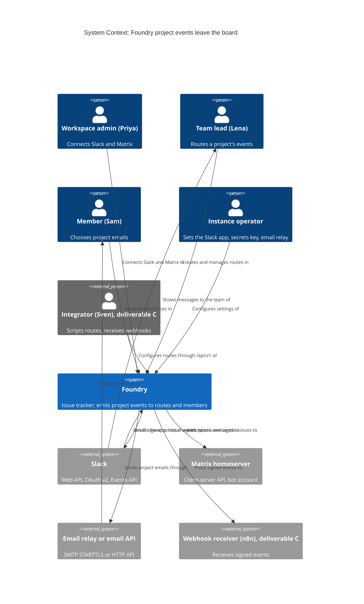
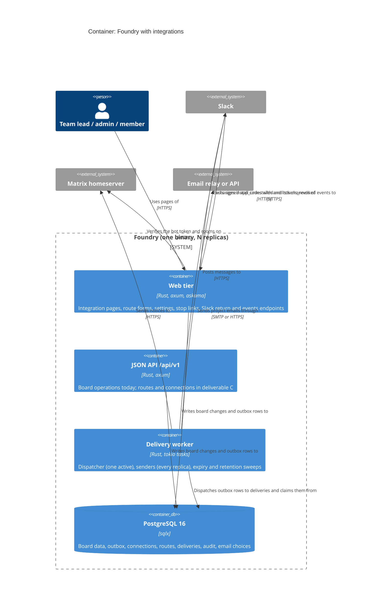
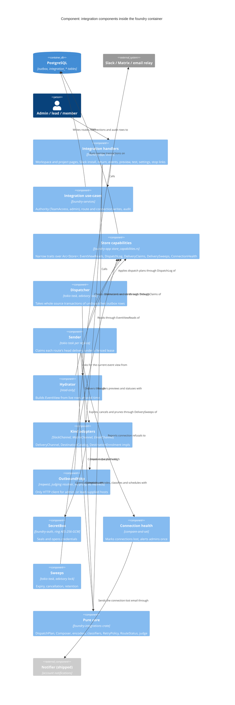

<!-- markdownlint-disable MD024 -->
# Feature Delta: external-integration-plugins

Foundry tells the outside world what happens on a project. A workspace connects
its Slack (through a Foundry Slack app installed with Slack's own approval
screen) and its Matrix homeserver (through a Foundry bot account invited to a
room). A team lead then decides, per project, which events go to which channel
or room and how much each message reveals. Every member decides, per project,
which events Foundry emails them. The same configuration is available through
`/api/v1`. Later slices add the two doors for custom integrations such as n8n:
signed outbound webhooks, and Foundry as an OAuth provider so a third-party app
gets scoped, revocable access without anyone pasting a machine token into it.

Today Foundry sends five account emails (invites, password reset and change,
member removed) through instance-wide providers set in environment variables.
No project event leaves the board.

## Wave: DISCUSS

Product owner: Luna (nw-product-owner) | Date: 2026-10-21 | Feature type:
cross-cutting (web UI, `/api/v1`, background delivery, three external systems)
| Walking skeleton: evaluated (brownfield) and adopted, slice 01: one project
event to one Slack channel through the Slack app, end to end | UX depth:
comprehensive (three journeys with emotional arcs) | JTBD: yes, three new jobs
| Density: lean, Tier-1 [REF] | Requirements readiness: clear in the user's
head, nothing written; the user locked Slack and Matrix as official app installs
and the orchestrator applied "OAuth app in scope, later slice" as a default (OD-2).

### [REF] Prior Wave Consultation

| Artifact | Status | Note |
|---|---|---|
| `crates/foundry-app/src/notify.rs` | ✓ | `NotificationProvider` (`deliver`, `kind`, `probe`), `ProviderKind {Log, Smtp, Webhook, EmailApi}`, a closed `NotificationEvent` of five **account** events (`password_reset`, `workspace_invite`, `member_invite`, `member_removed`, `password_changed`), each with ONE named recipient. `Notifier::notify` fans out inline, inside the request, to **every** provider configured by `NOTIFICATION_PROVIDERS`, bounded by a 5 s timeout, best-effort at-most-once. There is no per-project, per-destination or per-event routing. The shipped `WebhookProvider` is instance-wide, set by `WEBHOOK_URL`, and its body carries account notification bodies (a reset link included). |
| `docs/feature/notification-delivery-providers/` (discuss, design ADR-001..007, distill, slices) | ✓ | ADR-001 structured vendor-neutral notification that each provider renders; ADR-002 env config, wire then probe then use; ADR-003 infallible, never fails the request; ADR-004 bounded metric labels; ADR-005 closed catalogue; ADR-006 `SecretString`, no `Debug`, nothing secret in logs or errors; ADR-007 best-effort at-most-once, no retry, outbox named as the deferred durable backing. All inherited below; ADR-007 is **changed for routes** ([WHY] Changed Assumptions CA-1). |
| `docs/feature/recipient-notification-preferences/` | ✓ | Shipped: the per-workspace opt-out (`notification_unsubscribes`, migration 0014), the signed `/unsubscribe` link (RFC 8058 one-click), the suppression gate at the top of `notify()`, the rule that security events (`password_reset`, `password_changed`, `member_removed`) can never be suppressed, and the signed-in `/account/notifications` status page and resubscribe. Its recipient Sam Okafor is reused (with his Backend identity from team-membership). |
| `docs/feature/notification-preferences-ui/` (feature-delta, discuss/requirements, design, distill) | ✓ partial | **Not finished.** `show_settings` and `mute_notifications` exist in `crates/foundry-app/src/unsubscribe.rs`, and `GET /account/settings` and `POST /account/settings/mute` are mounted in `lib.rs:560-563`, but all 12 scenarios in `notification-preferences-ui.feature` are still `@pending`, there is no `deliver/` record and no CHANGELOG entry. Its requirements put "per-event granularity" out of scope. **Decision D-9: depend on it and extend it, not supersede it.** `/account/settings` hosts the new project-email section; the per-workspace mute stays as the master switch. Finishing its DELIVER (un-pend the 12 scenarios, CHANGELOG) is a pre-requisite of slice 05. |
| Outbox and realtime (`migrations/0003_outbox_notify.sql`, `foundry-realtime::EventPayload`, `foundry-store` writers) | ✓ | Events written today, in the same transaction as the change: `IssueCreated` (`insert_issue_with_outbox`), `IssueUpdated` (lane move and in-lane reorder, `reposition_issue_with_outbox`, and the lane-delete MoveCards fate), `IssueDeleted` (`delete_issues_with_outbox`, one row per card, also N rows for a lane delete with DeleteCards), `CommentAdded`, `CommentEdited`, `CommentDeleted`. The outbox is fire-and-forget: the trigger NOTIFYs and nothing ever sets `notified_at` (`count_pending_outbox` equals the row count). Title and description edits write `issue_change_events` but **no outbox row** (`update_issue_details`, ODD-4). See [REF] Event Catalogue and Risk R3. |
| `migrations/0001_init.sql` `issues.assignee_id`, `issues.priority` | ✓ | Both columns exist; no web, service or API code writes or reads them (zero matches in `foundry-app`, `foundry-services`, `foundry-api`). **There is no assignment in Foundry**, so "issue assigned" is not in the catalogue (D-2). |
| Machine tokens (`migrations/0007`, `/admin/tokens`, `foundry-api`, CHANGELOG v0.15-v0.17) | ✓ | EdDSA JWT, `jti` registry with revoke flag, optional `scope_team_id`, minted only by a signed-in workspace admin at `/admin/tokens`; the token acts as its `user_id`. No per-action scopes (read vs write). `check_api_no_mint_route` forbids a mint route in `/api/v1`. This is the mechanism the OAuth slice extends (slice 08, OD-2, OD-14). |
| `crates/foundry-api/openapi.json` and the check-arch rules `api-openapi-operations`, `api-openapi-statuses` (v0.17.0) | ✓ | Any new `/api/v1` operation (slice 06) must be described in the same change, or CI fails. |
| `docs/product/architecture/brief.md` | ✓ | Ports and adapters, trait-injected effects, composition root `main.rs`; three credential classes kept apart (`check_jwt_alg_pin` EdDSA, `check_oidc_alg_pin` RS256); `TeamAccess::of(is_admin, Option<TeamRole>)` = `None | View | Manage` is the one authority policy; uniform non-enumerable 404; GET dialog + POST confirm for destructive actions; `csrf_middleware`; append-only audit records (`workspace_rename_events`, `team_lifecycle_events`, `project_lifecycle_events`); projects soft-delete and restore. |
| `docs/product/jobs.yaml` | ✓ | No job covers telling people outside the board. Three jobs appended (see [REF] JTBD). |
| `docs/product/personas/persona-instance-operator.yaml` | ✓ | Priya Raman's cluster runs "Grafana, Portainer, ArgoCD **and Element**", so a Matrix homeserver on her cluster is evidenced. Nothing establishes Slack use; Slack examples are example data (see [REF] Personas). Sven Aarø (`persona-api-integrator`) is reused. Not edited here (write scope); follow-up F-6. |
| `docs/feature/team-membership/feature-delta.md` | ✓ | Supplies Lena Park (lead of Backend, workspace `member`), Sam Okafor (Backend member, `sam.okafor@canzan.dev`) and Tomás Rivera (`tomas.rivera@canzan.dev`). |
| `docs/product/journeys/journey-api-openapi-document.yaml` | ✓ | Style reference for the new journey file. |
| `docs/feature/api-openapi-document/feature-delta.md`, `slices/*.md` | ✓ | Style reference for this file and the slice briefs. |
| `docs/product/vision.md`, `docs/project-brief.md`, `docs/stakeholders.yaml` | ⊘ | Do not exist. |
| `docs/feature/external-integration-plugins/discover/`, `diverge/` (`recommendation.md`, `job-analysis.md`) | ⊘ | Do not exist. **Recorded risk R1**: the jobs are grounded in the user's request, the locked decisions and code reading, not interviews. |

### [REF] Inherited Commitments

| Origin | Commitment | DDR | Impact |
|---|---|---|---|
| notification-delivery-providers ADR-001 | The port carries a structured, vendor-neutral notification; each channel renders it | n/a | Each integration kind renders the same structured project event its own way (Block Kit, Matrix formatted body, email, JSON). One event, many renderings. |
| notification-delivery-providers ADR-003 / NFR-5 | Delivery never fails or stalls the originating request | n/a | Strengthened to D-5: route and email delivery happens after the action commits, never inside it. A board action's latency is a guardrail KPI (EIP-KPI-4). |
| notification-delivery-providers ADR-004 | Metric labels come from closed enums only | n/a | New delivery metrics are labelled by integration kind, event and outcome only. Never a channel, room, project, URL or person. |
| notification-delivery-providers ADR-005 | The event catalogue is closed | n/a | The routable catalogue (D-2) is closed and versioned; adding an event is a decision, not a side effect. |
| notification-delivery-providers ADR-006 | Secrets are `SecretString`, never logged, never in errors or debug output | n/a | Extended to every new credential: Slack bot token, Matrix access token, webhook signing secret, OAuth client secret, OAuth tokens (SC-3). |
| notification-delivery-providers ADR-007 | Best-effort, at-most-once, no retry | n/a | **Changed for routes and project emails** (CA-1, OD-7): queued, retried up to 24 h, at-least-once with a stable event id. Account notifications keep ADR-007 unchanged. |
| notification-delivery-providers ADR-002 | Providers are configured by environment, probed at boot | n/a | The email transport stays operator-configured. The Slack app's credentials are operator-configured (OD-3). Connections a workspace admin makes are stored per workspace, not in env (CA-4). |
| recipient-notification-preferences ADR-003 / NFR-3 | Security events are never suppressible; the workspace mute suppresses the rest | n/a | Project event emails are suppressible: a muted workspace sends none (D-14). Security emails are untouched. |
| recipient-notification-preferences ADR-001/002 | Signed one-click unsubscribe, prefetch-safe GET plus POST confirm, RFC 8058 | n/a | Every project event email carries a signed stop link for that one choice, with the same safety rules (US-EIP-11). |
| notification-preferences-ui FR-1, FR-4 | `/account/settings` hosts notifications; signed-in per-workspace mute | n/a | Hosts the "Project emails" section (US-EIP-10). Pre-requisite: its 12 scenarios un-pended (D-9). |
| token-management-api no-mint boundary, `check_api_no_mint_route` | `/api/v1` never mints a credential | n/a | Route configuration through the API mints no machine token. A webhook signing secret is not an API credential, but DESIGN confirms the boundary holds (OD-14). OAuth token issuance lives outside `/api/v1`. |
| brief.md, credential classes and `check_jwt_alg_pin` | Three credential classes, each with an algorithm pin | n/a | OAuth-granted access is a fourth way to reach `/api/v1`. It must be pinned and kept apart like the others (slice 08, SC-8). |
| brief.md, `TeamAccess` | One authority policy: None, View, Manage | n/a | Route configuration needs Manage on the project's team (lead or workspace admin). Connections and apps need workspace admin (D-4). |
| web-provisioning-flow and every page since | Uniform non-enumerable 404 for anyone without access | n/a | Every new page and API operation answers the same 404 to a caller who may not see it. |
| brief.md, `csrf_middleware`, ADR-ISSUE-DELETE-002 | State-changing forms are CSRF-checked; destructive actions are GET dialog plus POST confirm that counts consequences | n/a | Deleting a route, disconnecting, deleting an app and revoking a grant each use a counting confirm. |
| brief.md, audit records | Append-only actor, what, when records for lifecycle changes | n/a | Connection, route, app and grant changes are recorded the same way (D-16). |
| project-lifecycle, soft delete | A deleted project answers nowhere; restore is exact | n/a | A deleted project's routes and emails send nothing; a restore resumes them as they were (D-8). |
| api-openapi-document D3, check-arch `api-openapi-*` | The OpenAPI document is true, enforced by CI | n/a | Slice 06's operations are documented in the same change. |
| ADR-ISSUE-DELETE-001 | One delete primitive writes one `IssueDeleted` per card | n/a | A lane deleted with 7 cards produces 7 events; D-11 turns a burst into one message. |
| canzan-theme-system, api-openapi-document (CSP posture) | No inline scripts; nothing from another origin | n/a | New pages follow the same posture; Slack's approval screen is a top-level navigation, not an embed. |
| Memory: containerised dev dependencies | Never host installs; pin images | n/a | Test doubles for Slack and Matrix are a fake HTTP service and a pinned homeserver container (Technical Notes). |

### [REF] Personas

- **Priya Raman** (`persona-instance-operator`): workspace admin of Canzan Labs, lead of team Backend, instance super-admin and operator. She does the one-time operator setup (the Foundry Slack app's credentials, the Matrix bot account, email transport) and connects the workspace's Slack and Matrix. Her cluster runs Element (persona file), so a homeserver at `matrix.canzan.dev` is a reasonable example. **Slack use is not established by any prior wave**; the Slack workspace "Canzan Labs" (`canzanlabs.slack.com`) is example data.
- **Lena Park** (team-membership, inline): lead of Backend, a workspace `member`, not admin. The **project admin persona**: she wires Identity Platform (AUTH) to `#auth-dev` and to `#auth:canzan.dev`. Characteristics beyond her role are not established.
- **Sam Okafor** (recipient-notification-preferences, team-membership): Backend member, `sam.okafor@canzan.dev`. The **member managing his email persona**. He files and comments on AUTH issues and does not watch the board all day (the reason he wants email at all).
- **Sven Aarø** (`persona-api-integrator`): the **developer/operator building a custom integration**. Scripts against `/api/v1`; here he configures routes by API, points a webhook at n8n and connects n8n through OAuth. On this single-operator instance he is often Priya.
- **Marco** (`persona-team-member-foil`): signed in, wrong team. Gets the uniform 404 everywhere new.
- **Tomás Rivera** (team-membership): a Backend member who is removed from the team in US-EIP-11's example.

### [REF] JTBD

Three jobs, one per actor. They share an event catalogue and a delivery engine but
not a situation, so each is its own entry in `docs/product/jobs.yaml`.

**`job-route-project-events-to-chat`** (Lena, Priya). *When something happens on a
project my team works on (a new issue, a card reaching Done, a comment), I want it
to show up in the Slack channel or Matrix room where the team already talks, with
just enough to act on and nothing it should not reveal, so nobody has to keep the
board open to find out, and I can decide in one place what goes where.*

**`job-choose-my-project-emails`** (Sam). *When I am not looking at the board, I
want Foundry to email me about exactly the project events I chose, and to stop the
moment I say so or lose access, so I hear about the comments and moves that
concern me without an inbox full of everything else.*

**`job-grant-custom-integration-access`** (Sven, Priya). *When I want Foundry to
drive or be driven by my own automation (an n8n workflow, a script, a tool nobody
has built a plugin for), I want to receive Foundry's events as signed requests and
to grant the tool scoped access I can see and revoke, so I can build any
integration without handing it my own machine token or waiting for Foundry to
ship one.*

Four forces (details in `jobs.yaml`):

| Force | Route to chat | My project emails | Custom integration access |
|---|---|---|---|
| Push | No project event leaves the board. The only outbound channels are instance-wide env providers carrying account emails. | Foundry emails only invites and password events. To hear about a comment, Sam must open the issue. | The only programmatic door is a machine token minted by an admin and pasted into the tool: all-or-nothing within a team, shared by whatever holds it, no events pushed. |
| Pull | "Add to Slack", pick a channel, see the first message; the same for a Matrix room. | A per-project list of checkboxes in settings, and a stop link in every email. | A webhook with a signing secret, and an OAuth consent screen the way every other service the cluster runs offers. |
| Anxiety | A channel full of noise; an issue title leaking to people not on the team; a broken connection that fails silently; a Slack credential in a log. | Spam; emails about a project after being removed from it; no way to stop. | A webhook used to reach internal services; a third-party app holding more access than intended, or keeping it after revoke. |
| Habit | Opening the board; telling teammates in chat by hand. | Inbox rules; checking the board. | `curl` with a pasted machine token; n8n polling the API. |

Opportunity (importance × satisfaction, user's request and code reading, no
interviews):

| Job | Importance | Satisfaction today | Note |
|---|---|---|---|
| job-route-project-events-to-chat | high | none | First-named in the request (Slack, Matrix). No path exists at all. |
| job-choose-my-project-emails | high | low | Email exists for account events only; per-workspace mute is the only control. |
| job-grant-custom-integration-access | medium | low | Machine tokens work but are coarse and pull-only. The user wants it "in the future"; OD-2. |

### [REF] Scope Assessment: OVERSIZED (16 stories, 6 contexts, about 27 days)

| Oversized signal | Fired? | Evidence |
|---|---|---|
| More than 10 user stories | **Yes** | 16 |
| More than 3 bounded contexts | **Yes** | integration configuration, event delivery, Slack adapter, Matrix adapter, member email preferences, authorization server (OAuth) |
| Walking skeleton needs more than 5 integration points | No | 5: the outbox events, a connection store, Slack OAuth, Slack's post API, the route page |
| More than 2 weeks of effort | **Yes** | about 27 days (slice table) |
| Multiple independent outcomes | **Yes** | chat routing, member email, custom integrations each ship value alone |

Four of five signals fire. **Proposal (OD-1): one event and plugin model, three
deliverables**, each under two weeks and each shippable alone:

| Deliverable | Slices | Outcome | Est. |
|---|---|---|---|
| A. Chat routing on Slack (this feature id) | 01, 02, 03 | A team hears about its project in Slack, and trusts it when it breaks | about 10 d |
| B. Matrix and member email (could stay here, or become `project-event-email`) | 04, 05 | The same routes to Matrix; members choose their emails | about 7 d |
| C. Custom integrations (recommended: new feature `integration-webhooks-and-oauth-apps`) | 06, 07, 08 | API configuration, signed webhooks, Foundry as OAuth provider | about 10 d |

The model (D-1), the event catalogue (D-2) and the content rules (D-3) are
designed once, in deliverable A's DESIGN, so B and C add kinds rather than rework.
This document specifies all three so the model is designed against every known
consumer. **Handoff condition: until the user answers OD-1, DESIGN takes slices
01-03 only** (deliverable A passes the gate alone: 7 stories, 3 contexts, about
10 days). See [REF] DoR Validation.

### [REF] Product Model (D-1)

| Term | Meaning | Who owns it | Lives at (proposal) |
|---|---|---|---|
| **Integration kind** | A kind of outside system Foundry can talk to: `slack`, `matrix`, `email`, `webhook`; later `oauth_app`. Each kind states how it connects, how it checks a destination, how it renders an event and how it classifies a failure (the plugin contract). | Foundry (code) | the plugin trait (DESIGN) |
| **Connection** | One workspace's authorised link to one outside system: a Slack install, a Matrix bot login. Holds the secret. One per kind per workspace in v1 (D-7). | Workspace admin | `/workspace/integrations` |
| **Route** | Per project: "these events, filtered thus, go to this destination, revealing this much". Destination is a Slack channel, a Matrix room or a webhook URL. | Team lead or workspace admin | `/team/{team}/project/{project}/integrations` |
| **Email choice** | Per member, per project: which events Foundry emails *me*, and for which issues. | The member | `/account/settings` |
| **Delivery** | One attempt history of one event to one route or one inbox: when, outcome, reason, attempts. | Foundry | route history page |
| **App** (slice 08) | A third-party client registered in a workspace: name, redirect addresses, the scopes it may ask for. | Workspace admin | `/workspace/apps` |
| **Grant** (slice 08) | A member's consent that an app may act as them, within chosen scopes and teams. | The member (revocable by an admin) | `/account/apps`, `/workspace/apps` |

### [REF] Event Catalogue (D-2)

What Foundry emits today, verified in code, and what each kind carries in v1.

| Event (product name) | Source today | Chat routes v1 | Project email v1 | Webhook v1 |
|---|---|---|---|---|
| `issue.created` "New issue" | outbox `IssueCreated` | yes | yes | yes |
| `issue.moved` "Issue moved" (optional filter: only into chosen lanes) | outbox `IssueUpdated` with a lane change | yes | yes | yes |
| `issue.reordered` (position within a lane) | outbox `IssueUpdated`, same lane | **no** (noise) | no | no |
| `issue.deleted` "Issue deleted" | outbox `IssueDeleted` | yes | yes | yes |
| `comment.added` "New comment" | outbox `CommentAdded` | yes | yes | yes |
| `comment.edited`, `comment.deleted` | outbox `CommentEdited`, `CommentDeleted` | no (an edit would re-post; a Slack message cannot be recalled by Foundry) | no | yes |
| `issue.edited` (title, description) | `issue_change_events` only, **no outbox row** (ODD-4) | no, follow-up F-1 | no | no |
| Issue assigned | **does not exist**: `assignee_id` has no writer | n/a | n/a | n/a |
| Member added to or removed from a team or workspace | team writes, `member_removed` account email | no, follow-up F-2 | no | no |
| Project renamed, deleted, restored | `project_lifecycle_events` | not routed; a rename shows the new name in later messages; delete and restore pause and resume (D-8) | same | same |

Every event carries a stable **event id** so a receiver can recognise a repeat
(at-least-once, OD-7).

### [REF] Content Rules (D-3)

Three content levels per route, chosen by the person creating the route:

| Level | Carries | Default |
|---|---|---|
| **Link only** | issue key, project name, event word, link | |
| **Summary** | plus title, actor's display name, lane (and from → to for a move) | **yes** (OD-6) |
| **Summary with comment text** | plus the first 300 characters of the comment as plain text, for `comment.added` | |

**Never sent, at any level, to any kind**: an issue's description, attachments or
their names, any email address (people appear by display name; a member without
one appears as "A Foundry member"), any token, secret or internal id other than
the issue key and the event id, anything from another project.

**Never pings**: text from Foundry users (titles, comment text, lane names) is
sent so it cannot mention or notify: Slack `<!channel>`, `<!here>`, `<!everyone>`,
`<@U…>` and `@channel` forms, and Matrix `@room` and user pills, arrive as inert text.

**Links**: "Open in Foundry" points at the issue's full page. Opening it needs a
Foundry session and the usual access; anyone else gets the uniform 404. A deleted
issue's message has no link.

**Bursts (D-11)**: one action that produces more than 5 events of the same kind for
the same route (a lane deleted with its cards, a lane delete moving cards) posts
one message: "7 issues deleted from Identity Platform by Lena Park".

### [REF] Who May Do What (D-4)

| Action | Instance operator | Workspace admin | Team lead (Manage) | Team member | Anyone else |
|---|---|---|---|---|---|
| Register the Foundry Slack app's credentials, create the Matrix bot account, set up email transport | yes (once per instance) | | | | |
| Connect, reconnect or disconnect Slack or Matrix | | yes | no | no | uniform 404 |
| Create, edit, pause, delete a project's routes; see their delivery history | | yes, any project | yes, own team's projects | no (uniform 404) | uniform 404 |
| Choose own project emails | | own | own | own | n/a |
| Configure routes through `/api/v1` | | with a token acting as them | with a token acting as them | no | uniform 404 |
| Register, edit or delete an app | | yes | no | no | uniform 404 |
| Grant an app access to act as me | | yes | yes | yes | n/a |
| Revoke a grant | | any in the workspace | own | own | n/a |

### [REF] Copy (D-13, locked; DESIGN may change paths, not strings)

- K-1 Connected: "Connected to {slack_team} ({slack_domain}) · by {admin_name} · {date}"
- K-2 No Slack app on the instance: "Slack is not set up on this Foundry yet. An instance operator adds the Foundry Slack app once. How to set up Slack"
- K-3 Approval cancelled or forged: "Slack was not connected. Nothing changed."
- K-4 Lead with no connection: "This workspace has no chat connection yet. Ask a workspace admin to connect Slack or Matrix."
- K-5 Audience notice: "Everyone who can read {destination} will see what this route sends. Foundry cannot check who that is."
- K-6 Shared channel: "{destination} is shared with another organisation. Tick to confirm that is intended."
- K-7 Test message: "Test message from Foundry for {project_name} ({key_prefix}). This route will post here."
- K-8 Message lines (Summary): new issue "{key} {title}" / "New issue in {project_name} by {actor} · {lane}"; moved "{key} {title}" / "Moved {from_lane} → {to_lane} by {actor} · {project_name}"; comment "{key} {title}" / "{actor} commented · {project_name}"; deleted "{key} {title}" / "Deleted by {actor} · {project_name}"; button "Open in Foundry".
- K-9 Route status: "Delivering" · "Retrying: {reason}" · "Paused" · "Paused: connection lost" · "Paused: Slack was disconnected" (or "Matrix was disconnected", deliberate) · "Paused: the app's access was revoked" · "Needs attention: {reason}".
- K-10 Disconnected banner: "Foundry lost its Slack connection for {workspace_name}: {reason}. Routes are paused. Reconnect"
- K-11 Secret shown once: "Copy it now. Foundry will not show it again."
- K-12 Email footer: "You get this because you chose {event} for {scope} in {project_name}. Stop these emails · Change what you get"
- K-13 No email transport: "This Foundry cannot send email yet. An instance operator needs to set up email delivery."
- K-14 Matrix not invited: "Invite {bot_user} to {room} in your Matrix client first, then try again."
- K-15 Matrix encrypted room: "{room} is end-to-end encrypted. Foundry's bot cannot post to encrypted rooms yet. Choose an unencrypted room."
- K-16 Refused webhook address: "Foundry will not send to this address."
- K-17 Consent heading: "{app_name} wants to act as you in {workspace_name}"

### [REF] Open Decisions (each has a recommended answer; the stories assume it)

- **OD-1: Split the feature into three deliverables?** (all) *Recommended: yes*, as in [REF] Scope Assessment: A (01-03) here, B (04-05) here or as `project-event-email`, C (06-08) as `integration-webhooks-and-oauth-apps`. DESIGN models all kinds once in A. If declined, the feature runs about 27 days in one directory.
- **OD-2: Custom integrations: in scope, later slice** (orchestrator default, the user did not answer). *Recommended: keep as default*: model events and the plugin contract for webhooks and apps now; ship webhooks (07) and Foundry-as-OAuth-provider (08) after the three built-ins. The user may overturn: drop 08 (machine tokens remain the door), or pull 07 earlier (it is the cheapest path to n8n).
- **OD-3: Where do the Foundry Slack app's credentials live?** (US-EIP-01) A Slack app's approval screen returns to one fixed address, so every self-hosted instance needs **its own** Slack app. *Recommended: the operator creates it in Slack from a manifest Foundry publishes, and sets its client id, client secret and signing secret as environment settings* (like `SMTP_*`, ADR-002), validated at boot. `/workspace/integrations` shows K-2 when they are absent. Alternative: an instance-admin form that stores them (more UI, a stored instance secret).
- **OD-4: Where does the Matrix bot's login live?** (US-EIP-08) *Recommended: a workspace admin enters the homeserver address and the bot's access token in `/workspace/integrations`* (uniform with Slack from the admin's point of view; the operator only creates the bot account). Alternative: environment settings, one bot for the whole instance.
- **OD-5: Encrypted Matrix rooms.** (US-EIP-09) Element creates private rooms encrypted by default. *Recommended: v1 refuses an encrypted room with K-15*; supporting encryption is follow-up F-3. Alternative: build encryption support now (large, new key-storage concerns).
- **OD-6: Default content level.** (US-EIP-04) *Recommended: Summary*: key, title, actor, lane, link; no comment text unless chosen. Alternative: Link only by default (safest, least useful).
- **OD-7: Delivery semantics for routes and project emails.** (US-EIP-05) *Recommended: queued after commit, retried with backoff for up to 24 hours (honouring Slack's and the homeserver's "retry after"), at-least-once: a rare repeat is possible, a silent loss is not*; every delivery is in the history. This changes ADR-007 for these kinds only (CA-1). Alternative: keep at-most-once (simpler; a Slack blip drops messages unseen).
- **OD-8: Email cadence.** (US-EIP-10) *Recommended: one email per event in v1*; a daily digest is follow-up F-4.
- **OD-9: Can plain members see a project's routes?** *Recommended: no in v1* (Manage only, D-4). Follow-up F-5 if members ask "where does this post?".
- **OD-10: Default project email choices for a member.** (US-EIP-10) *Recommended: nothing on by default*; the settings page invites Sam to choose. Consistent with "no unsolicited email". Alternative: "New comments on issues I created or commented on" on by default.
- **OD-11: Email me about my own actions?** *Recommended: never in v1* (Sam does not get an email about his own comment). Not configurable.
- **OD-12: Secrets at rest.** (US-EIP-01, -08, -13, -14) For the first time Foundry stores outside credentials in its database (CA-4). *Recommended: a database dump or backup alone must not yield a usable credential*, which implies a new operator-held key setting, required once any connection exists. DESIGN picks the mechanism.
- **OD-13: Which webhook addresses are allowed?** (US-EIP-13) Priya's n8n is on her private network, which is also what an attacker would aim a webhook at. *Recommended: always refuse loopback, link-local and cloud metadata addresses; refuse private-network addresses unless the operator lists allowed hosts or ranges in a setting*. Alternative: allow everything (simplest; a team lead could probe the cluster).
- **OD-14: Does a webhook signing secret, or OAuth issuance, cross the no-mint boundary?** (US-EIP-12, -13, slice 08) *Recommended: no for the webhook secret* (it authenticates Foundry to the receiver, it opens no Foundry door), so the API may return it once on create; *OAuth tokens are issued only at the OAuth endpoints outside `/api/v1`*, keeping `check_api_no_mint_route` unchanged. DESIGN confirms.
- **OD-15: OAuth scopes.** (US-EIP-14, -15) *Recommended: three*: `issues:read` (list issues, history, comments), `issues:write` (create, move, comment), `routes:manage` (configure routes and webhooks in projects the member manages). Finer scopes are follow-up.

### [REF] User Decisions (2026-10-21)

The user accepted every recommendation ("accept all"), and accepted the four
post-review fixes in [REF] Peer Review without a third review.

- **OD-1 yes.** Deliverable A (slices 01-03) and B (04-05) stay under this feature id; deliverable C (06-08) moves to its own feature, `integration-webhooks-and-oauth-apps`, when its turn comes. Its slices stay specified here until then. DESIGN models D-1, D-2 and D-3 for every kind now, and plans slice-level work for A first, then B.
- **OD-2** keep: custom integrations in scope as the later deliverable C.
- **OD-3** operator-created Slack app from a Foundry manifest; credentials in env settings, validated at boot.
- **OD-4** workspace admin enters homeserver and bot token in `/workspace/integrations`.
- **OD-5** refuse encrypted Matrix rooms in v1 (K-15).
- **OD-6** Summary is the default content level.
- **OD-7** at-least-once, queued after commit, retried up to 24 h (CA-1).
- **OD-8** one email per event.
- **OD-9** plain members cannot see routes.
- **OD-10** no project email choices on by default.
- **OD-11** never email people about their own actions.
- **OD-12** a dump or backup alone yields no usable credential; new operator-held key setting.
- **OD-13** refuse loopback, link-local and metadata always; private ranges only via an operator allow-list.
- **OD-14** webhook secret does not cross no-mint; OAuth tokens only outside `/api/v1`.
- **OD-15** three scopes: `issues:read`, `issues:write`, `routes:manage`.

### [REF] Journeys (summary; full: `docs/product/journeys/journey-external-integration-plugins.yaml`)

**Journey 1, route project events to chat (Priya, then Lena).** Arc: *Confidence
Building*, from wary (will this spam the team or leak a title?) through in control
(the preview shows exactly what goes out; the test message lands) to relieved (the
team hears about AUTH-12 without anyone opening the board), and, when Slack breaks,
reassured rather than betrayed (the route says what broke and one reconnect fixes it).

```text
[Where]                                    [Does]                                   [Sees]                                                              [Feels]
/workspace/integrations (Priya)            Add to Slack → approves on Slack         K-1 "Connected to Canzan Labs (canzanlabs.slack.com) · by Priya…"   curious → assured
/team/backend/project/auth/integrations    New route → Slack → #auth-dev            K-5 audience notice; events: New issue; content: Summary; preview   wary → in control
  (Lena)                                   Send test                                K-7 lands in #auth-dev within seconds                               in control → confident
Slack #auth-dev (team)                     Sam files AUTH-12                        "AUTH-12 Rotate LLDAP bind password / New issue in Identity…"      relieved
/team/backend/project/auth/integrations    (Slack app removed by a Slack admin)     K-9 "Paused: connection lost"; Priya gets the K-10 email           alarmed → reassured
/workspace/integrations (Priya)            Reconnect                                routes resume; queued events under 24 h delivered; history shows it relieved
Element #auth:canzan.dev (Lena)            invites @foundry:canzan.dev; adds route  formatted notice from the bot                                       confident
```

**Journey 2, choose my project emails (Sam).** Arc: *Problem Relief*, from
overlooked (he finds out about Lena's comment days late) through deliberate (one
row of checkboxes per project) to calm (he gets the two kinds of email he chose,
each saying why, each with a stop link).

```text
/account/settings (Sam)          Project emails → Identity Platform: New comment, "issues I created or commented on"   "Saved. Foundry will email sam.okafor@canzan.dev about: …"   deliberate
inbox                            Lena comments on AUTH-7 (Sam created it)                                             "[AUTH-7] Lena Park commented: Move Grafana sign-in to Keycloak" + K-12  informed
inbox → stop page                Stop these emails → Confirm                                                          "Stopped: New comment in Identity Platform."                 in control
(Sam removed from Backend)       Lena comments again                                                                  no email                                                     (unaware, correctly)
```

**Journey 3, grant custom integration access (Priya, Sven).** Arc: *Confidence
Building*, from cautious (handing a tool a key) through informed (the consent page
says in plain words what n8n may do, as whom, where) to in charge (Priya sees every
grant and one revoke ends it within a minute).

```text
/workspace/apps (Priya)          Register app "n8n homelab", redirect, scopes       client id; secret once with K-11                                cautious → prepared
n8n → /oauth/authorize (Sven)    Connect                                            K-17 consent: Read issues, Create issues and comments, Backend  informed
n8n                              Allow → workflow runs                              201 issue AUTH-31 created as Sven; webhook event arrives signed  confident
/workspace/apps (Priya)          Revoke                                             "Revoked. n8n homelab can no longer act as Sven Aarø."          in charge
```

Error paths covered per step are in the journey file's `failure_modes` and in each
story's examples.

### [REF] Shared Artifacts

| Artifact | Source of truth | Consumers | Risk |
|---|---|---|---|
| `${event_catalogue}` | D-2 (closed list; DESIGN names the enum) | route event checkboxes, email choices, webhook `type`, API `events` field, metrics labels, openapi.json | HIGH: a name differing between UI, API and webhook breaks integrations |
| `${issue_key}`, `${title}`, `${lane}` | issues and lanes in the store, read at delivery | Slack and Matrix messages, emails, webhook payload | MEDIUM: rename between event and delivery shows the current name (D-8) |
| `${actor}` display name | users | messages, emails | MEDIUM: never the email address (D-3) |
| `${connection_status}` | the connection record | `/workspace/integrations`, every route row's status, K-10 email, API `status` | HIGH: one source, or a route says "Delivering" while the connection is gone |
| `${destination}` | the route record (Slack channel id plus name at save; Matrix room id plus alias) | route row, K-5/K-6, history, API | MEDIUM: a channel renamed in Slack keeps working by id; the name shown refreshes |
| `${bot_user}` | the Matrix connection (`whoami` answer) | K-14, connection row | LOW |
| `${slack_team}`, `${slack_domain}` | Slack's install answer | K-1, K-10 | LOW |
| `${event_id}` | assigned once per event | webhook payload and header, delivery history, dedup | HIGH: must be stable across retries |
| Secrets (bot token, access token, signing secret, client secret) | the connection or app record, write-only | delivery adapters only | HIGH: never rendered, logged or returned after creation (SC-3) |
| `${foundry_issue_url}` | the instance's public base address and the issue's slugs | "Open in Foundry" in every kind | MEDIUM: must use slugs, never names (brief.md slugs rule) |
| `${email_choice}` | the member's choices per project | settings page, K-12 footer, stop link | HIGH: the footer must describe the choice that caused the email |
| `${member_email}` | `users.email` of the signed-in member | saved confirmation, the email's recipient | LOW |
| `${admin_name}`, `${date}` | the connection record's actor (display name) and creation date | K-1, connection row, audit activity | LOW |
| `${project_name}`, `${key_prefix}` | projects (name is a label, read at delivery; key prefix immutable) | K-7, K-8, K-12, webhook `project` | MEDIUM: a rename shows the new name (D-8) |
| `${client_id}` | the app registration | apps page, consent request, activity | LOW |
| `${client_secret}` | the app registration, **write-only** (SC-3) | shown once at registration or rotation, then nowhere | HIGH: must never be rendered again |
| `${scope_catalogue}` | OD-15 | registration form, consent wording, per-request access check, API description | HIGH: consent wording must mean exactly what the check enforces |

### [REF] Story Map

User: the team that works a project (Lena configures, Sam receives, Priya
connects, Sven automates). Goal: hear about project events where you already
are, and only those.

Backbone: **Connect a system → Route events → Shape the message → Receive →
Trust and repair → Own my inbox → Automate it**

| | Connect a system | Route events | Shape the message | Receive | Trust and repair | Own my inbox | Automate it |
|---|---|---|---|---|---|---|---|
| **Walking skeleton (slice 01)** | Add to Slack (US-EIP-01) | one route, New issue, one channel (US-EIP-02) | fixed Summary | Block Kit message in the channel; route shows last delivery | the action is never slowed (US-EIP-02) | | |
| **Release A, slice 02** | | all v1 events, lane filter (US-EIP-03) | levels, preview, never-sent, no pings (US-EIP-04) | | | | |
| **Release A, slice 03** | reconnect (US-EIP-06) | pause, edit, delete, disconnect (US-EIP-07) | | | history and retries (US-EIP-05), broken connection (US-EIP-06) | | |
| **Release B, slice 04** | Matrix bot (US-EIP-08) | Matrix room routes (US-EIP-09) | same levels | formatted notice in Element | kicked, encrypted, unreachable | | |
| **Release B, slice 05** | | | | event emails | | choose (US-EIP-10), stop and access (US-EIP-11) | |
| **Release C, slice 06** | | routes by API (US-EIP-12) | | | | | API configuration |
| **Release C, slice 07** | | webhook route (US-EIP-13) | JSON payload | signed request | same history and retries | | n8n webhook trigger |
| **Release C, slice 08** | register app (US-EIP-14) | | | | revoke and audit (US-EIP-16) | | consent and scoped access (US-EIP-15) |

| Slice | Stories | What it adds | Est. | Brief |
|---|---|---|---|---|
| 01 | US-EIP-01, -02 | Walking skeleton: Slack connected, one New-issue route, a real message, the action never slowed | 3 d | `slices/slice-01-slack-walking-skeleton.md` |
| 02 | US-EIP-03, -04 | Every v1 event, lane filters, bursts; content levels, preview, redaction | 3 d | `slices/slice-02-events-and-content.md` |
| 03 | US-EIP-05, -06, -07 | Delivery history and retries; broken connections flagged and fixed; pause, edit, delete, disconnect | 4 d | `slices/slice-03-trust-and-repair.md` |
| 04 | US-EIP-08, -09 | Matrix bot connection and room routes, with Matrix's failure paths | 3.5 d | `slices/slice-04-matrix.md` |
| 05 | US-EIP-10, -11 | Member project-email choices; stop link; access-safe sending | 3.5 d | `slices/slice-05-member-project-email.md` |
| 06 | US-EIP-12 | Routes and connections through `/api/v1`, documented | 2 d | `slices/slice-06-routes-by-api.md` |
| 07 | US-EIP-13 | Signed outbound webhook routes | 2.5 d | `slices/slice-07-signed-webhooks.md` |
| 08 | US-EIP-14, -15, -16 | Foundry as OAuth provider: apps, consent, scoped access, revoke | 5.5 d | `slices/slice-08-oauth-apps.md` |

### [REF] Priority Rationale

1. **01 first, the walking skeleton.** It carries the two riskiest assumptions: that a self-hosted instance can run a Slack app install end to end (each instance owns its own Slack app, OD-3), and that events can be delivered after commit, durably, without touching the action's latency, when the existing outbox is fire-and-forget (R3). If either fails, every later slice changes shape. It is also the first user-visible value (Lena's channel).
2. **02 next, highest value per day.** A route that only knows "New issue" and one fixed text is a demo. Lane filters ("tell #auth-releases when something reaches Done") and the content levels make it the team's tool, and the content rules are the security heart of the feature (D-3), so they must exist before more kinds reuse them.
3. **03 before any new kind.** Integrations fail in the field (uninstalled apps, archived channels, rate limits). History, retries and the broken-connection path are what make the team trust the channel instead of the board. Matrix and webhooks reuse all of it.
4. **04, Matrix.** Second kind the user named, evidenced on Priya's cluster (Element). Low uncertainty after 01-03; its unique risk is encrypted rooms (OD-5).
5. **05, member email.** High importance, but it depends on `notification-preferences-ui` finishing (D-9) and reuses the delivery engine from 01-03. Placed after Matrix because chat routing serves the whole team at once and email serves one member at a time; the user may swap 04 and 05 at no cost.
6. **06-08, custom integrations (OD-2).** 06 is small and makes 07-08 scriptable; 07 is the cheapest path to n8n; 08 is the largest and most security-sensitive (a new authorization server), so it goes last and, per OD-1, as its own feature with its own threat model.

Value × urgency / effort (1-5), **product-owner judgement, not data** (R1: no
interviews or usage data exist; the ordering rests on the risk argument above): 01 = 5×5/3 = 8.3; 02 = 4×4/3 = 5.3; 03 = 4×4/4 = 4.0; 04 = 4×3/3 = 4.0; 05 = 4×3/3 = 4.0; 06 = 2×2/2 = 2.0; 07 = 3×2/2 = 3.0; 08 = 3×2/5 = 1.2. Ties broken by riskiest assumption first (03 before 04/05) and by dependency (06 before 07-08).

Taste tests: every slice changes something a person sees; no slice is
infrastructure only; each slice names what it would disprove (slice briefs).

### [REF] System Constraints

Requirements for DESIGN. They name risks and outcomes, not mechanisms.

- **SC-1 (never slows, never fails the action):** creating, moving, deleting an issue or adding a comment succeeds and answers in its usual time whatever the state of Slack, Matrix, email or a webhook receiver. Delivery happens after the change commits.
- **SC-2 (no event without its change, no change without its event):** an event is offered for delivery exactly when its change commits; a rolled-back change sends nothing; a committed change is never silently dropped (OD-7).
- **SC-3 (secrets):** every outside credential is write-only: never rendered after creation, never in a log line, error, metric, audit record, API response, OpenAPI example or debug output (ADR-006). OD-12 for storage.
- **SC-4 (audience):** a route sends only its own project's events, only at its content level, only to its destination. Text from users never pings (D-3).
- **SC-5 (access at send time):** an email goes only to a member who can see the project when it is sent, not when the choice was made.
- **SC-6 (non-enumerable):** every new page and API operation gives the uniform 404 to anyone without the right, including for connections, routes, apps and grants of other workspaces.
- **SC-7 (shipped behaviour unchanged):** the five account notifications, `NOTIFICATION_PROVIDERS`, the env `WebhookProvider`, the per-workspace mute and `/unsubscribe` behave exactly as before (D-6). The new webhook routes never carry account notifications.
- **SC-8 (credential classes):** OAuth-granted access is a separate class from sessions, machine tokens and Keycloak tokens, with its own algorithm pin and a build-time guard in the shape of `check_jwt_alg_pin` (slice 08).
- **SC-9 (bounded observability):** delivery counters are labelled only by kind, event and outcome (ADR-004).
- **SC-10 (test doubles):** Slack is faked by an HTTP double; Matrix runs against a pinned homeserver container; no host installs, no real Slack in CI (memory: containerised dev dependencies).

### [REF] Non-Functional Requirements

- **NFR-EIP-1 (latency of delivery):** with Slack, the homeserver or the receiver healthy, a routed event's message appears within 10 s at p95 and 60 s at p99 of the change committing (smoke lane with the doubles; dev dogfood with real Slack).
- **NFR-EIP-2 (latency of the action):** with one route per kind active and every destination unreachable, issue create and move answer within 10% of their p95 with no routes, on the smoke lane (EIP-KPI-4).
- **NFR-EIP-3 (durability):** with OD-7 as recommended, every event is delivered or shown as failed within 24 h; the history records each attempt. Retries honour "retry after" answers and never exceed one attempt per destination per second.
- **NFR-EIP-4 (security):** SC-3, SC-4, SC-6, SC-8; OAuth uses authorization code with PKCE, exact redirect matching, single-use codes, and revocation effective within 60 s.
- **NFR-EIP-5 (accessibility):** every new page meets WCAG 2.2 AA; the preview is readable text, not an image; status words (K-9) are text, not colour alone.
- **NFR-EIP-6 (scripting disabled):** every new page works with scripting disabled (the shipped lane); the Slack approval is a plain link.
- **NFR-EIP-7 (scale):** homelab scale: up to 50 routes per workspace, 1,000 events per day; delivery history keeps at least the last 100 attempts per route for 30 days.

### [REF] User Stories

#### US-EIP-01: A workspace admin connects the workspace's Slack in one approval

`job_id: job-route-project-events-to-chat` | slice 01 | MoSCoW: Must

##### Elevator Pitch

Before: Canzan Labs has no way to put Foundry into Slack. The only outbound channels are instance-wide environment settings that carry account emails.
After: Priya opens `/workspace/integrations`, clicks **Add to Slack**, approves on Slack's own screen, and lands back on `/workspace/integrations` seeing "Slack · Connected to Canzan Labs (canzanlabs.slack.com) · by Priya Raman · 21 Oct 2026".
Decision enabled: Priya tells Lena that Backend can now route its projects to Slack, or disconnects if the wrong Slack workspace was chosen.

##### Problem

Priya wants her teams' Slack to hear from Foundry, but connecting means editing
environment variables and pasting webhook URLs per channel, which she does not
want team leads doing and cannot audit.

##### Who

- Priya Raman, workspace admin of Canzan Labs | in a browser, signed in | wants one approval that connects the workspace's Slack, with no secret to copy.
- Priya as instance operator, once per instance | has registered the Foundry Slack app (OD-3).

##### Solution

A workspace integrations page with an **Add to Slack** link that runs Slack's
OAuth approval and stores the resulting connection for the workspace.

##### Domain Examples

1. **Happy path**: Priya clicks Add to Slack, approves "Foundry" for Canzan Labs on Slack, and returns to K-1 with her name and 21 Oct 2026.
2. **Instance not set up**: the dev instance has no Slack app credentials. `/workspace/integrations` shows K-2 with the link "How to set up Slack"; no Add to Slack button.
3. **Cancelled**: Priya clicks Cancel on Slack's screen → K-3; nothing is stored.
4. **Not an admin**: Lena opens `/workspace/integrations` → the uniform 404.
5. **Forged return**: a link to the return address with a made-up `code` and `state`, opened by Priya → K-3; nothing is stored, nothing is sent to Slack with Priya's session.

##### UAT Scenarios (BDD)

###### Scenario: A workspace admin connects Slack and sees the connection

- Given the instance has the Foundry Slack app set up and Canzan Labs has no Slack connection
- When Priya chooses Add to Slack on the workspace integrations page and approves Foundry for the Slack workspace "Canzan Labs"
- Then Priya is back on the workspace integrations page and reads "Connected to Canzan Labs (canzanlabs.slack.com) · by Priya Raman · 21 Oct 2026"
- And the workspace's integration activity reads "21 Oct 2026 · Priya Raman connected Slack (Canzan Labs)"

###### Scenario: An instance without the Slack app explains what is missing

- Given the instance has no Foundry Slack app credentials
- When Priya opens the workspace integrations page
- Then Priya reads "Slack is not set up on this Foundry yet. An instance operator adds the Foundry Slack app once. How to set up Slack" and sees no Add to Slack choice

###### Scenario: A cancelled approval connects nothing

- Given Canzan Labs has no Slack connection
- When Priya cancels on Slack's approval screen
- Then Priya reads "Slack was not connected. Nothing changed." and Canzan Labs still has no Slack connection

###### Scenario: A forged return from Slack connects nothing

- Given Canzan Labs has no Slack connection
- When Priya opens the Slack return address with a state Foundry never issued, with one already used, or with one older than 10 minutes
- Then each time Priya reads "Slack was not connected. Nothing changed." and no connection is stored

###### Scenario: Only a workspace admin can reach workspace integrations

- Given Lena is lead of Backend and a workspace member, and Marco is on no Canzan Labs team
- When Lena or Marco opens the workspace integrations page or its Slack return address
- Then each gets the same not-found page any unknown address gets

###### Scenario: The Slack credential never leaves the server

- Given Priya has connected Slack
- When anyone views the workspace integrations page, its page source, or the server's logs for the connection
- Then no Slack token appears anywhere

##### Acceptance Criteria

- [ ] A workspace admin connects Slack through Slack's approval and sees K-1 with team name, domain, her name and the date (scenario 1).
- [ ] Without the operator's Slack app settings, the page shows K-2 and no Add to Slack (scenario 2; OD-3).
- [ ] Cancel, a forged, replayed or expired (over 10 minutes) return store nothing and show K-3 (scenarios 3, 4).
- [ ] Non-admins and outsiders get the uniform 404 on the page and on the return address (scenario 5; SC-6).
- [ ] No Slack token is rendered, logged or returned (scenario 6; SC-3).
- [ ] Connecting writes an audit record: actor, kind, Slack team, time, shown in the workspace's integration activity (scenario 1; D-16).

##### Outcome KPIs

EIP-KPI-1, EIP-KPI-2, EIP-KPI-5.

##### Technical Notes

- One Slack connection per workspace (D-7). Reconnecting replaces it.
- Requested Slack bot permissions must be the least that slices 01-03 need: post messages, read the channel list (public and the private ones the app is in), and read channel info for the shared-channel flag. No user-token scopes, no reading messages.
- The approval's `state` binds to Priya's session and expires (CSRF of OAuth).
- The app manifest and setup steps are documentation the operator reads; DESIGN decides where they live.
- Disconnect and reconnect are US-EIP-06/-07.

##### Size

1.5 days | 6 scenarios | slice 01

#### US-EIP-02: A team lead sends a project's new issues to a Slack channel and sees the first one arrive

`job_id: job-route-project-events-to-chat` | slice 01 | MoSCoW: Must

##### Elevator Pitch

Before: Lena learns about new Identity Platform issues only by opening the AUTH board.
After: on `/team/backend/project/auth/integrations` Lena chooses **New route** → Slack → `#auth-dev` → New issue, clicks **Send test** and sees K-7 in `#auth-dev`, saves; when Sam files AUTH-12, `#auth-dev` shows a Foundry message "AUTH-12 Rotate LLDAP bind password / New issue in Identity Platform by Sam Okafor · Backlog" with **Open in Foundry**, and the route row reads "Delivering · last delivery 14:02".
Decision enabled: Lena makes `#auth-dev` the place the team triages new AUTH work and stops checking the board for it.

##### Problem

New work lands on the board silently. Lena's team talks in Slack, so new issues
are noticed late or by whoever happens to open the board.

##### Who

- Lena Park, lead of Backend (Manage on AUTH) | signed in | wants AUTH's new issues in the team's channel without asking an admin.
- Sam Okafor, Backend member | files the issue | expects nothing different on the board.

##### Solution

A per-project integrations page where a team lead creates a route to a Slack
channel of the workspace's connection; delivery after commit.

##### Domain Examples

1. **Happy path**: Lena routes New issue on AUTH to `#auth-dev`. Sam files AUTH-12 "Rotate LLDAP bind password" at 14:02:03; the message arrives at 14:02:05.
2. **Private channel**: `#backend-private` is not in the picker. The picker says "Private channels appear here after someone runs /invite @Foundry in them." After Lena does so, it appears.
3. **No connection**: Canzan Labs has no Slack connection. Lena's New route shows K-4.
4. **Slack is down**: Slack's API fails while Sam files AUTH-13. AUTH-13 is created in its usual time; the route row reads "Retrying: Slack did not answer"; when Slack answers again, AUTH-13's message is delivered. (Slice 01 retries at a fixed interval for up to 24 h; slice 03 adds backoff, "retry after", ordering and the history page.)
5. **Another project**: Sam files OPS-4 in Homelab Ops. Nothing is posted to `#auth-dev`.

##### UAT Scenarios (BDD)

###### Scenario: A new issue in the project appears in the chosen Slack channel

- Given Canzan Labs is connected to Slack and Lena has routed New issue on Identity Platform to #auth-dev
- When Sam files "Rotate LLDAP bind password" in Identity Platform and it becomes AUTH-12
- Then #auth-dev shows a Foundry message "AUTH-12 Rotate LLDAP bind password" / "New issue in Identity Platform by Sam Okafor · Backlog" with Open in Foundry, within 10 seconds
- And the route row reads "Delivering" with the time of that delivery

###### Scenario: A test message confirms the route before it is saved

- Given Lena is creating a route from Identity Platform to #auth-dev
- When Lena chooses Send test
- Then #auth-dev shows "Test message from Foundry for Identity Platform (AUTH). This route will post here."

###### Scenario: Filing an issue is never slowed or refused by chat delivery

- Given Lena's route to #auth-dev is active and Slack does not answer
- When Sam files "Audit Keycloak client scopes" in Identity Platform
- Then AUTH-13 is created and shown on the board in its usual time
- And the route row reads "Retrying: Slack did not answer"
- And when Foundry is restarted while Slack is still down, and Slack then answers again, #auth-dev shows AUTH-13's message

###### Scenario: A message Slack never accepts within a day is shown as failed

- Given Lena's route to #auth-dev is active and Slack stops answering
- When Sam files AUTH-14 and Slack stays down for 24 hours
- Then the route row reads "Needs attention: AUTH-14's message could not be delivered within 24 hours", and nothing about AUTH-14 is posted later

###### Scenario: A lead without a chat connection is told who can add one

- Given Canzan Labs has no Slack or Matrix connection
- When Lena chooses New route on Identity Platform's integrations page
- Then Lena reads "This workspace has no chat connection yet. Ask a workspace admin to connect Slack or Matrix."

###### Scenario: Only the team's leads and workspace admins configure routes

- Given Sam is a member of Backend but not a lead, and Marco is on no Canzan Labs team
- When Sam or Marco opens Identity Platform's integrations page or submits a new route there
- Then each gets the same not-found page any unknown address gets, and no route is created

###### Scenario: Another project's issues never reach the route

- Given Lena's route sends Identity Platform's new issues to #auth-dev
- When Sam files "Renew cluster certificates" in Homelab Ops
- Then nothing is posted to #auth-dev

##### Acceptance Criteria

- [ ] A Manage user creates a route to a Slack channel of the workspace connection; a new issue in that project posts the K-8 New-issue message with Open in Foundry within 10 s (scenario 1; NFR-EIP-1).
- [ ] Send test posts K-7 before saving (scenario 2).
- [ ] Issue creation's outcome and timing are unchanged whatever Slack does; an undelivered message is visible on the route row and is delivered once Slack answers, also across a Foundry restart (scenario 3; SC-1, SC-2, OD-7); after 24 h undelivered, the route says so and stops trying that message (scenario 4).
- [ ] Without a connection, K-4 (scenario 5).
- [ ] Plain members and outsiders get the uniform 404 and create nothing (scenario 6; D-4, SC-6).
- [ ] A route carries only its own project's events (scenario 7; SC-4).
- [ ] Creating a route writes an audit record (D-16).

##### Outcome KPIs

EIP-KPI-1, EIP-KPI-2, EIP-KPI-3, EIP-KPI-4.

##### Technical Notes

- The walking skeleton proves R3: a durable, after-commit event source. The shipped outbox is fire-and-forget; DESIGN decides whether to consume it, extend it, or add a delivery queue written in the same transaction.
- In slice 01 the content is fixed at Summary (US-EIP-04 adds levels) and the events at New issue (US-EIP-03 adds the rest).
- The route stores the channel by Slack's id, so a renamed channel keeps working.
- "Open in Foundry" uses slugs and the instance's public address (shared artifact `${foundry_issue_url}`). The instance's public address must be known to Foundry; DESIGN confirms the setting.

##### Size

1.5 days | 7 scenarios | slice 01

#### US-EIP-03: A team lead chooses exactly which events a route carries

`job_id: job-route-project-events-to-chat` | slice 02 | MoSCoW: Must

##### Elevator Pitch

Before: a route knows only "New issue", so Lena cannot tell `#auth-releases` when work reaches Done without flooding it with every new issue.
After: on the route form Lena ticks **Issue moved**, limits it to **into Done**, and saves; when Sam drags AUTH-7 from In progress to Done, `#auth-releases` shows "AUTH-7 Move Grafana sign-in to Keycloak / Moved In progress → Done by Sam Okafor · Identity Platform", and nothing is posted when he reorders cards inside a lane.
Decision enabled: Lena splits the team's noise by channel: new work to `#auth-dev`, finished work to `#auth-releases`.

##### Problem

One event type is either too little or, with every event on, too much. Lena needs
to say which events and which lanes matter for each channel.

##### Who

- Lena Park, lead of Backend | shaping two channels for one project | wants each channel to carry only what its readers act on.

##### Solution

Event checkboxes from the v1 catalogue (D-2) with an optional lane filter for
Issue moved, and the burst rule (D-11).

##### Domain Examples

1. **Lane filter**: route to `#auth-releases`, Issue moved into Done only. AUTH-7 to Done posts; AUTH-8 Todo → In progress does not.
2. **Comments**: route to `#auth-dev` with New comment. Lena comments on AUTH-7 → "AUTH-7 Move Grafana sign-in to Keycloak / Lena Park commented · Identity Platform".
3. **Reorder**: Sam drags AUTH-9 above AUTH-8 inside Todo → nothing posts anywhere.
4. **Lane renamed**: Lena renames Done to Shipped. The filter follows the lane; the next move posts "… → Shipped".
5. **Lane deleted**: the filtered lane "QA" is deleted. The route reads "Needs attention: the lane QA no longer exists. Choose lanes again." and posts no moves until edited.
6. **Burst**: Lena deletes lane "Spikes" with its 7 cards → one message "7 issues deleted from Identity Platform by Lena Park".

##### UAT Scenarios (BDD)

###### Scenario: A route limited to one lane posts only moves into that lane

- Given Lena's route sends Issue moved into Done from Identity Platform to #auth-releases
- When Sam moves AUTH-7 from In progress to Done, and AUTH-8 from Todo to In progress
- Then #auth-releases shows "Moved In progress → Done by Sam Okafor" for AUTH-7 only

###### Scenario: A new comment is announced in the channel

- Given Lena's route sends New comment from Identity Platform to #auth-dev
- When Lena comments on AUTH-7
- Then #auth-dev shows "AUTH-7 Move Grafana sign-in to Keycloak" / "Lena Park commented · Identity Platform"

###### Scenario: Reordering cards within a lane posts nothing

- Given Lena's routes send every v1 event from Identity Platform
- When Sam moves AUTH-9 above AUTH-8 inside Todo
- Then no channel receives a message

###### Scenario: A lane filter follows its lane through a rename

- Given Lena's route sends Issue moved into Done to #auth-releases
- When Lena renames the lane Done to Shipped and Sam then moves AUTH-10 into it
- Then #auth-releases shows "Moved In progress → Shipped by Sam Okafor" for AUTH-10

###### Scenario: A route whose filtered lane is gone asks to be fixed

- Given Lena's route sends Issue moved into QA to #auth-releases
- When the lane QA is deleted
- Then the route reads "Needs attention: the lane QA no longer exists. Choose lanes again." and posts no moves until Lena edits it

###### Scenario: Deleting a lane full of cards posts one message, not one per card

- Given Lena's route sends Issue deleted from Identity Platform to #auth-dev and the lane Spikes holds 7 cards
- When Lena deletes Spikes and its cards
- Then #auth-dev shows one message "7 issues deleted from Identity Platform by Lena Park"

##### Acceptance Criteria

- [ ] The route form offers exactly the v1 chat events of D-2; Issue moved takes an optional set of destination lanes (scenario 1).
- [ ] New comment posts the K-8 comment line (scenario 2).
- [ ] An in-lane reorder posts nothing (scenario 3).
- [ ] Lane filters bind to the lane, not its name; a deleted filtered lane puts the route in K-9 Needs attention with the stated reason (scenarios 4, 5).
- [ ] More than 5 same-kind events from one action for one route post one summary message (scenario 6; D-11).

##### Outcome KPIs

EIP-KPI-1, EIP-KPI-3.

##### Technical Notes

- The lane-move event must say from which lane to which; today's `IssueUpdated` payload carries the new `state` only. DESIGN finds the old lane (for example from `issue_change_events`, written in the same transaction).
- Issue deleted messages have no link (the issue is gone).

##### Size

1.5 days | 6 scenarios | slice 02

#### US-EIP-04: A team lead decides how much a message reveals, and sees it before saving

`job_id: job-route-project-events-to-chat` | slice 02 | MoSCoW: Must

##### Elevator Pitch

Before: whatever Foundry posts, Lena cannot tell in advance what `#general`, which includes contractors, will read about Identity Platform.
After: on the route form Lena picks **Link only** for `#general`, reads K-5 "Everyone who can read #general will see what this route sends. Foundry cannot check who that is.", and the live preview shows "AUTH-12 · Identity Platform · New issue · Open in Foundry", no title; for `#auth-dev` she picks **Summary with comment text** and the preview shows the first 300 characters of a sample comment as plain text.
Decision enabled: Lena chooses, per channel, between usefulness and exposure, knowing exactly what goes out.

##### Problem

A channel's audience is not the project's audience. Foundry cannot see who reads a
channel, so the person routing must choose what is revealed, and must not be
surprised by what was sent or by a comment that pings the whole channel.

##### Who

- Lena Park | routing to channels whose audiences differ | wants to see the message before anyone else does.

##### Solution

Three content levels (D-3), a preview rendered from the project's latest issue,
the audience notice, the shared-channel confirmation, and the never-sent and
never-pings rules applied to every message.

##### Domain Examples

1. **Default**: a new route preselects Summary (OD-6); the preview shows key, title, actor, lane.
2. **Link only**: `#general` route; AUTH-12's message has no title.
3. **Comment text**: Lena's 450-character comment on AUTH-7 arrives cut at 300 characters with "…".
4. **No ping**: Sam's comment "@channel the LDAP bind is broken <!here>" arrives as inert text; nobody is notified.
5. **Never sent**: AUTH-12's description "bind DN cn=admin,dc=canzan… password in vault path secret/ldap" never appears at any level.
6. **Shared channel**: `#ext-auth-vendor` is shared with another organisation → K-6; saving needs the tick.

##### UAT Scenarios (BDD)

###### Scenario: The preview shows exactly what the channel will receive

- Given Lena is creating a route from Identity Platform to #general with Link only
- When Lena reads the preview
- Then it shows "AUTH-12 · Identity Platform · New issue" and Open in Foundry, and no title, actor or lane

###### Scenario: Comment text is included only when chosen, and cut at 300 characters

- Given Lena's route to #auth-dev sends New comment with Summary with comment text
- When Lena posts a 450-character comment on AUTH-7
- Then #auth-dev shows the comment's first 300 characters followed by "…"

###### Scenario: Text from people can never ping a channel

- Given Lena's route to #auth-dev sends New comment with Summary with comment text
- When Sam comments "@channel the LDAP bind is broken <!here>" on AUTH-7
- Then #auth-dev shows that text without notifying anyone in the channel

###### Scenario: Descriptions, attachments and email addresses are never sent

- Given AUTH-12's description names a vault path, it has the attachment "ldap-bind.env", Sam Okafor's address is sam.okafor@canzan.dev, and every content level is in use across Lena's routes
- When Sam creates AUTH-12, moves it and comments on it
- Then no message in any channel contains any part of the description, the attachment's name, any email address, or any identifier other than AUTH-12

###### Scenario: A channel shared with another organisation needs explicit confirmation

- Given #ext-auth-vendor is shared with another organisation in Slack
- When Lena chooses it as a destination
- Then Lena reads "#ext-auth-vendor is shared with another organisation. Tick to confirm that is intended." and cannot save until she ticks it

##### Acceptance Criteria

- [ ] Three levels exist with D-3's contents; Summary is preselected (scenario 1; OD-6).
- [ ] The preview equals the message that would be sent for the project's latest issue (scenario 1).
- [ ] Comment text appears only at the third level, as plain text, at most 300 characters plus "…" (scenario 2).
- [ ] No message notifies a channel or person through user-supplied text (scenario 3; D-3).
- [ ] Descriptions, attachment names, email addresses and identifiers other than the issue key are never sent (scenario 4; D-3). Secrets never reach any message (US-EIP-01 scenario 6, SC-3).
- [ ] K-5 is shown on every route form; a shared channel needs the K-6 tick (scenario 5).

##### Outcome KPIs

EIP-KPI-5.

##### Technical Notes

- Escaping rules differ per kind (Slack mrkdwn and its `<!…>` control sequences; Matrix HTML `formatted_body` and `@room`). The content rules are kind-independent; each kind's renderer must meet them. A property test over generated text is the natural guard.
- The preview needs no Slack call.

##### Size

1.5 days | 5 scenarios | slice 02

#### US-EIP-05: A team lead sees every delivery, and transient failures fix themselves

`job_id: job-route-project-events-to-chat` | slice 03 | MoSCoW: Must

##### Elevator Pitch

Before: when a message is missing from `#auth-dev`, Lena cannot tell whether Foundry sent it, Slack refused it, or nothing happened.
After: Lena opens **History** on the `#auth-dev` route and sees "14:02 · New issue · AUTH-12 · Delivered", "15:40 · New comment · AUTH-7 · Delivered after 4 attempts (Slack asked Foundry to slow down)", "16:10 · Issue moved · AUTH-8 · Retrying (Slack did not answer) · next attempt 16:15".
Decision enabled: Lena knows whether to wait, to tell the team a message is delayed, or to ask Priya to look at the connection.

##### Problem

Delivery to an outside system fails sometimes. Without a record and retries, the
team quietly loses messages and goes back to watching the board.

##### Who

- Lena Park | a teammate says "I didn't see AUTH-8 in the channel" | wants an answer in one page.

##### Solution

A per-route delivery history and retries with backoff for up to 24 hours (OD-7).

##### Domain Examples

1. **Rate limit**: Slack answers "slow down, retry after 30 s" during a burst; Foundry waits and delivers; history "Delivered after 2 attempts (Slack asked Foundry to slow down)".
2. **Slack outage**: Slack fails for 2 hours; messages arrive afterwards in the order they happened per issue; history shows attempts.
3. **Gave up**: Slack fails for 25 hours; AUTH-14's message is "Failed: gave up after 24 hours (Slack did not answer)".
4. **Order**: AUTH-8 is created then moved during an outage; "New issue" arrives before "Moved".
5. **Outsider**: Marco opens the history address → uniform 404.

##### UAT Scenarios (BDD)

###### Scenario: Every delivery is listed with its outcome

- Given Lena's route to #auth-dev has delivered AUTH-12's New issue message
- When Lena opens the route's history
- Then Lena sees "New issue · AUTH-12 · Delivered" with its time

###### Scenario: A rate-limited delivery waits and then arrives

- Given Slack answers Foundry's next post with "retry after 30 seconds"
- When Sam comments on AUTH-7 and Lena's route sends New comment to #auth-dev
- Then the message reaches #auth-dev after Slack's wait, and the history reads "Delivered after 2 attempts (Slack asked Foundry to slow down)"

###### Scenario: Messages delayed by an outage arrive in the order they happened

- Given Slack does not answer for 2 hours
- When Sam files AUTH-8 and then moves it to In progress during that time
- Then after Slack answers again, #auth-dev shows AUTH-8's New issue message before its Moved message

###### Scenario: After 24 hours of failure Foundry stops and says so

- Given Slack has not answered for 24 hours since AUTH-14's event
- When Lena opens the route's history
- Then AUTH-14's entry reads "Failed: gave up after 24 hours (Slack did not answer)"

###### Scenario: Only those who manage the route see its history

- Given Marco is on no Canzan Labs team and Sam is a plain Backend member
- When either opens the history of Lena's route
- Then each gets the same not-found page any unknown address gets

##### Acceptance Criteria

- [ ] Each route has a history of at least its last 100 attempts for 30 days: time, event, issue key, outcome, plain reason, attempt count (scenario 1; NFR-EIP-7).
- [ ] "Retry after" answers are honoured; transient failures are retried with backoff for up to 24 h; permanent ones are not retried (scenarios 2, 4; OD-7, NFR-EIP-3).
- [ ] For one route, one issue's messages are delivered in the order the events happened (scenario 3).
- [ ] History is Manage-only with the uniform 404 for others (scenario 5).
- [ ] No reason text contains a token, URL secret or raw vendor error (SC-3).

##### Outcome KPIs

EIP-KPI-3, EIP-KPI-6.

##### Technical Notes

- `DeliveryError::Transient | Permanent` (ADR-007's seam) is the classification to reuse.
- Reasons are Foundry's words mapped from vendor codes (for example `ratelimited`, `channel_not_found`), never the vendor's raw text.

##### Size

1.5 days | 5 scenarios | slice 03

#### US-EIP-06: A broken connection is flagged at once and fixed with one reconnect

`job_id: job-route-project-events-to-chat` | slice 03 | MoSCoW: Must

##### Elevator Pitch

Before: if a Slack admin removes the Foundry app, every route would keep failing in silence.
After: after the first refused delivery, `/workspace/integrations` shows K-10 "Foundry lost its Slack connection for Canzan Labs: the Foundry app was removed from Slack. Routes are paused. Reconnect", each route reads "Paused: connection lost", and Priya gets one email saying so; she clicks **Reconnect**, approves on Slack, and the routes read "Delivering" again, with events from the last 24 hours delivered.
Decision enabled: Priya decides to reconnect now, or to disconnect for good (US-EIP-07).

##### Problem

Outside systems change under Foundry: apps get uninstalled, tokens revoked,
channels archived, the app removed from a channel. Each must be visible to the
person who can fix it, at the right level (connection or route).

##### Who

- Priya Raman, workspace admin | gets told when the connection breaks | can reconnect.
- Lena Park | sees which of her routes needs her (channel-level problems).

##### Solution

Classify permanent failures by level: connection-level pauses all its routes and
alerts the workspace admins; route-level marks that route Needs attention.

##### Domain Examples

1. **App removed**: Slack refuses with "token revoked" → connection disconnected, 3 routes "Paused: connection lost", one email to Priya (and any other workspace admin) within 5 minutes.
2. **Reconnect**: Priya reconnects the same Slack workspace → routes resume; AUTH-15 and AUTH-16, created 2 hours earlier, are delivered.
3. **Channel archived**: `#auth-dev` is archived → only that route "Needs attention: Foundry can no longer post to #auth-dev (the channel was archived)"; `#auth-releases` keeps delivering.
4. **App removed from a private channel**: `#backend-private` → "Needs attention: Foundry is no longer in #backend-private. Invite @Foundry back, then Resume."
5. **Different Slack workspace on reconnect**: Priya approves "Canzan Personal" by mistake → "This is a different Slack workspace (Canzan Personal). Routes stay paused. Reconnect to Canzan Labs, or disconnect."

##### UAT Scenarios (BDD)

###### Scenario: A removed Slack app pauses the routes and tells the workspace admins

- Given Canzan Labs' Slack connection feeds 3 routes and the Foundry app has been removed from Slack
- When the next routed event is refused by Slack
- Then the workspace integrations page shows "Foundry lost its Slack connection for Canzan Labs: the Foundry app was removed from Slack. Routes are paused. Reconnect"
- And each of the 3 routes reads "Paused: connection lost"
- And Priya receives one email saying the Slack connection was lost, within 5 minutes

###### Scenario: Reconnecting resumes the routes and delivers what was missed

- Given the Slack connection was lost 2 hours ago and AUTH-15 and AUTH-16 were filed since
- When Priya chooses Reconnect and approves Foundry for Canzan Labs again
- Then the routes read "Delivering" and #auth-dev shows AUTH-15 and AUTH-16's messages

###### Scenario: An archived channel affects only its own route

- Given Lena routes Identity Platform to #auth-dev and #auth-releases
- When #auth-dev is archived in Slack and the next event is refused
- Then the #auth-dev route reads "Needs attention: Foundry can no longer post to #auth-dev (the channel was archived)" and the #auth-releases route keeps delivering

###### Scenario: Reconnecting to the wrong Slack workspace changes nothing

- Given Canzan Labs' connection to the Slack workspace "Canzan Labs" was lost
- When Priya reconnects and approves the Slack workspace "Canzan Personal"
- Then Priya reads "This is a different Slack workspace (Canzan Personal). Routes stay paused. Reconnect to Canzan Labs, or disconnect." and the routes stay paused

##### Acceptance Criteria

- [ ] Connection-level refusals (revoked, uninstalled, invalid credential) mark the connection lost on the first refusal, pause every route of it, show K-10, and email each workspace admin once, within 5 minutes (scenario 1; EIP-KPI-6).
- [ ] Reconnect to the same Slack workspace resumes routes and delivers events younger than 24 h (scenario 2; D-8).
- [ ] Channel-level refusals mark only that route Needs attention with a K-9 reason (scenario 3).
- [ ] Reconnecting to a different Slack workspace keeps routes paused with the stated message (scenario 4).
- [ ] The admin email goes through the shipped notifier as a new suppressible account event; the workspace mute applies (D-14).

##### Outcome KPIs

EIP-KPI-6.

##### Technical Notes

- The admin alert is a new entry in the closed `NotificationEvent` catalogue (ADR-005); it is suppressible.
- "Resume" on a route re-checks the destination before delivering.

##### Size

1.5 days | 4 scenarios | slice 03

#### US-EIP-07: A team lead pauses, edits or deletes a route, and an admin disconnects safely

`job_id: job-route-project-events-to-chat` | slice 03 | MoSCoW: Should

##### Elevator Pitch

Before: once created, a route could only keep posting.
After: Lena clicks **Pause** on the `#auth-dev` route during a noisy migration and it reads "Paused"; later **Delete** shows "Delete the route to #auth-dev? Identity Platform stops posting there. Messages already in Slack stay." and Confirm removes it; Priya's **Disconnect Slack** shows "Disconnect Slack? 3 routes in 2 projects stop posting. Foundry's access to Canzan Labs' Slack is removed." and Confirm does it.
Decision enabled: Lena and Priya can change their minds without leaving a route posting or a credential behind.

##### Problem

Teams reorganise channels and projects end. Routes and connections need the same
safe, counted lifecycle as everything else in Foundry.

##### Who

- Lena Park | maintains her project's routes.
- Priya Raman | owns the workspace's connections.

##### Solution

Pause, resume, edit, delete for routes; disconnect for connections; counting
confirms; audit records; project delete and restore honoured (D-8).

##### Domain Examples

1. **Pause**: during the LDAP migration Lena pauses `#auth-dev`; 12 new issues post nothing and are not sent later (D-8).
2. **Edit**: Lena adds New comment to the `#auth-releases` route; the next comment posts.
3. **Delete**: confirm counts nothing but names the channel; Slack messages remain.
4. **Disconnect**: counts 3 routes in Identity Platform and Homelab Ops; afterwards Slack no longer lists Foundry's access for Canzan Labs.
5. **Project deleted**: Identity Platform is deleted; its routes post nothing; after the instance operator restores it, the routes are as they were.

##### UAT Scenarios (BDD)

###### Scenario: A paused route skips events and does not send them later

- Given Lena has paused the route to #auth-dev
- When Sam files AUTH-17 and Lena then resumes the route
- Then #auth-dev never receives AUTH-17's message

###### Scenario: Editing a route's events takes effect on the next event

- Given the #auth-releases route sends Issue moved into Done only
- When Lena adds New comment to it and Sam comments on AUTH-7
- Then #auth-releases shows AUTH-7's comment message

###### Scenario: Deleting a route asks first and leaves Slack's messages alone

- Given the route to #auth-dev exists
- When Lena chooses Delete
- Then Lena reads "Delete the route to #auth-dev? Identity Platform stops posting there. Messages already in Slack stay." and only Confirm removes it

###### Scenario: Disconnecting Slack counts what stops and removes Foundry's access

- Given Canzan Labs' Slack connection feeds 3 routes in Identity Platform and Homelab Ops
- When Priya chooses Disconnect Slack and confirms "Disconnect Slack? 3 routes in 2 projects stop posting. Foundry's access to Canzan Labs' Slack is removed."
- Then the 3 routes read "Paused: Slack was disconnected", the page shows Slack as not connected, and Foundry's access is withdrawn at Slack

###### Scenario: A deleted project's routes post nothing, and a restore brings them back

- Given Identity Platform has an active route to #auth-dev
- When Lena deletes Identity Platform, and the instance operator later restores it and Sam files AUTH-18
- Then nothing is posted while it is deleted, and AUTH-18's message reaches #auth-dev after the restore

##### Acceptance Criteria

- [ ] Pause and resume; paused routes skip events permanently (scenario 1; D-8).
- [ ] Edits apply from the next event (scenario 2).
- [ ] Delete and disconnect use GET dialog plus POST confirm with the counted copy (scenarios 3, 4; ADR-ISSUE-DELETE-002).
- [ ] Disconnect withdraws Foundry's access at Slack and forgets the credential (scenario 4; SC-3).
- [ ] Deleted projects send nothing; restore resumes routes unchanged (scenario 5; D-8).
- [ ] Every change writes an audit record (D-16).

##### Outcome KPIs

EIP-KPI-1, EIP-KPI-5.

##### Technical Notes

- Disconnect is a deliberate act and differs from a lost connection: lost connections queue for 24 h (US-EIP-06); a disconnect queues nothing.

##### Size

1 day | 5 scenarios | slice 03

#### US-EIP-08: A workspace admin connects Foundry's Matrix bot

`job_id: job-route-project-events-to-chat` | slice 04 | MoSCoW: Must

##### Elevator Pitch

Before: Priya's cluster runs Element, but Foundry cannot speak Matrix at all.
After: on `/workspace/integrations` Priya chooses **Connect Matrix**, enters `https://matrix.canzan.dev` and the access token of the bot account the operator created, and sees "Matrix · Connected as @foundry:canzan.dev on matrix.canzan.dev · by Priya Raman · 21 Oct 2026"; the token field afterwards reads "saved 21 Oct 2026", never the token.
Decision enabled: Priya tells Lena the bot's name to invite into team rooms.

##### Problem

Matrix has no app store; the official way to integrate is a bot account. Foundry
needs to log in as that bot, check it works, and keep the token secret.

##### Who

- Priya Raman, workspace admin and operator | has created `@foundry:canzan.dev` on her homeserver.

##### Solution

A Matrix connection form that checks the homeserver and token before saving
(OD-4).

##### Domain Examples

1. **Happy path**: valid token → K-1-style line naming `@foundry:canzan.dev`.
2. **Bad token**: "The homeserver did not accept this access token. Nothing was saved."
3. **Unreachable**: `https://matrix.canzan.dev` down → "Foundry could not reach https://matrix.canzan.dev. Nothing was saved."
4. **Not an admin**: Lena → uniform 404.
5. **Token rotated**: the operator logs the bot out; next delivery refused → K-10 for Matrix; Priya enters a new token → routes resume.

##### UAT Scenarios (BDD)

###### Scenario: A workspace admin connects the Matrix bot and sees who it is

- Given the homeserver matrix.canzan.dev has the bot account @foundry:canzan.dev
- When Priya connects Matrix with https://matrix.canzan.dev and the bot's access token
- Then Priya reads "Connected as @foundry:canzan.dev on matrix.canzan.dev · by Priya Raman · 21 Oct 2026" and the token is never shown again

###### Scenario: A token the homeserver refuses is not saved

- Given Canzan Labs has no Matrix connection
- When Priya connects Matrix with an access token the homeserver refuses
- Then Priya reads "The homeserver did not accept this access token. Nothing was saved."

###### Scenario: An unreachable homeserver is reported and nothing is saved

- Given https://matrix.canzan.dev does not answer
- When Priya tries to connect Matrix to it
- Then Priya reads "Foundry could not reach https://matrix.canzan.dev. Nothing was saved."

###### Scenario: A logged-out bot pauses Matrix routes until a new token is entered

- Given Canzan Labs' Matrix connection feeds the route to #auth:canzan.dev and the bot has been logged out
- When the next routed event is refused and Priya then enters a new valid token
- Then Matrix routes read "Paused: connection lost" until the new token is saved, and then deliver again

##### Acceptance Criteria

- [ ] Connect validates reachability and the token before saving; shows the bot user and homeserver (scenario 1).
- [ ] Refused token and unreachable homeserver save nothing and show the stated copy (scenarios 2, 3).
- [ ] The token is write-only (SC-3); the form shows only when it was saved.
- [ ] A refused credential follows US-EIP-06's connection-lost path for Matrix (scenario 4).
- [ ] Workspace-admin only, uniform 404 otherwise (D-4).

##### Outcome KPIs

EIP-KPI-2, EIP-KPI-5, EIP-KPI-6.

##### Technical Notes

- The homeserver address must be `https`; a private address follows OD-13's rule (Priya's homeserver is likely on her network, so the operator's allow list applies).
- Test against a pinned homeserver container (SC-10).

##### Size

1.5 days | 4 scenarios | slice 04

#### US-EIP-09: A team lead sends a project's events to a Matrix room

`job_id: job-route-project-events-to-chat` | slice 04 | MoSCoW: Must

##### Elevator Pitch

Before: Lena's team room `#auth:canzan.dev` in Element hears nothing from Foundry.
After: Lena invites `@foundry:canzan.dev` to `#auth:canzan.dev` in Element, then on `/team/backend/project/auth/integrations` chooses **New route → Matrix**, enters `#auth:canzan.dev`, and sees "Foundry is in #auth:canzan.dev (room "Identity Platform", 6 members)"; with the same events and content level as her Slack routes, AUTH-12 then appears in Element as a bot notice with **AUTH-12** in bold and an "Open in Foundry" link.
Decision enabled: Lena runs the AUTH project's chat in Matrix instead of, or beside, Slack.

##### Problem

Matrix rooms need an invited bot, can be encrypted, and can remove the bot; each
of these must be clear to Lena at the moment it matters.

##### Who

- Lena Park | uses Element | wants the same route she has in Slack.

##### Solution

Matrix as a second route kind, reusing US-EIP-03/-04/-05/-06/-07 unchanged,
with Matrix's own destination checks.

##### Domain Examples

1. **Happy path**: invited, joined, notice renders formatted with a plain-text fallback.
2. **Not invited**: K-14 "Invite @foundry:canzan.dev to #auth:canzan.dev in your Matrix client first, then try again."
3. **Encrypted**: `#backend-private:canzan.dev` is encrypted → K-15.
4. **Kicked**: a room moderator removes the bot → "Needs attention: @foundry:canzan.dev was removed from #auth:canzan.dev. Invite it back, then Resume."
5. **Room ping**: Sam's comment "@room deploy is broken" arrives inert.

##### UAT Scenarios (BDD)

###### Scenario: A new issue appears in the Matrix room as a formatted notice

- Given Canzan Labs' Matrix bot @foundry:canzan.dev is in #auth:canzan.dev and Lena has routed New issue on Identity Platform there
- When Sam files AUTH-12
- Then #auth:canzan.dev shows a notice from @foundry:canzan.dev with "AUTH-12 Rotate LLDAP bind password" in bold, "New issue in Identity Platform by Sam Okafor · Backlog" and an Open in Foundry link, within 10 seconds

###### Scenario: A room the bot was not invited to is explained

- Given @foundry:canzan.dev has not been invited to #auth:canzan.dev
- When Lena enters #auth:canzan.dev as a route destination
- Then Lena reads "Invite @foundry:canzan.dev to #auth:canzan.dev in your Matrix client first, then try again." and no route is saved

###### Scenario: An encrypted room is refused with the reason

- Given #backend-private:canzan.dev is end-to-end encrypted and the bot is invited
- When Lena enters it as a route destination
- Then Lena reads "#backend-private:canzan.dev is end-to-end encrypted. Foundry's bot cannot post to encrypted rooms yet. Choose an unencrypted room."

###### Scenario: A bot removed from the room flags the route

- Given Lena's route posts to #auth:canzan.dev
- When a room moderator removes @foundry:canzan.dev and Sam then files AUTH-19
- Then the route reads "Needs attention: @foundry:canzan.dev was removed from #auth:canzan.dev. Invite it back, then Resume."

###### Scenario: Text from people can never ping a Matrix room

- Given Lena's Matrix route sends New comment with Summary with comment text
- When Sam comments "@room deploy is broken" on AUTH-7
- Then #auth:canzan.dev shows that text without notifying the room

##### Acceptance Criteria

- [ ] A Manage user routes to a room alias or id the bot is invited to; Foundry joins and confirms with room name and member count (example 1).
- [ ] Messages are bot notices with a formatted body and a plain-text body carrying the same K-8 lines (scenario 1).
- [ ] K-14 for a room the bot is not in; K-15 for an encrypted room; nothing is saved (scenarios 2, 3; OD-5).
- [ ] A removed or banned bot puts the route in Needs attention with the stated reason (scenario 4).
- [ ] `@room` and user mentions in user text are inert (scenario 5; D-3).
- [ ] Events, content levels, history, retries, pause, edit, delete behave as for Slack (US-EIP-03..07).

##### Outcome KPIs

EIP-KPI-1, EIP-KPI-3, EIP-KPI-5.

##### Technical Notes

- Bots conventionally send notices so other bots do not answer them; DESIGN confirms the message type.
- A room's encryption can be turned on after the route exists; the next delivery then marks the route Needs attention with K-15's reason.

##### Size

2 days | 5 scenarios | slice 04

#### US-EIP-10: A member chooses which project events Foundry emails them

`job_id: job-choose-my-project-emails` | slice 05 | MoSCoW: Must

##### Elevator Pitch

Before: Sam finds out that Lena commented on his issue AUTH-7 only when he next opens it; Foundry emails nothing about projects.
After: on `/account/settings` Sam opens **Project emails**, ticks **New comment** for "Only issues I created or commented on" in Identity Platform and saves, reading "Saved. Foundry will email sam.okafor@canzan.dev about: New comment (issues you created or commented on) in Identity Platform."; when Lena comments on AUTH-7 he receives "[AUTH-7] Lena Park commented: Move Grafana sign-in to Keycloak" with the K-12 footer.
Decision enabled: Sam replies to Lena the same hour instead of days later, and decides which other events deserve his inbox.

##### Problem

Sam does not watch the board. Without a per-project choice he either misses what
concerns him or would drown in everything.

##### Who

- Sam Okafor, Backend member, `sam.okafor@canzan.dev` | not on the board all day | wants a few kinds of email, per project.

##### Solution

A "Project emails" section on `/account/settings` (D-9): per project the member
can see, the v1 events (New issue, Issue moved, New comment, Issue deleted) and a
scope, "All issues" or "Only issues I created or commented on". Off by default
(OD-10). One email per event (OD-8).

##### Domain Examples

1. **Happy path**: as in the pitch; the email arrives within 2 minutes of the comment.
2. **Own action**: Sam comments on AUTH-7 himself → no email to Sam (OD-11).
3. **Workspace muted**: Sam muted Canzan Labs (shipped mute) → the section shows "Canzan Labs is muted. These choices apply when you resubscribe." and no project email is sent.
4. **No email transport**: the instance has no `smtp` or `email_api` provider → the section shows K-13 and no choices can be saved.
5. **All issues**: Sam ticks Issue moved for All issues in Homelab Ops → an email for OPS-4 moving to Done, though he never touched OPS-4.

##### UAT Scenarios (BDD)

###### Scenario: A member chooses an event for a project and gets the email it describes

- Given Sam has chosen New comment for issues he created or commented on in Identity Platform, and Sam created AUTH-7
- When Lena comments on AUTH-7
- Then Sam receives an email "[AUTH-7] Lena Park commented: Move Grafana sign-in to Keycloak" within 2 minutes
- And its footer reads "You get this because you chose New comment for issues you created or commented on in Identity Platform. Stop these emails · Change what you get"

###### Scenario: Saving shows exactly what will be emailed

- Given Sam is on the Identity Platform board and has no project email choices
- When Sam follows Settings in the sidebar, ticks New comment for issues he created or commented on in Identity Platform, and saves
- Then Sam reads "Saved. Foundry will email sam.okafor@canzan.dev about: New comment (issues you created or commented on) in Identity Platform."

###### Scenario: A member is not emailed about their own actions

- Given Sam has chosen New comment for all issues in Identity Platform
- When Sam comments on AUTH-7
- Then Sam receives no email about that comment

###### Scenario: A muted workspace sends no project email

- Given Sam has muted Canzan Labs and has chosen New issue for all issues in Identity Platform
- When Lena files AUTH-20
- Then Sam receives no email, and his settings show "Canzan Labs is muted. These choices apply when you resubscribe."

###### Scenario: An instance that cannot send email says so

- Given the instance has no email delivery configured
- When Sam opens Project emails in his settings
- Then Sam reads "This Foundry cannot send email yet. An instance operator needs to set up email delivery." and cannot save choices

###### Scenario: A member sees only projects they can open, with nothing chosen for them

- Given Sam is on Backend only, Homelab Ops belongs to team Ops, and Sam has never opened Project emails
- When Sam opens Project emails in his settings
- Then Sam sees Identity Platform and not Homelab Ops, and no event is ticked for Identity Platform

##### Acceptance Criteria

- [ ] `/account/settings` lists the member's visible projects with the four v1 events and two scopes; nothing is on by default (scenario 6; OD-10).
- [ ] Saving confirms the exact choices and the address (scenario 2).
- [ ] Emails carry the issue key, actor, title and the K-12 footer describing the choice that caused them (scenario 1).
- [ ] The actor is never emailed about their own action (scenario 3; OD-11).
- [ ] The shipped workspace mute suppresses project emails; security emails are unaffected (scenario 4; D-14).
- [ ] Without an email transport, K-13 and no saving (scenario 5).
- [ ] "Created or commented on" means Sam is the issue's author or has a comment on it that is not deleted.

##### Outcome KPIs

EIP-KPI-7.

##### Technical Notes

- Depends on notification-preferences-ui being finished (D-9).
- Email content follows D-3 at Summary with comment text for New comment (comment excerpt, plain text, 300 characters), sent to one known member who can see the issue (SC-5).
- Emails go through the configured email transport, but asynchronously and retried (OD-7), not through the in-request `notify()` path; DESIGN decides how the two meet.

##### Size

2 days | 6 scenarios | slice 05

#### US-EIP-11: Project emails stop the moment they should, including from the email itself

`job_id: job-choose-my-project-emails` | slice 05 | MoSCoW: Must

##### Elevator Pitch

Before: the only stop control in a Foundry email silences a whole workspace.
After: Sam clicks **Stop these emails** in an AUTH-7 comment email, sees "Stop New comment emails from Identity Platform?", clicks **Confirm**, and reads "Stopped: New comment in Identity Platform. Your other choices are unchanged."; and when Tomás is removed from Backend, his project emails for Identity Platform stop without anyone touching his settings.
Decision enabled: Sam keeps Foundry email on because stopping one kind is one click, not all-or-nothing.

##### Problem

An email a member cannot stop easily becomes spam; an email that keeps coming
after the member lost access is a leak.

##### Who

- Sam Okafor | reading the email on his phone, possibly not signed in.
- Tomás Rivera | removed from Backend.

##### Solution

A signed per-choice stop link with the shipped GET confirm / POST safety and
one-click mail headers; access checked at send time (SC-5).

##### Domain Examples

1. **Stop from the email**: as in the pitch, signed out.
2. **Mail client one-click**: Sam's mail app offers "Unsubscribe" from the header → the same choice stops, no page.
3. **Removed from team**: Tomás chose New issue in Identity Platform; after removal, AUTH-21 sends him nothing.
4. **Forged link**: a link with an altered signature → the shipped uniform refusal page; nothing changes.
5. **Security mail unaffected**: Sam stops every project email and still gets his password-reset email.

##### UAT Scenarios (BDD)

###### Scenario: A member stops one kind of email from the email itself

- Given Sam receives New comment emails for Identity Platform and is signed out
- When Sam follows Stop these emails in one of them and confirms "Stop New comment emails from Identity Platform?"
- Then Sam reads "Stopped: New comment in Identity Platform. Your other choices are unchanged." and receives no further New comment emails from Identity Platform

###### Scenario: Merely opening a stop link changes nothing

- Given Sam receives New comment emails for Identity Platform
- When a link scanner opens the Stop these emails link without confirming
- Then Sam's New comment choice is still on and his next New comment email arrives

###### Scenario: A mail client's one-click unsubscribe stops the same choice

- Given Sam receives New comment emails for Identity Platform
- When Sam's mail client sends the one-click unsubscribe for one of them
- Then that choice is stopped and Sam's other choices are unchanged

###### Scenario: Losing access stops the emails without any setting changing

- Given Tomás chose New issue for all issues in Identity Platform
- When Tomás is removed from Backend and Lena then files AUTH-21
- Then Tomás receives no email about AUTH-21

###### Scenario: A tampered stop link changes nothing and reveals nothing

- Given an Identity Platform stop link whose signature has been altered
- When anyone opens it
- Then they see the same refusal page as for any invalid link, and no choice changes

###### Scenario: Stopping project emails never stops security emails

- Given Sam has stopped every project email choice
- When Sam requests a password reset
- Then Sam receives the password-reset email

##### Acceptance Criteria

- [ ] Every project email carries a signed per-choice stop link and the one-click unsubscribe headers (scenarios 1, 3).
- [ ] Opening the link only shows the confirm; only confirming stops (scenario 2; prefetch-safe, shipped ADR-002).
- [ ] Access is checked when each email is sent; a member who cannot see the project is sent nothing (scenario 4; SC-5).
- [ ] A tampered or expired link gets the shipped uniform refusal (scenario 5).
- [ ] Security emails are never affected (scenario 6; D-14).

##### Outcome KPIs

EIP-KPI-5, EIP-KPI-7.

##### Technical Notes

- Reuse the shipped unsubscribe token design (recipient-notification-preferences ADR-001), extended to bind a project and an event choice.

##### Size

1.5 days | 6 scenarios | slice 05

#### US-EIP-12: An integrator configures routes through the API

`job_id: job-grant-custom-integration-access` | slice 06 | MoSCoW: Should

##### Elevator Pitch

Before: routes exist only in the web UI, so Sven cannot keep them in his homelab's configuration repository.
After: Sven runs `curl -H "Authorization: Bearer $FOUNDRY_TOKEN" https://foundry.unintelligent-design.us/api/v1/teams/backend/projects/auth/routes` and gets 200 `[{"id":"…","kind":"slack","destination":{"name":"#auth-dev"},"events":["issue.created"],"content":"summary","status":"delivering"}]`; a `POST` with `{"connection":"slack","destination":"#auth-releases","events":["issue.moved"],"lanes":["done"],"content":"summary"}` answers 201 with the same shape, and the route appears on Lena's page.
Decision enabled: Sven declares the workspace's routes in code and reapplies them after a rebuild, instead of clicking.

##### Problem

The user asked to "lean on API configuration". Without API operations, every
route is hand-made and unrepeatable.

##### Who

- Sven Aarø, integrator | machine token acting as a user with Manage on Backend | wants routes as code.

##### Solution

Workspace connections (read) and per-project routes (list, create, change,
delete) under `/api/v1`, documented in `openapi.json`.

##### Domain Examples

1. **List**: as in the pitch; no secret field anywhere.
2. **Create**: 201, route visible in the UI, audit names the token's user and "via API".
3. **Unknown channel**: `"destination":"#nope"` → 422 `{"error":{"code":"destination_unknown",…}}`.
4. **No right**: a token acting as Sam (plain member) → the uniform 404.
5. **Connections**: `GET /api/v1/integrations` → `[{"kind":"slack","status":"connected","name":"Canzan Labs"},{"kind":"matrix","status":"lost","name":"@foundry:canzan.dev"}]`.

##### UAT Scenarios (BDD)

###### Scenario: An integrator lists a project's routes without any secret

- Given Lena has routes from Identity Platform to #auth-dev and #auth:canzan.dev, and Sven's token acts as Lena
- When Sven lists Identity Platform's routes through the API
- Then he gets both routes with kind, destination, events, content level and status, and no token or secret

###### Scenario: A route created through the API works like one made on the page

- Given Sven's token acts as Lena, who leads Backend
- When Sven creates a route from Identity Platform to #auth-releases for issues moved into Done
- Then the API answers 201 with the route, Lena's integrations page shows it, and the next move into Done posts to #auth-releases

###### Scenario: An unknown destination is refused with a stable code

- Given Canzan Labs' Slack has no channel named #nope
- When Sven creates a route to #nope through the API
- Then the API answers 422 with error code destination_unknown and no route is created

###### Scenario: A token without the right gets the uniform not-found

- Given Sven's token acts as Sam, a plain Backend member
- When Sven lists or creates Identity Platform routes through the API
- Then the API answers the uniform 404 not_found

###### Scenario: Pausing and deleting through the API

- Given the route to #auth-releases exists
- When Sven pauses it and then deletes it through the API
- Then the route reads "Paused" after the first call, and is gone after the second, answering 204

###### Scenario: An integrator finds the route operations in the instance's API description

- Given Foundry serves its API description at /api/v1/openapi.json
- When Sven fetches it with no token
- Then it describes listing, creating, changing and deleting routes and listing connections, with every answer and error code those operations can give

##### Acceptance Criteria

- [ ] Routes: list, create, change (pause, resume, events, lanes, content), delete, per project; connections: list, per workspace; no secrets in any answer (scenarios 1, 2, 5).
- [ ] The token's user needs Manage (routes) or workspace admin (connections), else the uniform 404 (scenario 4; D-4).
- [ ] Validation refusals use the envelope with stable codes (`destination_unknown`, `event_unknown`, `lane_unknown`, `content_unknown`) (scenario 3).
- [ ] API-created routes are audited "via API" (D-16).
- [ ] An integrator can learn every new operation, answer and error code from the served API description, and can rely on it matching what the server does (scenario 6).
- [ ] Connecting Slack or Matrix stays UI-only in v1 (Slack's approval needs a browser).

##### Outcome KPIs

EIP-KPI-8.

##### Technical Notes

- Event names in the API are D-2's dotted names, shared with webhooks (shared artifact `${event_catalogue}`).
- The new operations go into `crates/foundry-api/openapi.json` in the same change; check-arch `api-openapi-operations` and `api-openapi-statuses` must pass.
- Machine tokens have no per-action scopes today; any valid token of a Manage user can change routes. OAuth scopes (slice 08) narrow this.

##### Size

2 days | 6 scenarios | slice 06

#### US-EIP-13: A team lead sends project events to their own system as signed webhooks

`job_id: job-grant-custom-integration-access` | slice 07 | MoSCoW: Should

##### Elevator Pitch

Before: to react to Foundry events, Sven's n8n must poll `/api/v1` every minute.
After: on `/team/backend/project/auth/integrations` Lena chooses **New route → Webhook**, enters `https://n8n.canzan.dev/webhook/foundry-auth`, sees the signing secret once with K-11, clicks **Send test**, and n8n's webhook node receives a POST with a JSON body `{"id":"evt_…","type":"issue.created","schema_version":1,"occurred_at":"2026-10-21T14:02:03Z","project":{"key":"AUTH","name":"Identity Platform"},"issue":{"key":"AUTH-12","title":"Rotate LLDAP bind password","lane":"backlog"},"actor":{"name":"Sam Okafor"},"url":"https://…/issues/12"}` and a signature header.
Decision enabled: Sven builds any automation on Foundry events (file a Grafana alert's follow-up, post to a tool nobody has a plugin for) without waiting for Foundry to ship it.

##### Problem

Custom integrations need events pushed, authenticated, and documented; the
shipped env `WebhookProvider` is instance-wide, carries account emails and is not
per project.

##### Who

- Lena Park | creates the route (Manage).
- Sven Aarø | builds the n8n workflow that receives it.

##### Solution

Webhook as a third route kind: a URL, a signing secret shown once, a documented
JSON payload per D-2 event, the same history, retries and lifecycle.

##### Domain Examples

1. **Happy path**: test and real events arrive, signature verifies with the secret.
2. **Receiver gone**: n8n answers 410 → route "Needs attention: the receiver says this address is gone." and no more attempts.
3. **Refused address**: `http://169.254.169.254/latest` → K-16; `http://localhost:5678` → K-16.
4. **Private address**: `https://10.0.4.12/webhook` refused unless the operator allowed it (OD-13); allowed, it works.
5. **Rotate**: Lena rotates the secret → new secret shown once; for 24 h both are accepted so n8n can be updated (two signatures sent).

##### UAT Scenarios (BDD)

###### Scenario: A webhook route delivers signed event payloads

- Given Lena has a webhook route from Identity Platform to https://n8n.canzan.dev/webhook/foundry-auth carrying New issue
- When Sam files AUTH-12
- Then the receiver gets one POST whose JSON names event issue.created, schema version 1, AUTH-12 and its title, and whose signature verifies with the route's secret

###### Scenario: The signing secret is shown once

- Given Lena is creating a webhook route
- When Lena saves it
- Then Lena sees the signing secret with "Copy it now. Foundry will not show it again." and no later page or API answer shows it

###### Scenario: Addresses inside the instance's own network edge are refused

- Given the operator has allowed no private addresses
- When Lena enters http://169.254.169.254/latest, http://localhost:5678 or https://10.0.4.12/webhook
- Then Lena reads "Foundry will not send to this address." for each and no route is saved

###### Scenario: A receiver that says it is gone stops the route

- Given Lena's webhook route is active
- When the receiver answers 410 to a delivery
- Then the route reads "Needs attention: the receiver says this address is gone." and Foundry makes no further attempts

###### Scenario: Retries carry the same event id

- Given the receiver fails the first delivery of AUTH-12's event with a server error
- When Foundry retries it
- Then the retry carries the same event id as the first attempt

###### Scenario: Rotating the secret gives the receiver a day to catch up

- Given Lena's webhook route signs with its current secret
- When Lena rotates the secret and copies the new one
- Then for the next 24 hours each delivery verifies with either the old or the new secret, and after that only with the new one

###### Scenario: Webhook routes never carry account notifications

- Given Lena's webhook route is active and Sam requests a password reset
- When the password-reset email is sent
- Then the receiver gets nothing

##### Acceptance Criteria

- [ ] The receiver gets one documented JSON request per event (D-2 webhook column) with schema version 1, and can prove with the route's secret that it came from this Foundry and was not altered or replayed (scenario 1).
- [ ] A retry carries the same event id, so the receiver can recognise a repeat (scenario 5).
- [ ] The secret is shown once and never again (scenario 2; SC-3); after a rotation, either secret verifies for 24 h, then only the new one (scenario 6).
- [ ] Addresses refused per OD-13 show K-16 (scenario 3).
- [ ] A receiver saying "gone" stops the route with the stated reason; other failures follow US-EIP-05 (scenario 4).
- [ ] The payload follows D-3 at the route's content level; never a description or email address (US-EIP-04 scenario 4 applies to this kind).
- [ ] Account notifications never reach webhook routes; the env `WebhookProvider` is unchanged (scenario 7; SC-7).

##### Outcome KPIs

EIP-KPI-8, EIP-KPI-5.

##### Technical Notes

- The payload schema is published with the API description (DESIGN decides: an OpenAPI `webhooks` section in `openapi.json` would put it under the drift check).
- Redirects from the receiver are not followed (an SSRF path).
- Signature: a timestamped HMAC-SHA256 over the body is the expected shape (the shipped `x-foundry-signature` precedent); DESIGN fixes the header and tolerance window. 2xx means delivered; 410 means gone.

##### Size

2.5 days | 7 scenarios | slice 07

#### US-EIP-14: A workspace admin registers a third-party app

`job_id: job-grant-custom-integration-access` | slice 08 | MoSCoW: Could

##### Elevator Pitch

Before: the only way to let n8n call Foundry is to mint a machine token and paste it into n8n, where it acts with the full rights of the person it was minted for.
After: on `/workspace/apps` Priya chooses **Register app**, enters "n8n homelab", the redirect address `https://n8n.canzan.dev/rest/oauth2-credential/callback` and the scopes it may ask for (`issues:read`, `issues:write`), and sees its client id and, once, its client secret with K-11.
Decision enabled: Priya decides which outside tools may ask members for access at all.

##### Problem

Without app registration, any tool would have to hold a personal credential, and
an admin cannot tell which tools have access.

##### Who

- Priya Raman, workspace admin | in charge of what may connect.

##### Solution

A workspace app registry: name, exact redirect addresses, allowed scopes (OD-15),
client id, secret shown once, rotate, delete.

##### Domain Examples

1. **Happy path**: as in the pitch.
2. **Non-TLS redirect**: `http://n8n.canzan.dev/callback` refused "Redirect addresses must use https, except http://localhost or http://127.0.0.1."
3. **Rotate**: new secret shown once; the old one stops working at once.
4. **Delete**: "Delete n8n homelab? 2 members' grants are revoked." Confirm.
5. **Not an admin**: Lena → uniform 404.

##### UAT Scenarios (BDD)

###### Scenario: A workspace admin registers an app and copies its secret once

- Given Canzan Labs has no registered apps
- When Priya registers "n8n homelab" with redirect https://n8n.canzan.dev/rest/oauth2-credential/callback and scopes issues:read and issues:write
- Then Priya sees the app's client id and its client secret with "Copy it now. Foundry will not show it again."
- And the workspace apps activity reads "21 Oct 2026 · Priya Raman registered n8n homelab"

###### Scenario: A redirect address that could leak a code is refused

- Given Priya is registering an app
- When Priya enters the redirect http://n8n.canzan.dev/callback
- Then Priya reads "Redirect addresses must use https, except http://localhost or http://127.0.0.1." and nothing is registered

###### Scenario: Rotating the secret ends the old one at once

- Given "n8n homelab" is registered
- When Priya rotates its secret
- Then the new secret is shown once and the old secret is refused on its next use

###### Scenario: Deleting an app counts and revokes its grants

- Given Sven and Lena have each granted "n8n homelab" access
- When Priya deletes the app and confirms "Delete n8n homelab? 2 members' grants are revoked."
- Then both grants are revoked and the app can no longer act for anyone

###### Scenario: Only workspace admins manage apps

- Given Lena is a team lead, not a workspace admin
- When Lena opens the apps page or submits a new app
- Then she gets the same not-found page any unknown address gets

##### Acceptance Criteria

- [ ] Register with name, one or more exact redirect addresses (https, or http on localhost), allowed scopes; client id shown; secret once (scenarios 1, 2; SC-3).
- [ ] Rotate replaces the secret immediately (scenario 3).
- [ ] Delete uses a counting confirm and revokes every grant (scenario 4).
- [ ] Workspace-admin only (scenario 5).
- [ ] Every change audited and shown in the workspace apps activity (scenario 1; D-16).

##### Outcome KPIs

EIP-KPI-8, EIP-KPI-9.

##### Technical Notes

- Apps are per workspace; an app cannot request access to another workspace.

##### Size

1.5 days | 5 scenarios | slice 08

#### US-EIP-15: A member lets an app act for them, only as far as they approve

`job_id: job-grant-custom-integration-access` | slice 08 | MoSCoW: Could

##### Elevator Pitch

Before: Sven's n8n workflow holds a machine token Priya minted and pasted for him.
After: in n8n Sven clicks **Connect**, lands on Foundry's page "n8n homelab wants to act as you in Canzan Labs" listing "Read issues and comments" and "Create issues, move them and comment" for team Backend, clicks **Allow**, and n8n's next call `POST /api/v1/teams/backend/projects/auth/issues` creates AUTH-31 authored by Sven Aarø, while a call to team Ops answers the uniform 404.
Decision enabled: Sven decides how much of himself each tool gets, and can see it.

##### Problem

A tool should get access a person grants, limited to what they choose, never more
than they have, and without a secret changing hands.

##### Who

- Sven Aarø | builds n8n workflows | signed in to Foundry in the browser n8n opens.

##### Solution

Foundry as an OAuth authorization server for registered apps: authorization code
with PKCE, consent naming scopes and teams in plain words, access limited to the
intersection of the grant and the member's own access.

##### Domain Examples

1. **Happy path**: as in the pitch.
2. **Unregistered redirect**: an authorize request naming `https://evil.example/cb` → a Foundry error page "This app's request is not valid." and **no redirect**.
3. **Scope not allowed**: n8n asks `routes:manage`, which Priya did not allow → the consent page shows only allowed scopes, and the grant has only those.
4. **Cancel**: Sven clicks Cancel → n8n gets a refusal; no grant.
5. **Access shrinks**: Sven is removed from Backend → n8n's Backend calls answer the uniform 404 at once.

##### UAT Scenarios (BDD)

###### Scenario: A member grants an app limited access and the app acts as them

- Given "n8n homelab" is registered in Canzan Labs with issues:read and issues:write, and Sven is on Backend
- When Sven allows n8n homelab "Read issues and comments" and "Create issues, move them and comment" for Backend
- Then n8n homelab can create an issue in Identity Platform, and it is authored by Sven Aarø

###### Scenario: The app cannot reach beyond the grant

- Given Sven granted n8n homelab access to Backend only, and Sven is also on Ops
- When n8n homelab lists Homelab Ops issues
- Then the API answers the uniform 404 not_found

###### Scenario: An authorization request with an unknown redirect never redirects

- Given "n8n homelab" is registered with redirect https://n8n.canzan.dev/rest/oauth2-credential/callback
- When an authorization request names https://evil.example/cb
- Then Foundry shows "This app's request is not valid." and sends the browser nowhere

###### Scenario: An app gets no more than its registration allows

- Given "n8n homelab" may request issues:read and issues:write only
- When n8n homelab asks Sven for routes:manage as well
- Then the consent page lists only the allowed scopes, and the grant cannot manage routes

###### Scenario: Losing team access ends the app's access there too

- Given Sven's grant to n8n homelab covers Backend
- When Sven is removed from Backend
- Then n8n homelab's next call to a Backend project answers the uniform 404 not_found

###### Scenario: A cancelled consent grants nothing

- Given Sven is on the consent page for n8n homelab
- When Sven chooses Cancel
- Then n8n homelab receives a refusal and no grant exists

##### Acceptance Criteria

- [ ] Only the app that started a consent can complete it, a consent can be completed once, and an address not registered for the app is never sent to (scenarios 1, 3; NFR-EIP-4).
- [ ] The consent page shows K-17, the scopes in plain words, the teams to include, and the identity the app will act as (scenario 1).
- [ ] Effective access = grant scopes ∩ registration scopes ∩ the member's current access, evaluated per request (scenarios 2, 4, 5).
- [ ] Cancel grants nothing (scenario 6).
- [ ] Access granted to an app reaches only what the grant and registration allow, never more, whichever Foundry address the app calls (scenarios 2, 4).

##### Outcome KPIs

EIP-KPI-8, EIP-KPI-9.

##### Technical Notes

- Expected mechanism (NFR-EIP-4): OAuth 2 authorization code with PKCE, single-use short-lived codes, exact redirect matching. OAuth access is its own credential class with its own algorithm pin and build guard (SC-8); issuance lives outside `/api/v1` (OD-14).
- Access lifetime: short-lived access renewed while the grant stands, so revocation takes effect within 60 s (NFR-EIP-4). DESIGN picks the token form.
- Webhook routes created by an app under `routes:manage` are tied to the grant and paused when it is revoked (US-EIP-16).

##### Size

2.5 days | 6 scenarios | slice 08

#### US-EIP-16: An admin sees which apps act in the workspace and revokes any of them

`job_id: job-grant-custom-integration-access` | slice 08 | MoSCoW: Could

##### Elevator Pitch

Before: Priya cannot list which tools hold access to Canzan Labs, or for whom.
After: `/workspace/apps` lists "n8n homelab · authorized by Sven Aarø · Backend · Read issues and comments, Create issues, move them and comment · last used 2 minutes ago"; Priya clicks **Revoke**, confirms, reads "Revoked. n8n homelab can no longer act as Sven Aarø.", and n8n's next call answers 401 within 60 seconds.
Decision enabled: Priya removes a tool she no longer trusts in one action, with a record of who granted what.

##### Problem

Grants accumulate. Without a list, last-use time and revoke, access outlives the
reason it was given.

##### Who

- Priya Raman, workspace admin | reviewing access.
- Sven Aarø | revoking his own grant at `/account/apps`.

##### Solution

Grant lists for admins (all) and members (own), revoke, audit trail.

##### Domain Examples

1. **Admin revoke**: as in the pitch.
2. **Self revoke**: Sven revokes his own grant at `/account/apps`.
3. **Webhook routes tied to the grant**: n8n had created a webhook route via API under the grant → it reads "Paused: the app's access was revoked".
4. **Audit**: "21 Oct 2026 16:40 · Priya Raman revoked n8n homelab for Sven Aarø".
5. **Member foil**: Lena opens `/workspace/apps` → uniform 404; she sees only her own at `/account/apps`.

##### UAT Scenarios (BDD)

###### Scenario: An admin revokes an app's grant and the app stops within a minute

- Given Sven has granted n8n homelab access and it is in use
- When Priya revokes that grant on the workspace apps page
- Then Priya reads "Revoked. n8n homelab can no longer act as Sven Aarø." and n8n homelab's calls answer 401 within 60 seconds

###### Scenario: A member revokes their own grant

- Given Sven has granted n8n homelab access
- When Sven revokes it on his own apps page
- Then n8n homelab can no longer act as Sven

###### Scenario: Routes an app created stop with its grant

- Given n8n homelab created a webhook route on Identity Platform under Sven's grant
- When the grant is revoked
- Then that route reads "Paused: the app's access was revoked"

###### Scenario: Every grant and revoke is on record

- Given Sven granted n8n homelab access and Priya revoked it
- When Priya reads the workspace apps activity
- Then she sees who granted it, when, with which scopes and teams, and who revoked it, when

###### Scenario: Members see only their own grants

- Given Lena is a team lead, not a workspace admin, and has granted no apps
- When Lena opens the workspace apps page, and then her own apps page
- Then the first is the uniform not-found page, and the second lists no grants

##### Acceptance Criteria

- [ ] Admins list all grants with app, member, teams, scopes and last use; members list their own (scenarios 1, 5).
- [ ] Revoke ends access within 60 s; routes tied to the grant pause (scenarios 1, 2, 3; NFR-EIP-4).
- [ ] Grants, revokes, app changes are audited (scenario 4; D-16).

##### Outcome KPIs

EIP-KPI-9.

##### Technical Notes

- Revocation must also hold during a rolling deploy (two replicas); DESIGN states how.

##### Size

1.5 days | 5 scenarios | slice 08

### [REF] Outcome KPIs

Objective: a team hears about its project where it already talks, each member
gets the email they chose and nothing else, and any tool can be connected and
disconnected safely.

| # | Who | Does What | By How Much | Baseline | Measured By | Type |
|---|-----|-----------|-------------|----------|-------------|------|
| EIP-KPI-1 | Team leads (Lena; on this instance Priya) | Keep at least one chat route active on the projects they work daily (AUTH, OPS) | ≥ 1 active route on each, still active 30 days after slice 03 ships | 0 routes (no capability) | Store query; the user's report | North star (leading) |
| EIP-KPI-2 | Workspace admins and leads | Go from Add to Slack (or Connect Matrix) to the first real message in the channel | ≤ 5 minutes, no docs beyond the page, no environment edit after the operator's one-time setup | Not possible today | The user's report at the dogfood, timed | Leading (activation) |
| EIP-KPI-3 | Routed events | Arrive in their channel or room | ≥ 99% within 60 s, 100% delivered or shown failed within 24 h, over 14 days of dogfood | n/a | Store query over delivery history | Leading |
| EIP-KPI-4 | Members working the board | Create and move issues at the usual speed with routes active | p95 within 10% of no-routes p95 with every destination unreachable | Not yet recorded: **task T-1**, step 1 of slice 01, records the no-routes p95 of issue create and move over 100 sequential calls on the smoke lane (release build) and writes the number here | Smoke lane timing, same 100-call method | Guardrail |
| EIP-KPI-5 | Every delivery and page | Leak nothing | 0 secrets in logs, pages, API answers, `openapi.json`; 0 deliveries to another project's route; 0 emails to a recipient without access; 0 pings from user text | n/a | Acceptance assertions; property test on renderers; log scan in CI | Guardrail |
| EIP-KPI-6 | Workspace admins | Learn that a connection broke | 100% of connection-level refusals pause routes on the first refusal and email admins within 5 min | Silent (no capability) | Acceptance with the Slack and Matrix doubles | Guardrail |
| EIP-KPI-7 | Members (Sam) | Change what they receive, and stop it | ≤ 3 actions from any page to a saved change; 100% of project emails carry a working stop link; 0 project emails after a stop, mute or loss of access | Only per-workspace mute exists | Acceptance; the user's report | Leading |
| EIP-KPI-8 | Integrators (Sven, often Priya) | Connect a custom tool without pasting a machine token into it | An n8n workflow authorised through OAuth creates an issue and receives a webhook event, within 15 minutes of registering the app, at the dogfood | Machine token pasted by hand; polling | The user's report | Leading |
| EIP-KPI-9 | Workspace admins | End a tool's access | ≤ 60 s from revoke to refusal; 100% of grants and revokes audited | No grants exist | Acceptance; audit query | Guardrail |

At homelab scale every measurement is a store query, an acceptance assertion or
the user's report (persona rule). No analytics are added. For the KPIs measured
by "the user's report" (2, 7, 8) the report is made reproducible: KPI-2 and
KPI-8 are timed from the first click to the first message or webhook seen, and
the start and end times are cross-checked against the audit record and the
delivery history; KPI-7's "3 actions" is also an acceptance assertion
(US-EIP-10 scenario 2 reaches a saved change from the sidebar in 3 actions).

Hypothesis: we believe routing project events to Slack and Matrix for Lena's
team will make the channel, not the board, where new and finished AUTH work is
noticed. We will know when AUTH and OPS each keep an active route for 30 days
and the user reports opening the board less to check for changes.

### [REF] DoD

1. All UAT scenarios pass: 6+7+6+5+5+4+5+4+5+6+6+6+7+5+6+5 = 88 story-level scenarios. Neighbouring lanes stay green: recipient-notification-preferences, notification-delivery-providers, notification-preferences-ui, issue-card-delete, board-lane-*, card-*, project-lifecycle, team-membership, us-w05*, us-tma, api-openapi-document.
2. `cargo xtask check-arch` and `cargo xtask smoke` pass before each commit; `FOUNDRY_XTASK_INCLUDE_DOCKER=1 cargo xtask ci` before push. Mutation kill rate ≥ 80% on modified files.
3. **Dogfood on dev** after the user releases: the operator sets up the Slack app; Priya connects Slack and Matrix; Lena routes AUTH; Sam sets emails; a forced uninstall and reconnect; for slices 06-08, Sven's n8n.
4. Documentation: CHANGELOG `[Unreleased]`; operator setup for Slack and Matrix; `brief.md` gains the integration model (DESIGN).

### [REF] Out of Scope

- Inbound from Slack or Matrix: slash commands, link unfurling, replying in a thread to comment, buttons that change Foundry. Outbound only.
- Encrypted Matrix rooms (OD-5, F-3). Digests (OD-8, F-4). Members seeing routes (OD-9, F-5).
- Events that do not exist today: issue edited (F-1), assignment (no assignment exists), membership changes (F-2).
- Microsoft Teams, Discord, generic chat. They are future kinds of the same contract.
- A Foundry-published Slack app in Slack's public directory (each instance has its own, OD-3).
- Changing the shipped account notifications or `NOTIFICATION_PROVIDERS` (SC-7).
- OAuth for signing in to Foundry (Keycloak covers that); Foundry as an OAuth **client** of other services.

### [REF] Follow-ups (recorded, not in scope)

- F-1 Broadcast title and description edits (needs an outbox event the store does not write today, ODD-4).
- F-2 Workspace and team membership events for admins' channels.
- F-3 Encrypted Matrix rooms.
- F-4 Daily digest email.
- F-5 Members can see where a project posts.
- F-6 Update `persona-instance-operator.yaml` (Priya, Sven `also_referenced_by`, pains) and add Lena and Sam if the coordinator agrees: outside this wave's write scope.
- F-7 Inbound Slack and Matrix (unfurl, commands).

### [REF] WS Strategy

Brownfield, with a walking skeleton. Shipped: the outbox events, `TeamAccess`,
uniform 404, CSRF, the notifier, the settings page (pending), the API and its
drift check. Slice 01 is the skeleton: Slack connection, one route, one event
kind, after-commit durable delivery, the route row's last delivery. It runs on
real Postgres, the real router and a Slack HTTP double; the dogfood uses real
Slack on dev.

### [REF] Driving Ports

Paths are proposals; copy is locked (D-13).

1. `GET /workspace/integrations`, Add to Slack link, Slack return address (proposal `/integrations/slack/return`), Connect Matrix form, Reconnect, Disconnect dialog and confirm: US-EIP-01, -06, -07, -08.
2. `GET/POST /team/{team_slug}/project/{project_slug}/integrations` (routes, new route, test, pause, resume, edit, delete dialog and confirm, history): US-EIP-02..07, -09, -13.
3. `GET/POST /account/settings` (Project emails section) and the signed stop link GET and POST: US-EIP-10, -11.
4. `/api/v1/integrations` (GET) and `/api/v1/teams/{team_slug}/projects/{project_slug}/routes` (GET, POST), `…/routes/{route_id}` (PATCH, DELETE): US-EIP-12.
5. `GET/POST /workspace/apps`, `/account/apps`, `/oauth/authorize` (consent), `/oauth/token`, `/oauth/revoke`: US-EIP-14..16.
6. The plugin contract (driven port, DESIGN names it): connect, check destination, render event, deliver, classify failure; implemented by `slack`, `matrix`, `email`, `webhook`.
7. Outbox and board actions (unchanged): `POST …/issues`, `…/state`, comments, lane delete, and their `/api/v1` twins, as the event sources.

### [REF] Pre-requisites

- Shipped: outbox writers, `TeamAccess`, notifier and providers, unsubscribe tokens, `/api/v1` and the drift check, project soft delete.
- notification-preferences-ui finished (D-9) before slice 05.
- The user answers OD-1 and OD-2 before DESIGN; OD-3, OD-6, OD-7, OD-12 before slice 01; OD-4, OD-5 before 04; OD-8, OD-10, OD-11 before 05; OD-13, OD-14 before 06-07; OD-15 before 08.
- A Slack workspace the user can install a test app into, for the dogfood.

### [REF] DoR Validation

| DoR item | 01 | 02 | 03 | 04 | 05 | 06 | 07 | 08 | 09 | 10 | 11 | 12 | 13 | 14 | 15 | 16 | Evidence |
|---|---|---|---|---|---|---|---|---|---|---|---|---|---|---|---|---|---|
| 1. Problem in domain language | P | P | P | P | P | P | P | P | P | P | P | P | P | P | P | P | Each Problem names the person and the pain (no channel hears the project; late comments; pasted tokens) |
| 2. Persona specific | P | P | P | P | P | P | P | P | P | P | P | P | P | P | P | P | Priya, Lena, Sam, Tomás, Sven, Marco, each sourced (Personas) |
| 3. 3+ domain examples | P (5) | P (5) | P (6) | P (6) | P (5) | P (5) | P (5) | P (5) | P (5) | P (5) | P (5) | P (5) | P (5) | P (5) | P (5) | P (5) | Real names, AUTH-7/12/…, #auth-dev, #auth:canzan.dev, n8n.canzan.dev, 21 Oct 2026 |
| 4. UAT 3-7 scenarios | P (6) | P (7) | P (6) | P (5) | P (5) | P (4) | P (5) | P (4) | P (5) | P (6) | P (6) | P (6) | P (7) | P (5) | P (6) | P (5) | Business-outcome titles; Given, When, Then in each |
| 5. AC from UAT | P | P | P | P | P | P | P | P | P | P | P | P | P | P | P | P | ACs cite scenarios and D/OD/SC |
| 6. Right-sized | P | P | P | P | P | P | P | P | P | P | P | P | P | P | P | P | 1-2.5 days each; 4-6 scenarios; feature oversized as a whole → OD-1 split |
| 7. Technical notes | P | P | P | P | P | P | P | P | P | P | P | P | P | P | P | P | Per story, plus SC-1..10, NFR-EIP-1..7 |
| 8. Dependencies tracked | P | P | P | P | P | P | P | P | P | P | P | P | P | P | P | P | Pre-requisites; D-9; ODs per slice |
| 9. Outcome KPIs | P | P | P | P | P | P | P | P | P | P | P | P | P | P | P | P | EIP-KPI-1..9 per story |
| job_id + Elevator Pitch | P | P | P | P | P | P | P | P | P | P | P | P | P | P | P | P | One of the three new job ids; every After names a page, command or address and what is seen |

Cell evidence, by item: (1) e.g. US-EIP-02 "New work lands on the board silently"; (2) the Who block names the person, role and context; (3) the count of numbered Domain Examples; (4) the count of `######` scenarios; (5) each AC cites its scenario number; (6) the Size line; (7) the Technical Notes block; (8) [REF] Pre-requisites plus the OD named per slice brief; (9) the Outcome KPIs line.

DoR status, two levels kept apart:

- **Story level: PASSED** for all 16 stories, conditional on the ODs being answered as recommended before the slice they touch (Pre-requisites).
- **Feature level: BLOCKED as one unit** by the right-size gate (16 stories, about 27 days). **Handoff condition:** until the user answers OD-1, DESIGN takes **deliverable A only (slices 01-03, about 10 days)**, which passes the gate on its own (7 stories, 3 contexts, under 2 weeks). Slices 04-08 stay here, specified, for model design, and are not handed to DESIGN for slice-level work until OD-1 is answered.
- **Resolved 2026-10-21:** OD-1 answered yes ([REF] User Decisions). Deliverables A and B pass the gate as separate units under this id; C leaves for `integration-webhooks-and-oauth-apps`. Handoff to DESIGN accepted.

Peer review: [REF] Peer Review.

### [REF] Alternatives Considered

- **Pasted Slack incoming-webhook and Matrix webhook URLs** as the primary path. Rejected by the user (official app installs). Cheaper, but no channel picker, no uninstall signal, a secret per channel pasted by leads, and no Matrix equivalent without a bridge.
- **One Foundry-published Slack app for every instance.** Impossible without a central relay Foundry would have to run: Slack's approval returns to one fixed address. Each instance registers its own (OD-3).
- **Extend `NotificationProvider` to carry project events.** Not chosen at product level (CA-2): that port delivers one known recipient's account mail inline in the request; routes are per destination, asynchronous and retried. DESIGN may still share code.
- **Reuse the env `WebhookProvider` for custom integrations.** Rejected: instance-wide, carries account notification bodies (a reset link), configured by env, not per project (SC-7).
- **Machine tokens with scopes instead of OAuth.** Smaller, and a possible answer if the user overturns OD-2. It does not give consent, per-tool visibility or a standard flow n8n supports natively.
- **Email routes configured by admins to group addresses.** Not in v1: the user framed email as each user managing what they get. A team mailing-list route is a possible later kind.

### [REF] Wave Decisions

- D-1 Product model (Connection, Route, Email choice, Delivery, App, Grant). D-2 event catalogue. D-3 content rules. D-4 roles. D-13 copy.
- **D-5** Delivery happens after the change commits and never affects the action (SC-1).
- **D-6** The five account notifications, `NOTIFICATION_PROVIDERS` and the env `WebhookProvider` are unchanged; new webhook routes never carry account mail.
- **D-7** One Slack and one Matrix connection per Foundry workspace in v1.
- **D-8** A deliberate pause skips events (not sent later); a lost connection queues up to 24 h; a deleted project sends nothing and a restore resumes routes as they were; a rename shows the current names.
- **D-9** notification-preferences-ui: **depend and extend, not supersede.** Its `/account/settings` hosts Project emails; its per-workspace mute is the master switch. Its 12 `@pending` scenarios must be un-pended and its CHANGELOG entry written before slice 05.
- **D-10** Outbound only; messages link to Foundry and the link needs sign-in.
- **D-11** Bursts of more than 5 same-kind events from one action to one route become one message.
- **D-14** Project emails are suppressible; security emails never are.
- **D-15** The connection-lost admin email is a new suppressible account event in the shipped catalogue.
- **D-16** Connection, route, app and grant changes are append-only audit records (actor, what, via UI or API, when), never containing a secret.
- Risk register:

| # | Risk | P | I | Mitigation |
|---|---|---|---|---|
| R1 | No DIVERGE or DISCOVER; jobs from the request and code | medium | medium | ODs to the user before DESIGN; dogfood KPIs |
| R2 | Each self-hosted instance needs its own Slack app (operator burden; Slack needs a public https return address) | high | medium | Manifest plus K-2; dev and prod have public addresses; Slack double in CI |
| R3 | No durable event source: the outbox is fire-and-forget; title edits are not broadcast | high | high | Walking skeleton proves after-commit durable delivery first |
| R4 | A channel's audience is unknowable to Foundry | high | medium | Manage-only routes, content levels, Summary default without comment text, K-5/K-6, links need sign-in |
| R5 | Mention or formatting injection through user text | medium | medium | D-3 never-pings rule; property test on renderers |
| R6 | SSRF through webhook and homeserver addresses | medium | high | OD-13; no redirects followed |
| R7 | OAuth server is a new security-critical surface | medium | high | Last slice; OD-1 separate feature with its own threat model; SC-8 |
| R8 | Outside credentials stored in the database for the first time | high | high | OD-12; SC-3 |
| R9 | Element encrypts private rooms by default | high | medium | K-15 refusal; F-3 |
| R10 | Feature oversized | certain | medium | OD-1 three deliverables |
| R11 | notification-preferences-ui DELIVER unfinished | certain | low | D-9 pre-requisite |

- Density: lean. Triggers: cross-context complexity **fired** (six contexts; OD-1); multi-stakeholder **fired** (operator, admin, lead, member, integrator); compliance not fired (homelab; email stop links follow RFC 8058 as shipped); AC ambiguity **fired** on "created or commented on" (defined in US-EIP-10 AC) and "connection-level vs route-level" (US-EIP-06).
- SSOT updated here: `docs/product/jobs.yaml` (three jobs), `docs/product/journeys/journey-external-integration-plugins.yaml` (new). Personas not edited (F-6).

### [WHY] Changed Assumptions

- **CA-1, ADR-007 (best-effort, at-most-once) does not fit routes.** It was right for account mail sent inline to one person. A route is a team's shared feed: a Slack blip silently dropping "AUTH-7 moved to Done" teaches the team to go back to the board, which defeats the job. Routes and project emails are therefore queued, retried for 24 h and at-least-once (OD-7). Account notifications keep ADR-007.
- **CA-2, the provider port is not the plugin contract.** `NotificationProvider` assumes one recipient per notification, inline delivery and env configuration. Routes have a destination per route, many routes per event, asynchronous delivery and per-workspace connections. The plugin contract is a sibling; DESIGN decides what code they share.
- **CA-3, per-event email granularity.** notification-preferences-ui put "per-event granularity" out of scope for the *mute*. This feature adds per-project, per-event choices without changing the mute, which stays the master switch (D-9).
- **CA-4, secrets live in the database.** Until now every secret was an environment setting read once (ADR-002, ADR-006). Connections made by a workspace admin must be stored per workspace. OD-12.
- **CA-5, the outbox is not a queue.** realtime-roadmap and ADR-007 named the outbox as the future durable backing. In code it is a NOTIFY trigger with no consumer marking rows; DESIGN must not assume it already delivers anything durably (R3).

### [REF] Peer Review

Reviewer: nw-product-owner-reviewer, 2026-10-21.

- **Iteration 1: rejected pending revisions** (0 critical, 5 high, 7 medium, 4 low). Passed: Dimension 0 (all 16 Elevator Pitches, no infrastructure-only slice), JTBD traceability (16 of 16 job ids resolve), slice composition, sizing arithmetic, and every code claim checked (the five account events, the outbox writers, no `notified_at` writer, no outbox row on title edits, 12 `@pending` scenarios in notification-preferences-ui). All high items fixed:
  - DoR item 5, mechanisms in ACs (US-EIP-12, -13, -15): restated as outcomes; HMAC, PKCE and the drift check moved to Technical Notes;
  - an AC without a scenario (US-EIP-13 secret rotation): scenario added, citations fixed;
  - slice 01 claimed durability without retries: slice 01 now retries at a fixed interval for up to 24 h across restarts (US-EIP-02 example 4, scenario 3, AC; slice brief); slice 03 adds backoff, "retry after", ordering and history;
  - the never-sent rule was tested for descriptions only (US-EIP-04): the scenario now covers descriptions, attachment names, email addresses and identifiers;
  - the oversized feature versus "DoR PASSED": the DoR summary now separates story level (passed) from feature level (blocked as one unit), with the handoff condition that DESIGN takes slices 01-03 only until OD-1 is answered.
- Medium items applied: missing shared artifacts declared (`${admin_name}`, `${date}`, `${project_name}`, `${client_id}`, `${client_secret}`, `${scope_catalogue}`, `${member_email}`); "Auth team" corrected; scenarios added or extended for default-off email choices, prefetch-safe stop links, replayed and expired Slack returns, and audit visibility (US-EIP-01, -14); a deliberate disconnect now reads "Paused: Slack was disconnected" (K-9); EIP-KPI-4's baseline is a dated measurement task (T-1) and the report-based KPIs name a reproducible method; this section replaced its dangling reference.
- Low items applied: AUTH-7 has its own title; priority scores labelled as judgement; journey steps without Gherkin given one; journey 3 gains an API step.
- **Iteration 2 (final, max-2 rule): rejected pending revisions** (0 critical, 1 high, 1 medium, 2 low). Verified resolved: iteration-1 findings 1, 3, 4 and the medium and low items; counts, Given/When/Then coverage, Elevator Pitches, job ids and YAML structure re-checked with no regression. Remaining, and fixed after the review **without a third review** (each a mechanical edit):
  - high R-1, US-EIP-02's AC cited scenario 3 for restart durability and the 24 h bound, which it did not test: scenario 3 now restarts Foundry while Slack is down, and a new scenario 4 covers the 24 h give-up; AC citations renumbered; US-EIP-02 is now 7 scenarios (88 in total); slice 01's AC cites both;
  - medium R-2, journey 2 used artifacts declared only in journey 1: declared in journey 2;
  - low R-3, journey 3 step 3 had no Gherkin: added;
  - low R-4, tool and pin references in US-EIP-12 and US-EIP-15 ACs: moved to Technical Notes.
- **Status for handoff**: no critical or high item is known to remain, but the last high fix has not been re-reviewed. The coordinator may run one confirming review before DESIGN, or accept the fix list above.

## Wave: DESIGN

Architect: Morgan (nw-solution-architect) | Date: 2026-10-21 | Scope: application, components |
Mode: propose (orchestrator-dispatched; OD-1..OD-15 were accepted by the user on 2026-10-21 and are
not reopened) | Paradigm: OOP (CLAUDE.md, unchanged) | Density: lean, [REF] / [WHY] | Depth:
component level for deliverable A (slices 01-03), then B (04-05); deliverable C (06-08) only as far
as the contract, event model, secrets and API boundary need to be fixed now | Review:
nw-solution-architect-reviewer (see [REF] Peer Review).

### [REF] Prior Wave Consultation

| Artifact | Status | Note |
|---|---|---|
| DISCUSS above: Scope Assessment, D-1, D-2, D-3, D-4, D-13, OD-1..15 and [REF] User Decisions, SC-1..10, NFR-EIP-1..7, EIP-KPI-1..9, CA-1..5, risk register, all 16 stories | ✓ | No DISCUSS decision reopened. Four findings that change story wording or estimates are under [WHY] Upstream Issues. |
| `slices/slice-01..08-*.md` | ✓ | All eight read. Learning hypotheses of 01 (R3, OD-3), 02 (escaping totality), 03 (refusal classification) and 04 (contract admits a second kind) are each answered by a DDR below. |
| `docs/product/architecture/brief.md` | ✓ | Extended with a new section, "Project events leave the board", and the crate graph gains `foundry-integrations`. |
| ADRs: `adr-oidc-001..003`, `adr-project-lifecycle-001..004`, `adr-issue-delete-001/002`, `adr-team-membership-003`, `adr-team-lifecycle-004`, `adr-api-openapi-001..004`, `adr-workspace-rename-001` | ✓ | Reused: crate boundary as security boundary, signed state carrier (considered, not reused), lazy external dependency, `live_projects` read seam and `lock_live_project` write guard, one delete primitive, one authority policy, the drift check, append-only audit rows. |
| notification-delivery-providers `design/adr-001..007` | ✓ | ADR-001/003/004/005/006 inherited; ADR-007 changed for routes and project emails only (CA-1). |
| `docs/product/journeys/journey-external-integration-plugins.yaml`, `docs/product/jobs.yaml` | ✓ | Three journeys and three jobs; shared artifacts mapped to their source of truth in [REF] Persistence Model. |
| Code (Read and Grep): `foundry-app/src/notify.rs` (port, providers, `Notifier`), `main.rs` (env config, probes, background tasks, `FOUNDRY_PUBLIC_URL`), `lib.rs` (route table), `csrf.rs` (`is_exempt_path`), `session.rs` (`SameSite=Lax`), `unsubscribe.rs`; `foundry-store` `lib.rs` (the six outbox writers, `count_pending_outbox`), `issue_delete.rs`, `lanes.rs` (`move_cards_to_destination`), migrations 0001, 0003, 0013; `foundry-core/src/team_membership.rs` (`TeamAccess`); `foundry-auth` (`UnsubscribeToken`); `foundry-realtime` (`EventPayload` tolerates added fields); `xtask/src/check_arch.rs` module doc; `deny.toml`; `Cargo.lock`; the slice-8 deferred-metrics feature (outbox gauge contract) | ✓ | Facts used are cited where used. |
| Style reference `docs/feature/api-openapi-document/feature-delta.md` `## Wave: DESIGN` | ✓ | Section order followed. |
| CodeGraph (`codegraph explore`), dual-graph MCP | ⊘ | This session has neither a shell nor those MCP tools; code was read with Read and Grep at the files named. |
| `discover/`, `diverge/` | ⊘ | None exist (DISCUSS R1 stands). |
| `docs/product/architecture/c4-diagrams.md` | ⊘ | Does not exist; the diagrams live below and in brief.md. |

Code facts this design rests on:

- Six store writers insert `outbox` rows in the board change's transaction: `insert_issue_with_outbox` (`IssueCreated`), `reposition_issue_with_outbox` and `lanes.rs::move_cards_to_destination` (`IssueUpdated`, **only when the lane changes**), `issue_delete::delete_issues_with_outbox` (`IssueDeleted`, one per removed card), `insert_comment_with_outbox`, `update_comment_with_outbox`, `soft_delete_comment_with_outbox`.
- `IssueUpdated` carries the new `state` only; `IssueDeleted` carries no actor and no title; `CommentAdded` carries `author_email` (so no renderer may ever see the raw payload).
- Nothing writes `outbox.notified_at`; the shipped gauge `outbox_pending_jobs` counts `notified_at IS NULL` and its acceptance scenario asserts it rises with writes.
- `Notifier::notify` returns nothing; `SmtpProvider` / `EmailApiProvider::deliver` return a classified `DeliveryError`; `Notification` has no headers; **no `List-Unsubscribe` header is sent anywhere**, and `POST /unsubscribe` is CSRF-checked (DA-1).
- `ring` 0.17.14 is in the production graph through `rustls` and `jsonwebtoken`; no RustCrypto AEAD crate is locked; `reqwest`, `hmac`, `sha2`, `ipnet`, `secrecy`, `proptest`, `testcontainers` are locked. CI and local Postgres are 16.

### [REF] Inherited Commitments

| Origin | Commitment | DDR | Impact |
|---|---|---|---|
| DISCUSS D-1, OD-1 | One model (connection, route, email choice, delivery; app and grant later) designed once for every kind | DDR-1, DDR-17 | `ChannelKind` is closed and already lists `webhook`; tables carry `kind` columns; C adds rows and an adapter, not a model. |
| DISCUSS D-2, ADR-005 (providers) | Closed, versioned catalogue; one name per event | DDR-7 | `EventKind` enum with one wire name each; reorders and edits are not events. |
| DISCUSS D-3, R5 | Three content levels; never-sent list; never pings; links need sign-in | DDR-1, DDR-12 | A pure composer decides content, pure encoders decide escaping; both proptested. |
| DISCUSS D-4, brief.md `TeamAccess` | Manage for routes, workspace admin for connections, uniform 404 otherwise | DDR-20 | Use-cases in `foundry-services` gate on `TeamAccess::can_manage` / workspace admin before any read. |
| DISCUSS D-5, SC-1, ADR-003 (providers) | Delivery never inside the action | DDR-3, DDR-4 | Board writers gain no query; sending is out of band. |
| DISCUSS D-6, SC-7 | Account mail, `NOTIFICATION_PROVIDERS`, env `WebhookProvider`, mute, `/unsubscribe` unchanged | DDR-15, DDR-23 | One new suppressible account event (D-15) is the only `Notifier` change; `notified_at` and its gauge keep their meaning. |
| DISCUSS D-7 | One Slack and one Matrix connection per workspace | DDR-17 | `UNIQUE (workspace_id, kind)`. |
| DISCUSS D-8 | Pause skips; lost queues 24 h; deleted project sends nothing, restore resumes; renames show current names | DDR-6, DDR-18 | Dispatch and send-time rules; names are read at send time. |
| DISCUSS D-9, D-14 | `/account/settings` hosts Project emails; mute is the master switch; security mail untouched | DDR-15 | Send-time mute check; project mail never touches the suppression gate. |
| DISCUSS D-11 | More than 5 same-kind events of one action to one route post one message | DDR-8 | Grouped by the committing transaction id. |
| DISCUSS D-13 | Copy locked; paths may change | DDR-20 | Paths below; no string changed; missing strings are Upstream Issues. |
| DISCUSS D-15 | Connection-lost admin email is a new suppressible account event | DDR-23 | `NotificationEvent::IntegrationConnectionLost`, suppressible. |
| DISCUSS D-16, brief.md audit records | Append-only actor, what, via, when; no secret | DDR-21 | `integration_audit_events`. |
| OD-3 | Operator-created Slack app; env credentials validated at boot | DDR-10 | Three-or-none Slack settings; manifest page with this instance's URLs. |
| OD-4, OD-5 | Admin enters homeserver and bot token; encrypted rooms refused | DDR-13 | Thin Matrix client; encryption checked at save and before each send. |
| OD-6 | Summary is the default level | DDR-12 | Route form preselects Summary. |
| OD-7, CA-1, ADR-007 (providers) | Queued after commit, 24 h retry, at-least-once, stable event id | DDR-3, DDR-5 | ADR-007 is changed for routes and project emails only. |
| OD-8, OD-10, OD-11 | One email per event; nothing on by default; never about own actions | DDR-15 | Dispatch excludes the actor; no default rows. |
| OD-12, CA-4, ADR-006 (providers) | A dump alone yields no credential; operator-held key | DDR-9 | AES-256-GCM through `ring`; boot key-check. |
| OD-13, R6 | Loopback, link-local, metadata always refused; private only by allow-list; no redirects | DDR-14 | One outbound client with a judging resolver. |
| OD-14, `check_api_no_mint_route` | Webhook secret does not cross no-mint; OAuth tokens only outside `/api/v1` | DDR-24 | Fixed now for C; no `/api/v1` route in A or B. |
| OD-15 | Three OAuth scopes | DDR-24 | Recorded for C; no design here. |
| SC-3, ADR-006 (providers) | Credentials write-only, never in logs, errors, metrics, audit, API, debug | DDR-9 | `SealedSecret` has no `Debug`/`Display`/`Serialize`; one opening seam enforced by check-arch. |
| SC-5 | Email access checked at send time | DDR-15 | Send-time access, mute, choice and scope checks. |
| SC-9, ADR-004 (providers) | Metric labels from closed enums only | DDR-22 | `{kind, event, outcome}`. |
| SC-10, memory "containerised dev dependencies" | Slack HTTP double; pinned homeserver container; no host installs | DDR-10, DDR-13 | `SLACK_API_BASE_URL` seam; Synapse container pinned by digest in DISTILL. |
| project-lifecycle ADR-001/002 | `live_projects` read seam; `lock_live_project` write guard | DDR-17, DDR-18 | All new SQL reads `live_projects`; route and choice writers take the guard; check-arch rules extended. |
| api-openapi-document ADR-001/002 | `/api/v1` is described in the same change | DDR-24 | Nothing in A or B touches `/api/v1`; C's routes reuse A's use-cases. |
| issue-delete ADR-001 | One delete primitive announces each card | DDR-7 | It gains `author_id` and `title` in the payload. |
| CSP posture (api-openapi ADR-004, canzan-theme) | No inline script; nothing cross-origin | DDR-20 | Server-rendered forms; Slack approval is a top-level link; no Slack or Matrix asset is embedded. |

### [REF] Quality Attributes and Constraints

| Driver | Measure | How the design meets it |
|---|---|---|
| Reliability (SC-2, OD-7, NFR-EIP-3) | 100% delivered or shown failed within 24 h; at most one attempt per destination per second | Outbox as log, exactly-once expansion, fenced leased at-least-once sends, a give-up for every non-terminal delivery, per-destination pacing, stall gauges (DDR-3, -4, -5, -22) |
| Performance of the action (NFR-EIP-2, EIP-KPI-4) | p95 within 10% of baseline with every destination down | Zero new queries on the board path; worker holds no connection across outbound calls; per-replica send cap (DDR-3) |
| Delivery latency (NFR-EIP-1) | 10 s p95, 60 s p99 | 1 s poll, one dispatch transaction, immediate claim (DDR-3) |
| Security (SC-3, SC-4, SC-6, R5, R6, R8) | 0 secrets leaked, 0 pings, 0 cross-project deliveries | Sealed secrets, pure composer and encoders, address policy, uniform 404 (DDR-1, DDR-9, DDR-12, DDR-14, DDR-20) |
| Maintainability (OD-1) | Matrix and webhook add no change to events, content, history or lifecycle | Split contract (DDR-1) |
| Testability | Content and no-ping rules provable without a network | Pure core crate; property tests (DDR-2) |
| Operability | Misconfiguration found at boot, not after 24 h | Three-or-none settings, key-check, `Store::probe` (DDR-9, DDR-10) |

Team and Conway check: one maintainer, one repository, one binary, rolling replicas. A modular
monolith with ports and adapters fits; no new deployable. Load: about 1,000 events a day and 50
routes per workspace, so a database-backed queue has three orders of magnitude of headroom.

Constraint weight: the largest risk is R3 (no durable event source, high/high) and it is entirely
inside our control; the external constraints (Slack's fixed redirect, Matrix encryption) are each a
single adapter decision. Slice 01 is therefore sized around the delivery engine, not around Slack.

### [REF] C4 System Context (L1)

Elements marked "deliverable C" are context for the seams fixed here; they are not built in this
feature.



### [REF] C4 Container (L2)

The web tier, the JSON API and the delivery worker run in the **same `foundry` binary**, in every
replica; they are drawn apart because they are different driving surfaces with different failure
behaviour.



### [REF] C4 Component (L3): the delivery subsystem

All components below live inside the one `foundry` container of L2. The web-side and worker-side
components are grouped by module, not by container. The pure core is a library crate the shell
calls.



### [REF] Component Decomposition (per slice)

| Slice | Component | Where | Change |
|---|---|---|---|
| 01 | T-1: no-routes p95 of issue create and move, 100 sequential calls, smoke lane, release build; number written into EIP-KPI-4 | smoke lane | FIRST STEP |
| 01 | Migration: nullable `outbox.event_id`, `outbox.source_txid`, `outbox.dispatched_at`, then `SET DEFAULT` (metadata only), `integration_dispatch_start`; `lock_timeout`; no backfill, no rewrite | `migrations/0028_outbox_dispatch.sql` | CREATE |
| 01 | Migration (`-- no-transaction`): `CREATE INDEX CONCURRENTLY` on `outbox (id) WHERE dispatched_at IS NULL AND event_id IS NOT NULL` | `migrations/0029_outbox_dispatch_index.sql` | CREATE |
| 01 | Migration: `integration_connections`, `integration_routes`, `integration_route_lanes`, `integration_destination_pacing`, `integration_deliveries`, `integration_audit_events`, `integration_key_checks`, `integration_worker_heartbeats` | `migrations/0030_integrations.sql` | CREATE |
| 01 | Store capabilities: `EventViewReads`, `DispatchLog`, `DeliveryClaims`, `DeliverySweeps`, `ConnectionHealth` over `Arc<Store>` | `foundry-app/src/integrations/store_capabilities.rs` | CREATE |
| 01 | Pure core: `ChannelKind`, `EventKind`, `ContentLevel`, `ReasonCode`, `ChannelOutcome`, `RouteSpec`, `DispatchPlan` (New issue only), `compose` (Summary), `encode_slack`, `classify_slack`, `RetryPolicy` (fixed 30 s, 24 h, at least one attempt), `RouteStatus` (Delivering, Retrying, Needs attention gave up); port traits `DeliveryChannel`, `DestinationCatalog`, `DestinationEnrolment`, `EmailTransport` | new crate `crates/foundry-integrations` | CREATE |
| 01 | `SecretBox`, `SealedSecret`, key ids, AAD | `foundry-auth/src/secret_box.rs` (+ `ring` direct dep) | CREATE |
| 01 | Store: connection upsert, route create and list, dispatch transaction (one call holding the transaction, taking the plan as a closure returning `NewDelivery` rows), fenced claim and record, expiry sweep, event-view reads, key-check rows, heartbeat; `Store::probe` requires the 0028-0030 objects (slice 05 extends it to 0031) | `foundry-store/src/integrations.rs`, `lib.rs` | CREATE / EXTEND |
| 01 | Services: workspace integrations view, complete Slack install, create and list routes, audit writes | `foundry-services/src/integrations.rs` | CREATE |
| 01 | App: `SlackConfig::from_env`, `SecretsConfig`, Slack adapter (`oauth.v2.access`, `auth.test`, `conversations.list`, `chat.postMessage`), worker (dispatcher, sender, expiry), handlers and templates for `/workspace/integrations`, Slack install and return, setup page, project integrations page and route form with Send test | `foundry-app/src/integrations/{mod,config,slack,worker,handlers}.rs`, `templates/integrations/*.html`, `main.rs`, `lib.rs` | CREATE / EXTEND |
| 01 | Send test endpoint with a per-user rate limit (the `RevokeRateLimiter` shape: 6 per minute per user) | `foundry-app/src/integrations/handlers.rs`, `rate_limit.rs` | CREATE / EXTEND |
| 01 | check-arch `integrations-pure-core` (allow-list), `integrations-secret-seam`, `integrations-store-capability`; `deny.toml` wrapper rule for `foundry-integrations` | `xtask/src/check_arch.rs`, `deny.toml` | EXTEND |
| 02 | All four chat events, lane filters (`integration_route_lanes`), bursts by `source_txid`, three content levels, preview, K-5, K-6 via `conversations.info`; proptests for composer and Slack encoder | core, store, services, app | EXTEND |
| 02 | Payload enrichment: `from_state` in both `IssueUpdated` writers; `author_id` and `title` in `IssueDeleted` (`IssueDeleteContext` gains the actor) | `foundry-store/src/lib.rs`, `lanes.rs`, `issue_delete.rs`; their callers in services | EXTEND |
| 03 | Backoff and `retry_after`, destination and connection `not_before`, head-of-line claim (from slice 01, now under load), history page, reason catalogue, connection-lost transition, `NotificationEvent::IntegrationConnectionLost` (+ register-at-0), Slack events endpoint, reconnect, pause, resume, edit, delete, disconnect (`apps.uninstall`), D-8 skip rules, retention sweep, audit for every change, delivery metrics | core, store, services, app; `notify.rs`; `csrf.rs` | EXTEND |
| 03 | check-arch `integrations-csrf-exempt-set` (unit test pinning the exempt paths), `project-lifecycle-write-guard` extended to route writers | `xtask`, `csrf.rs` tests | EXTEND |
| 04 | `OutboundHttp` (judging resolver, `no_proxy()`, no redirects), `FOUNDRY_OUTBOUND_ALLOW` (no proxy mode in v1), `judge` in core, Matrix adapter (catalogue: alias resolve, membership, state or invite state, `joined_members`; enrolment: `join`, `leave`; channel: `send` with `txnId`, pre-send encryption read), `encode_matrix`, `classify_matrix`, Connect Matrix form; check-arch `integrations-outbound-client-seam` | core, app, `xtask` | CREATE / EXTEND |
| 05 | Migration `integration_email_choices` (`0031`); Project emails section and save; `EmailTransport` impls on `SmtpProvider` and `EmailApiProvider`; email composer and encoder with `List-Unsubscribe` headers; `ProjectEmailStopToken`; `/email/stop` GET, POST and one-click POST; send-time access, mute, choice and scope checks | `migrations/0031_integration_email_choices.sql`, core, `foundry-auth`, store, services, app (`notify.rs`, `unsubscribe.rs` neighbour module) | CREATE / EXTEND |

### [REF] Driving Ports (deliverables A and B)

All HTML routes sit inside the session layer and `csrf_middleware`; all answer the uniform 404 to a
caller without the right (SC-6); destructive actions are GET dialog plus POST confirm.

| Path | Methods | Who | Story |
|---|---|---|---|
| `/workspace/integrations` | GET | workspace admin | US-EIP-01, -06, -07, -08 |
| `/workspace/integrations/slack/setup` | GET | workspace admin (K-2's "How to set up Slack") | US-EIP-01 |
| `/workspace/integrations/slack/install` | GET (redirect to Slack) | workspace admin | US-EIP-01, -06 |
| `/workspace/integrations/slack/return` | GET | workspace admin; Slack's fixed redirect target | US-EIP-01, -06 |
| `/workspace/integrations/slack/disconnect` | GET, POST | workspace admin | US-EIP-07 |
| `/workspace/integrations/matrix` | POST (connect or replace token) | workspace admin | US-EIP-08 |
| `/workspace/integrations/matrix/disconnect` | GET, POST | workspace admin | US-EIP-07 (Matrix) |
| `/integrations/slack/events` | POST, public, CSRF-exempt, Slack-signed | Slack | US-EIP-06 |
| `/team/{team_slug}/project/{project_slug}/integrations` | GET | Manage | US-EIP-02..07, -09 |
| `…/integrations/routes/new` | GET (`?kind=slack|matrix`; re-posts for preview with scripting off) | Manage | US-EIP-02, -04, -09 |
| `…/integrations/routes/preview` | POST (pure: re-renders the form with `compose` output; calls no port, writes nothing) | Manage | US-EIP-04 |
| `…/integrations/routes/test` | POST (sends exactly one K-7 message to the entered destination; writes no row; rate-limited per user). Slack: from the unsaved form. Matrix: from the saved route row only, since the bot joins on save; `txnId` is a fresh uuid recorded nowhere | Manage | US-EIP-02, -09 |
| `…/integrations/routes` | POST (create: catalogue check, then enrolment, then the route row and audit) | Manage | US-EIP-02, -03, -04, -09 |
| `…/integrations/routes/{route_id}/edit` | GET, POST | Manage | US-EIP-07 |
| `…/integrations/routes/{route_id}/pause`, `/resume` | POST | Manage | US-EIP-06, -07 |
| `…/integrations/routes/{route_id}/delete` | GET, POST | Manage | US-EIP-07 |
| `…/integrations/routes/{route_id}/history` | GET | Manage | US-EIP-05 |
| `/account/settings` (Project emails section), `/account/settings/project-emails` | GET, POST | signed-in member | US-EIP-10 |
| `/email/stop` | GET, POST | anyone holding a valid signed link | US-EIP-11 |
| `/email/stop/one-click` | POST, CSRF-exempt, signature-authenticated | mail clients (RFC 8058) | US-EIP-11 |
| `foundry doctor rotate-secrets` | CLI | operator | DDR-9 |
| The board writers (`POST …/issues`, `…/state`, comments, lane delete, issue delete, and their `/api/v1` twins) | unchanged | as today | the event sources |

`route_id` is a UUID. Every `/workspace/…` path acts on the session's active workspace, so Slack's
single redirect address needs no workspace in it.

### [REF] Driven Ports and Contract Shapes (Principle 12)

| Component | Shape | Universe / assertion |
|---|---|---|
| `DispatchPlan::build(rows, routes, choices) -> DispatchPlan` | pure function (plan value) | Unit and proptest: rows of another project never match; reorders cannot appear; more than 5 same-kind rows of one transaction make one burst entry per route |
| Dispatcher tick | bounded change: inserts the plan's `integration_deliveries` rows and sets `outbox.dispatched_at` on exactly the rows it read, one transaction | Store test: a rolled-back board transaction yields no delivery; a re-run is a no-op |
| `compose(EventView, ContentLevel) -> MessageLines` | pure function | Proptest: never a description, attachment name, email address or id other than issue key and event id; comment excerpt at most 300 characters plus "…" |
| `encode_slack`, `encode_matrix`, `encode_email` (and `encode_webhook`, C) | pure functions | Proptest over arbitrary user text: no active mention, no unescaped markup |
| `classify_slack`, `classify_matrix`, email error mapping | pure functions of the vendor answer | Table tests from recorded answers, including Slack's 200 with `ok: false` |
| `RetryPolicy::next` | pure function | Proptest: never schedules past `give_up_at`; honours a larger `retry_after`; monotone in attempts |
| `claimable_head(route, deliveries, pacing, now)`, `expiry_set(now, deliveries)`, `cancel_set(target, deliveries)`, `prune_set(now, deliveries, outbox_refs)` | pure, plan-returning (ids) | Proptest per function: the returned set is exactly the specified one (head only, no live lease; past `give_up_at` and not leased; the target's non-terminal unleased rows; past retention and not among the newest 100 per route, outbox rows unreferenced). The store applies one compare-and-set on the returned ids, and a store test confirms the database-level match |
| `RouteStatus::derive` | pure function | Table test over every precedence pair (DDR-19) |
| `judge(ip, allow_list)` | pure function | Proptest over every refused range and mapped form |
| `DestinationCatalog` (Slack, Matrix) | strictly read-only driven port: verify connection, list destinations, check destination | Adapter tests against the doubles assert that only GET (and Matrix filtered `/sync`) requests reach the vendor |
| `DestinationEnrolment` (Matrix `join`/`leave`; Slack no-op) | bounded change: the bot's membership of one room | Called only by the route-save and route-delete use-cases; adapter test: one join on save, one leave on the last route's delete, none on preview, test or page load |
| Send test (`…/routes/test`) | bounded change: exactly one K-7 message to one destination; zero rows written | Handler test: no `integration_*` row changes; a seventh test within a minute is refused with no vendor call |
| Preview (`…/routes/preview`) | pure render of `compose` output | Handler test: no port is called, no row changes |
| Hydrator (`EventViewReads`) | read-only capability | The trait has no write method; check-arch `integrations-store-capability` keeps `Store` out of the hydrator |
| Sender claim (`DeliveryClaims::claim`) | plan-returning: `claimable_head` chooses; the store sets `claim_id`, `attempts`, `lease_until` on that id and `not_before` on its destination pacing row | Covered by the plan-function proptest above; store test: the compare-and-set misses when the row changed meanwhile |
| Expiry sweep (`DeliverySweeps::expire`) | plan-returning: `expiry_set` chooses; the store sets those ids `failed` | As above |
| Cancel (`DeliverySweeps::cancel`, for pause, disconnect, route delete) | plan-returning: `cancel_set` chooses; the store sets those ids `skipped` | As above |
| Retention sweep (`DeliverySweeps::prune`) | plan-returning: `prune_set` chooses; the store deletes those ids | As above |
| Route create (use-case over `RouteStore`, `AuditLog`, `DestinationEnrolment`) | bounded change: one route row, its lane rows, one audit row, and one vendor enrolment (Matrix) | Use-case test: a refused catalogue check or enrolment writes nothing |
| Connection upsert (Slack install complete, Matrix connect; `ConnectionStore`, `AuditLog`) | bounded change: one connection row (insert, or replace of the sealed credential on reconnect), one audit row | Use-case test: a different Slack team on reconnect changes nothing; no plaintext crosses the use-case (it receives a `SealedSecret`) |
| Email-choice save (slice 05, `EmailChoiceStore`) | bounded change: the member's own rows for one project | Use-case test: another member's or another project's rows untouched |
| Dispatcher heartbeat | bounded change: one `integration_worker_heartbeats` row per replica and role | Store test |
| `OutboundHttp` | capability: the only client for user-supplied hosts; judge at connect; no proxy; no redirects | Gold tests: rebinding, proxy forwarder, redirect to metadata |
| Audit writer (inside the use-cases' transactions) | bounded change: one `integration_audit_events` row per effective change | Use-case tests: no row on a refused or no-op change; no secret field in any row |
| `foundry doctor rotate-secrets` | bounded change: every `sealed_credential` re-sealed under the current key, plus one canary row, in one transaction | Test: plaintexts unchanged after open; row count unchanged; a failure mid-way changes nothing |
| Use-cases pause, resume, edit, delete, disconnect | bounded change: the route or connection row, its audit row, and (pause, disconnect, delete) the cancel set | Use-case tests per action |
| `DeliveryChannel` (Slack, Matrix, email; webhook in C) | write-only driven port: `deliver`, `kind`, `probe` (no default) | Compile-time `probe`; adapter tests per refusal code |
| `EmailTransport` (on `SmtpProvider`, `EmailApiProvider`) | write-only driven port | Existing provider tests plus header assertions |
| `SecretBox` | bounded change: `seal` returns a value, `open` returns `SecretString`; no I/O | Unit tests: wrong AAD, wrong key, truncated input all fail closed |
| Sender record step (`DeliveryClaims::record`) | bounded change, fenced: one delivery row `WHERE claim_id = <its claim>`, plus pacing `not_before` on a "retry after", plus at most one connection state transition (through `ConnectionHealth`) | Store tests: a recorder whose lease was taken over writes nothing |
| Connection health | bounded change: `connected → lost` compare-and-set; the winner sends one `Notifier` message per admin | Two-replica test: one email per admin |

Shell components (worker loops, handlers, store transactions) contain no content decision; every
decision above is a pure function the shell calls.

### [REF] Persistence Model

Migrations are additive; none adds a `projects` column, so `live_projects` is not recreated. All new
Rust SQL selects projects through `live_projects` (the `project-lifecycle-live-reads` rule). Rows
written by an old replica during a rolling deploy get the new `outbox` defaults.

| Table | Key columns | Rules |
|---|---|---|
| `outbox` (+3 nullable columns, 0028; index 0029) | `event_id uuid` (default `gen_random_uuid()` for new rows), `source_txid xid8` (default `pg_current_xact_id()`), `dispatched_at` | No rewrite, no backfill: rows at or below `integration_dispatch_start` (and every row with a NULL `event_id`) are never dispatched; `notified_at` untouched |
| `integration_dispatch_start` | `outbox_id` (one row) | The highest outbox id when 0028 ran |
| `integration_worker_heartbeats` | `role`, `replica`, `beat_at` | Dispatcher liveness for the stall gauge |
| `integration_connections` | `workspace_id`, `kind` (`slack`, `matrix`), `state` (`connected`, `lost`, `disconnected`), `external_id` (Slack team id or Matrix user id), `app_id` (Slack app id, matched against event envelopes), `bot_user_id`, `label`, `detail`, `endpoint` (homeserver), `sealed_credential`, `credential_saved_at`, `lost_reason`, `lost_at`, `connected_by`, `connected_at`, `not_before` | `UNIQUE (workspace_id, kind)` (D-7); CHECK `state = 'disconnected'` exactly when `sealed_credential IS NULL` |
| `integration_routes` | `workspace_id`, `project_id`, `connection_id` (nullable), `kind`, `destination_ref` (channel id, room id; URL in C), `destination_label`, `events text[]`, `content_level`, `shared_confirmed`, `receives_from` (set at create and resume), `paused_at`, `paused_by`, `problem_reason`, `problem_at`, `created_by`, `created_via` (`web`, `api`), timestamps | CHECK `(kind = 'webhook') = (connection_id IS NULL)`, so C adds webhook routes without a model change; `events` non-empty and a subset of the kind's eligible events (CHECK); route writers take `lock_live_project` |
| `integration_destination_pacing` | `connection_id`, `destination_ref`, `not_before` | PK `(connection_id, destination_ref)`: two routes to one channel share it (NFR-EIP-3); webhook routes (C) key on the route |
| `integration_route_lanes` | `route_id`, `lane_id`, `label_at_save` | **No FK to `lanes`**, on purpose: a deleted lane must be detectable (US-EIP-03 example 5), not silently cascaded into "all lanes" |
| `integration_deliveries` | `id bigserial`, `workspace_id`, `project_id`, `route_id` or `recipient_user_id` (CHECK exactly one), `event_kind`, `event_id`, `outbox_ids bigint[]`, `issue_id` (no FK), `issue_key`, `occurred_at`, `status` (`pending`, `delivered`, `failed`, `skipped`), `attempts`, `first_attempt_at`, `give_up_at` (NOT NULL, set at dispatch), `next_attempt_at`, `claim_id`, `lease_until`, `last_vendor_reason` (the latest `ReasonCode` from the vendor), `final_reason` (why it ended, e.g. `gave_up_24h`, `project_deleted`), `slowed_down` (bool, "Slack asked Foundry to slow down"), `finished_at` | Partial index `(route_id, id) WHERE status = 'pending'`; route delete cascades its history |
| `integration_audit_events` | `workspace_id`, `project_id`, `actor_id` (NULL = system), `via` (`web`, `api`, `slack`, `system`), `action` (closed CHECK), `kind`, `subject` (team name, channel or room label), `created_at` | Append-only; no FK to projects or teams (the lifecycle-events precedent); never a secret |
| `integration_key_checks` | `key_id`, `sealed_canary` | One per key id ever used (DDR-9) |
| `integration_email_choices` (0031, slice 05) | `user_id`, `project_id`, `event`, `scope` (`all`, `mine`) | PK `(user_id, project_id, event)`; no default rows (OD-10) |

Shared artifacts: `${connection_status}` = `integration_connections.state` (one source; route rows
derive from it); `${destination}` = `destination_ref` plus `destination_label` (label refreshed by
`DestinationCatalog` on the route page); `${event_id}` = `outbox.event_id`; `${event_catalogue}` =
`EventKind`; `${foundry_issue_url}` = `FOUNDRY_PUBLIC_URL` + `/team/{team_slug}/project/{project_slug}/issues/{number}`
from slugs; secrets = `sealed_credential` only.

Per-workspace export (`TENANT_TABLES`): integration tables are **not** added in v1 (DD-5).

### [REF] Route and Delivery Status (DDR-19)

`RouteStatus::derive` gives the K-9 status, first match wins:

1. route paused → "Paused";
2. connection `disconnected` → "Paused: Slack was disconnected" (or Matrix); C adds "Paused: the app's access was revoked" here;
3. connection `lost` → "Paused: connection lost" (rules 2 and 3 do not apply to a webhook route, which has no connection);
4. route `problem_reason` set → "Needs attention: {reason}";
5. a filter lane no longer in the project → "Needs attention: the lane {label_at_save} no longer exists. Choose lanes again.";
6. the newest finished delivery is a 24-hour give-up with no later success → "Needs attention: {issue_key}'s message could not be delivered within 24 hours";
7. the head pending delivery has failed at least once → "Retrying: {reason}";
8. otherwise "Delivering" and the last delivery time.

Dispatch and send rules (D-8). **The 24-hour give-up applies to every non-terminal delivery in every
row of this table**. Each delivery stores `give_up_at = max(occurred_at, dispatched_at) + 24 h`
(never NULL), and once it passes, the expiry sweep fails the delivery whatever the route or
connection state. A blocked delivery (connection lost, route needs attention, credential
unavailable) is attempted when its blocker clears. If the blocker does not clear in time, the sweep
fails it unattempted at `give_up_at` with a `final_reason` naming the
blocker, and status rule 6 shows it.

| Situation | Dispatch | Pending deliveries | Sender |
|---|---|---|---|
| Route created or resumed | events whose outbox `created_at` is at or after `receives_from` only | n/a | normal |
| Route paused | creates none | cancelled as `skipped` (DD-8) | n/a |
| Route needs attention (vendor refusal) | creates them | kept, under the 24-hour rule | does not claim until Resume re-checks the destination |
| Filter lane deleted | creates none for `issue.moved`; others continue | kept | normal |
| Connection lost | creates them | kept (drained on reconnect), under the 24-hour rule | does not claim |
| Credential cannot be opened on this replica (key missing or rotated) | creates them | kept, under the 24-hour rule | `Transient(secret_unavailable)`; connection state unchanged |
| Connection disconnected | creates none | cancelled | n/a |
| Project soft-deleted | none possible (writes refused) | ended `skipped` at send | restore resumes routes unchanged |
| Issue or comment gone at send time | n/a | ended `skipped` | n/a |
| Email recipient lost access, muted, choice removed, scope no longer matches | creates them | ended `skipped` at send (SC-5) | n/a |

### [REF] Technology Choices

| Need | Choice | Licence | Status in `Cargo.lock` | Alternatives rejected |
|---|---|---|---|---|
| Queue | PostgreSQL 16 tables with `FOR UPDATE SKIP LOCKED` and advisory locks | PostgreSQL | in use | NATS, Redis streams, RabbitMQ: new infrastructure for 1,000 events a day |
| AEAD for secrets | `ring` 0.17 `aead::AES_256_GCM` | Apache-2.0 AND ISC | in the production graph (rustls, jsonwebtoken) | `aes-gcm` / `chacha20poly1305` (about 6 new crates), pgcrypto (key in queries), Vault (infrastructure) |
| HTTP client | `reqwest` 0.12 with a custom `dns::Resolve` | MIT OR Apache-2.0 | locked | `hyper` directly (more code), `ureq` (blocking) |
| Slack signing, stop tokens | `hmac` + `sha2`; `subtle` for constant-time compare (already used by `csrf.rs`) | MIT OR Apache-2.0 | locked | n/a |
| Address ranges | `ipnet` | MIT OR Apache-2.0 | locked (transitive; becomes direct) | hand-written CIDR parsing |
| Matrix | thin client on `reqwest` | n/a | n/a | `matrix-sdk` (large graph, E2EE not needed in v1; right tool for F-3) |
| Slack | thin client on `reqwest` | n/a | n/a | community Slack crates (`slack-morphism`, MIT): a large typed surface for five methods |
| Email | the shipped `lettre` and email-API providers | MIT | locked | a second mail client |
| Tests | `proptest`, `testcontainers` (Synapse image pinned by digest in DISTILL), an axum-based Slack double in `foundry-acceptance` | MIT / Apache-2.0 | locked | WireMock as a container (works; a Rust double keeps scripted Slack answers in the test language) |

DELIVER records the `Cargo.lock` diff and a passing `cargo deny check` for slices 01 and 04
(the DDD-12a precedent). Expected new **third-party** crates: **0** (`ring` and `ipnet` become
direct). New **workspace** crates: **1** (`foundry-integrations`).

### [REF] Reuse Analysis

| Need | Existing | Decision | Contract shape / universe / assertion |
|---|---|---|---|
| Transactional event source | `outbox` + six writers | **Extend** (three nullable columns, two defaults, three payload fields) | Bounded change: `outbox` columns only; gauge `outbox_pending_jobs` keeps its predicate (slice-8 scenario stays green; retention lowers the count only for rows older than 30 days, DA-4) |
| Delivery port | `NotificationProvider` | **Sibling, not extension** (CA-2) | Unchanged; SC-7 lanes stay green |
| Email transport | `SmtpProvider`, `EmailApiProvider` | **Reuse** via a second trait impl | Bounded change: a new impl; their `NotificationProvider` impls untouched |
| Transient/permanent taxonomy | `DeliveryError` | **Reuse**, mapped into `ChannelOutcome` (named apart from the shipped `notify::DeliveryOutcome`) | Pure mapping |
| Store access from the worker | `StoreSuppression` (a narrow trait over `Arc<Store>`) | **Reuse the pattern** for five capabilities | Read-only or bounded-change per trait |
| Per-user rate limit | `RevokeRateLimiter` | **Reuse the shape** for Send test | Bounded memory per user |
| Admin alert | `Notifier` + suppression gate | **Reuse**, one new suppressible event | Bounded change: `NotificationEvent::ALL` grows by one; register-at-0 series grow accordingly |
| Authority | `TeamAccess`, workspace admin check | **Reuse** in services | Pure |
| Project liveness | `live_projects`, `lock_live_project` | **Reuse** | Rule-enforced |
| Signed links | `foundry_auth::sign` / `UnsubscribeToken` shape | **Reuse the primitive**, new token type | Pure |
| CSRF | `csrf_middleware`, `is_exempt_path` | **Extend** by exactly two paths | Pinned by test |
| Background tasks | `tokio::spawn` loops, advisory-lock pattern of the tombstone GC | **Reuse the pattern** | Same shutdown semantics |
| Config and probes | env parsing, `health.startup.refused`, `probe_failures_total{probe_name}` | **Reuse**; `probe_name` gains `secrets` | Bounded label set |
| Audit | lifecycle events tables | **Reuse the shape**, new table | Append-only |
| Signed webhook (C) | env `WebhookProvider`'s `x-foundry-signature` | **Not reused** (instance-wide, carries account mail, SC-7); C designs a timestamped signature | n/a |
| OAuth state carrier | ADR-OIDC-002 signed cookie | **Not reused**: the Slack install starts signed in; the session is the carrier | n/a |

No existing component does route matching, content composition, queued delivery or credential
sealing; each new component above answers "no existing alternative".

### [REF] DDR List (design decisions)

| ID | Decision | Options | Verdict | One-line rationale |
|---|---|---|---|---|
| DDR-1 | **The plugin contract (Q1)** | (a) extend `NotificationProvider`; (b) one fat trait per kind; (c) pure composer + pure per-kind encoder and classifier + read-only `DestinationCatalog` + write-only `DeliveryChannel` | **(c)**, plus a bounded-write `DestinationEnrolment` (Matrix join/leave) used only on route save and delete | D-3 lives in one pure function; reads and writes are separate ports (the catalogue is strictly read-only); a kind is one adapter set plus one encoder; unknown vendor codes are transient. ADR-EIP-001. |
| DDR-2 | **Crate placement** | (a) everything in foundry-app (the notify.rs precedent); (b) new pure crate `foundry-integrations` + store, services, app modules; (c) a crate per kind | **(b)** | The pure core is property-testable without a runtime and enforceable by a dependency rule; use-cases in services are reused by C's API. ADR-EIP-001. |
| DDR-3 | **Durable after-commit delivery (Q2)** | (a) LISTEN/NOTIFY; (b) second outbox in every writer; (c) trigger copy; (d) outbox as log, dispatcher marks `dispatched_at`, deliveries table as queue; (e) external broker | **(d)** | SC-2 by construction, zero writer queries, no new infrastructure. ADR-EIP-002. |
| DDR-4 | **Multi-replica** | (a) leader election for everything; (b) single-active dispatcher (advisory lock) + `SKIP LOCKED` leased senders on every replica; (c) per-replica partitions | **(b)**, fenced | Dispatch is cheap and ordered; sending scales across replicas. The claim locks the route row and takes the route's head only when the head holds no live lease. The record and the sweeps are compare-and-set on `claim_id`. The lease (default 45 s) must exceed the worst-case resolve, pre-send read and send path plus 10 s (35 s), which boot checks. ADR-EIP-002 decisions 4, 9. |
| DDR-5 | **Retries, ordering, pacing** | Ordering: (a) per (route, issue); (b) per route, head of line. Pacing: (a) per route; (b) per destination `(connection, destination_ref)`. Backoff: fixed 30 s (slice 01), then 10 s doubling to 15 min, ±20% jitter, `retry_after` honoured. Give-up: a stored `give_up_at = max(occurred_at, dispatched_at) + 24 h` for every delivery | **ordering (b) (DD-4), pacing (b)** | Per-route FIFO is simpler and stronger than the AC. Per-destination pacing meets NFR-EIP-3 even when two routes share a channel. Every delivery is delivered, skipped or failed with a reason by `give_up_at`, and a dispatcher stall delays messages instead of failing them unseen. |
| DDR-6 | **Send-time hydration** | (a) snapshot content at dispatch; (b) read current rows at send, payload only for what is gone | **(b)** | D-8 "renames show current names"; deletions and access losses are honoured. |
| DDR-7 | **Event catalogue (Q3)** | (a) also emit `IssueEdited` now (close F-1); (b) v1 = the six shipped outbox types mapped to a closed `EventKind`, with `from_state`, deleted `author_id` and `title` added to payloads | **(b)** | Matches D-2; ODD-4's no-broadcast of edits stands; F-1 is one variant later. ADR-EIP-003. |
| DDR-8 | **Bursts** | (a) time window per route; (b) group by `source_txid` (one committing transaction = one action) | **(b)** | Exact "one action" semantics with a column default and no writer change. |
| DDR-9 | **Secrets at rest (Q4)** | see ADR-EIP-004 table | **`ring` AES-256-GCM, key id, row-bound AAD, `doctor rotate-secrets` with a fixed rollout order, boot key-check** | Zero new third-party crates; a dump yields nothing. A malformed key refuses start; a missing or non-opening key starts degraded (DD-2). An open failure is a local transient fault, never a lost connection. |
| DDR-10 | **Slack install (Q5)** | state carrier: (a) session (b) signed cookie (c) table | **(a)**, three-or-none settings, manifest page, `SLACK_API_BASE_URL` seam | Install starts signed in; Lax cookie survives the return. ADR-EIP-005. |
| DDR-11 | **Slack uninstall detection** | (a) refusals only; (b) refusals + signed Events API endpoint; (c) polling | **(b)** (DD-1) | Fast K-10 with one narrowly scoped inbound endpoint; refusals remain the authority. |
| DDR-12 | **Rendering and never-pings** | Slack: `mrkdwn` with escaping vs `plain_text` objects + escaping + `parse: none` + `link_names: false` + button URL | **plain_text belt and braces** | No user text reaches a parsing context; proptest proves it. |
| DDR-13 | **Matrix (Q6)** | `matrix-sdk` vs thin client | **thin client**, `m.notice`, `m.mentions: {}`, word joiner, `txnId` = delivery id, encryption checked at save and per send | ADR-EIP-006. |
| DDR-14 | **SSRF guard** | (a) check at save; (b) judging resolver at connect, no redirects; (c) egress proxy | **(b)** | Closes DNS rebinding; shared with C. ADR-EIP-006. |
| DDR-15 | **Member email (Q7)** | (a) through `notify()`; (b) `NotificationProvider::deliver` directly; (c) new `EmailTransport` port on the same providers | **(c)** | Outcomes for retries, headers for one-click, SC-7 intact. ADR-EIP-007. |
| DDR-16 | **Stop links** | expiry vs none; CSRF form only vs plus one-click POST | **no expiry; one-click POST CSRF-exempt** (DD-7) | RFC 8058 needs a cookie-less POST; a stop link must keep working. |
| DDR-17 | **Persistence (Q8)** | see [REF] Persistence Model | **Additive migrations 0028-0031**; 0028 and 0029 never rewrite or long-lock `outbox` (nullable columns, metadata-only defaults, no backfill, `CREATE INDEX CONCURRENTLY`, `lock_timeout`) | One source per shared artifact; rolling upgrades keep board writes flowing. |
| DDR-18 | **D-8 interactions** | see [REF] Route and Delivery Status | **As tabled** | Pause skips, lost queues, disconnect forgets, delete sends nothing, restore resumes. |
| DDR-19 | **Route status** | stored status column vs derived | **derived, pure** | One source per fact; no status drift between connection and routes (`${connection_status}` HIGH risk). |
| DDR-20 | **HTTP surface (Q9)** | paths under `/workspace/integrations` and the project | **As tabled** | Admin-only workspace paths, Manage-only project paths; scripting-off forms. |
| DDR-21 | **Audit** | reuse an existing events table vs new | **`integration_audit_events`** | Different subject set; same append-only shape. |
| DDR-22 | **Metrics and stall visibility** | `foundry_integration_deliveries_total{kind, event, outcome}` (outcome ∈ delivered, retried, failed, skipped, derived from the delivery's state, ADR-EIP-001); gauges `foundry_integration_deliveries_pending`, `foundry_outbox_undispatched`, `foundry_outbox_undispatched_oldest_seconds`, `foundry_integration_deliveries_pending_oldest_seconds`; dispatcher heartbeat; `integrations.dispatch.stalled` warn log past 5 minutes; all registered at 0 over closed sets | **As stated** | SC-9; never a channel, room, project, URL or person. A stalled dispatcher is visible within minutes, not after 24 h. |
| DDR-23 | **Connection-lost alert (D-15)** | durable email delivery vs shipped `Notifier` | **`Notifier`, new suppressible event** | D-15 as decided; banner and statuses carry the state if the email is lost. |
| DDR-24 | **Deliverable C boundary** | see [REF] What Deliverable C Inherits | **Fixed now** | No rework of contract, events, secrets or API seam. |
| DDR-25 | **Preview and Send test** | (a) one form endpoint with `action=preview|test|save`; (b) three endpoints with three declared shapes | **(b)** | Preview (`…/routes/preview`) is a pure re-render of `compose` output and calls no port. Send test (`…/routes/test`) is a bounded change: exactly one K-7 message, zero rows, 10 s timeout, 6 per minute per user. Save never sends. Works with scripting off (NFR-EIP-6). A test is not a board action, so SC-1 does not apply. |
| DDR-26 | **Restricted store capabilities (Principle 12e)** | (a) worker components hold `Arc<Store>`; (b) narrow traits per component over `Arc<Store>` (the `StoreSuppression` precedent) | **(b)** | `EventViewReads` (read-only), `DispatchLog`, `DeliveryClaims`, `DeliverySweeps`, `ConnectionHealth`; enforced by check-arch `integrations-store-capability`. ADR-EIP-001 decision 5. |
| DDR-27 | **Which events a new or resumed route receives** | (a) everything undispatched at dispatch time; (b) events whose outbox `created_at` is at or after the route's `receives_from` | **(b)** | A lagging dispatcher never sends a new route old events; a resumed route never receives what it skipped. `receives_from` is the database `now()` of the create or resume transaction, the same clock as `outbox.created_at`. Accepted edge: an event whose transaction started before the route's and committed after it is not delivered. ADR-EIP-002 decision 3. |

### [REF] What Deliverable C Inherits (DDR-24)

Fixed now so `integration-webhooks-and-oauth-apps` adds, and does not rework:

- **Webhook kind:** `ChannelKind::Webhook` exists; a webhook route has no connection (`integration_routes.connection_id` is nullable with a CHECK tying NULL to `kind = 'webhook'`; status rules 2-3 do not apply; pacing keys on the route); it accepts all six `EventKind`s; its destination is a URL judged by the outbound address policy (OD-13); its signing secrets are sealed by `SecretBox` in their own table with a rotation overlap (current plus previous with an expiry); the payload is `encode_webhook(MessageLines + EventView)` at schema version 1, never the outbox payload; the event id is `outbox.event_id`. Signature header shape and tolerance window are C's decision.
- **API:** `/api/v1` routes and connections call the `foundry-services` use-cases slice 01 creates; responses never include `sealed_credential`; audit `via = api`; `openapi.json` and the drift check are updated in C's change. Webhook payloads should be described in the document's OpenAPI 3.1 `webhooks` section so the drift check covers them.
- **No-mint (OD-14):** a webhook signing secret may be returned once on create (it opens no Foundry door); OAuth tokens are issued only by `/oauth/*` routes outside `/api/v1`; `check_api_no_mint_route` is unchanged.
- **OAuth:** a fourth credential class with its own crate-level algorithm pin (SC-8) and a principal carrying a scope set; routes created under a grant gain a nullable `grant_id` column and status precedence 2 ("Paused: the app's access was revoked"). C's DESIGN owns the threat model (R7).

### [REF] check-arch and Dependency Rules

1. **`integrations-pure-core`** (slice 01), an **allow-list**: the `[dependencies]` of `crates/foundry-integrations/Cargo.toml` may name only `foundry-core`, `serde`, `serde_json`, `async-trait`, `uuid`, `time`, `ipnet`. Gold tests: plant `reqwest`; plant `foundry-auth`.
1a. **`integrations-store-capability`** (slice 01): no file under `crates/foundry-app/src/integrations/` except `store_capabilities.rs`, and no file under `crates/foundry-services/src/integrations/` except `store_impls.rs`, names `foundry_store::Store`. Gold tests: `Arc<Store>` planted in the hydrator; `&Store` planted in a use-case.
2. **`integrations-secret-seam`** (slice 01): `SecretBox::open` and `.open(` on a `SealedSecret` appear only under `crates/foundry-app/src/integrations/` (adapters, connect handlers) and in the `doctor` rotation command. Gold test: plant a call in a view module.
3. **`integrations-outbound-client-seam`** (slice 04): no `reqwest::Client::new` / `Client::builder` under `crates/foundry-app/src/integrations/` outside `OutboundHttp` and the fixed-host Slack client; `OutboundHttp` sets both `redirect::Policy::none()` and `no_proxy()`, and the Slack client sets `redirect::Policy::none()`. Gold tests: a stray client; a redirect policy removed; `no_proxy()` removed.
4. **`project-lifecycle-write-guard`** extended (slice 01): route and email-choice writers open with `lock_live_project`.
5. **CSRF exempt set** (slices 03, 05): a `csrf.rs` unit test pins `is_exempt_path` to exactly `/bootstrap`, `/integrations/slack/events`, `/email/stop/one-click`.
6. **`deny.toml`:** `[[bans.deny]] name = "foundry-integrations"`, wrappers `foundry-services`, `foundry-app`, `foundry-acceptance`.

### [REF] Earned Trust (probes and the lies they catch)

| Dependency | Probe at boot | Lies exercised by gold or acceptance tests |
|---|---|---|
| `FOUNDRY_SECRETS_KEY` | malformed or failed self-test → `health.startup.refused`; missing or non-opening key with sealed credentials → start degraded, `probe_failures_total{probe_name="secrets"}`, `health.degraded` | wrong key (degraded, board up, no connection marked lost); key removed while connections exist; swapped ciphertext between rows (AAD); mixed-key replicas during rotation (open failure is `Transient(secret_unavailable)`) |
| Slack settings | three-or-none shape only; never a network call (readiness never depends on Slack) | 200 with `ok: false`; unknown `ok: false` codes (transient, never parks a route); 429 with `Retry-After`; HTML 503 from a proxy; timeout after Slack accepted (a rare duplicate, documented); forged, replayed, expired `state`; unsigned, stale or duplicated events; an uninstall event from another Slack team (no effect) |
| Matrix | none instance-wide; `whoami` at connect | homeserver accepts plaintext into an encrypted room (checked per send); encryption turned on between check and join; 403 after a kick; 401 after logout; 429 with `retry_after_ms`; unknown `errcode` (transient) |
| Outbound addresses | `FOUNDRY_OUTBOUND_ALLOW` parse | DNS rebinding (resolver judges at connect); `HTTPS_PROXY` forwarder to metadata; `::ffff:127.0.0.1`, NAT64 `64:ff9b::a9fe:a9fe`, 6to4 `2002:a9fe:a9fe::`; decimal IP literals; redirect to metadata |
| Email transport | the shipped provider probe | relay accepts then bounces (reported Delivered, documented) |
| Store and migrations | `Store::probe` requires the 0028-0030 objects from slice 01, and 0031 from slice 05 | a replica booted against an un-migrated schema refuses readiness; board writes during 0028/0029 on a large outbox (no rewrite; `lock_timeout` fails the migration rather than stalling writers) |
| Worker | dispatcher heartbeat and the oldest-age gauges | replica killed mid-send (lease expiry, same `event_id`); lease expiring during a slow send (late record writes nothing); two replicas and a slow send (row 2 never overtakes row 1); two routes to one channel (one attempt per second); dispatcher stopped for 25 h (stall visible within 5 minutes; deliveries get a fresh window from dispatch and are attempted); connection lost and never reconnected (fails unattempted at `give_up_at`, naming the blocker); rolled-back board transaction (no delivery); restart while Slack is down (US-EIP-02 scenario 3) |

Self-application: `probe()` is a required trait method (compile-time), the check-arch rules carry
injected-violation gold tests, and the proptests are mutation-tested in DELIVER (kill rate ≥ 80%).

### [REF] External Integrations Requiring Contract Tests

- **Slack Web API** (REST): `oauth.v2.access`, `auth.test`, `conversations.list`, `conversations.info`, `chat.postMessage`, `apps.uninstall`; **Slack Events API** (inbound webhook): `url_verification`, `app_uninstalled`, `tokens_revoked`. Recommended: consumer-driven contracts (Pact, or a recorded-fixture suite replayed by the Rust double) in the CI acceptance stage; refresh fixtures against a real test Slack workspace at each dogfood.
- **Matrix client-server API** (REST, spec v1.7+): `whoami`, `join`, room state, `joined_members`, `send`. Recommended: the pinned Synapse container is the contract (SC-10); bump it deliberately.
- **Email relay / email API**: unchanged from notification-delivery-providers.

### [REF] Open Design Decisions (DD-n, each with a recommended answer)

- **DD-1: Slack events endpoint in slice 03?** *Recommended: yes*, `POST /integrations/slack/events` for `app_uninstalled` and `tokens_revoked` only, signature-verified. Alternative: refusals only (no inbound surface; K-10 appears only at the next routed event).
- **DD-2: Secrets key missing or wrong while sealed credentials exist.** *Recommended (revised after review): start degraded*. The board stays up; affected connections show "unavailable"; no connection or route write is admitted on them; a probe-failure metric and a `health.degraded` line name the missing key ids; their deliveries follow the 24-hour give-up. A malformed key still refuses start. Alternative: refuse to start. That is louder, but the cost is every board page and API call for an optional feature's secret.
- **DD-3: Slack scope `chat:write.public`.** *Recommended: include*, so public channels work without an invite (the picker lists them). Alternative: leads `/invite @Foundry` everywhere (fewer scopes, more steps, a DISCUSS example changes).
- **DD-4: Per-route head-of-line ordering** (stronger than per-issue order). *Recommended: yes.* Alternative: per (route, issue) ordering, which lets other issues pass a stuck message at the cost of a more complex claim.
- **DD-5: Integration tables in the per-workspace export.** *Recommended: not in v1* (credentials are unusable outside the instance; routes and history are cheap to recreate). Alternative: export routes and choices without credentials.
- **DD-6: Copy for "Foundry cannot store connections yet" (no secrets key).** *Recommended: show K-2 for Slack when any Slack setting or the key is missing, and a new K-18 for Matrix* (Upstream Issue UI-1).
- **DD-7: Stop links never expire.** *Recommended: yes* (US-EIP-11's "expired" then means nothing; Upstream Issue UI-2).
- **DD-8: Pausing a route cancels its pending deliveries.** *Recommended: yes*, consistent with "a paused route skips events and does not send them later". Alternative: let already-queued ones finish.
- **DD-9: The Slack manifest lives on an admin page rendered with this instance's URLs**, and the operator doc points at it. *Recommended: yes.* Alternative: a static manifest file in `docs/` the operator edits.
- **DD-10: Retention.** *Recommended: prune finished deliveries older than 30 days beyond the newest 100 per route, and dispatched `outbox` rows older than 30 days that no non-terminal delivery references.* This bounds the personal data the outbox holds: deleted-issue titles and the shipped `author_email`. Alternative: keep the outbox forever, as today.
- **DD-11: Poll interval 1 s, no LISTEN coupling.** *Recommended: yes.* Alternative: wake the dispatcher on the existing `issue_events` NOTIFY (lower latency, couples the worker to the realtime channel).

### [WHY] Changed Assumptions (back-propagation)

- **DA-1, RFC 8058 one-click is not shipped.** DISCUSS states the shipped unsubscribe link is "RFC 8058 one-click". In code no `List-Unsubscribe` or `List-Unsubscribe-Post` header is sent, `Notification` has no headers, and `POST /unsubscribe` is CSRF-checked, which a mail client's cookie-less one-click POST cannot pass. Project emails therefore get their own header-capable `EmailTransport` and a CSRF-exempt one-click endpoint (ADR-EIP-007). The shipped workspace `/unsubscribe` is unchanged.
- **DA-2, the from-lane comes from the payload, not `issue_change_events`.** US-EIP-03's note suggested reading `issue_change_events`; DESIGN adds `from_state` to the payload in both move writers, and keeps the change-event read only as the rolling-deploy fallback (ADR-EIP-003).
- **DA-3, posting to a public channel without an invite needs `chat:write.public`.** US-EIP-01's "least scopes" list omitted it (DD-3).
- **DA-4, the outbox gauge is not the delivery backlog.** `outbox_pending_jobs` keeps its shipped predicate; the dispatcher uses its own `dispatched_at` column and new gauges (SC-7; the slice-8 scenario, ">= N after N writes within 10 s", stays valid). With DD-10 the retention sweep deletes dispatched rows older than 30 days, so the gauge stops growing without bound, which is closer to its stated purpose.
- **DA-5, ADR-007 changes for routes and project emails only** (CA-1, restated as the ADR-EIP-002 decision).

### [WHY] Upstream Issues (for the product owner; DISCUSS text not edited)

- **UI-1 (copy):** no string covers "this Foundry has no secrets key" or "the key cannot open this connection" (DD-2 degraded start). Proposal: K-2 also covers a missing key for Slack; new **K-18** for Matrix: "Matrix is not set up on this Foundry yet. An instance operator sets it up once."; new **K-19** on an unavailable connection: "{kind} is unavailable: this Foundry cannot read its saved connection. An instance operator needs to check the secrets key." (DD-6).
- **UI-2 (US-EIP-11 AC 4):** "A tampered or expired link" — with DD-7 links do not expire; proposal: "A tampered link".
- **UI-3 (copy):** D-11's burst copy exists for deletes only ("7 issues deleted from Identity Platform by Lena Park"). A lane delete with MoveCards produces a burst of moves, which needs a locked line. Proposal: "7 issues moved to {to_lane} in {project_name} by {actor}".
- **UI-4 (copy):** project email subjects exist for comments only ("[AUTH-7] Lena Park commented: …"). Needed: New issue, Issue moved, Issue deleted subjects. Proposal: "[{key}] New issue: {title}", "[{key}] Moved to {to_lane}: {title}", "[{key}] Deleted: {title}".
- **UI-5 (copy):** the connection-lost admin email (D-15, US-EIP-06) has no subject or body string; K-10 is the banner. Proposal: subject "Foundry lost its Slack connection for {workspace_name}", body = K-10 with the Reconnect link.
- **UI-6 (copy):** the Matrix private-address refusal on Connect Matrix: proposal reuse K-16 "Foundry will not send to this address." plus "An instance operator can allow it."
- **UI-7 (reason catalogue):** K-9 "{reason}" values are scattered across examples. DESIGN's `ReasonCode` enum maps each: `slack_no_answer` "Slack did not answer", `slack_slow_down` "Slack asked Foundry to slow down", `channel_archived`, `not_in_channel`, `channel_not_found`, `app_removed` "the Foundry app was removed from Slack", `token_revoked`, `bot_not_in_room`, `room_encrypted`, `homeserver_no_answer`, `lane_missing`, `gave_up_24h`, `issue_gone`, `project_deleted`, `route_paused`, `no_access`, `muted`. The PO confirms the words for the ones without a quoted example.
- **UI-8 (estimate):** slice 01 now carries the pure core crate, three migrations, the secret box, the fenced worker and the Slack install; DESIGN estimates **4.5 days, not 3**. Slices 02-04 unchanged; slice 05 gains about half a day for DA-1.
- **UI-9 (EIP-KPI-4 method):** a p95 over 100 sequential calls is the fifth-slowest sample, too noisy for a 10% bound. Proposal: 500 calls at concurrency 1 and again at 4, run with the dispatcher and senders active against unreachable destinations; compare p95 with a bootstrap 95% confidence interval. T-1 records the baseline the same way.
- **UI-10 (route boundary):** a route receives events from the moment it is saved (DDR-27). A resumed route receives events from the moment of resume. This matches US-EIP-07 scenario 1; recorded so DISTILL asserts it.

### [REF] Wave Decisions

- **Key Decisions:**
  - DDR-1: a split delivery contract, a sibling of `NotificationProvider`. It has a pure composer, a pure per-kind encoder and classifier (unknown vendor codes are transient), a strictly read-only `DestinationCatalog`, a bounded `DestinationEnrolment` and a write-only `DeliveryChannel`.
  - DDR-3/4: the outbox is a dispatched log and the deliveries table is the queue. A single-active dispatcher feeds fenced, leased `SKIP LOCKED` senders, and no migration rewrites the outbox.
  - DDR-5: per-route FIFO, per-destination 1 s pacing, backoff to 15 min, and a stored `give_up_at = max(occurred_at, dispatched_at) + 24 h` by which every delivery is delivered, skipped or failed with a reason.
  - DDR-25/26/27: preview, test and save are separate endpoints; worker components get restricted store capabilities; routes receive events from `receives_from`. DDR-7 closed `EventKind` from the six shipped outbox types with three payload fields added; DDR-9 `ring` AES-256-GCM sealed secrets with key-check; DDR-10/11 per-instance Slack app, session-bound install, signed events endpoint; DDR-13/14 thin Matrix client and one judging outbound client; DDR-15/16 `EmailTransport` port and one-click stop links.
- **Architecture Summary:** modular monolith, ports and adapters, OOP. One new pure crate (`foundry-integrations`); store, services and app modules named `integrations`; a delivery worker inside the binary on every replica; four additive migrations (0028-0031).
- **Technology Stack:** Rust, axum, askama, sqlx on PostgreSQL 16, tokio; `ring`, `reqwest`, `hmac`, `sha2`, `ipnet`, `lettre` (all already locked); `proptest`, `testcontainers` for tests. Zero new third-party crates expected; one new workspace crate.
- **Constraints:** no new infrastructure; readiness never depends on Slack or Matrix; board path gains no query; every new page answers the uniform 404; no `/api/v1` change in A or B.
- **Upstream Changes:** DA-1..DA-5; UI-1..UI-8 to the product owner; ADR-007 (providers) superseded for routes and project emails by ADR-EIP-002.
- ADRs: `adr-eip-001` … `adr-eip-007` in `docs/product/architecture/`.
- Handoff: DISTILL (acceptance-designer) reads brief.md "For Acceptance Designer"; DEVOPS (platform-architect) receives the contract-test annotation above, the new settings (`FOUNDRY_SECRETS_KEY`, `FOUNDRY_SECRETS_KEY_PREVIOUS`, `SLACK_CLIENT_ID`, `SLACK_CLIENT_SECRET`, `SLACK_SIGNING_SECRET`, `FOUNDRY_OUTBOUND_ALLOW`, `FOUNDRY_INTEGRATIONS_POLL_MS`, `FOUNDRY_INTEGRATIONS_GIVE_UP_SECONDS`, `FOUNDRY_INTEGRATIONS_LEASE_SECONDS`, `SLACK_API_BASE_URL`, `SLACK_AUTHORIZE_URL`) and the delivery metrics and gauges of DDR-22.

### [REF] Peer Review

Reviewer: nw-solution-architect-reviewer, 2026-10-21. Maximum two iterations.

- **Iteration 1: rejected pending revisions** (4 critical, 11 high, about 12 medium, 6 low). Strengths
  noted: the split contract, the outbox-as-log choice justified by verified code facts, no technology
  bias, the secrets design, honest DA-1. All items addressed:
  - critical:
    - Matrix `join` moved out of the read-only catalogue into `DestinationEnrolment`;
    - contract shapes added for every writing or read-only component;
    - preview, test and save split into three endpoints;
    - restricted store capabilities (DDR-26);
  - high:
    - head-of-line claim predicate under a route-row lock;
    - `claim_id` fencing and a lease setting;
    - closed vendor-code lists, unknown → transient;
    - Slack events matched by team and app;
    - `no_proxy()`;
    - per-destination pacing;
    - a 24-hour bound for every non-terminal delivery;
    - migrations that never rewrite `outbox`;
    - stall gauges and a heartbeat;
    - the rotation order and open failure as a local fault;
    - DD-2 changed to a degraded start;
  - medium and low: the route boundary (DDR-27), outbox retention (DD-10), NAT64 and 6to4, a
    nullable `connection_id` for webhooks, UI-9, the ordering invariant, the dispatch store API,
    sweep locks, the `ChannelOutcome` rename, an allow-list rule, the L3 redraw, crate counts, C
    labels, two reason columns, the Slack client redirect policy.
- **Iteration 2 (final): rejected pending revisions** (1 critical, 5 high, 6 medium, 2 low). Iteration
  1's C1-C4 and the listed highs verified resolved in all three artifact sets. Remaining items were
  fixed after the review **without a third review** (max-2 rule):
  - critical U4: claim head, expiry, cancel and prune are now plan-returning pure functions
    (`claimable_head`, `expiry_set`, `cancel_set`, `prune_set`), and the store applies a
    compare-and-set on the returned ids;
  - high:
    - U1: `app_id` and `bot_user_id` are persisted at install and matched against event envelopes;
    - U2: a stored, never-NULL `give_up_at = max(occurred_at, dispatched_at) + 24 h`. The guarantee
      is restated as "delivered, skipped or failed with a reason by `give_up_at`"; the false "at
      least one attempt" claim is removed;
    - U3: the proxy mode (`FOUNDRY_OUTBOUND_PROXY`) is dropped from v1, so the "connects only to
      judged addresses" invariant holds;
    - U5: the services use-cases take narrow traits (`RouteStore`, `ConnectionStore`,
      `EmailChoiceStore`, `AuditLog`) under the same check-arch rule;
    - U6: Matrix Send test is offered on the saved route only, with a fresh `txnId`;
  - medium and low:
    - N1: the lease defaults to 45 s, and boot checks it against the worst-case path (35 s);
    - N2: `SealedSecret` is a `foundry-core` newtype, and only the connect handlers seal;
    - N3: `deliver` takes no credential; a `ChannelFactory` holds it;
    - N4: probe ranges given per slice;
    - N5: `receives_from` uses database time, and the edge is stated;
    - N6: contract rows added for route create, connection upsert, email-choice save and the
      heartbeat;
    - N7: `0.0.0.0/8`, `240.0.0.0/4`, and the documentation and benchmark ranges are refused;
    - N8: the inventory row and the ADR-001 vendor-write list completed.
- **Status for handoff:** no critical or high item is known to remain, but the iteration-2 fixes have
  not been re-reviewed. The coordinator may run one confirming review before DISTILL, or accept the
  fix list above.
