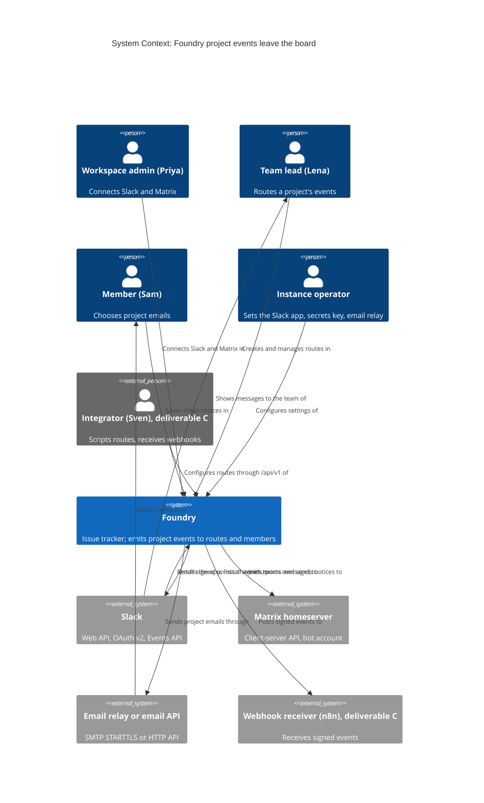
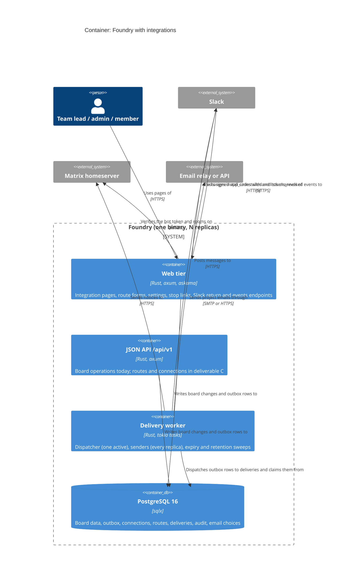
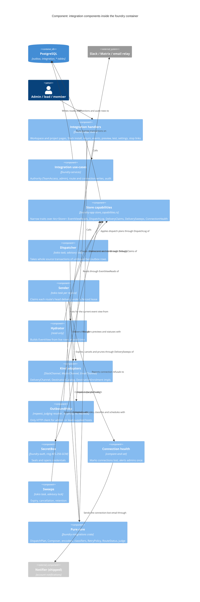

<!-- markdownlint-disable MD024 -->
# Feature Delta: external-integration-plugins

Foundry tells the outside world what happens on a project. A workspace connects
its Slack (through a Foundry Slack app installed with Slack's own approval
screen) and its Matrix homeserver (through a Foundry bot account invited to a
room). A team lead then decides, per project, which events go to which channel
or room and how much each message reveals. Every member decides, per project,
which events Foundry emails them. The same configuration is available through
`/api/v1`. Later slices add the two doors for custom integrations such as n8n:
signed outbound webhooks, and Foundry as an OAuth provider so a third-party app
gets scoped, revocable access without anyone pasting a machine token into it.

Today Foundry sends five account emails (invites, password reset and change,
member removed) through instance-wide providers set in environment variables.
No project event leaves the board.

## Wave: DISCUSS

Product owner: Luna (nw-product-owner) | Date: 2026-10-21 | Feature type:
cross-cutting (web UI, `/api/v1`, background delivery, three external systems)
| Walking skeleton: evaluated (brownfield) and adopted, slice 01: one project
event to one Slack channel through the Slack app, end to end | UX depth:
comprehensive (three journeys with emotional arcs) | JTBD: yes, three new jobs
| Density: lean, Tier-1 [REF] | Requirements readiness: clear in the user's
head, nothing written; the user locked Slack and Matrix as official app installs
and the orchestrator applied "OAuth app in scope, later slice" as a default (OD-2).

### [REF] Prior Wave Consultation

| Artifact | Status | Note |
|---|---|---|
| `crates/foundry-app/src/notify.rs` | ✓ | `NotificationProvider` (`deliver`, `kind`, `probe`), `ProviderKind {Log, Smtp, Webhook, EmailApi}`, a closed `NotificationEvent` of five **account** events (`password_reset`, `workspace_invite`, `member_invite`, `member_removed`, `password_changed`), each with ONE named recipient. `Notifier::notify` fans out inline, inside the request, to **every** provider configured by `NOTIFICATION_PROVIDERS`, bounded by a 5 s timeout, best-effort at-most-once. There is no per-project, per-destination or per-event routing. The shipped `WebhookProvider` is instance-wide, set by `WEBHOOK_URL`, and its body carries account notification bodies (a reset link included). |
| `docs/feature/notification-delivery-providers/` (discuss, design ADR-001..007, distill, slices) | ✓ | ADR-001 structured vendor-neutral notification that each provider renders; ADR-002 env config, wire then probe then use; ADR-003 infallible, never fails the request; ADR-004 bounded metric labels; ADR-005 closed catalogue; ADR-006 `SecretString`, no `Debug`, nothing secret in logs or errors; ADR-007 best-effort at-most-once, no retry, outbox named as the deferred durable backing. All inherited below; ADR-007 is **changed for routes** ([WHY] Changed Assumptions CA-1). |
| `docs/feature/recipient-notification-preferences/` | ✓ | Shipped: the per-workspace opt-out (`notification_unsubscribes`, migration 0014), the signed `/unsubscribe` link (RFC 8058 one-click), the suppression gate at the top of `notify()`, the rule that security events (`password_reset`, `password_changed`, `member_removed`) can never be suppressed, and the signed-in `/account/notifications` status page and resubscribe. Its recipient Sam Okafor is reused (with his Backend identity from team-membership). |
| `docs/feature/notification-preferences-ui/` (feature-delta, discuss/requirements, design, distill) | ✓ partial | **Not finished.** `show_settings` and `mute_notifications` exist in `crates/foundry-app/src/unsubscribe.rs`, and `GET /account/settings` and `POST /account/settings/mute` are mounted in `lib.rs:560-563`, but all 12 scenarios in `notification-preferences-ui.feature` are still `@pending`, there is no `deliver/` record and no CHANGELOG entry. Its requirements put "per-event granularity" out of scope. **Decision D-9: depend on it and extend it, not supersede it.** `/account/settings` hosts the new project-email section; the per-workspace mute stays as the master switch. Finishing its DELIVER (un-pend the 12 scenarios, CHANGELOG) is a pre-requisite of slice 05. |
| Outbox and realtime (`migrations/0003_outbox_notify.sql`, `foundry-realtime::EventPayload`, `foundry-store` writers) | ✓ | Events written today, in the same transaction as the change: `IssueCreated` (`insert_issue_with_outbox`), `IssueUpdated` (lane move and in-lane reorder, `reposition_issue_with_outbox`, and the lane-delete MoveCards fate), `IssueDeleted` (`delete_issues_with_outbox`, one row per card, also N rows for a lane delete with DeleteCards), `CommentAdded`, `CommentEdited`, `CommentDeleted`. The outbox is fire-and-forget: the trigger NOTIFYs and nothing ever sets `notified_at` (`count_pending_outbox` equals the row count). Title and description edits write `issue_change_events` but **no outbox row** (`update_issue_details`, ODD-4). See [REF] Event Catalogue and Risk R3. |
| `migrations/0001_init.sql` `issues.assignee_id`, `issues.priority` | ✓ | Both columns exist; no web, service or API code writes or reads them (zero matches in `foundry-app`, `foundry-services`, `foundry-api`). **There is no assignment in Foundry**, so "issue assigned" is not in the catalogue (D-2). |
| Machine tokens (`migrations/0007`, `/admin/tokens`, `foundry-api`, CHANGELOG v0.15-v0.17) | ✓ | EdDSA JWT, `jti` registry with revoke flag, optional `scope_team_id`, minted only by a signed-in workspace admin at `/admin/tokens`; the token acts as its `user_id`. No per-action scopes (read vs write). `check_api_no_mint_route` forbids a mint route in `/api/v1`. This is the mechanism the OAuth slice extends (slice 08, OD-2, OD-14). |
| `crates/foundry-api/openapi.json` and the check-arch rules `api-openapi-operations`, `api-openapi-statuses` (v0.17.0) | ✓ | Any new `/api/v1` operation (slice 06) must be described in the same change, or CI fails. |
| `docs/product/architecture/brief.md` | ✓ | Ports and adapters, trait-injected effects, composition root `main.rs`; three credential classes kept apart (`check_jwt_alg_pin` EdDSA, `check_oidc_alg_pin` RS256); `TeamAccess::of(is_admin, Option<TeamRole>)` = `None | View | Manage` is the one authority policy; uniform non-enumerable 404; GET dialog + POST confirm for destructive actions; `csrf_middleware`; append-only audit records (`workspace_rename_events`, `team_lifecycle_events`, `project_lifecycle_events`); projects soft-delete and restore. |
| `docs/product/jobs.yaml` | ✓ | No job covers telling people outside the board. Three jobs appended (see [REF] JTBD). |
| `docs/product/personas/persona-instance-operator.yaml` | ✓ | Priya Raman's cluster runs "Grafana, Portainer, ArgoCD **and Element**", so a Matrix homeserver on her cluster is evidenced. Nothing establishes Slack use; Slack examples are example data (see [REF] Personas). Sven Aarø (`persona-api-integrator`) is reused. Not edited here (write scope); follow-up F-6. |
| `docs/feature/team-membership/feature-delta.md` | ✓ | Supplies Lena Park (lead of Backend, workspace `member`), Sam Okafor (Backend member, `sam.okafor@canzan.dev`) and Tomás Rivera (`tomas.rivera@canzan.dev`). |
| `docs/product/journeys/journey-api-openapi-document.yaml` | ✓ | Style reference for the new journey file. |
| `docs/feature/api-openapi-document/feature-delta.md`, `slices/*.md` | ✓ | Style reference for this file and the slice briefs. |
| `docs/product/vision.md`, `docs/project-brief.md`, `docs/stakeholders.yaml` | ⊘ | Do not exist. |
| `docs/feature/external-integration-plugins/discover/`, `diverge/` (`recommendation.md`, `job-analysis.md`) | ⊘ | Do not exist. **Recorded risk R1**: the jobs are grounded in the user's request, the locked decisions and code reading, not interviews. |

### [REF] Inherited Commitments

| Origin | Commitment | DDR | Impact |
|---|---|---|---|
| notification-delivery-providers ADR-001 | The port carries a structured, vendor-neutral notification; each channel renders it | n/a | Each integration kind renders the same structured project event its own way (Block Kit, Matrix formatted body, email, JSON). One event, many renderings. |
| notification-delivery-providers ADR-003 / NFR-5 | Delivery never fails or stalls the originating request | n/a | Strengthened to D-5: route and email delivery happens after the action commits, never inside it. A board action's latency is a guardrail KPI (EIP-KPI-4). |
| notification-delivery-providers ADR-004 | Metric labels come from closed enums only | n/a | New delivery metrics are labelled by integration kind, event and outcome only. Never a channel, room, project, URL or person. |
| notification-delivery-providers ADR-005 | The event catalogue is closed | n/a | The routable catalogue (D-2) is closed and versioned; adding an event is a decision, not a side effect. |
| notification-delivery-providers ADR-006 | Secrets are `SecretString`, never logged, never in errors or debug output | n/a | Extended to every new credential: Slack bot token, Matrix access token, webhook signing secret, OAuth client secret, OAuth tokens (SC-3). |
| notification-delivery-providers ADR-007 | Best-effort, at-most-once, no retry | n/a | **Changed for routes and project emails** (CA-1, OD-7): queued, retried up to 24 h, at-least-once with a stable event id. Account notifications keep ADR-007 unchanged. |
| notification-delivery-providers ADR-002 | Providers are configured by environment, probed at boot | n/a | The email transport stays operator-configured. The Slack app's credentials are operator-configured (OD-3). Connections a workspace admin makes are stored per workspace, not in env (CA-4). |
| recipient-notification-preferences ADR-003 / NFR-3 | Security events are never suppressible; the workspace mute suppresses the rest | n/a | Project event emails are suppressible: a muted workspace sends none (D-14). Security emails are untouched. |
| recipient-notification-preferences ADR-001/002 | Signed one-click unsubscribe, prefetch-safe GET plus POST confirm, RFC 8058 | n/a | Every project event email carries a signed stop link for that one choice, with the same safety rules (US-EIP-11). |
| notification-preferences-ui FR-1, FR-4 | `/account/settings` hosts notifications; signed-in per-workspace mute | n/a | Hosts the "Project emails" section (US-EIP-10). Pre-requisite: its 12 scenarios un-pended (D-9). |
| token-management-api no-mint boundary, `check_api_no_mint_route` | `/api/v1` never mints a credential | n/a | Route configuration through the API mints no machine token. A webhook signing secret is not an API credential, but DESIGN confirms the boundary holds (OD-14). OAuth token issuance lives outside `/api/v1`. |
| brief.md, credential classes and `check_jwt_alg_pin` | Three credential classes, each with an algorithm pin | n/a | OAuth-granted access is a fourth way to reach `/api/v1`. It must be pinned and kept apart like the others (slice 08, SC-8). |
| brief.md, `TeamAccess` | One authority policy: None, View, Manage | n/a | Route configuration needs Manage on the project's team (lead or workspace admin). Connections and apps need workspace admin (D-4). |
| web-provisioning-flow and every page since | Uniform non-enumerable 404 for anyone without access | n/a | Every new page and API operation answers the same 404 to a caller who may not see it. |
| brief.md, `csrf_middleware`, ADR-ISSUE-DELETE-002 | State-changing forms are CSRF-checked; destructive actions are GET dialog plus POST confirm that counts consequences | n/a | Deleting a route, disconnecting, deleting an app and revoking a grant each use a counting confirm. |
| brief.md, audit records | Append-only actor, what, when records for lifecycle changes | n/a | Connection, route, app and grant changes are recorded the same way (D-16). |
| project-lifecycle, soft delete | A deleted project answers nowhere; restore is exact | n/a | A deleted project's routes and emails send nothing; a restore resumes them as they were (D-8). |
| api-openapi-document D3, check-arch `api-openapi-*` | The OpenAPI document is true, enforced by CI | n/a | Slice 06's operations are documented in the same change. |
| ADR-ISSUE-DELETE-001 | One delete primitive writes one `IssueDeleted` per card | n/a | A lane deleted with 7 cards produces 7 events; D-11 turns a burst into one message. |
| canzan-theme-system, api-openapi-document (CSP posture) | No inline scripts; nothing from another origin | n/a | New pages follow the same posture; Slack's approval screen is a top-level navigation, not an embed. |
| Memory: containerised dev dependencies | Never host installs; pin images | n/a | Test doubles for Slack and Matrix are a fake HTTP service and a pinned homeserver container (Technical Notes). |

### [REF] Personas

- **Priya Raman** (`persona-instance-operator`): workspace admin of Canzan Labs, lead of team Backend, instance super-admin and operator. She does the one-time operator setup (the Foundry Slack app's credentials, the Matrix bot account, email transport) and connects the workspace's Slack and Matrix. Her cluster runs Element (persona file), so a homeserver at `matrix.canzan.dev` is a reasonable example. **Slack use is not established by any prior wave**; the Slack workspace "Canzan Labs" (`canzanlabs.slack.com`) is example data.
- **Lena Park** (team-membership, inline): lead of Backend, a workspace `member`, not admin. The **project admin persona**: she wires Identity Platform (AUTH) to `#auth-dev` and to `#auth:canzan.dev`. Characteristics beyond her role are not established.
- **Sam Okafor** (recipient-notification-preferences, team-membership): Backend member, `sam.okafor@canzan.dev`. The **member managing his email persona**. He files and comments on AUTH issues and does not watch the board all day (the reason he wants email at all).
- **Sven Aarø** (`persona-api-integrator`): the **developer/operator building a custom integration**. Scripts against `/api/v1`; here he configures routes by API, points a webhook at n8n and connects n8n through OAuth. On this single-operator instance he is often Priya.
- **Marco** (`persona-team-member-foil`): signed in, wrong team. Gets the uniform 404 everywhere new.
- **Tomás Rivera** (team-membership): a Backend member who is removed from the team in US-EIP-11's example.

### [REF] JTBD

Three jobs, one per actor. They share an event catalogue and a delivery engine but
not a situation, so each is its own entry in `docs/product/jobs.yaml`.

**`job-route-project-events-to-chat`** (Lena, Priya). *When something happens on a
project my team works on (a new issue, a card reaching Done, a comment), I want it
to show up in the Slack channel or Matrix room where the team already talks, with
just enough to act on and nothing it should not reveal, so nobody has to keep the
board open to find out, and I can decide in one place what goes where.*

**`job-choose-my-project-emails`** (Sam). *When I am not looking at the board, I
want Foundry to email me about exactly the project events I chose, and to stop the
moment I say so or lose access, so I hear about the comments and moves that
concern me without an inbox full of everything else.*

**`job-grant-custom-integration-access`** (Sven, Priya). *When I want Foundry to
drive or be driven by my own automation (an n8n workflow, a script, a tool nobody
has built a plugin for), I want to receive Foundry's events as signed requests and
to grant the tool scoped access I can see and revoke, so I can build any
integration without handing it my own machine token or waiting for Foundry to
ship one.*

Four forces (details in `jobs.yaml`):

| Force | Route to chat | My project emails | Custom integration access |
|---|---|---|---|
| Push | No project event leaves the board. The only outbound channels are instance-wide env providers carrying account emails. | Foundry emails only invites and password events. To hear about a comment, Sam must open the issue. | The only programmatic door is a machine token minted by an admin and pasted into the tool: all-or-nothing within a team, shared by whatever holds it, no events pushed. |
| Pull | "Add to Slack", pick a channel, see the first message; the same for a Matrix room. | A per-project list of checkboxes in settings, and a stop link in every email. | A webhook with a signing secret, and an OAuth consent screen the way every other service the cluster runs offers. |
| Anxiety | A channel full of noise; an issue title leaking to people not on the team; a broken connection that fails silently; a Slack credential in a log. | Spam; emails about a project after being removed from it; no way to stop. | A webhook used to reach internal services; a third-party app holding more access than intended, or keeping it after revoke. |
| Habit | Opening the board; telling teammates in chat by hand. | Inbox rules; checking the board. | `curl` with a pasted machine token; n8n polling the API. |

Opportunity (importance × satisfaction, user's request and code reading, no
interviews):

| Job | Importance | Satisfaction today | Note |
|---|---|---|---|
| job-route-project-events-to-chat | high | none | First-named in the request (Slack, Matrix). No path exists at all. |
| job-choose-my-project-emails | high | low | Email exists for account events only; per-workspace mute is the only control. |
| job-grant-custom-integration-access | medium | low | Machine tokens work but are coarse and pull-only. The user wants it "in the future"; OD-2. |

### [REF] Scope Assessment: OVERSIZED (16 stories, 6 contexts, about 27 days)

| Oversized signal | Fired? | Evidence |
|---|---|---|
| More than 10 user stories | **Yes** | 16 |
| More than 3 bounded contexts | **Yes** | integration configuration, event delivery, Slack adapter, Matrix adapter, member email preferences, authorization server (OAuth) |
| Walking skeleton needs more than 5 integration points | No | 5: the outbox events, a connection store, Slack OAuth, Slack's post API, the route page |
| More than 2 weeks of effort | **Yes** | about 27 days (slice table) |
| Multiple independent outcomes | **Yes** | chat routing, member email, custom integrations each ship value alone |

Four of five signals fire. **Proposal (OD-1): one event and plugin model, three
deliverables**, each under two weeks and each shippable alone:

| Deliverable | Slices | Outcome | Est. |
|---|---|---|---|
| A. Chat routing on Slack (this feature id) | 01, 02, 03 | A team hears about its project in Slack, and trusts it when it breaks | about 10 d |
| B. Matrix and member email (could stay here, or become `project-event-email`) | 04, 05 | The same routes to Matrix; members choose their emails | about 7 d |
| C. Custom integrations (recommended: new feature `integration-webhooks-and-oauth-apps`) | 06, 07, 08 | API configuration, signed webhooks, Foundry as OAuth provider | about 10 d |

The model (D-1), the event catalogue (D-2) and the content rules (D-3) are
designed once, in deliverable A's DESIGN, so B and C add kinds rather than rework.
This document specifies all three so the model is designed against every known
consumer. **Handoff condition: until the user answers OD-1, DESIGN takes slices
01-03 only** (deliverable A passes the gate alone: 7 stories, 3 contexts, about
10 days). See [REF] DoR Validation.

### [REF] Product Model (D-1)

| Term | Meaning | Who owns it | Lives at (proposal) |
|---|---|---|---|
| **Integration kind** | A kind of outside system Foundry can talk to: `slack`, `matrix`, `email`, `webhook`; later `oauth_app`. Each kind states how it connects, how it checks a destination, how it renders an event and how it classifies a failure (the plugin contract). | Foundry (code) | the plugin trait (DESIGN) |
| **Connection** | One workspace's authorised link to one outside system: a Slack install, a Matrix bot login. Holds the secret. One per kind per workspace in v1 (D-7). | Workspace admin | `/workspace/integrations` |
| **Route** | Per project: "these events, filtered thus, go to this destination, revealing this much". Destination is a Slack channel, a Matrix room or a webhook URL. | Team lead or workspace admin | `/team/{team}/project/{project}/integrations` |
| **Email choice** | Per member, per project: which events Foundry emails *me*, and for which issues. | The member | `/account/settings` |
| **Delivery** | One attempt history of one event to one route or one inbox: when, outcome, reason, attempts. | Foundry | route history page |
| **App** (slice 08) | A third-party client registered in a workspace: name, redirect addresses, the scopes it may ask for. | Workspace admin | `/workspace/apps` |
| **Grant** (slice 08) | A member's consent that an app may act as them, within chosen scopes and teams. | The member (revocable by an admin) | `/account/apps`, `/workspace/apps` |

### [REF] Event Catalogue (D-2)

What Foundry emits today, verified in code, and what each kind carries in v1.

| Event (product name) | Source today | Chat routes v1 | Project email v1 | Webhook v1 |
|---|---|---|---|---|
| `issue.created` "New issue" | outbox `IssueCreated` | yes | yes | yes |
| `issue.moved` "Issue moved" (optional filter: only into chosen lanes) | outbox `IssueUpdated` with a lane change | yes | yes | yes |
| `issue.reordered` (position within a lane) | outbox `IssueUpdated`, same lane | **no** (noise) | no | no |
| `issue.deleted` "Issue deleted" | outbox `IssueDeleted` | yes | yes | yes |
| `comment.added` "New comment" | outbox `CommentAdded` | yes | yes | yes |
| `comment.edited`, `comment.deleted` | outbox `CommentEdited`, `CommentDeleted` | no (an edit would re-post; a Slack message cannot be recalled by Foundry) | no | yes |
| `issue.edited` (title, description) | `issue_change_events` only, **no outbox row** (ODD-4) | no, follow-up F-1 | no | no |
| Issue assigned | **does not exist**: `assignee_id` has no writer | n/a | n/a | n/a |
| Member added to or removed from a team or workspace | team writes, `member_removed` account email | no, follow-up F-2 | no | no |
| Project renamed, deleted, restored | `project_lifecycle_events` | not routed; a rename shows the new name in later messages; delete and restore pause and resume (D-8) | same | same |

Every event carries a stable **event id** so a receiver can recognise a repeat
(at-least-once, OD-7).

### [REF] Content Rules (D-3)

Three content levels per route, chosen by the person creating the route:

| Level | Carries | Default |
|---|---|---|
| **Link only** | issue key, project name, event word, link | |
| **Summary** | plus title, actor's display name, lane (and from → to for a move) | **yes** (OD-6) |
| **Summary with comment text** | plus the first 300 characters of the comment as plain text, for `comment.added` | |

**Never sent, at any level, to any kind**: an issue's description, attachments or
their names, any email address (people appear by display name; a member without
one appears as "A Foundry member"), any token, secret or internal id other than
the issue key and the event id, anything from another project.

**Never pings**: text from Foundry users (titles, comment text, lane names) is
sent so it cannot mention or notify: Slack `<!channel>`, `<!here>`, `<!everyone>`,
`<@U…>` and `@channel` forms, and Matrix `@room` and user pills, arrive as inert text.

**Links**: "Open in Foundry" points at the issue's full page. Opening it needs a
Foundry session and the usual access; anyone else gets the uniform 404. A deleted
issue's message has no link.

**Bursts (D-11)**: one action that produces more than 5 events of the same kind for
the same route (a lane deleted with its cards, a lane delete moving cards) posts
one message: "7 issues deleted from Identity Platform by Lena Park".

### [REF] Who May Do What (D-4)

| Action | Instance operator | Workspace admin | Team lead (Manage) | Team member | Anyone else |
|---|---|---|---|---|---|
| Register the Foundry Slack app's credentials, create the Matrix bot account, set up email transport | yes (once per instance) | | | | |
| Connect, reconnect or disconnect Slack or Matrix | | yes | no | no | uniform 404 |
| Create, edit, pause, delete a project's routes; see their delivery history | | yes, any project | yes, own team's projects | no (uniform 404) | uniform 404 |
| Choose own project emails | | own | own | own | n/a |
| Configure routes through `/api/v1` | | with a token acting as them | with a token acting as them | no | uniform 404 |
| Register, edit or delete an app | | yes | no | no | uniform 404 |
| Grant an app access to act as me | | yes | yes | yes | n/a |
| Revoke a grant | | any in the workspace | own | own | n/a |

### [REF] Copy (D-13, locked; DESIGN may change paths, not strings)

- K-1 Connected: "Connected to {slack_team} ({slack_domain}) · by {admin_name} · {date}"
- K-2 No Slack app on the instance: "Slack is not set up on this Foundry yet. An instance operator adds the Foundry Slack app once. How to set up Slack"
- K-3 Approval cancelled or forged: "Slack was not connected. Nothing changed."
- K-4 Lead with no connection: "This workspace has no chat connection yet. Ask a workspace admin to connect Slack or Matrix."
- K-5 Audience notice: "Everyone who can read {destination} will see what this route sends. Foundry cannot check who that is."
- K-6 Shared channel: "{destination} is shared with another organisation. Tick to confirm that is intended."
- K-7 Test message: "Test message from Foundry for {project_name} ({key_prefix}). This route will post here."
- K-8 Message lines (Summary): new issue "{key} {title}" / "New issue in {project_name} by {actor} · {lane}"; moved "{key} {title}" / "Moved {from_lane} → {to_lane} by {actor} · {project_name}"; comment "{key} {title}" / "{actor} commented · {project_name}"; deleted "{key} {title}" / "Deleted by {actor} · {project_name}"; button "Open in Foundry".
- K-9 Route status: "Delivering" · "Retrying: {reason}" · "Paused" · "Paused: connection lost" · "Paused: Slack was disconnected" (or "Matrix was disconnected", deliberate) · "Paused: the app's access was revoked" · "Needs attention: {reason}".
- K-10 Disconnected banner: "Foundry lost its Slack connection for {workspace_name}: {reason}. Routes are paused. Reconnect"
- K-11 Secret shown once: "Copy it now. Foundry will not show it again."
- K-12 Email footer: "You get this because you chose {event} for {scope} in {project_name}. Stop these emails · Change what you get"
- K-13 No email transport: "This Foundry cannot send email yet. An instance operator needs to set up email delivery."
- K-14 Matrix not invited: "Invite {bot_user} to {room} in your Matrix client first, then try again."
- K-15 Matrix encrypted room: "{room} is end-to-end encrypted. Foundry's bot cannot post to encrypted rooms yet. Choose an unencrypted room."
- K-16 Refused webhook address: "Foundry will not send to this address."
- K-17 Consent heading: "{app_name} wants to act as you in {workspace_name}"

### [REF] Open Decisions (each has a recommended answer; the stories assume it)

- **OD-1: Split the feature into three deliverables?** (all) *Recommended: yes*, as in [REF] Scope Assessment: A (01-03) here, B (04-05) here or as `project-event-email`, C (06-08) as `integration-webhooks-and-oauth-apps`. DESIGN models all kinds once in A. If declined, the feature runs about 27 days in one directory.
- **OD-2: Custom integrations: in scope, later slice** (orchestrator default, the user did not answer). *Recommended: keep as default*: model events and the plugin contract for webhooks and apps now; ship webhooks (07) and Foundry-as-OAuth-provider (08) after the three built-ins. The user may overturn: drop 08 (machine tokens remain the door), or pull 07 earlier (it is the cheapest path to n8n).
- **OD-3: Where do the Foundry Slack app's credentials live?** (US-EIP-01) A Slack app's approval screen returns to one fixed address, so every self-hosted instance needs **its own** Slack app. *Recommended: the operator creates it in Slack from a manifest Foundry publishes, and sets its client id, client secret and signing secret as environment settings* (like `SMTP_*`, ADR-002), validated at boot. `/workspace/integrations` shows K-2 when they are absent. Alternative: an instance-admin form that stores them (more UI, a stored instance secret).
- **OD-4: Where does the Matrix bot's login live?** (US-EIP-08) *Recommended: a workspace admin enters the homeserver address and the bot's access token in `/workspace/integrations`* (uniform with Slack from the admin's point of view; the operator only creates the bot account). Alternative: environment settings, one bot for the whole instance.
- **OD-5: Encrypted Matrix rooms.** (US-EIP-09) Element creates private rooms encrypted by default. *Recommended: v1 refuses an encrypted room with K-15*; supporting encryption is follow-up F-3. Alternative: build encryption support now (large, new key-storage concerns).
- **OD-6: Default content level.** (US-EIP-04) *Recommended: Summary*: key, title, actor, lane, link; no comment text unless chosen. Alternative: Link only by default (safest, least useful).
- **OD-7: Delivery semantics for routes and project emails.** (US-EIP-05) *Recommended: queued after commit, retried with backoff for up to 24 hours (honouring Slack's and the homeserver's "retry after"), at-least-once: a rare repeat is possible, a silent loss is not*; every delivery is in the history. This changes ADR-007 for these kinds only (CA-1). Alternative: keep at-most-once (simpler; a Slack blip drops messages unseen).
- **OD-8: Email cadence.** (US-EIP-10) *Recommended: one email per event in v1*; a daily digest is follow-up F-4.
- **OD-9: Can plain members see a project's routes?** *Recommended: no in v1* (Manage only, D-4). Follow-up F-5 if members ask "where does this post?".
- **OD-10: Default project email choices for a member.** (US-EIP-10) *Recommended: nothing on by default*; the settings page invites Sam to choose. Consistent with "no unsolicited email". Alternative: "New comments on issues I created or commented on" on by default.
- **OD-11: Email me about my own actions?** *Recommended: never in v1* (Sam does not get an email about his own comment). Not configurable.
- **OD-12: Secrets at rest.** (US-EIP-01, -08, -13, -14) For the first time Foundry stores outside credentials in its database (CA-4). *Recommended: a database dump or backup alone must not yield a usable credential*, which implies a new operator-held key setting, required once any connection exists. DESIGN picks the mechanism.
- **OD-13: Which webhook addresses are allowed?** (US-EIP-13) Priya's n8n is on her private network, which is also what an attacker would aim a webhook at. *Recommended: always refuse loopback, link-local and cloud metadata addresses; refuse private-network addresses unless the operator lists allowed hosts or ranges in a setting*. Alternative: allow everything (simplest; a team lead could probe the cluster).
- **OD-14: Does a webhook signing secret, or OAuth issuance, cross the no-mint boundary?** (US-EIP-12, -13, slice 08) *Recommended: no for the webhook secret* (it authenticates Foundry to the receiver, it opens no Foundry door), so the API may return it once on create; *OAuth tokens are issued only at the OAuth endpoints outside `/api/v1`*, keeping `check_api_no_mint_route` unchanged. DESIGN confirms.
- **OD-15: OAuth scopes.** (US-EIP-14, -15) *Recommended: three*: `issues:read` (list issues, history, comments), `issues:write` (create, move, comment), `routes:manage` (configure routes and webhooks in projects the member manages). Finer scopes are follow-up.

### [REF] User Decisions (2026-10-21)

The user accepted every recommendation ("accept all"), and accepted the four
post-review fixes in [REF] Peer Review without a third review.

- **OD-1 yes.** Deliverable A (slices 01-03) and B (04-05) stay under this feature id; deliverable C (06-08) moves to its own feature, `integration-webhooks-and-oauth-apps`, when its turn comes. Its slices stay specified here until then. DESIGN models D-1, D-2 and D-3 for every kind now, and plans slice-level work for A first, then B.
- **OD-2** keep: custom integrations in scope as the later deliverable C.
- **OD-3** operator-created Slack app from a Foundry manifest; credentials in env settings, validated at boot.
- **OD-4** workspace admin enters homeserver and bot token in `/workspace/integrations`.
- **OD-5** refuse encrypted Matrix rooms in v1 (K-15).
- **OD-6** Summary is the default content level.
- **OD-7** at-least-once, queued after commit, retried up to 24 h (CA-1).
- **OD-8** one email per event.
- **OD-9** plain members cannot see routes.
- **OD-10** no project email choices on by default.
- **OD-11** never email people about their own actions.
- **OD-12** a dump or backup alone yields no usable credential; new operator-held key setting.
- **OD-13** refuse loopback, link-local and metadata always; private ranges only via an operator allow-list.
- **OD-14** webhook secret does not cross no-mint; OAuth tokens only outside `/api/v1`.
- **OD-15** three scopes: `issues:read`, `issues:write`, `routes:manage`.

### [REF] Journeys (summary; full: `docs/product/journeys/journey-external-integration-plugins.yaml`)

**Journey 1, route project events to chat (Priya, then Lena).** Arc: *Confidence
Building*, from wary (will this spam the team or leak a title?) through in control
(the preview shows exactly what goes out; the test message lands) to relieved (the
team hears about AUTH-12 without anyone opening the board), and, when Slack breaks,
reassured rather than betrayed (the route says what broke and one reconnect fixes it).

```text
[Where]                                    [Does]                                   [Sees]                                                              [Feels]
/workspace/integrations (Priya)            Add to Slack → approves on Slack         K-1 "Connected to Canzan Labs (canzanlabs.slack.com) · by Priya…"   curious → assured
/team/backend/project/auth/integrations    New route → Slack → #auth-dev            K-5 audience notice; events: New issue; content: Summary; preview   wary → in control
  (Lena)                                   Send test                                K-7 lands in #auth-dev within seconds                               in control → confident
Slack #auth-dev (team)                     Sam files AUTH-12                        "AUTH-12 Rotate LLDAP bind password / New issue in Identity…"      relieved
/team/backend/project/auth/integrations    (Slack app removed by a Slack admin)     K-9 "Paused: connection lost"; Priya gets the K-10 email           alarmed → reassured
/workspace/integrations (Priya)            Reconnect                                routes resume; queued events under 24 h delivered; history shows it relieved
Element #auth:canzan.dev (Lena)            invites @foundry:canzan.dev; adds route  formatted notice from the bot                                       confident
```

**Journey 2, choose my project emails (Sam).** Arc: *Problem Relief*, from
overlooked (he finds out about Lena's comment days late) through deliberate (one
row of checkboxes per project) to calm (he gets the two kinds of email he chose,
each saying why, each with a stop link).

```text
/account/settings (Sam)          Project emails → Identity Platform: New comment, "issues I created or commented on"   "Saved. Foundry will email sam.okafor@canzan.dev about: …"   deliberate
inbox                            Lena comments on AUTH-7 (Sam created it)                                             "[AUTH-7] Lena Park commented: Move Grafana sign-in to Keycloak" + K-12  informed
inbox → stop page                Stop these emails → Confirm                                                          "Stopped: New comment in Identity Platform."                 in control
(Sam removed from Backend)       Lena comments again                                                                  no email                                                     (unaware, correctly)
```

**Journey 3, grant custom integration access (Priya, Sven).** Arc: *Confidence
Building*, from cautious (handing a tool a key) through informed (the consent page
says in plain words what n8n may do, as whom, where) to in charge (Priya sees every
grant and one revoke ends it within a minute).

```text
/workspace/apps (Priya)          Register app "n8n homelab", redirect, scopes       client id; secret once with K-11                                cautious → prepared
n8n → /oauth/authorize (Sven)    Connect                                            K-17 consent: Read issues, Create issues and comments, Backend  informed
n8n                              Allow → workflow runs                              201 issue AUTH-31 created as Sven; webhook event arrives signed  confident
/workspace/apps (Priya)          Revoke                                             "Revoked. n8n homelab can no longer act as Sven Aarø."          in charge
```

Error paths covered per step are in the journey file's `failure_modes` and in each
story's examples.

### [REF] Shared Artifacts

| Artifact | Source of truth | Consumers | Risk |
|---|---|---|---|
| `${event_catalogue}` | D-2 (closed list; DESIGN names the enum) | route event checkboxes, email choices, webhook `type`, API `events` field, metrics labels, openapi.json | HIGH: a name differing between UI, API and webhook breaks integrations |
| `${issue_key}`, `${title}`, `${lane}` | issues and lanes in the store, read at delivery | Slack and Matrix messages, emails, webhook payload | MEDIUM: rename between event and delivery shows the current name (D-8) |
| `${actor}` display name | users | messages, emails | MEDIUM: never the email address (D-3) |
| `${connection_status}` | the connection record | `/workspace/integrations`, every route row's status, K-10 email, API `status` | HIGH: one source, or a route says "Delivering" while the connection is gone |
| `${destination}` | the route record (Slack channel id plus name at save; Matrix room id plus alias) | route row, K-5/K-6, history, API | MEDIUM: a channel renamed in Slack keeps working by id; the name shown refreshes |
| `${bot_user}` | the Matrix connection (`whoami` answer) | K-14, connection row | LOW |
| `${slack_team}`, `${slack_domain}` | Slack's install answer | K-1, K-10 | LOW |
| `${event_id}` | assigned once per event | webhook payload and header, delivery history, dedup | HIGH: must be stable across retries |
| Secrets (bot token, access token, signing secret, client secret) | the connection or app record, write-only | delivery adapters only | HIGH: never rendered, logged or returned after creation (SC-3) |
| `${foundry_issue_url}` | the instance's public base address and the issue's slugs | "Open in Foundry" in every kind | MEDIUM: must use slugs, never names (brief.md slugs rule) |
| `${email_choice}` | the member's choices per project | settings page, K-12 footer, stop link | HIGH: the footer must describe the choice that caused the email |
| `${member_email}` | `users.email` of the signed-in member | saved confirmation, the email's recipient | LOW |
| `${admin_name}`, `${date}` | the connection record's actor (display name) and creation date | K-1, connection row, audit activity | LOW |
| `${project_name}`, `${key_prefix}` | projects (name is a label, read at delivery; key prefix immutable) | K-7, K-8, K-12, webhook `project` | MEDIUM: a rename shows the new name (D-8) |
| `${client_id}` | the app registration | apps page, consent request, activity | LOW |
| `${client_secret}` | the app registration, **write-only** (SC-3) | shown once at registration or rotation, then nowhere | HIGH: must never be rendered again |
| `${scope_catalogue}` | OD-15 | registration form, consent wording, per-request access check, API description | HIGH: consent wording must mean exactly what the check enforces |

### [REF] Story Map

User: the team that works a project (Lena configures, Sam receives, Priya
connects, Sven automates). Goal: hear about project events where you already
are, and only those.

Backbone: **Connect a system → Route events → Shape the message → Receive →
Trust and repair → Own my inbox → Automate it**

| | Connect a system | Route events | Shape the message | Receive | Trust and repair | Own my inbox | Automate it |
|---|---|---|---|---|---|---|---|
| **Walking skeleton (slice 01)** | Add to Slack (US-EIP-01) | one route, New issue, one channel (US-EIP-02) | fixed Summary | Block Kit message in the channel; route shows last delivery | the action is never slowed (US-EIP-02) | | |
| **Release A, slice 02** | | all v1 events, lane filter (US-EIP-03) | levels, preview, never-sent, no pings (US-EIP-04) | | | | |
| **Release A, slice 03** | reconnect (US-EIP-06) | pause, edit, delete, disconnect (US-EIP-07) | | | history and retries (US-EIP-05), broken connection (US-EIP-06) | | |
| **Release B, slice 04** | Matrix bot (US-EIP-08) | Matrix room routes (US-EIP-09) | same levels | formatted notice in Element | kicked, encrypted, unreachable | | |
| **Release B, slice 05** | | | | event emails | | choose (US-EIP-10), stop and access (US-EIP-11) | |
| **Release C, slice 06** | | routes by API (US-EIP-12) | | | | | API configuration |
| **Release C, slice 07** | | webhook route (US-EIP-13) | JSON payload | signed request | same history and retries | | n8n webhook trigger |
| **Release C, slice 08** | register app (US-EIP-14) | | | | revoke and audit (US-EIP-16) | | consent and scoped access (US-EIP-15) |

| Slice | Stories | What it adds | Est. | Brief |
|---|---|---|---|---|
| 01 | US-EIP-01, -02 | Walking skeleton: Slack connected, one New-issue route, a real message, the action never slowed | 3 d | `slices/slice-01-slack-walking-skeleton.md` |
| 02 | US-EIP-03, -04 | Every v1 event, lane filters, bursts; content levels, preview, redaction | 3 d | `slices/slice-02-events-and-content.md` |
| 03 | US-EIP-05, -06, -07 | Delivery history and retries; broken connections flagged and fixed; pause, edit, delete, disconnect | 4 d | `slices/slice-03-trust-and-repair.md` |
| 04 | US-EIP-08, -09 | Matrix bot connection and room routes, with Matrix's failure paths | 3.5 d | `slices/slice-04-matrix.md` |
| 05 | US-EIP-10, -11 | Member project-email choices; stop link; access-safe sending | 3.5 d | `slices/slice-05-member-project-email.md` |
| 06 | US-EIP-12 | Routes and connections through `/api/v1`, documented | 2 d | `slices/slice-06-routes-by-api.md` |
| 07 | US-EIP-13 | Signed outbound webhook routes | 2.5 d | `slices/slice-07-signed-webhooks.md` |
| 08 | US-EIP-14, -15, -16 | Foundry as OAuth provider: apps, consent, scoped access, revoke | 5.5 d | `slices/slice-08-oauth-apps.md` |

### [REF] Priority Rationale

1. **01 first, the walking skeleton.** It carries the two riskiest assumptions: that a self-hosted instance can run a Slack app install end to end (each instance owns its own Slack app, OD-3), and that events can be delivered after commit, durably, without touching the action's latency, when the existing outbox is fire-and-forget (R3). If either fails, every later slice changes shape. It is also the first user-visible value (Lena's channel).
2. **02 next, highest value per day.** A route that only knows "New issue" and one fixed text is a demo. Lane filters ("tell #auth-releases when something reaches Done") and the content levels make it the team's tool, and the content rules are the security heart of the feature (D-3), so they must exist before more kinds reuse them.
3. **03 before any new kind.** Integrations fail in the field (uninstalled apps, archived channels, rate limits). History, retries and the broken-connection path are what make the team trust the channel instead of the board. Matrix and webhooks reuse all of it.
4. **04, Matrix.** Second kind the user named, evidenced on Priya's cluster (Element). Low uncertainty after 01-03; its unique risk is encrypted rooms (OD-5).
5. **05, member email.** High importance, but it depends on `notification-preferences-ui` finishing (D-9) and reuses the delivery engine from 01-03. Placed after Matrix because chat routing serves the whole team at once and email serves one member at a time; the user may swap 04 and 05 at no cost.
6. **06-08, custom integrations (OD-2).** 06 is small and makes 07-08 scriptable; 07 is the cheapest path to n8n; 08 is the largest and most security-sensitive (a new authorization server), so it goes last and, per OD-1, as its own feature with its own threat model.

Value × urgency / effort (1-5), **product-owner judgement, not data** (R1: no
interviews or usage data exist; the ordering rests on the risk argument above): 01 = 5×5/3 = 8.3; 02 = 4×4/3 = 5.3; 03 = 4×4/4 = 4.0; 04 = 4×3/3 = 4.0; 05 = 4×3/3 = 4.0; 06 = 2×2/2 = 2.0; 07 = 3×2/2 = 3.0; 08 = 3×2/5 = 1.2. Ties broken by riskiest assumption first (03 before 04/05) and by dependency (06 before 07-08).

Taste tests: every slice changes something a person sees; no slice is
infrastructure only; each slice names what it would disprove (slice briefs).

### [REF] System Constraints

Requirements for DESIGN. They name risks and outcomes, not mechanisms.

- **SC-1 (never slows, never fails the action):** creating, moving, deleting an issue or adding a comment succeeds and answers in its usual time whatever the state of Slack, Matrix, email or a webhook receiver. Delivery happens after the change commits.
- **SC-2 (no event without its change, no change without its event):** an event is offered for delivery exactly when its change commits; a rolled-back change sends nothing; a committed change is never silently dropped (OD-7).
- **SC-3 (secrets):** every outside credential is write-only: never rendered after creation, never in a log line, error, metric, audit record, API response, OpenAPI example or debug output (ADR-006). OD-12 for storage.
- **SC-4 (audience):** a route sends only its own project's events, only at its content level, only to its destination. Text from users never pings (D-3).
- **SC-5 (access at send time):** an email goes only to a member who can see the project when it is sent, not when the choice was made.
- **SC-6 (non-enumerable):** every new page and API operation gives the uniform 404 to anyone without the right, including for connections, routes, apps and grants of other workspaces.
- **SC-7 (shipped behaviour unchanged):** the five account notifications, `NOTIFICATION_PROVIDERS`, the env `WebhookProvider`, the per-workspace mute and `/unsubscribe` behave exactly as before (D-6). The new webhook routes never carry account notifications.
- **SC-8 (credential classes):** OAuth-granted access is a separate class from sessions, machine tokens and Keycloak tokens, with its own algorithm pin and a build-time guard in the shape of `check_jwt_alg_pin` (slice 08).
- **SC-9 (bounded observability):** delivery counters are labelled only by kind, event and outcome (ADR-004).
- **SC-10 (test doubles):** Slack is faked by an HTTP double; Matrix runs against a pinned homeserver container; no host installs, no real Slack in CI (memory: containerised dev dependencies).

### [REF] Non-Functional Requirements

- **NFR-EIP-1 (latency of delivery):** with Slack, the homeserver or the receiver healthy, a routed event's message appears within 10 s at p95 and 60 s at p99 of the change committing (smoke lane with the doubles; dev dogfood with real Slack).
- **NFR-EIP-2 (latency of the action):** with one route per kind active and every destination unreachable, issue create and move answer within 10% of their p95 with no routes, on the smoke lane (EIP-KPI-4).
- **NFR-EIP-3 (durability):** with OD-7 as recommended, every event is delivered or shown as failed within 24 h; the history records each attempt. Retries honour "retry after" answers and never exceed one attempt per destination per second.
- **NFR-EIP-4 (security):** SC-3, SC-4, SC-6, SC-8; OAuth uses authorization code with PKCE, exact redirect matching, single-use codes, and revocation effective within 60 s.
- **NFR-EIP-5 (accessibility):** every new page meets WCAG 2.2 AA; the preview is readable text, not an image; status words (K-9) are text, not colour alone.
- **NFR-EIP-6 (scripting disabled):** every new page works with scripting disabled (the shipped lane); the Slack approval is a plain link.
- **NFR-EIP-7 (scale):** homelab scale: up to 50 routes per workspace, 1,000 events per day; delivery history keeps at least the last 100 attempts per route for 30 days.

### [REF] User Stories

#### US-EIP-01: A workspace admin connects the workspace's Slack in one approval

`job_id: job-route-project-events-to-chat` | slice 01 | MoSCoW: Must

##### Elevator Pitch

Before: Canzan Labs has no way to put Foundry into Slack. The only outbound channels are instance-wide environment settings that carry account emails.
After: Priya opens `/workspace/integrations`, clicks **Add to Slack**, approves on Slack's own screen, and lands back on `/workspace/integrations` seeing "Slack · Connected to Canzan Labs (canzanlabs.slack.com) · by Priya Raman · 21 Oct 2026".
Decision enabled: Priya tells Lena that Backend can now route its projects to Slack, or disconnects if the wrong Slack workspace was chosen.

##### Problem

Priya wants her teams' Slack to hear from Foundry, but connecting means editing
environment variables and pasting webhook URLs per channel, which she does not
want team leads doing and cannot audit.

##### Who

- Priya Raman, workspace admin of Canzan Labs | in a browser, signed in | wants one approval that connects the workspace's Slack, with no secret to copy.
- Priya as instance operator, once per instance | has registered the Foundry Slack app (OD-3).

##### Solution

A workspace integrations page with an **Add to Slack** link that runs Slack's
OAuth approval and stores the resulting connection for the workspace.

##### Domain Examples

1. **Happy path**: Priya clicks Add to Slack, approves "Foundry" for Canzan Labs on Slack, and returns to K-1 with her name and 21 Oct 2026.
2. **Instance not set up**: the dev instance has no Slack app credentials. `/workspace/integrations` shows K-2 with the link "How to set up Slack"; no Add to Slack button.
3. **Cancelled**: Priya clicks Cancel on Slack's screen → K-3; nothing is stored.
4. **Not an admin**: Lena opens `/workspace/integrations` → the uniform 404.
5. **Forged return**: a link to the return address with a made-up `code` and `state`, opened by Priya → K-3; nothing is stored, nothing is sent to Slack with Priya's session.

##### UAT Scenarios (BDD)

###### Scenario: A workspace admin connects Slack and sees the connection

- Given the instance has the Foundry Slack app set up and Canzan Labs has no Slack connection
- When Priya chooses Add to Slack on the workspace integrations page and approves Foundry for the Slack workspace "Canzan Labs"
- Then Priya is back on the workspace integrations page and reads "Connected to Canzan Labs (canzanlabs.slack.com) · by Priya Raman · 21 Oct 2026"
- And the workspace's integration activity reads "21 Oct 2026 · Priya Raman connected Slack (Canzan Labs)"

###### Scenario: An instance without the Slack app explains what is missing

- Given the instance has no Foundry Slack app credentials
- When Priya opens the workspace integrations page
- Then Priya reads "Slack is not set up on this Foundry yet. An instance operator adds the Foundry Slack app once. How to set up Slack" and sees no Add to Slack choice

###### Scenario: A cancelled approval connects nothing

- Given Canzan Labs has no Slack connection
- When Priya cancels on Slack's approval screen
- Then Priya reads "Slack was not connected. Nothing changed." and Canzan Labs still has no Slack connection

###### Scenario: A forged return from Slack connects nothing

- Given Canzan Labs has no Slack connection
- When Priya opens the Slack return address with a state Foundry never issued, with one already used, or with one older than 10 minutes
- Then each time Priya reads "Slack was not connected. Nothing changed." and no connection is stored

###### Scenario: Only a workspace admin can reach workspace integrations

- Given Lena is lead of Backend and a workspace member, and Marco is on no Canzan Labs team
- When Lena or Marco opens the workspace integrations page or its Slack return address
- Then each gets the same not-found page any unknown address gets

###### Scenario: The Slack credential never leaves the server

- Given Priya has connected Slack
- When anyone views the workspace integrations page, its page source, or the server's logs for the connection
- Then no Slack token appears anywhere

##### Acceptance Criteria

- [ ] A workspace admin connects Slack through Slack's approval and sees K-1 with team name, domain, her name and the date (scenario 1).
- [ ] Without the operator's Slack app settings, the page shows K-2 and no Add to Slack (scenario 2; OD-3).
- [ ] Cancel, a forged, replayed or expired (over 10 minutes) return store nothing and show K-3 (scenarios 3, 4).
- [ ] Non-admins and outsiders get the uniform 404 on the page and on the return address (scenario 5; SC-6).
- [ ] No Slack token is rendered, logged or returned (scenario 6; SC-3).
- [ ] Connecting writes an audit record: actor, kind, Slack team, time, shown in the workspace's integration activity (scenario 1; D-16).

##### Outcome KPIs

EIP-KPI-1, EIP-KPI-2, EIP-KPI-5.

##### Technical Notes

- One Slack connection per workspace (D-7). Reconnecting replaces it.
- Requested Slack bot permissions must be the least that slices 01-03 need: post messages, read the channel list (public and the private ones the app is in), and read channel info for the shared-channel flag. No user-token scopes, no reading messages.
- The approval's `state` binds to Priya's session and expires (CSRF of OAuth).
- The app manifest and setup steps are documentation the operator reads; DESIGN decides where they live.
- Disconnect and reconnect are US-EIP-06/-07.

##### Size

1.5 days | 6 scenarios | slice 01

#### US-EIP-02: A team lead sends a project's new issues to a Slack channel and sees the first one arrive

`job_id: job-route-project-events-to-chat` | slice 01 | MoSCoW: Must

##### Elevator Pitch

Before: Lena learns about new Identity Platform issues only by opening the AUTH board.
After: on `/team/backend/project/auth/integrations` Lena chooses **New route** → Slack → `#auth-dev` → New issue, clicks **Send test** and sees K-7 in `#auth-dev`, saves; when Sam files AUTH-12, `#auth-dev` shows a Foundry message "AUTH-12 Rotate LLDAP bind password / New issue in Identity Platform by Sam Okafor · Backlog" with **Open in Foundry**, and the route row reads "Delivering · last delivery 14:02".
Decision enabled: Lena makes `#auth-dev` the place the team triages new AUTH work and stops checking the board for it.

##### Problem

New work lands on the board silently. Lena's team talks in Slack, so new issues
are noticed late or by whoever happens to open the board.

##### Who

- Lena Park, lead of Backend (Manage on AUTH) | signed in | wants AUTH's new issues in the team's channel without asking an admin.
- Sam Okafor, Backend member | files the issue | expects nothing different on the board.

##### Solution

A per-project integrations page where a team lead creates a route to a Slack
channel of the workspace's connection; delivery after commit.

##### Domain Examples

1. **Happy path**: Lena routes New issue on AUTH to `#auth-dev`. Sam files AUTH-12 "Rotate LLDAP bind password" at 14:02:03; the message arrives at 14:02:05.
2. **Private channel**: `#backend-private` is not in the picker. The picker says "Private channels appear here after someone runs /invite @Foundry in them." After Lena does so, it appears.
3. **No connection**: Canzan Labs has no Slack connection. Lena's New route shows K-4.
4. **Slack is down**: Slack's API fails while Sam files AUTH-13. AUTH-13 is created in its usual time; the route row reads "Retrying: Slack did not answer"; when Slack answers again, AUTH-13's message is delivered. (Slice 01 retries at a fixed interval for up to 24 h; slice 03 adds backoff, "retry after", ordering and the history page.)
5. **Another project**: Sam files OPS-4 in Homelab Ops. Nothing is posted to `#auth-dev`.

##### UAT Scenarios (BDD)

###### Scenario: A new issue in the project appears in the chosen Slack channel

- Given Canzan Labs is connected to Slack and Lena has routed New issue on Identity Platform to #auth-dev
- When Sam files "Rotate LLDAP bind password" in Identity Platform and it becomes AUTH-12
- Then #auth-dev shows a Foundry message "AUTH-12 Rotate LLDAP bind password" / "New issue in Identity Platform by Sam Okafor · Backlog" with Open in Foundry, within 10 seconds
- And the route row reads "Delivering" with the time of that delivery

###### Scenario: A test message confirms the route before it is saved

- Given Lena is creating a route from Identity Platform to #auth-dev
- When Lena chooses Send test
- Then #auth-dev shows "Test message from Foundry for Identity Platform (AUTH). This route will post here."

###### Scenario: Filing an issue is never slowed or refused by chat delivery

- Given Lena's route to #auth-dev is active and Slack does not answer
- When Sam files "Audit Keycloak client scopes" in Identity Platform
- Then AUTH-13 is created and shown on the board in its usual time
- And the route row reads "Retrying: Slack did not answer"
- And when Foundry is restarted while Slack is still down, and Slack then answers again, #auth-dev shows AUTH-13's message

###### Scenario: A message Slack never accepts within a day is shown as failed

- Given Lena's route to #auth-dev is active and Slack stops answering
- When Sam files AUTH-14 and Slack stays down for 24 hours
- Then the route row reads "Needs attention: AUTH-14's message could not be delivered within 24 hours", and nothing about AUTH-14 is posted later

###### Scenario: A lead without a chat connection is told who can add one

- Given Canzan Labs has no Slack or Matrix connection
- When Lena chooses New route on Identity Platform's integrations page
- Then Lena reads "This workspace has no chat connection yet. Ask a workspace admin to connect Slack or Matrix."

###### Scenario: Only the team's leads and workspace admins configure routes

- Given Sam is a member of Backend but not a lead, and Marco is on no Canzan Labs team
- When Sam or Marco opens Identity Platform's integrations page or submits a new route there
- Then each gets the same not-found page any unknown address gets, and no route is created

###### Scenario: Another project's issues never reach the route

- Given Lena's route sends Identity Platform's new issues to #auth-dev
- When Sam files "Renew cluster certificates" in Homelab Ops
- Then nothing is posted to #auth-dev

##### Acceptance Criteria

- [ ] A Manage user creates a route to a Slack channel of the workspace connection; a new issue in that project posts the K-8 New-issue message with Open in Foundry within 10 s (scenario 1; NFR-EIP-1).
- [ ] Send test posts K-7 before saving (scenario 2).
- [ ] Issue creation's outcome and timing are unchanged whatever Slack does; an undelivered message is visible on the route row and is delivered once Slack answers, also across a Foundry restart (scenario 3; SC-1, SC-2, OD-7); after 24 h undelivered, the route says so and stops trying that message (scenario 4).
- [ ] Without a connection, K-4 (scenario 5).
- [ ] Plain members and outsiders get the uniform 404 and create nothing (scenario 6; D-4, SC-6).
- [ ] A route carries only its own project's events (scenario 7; SC-4).
- [ ] Creating a route writes an audit record (D-16).

##### Outcome KPIs

EIP-KPI-1, EIP-KPI-2, EIP-KPI-3, EIP-KPI-4.

##### Technical Notes

- The walking skeleton proves R3: a durable, after-commit event source. The shipped outbox is fire-and-forget; DESIGN decides whether to consume it, extend it, or add a delivery queue written in the same transaction.
- In slice 01 the content is fixed at Summary (US-EIP-04 adds levels) and the events at New issue (US-EIP-03 adds the rest).
- The route stores the channel by Slack's id, so a renamed channel keeps working.
- "Open in Foundry" uses slugs and the instance's public address (shared artifact `${foundry_issue_url}`). The instance's public address must be known to Foundry; DESIGN confirms the setting.

##### Size

1.5 days | 7 scenarios | slice 01

#### US-EIP-03: A team lead chooses exactly which events a route carries

`job_id: job-route-project-events-to-chat` | slice 02 | MoSCoW: Must

##### Elevator Pitch

Before: a route knows only "New issue", so Lena cannot tell `#auth-releases` when work reaches Done without flooding it with every new issue.
After: on the route form Lena ticks **Issue moved**, limits it to **into Done**, and saves; when Sam drags AUTH-7 from In progress to Done, `#auth-releases` shows "AUTH-7 Move Grafana sign-in to Keycloak / Moved In progress → Done by Sam Okafor · Identity Platform", and nothing is posted when he reorders cards inside a lane.
Decision enabled: Lena splits the team's noise by channel: new work to `#auth-dev`, finished work to `#auth-releases`.

##### Problem

One event type is either too little or, with every event on, too much. Lena needs
to say which events and which lanes matter for each channel.

##### Who

- Lena Park, lead of Backend | shaping two channels for one project | wants each channel to carry only what its readers act on.

##### Solution

Event checkboxes from the v1 catalogue (D-2) with an optional lane filter for
Issue moved, and the burst rule (D-11).

##### Domain Examples

1. **Lane filter**: route to `#auth-releases`, Issue moved into Done only. AUTH-7 to Done posts; AUTH-8 Todo → In progress does not.
2. **Comments**: route to `#auth-dev` with New comment. Lena comments on AUTH-7 → "AUTH-7 Move Grafana sign-in to Keycloak / Lena Park commented · Identity Platform".
3. **Reorder**: Sam drags AUTH-9 above AUTH-8 inside Todo → nothing posts anywhere.
4. **Lane renamed**: Lena renames Done to Shipped. The filter follows the lane; the next move posts "… → Shipped".
5. **Lane deleted**: the filtered lane "QA" is deleted. The route reads "Needs attention: the lane QA no longer exists. Choose lanes again." and posts no moves until edited.
6. **Burst**: Lena deletes lane "Spikes" with its 7 cards → one message "7 issues deleted from Identity Platform by Lena Park".

##### UAT Scenarios (BDD)

###### Scenario: A route limited to one lane posts only moves into that lane

- Given Lena's route sends Issue moved into Done from Identity Platform to #auth-releases
- When Sam moves AUTH-7 from In progress to Done, and AUTH-8 from Todo to In progress
- Then #auth-releases shows "Moved In progress → Done by Sam Okafor" for AUTH-7 only

###### Scenario: A new comment is announced in the channel

- Given Lena's route sends New comment from Identity Platform to #auth-dev
- When Lena comments on AUTH-7
- Then #auth-dev shows "AUTH-7 Move Grafana sign-in to Keycloak" / "Lena Park commented · Identity Platform"

###### Scenario: Reordering cards within a lane posts nothing

- Given Lena's routes send every v1 event from Identity Platform
- When Sam moves AUTH-9 above AUTH-8 inside Todo
- Then no channel receives a message

###### Scenario: A lane filter follows its lane through a rename

- Given Lena's route sends Issue moved into Done to #auth-releases
- When Lena renames the lane Done to Shipped and Sam then moves AUTH-10 into it
- Then #auth-releases shows "Moved In progress → Shipped by Sam Okafor" for AUTH-10

###### Scenario: A route whose filtered lane is gone asks to be fixed

- Given Lena's route sends Issue moved into QA to #auth-releases
- When the lane QA is deleted
- Then the route reads "Needs attention: the lane QA no longer exists. Choose lanes again." and posts no moves until Lena edits it

###### Scenario: Deleting a lane full of cards posts one message, not one per card

- Given Lena's route sends Issue deleted from Identity Platform to #auth-dev and the lane Spikes holds 7 cards
- When Lena deletes Spikes and its cards
- Then #auth-dev shows one message "7 issues deleted from Identity Platform by Lena Park"

##### Acceptance Criteria

- [ ] The route form offers exactly the v1 chat events of D-2; Issue moved takes an optional set of destination lanes (scenario 1).
- [ ] New comment posts the K-8 comment line (scenario 2).
- [ ] An in-lane reorder posts nothing (scenario 3).
- [ ] Lane filters bind to the lane, not its name; a deleted filtered lane puts the route in K-9 Needs attention with the stated reason (scenarios 4, 5).
- [ ] More than 5 same-kind events from one action for one route post one summary message (scenario 6; D-11).

##### Outcome KPIs

EIP-KPI-1, EIP-KPI-3.

##### Technical Notes

- The lane-move event must say from which lane to which; today's `IssueUpdated` payload carries the new `state` only. DESIGN finds the old lane (for example from `issue_change_events`, written in the same transaction).
- Issue deleted messages have no link (the issue is gone).

##### Size

1.5 days | 6 scenarios | slice 02

#### US-EIP-04: A team lead decides how much a message reveals, and sees it before saving

`job_id: job-route-project-events-to-chat` | slice 02 | MoSCoW: Must

##### Elevator Pitch

Before: whatever Foundry posts, Lena cannot tell in advance what `#general`, which includes contractors, will read about Identity Platform.
After: on the route form Lena picks **Link only** for `#general`, reads K-5 "Everyone who can read #general will see what this route sends. Foundry cannot check who that is.", and the live preview shows "AUTH-12 · Identity Platform · New issue · Open in Foundry", no title; for `#auth-dev` she picks **Summary with comment text** and the preview shows the first 300 characters of a sample comment as plain text.
Decision enabled: Lena chooses, per channel, between usefulness and exposure, knowing exactly what goes out.

##### Problem

A channel's audience is not the project's audience. Foundry cannot see who reads a
channel, so the person routing must choose what is revealed, and must not be
surprised by what was sent or by a comment that pings the whole channel.

##### Who

- Lena Park | routing to channels whose audiences differ | wants to see the message before anyone else does.

##### Solution

Three content levels (D-3), a preview rendered from the project's latest issue,
the audience notice, the shared-channel confirmation, and the never-sent and
never-pings rules applied to every message.

##### Domain Examples

1. **Default**: a new route preselects Summary (OD-6); the preview shows key, title, actor, lane.
2. **Link only**: `#general` route; AUTH-12's message has no title.
3. **Comment text**: Lena's 450-character comment on AUTH-7 arrives cut at 300 characters with "…".
4. **No ping**: Sam's comment "@channel the LDAP bind is broken <!here>" arrives as inert text; nobody is notified.
5. **Never sent**: AUTH-12's description "bind DN cn=admin,dc=canzan… password in vault path secret/ldap" never appears at any level.
6. **Shared channel**: `#ext-auth-vendor` is shared with another organisation → K-6; saving needs the tick.

##### UAT Scenarios (BDD)

###### Scenario: The preview shows exactly what the channel will receive

- Given Lena is creating a route from Identity Platform to #general with Link only
- When Lena reads the preview
- Then it shows "AUTH-12 · Identity Platform · New issue" and Open in Foundry, and no title, actor or lane

###### Scenario: Comment text is included only when chosen, and cut at 300 characters

- Given Lena's route to #auth-dev sends New comment with Summary with comment text
- When Lena posts a 450-character comment on AUTH-7
- Then #auth-dev shows the comment's first 300 characters followed by "…"

###### Scenario: Text from people can never ping a channel

- Given Lena's route to #auth-dev sends New comment with Summary with comment text
- When Sam comments "@channel the LDAP bind is broken <!here>" on AUTH-7
- Then #auth-dev shows that text without notifying anyone in the channel

###### Scenario: Descriptions, attachments and email addresses are never sent

- Given AUTH-12's description names a vault path, it has the attachment "ldap-bind.env", Sam Okafor's address is sam.okafor@canzan.dev, and every content level is in use across Lena's routes
- When Sam creates AUTH-12, moves it and comments on it
- Then no message in any channel contains any part of the description, the attachment's name, any email address, or any identifier other than AUTH-12

###### Scenario: A channel shared with another organisation needs explicit confirmation

- Given #ext-auth-vendor is shared with another organisation in Slack
- When Lena chooses it as a destination
- Then Lena reads "#ext-auth-vendor is shared with another organisation. Tick to confirm that is intended." and cannot save until she ticks it

##### Acceptance Criteria

- [ ] Three levels exist with D-3's contents; Summary is preselected (scenario 1; OD-6).
- [ ] The preview equals the message that would be sent for the project's latest issue (scenario 1).
- [ ] Comment text appears only at the third level, as plain text, at most 300 characters plus "…" (scenario 2).
- [ ] No message notifies a channel or person through user-supplied text (scenario 3; D-3).
- [ ] Descriptions, attachment names, email addresses and identifiers other than the issue key are never sent (scenario 4; D-3). Secrets never reach any message (US-EIP-01 scenario 6, SC-3).
- [ ] K-5 is shown on every route form; a shared channel needs the K-6 tick (scenario 5).

##### Outcome KPIs

EIP-KPI-5.

##### Technical Notes

- Escaping rules differ per kind (Slack mrkdwn and its `<!…>` control sequences; Matrix HTML `formatted_body` and `@room`). The content rules are kind-independent; each kind's renderer must meet them. A property test over generated text is the natural guard.
- The preview needs no Slack call.

##### Size

1.5 days | 5 scenarios | slice 02

#### US-EIP-05: A team lead sees every delivery, and transient failures fix themselves

`job_id: job-route-project-events-to-chat` | slice 03 | MoSCoW: Must

##### Elevator Pitch

Before: when a message is missing from `#auth-dev`, Lena cannot tell whether Foundry sent it, Slack refused it, or nothing happened.
After: Lena opens **History** on the `#auth-dev` route and sees "14:02 · New issue · AUTH-12 · Delivered", "15:40 · New comment · AUTH-7 · Delivered after 4 attempts (Slack asked Foundry to slow down)", "16:10 · Issue moved · AUTH-8 · Retrying (Slack did not answer) · next attempt 16:15".
Decision enabled: Lena knows whether to wait, to tell the team a message is delayed, or to ask Priya to look at the connection.

##### Problem

Delivery to an outside system fails sometimes. Without a record and retries, the
team quietly loses messages and goes back to watching the board.

##### Who

- Lena Park | a teammate says "I didn't see AUTH-8 in the channel" | wants an answer in one page.

##### Solution

A per-route delivery history and retries with backoff for up to 24 hours (OD-7).

##### Domain Examples

1. **Rate limit**: Slack answers "slow down, retry after 30 s" during a burst; Foundry waits and delivers; history "Delivered after 2 attempts (Slack asked Foundry to slow down)".
2. **Slack outage**: Slack fails for 2 hours; messages arrive afterwards in the order they happened per issue; history shows attempts.
3. **Gave up**: Slack fails for 25 hours; AUTH-14's message is "Failed: gave up after 24 hours (Slack did not answer)".
4. **Order**: AUTH-8 is created then moved during an outage; "New issue" arrives before "Moved".
5. **Outsider**: Marco opens the history address → uniform 404.

##### UAT Scenarios (BDD)

###### Scenario: Every delivery is listed with its outcome

- Given Lena's route to #auth-dev has delivered AUTH-12's New issue message
- When Lena opens the route's history
- Then Lena sees "New issue · AUTH-12 · Delivered" with its time

###### Scenario: A rate-limited delivery waits and then arrives

- Given Slack answers Foundry's next post with "retry after 30 seconds"
- When Sam comments on AUTH-7 and Lena's route sends New comment to #auth-dev
- Then the message reaches #auth-dev after Slack's wait, and the history reads "Delivered after 2 attempts (Slack asked Foundry to slow down)"

###### Scenario: Messages delayed by an outage arrive in the order they happened

- Given Slack does not answer for 2 hours
- When Sam files AUTH-8 and then moves it to In progress during that time
- Then after Slack answers again, #auth-dev shows AUTH-8's New issue message before its Moved message

###### Scenario: After 24 hours of failure Foundry stops and says so

- Given Slack has not answered for 24 hours since AUTH-14's event
- When Lena opens the route's history
- Then AUTH-14's entry reads "Failed: gave up after 24 hours (Slack did not answer)"

###### Scenario: Only those who manage the route see its history

- Given Marco is on no Canzan Labs team and Sam is a plain Backend member
- When either opens the history of Lena's route
- Then each gets the same not-found page any unknown address gets

##### Acceptance Criteria

- [ ] Each route has a history of at least its last 100 attempts for 30 days: time, event, issue key, outcome, plain reason, attempt count (scenario 1; NFR-EIP-7).
- [ ] "Retry after" answers are honoured; transient failures are retried with backoff for up to 24 h; permanent ones are not retried (scenarios 2, 4; OD-7, NFR-EIP-3).
- [ ] For one route, one issue's messages are delivered in the order the events happened (scenario 3).
- [ ] History is Manage-only with the uniform 404 for others (scenario 5).
- [ ] No reason text contains a token, URL secret or raw vendor error (SC-3).

##### Outcome KPIs

EIP-KPI-3, EIP-KPI-6.

##### Technical Notes

- `DeliveryError::Transient | Permanent` (ADR-007's seam) is the classification to reuse.
- Reasons are Foundry's words mapped from vendor codes (for example `ratelimited`, `channel_not_found`), never the vendor's raw text.

##### Size

1.5 days | 5 scenarios | slice 03

#### US-EIP-06: A broken connection is flagged at once and fixed with one reconnect

`job_id: job-route-project-events-to-chat` | slice 03 | MoSCoW: Must

##### Elevator Pitch

Before: if a Slack admin removes the Foundry app, every route would keep failing in silence.
After: after the first refused delivery, `/workspace/integrations` shows K-10 "Foundry lost its Slack connection for Canzan Labs: the Foundry app was removed from Slack. Routes are paused. Reconnect", each route reads "Paused: connection lost", and Priya gets one email saying so; she clicks **Reconnect**, approves on Slack, and the routes read "Delivering" again, with events from the last 24 hours delivered.
Decision enabled: Priya decides to reconnect now, or to disconnect for good (US-EIP-07).

##### Problem

Outside systems change under Foundry: apps get uninstalled, tokens revoked,
channels archived, the app removed from a channel. Each must be visible to the
person who can fix it, at the right level (connection or route).

##### Who

- Priya Raman, workspace admin | gets told when the connection breaks | can reconnect.
- Lena Park | sees which of her routes needs her (channel-level problems).

##### Solution

Classify permanent failures by level: connection-level pauses all its routes and
alerts the workspace admins; route-level marks that route Needs attention.

##### Domain Examples

1. **App removed**: Slack refuses with "token revoked" → connection disconnected, 3 routes "Paused: connection lost", one email to Priya (and any other workspace admin) within 5 minutes.
2. **Reconnect**: Priya reconnects the same Slack workspace → routes resume; AUTH-15 and AUTH-16, created 2 hours earlier, are delivered.
3. **Channel archived**: `#auth-dev` is archived → only that route "Needs attention: Foundry can no longer post to #auth-dev (the channel was archived)"; `#auth-releases` keeps delivering.
4. **App removed from a private channel**: `#backend-private` → "Needs attention: Foundry is no longer in #backend-private. Invite @Foundry back, then Resume."
5. **Different Slack workspace on reconnect**: Priya approves "Canzan Personal" by mistake → "This is a different Slack workspace (Canzan Personal). Routes stay paused. Reconnect to Canzan Labs, or disconnect."

##### UAT Scenarios (BDD)

###### Scenario: A removed Slack app pauses the routes and tells the workspace admins

- Given Canzan Labs' Slack connection feeds 3 routes and the Foundry app has been removed from Slack
- When the next routed event is refused by Slack
- Then the workspace integrations page shows "Foundry lost its Slack connection for Canzan Labs: the Foundry app was removed from Slack. Routes are paused. Reconnect"
- And each of the 3 routes reads "Paused: connection lost"
- And Priya receives one email saying the Slack connection was lost, within 5 minutes

###### Scenario: Reconnecting resumes the routes and delivers what was missed

- Given the Slack connection was lost 2 hours ago and AUTH-15 and AUTH-16 were filed since
- When Priya chooses Reconnect and approves Foundry for Canzan Labs again
- Then the routes read "Delivering" and #auth-dev shows AUTH-15 and AUTH-16's messages

###### Scenario: An archived channel affects only its own route

- Given Lena routes Identity Platform to #auth-dev and #auth-releases
- When #auth-dev is archived in Slack and the next event is refused
- Then the #auth-dev route reads "Needs attention: Foundry can no longer post to #auth-dev (the channel was archived)" and the #auth-releases route keeps delivering

###### Scenario: Reconnecting to the wrong Slack workspace changes nothing

- Given Canzan Labs' connection to the Slack workspace "Canzan Labs" was lost
- When Priya reconnects and approves the Slack workspace "Canzan Personal"
- Then Priya reads "This is a different Slack workspace (Canzan Personal). Routes stay paused. Reconnect to Canzan Labs, or disconnect." and the routes stay paused

##### Acceptance Criteria

- [ ] Connection-level refusals (revoked, uninstalled, invalid credential) mark the connection lost on the first refusal, pause every route of it, show K-10, and email each workspace admin once, within 5 minutes (scenario 1; EIP-KPI-6).
- [ ] Reconnect to the same Slack workspace resumes routes and delivers events younger than 24 h (scenario 2; D-8).
- [ ] Channel-level refusals mark only that route Needs attention with a K-9 reason (scenario 3).
- [ ] Reconnecting to a different Slack workspace keeps routes paused with the stated message (scenario 4).
- [ ] The admin email goes through the shipped notifier as a new suppressible account event; the workspace mute applies (D-14).

##### Outcome KPIs

EIP-KPI-6.

##### Technical Notes

- The admin alert is a new entry in the closed `NotificationEvent` catalogue (ADR-005); it is suppressible.
- "Resume" on a route re-checks the destination before delivering.

##### Size

1.5 days | 4 scenarios | slice 03

#### US-EIP-07: A team lead pauses, edits or deletes a route, and an admin disconnects safely

`job_id: job-route-project-events-to-chat` | slice 03 | MoSCoW: Should

##### Elevator Pitch

Before: once created, a route could only keep posting.
After: Lena clicks **Pause** on the `#auth-dev` route during a noisy migration and it reads "Paused"; later **Delete** shows "Delete the route to #auth-dev? Identity Platform stops posting there. Messages already in Slack stay." and Confirm removes it; Priya's **Disconnect Slack** shows "Disconnect Slack? 3 routes in 2 projects stop posting. Foundry's access to Canzan Labs' Slack is removed." and Confirm does it.
Decision enabled: Lena and Priya can change their minds without leaving a route posting or a credential behind.

##### Problem

Teams reorganise channels and projects end. Routes and connections need the same
safe, counted lifecycle as everything else in Foundry.

##### Who

- Lena Park | maintains her project's routes.
- Priya Raman | owns the workspace's connections.

##### Solution

Pause, resume, edit, delete for routes; disconnect for connections; counting
confirms; audit records; project delete and restore honoured (D-8).

##### Domain Examples

1. **Pause**: during the LDAP migration Lena pauses `#auth-dev`; 12 new issues post nothing and are not sent later (D-8).
2. **Edit**: Lena adds New comment to the `#auth-releases` route; the next comment posts.
3. **Delete**: confirm counts nothing but names the channel; Slack messages remain.
4. **Disconnect**: counts 3 routes in Identity Platform and Homelab Ops; afterwards Slack no longer lists Foundry's access for Canzan Labs.
5. **Project deleted**: Identity Platform is deleted; its routes post nothing; after the instance operator restores it, the routes are as they were.

##### UAT Scenarios (BDD)

###### Scenario: A paused route skips events and does not send them later

- Given Lena has paused the route to #auth-dev
- When Sam files AUTH-17 and Lena then resumes the route
- Then #auth-dev never receives AUTH-17's message

###### Scenario: Editing a route's events takes effect on the next event

- Given the #auth-releases route sends Issue moved into Done only
- When Lena adds New comment to it and Sam comments on AUTH-7
- Then #auth-releases shows AUTH-7's comment message

###### Scenario: Deleting a route asks first and leaves Slack's messages alone

- Given the route to #auth-dev exists
- When Lena chooses Delete
- Then Lena reads "Delete the route to #auth-dev? Identity Platform stops posting there. Messages already in Slack stay." and only Confirm removes it

###### Scenario: Disconnecting Slack counts what stops and removes Foundry's access

- Given Canzan Labs' Slack connection feeds 3 routes in Identity Platform and Homelab Ops
- When Priya chooses Disconnect Slack and confirms "Disconnect Slack? 3 routes in 2 projects stop posting. Foundry's access to Canzan Labs' Slack is removed."
- Then the 3 routes read "Paused: Slack was disconnected", the page shows Slack as not connected, and Foundry's access is withdrawn at Slack

###### Scenario: A deleted project's routes post nothing, and a restore brings them back

- Given Identity Platform has an active route to #auth-dev
- When Lena deletes Identity Platform, and the instance operator later restores it and Sam files AUTH-18
- Then nothing is posted while it is deleted, and AUTH-18's message reaches #auth-dev after the restore

##### Acceptance Criteria

- [ ] Pause and resume; paused routes skip events permanently (scenario 1; D-8).
- [ ] Edits apply from the next event (scenario 2).
- [ ] Delete and disconnect use GET dialog plus POST confirm with the counted copy (scenarios 3, 4; ADR-ISSUE-DELETE-002).
- [ ] Disconnect withdraws Foundry's access at Slack and forgets the credential (scenario 4; SC-3).
- [ ] Deleted projects send nothing; restore resumes routes unchanged (scenario 5; D-8).
- [ ] Every change writes an audit record (D-16).

##### Outcome KPIs

EIP-KPI-1, EIP-KPI-5.

##### Technical Notes

- Disconnect is a deliberate act and differs from a lost connection: lost connections queue for 24 h (US-EIP-06); a disconnect queues nothing.

##### Size

1 day | 5 scenarios | slice 03

#### US-EIP-08: A workspace admin connects Foundry's Matrix bot

`job_id: job-route-project-events-to-chat` | slice 04 | MoSCoW: Must

##### Elevator Pitch

Before: Priya's cluster runs Element, but Foundry cannot speak Matrix at all.
After: on `/workspace/integrations` Priya chooses **Connect Matrix**, enters `https://matrix.canzan.dev` and the access token of the bot account the operator created, and sees "Matrix · Connected as @foundry:canzan.dev on matrix.canzan.dev · by Priya Raman · 21 Oct 2026"; the token field afterwards reads "saved 21 Oct 2026", never the token.
Decision enabled: Priya tells Lena the bot's name to invite into team rooms.

##### Problem

Matrix has no app store; the official way to integrate is a bot account. Foundry
needs to log in as that bot, check it works, and keep the token secret.

##### Who

- Priya Raman, workspace admin and operator | has created `@foundry:canzan.dev` on her homeserver.

##### Solution

A Matrix connection form that checks the homeserver and token before saving
(OD-4).

##### Domain Examples

1. **Happy path**: valid token → K-1-style line naming `@foundry:canzan.dev`.
2. **Bad token**: "The homeserver did not accept this access token. Nothing was saved."
3. **Unreachable**: `https://matrix.canzan.dev` down → "Foundry could not reach https://matrix.canzan.dev. Nothing was saved."
4. **Not an admin**: Lena → uniform 404.
5. **Token rotated**: the operator logs the bot out; next delivery refused → K-10 for Matrix; Priya enters a new token → routes resume.

##### UAT Scenarios (BDD)

###### Scenario: A workspace admin connects the Matrix bot and sees who it is

- Given the homeserver matrix.canzan.dev has the bot account @foundry:canzan.dev
- When Priya connects Matrix with https://matrix.canzan.dev and the bot's access token
- Then Priya reads "Connected as @foundry:canzan.dev on matrix.canzan.dev · by Priya Raman · 21 Oct 2026" and the token is never shown again

###### Scenario: A token the homeserver refuses is not saved

- Given Canzan Labs has no Matrix connection
- When Priya connects Matrix with an access token the homeserver refuses
- Then Priya reads "The homeserver did not accept this access token. Nothing was saved."

###### Scenario: An unreachable homeserver is reported and nothing is saved

- Given https://matrix.canzan.dev does not answer
- When Priya tries to connect Matrix to it
- Then Priya reads "Foundry could not reach https://matrix.canzan.dev. Nothing was saved."

###### Scenario: A logged-out bot pauses Matrix routes until a new token is entered

- Given Canzan Labs' Matrix connection feeds the route to #auth:canzan.dev and the bot has been logged out
- When the next routed event is refused and Priya then enters a new valid token
- Then Matrix routes read "Paused: connection lost" until the new token is saved, and then deliver again

##### Acceptance Criteria

- [ ] Connect validates reachability and the token before saving; shows the bot user and homeserver (scenario 1).
- [ ] Refused token and unreachable homeserver save nothing and show the stated copy (scenarios 2, 3).
- [ ] The token is write-only (SC-3); the form shows only when it was saved.
- [ ] A refused credential follows US-EIP-06's connection-lost path for Matrix (scenario 4).
- [ ] Workspace-admin only, uniform 404 otherwise (D-4).

##### Outcome KPIs

EIP-KPI-2, EIP-KPI-5, EIP-KPI-6.

##### Technical Notes

- The homeserver address must be `https`; a private address follows OD-13's rule (Priya's homeserver is likely on her network, so the operator's allow list applies).
- Test against a pinned homeserver container (SC-10).

##### Size

1.5 days | 4 scenarios | slice 04

#### US-EIP-09: A team lead sends a project's events to a Matrix room

`job_id: job-route-project-events-to-chat` | slice 04 | MoSCoW: Must

##### Elevator Pitch

Before: Lena's team room `#auth:canzan.dev` in Element hears nothing from Foundry.
After: Lena invites `@foundry:canzan.dev` to `#auth:canzan.dev` in Element, then on `/team/backend/project/auth/integrations` chooses **New route → Matrix**, enters `#auth:canzan.dev`, and sees "Foundry is in #auth:canzan.dev (room "Identity Platform", 6 members)"; with the same events and content level as her Slack routes, AUTH-12 then appears in Element as a bot notice with **AUTH-12** in bold and an "Open in Foundry" link.
Decision enabled: Lena runs the AUTH project's chat in Matrix instead of, or beside, Slack.

##### Problem

Matrix rooms need an invited bot, can be encrypted, and can remove the bot; each
of these must be clear to Lena at the moment it matters.

##### Who

- Lena Park | uses Element | wants the same route she has in Slack.

##### Solution

Matrix as a second route kind, reusing US-EIP-03/-04/-05/-06/-07 unchanged,
with Matrix's own destination checks.

##### Domain Examples

1. **Happy path**: invited, joined, notice renders formatted with a plain-text fallback.
2. **Not invited**: K-14 "Invite @foundry:canzan.dev to #auth:canzan.dev in your Matrix client first, then try again."
3. **Encrypted**: `#backend-private:canzan.dev` is encrypted → K-15.
4. **Kicked**: a room moderator removes the bot → "Needs attention: @foundry:canzan.dev was removed from #auth:canzan.dev. Invite it back, then Resume."
5. **Room ping**: Sam's comment "@room deploy is broken" arrives inert.

##### UAT Scenarios (BDD)

###### Scenario: A new issue appears in the Matrix room as a formatted notice

- Given Canzan Labs' Matrix bot @foundry:canzan.dev is in #auth:canzan.dev and Lena has routed New issue on Identity Platform there
- When Sam files AUTH-12
- Then #auth:canzan.dev shows a notice from @foundry:canzan.dev with "AUTH-12 Rotate LLDAP bind password" in bold, "New issue in Identity Platform by Sam Okafor · Backlog" and an Open in Foundry link, within 10 seconds

###### Scenario: A room the bot was not invited to is explained

- Given @foundry:canzan.dev has not been invited to #auth:canzan.dev
- When Lena enters #auth:canzan.dev as a route destination
- Then Lena reads "Invite @foundry:canzan.dev to #auth:canzan.dev in your Matrix client first, then try again." and no route is saved

###### Scenario: An encrypted room is refused with the reason

- Given #backend-private:canzan.dev is end-to-end encrypted and the bot is invited
- When Lena enters it as a route destination
- Then Lena reads "#backend-private:canzan.dev is end-to-end encrypted. Foundry's bot cannot post to encrypted rooms yet. Choose an unencrypted room."

###### Scenario: A bot removed from the room flags the route

- Given Lena's route posts to #auth:canzan.dev
- When a room moderator removes @foundry:canzan.dev and Sam then files AUTH-19
- Then the route reads "Needs attention: @foundry:canzan.dev was removed from #auth:canzan.dev. Invite it back, then Resume."

###### Scenario: Text from people can never ping a Matrix room

- Given Lena's Matrix route sends New comment with Summary with comment text
- When Sam comments "@room deploy is broken" on AUTH-7
- Then #auth:canzan.dev shows that text without notifying the room

##### Acceptance Criteria

- [ ] A Manage user routes to a room alias or id the bot is invited to; Foundry joins and confirms with room name and member count (example 1).
- [ ] Messages are bot notices with a formatted body and a plain-text body carrying the same K-8 lines (scenario 1).
- [ ] K-14 for a room the bot is not in; K-15 for an encrypted room; nothing is saved (scenarios 2, 3; OD-5).
- [ ] A removed or banned bot puts the route in Needs attention with the stated reason (scenario 4).
- [ ] `@room` and user mentions in user text are inert (scenario 5; D-3).
- [ ] Events, content levels, history, retries, pause, edit, delete behave as for Slack (US-EIP-03..07).

##### Outcome KPIs

EIP-KPI-1, EIP-KPI-3, EIP-KPI-5.

##### Technical Notes

- Bots conventionally send notices so other bots do not answer them; DESIGN confirms the message type.
- A room's encryption can be turned on after the route exists; the next delivery then marks the route Needs attention with K-15's reason.

##### Size

2 days | 5 scenarios | slice 04

#### US-EIP-10: A member chooses which project events Foundry emails them

`job_id: job-choose-my-project-emails` | slice 05 | MoSCoW: Must

##### Elevator Pitch

Before: Sam finds out that Lena commented on his issue AUTH-7 only when he next opens it; Foundry emails nothing about projects.
After: on `/account/settings` Sam opens **Project emails**, ticks **New comment** for "Only issues I created or commented on" in Identity Platform and saves, reading "Saved. Foundry will email sam.okafor@canzan.dev about: New comment (issues you created or commented on) in Identity Platform."; when Lena comments on AUTH-7 he receives "[AUTH-7] Lena Park commented: Move Grafana sign-in to Keycloak" with the K-12 footer.
Decision enabled: Sam replies to Lena the same hour instead of days later, and decides which other events deserve his inbox.

##### Problem

Sam does not watch the board. Without a per-project choice he either misses what
concerns him or would drown in everything.

##### Who

- Sam Okafor, Backend member, `sam.okafor@canzan.dev` | not on the board all day | wants a few kinds of email, per project.

##### Solution

A "Project emails" section on `/account/settings` (D-9): per project the member
can see, the v1 events (New issue, Issue moved, New comment, Issue deleted) and a
scope, "All issues" or "Only issues I created or commented on". Off by default
(OD-10). One email per event (OD-8).

##### Domain Examples

1. **Happy path**: as in the pitch; the email arrives within 2 minutes of the comment.
2. **Own action**: Sam comments on AUTH-7 himself → no email to Sam (OD-11).
3. **Workspace muted**: Sam muted Canzan Labs (shipped mute) → the section shows "Canzan Labs is muted. These choices apply when you resubscribe." and no project email is sent.
4. **No email transport**: the instance has no `smtp` or `email_api` provider → the section shows K-13 and no choices can be saved.
5. **All issues**: Sam ticks Issue moved for All issues in Homelab Ops → an email for OPS-4 moving to Done, though he never touched OPS-4.

##### UAT Scenarios (BDD)

###### Scenario: A member chooses an event for a project and gets the email it describes

- Given Sam has chosen New comment for issues he created or commented on in Identity Platform, and Sam created AUTH-7
- When Lena comments on AUTH-7
- Then Sam receives an email "[AUTH-7] Lena Park commented: Move Grafana sign-in to Keycloak" within 2 minutes
- And its footer reads "You get this because you chose New comment for issues you created or commented on in Identity Platform. Stop these emails · Change what you get"

###### Scenario: Saving shows exactly what will be emailed

- Given Sam is on the Identity Platform board and has no project email choices
- When Sam follows Settings in the sidebar, ticks New comment for issues he created or commented on in Identity Platform, and saves
- Then Sam reads "Saved. Foundry will email sam.okafor@canzan.dev about: New comment (issues you created or commented on) in Identity Platform."

###### Scenario: A member is not emailed about their own actions

- Given Sam has chosen New comment for all issues in Identity Platform
- When Sam comments on AUTH-7
- Then Sam receives no email about that comment

###### Scenario: A muted workspace sends no project email

- Given Sam has muted Canzan Labs and has chosen New issue for all issues in Identity Platform
- When Lena files AUTH-20
- Then Sam receives no email, and his settings show "Canzan Labs is muted. These choices apply when you resubscribe."

###### Scenario: An instance that cannot send email says so

- Given the instance has no email delivery configured
- When Sam opens Project emails in his settings
- Then Sam reads "This Foundry cannot send email yet. An instance operator needs to set up email delivery." and cannot save choices

###### Scenario: A member sees only projects they can open, with nothing chosen for them

- Given Sam is on Backend only, Homelab Ops belongs to team Ops, and Sam has never opened Project emails
- When Sam opens Project emails in his settings
- Then Sam sees Identity Platform and not Homelab Ops, and no event is ticked for Identity Platform

##### Acceptance Criteria

- [ ] `/account/settings` lists the member's visible projects with the four v1 events and two scopes; nothing is on by default (scenario 6; OD-10).
- [ ] Saving confirms the exact choices and the address (scenario 2).
- [ ] Emails carry the issue key, actor, title and the K-12 footer describing the choice that caused them (scenario 1).
- [ ] The actor is never emailed about their own action (scenario 3; OD-11).
- [ ] The shipped workspace mute suppresses project emails; security emails are unaffected (scenario 4; D-14).
- [ ] Without an email transport, K-13 and no saving (scenario 5).
- [ ] "Created or commented on" means Sam is the issue's author or has a comment on it that is not deleted.

##### Outcome KPIs

EIP-KPI-7.

##### Technical Notes

- Depends on notification-preferences-ui being finished (D-9).
- Email content follows D-3 at Summary with comment text for New comment (comment excerpt, plain text, 300 characters), sent to one known member who can see the issue (SC-5).
- Emails go through the configured email transport, but asynchronously and retried (OD-7), not through the in-request `notify()` path; DESIGN decides how the two meet.

##### Size

2 days | 6 scenarios | slice 05

#### US-EIP-11: Project emails stop the moment they should, including from the email itself

`job_id: job-choose-my-project-emails` | slice 05 | MoSCoW: Must

##### Elevator Pitch

Before: the only stop control in a Foundry email silences a whole workspace.
After: Sam clicks **Stop these emails** in an AUTH-7 comment email, sees "Stop New comment emails from Identity Platform?", clicks **Confirm**, and reads "Stopped: New comment in Identity Platform. Your other choices are unchanged."; and when Tomás is removed from Backend, his project emails for Identity Platform stop without anyone touching his settings.
Decision enabled: Sam keeps Foundry email on because stopping one kind is one click, not all-or-nothing.

##### Problem

An email a member cannot stop easily becomes spam; an email that keeps coming
after the member lost access is a leak.

##### Who

- Sam Okafor | reading the email on his phone, possibly not signed in.
- Tomás Rivera | removed from Backend.

##### Solution

A signed per-choice stop link with the shipped GET confirm / POST safety and
one-click mail headers; access checked at send time (SC-5).

##### Domain Examples

1. **Stop from the email**: as in the pitch, signed out.
2. **Mail client one-click**: Sam's mail app offers "Unsubscribe" from the header → the same choice stops, no page.
3. **Removed from team**: Tomás chose New issue in Identity Platform; after removal, AUTH-21 sends him nothing.
4. **Forged link**: a link with an altered signature → the shipped uniform refusal page; nothing changes.
5. **Security mail unaffected**: Sam stops every project email and still gets his password-reset email.

##### UAT Scenarios (BDD)

###### Scenario: A member stops one kind of email from the email itself

- Given Sam receives New comment emails for Identity Platform and is signed out
- When Sam follows Stop these emails in one of them and confirms "Stop New comment emails from Identity Platform?"
- Then Sam reads "Stopped: New comment in Identity Platform. Your other choices are unchanged." and receives no further New comment emails from Identity Platform

###### Scenario: Merely opening a stop link changes nothing

- Given Sam receives New comment emails for Identity Platform
- When a link scanner opens the Stop these emails link without confirming
- Then Sam's New comment choice is still on and his next New comment email arrives

###### Scenario: A mail client's one-click unsubscribe stops the same choice

- Given Sam receives New comment emails for Identity Platform
- When Sam's mail client sends the one-click unsubscribe for one of them
- Then that choice is stopped and Sam's other choices are unchanged

###### Scenario: Losing access stops the emails without any setting changing

- Given Tomás chose New issue for all issues in Identity Platform
- When Tomás is removed from Backend and Lena then files AUTH-21
- Then Tomás receives no email about AUTH-21

###### Scenario: A tampered stop link changes nothing and reveals nothing

- Given an Identity Platform stop link whose signature has been altered
- When anyone opens it
- Then they see the same refusal page as for any invalid link, and no choice changes

###### Scenario: Stopping project emails never stops security emails

- Given Sam has stopped every project email choice
- When Sam requests a password reset
- Then Sam receives the password-reset email

##### Acceptance Criteria

- [ ] Every project email carries a signed per-choice stop link and the one-click unsubscribe headers (scenarios 1, 3).
- [ ] Opening the link only shows the confirm; only confirming stops (scenario 2; prefetch-safe, shipped ADR-002).
- [ ] Access is checked when each email is sent; a member who cannot see the project is sent nothing (scenario 4; SC-5).
- [ ] A tampered or expired link gets the shipped uniform refusal (scenario 5).
- [ ] Security emails are never affected (scenario 6; D-14).

##### Outcome KPIs

EIP-KPI-5, EIP-KPI-7.

##### Technical Notes

- Reuse the shipped unsubscribe token design (recipient-notification-preferences ADR-001), extended to bind a project and an event choice.

##### Size

1.5 days | 6 scenarios | slice 05

#### US-EIP-12: An integrator configures routes through the API

`job_id: job-grant-custom-integration-access` | slice 06 | MoSCoW: Should

##### Elevator Pitch

Before: routes exist only in the web UI, so Sven cannot keep them in his homelab's configuration repository.
After: Sven runs `curl -H "Authorization: Bearer $FOUNDRY_TOKEN" https://foundry.unintelligent-design.us/api/v1/teams/backend/projects/auth/routes` and gets 200 `[{"id":"…","kind":"slack","destination":{"name":"#auth-dev"},"events":["issue.created"],"content":"summary","status":"delivering"}]`; a `POST` with `{"connection":"slack","destination":"#auth-releases","events":["issue.moved"],"lanes":["done"],"content":"summary"}` answers 201 with the same shape, and the route appears on Lena's page.
Decision enabled: Sven declares the workspace's routes in code and reapplies them after a rebuild, instead of clicking.

##### Problem

The user asked to "lean on API configuration". Without API operations, every
route is hand-made and unrepeatable.

##### Who

- Sven Aarø, integrator | machine token acting as a user with Manage on Backend | wants routes as code.

##### Solution

Workspace connections (read) and per-project routes (list, create, change,
delete) under `/api/v1`, documented in `openapi.json`.

##### Domain Examples

1. **List**: as in the pitch; no secret field anywhere.
2. **Create**: 201, route visible in the UI, audit names the token's user and "via API".
3. **Unknown channel**: `"destination":"#nope"` → 422 `{"error":{"code":"destination_unknown",…}}`.
4. **No right**: a token acting as Sam (plain member) → the uniform 404.
5. **Connections**: `GET /api/v1/integrations` → `[{"kind":"slack","status":"connected","name":"Canzan Labs"},{"kind":"matrix","status":"lost","name":"@foundry:canzan.dev"}]`.

##### UAT Scenarios (BDD)

###### Scenario: An integrator lists a project's routes without any secret

- Given Lena has routes from Identity Platform to #auth-dev and #auth:canzan.dev, and Sven's token acts as Lena
- When Sven lists Identity Platform's routes through the API
- Then he gets both routes with kind, destination, events, content level and status, and no token or secret

###### Scenario: A route created through the API works like one made on the page

- Given Sven's token acts as Lena, who leads Backend
- When Sven creates a route from Identity Platform to #auth-releases for issues moved into Done
- Then the API answers 201 with the route, Lena's integrations page shows it, and the next move into Done posts to #auth-releases

###### Scenario: An unknown destination is refused with a stable code

- Given Canzan Labs' Slack has no channel named #nope
- When Sven creates a route to #nope through the API
- Then the API answers 422 with error code destination_unknown and no route is created

###### Scenario: A token without the right gets the uniform not-found

- Given Sven's token acts as Sam, a plain Backend member
- When Sven lists or creates Identity Platform routes through the API
- Then the API answers the uniform 404 not_found

###### Scenario: Pausing and deleting through the API

- Given the route to #auth-releases exists
- When Sven pauses it and then deletes it through the API
- Then the route reads "Paused" after the first call, and is gone after the second, answering 204

###### Scenario: An integrator finds the route operations in the instance's API description

- Given Foundry serves its API description at /api/v1/openapi.json
- When Sven fetches it with no token
- Then it describes listing, creating, changing and deleting routes and listing connections, with every answer and error code those operations can give

##### Acceptance Criteria

- [ ] Routes: list, create, change (pause, resume, events, lanes, content), delete, per project; connections: list, per workspace; no secrets in any answer (scenarios 1, 2, 5).
- [ ] The token's user needs Manage (routes) or workspace admin (connections), else the uniform 404 (scenario 4; D-4).
- [ ] Validation refusals use the envelope with stable codes (`destination_unknown`, `event_unknown`, `lane_unknown`, `content_unknown`) (scenario 3).
- [ ] API-created routes are audited "via API" (D-16).
- [ ] An integrator can learn every new operation, answer and error code from the served API description, and can rely on it matching what the server does (scenario 6).
- [ ] Connecting Slack or Matrix stays UI-only in v1 (Slack's approval needs a browser).

##### Outcome KPIs

EIP-KPI-8.

##### Technical Notes

- Event names in the API are D-2's dotted names, shared with webhooks (shared artifact `${event_catalogue}`).
- The new operations go into `crates/foundry-api/openapi.json` in the same change; check-arch `api-openapi-operations` and `api-openapi-statuses` must pass.
- Machine tokens have no per-action scopes today; any valid token of a Manage user can change routes. OAuth scopes (slice 08) narrow this.

##### Size

2 days | 6 scenarios | slice 06

#### US-EIP-13: A team lead sends project events to their own system as signed webhooks

`job_id: job-grant-custom-integration-access` | slice 07 | MoSCoW: Should

##### Elevator Pitch

Before: to react to Foundry events, Sven's n8n must poll `/api/v1` every minute.
After: on `/team/backend/project/auth/integrations` Lena chooses **New route → Webhook**, enters `https://n8n.canzan.dev/webhook/foundry-auth`, sees the signing secret once with K-11, clicks **Send test**, and n8n's webhook node receives a POST with a JSON body `{"id":"evt_…","type":"issue.created","schema_version":1,"occurred_at":"2026-10-21T14:02:03Z","project":{"key":"AUTH","name":"Identity Platform"},"issue":{"key":"AUTH-12","title":"Rotate LLDAP bind password","lane":"backlog"},"actor":{"name":"Sam Okafor"},"url":"https://…/issues/12"}` and a signature header.
Decision enabled: Sven builds any automation on Foundry events (file a Grafana alert's follow-up, post to a tool nobody has a plugin for) without waiting for Foundry to ship it.

##### Problem

Custom integrations need events pushed, authenticated, and documented; the
shipped env `WebhookProvider` is instance-wide, carries account emails and is not
per project.

##### Who

- Lena Park | creates the route (Manage).
- Sven Aarø | builds the n8n workflow that receives it.

##### Solution

Webhook as a third route kind: a URL, a signing secret shown once, a documented
JSON payload per D-2 event, the same history, retries and lifecycle.

##### Domain Examples

1. **Happy path**: test and real events arrive, signature verifies with the secret.
2. **Receiver gone**: n8n answers 410 → route "Needs attention: the receiver says this address is gone." and no more attempts.
3. **Refused address**: `http://169.254.169.254/latest` → K-16; `http://localhost:5678` → K-16.
4. **Private address**: `https://10.0.4.12/webhook` refused unless the operator allowed it (OD-13); allowed, it works.
5. **Rotate**: Lena rotates the secret → new secret shown once; for 24 h both are accepted so n8n can be updated (two signatures sent).

##### UAT Scenarios (BDD)

###### Scenario: A webhook route delivers signed event payloads

- Given Lena has a webhook route from Identity Platform to https://n8n.canzan.dev/webhook/foundry-auth carrying New issue
- When Sam files AUTH-12
- Then the receiver gets one POST whose JSON names event issue.created, schema version 1, AUTH-12 and its title, and whose signature verifies with the route's secret

###### Scenario: The signing secret is shown once

- Given Lena is creating a webhook route
- When Lena saves it
- Then Lena sees the signing secret with "Copy it now. Foundry will not show it again." and no later page or API answer shows it

###### Scenario: Addresses inside the instance's own network edge are refused

- Given the operator has allowed no private addresses
- When Lena enters http://169.254.169.254/latest, http://localhost:5678 or https://10.0.4.12/webhook
- Then Lena reads "Foundry will not send to this address." for each and no route is saved

###### Scenario: A receiver that says it is gone stops the route

- Given Lena's webhook route is active
- When the receiver answers 410 to a delivery
- Then the route reads "Needs attention: the receiver says this address is gone." and Foundry makes no further attempts

###### Scenario: Retries carry the same event id

- Given the receiver fails the first delivery of AUTH-12's event with a server error
- When Foundry retries it
- Then the retry carries the same event id as the first attempt

###### Scenario: Rotating the secret gives the receiver a day to catch up

- Given Lena's webhook route signs with its current secret
- When Lena rotates the secret and copies the new one
- Then for the next 24 hours each delivery verifies with either the old or the new secret, and after that only with the new one

###### Scenario: Webhook routes never carry account notifications

- Given Lena's webhook route is active and Sam requests a password reset
- When the password-reset email is sent
- Then the receiver gets nothing

##### Acceptance Criteria

- [ ] The receiver gets one documented JSON request per event (D-2 webhook column) with schema version 1, and can prove with the route's secret that it came from this Foundry and was not altered or replayed (scenario 1).
- [ ] A retry carries the same event id, so the receiver can recognise a repeat (scenario 5).
- [ ] The secret is shown once and never again (scenario 2; SC-3); after a rotation, either secret verifies for 24 h, then only the new one (scenario 6).
- [ ] Addresses refused per OD-13 show K-16 (scenario 3).
- [ ] A receiver saying "gone" stops the route with the stated reason; other failures follow US-EIP-05 (scenario 4).
- [ ] The payload follows D-3 at the route's content level; never a description or email address (US-EIP-04 scenario 4 applies to this kind).
- [ ] Account notifications never reach webhook routes; the env `WebhookProvider` is unchanged (scenario 7; SC-7).

##### Outcome KPIs

EIP-KPI-8, EIP-KPI-5.

##### Technical Notes

- The payload schema is published with the API description (DESIGN decides: an OpenAPI `webhooks` section in `openapi.json` would put it under the drift check).
- Redirects from the receiver are not followed (an SSRF path).
- Signature: a timestamped HMAC-SHA256 over the body is the expected shape (the shipped `x-foundry-signature` precedent); DESIGN fixes the header and tolerance window. 2xx means delivered; 410 means gone.

##### Size

2.5 days | 7 scenarios | slice 07

#### US-EIP-14: A workspace admin registers a third-party app

`job_id: job-grant-custom-integration-access` | slice 08 | MoSCoW: Could

##### Elevator Pitch

Before: the only way to let n8n call Foundry is to mint a machine token and paste it into n8n, where it acts with the full rights of the person it was minted for.
After: on `/workspace/apps` Priya chooses **Register app**, enters "n8n homelab", the redirect address `https://n8n.canzan.dev/rest/oauth2-credential/callback` and the scopes it may ask for (`issues:read`, `issues:write`), and sees its client id and, once, its client secret with K-11.
Decision enabled: Priya decides which outside tools may ask members for access at all.

##### Problem

Without app registration, any tool would have to hold a personal credential, and
an admin cannot tell which tools have access.

##### Who

- Priya Raman, workspace admin | in charge of what may connect.

##### Solution

A workspace app registry: name, exact redirect addresses, allowed scopes (OD-15),
client id, secret shown once, rotate, delete.

##### Domain Examples

1. **Happy path**: as in the pitch.
2. **Non-TLS redirect**: `http://n8n.canzan.dev/callback` refused "Redirect addresses must use https, except http://localhost or http://127.0.0.1."
3. **Rotate**: new secret shown once; the old one stops working at once.
4. **Delete**: "Delete n8n homelab? 2 members' grants are revoked." Confirm.
5. **Not an admin**: Lena → uniform 404.

##### UAT Scenarios (BDD)

###### Scenario: A workspace admin registers an app and copies its secret once

- Given Canzan Labs has no registered apps
- When Priya registers "n8n homelab" with redirect https://n8n.canzan.dev/rest/oauth2-credential/callback and scopes issues:read and issues:write
- Then Priya sees the app's client id and its client secret with "Copy it now. Foundry will not show it again."
- And the workspace apps activity reads "21 Oct 2026 · Priya Raman registered n8n homelab"

###### Scenario: A redirect address that could leak a code is refused

- Given Priya is registering an app
- When Priya enters the redirect http://n8n.canzan.dev/callback
- Then Priya reads "Redirect addresses must use https, except http://localhost or http://127.0.0.1." and nothing is registered

###### Scenario: Rotating the secret ends the old one at once

- Given "n8n homelab" is registered
- When Priya rotates its secret
- Then the new secret is shown once and the old secret is refused on its next use

###### Scenario: Deleting an app counts and revokes its grants

- Given Sven and Lena have each granted "n8n homelab" access
- When Priya deletes the app and confirms "Delete n8n homelab? 2 members' grants are revoked."
- Then both grants are revoked and the app can no longer act for anyone

###### Scenario: Only workspace admins manage apps

- Given Lena is a team lead, not a workspace admin
- When Lena opens the apps page or submits a new app
- Then she gets the same not-found page any unknown address gets

##### Acceptance Criteria

- [ ] Register with name, one or more exact redirect addresses (https, or http on localhost), allowed scopes; client id shown; secret once (scenarios 1, 2; SC-3).
- [ ] Rotate replaces the secret immediately (scenario 3).
- [ ] Delete uses a counting confirm and revokes every grant (scenario 4).
- [ ] Workspace-admin only (scenario 5).
- [ ] Every change audited and shown in the workspace apps activity (scenario 1; D-16).

##### Outcome KPIs

EIP-KPI-8, EIP-KPI-9.

##### Technical Notes

- Apps are per workspace; an app cannot request access to another workspace.

##### Size

1.5 days | 5 scenarios | slice 08

#### US-EIP-15: A member lets an app act for them, only as far as they approve

`job_id: job-grant-custom-integration-access` | slice 08 | MoSCoW: Could

##### Elevator Pitch

Before: Sven's n8n workflow holds a machine token Priya minted and pasted for him.
After: in n8n Sven clicks **Connect**, lands on Foundry's page "n8n homelab wants to act as you in Canzan Labs" listing "Read issues and comments" and "Create issues, move them and comment" for team Backend, clicks **Allow**, and n8n's next call `POST /api/v1/teams/backend/projects/auth/issues` creates AUTH-31 authored by Sven Aarø, while a call to team Ops answers the uniform 404.
Decision enabled: Sven decides how much of himself each tool gets, and can see it.

##### Problem

A tool should get access a person grants, limited to what they choose, never more
than they have, and without a secret changing hands.

##### Who

- Sven Aarø | builds n8n workflows | signed in to Foundry in the browser n8n opens.

##### Solution

Foundry as an OAuth authorization server for registered apps: authorization code
with PKCE, consent naming scopes and teams in plain words, access limited to the
intersection of the grant and the member's own access.

##### Domain Examples

1. **Happy path**: as in the pitch.
2. **Unregistered redirect**: an authorize request naming `https://evil.example/cb` → a Foundry error page "This app's request is not valid." and **no redirect**.
3. **Scope not allowed**: n8n asks `routes:manage`, which Priya did not allow → the consent page shows only allowed scopes, and the grant has only those.
4. **Cancel**: Sven clicks Cancel → n8n gets a refusal; no grant.
5. **Access shrinks**: Sven is removed from Backend → n8n's Backend calls answer the uniform 404 at once.

##### UAT Scenarios (BDD)

###### Scenario: A member grants an app limited access and the app acts as them

- Given "n8n homelab" is registered in Canzan Labs with issues:read and issues:write, and Sven is on Backend
- When Sven allows n8n homelab "Read issues and comments" and "Create issues, move them and comment" for Backend
- Then n8n homelab can create an issue in Identity Platform, and it is authored by Sven Aarø

###### Scenario: The app cannot reach beyond the grant

- Given Sven granted n8n homelab access to Backend only, and Sven is also on Ops
- When n8n homelab lists Homelab Ops issues
- Then the API answers the uniform 404 not_found

###### Scenario: An authorization request with an unknown redirect never redirects

- Given "n8n homelab" is registered with redirect https://n8n.canzan.dev/rest/oauth2-credential/callback
- When an authorization request names https://evil.example/cb
- Then Foundry shows "This app's request is not valid." and sends the browser nowhere

###### Scenario: An app gets no more than its registration allows

- Given "n8n homelab" may request issues:read and issues:write only
- When n8n homelab asks Sven for routes:manage as well
- Then the consent page lists only the allowed scopes, and the grant cannot manage routes

###### Scenario: Losing team access ends the app's access there too

- Given Sven's grant to n8n homelab covers Backend
- When Sven is removed from Backend
- Then n8n homelab's next call to a Backend project answers the uniform 404 not_found

###### Scenario: A cancelled consent grants nothing

- Given Sven is on the consent page for n8n homelab
- When Sven chooses Cancel
- Then n8n homelab receives a refusal and no grant exists

##### Acceptance Criteria

- [ ] Only the app that started a consent can complete it, a consent can be completed once, and an address not registered for the app is never sent to (scenarios 1, 3; NFR-EIP-4).
- [ ] The consent page shows K-17, the scopes in plain words, the teams to include, and the identity the app will act as (scenario 1).
- [ ] Effective access = grant scopes ∩ registration scopes ∩ the member's current access, evaluated per request (scenarios 2, 4, 5).
- [ ] Cancel grants nothing (scenario 6).
- [ ] Access granted to an app reaches only what the grant and registration allow, never more, whichever Foundry address the app calls (scenarios 2, 4).

##### Outcome KPIs

EIP-KPI-8, EIP-KPI-9.

##### Technical Notes

- Expected mechanism (NFR-EIP-4): OAuth 2 authorization code with PKCE, single-use short-lived codes, exact redirect matching. OAuth access is its own credential class with its own algorithm pin and build guard (SC-8); issuance lives outside `/api/v1` (OD-14).
- Access lifetime: short-lived access renewed while the grant stands, so revocation takes effect within 60 s (NFR-EIP-4). DESIGN picks the token form.
- Webhook routes created by an app under `routes:manage` are tied to the grant and paused when it is revoked (US-EIP-16).

##### Size

2.5 days | 6 scenarios | slice 08

#### US-EIP-16: An admin sees which apps act in the workspace and revokes any of them

`job_id: job-grant-custom-integration-access` | slice 08 | MoSCoW: Could

##### Elevator Pitch

Before: Priya cannot list which tools hold access to Canzan Labs, or for whom.
After: `/workspace/apps` lists "n8n homelab · authorized by Sven Aarø · Backend · Read issues and comments, Create issues, move them and comment · last used 2 minutes ago"; Priya clicks **Revoke**, confirms, reads "Revoked. n8n homelab can no longer act as Sven Aarø.", and n8n's next call answers 401 within 60 seconds.
Decision enabled: Priya removes a tool she no longer trusts in one action, with a record of who granted what.

##### Problem

Grants accumulate. Without a list, last-use time and revoke, access outlives the
reason it was given.

##### Who

- Priya Raman, workspace admin | reviewing access.
- Sven Aarø | revoking his own grant at `/account/apps`.

##### Solution

Grant lists for admins (all) and members (own), revoke, audit trail.

##### Domain Examples

1. **Admin revoke**: as in the pitch.
2. **Self revoke**: Sven revokes his own grant at `/account/apps`.
3. **Webhook routes tied to the grant**: n8n had created a webhook route via API under the grant → it reads "Paused: the app's access was revoked".
4. **Audit**: "21 Oct 2026 16:40 · Priya Raman revoked n8n homelab for Sven Aarø".
5. **Member foil**: Lena opens `/workspace/apps` → uniform 404; she sees only her own at `/account/apps`.

##### UAT Scenarios (BDD)

###### Scenario: An admin revokes an app's grant and the app stops within a minute

- Given Sven has granted n8n homelab access and it is in use
- When Priya revokes that grant on the workspace apps page
- Then Priya reads "Revoked. n8n homelab can no longer act as Sven Aarø." and n8n homelab's calls answer 401 within 60 seconds

###### Scenario: A member revokes their own grant

- Given Sven has granted n8n homelab access
- When Sven revokes it on his own apps page
- Then n8n homelab can no longer act as Sven

###### Scenario: Routes an app created stop with its grant

- Given n8n homelab created a webhook route on Identity Platform under Sven's grant
- When the grant is revoked
- Then that route reads "Paused: the app's access was revoked"

###### Scenario: Every grant and revoke is on record

- Given Sven granted n8n homelab access and Priya revoked it
- When Priya reads the workspace apps activity
- Then she sees who granted it, when, with which scopes and teams, and who revoked it, when

###### Scenario: Members see only their own grants

- Given Lena is a team lead, not a workspace admin, and has granted no apps
- When Lena opens the workspace apps page, and then her own apps page
- Then the first is the uniform not-found page, and the second lists no grants

##### Acceptance Criteria

- [ ] Admins list all grants with app, member, teams, scopes and last use; members list their own (scenarios 1, 5).
- [ ] Revoke ends access within 60 s; routes tied to the grant pause (scenarios 1, 2, 3; NFR-EIP-4).
- [ ] Grants, revokes, app changes are audited (scenario 4; D-16).

##### Outcome KPIs

EIP-KPI-9.

##### Technical Notes

- Revocation must also hold during a rolling deploy (two replicas); DESIGN states how.

##### Size

1.5 days | 5 scenarios | slice 08

### [REF] Outcome KPIs

Objective: a team hears about its project where it already talks, each member
gets the email they chose and nothing else, and any tool can be connected and
disconnected safely.

| # | Who | Does What | By How Much | Baseline | Measured By | Type |
|---|-----|-----------|-------------|----------|-------------|------|
| EIP-KPI-1 | Team leads (Lena; on this instance Priya) | Keep at least one chat route active on the projects they work daily (AUTH, OPS) | ≥ 1 active route on each, still active 30 days after slice 03 ships | 0 routes (no capability) | Store query; the user's report | North star (leading) |
| EIP-KPI-2 | Workspace admins and leads | Go from Add to Slack (or Connect Matrix) to the first real message in the channel | ≤ 5 minutes, no docs beyond the page, no environment edit after the operator's one-time setup | Not possible today | The user's report at the dogfood, timed | Leading (activation) |
| EIP-KPI-3 | Routed events | Arrive in their channel or room | ≥ 99% within 60 s, 100% delivered or shown failed within 24 h, over 14 days of dogfood | n/a | Store query over delivery history | Leading |
| EIP-KPI-4 | Members working the board | Create and move issues at the usual speed with routes active | p95 within 10% of no-routes p95 with every destination unreachable | Not yet recorded: **task T-1**, step 1 of slice 01, records the no-routes p95 of issue create and move over 100 sequential calls on the smoke lane (release build) and writes the number here | Smoke lane timing, same 100-call method | Guardrail |
| EIP-KPI-5 | Every delivery and page | Leak nothing | 0 secrets in logs, pages, API answers, `openapi.json`; 0 deliveries to another project's route; 0 emails to a recipient without access; 0 pings from user text | n/a | Acceptance assertions; property test on renderers; log scan in CI | Guardrail |
| EIP-KPI-6 | Workspace admins | Learn that a connection broke | 100% of connection-level refusals pause routes on the first refusal and email admins within 5 min | Silent (no capability) | Acceptance with the Slack and Matrix doubles | Guardrail |
| EIP-KPI-7 | Members (Sam) | Change what they receive, and stop it | ≤ 3 actions from any page to a saved change; 100% of project emails carry a working stop link; 0 project emails after a stop, mute or loss of access | Only per-workspace mute exists | Acceptance; the user's report | Leading |
| EIP-KPI-8 | Integrators (Sven, often Priya) | Connect a custom tool without pasting a machine token into it | An n8n workflow authorised through OAuth creates an issue and receives a webhook event, within 15 minutes of registering the app, at the dogfood | Machine token pasted by hand; polling | The user's report | Leading |
| EIP-KPI-9 | Workspace admins | End a tool's access | ≤ 60 s from revoke to refusal; 100% of grants and revokes audited | No grants exist | Acceptance; audit query | Guardrail |

At homelab scale every measurement is a store query, an acceptance assertion or
the user's report (persona rule). No analytics are added. For the KPIs measured
by "the user's report" (2, 7, 8) the report is made reproducible: KPI-2 and
KPI-8 are timed from the first click to the first message or webhook seen, and
the start and end times are cross-checked against the audit record and the
delivery history; KPI-7's "3 actions" is also an acceptance assertion
(US-EIP-10 scenario 2 reaches a saved change from the sidebar in 3 actions).

Hypothesis: we believe routing project events to Slack and Matrix for Lena's
team will make the channel, not the board, where new and finished AUTH work is
noticed. We will know when AUTH and OPS each keep an active route for 30 days
and the user reports opening the board less to check for changes.

### [REF] DoD

1. All UAT scenarios pass: 6+7+6+5+5+4+5+4+5+6+6+6+7+5+6+5 = 88 story-level scenarios. Neighbouring lanes stay green: recipient-notification-preferences, notification-delivery-providers, notification-preferences-ui, issue-card-delete, board-lane-*, card-*, project-lifecycle, team-membership, us-w05*, us-tma, api-openapi-document.
2. `cargo xtask check-arch` and `cargo xtask smoke` pass before each commit; `FOUNDRY_XTASK_INCLUDE_DOCKER=1 cargo xtask ci` before push. Mutation kill rate ≥ 80% on modified files.
3. **Dogfood on dev** after the user releases: the operator sets up the Slack app; Priya connects Slack and Matrix; Lena routes AUTH; Sam sets emails; a forced uninstall and reconnect; for slices 06-08, Sven's n8n.
4. Documentation: CHANGELOG `[Unreleased]`; operator setup for Slack and Matrix; `brief.md` gains the integration model (DESIGN).

### [REF] Out of Scope

- Inbound from Slack or Matrix: slash commands, link unfurling, replying in a thread to comment, buttons that change Foundry. Outbound only.
- Encrypted Matrix rooms (OD-5, F-3). Digests (OD-8, F-4). Members seeing routes (OD-9, F-5).
- Events that do not exist today: issue edited (F-1), assignment (no assignment exists), membership changes (F-2).
- Microsoft Teams, Discord, generic chat. They are future kinds of the same contract.
- A Foundry-published Slack app in Slack's public directory (each instance has its own, OD-3).
- Changing the shipped account notifications or `NOTIFICATION_PROVIDERS` (SC-7).
- OAuth for signing in to Foundry (Keycloak covers that); Foundry as an OAuth **client** of other services.

### [REF] Follow-ups (recorded, not in scope)

- F-1 Broadcast title and description edits (needs an outbox event the store does not write today, ODD-4).
- F-2 Workspace and team membership events for admins' channels.
- F-3 Encrypted Matrix rooms.
- F-4 Daily digest email.
- F-5 Members can see where a project posts.
- F-6 Update `persona-instance-operator.yaml` (Priya, Sven `also_referenced_by`, pains) and add Lena and Sam if the coordinator agrees: outside this wave's write scope.
- F-7 Inbound Slack and Matrix (unfurl, commands).

### [REF] WS Strategy

Brownfield, with a walking skeleton. Shipped: the outbox events, `TeamAccess`,
uniform 404, CSRF, the notifier, the settings page (pending), the API and its
drift check. Slice 01 is the skeleton: Slack connection, one route, one event
kind, after-commit durable delivery, the route row's last delivery. It runs on
real Postgres, the real router and a Slack HTTP double; the dogfood uses real
Slack on dev.

### [REF] Driving Ports

Paths are proposals; copy is locked (D-13).

1. `GET /workspace/integrations`, Add to Slack link, Slack return address (proposal `/integrations/slack/return`), Connect Matrix form, Reconnect, Disconnect dialog and confirm: US-EIP-01, -06, -07, -08.
2. `GET/POST /team/{team_slug}/project/{project_slug}/integrations` (routes, new route, test, pause, resume, edit, delete dialog and confirm, history): US-EIP-02..07, -09, -13.
3. `GET/POST /account/settings` (Project emails section) and the signed stop link GET and POST: US-EIP-10, -11.
4. `/api/v1/integrations` (GET) and `/api/v1/teams/{team_slug}/projects/{project_slug}/routes` (GET, POST), `…/routes/{route_id}` (PATCH, DELETE): US-EIP-12.
5. `GET/POST /workspace/apps`, `/account/apps`, `/oauth/authorize` (consent), `/oauth/token`, `/oauth/revoke`: US-EIP-14..16.
6. The plugin contract (driven port, DESIGN names it): connect, check destination, render event, deliver, classify failure; implemented by `slack`, `matrix`, `email`, `webhook`.
7. Outbox and board actions (unchanged): `POST …/issues`, `…/state`, comments, lane delete, and their `/api/v1` twins, as the event sources.

### [REF] Pre-requisites

- Shipped: outbox writers, `TeamAccess`, notifier and providers, unsubscribe tokens, `/api/v1` and the drift check, project soft delete.
- notification-preferences-ui finished (D-9) before slice 05.
- The user answers OD-1 and OD-2 before DESIGN; OD-3, OD-6, OD-7, OD-12 before slice 01; OD-4, OD-5 before 04; OD-8, OD-10, OD-11 before 05; OD-13, OD-14 before 06-07; OD-15 before 08.
- A Slack workspace the user can install a test app into, for the dogfood.

### [REF] DoR Validation

| DoR item | 01 | 02 | 03 | 04 | 05 | 06 | 07 | 08 | 09 | 10 | 11 | 12 | 13 | 14 | 15 | 16 | Evidence |
|---|---|---|---|---|---|---|---|---|---|---|---|---|---|---|---|---|---|
| 1. Problem in domain language | P | P | P | P | P | P | P | P | P | P | P | P | P | P | P | P | Each Problem names the person and the pain (no channel hears the project; late comments; pasted tokens) |
| 2. Persona specific | P | P | P | P | P | P | P | P | P | P | P | P | P | P | P | P | Priya, Lena, Sam, Tomás, Sven, Marco, each sourced (Personas) |
| 3. 3+ domain examples | P (5) | P (5) | P (6) | P (6) | P (5) | P (5) | P (5) | P (5) | P (5) | P (5) | P (5) | P (5) | P (5) | P (5) | P (5) | P (5) | Real names, AUTH-7/12/…, #auth-dev, #auth:canzan.dev, n8n.canzan.dev, 21 Oct 2026 |
| 4. UAT 3-7 scenarios | P (6) | P (7) | P (6) | P (5) | P (5) | P (4) | P (5) | P (4) | P (5) | P (6) | P (6) | P (6) | P (7) | P (5) | P (6) | P (5) | Business-outcome titles; Given, When, Then in each |
| 5. AC from UAT | P | P | P | P | P | P | P | P | P | P | P | P | P | P | P | P | ACs cite scenarios and D/OD/SC |
| 6. Right-sized | P | P | P | P | P | P | P | P | P | P | P | P | P | P | P | P | 1-2.5 days each; 4-6 scenarios; feature oversized as a whole → OD-1 split |
| 7. Technical notes | P | P | P | P | P | P | P | P | P | P | P | P | P | P | P | P | Per story, plus SC-1..10, NFR-EIP-1..7 |
| 8. Dependencies tracked | P | P | P | P | P | P | P | P | P | P | P | P | P | P | P | P | Pre-requisites; D-9; ODs per slice |
| 9. Outcome KPIs | P | P | P | P | P | P | P | P | P | P | P | P | P | P | P | P | EIP-KPI-1..9 per story |
| job_id + Elevator Pitch | P | P | P | P | P | P | P | P | P | P | P | P | P | P | P | P | One of the three new job ids; every After names a page, command or address and what is seen |

Cell evidence, by item: (1) e.g. US-EIP-02 "New work lands on the board silently"; (2) the Who block names the person, role and context; (3) the count of numbered Domain Examples; (4) the count of `######` scenarios; (5) each AC cites its scenario number; (6) the Size line; (7) the Technical Notes block; (8) [REF] Pre-requisites plus the OD named per slice brief; (9) the Outcome KPIs line.

DoR status, two levels kept apart:

- **Story level: PASSED** for all 16 stories, conditional on the ODs being answered as recommended before the slice they touch (Pre-requisites).
- **Feature level: BLOCKED as one unit** by the right-size gate (16 stories, about 27 days). **Handoff condition:** until the user answers OD-1, DESIGN takes **deliverable A only (slices 01-03, about 10 days)**, which passes the gate on its own (7 stories, 3 contexts, under 2 weeks). Slices 04-08 stay here, specified, for model design, and are not handed to DESIGN for slice-level work until OD-1 is answered.
- **Resolved 2026-10-21:** OD-1 answered yes ([REF] User Decisions). Deliverables A and B pass the gate as separate units under this id; C leaves for `integration-webhooks-and-oauth-apps`. Handoff to DESIGN accepted.

Peer review: [REF] Peer Review.

### [REF] Alternatives Considered

- **Pasted Slack incoming-webhook and Matrix webhook URLs** as the primary path. Rejected by the user (official app installs). Cheaper, but no channel picker, no uninstall signal, a secret per channel pasted by leads, and no Matrix equivalent without a bridge.
- **One Foundry-published Slack app for every instance.** Impossible without a central relay Foundry would have to run: Slack's approval returns to one fixed address. Each instance registers its own (OD-3).
- **Extend `NotificationProvider` to carry project events.** Not chosen at product level (CA-2): that port delivers one known recipient's account mail inline in the request; routes are per destination, asynchronous and retried. DESIGN may still share code.
- **Reuse the env `WebhookProvider` for custom integrations.** Rejected: instance-wide, carries account notification bodies (a reset link), configured by env, not per project (SC-7).
- **Machine tokens with scopes instead of OAuth.** Smaller, and a possible answer if the user overturns OD-2. It does not give consent, per-tool visibility or a standard flow n8n supports natively.
- **Email routes configured by admins to group addresses.** Not in v1: the user framed email as each user managing what they get. A team mailing-list route is a possible later kind.

### [REF] Wave Decisions

- D-1 Product model (Connection, Route, Email choice, Delivery, App, Grant). D-2 event catalogue. D-3 content rules. D-4 roles. D-13 copy.
- **D-5** Delivery happens after the change commits and never affects the action (SC-1).
- **D-6** The five account notifications, `NOTIFICATION_PROVIDERS` and the env `WebhookProvider` are unchanged; new webhook routes never carry account mail.
- **D-7** One Slack and one Matrix connection per Foundry workspace in v1.
- **D-8** A deliberate pause skips events (not sent later); a lost connection queues up to 24 h; a deleted project sends nothing and a restore resumes routes as they were; a rename shows the current names.
- **D-9** notification-preferences-ui: **depend and extend, not supersede.** Its `/account/settings` hosts Project emails; its per-workspace mute is the master switch. Its 12 `@pending` scenarios must be un-pended and its CHANGELOG entry written before slice 05.
- **D-10** Outbound only; messages link to Foundry and the link needs sign-in.
- **D-11** Bursts of more than 5 same-kind events from one action to one route become one message.
- **D-14** Project emails are suppressible; security emails never are.
- **D-15** The connection-lost admin email is a new suppressible account event in the shipped catalogue.
- **D-16** Connection, route, app and grant changes are append-only audit records (actor, what, via UI or API, when), never containing a secret.
- Risk register:

| # | Risk | P | I | Mitigation |
|---|---|---|---|---|
| R1 | No DIVERGE or DISCOVER; jobs from the request and code | medium | medium | ODs to the user before DESIGN; dogfood KPIs |
| R2 | Each self-hosted instance needs its own Slack app (operator burden; Slack needs a public https return address) | high | medium | Manifest plus K-2; dev and prod have public addresses; Slack double in CI |
| R3 | No durable event source: the outbox is fire-and-forget; title edits are not broadcast | high | high | Walking skeleton proves after-commit durable delivery first |
| R4 | A channel's audience is unknowable to Foundry | high | medium | Manage-only routes, content levels, Summary default without comment text, K-5/K-6, links need sign-in |
| R5 | Mention or formatting injection through user text | medium | medium | D-3 never-pings rule; property test on renderers |
| R6 | SSRF through webhook and homeserver addresses | medium | high | OD-13; no redirects followed |
| R7 | OAuth server is a new security-critical surface | medium | high | Last slice; OD-1 separate feature with its own threat model; SC-8 |
| R8 | Outside credentials stored in the database for the first time | high | high | OD-12; SC-3 |
| R9 | Element encrypts private rooms by default | high | medium | K-15 refusal; F-3 |
| R10 | Feature oversized | certain | medium | OD-1 three deliverables |
| R11 | notification-preferences-ui DELIVER unfinished | certain | low | D-9 pre-requisite |

- Density: lean. Triggers: cross-context complexity **fired** (six contexts; OD-1); multi-stakeholder **fired** (operator, admin, lead, member, integrator); compliance not fired (homelab; email stop links follow RFC 8058 as shipped); AC ambiguity **fired** on "created or commented on" (defined in US-EIP-10 AC) and "connection-level vs route-level" (US-EIP-06).
- SSOT updated here: `docs/product/jobs.yaml` (three jobs), `docs/product/journeys/journey-external-integration-plugins.yaml` (new). Personas not edited (F-6).

### [WHY] Changed Assumptions

- **CA-1, ADR-007 (best-effort, at-most-once) does not fit routes.** It was right for account mail sent inline to one person. A route is a team's shared feed: a Slack blip silently dropping "AUTH-7 moved to Done" teaches the team to go back to the board, which defeats the job. Routes and project emails are therefore queued, retried for 24 h and at-least-once (OD-7). Account notifications keep ADR-007.
- **CA-2, the provider port is not the plugin contract.** `NotificationProvider` assumes one recipient per notification, inline delivery and env configuration. Routes have a destination per route, many routes per event, asynchronous delivery and per-workspace connections. The plugin contract is a sibling; DESIGN decides what code they share.
- **CA-3, per-event email granularity.** notification-preferences-ui put "per-event granularity" out of scope for the *mute*. This feature adds per-project, per-event choices without changing the mute, which stays the master switch (D-9).
- **CA-4, secrets live in the database.** Until now every secret was an environment setting read once (ADR-002, ADR-006). Connections made by a workspace admin must be stored per workspace. OD-12.
- **CA-5, the outbox is not a queue.** realtime-roadmap and ADR-007 named the outbox as the future durable backing. In code it is a NOTIFY trigger with no consumer marking rows; DESIGN must not assume it already delivers anything durably (R3).

### [REF] Peer Review

Reviewer: nw-product-owner-reviewer, 2026-10-21.

- **Iteration 1: rejected pending revisions** (0 critical, 5 high, 7 medium, 4 low). Passed: Dimension 0 (all 16 Elevator Pitches, no infrastructure-only slice), JTBD traceability (16 of 16 job ids resolve), slice composition, sizing arithmetic, and every code claim checked (the five account events, the outbox writers, no `notified_at` writer, no outbox row on title edits, 12 `@pending` scenarios in notification-preferences-ui). All high items fixed:
  - DoR item 5, mechanisms in ACs (US-EIP-12, -13, -15): restated as outcomes; HMAC, PKCE and the drift check moved to Technical Notes;
  - an AC without a scenario (US-EIP-13 secret rotation): scenario added, citations fixed;
  - slice 01 claimed durability without retries: slice 01 now retries at a fixed interval for up to 24 h across restarts (US-EIP-02 example 4, scenario 3, AC; slice brief); slice 03 adds backoff, "retry after", ordering and history;
  - the never-sent rule was tested for descriptions only (US-EIP-04): the scenario now covers descriptions, attachment names, email addresses and identifiers;
  - the oversized feature versus "DoR PASSED": the DoR summary now separates story level (passed) from feature level (blocked as one unit), with the handoff condition that DESIGN takes slices 01-03 only until OD-1 is answered.
- Medium items applied: missing shared artifacts declared (`${admin_name}`, `${date}`, `${project_name}`, `${client_id}`, `${client_secret}`, `${scope_catalogue}`, `${member_email}`); "Auth team" corrected; scenarios added or extended for default-off email choices, prefetch-safe stop links, replayed and expired Slack returns, and audit visibility (US-EIP-01, -14); a deliberate disconnect now reads "Paused: Slack was disconnected" (K-9); EIP-KPI-4's baseline is a dated measurement task (T-1) and the report-based KPIs name a reproducible method; this section replaced its dangling reference.
- Low items applied: AUTH-7 has its own title; priority scores labelled as judgement; journey steps without Gherkin given one; journey 3 gains an API step.
- **Iteration 2 (final, max-2 rule): rejected pending revisions** (0 critical, 1 high, 1 medium, 2 low). Verified resolved: iteration-1 findings 1, 3, 4 and the medium and low items; counts, Given/When/Then coverage, Elevator Pitches, job ids and YAML structure re-checked with no regression. Remaining, and fixed after the review **without a third review** (each a mechanical edit):
  - high R-1, US-EIP-02's AC cited scenario 3 for restart durability and the 24 h bound, which it did not test: scenario 3 now restarts Foundry while Slack is down, and a new scenario 4 covers the 24 h give-up; AC citations renumbered; US-EIP-02 is now 7 scenarios (88 in total); slice 01's AC cites both;
  - medium R-2, journey 2 used artifacts declared only in journey 1: declared in journey 2;
  - low R-3, journey 3 step 3 had no Gherkin: added;
  - low R-4, tool and pin references in US-EIP-12 and US-EIP-15 ACs: moved to Technical Notes.
- **Status for handoff**: no critical or high item is known to remain, but the last high fix has not been re-reviewed. The coordinator may run one confirming review before DESIGN, or accept the fix list above.

## Wave: DESIGN

Architect: Morgan (nw-solution-architect) | Date: 2026-10-21 | Scope: application, components |
Mode: propose (orchestrator-dispatched; OD-1..OD-15 were accepted by the user on 2026-10-21 and are
not reopened) | Paradigm: OOP (CLAUDE.md, unchanged) | Density: lean, [REF] / [WHY] | Depth:
component level for deliverable A (slices 01-03), then B (04-05); deliverable C (06-08) only as far
as the contract, event model, secrets and API boundary need to be fixed now | Review:
nw-solution-architect-reviewer (see [REF] Peer Review).

### [REF] Prior Wave Consultation

| Artifact | Status | Note |
|---|---|---|
| DISCUSS above: Scope Assessment, D-1, D-2, D-3, D-4, D-13, OD-1..15 and [REF] User Decisions, SC-1..10, NFR-EIP-1..7, EIP-KPI-1..9, CA-1..5, risk register, all 16 stories | ✓ | No DISCUSS decision reopened. Four findings that change story wording or estimates are under [WHY] Upstream Issues. |
| `slices/slice-01..08-*.md` | ✓ | All eight read. Learning hypotheses of 01 (R3, OD-3), 02 (escaping totality), 03 (refusal classification) and 04 (contract admits a second kind) are each answered by a DDR below. |
| `docs/product/architecture/brief.md` | ✓ | Extended with a new section, "Project events leave the board", and the crate graph gains `foundry-integrations`. |
| ADRs: `adr-oidc-001..003`, `adr-project-lifecycle-001..004`, `adr-issue-delete-001/002`, `adr-team-membership-003`, `adr-team-lifecycle-004`, `adr-api-openapi-001..004`, `adr-workspace-rename-001` | ✓ | Reused: crate boundary as security boundary, signed state carrier (considered, not reused), lazy external dependency, `live_projects` read seam and `lock_live_project` write guard, one delete primitive, one authority policy, the drift check, append-only audit rows. |
| notification-delivery-providers `design/adr-001..007` | ✓ | ADR-001/003/004/005/006 inherited; ADR-007 changed for routes and project emails only (CA-1). |
| `docs/product/journeys/journey-external-integration-plugins.yaml`, `docs/product/jobs.yaml` | ✓ | Three journeys and three jobs; shared artifacts mapped to their source of truth in [REF] Persistence Model. |
| Code (Read and Grep): `foundry-app/src/notify.rs` (port, providers, `Notifier`), `main.rs` (env config, probes, background tasks, `FOUNDRY_PUBLIC_URL`), `lib.rs` (route table), `csrf.rs` (`is_exempt_path`), `session.rs` (`SameSite=Lax`), `unsubscribe.rs`; `foundry-store` `lib.rs` (the six outbox writers, `count_pending_outbox`), `issue_delete.rs`, `lanes.rs` (`move_cards_to_destination`), migrations 0001, 0003, 0013; `foundry-core/src/team_membership.rs` (`TeamAccess`); `foundry-auth` (`UnsubscribeToken`); `foundry-realtime` (`EventPayload` tolerates added fields); `xtask/src/check_arch.rs` module doc; `deny.toml`; `Cargo.lock`; the slice-8 deferred-metrics feature (outbox gauge contract) | ✓ | Facts used are cited where used. |
| Style reference `docs/feature/api-openapi-document/feature-delta.md` `## Wave: DESIGN` | ✓ | Section order followed. |
| CodeGraph (`codegraph explore`), dual-graph MCP | ⊘ | This session has neither a shell nor those MCP tools; code was read with Read and Grep at the files named. |
| `discover/`, `diverge/` | ⊘ | None exist (DISCUSS R1 stands). |
| `docs/product/architecture/c4-diagrams.md` | ⊘ | Does not exist; the diagrams live below and in brief.md. |

Code facts this design rests on:

- Six store writers insert `outbox` rows in the board change's transaction: `insert_issue_with_outbox` (`IssueCreated`), `reposition_issue_with_outbox` and `lanes.rs::move_cards_to_destination` (`IssueUpdated`, **only when the lane changes**), `issue_delete::delete_issues_with_outbox` (`IssueDeleted`, one per removed card), `insert_comment_with_outbox`, `update_comment_with_outbox`, `soft_delete_comment_with_outbox`.
- `IssueUpdated` carries the new `state` only; `IssueDeleted` carries no actor and no title; `CommentAdded` carries `author_email` (so no renderer may ever see the raw payload).
- Nothing writes `outbox.notified_at`; the shipped gauge `outbox_pending_jobs` counts `notified_at IS NULL` and its acceptance scenario asserts it rises with writes.
- `Notifier::notify` returns nothing; `SmtpProvider` / `EmailApiProvider::deliver` return a classified `DeliveryError`; `Notification` has no headers; **no `List-Unsubscribe` header is sent anywhere**, and `POST /unsubscribe` is CSRF-checked (DA-1).
- `ring` 0.17.14 is in the production graph through `rustls` and `jsonwebtoken`; no RustCrypto AEAD crate is locked; `reqwest`, `hmac`, `sha2`, `ipnet`, `secrecy`, `proptest`, `testcontainers` are locked. CI and local Postgres are 16.

### [REF] Inherited Commitments

| Origin | Commitment | DDR | Impact |
|---|---|---|---|
| DISCUSS D-1, OD-1 | One model (connection, route, email choice, delivery; app and grant later) designed once for every kind | DDR-1, DDR-17 | `ChannelKind` is closed and already lists `webhook`; tables carry `kind` columns; C adds rows and an adapter, not a model. |
| DISCUSS D-2, ADR-005 (providers) | Closed, versioned catalogue; one name per event | DDR-7 | `EventKind` enum with one wire name each; reorders and edits are not events. |
| DISCUSS D-3, R5 | Three content levels; never-sent list; never pings; links need sign-in | DDR-1, DDR-12 | A pure composer decides content, pure encoders decide escaping; both proptested. |
| DISCUSS D-4, brief.md `TeamAccess` | Manage for routes, workspace admin for connections, uniform 404 otherwise | DDR-20 | Use-cases in `foundry-services` gate on `TeamAccess::can_manage` / workspace admin before any read. |
| DISCUSS D-5, SC-1, ADR-003 (providers) | Delivery never inside the action | DDR-3, DDR-4 | Board writers gain no query; sending is out of band. |
| DISCUSS D-6, SC-7 | Account mail, `NOTIFICATION_PROVIDERS`, env `WebhookProvider`, mute, `/unsubscribe` unchanged | DDR-15, DDR-23 | One new suppressible account event (D-15) is the only `Notifier` change; `notified_at` and its gauge keep their meaning. |
| DISCUSS D-7 | One Slack and one Matrix connection per workspace | DDR-17 | `UNIQUE (workspace_id, kind)`. |
| DISCUSS D-8 | Pause skips; lost queues 24 h; deleted project sends nothing, restore resumes; renames show current names | DDR-6, DDR-18 | Dispatch and send-time rules; names are read at send time. |
| DISCUSS D-9, D-14 | `/account/settings` hosts Project emails; mute is the master switch; security mail untouched | DDR-15 | Send-time mute check; project mail never touches the suppression gate. |
| DISCUSS D-11 | More than 5 same-kind events of one action to one route post one message | DDR-8 | Grouped by the committing transaction id. |
| DISCUSS D-13 | Copy locked; paths may change | DDR-20 | Paths below; no string changed; missing strings are Upstream Issues. |
| DISCUSS D-15 | Connection-lost admin email is a new suppressible account event | DDR-23 | `NotificationEvent::IntegrationConnectionLost`, suppressible. |
| DISCUSS D-16, brief.md audit records | Append-only actor, what, via, when; no secret | DDR-21 | `integration_audit_events`. |
| OD-3 | Operator-created Slack app; env credentials validated at boot | DDR-10 | Three-or-none Slack settings; manifest page with this instance's URLs. |
| OD-4, OD-5 | Admin enters homeserver and bot token; encrypted rooms refused | DDR-13 | Thin Matrix client; encryption checked at save and before each send. |
| OD-6 | Summary is the default level | DDR-12 | Route form preselects Summary. |
| OD-7, CA-1, ADR-007 (providers) | Queued after commit, 24 h retry, at-least-once, stable event id | DDR-3, DDR-5 | ADR-007 is changed for routes and project emails only. |
| OD-8, OD-10, OD-11 | One email per event; nothing on by default; never about own actions | DDR-15 | Dispatch excludes the actor; no default rows. |
| OD-12, CA-4, ADR-006 (providers) | A dump alone yields no credential; operator-held key | DDR-9 | AES-256-GCM through `ring`; boot key-check. |
| OD-13, R6 | Loopback, link-local, metadata always refused; private only by allow-list; no redirects | DDR-14 | One outbound client with a judging resolver. |
| OD-14, `check_api_no_mint_route` | Webhook secret does not cross no-mint; OAuth tokens only outside `/api/v1` | DDR-24 | Fixed now for C; no `/api/v1` route in A or B. |
| OD-15 | Three OAuth scopes | DDR-24 | Recorded for C; no design here. |
| SC-3, ADR-006 (providers) | Credentials write-only, never in logs, errors, metrics, audit, API, debug | DDR-9 | `SealedSecret` has no `Debug`/`Display`/`Serialize`; one opening seam enforced by check-arch. |
| SC-5 | Email access checked at send time | DDR-15 | Send-time access, mute, choice and scope checks. |
| SC-9, ADR-004 (providers) | Metric labels from closed enums only | DDR-22 | `{kind, event, outcome}`. |
| SC-10, memory "containerised dev dependencies" | Slack HTTP double; pinned homeserver container; no host installs | DDR-10, DDR-13 | `SLACK_API_BASE_URL` seam; Synapse container pinned by digest in DISTILL. |
| project-lifecycle ADR-001/002 | `live_projects` read seam; `lock_live_project` write guard | DDR-17, DDR-18 | All new SQL reads `live_projects`; route and choice writers take the guard; check-arch rules extended. |
| api-openapi-document ADR-001/002 | `/api/v1` is described in the same change | DDR-24 | Nothing in A or B touches `/api/v1`; C's routes reuse A's use-cases. |
| issue-delete ADR-001 | One delete primitive announces each card | DDR-7 | It gains `author_id` and `title` in the payload. |
| CSP posture (api-openapi ADR-004, canzan-theme) | No inline script; nothing cross-origin | DDR-20 | Server-rendered forms; Slack approval is a top-level link; no Slack or Matrix asset is embedded. |

### [REF] Quality Attributes and Constraints

| Driver | Measure | How the design meets it |
|---|---|---|
| Reliability (SC-2, OD-7, NFR-EIP-3) | 100% delivered or shown failed within 24 h; at most one attempt per destination per second | Outbox as log, exactly-once expansion, fenced leased at-least-once sends, a give-up for every non-terminal delivery, per-destination pacing, stall gauges (DDR-3, -4, -5, -22) |
| Performance of the action (NFR-EIP-2, EIP-KPI-4) | p95 within 10% of baseline with every destination down | Zero new queries on the board path; worker holds no connection across outbound calls; per-replica send cap (DDR-3) |
| Delivery latency (NFR-EIP-1) | 10 s p95, 60 s p99 | 1 s poll, one dispatch transaction, immediate claim (DDR-3) |
| Security (SC-3, SC-4, SC-6, R5, R6, R8) | 0 secrets leaked, 0 pings, 0 cross-project deliveries | Sealed secrets, pure composer and encoders, address policy, uniform 404 (DDR-1, DDR-9, DDR-12, DDR-14, DDR-20) |
| Maintainability (OD-1) | Matrix and webhook add no change to events, content, history or lifecycle | Split contract (DDR-1) |
| Testability | Content and no-ping rules provable without a network | Pure core crate; property tests (DDR-2) |
| Operability | Misconfiguration found at boot, not after 24 h | Three-or-none settings, key-check, `Store::probe` (DDR-9, DDR-10) |

Team and Conway check: one maintainer, one repository, one binary, rolling replicas. A modular
monolith with ports and adapters fits; no new deployable. Load: about 1,000 events a day and 50
routes per workspace, so a database-backed queue has three orders of magnitude of headroom.

Constraint weight: the largest risk is R3 (no durable event source, high/high) and it is entirely
inside our control; the external constraints (Slack's fixed redirect, Matrix encryption) are each a
single adapter decision. Slice 01 is therefore sized around the delivery engine, not around Slack.

### [REF] C4 System Context (L1)

Elements marked "deliverable C" are context for the seams fixed here; they are not built in this
feature.



### [REF] C4 Container (L2)

The web tier, the JSON API and the delivery worker run in the **same `foundry` binary**, in every
replica; they are drawn apart because they are different driving surfaces with different failure
behaviour.



### [REF] C4 Component (L3): the delivery subsystem

All components below live inside the one `foundry` container of L2. The web-side and worker-side
components are grouped by module, not by container. The pure core is a library crate the shell
calls.



### [REF] Component Decomposition (per slice)

| Slice | Component | Where | Change |
|---|---|---|---|
| 01 | T-1: no-routes p95 of issue create and move, 100 sequential calls, smoke lane, release build; number written into EIP-KPI-4 | smoke lane | FIRST STEP |
| 01 | Migration: nullable `outbox.event_id`, `outbox.source_txid`, `outbox.dispatched_at`, then `SET DEFAULT` (metadata only), `integration_dispatch_start`; `lock_timeout`; no backfill, no rewrite | `migrations/0028_outbox_dispatch.sql` | CREATE |
| 01 | Migration (`-- no-transaction`): `CREATE INDEX CONCURRENTLY` on `outbox (id) WHERE dispatched_at IS NULL AND event_id IS NOT NULL` | `migrations/0029_outbox_dispatch_index.sql` | CREATE |
| 01 | Migration: `integration_connections`, `integration_routes`, `integration_route_lanes`, `integration_destination_pacing`, `integration_deliveries`, `integration_audit_events`, `integration_key_checks`, `integration_worker_heartbeats` | `migrations/0030_integrations.sql` | CREATE |
| 01 | Store capabilities: `EventViewReads`, `DispatchLog`, `DeliveryClaims`, `DeliverySweeps`, `ConnectionHealth` over `Arc<Store>` | `foundry-app/src/integrations/store_capabilities.rs` | CREATE |
| 01 | Pure core: `ChannelKind`, `EventKind`, `ContentLevel`, `ReasonCode`, `ChannelOutcome`, `RouteSpec`, `DispatchPlan` (New issue only), `compose` (Summary), `encode_slack`, `classify_slack`, `RetryPolicy` (fixed 30 s, 24 h, at least one attempt), `RouteStatus` (Delivering, Retrying, Needs attention gave up); port traits `DeliveryChannel`, `DestinationCatalog`, `DestinationEnrolment`, `EmailTransport` | new crate `crates/foundry-integrations` | CREATE |
| 01 | `SecretBox`, `SealedSecret`, key ids, AAD | `foundry-auth/src/secret_box.rs` (+ `ring` direct dep) | CREATE |
| 01 | Store: connection upsert, route create and list, dispatch transaction (one call holding the transaction, taking the plan as a closure returning `NewDelivery` rows), fenced claim and record, expiry sweep, event-view reads, key-check rows, heartbeat; `Store::probe` requires the 0028-0030 objects (slice 05 extends it to 0031) | `foundry-store/src/integrations.rs`, `lib.rs` | CREATE / EXTEND |
| 01 | Services: workspace integrations view, complete Slack install, create and list routes, audit writes | `foundry-services/src/integrations.rs` | CREATE |
| 01 | App: `SlackConfig::from_env`, `SecretsConfig`, Slack adapter (`oauth.v2.access`, `auth.test`, `conversations.list`, `chat.postMessage`), worker (dispatcher, sender, expiry), handlers and templates for `/workspace/integrations`, Slack install and return, setup page, project integrations page and route form with Send test | `foundry-app/src/integrations/{mod,config,slack,worker,handlers}.rs`, `templates/integrations/*.html`, `main.rs`, `lib.rs` | CREATE / EXTEND |
| 01 | Send test endpoint with a per-user rate limit (the `RevokeRateLimiter` shape: 6 per minute per user) | `foundry-app/src/integrations/handlers.rs`, `rate_limit.rs` | CREATE / EXTEND |
| 01 | check-arch `integrations-pure-core` (allow-list), `integrations-secret-seam`, `integrations-store-capability`; `deny.toml` wrapper rule for `foundry-integrations` | `xtask/src/check_arch.rs`, `deny.toml` | EXTEND |
| 02 | All four chat events, lane filters (`integration_route_lanes`), bursts by `source_txid`, three content levels, preview, K-5, K-6 via `conversations.info`; proptests for composer and Slack encoder | core, store, services, app | EXTEND |
| 02 | Payload enrichment: `from_state` in both `IssueUpdated` writers; `author_id` and `title` in `IssueDeleted` (`IssueDeleteContext` gains the actor) | `foundry-store/src/lib.rs`, `lanes.rs`, `issue_delete.rs`; their callers in services | EXTEND |
| 03 | Backoff and `retry_after`, destination and connection `not_before`, head-of-line claim (from slice 01, now under load), history page, reason catalogue, connection-lost transition, `NotificationEvent::IntegrationConnectionLost` (+ register-at-0), Slack events endpoint, reconnect, pause, resume, edit, delete, disconnect (`apps.uninstall`), D-8 skip rules, retention sweep, audit for every change, delivery metrics | core, store, services, app; `notify.rs`; `csrf.rs` | EXTEND |
| 03 | check-arch `integrations-csrf-exempt-set` (unit test pinning the exempt paths), `project-lifecycle-write-guard` extended to route writers | `xtask`, `csrf.rs` tests | EXTEND |
| 04 | `OutboundHttp` (judging resolver, `no_proxy()`, no redirects), `FOUNDRY_OUTBOUND_ALLOW` (no proxy mode in v1), `judge` in core, Matrix adapter (catalogue: alias resolve, membership, state or invite state, `joined_members`; enrolment: `join`, `leave`; channel: `send` with `txnId`, pre-send encryption read), `encode_matrix`, `classify_matrix`, Connect Matrix form; check-arch `integrations-outbound-client-seam` | core, app, `xtask` | CREATE / EXTEND |
| 05 | Migration `integration_email_choices` (`0031`); Project emails section and save; `EmailTransport` impls on `SmtpProvider` and `EmailApiProvider`; email composer and encoder with `List-Unsubscribe` headers; `ProjectEmailStopToken`; `/email/stop` GET, POST and one-click POST; send-time access, mute, choice and scope checks | `migrations/0031_integration_email_choices.sql`, core, `foundry-auth`, store, services, app (`notify.rs`, `unsubscribe.rs` neighbour module) | CREATE / EXTEND |

### [REF] Driving Ports (deliverables A and B)

All HTML routes sit inside the session layer and `csrf_middleware`; all answer the uniform 404 to a
caller without the right (SC-6); destructive actions are GET dialog plus POST confirm.

| Path | Methods | Who | Story |
|---|---|---|---|
| `/workspace/integrations` | GET | workspace admin | US-EIP-01, -06, -07, -08 |
| `/workspace/integrations/slack/setup` | GET | workspace admin (K-2's "How to set up Slack") | US-EIP-01 |
| `/workspace/integrations/slack/install` | GET (redirect to Slack) | workspace admin | US-EIP-01, -06 |
| `/workspace/integrations/slack/return` | GET | workspace admin; Slack's fixed redirect target | US-EIP-01, -06 |
| `/workspace/integrations/slack/disconnect` | GET, POST | workspace admin | US-EIP-07 |
| `/workspace/integrations/matrix` | POST (connect or replace token) | workspace admin | US-EIP-08 |
| `/workspace/integrations/matrix/disconnect` | GET, POST | workspace admin | US-EIP-07 (Matrix) |
| `/integrations/slack/events` | POST, public, CSRF-exempt, Slack-signed | Slack | US-EIP-06 |
| `/team/{team_slug}/project/{project_slug}/integrations` | GET | Manage | US-EIP-02..07, -09 |
| `…/integrations/routes/new` | GET (`?kind=slack|matrix`; re-posts for preview with scripting off) | Manage | US-EIP-02, -04, -09 |
| `…/integrations/routes/preview` | POST (pure: re-renders the form with `compose` output; calls no port, writes nothing) | Manage | US-EIP-04 |
| `…/integrations/routes/test` | POST (sends exactly one K-7 message to the entered destination; writes no row; rate-limited per user). Slack: from the unsaved form. Matrix: from the saved route row only, since the bot joins on save; `txnId` is a fresh uuid recorded nowhere | Manage | US-EIP-02, -09 |
| `…/integrations/routes` | POST (create: catalogue check, then enrolment, then the route row and audit) | Manage | US-EIP-02, -03, -04, -09 |
| `…/integrations/routes/{route_id}/edit` | GET, POST | Manage | US-EIP-07 |
| `…/integrations/routes/{route_id}/pause`, `/resume` | POST | Manage | US-EIP-06, -07 |
| `…/integrations/routes/{route_id}/delete` | GET, POST | Manage | US-EIP-07 |
| `…/integrations/routes/{route_id}/history` | GET | Manage | US-EIP-05 |
| `/account/settings` (Project emails section), `/account/settings/project-emails` | GET, POST | signed-in member | US-EIP-10 |
| `/email/stop` | GET, POST | anyone holding a valid signed link | US-EIP-11 |
| `/email/stop/one-click` | POST, CSRF-exempt, signature-authenticated | mail clients (RFC 8058) | US-EIP-11 |
| `foundry doctor rotate-secrets` | CLI | operator | DDR-9 |
| The board writers (`POST …/issues`, `…/state`, comments, lane delete, issue delete, and their `/api/v1` twins) | unchanged | as today | the event sources |

`route_id` is a UUID. Every `/workspace/…` path acts on the session's active workspace, so Slack's
single redirect address needs no workspace in it.

### [REF] Driven Ports and Contract Shapes (Principle 12)

| Component | Shape | Universe / assertion |
|---|---|---|
| `DispatchPlan::build(rows, routes, choices) -> DispatchPlan` | pure function (plan value) | Unit and proptest: rows of another project never match; reorders cannot appear; more than 5 same-kind rows of one transaction make one burst entry per route |
| Dispatcher tick | bounded change: inserts the plan's `integration_deliveries` rows and sets `outbox.dispatched_at` on exactly the rows it read, one transaction | Store test: a rolled-back board transaction yields no delivery; a re-run is a no-op |
| `compose(EventView, ContentLevel) -> MessageLines` | pure function | Proptest: never a description, attachment name, email address or id other than issue key and event id; comment excerpt at most 300 characters plus "…" |
| `encode_slack`, `encode_matrix`, `encode_email` (and `encode_webhook`, C) | pure functions | Proptest over arbitrary user text: no active mention, no unescaped markup |
| `classify_slack`, `classify_matrix`, email error mapping | pure functions of the vendor answer | Table tests from recorded answers, including Slack's 200 with `ok: false` |
| `RetryPolicy::next` | pure function | Proptest: never schedules past `give_up_at`; honours a larger `retry_after`; monotone in attempts |
| `claimable_head(route, deliveries, pacing, now)`, `expiry_set(now, deliveries)`, `cancel_set(target, deliveries)`, `prune_set(now, deliveries, outbox_refs)` | pure, plan-returning (ids) | Proptest per function: the returned set is exactly the specified one (head only, no live lease; past `give_up_at` and not leased; the target's non-terminal unleased rows; past retention and not among the newest 100 per route, outbox rows unreferenced). The store applies one compare-and-set on the returned ids, and a store test confirms the database-level match |
| `RouteStatus::derive` | pure function | Table test over every precedence pair (DDR-19) |
| `judge(ip, allow_list)` | pure function | Proptest over every refused range and mapped form |
| `DestinationCatalog` (Slack, Matrix) | strictly read-only driven port: verify connection, list destinations, check destination | Adapter tests against the doubles assert that only GET (and Matrix filtered `/sync`) requests reach the vendor |
| `DestinationEnrolment` (Matrix `join`/`leave`; Slack no-op) | bounded change: the bot's membership of one room | Called only by the route-save and route-delete use-cases; adapter test: one join on save, one leave on the last route's delete, none on preview, test or page load |
| Send test (`…/routes/test`) | bounded change: exactly one K-7 message to one destination; zero rows written | Handler test: no `integration_*` row changes; a seventh test within a minute is refused with no vendor call |
| Preview (`…/routes/preview`) | pure render of `compose` output | Handler test: no port is called, no row changes |
| Hydrator (`EventViewReads`) | read-only capability | The trait has no write method; check-arch `integrations-store-capability` keeps `Store` out of the hydrator |
| Sender claim (`DeliveryClaims::claim`) | plan-returning: `claimable_head` chooses; the store sets `claim_id`, `attempts`, `lease_until` on that id and `not_before` on its destination pacing row | Covered by the plan-function proptest above; store test: the compare-and-set misses when the row changed meanwhile |
| Expiry sweep (`DeliverySweeps::expire`) | plan-returning: `expiry_set` chooses; the store sets those ids `failed` | As above |
| Cancel (`DeliverySweeps::cancel`, for pause, disconnect, route delete) | plan-returning: `cancel_set` chooses; the store sets those ids `skipped` | As above |
| Retention sweep (`DeliverySweeps::prune`) | plan-returning: `prune_set` chooses; the store deletes those ids | As above |
| Route create (use-case over `RouteStore`, `AuditLog`, `DestinationEnrolment`) | bounded change: one route row, its lane rows, one audit row, and one vendor enrolment (Matrix) | Use-case test: a refused catalogue check or enrolment writes nothing |
| Connection upsert (Slack install complete, Matrix connect; `ConnectionStore`, `AuditLog`) | bounded change: one connection row (insert, or replace of the sealed credential on reconnect), one audit row | Use-case test: a different Slack team on reconnect changes nothing; no plaintext crosses the use-case (it receives a `SealedSecret`) |
| Email-choice save (slice 05, `EmailChoiceStore`) | bounded change: the member's own rows for one project | Use-case test: another member's or another project's rows untouched |
| Dispatcher heartbeat | bounded change: one `integration_worker_heartbeats` row per replica and role | Store test |
| `OutboundHttp` | capability: the only client for user-supplied hosts; judge at connect; no proxy; no redirects | Gold tests: rebinding, proxy forwarder, redirect to metadata |
| Audit writer (inside the use-cases' transactions) | bounded change: one `integration_audit_events` row per effective change | Use-case tests: no row on a refused or no-op change; no secret field in any row |
| `foundry doctor rotate-secrets` | bounded change: every `sealed_credential` re-sealed under the current key, plus one canary row, in one transaction | Test: plaintexts unchanged after open; row count unchanged; a failure mid-way changes nothing |
| Use-cases pause, resume, edit, delete, disconnect | bounded change: the route or connection row, its audit row, and (pause, disconnect, delete) the cancel set | Use-case tests per action |
| `DeliveryChannel` (Slack, Matrix, email; webhook in C) | write-only driven port: `deliver`, `kind`, `probe` (no default) | Compile-time `probe`; adapter tests per refusal code |
| `EmailTransport` (on `SmtpProvider`, `EmailApiProvider`) | write-only driven port | Existing provider tests plus header assertions |
| `SecretBox` | bounded change: `seal` returns a value, `open` returns `SecretString`; no I/O | Unit tests: wrong AAD, wrong key, truncated input all fail closed |
| Sender record step (`DeliveryClaims::record`) | bounded change, fenced: one delivery row `WHERE claim_id = <its claim>`, plus pacing `not_before` on a "retry after", plus at most one connection state transition (through `ConnectionHealth`) | Store tests: a recorder whose lease was taken over writes nothing |
| Connection health | bounded change: `connected → lost` compare-and-set; the winner sends one `Notifier` message per admin | Two-replica test: one email per admin |

Shell components (worker loops, handlers, store transactions) contain no content decision; every
decision above is a pure function the shell calls.

### [REF] Persistence Model

Migrations are additive; none adds a `projects` column, so `live_projects` is not recreated. All new
Rust SQL selects projects through `live_projects` (the `project-lifecycle-live-reads` rule). Rows
written by an old replica during a rolling deploy get the new `outbox` defaults.

| Table | Key columns | Rules |
|---|---|---|
| `outbox` (+3 nullable columns, 0028; index 0029) | `event_id uuid` (default `gen_random_uuid()` for new rows), `source_txid xid8` (default `pg_current_xact_id()`), `dispatched_at` | No rewrite, no backfill: rows at or below `integration_dispatch_start` (and every row with a NULL `event_id`) are never dispatched; `notified_at` untouched |
| `integration_dispatch_start` | `outbox_id` (one row) | The highest outbox id when 0028 ran |
| `integration_worker_heartbeats` | `role`, `replica`, `beat_at` | Dispatcher liveness for the stall gauge |
| `integration_connections` | `workspace_id`, `kind` (`slack`, `matrix`), `state` (`connected`, `lost`, `disconnected`), `external_id` (Slack team id or Matrix user id), `app_id` (Slack app id, matched against event envelopes), `bot_user_id`, `label`, `detail`, `endpoint` (homeserver), `sealed_credential`, `credential_saved_at`, `lost_reason`, `lost_at`, `connected_by`, `connected_at`, `not_before` | `UNIQUE (workspace_id, kind)` (D-7); CHECK `state = 'disconnected'` exactly when `sealed_credential IS NULL` |
| `integration_routes` | `workspace_id`, `project_id`, `connection_id` (nullable), `kind`, `destination_ref` (channel id, room id; URL in C), `destination_label`, `events text[]`, `content_level`, `shared_confirmed`, `receives_from` (set at create and resume), `paused_at`, `paused_by`, `problem_reason`, `problem_at`, `created_by`, `created_via` (`web`, `api`), timestamps | CHECK `(kind = 'webhook') = (connection_id IS NULL)`, so C adds webhook routes without a model change; `events` non-empty and a subset of the kind's eligible events (CHECK); route writers take `lock_live_project` |
| `integration_destination_pacing` | `connection_id`, `destination_ref`, `not_before` | PK `(connection_id, destination_ref)`: two routes to one channel share it (NFR-EIP-3); webhook routes (C) key on the route |
| `integration_route_lanes` | `route_id`, `lane_id`, `label_at_save` | **No FK to `lanes`**, on purpose: a deleted lane must be detectable (US-EIP-03 example 5), not silently cascaded into "all lanes" |
| `integration_deliveries` | `id bigserial`, `workspace_id`, `project_id`, `route_id` or `recipient_user_id` (CHECK exactly one), `event_kind`, `event_id`, `outbox_ids bigint[]`, `issue_id` (no FK), `issue_key`, `occurred_at`, `status` (`pending`, `delivered`, `failed`, `skipped`), `attempts`, `first_attempt_at`, `give_up_at` (NOT NULL, set at dispatch), `next_attempt_at`, `claim_id`, `lease_until`, `last_vendor_reason` (the latest `ReasonCode` from the vendor), `final_reason` (why it ended, e.g. `gave_up_24h`, `project_deleted`), `slowed_down` (bool, "Slack asked Foundry to slow down"), `finished_at` | Partial index `(route_id, id) WHERE status = 'pending'`; route delete cascades its history |
| `integration_audit_events` | `workspace_id`, `project_id`, `actor_id` (NULL = system), `via` (`web`, `api`, `slack`, `system`), `action` (closed CHECK), `kind`, `subject` (team name, channel or room label), `created_at` | Append-only; no FK to projects or teams (the lifecycle-events precedent); never a secret |
| `integration_key_checks` | `key_id`, `sealed_canary` | One per key id ever used (DDR-9) |
| `integration_email_choices` (0031, slice 05) | `user_id`, `project_id`, `event`, `scope` (`all`, `mine`) | PK `(user_id, project_id, event)`; no default rows (OD-10) |

Shared artifacts: `${connection_status}` = `integration_connections.state` (one source; route rows
derive from it); `${destination}` = `destination_ref` plus `destination_label` (label refreshed by
`DestinationCatalog` on the route page); `${event_id}` = `outbox.event_id`; `${event_catalogue}` =
`EventKind`; `${foundry_issue_url}` = `FOUNDRY_PUBLIC_URL` + `/team/{team_slug}/project/{project_slug}/issues/{number}`
from slugs; secrets = `sealed_credential` only.

Per-workspace export (`TENANT_TABLES`): integration tables are **not** added in v1 (DD-5).

### [REF] Route and Delivery Status (DDR-19)

`RouteStatus::derive` gives the K-9 status, first match wins:

1. route paused → "Paused";
2. connection `disconnected` → "Paused: Slack was disconnected" (or Matrix); C adds "Paused: the app's access was revoked" here;
3. connection `lost` → "Paused: connection lost" (rules 2 and 3 do not apply to a webhook route, which has no connection);
4. route `problem_reason` set → "Needs attention: {reason}";
5. a filter lane no longer in the project → "Needs attention: the lane {label_at_save} no longer exists. Choose lanes again.";
6. the newest finished delivery is a 24-hour give-up with no later success → "Needs attention: {issue_key}'s message could not be delivered within 24 hours";
7. the head pending delivery has failed at least once → "Retrying: {reason}";
8. otherwise "Delivering" and the last delivery time.

Dispatch and send rules (D-8). **The 24-hour give-up applies to every non-terminal delivery in every
row of this table**. Each delivery stores `give_up_at = max(occurred_at, dispatched_at) + 24 h`
(never NULL), and once it passes, the expiry sweep fails the delivery whatever the route or
connection state. A blocked delivery (connection lost, route needs attention, credential
unavailable) is attempted when its blocker clears. If the blocker does not clear in time, the sweep
fails it unattempted at `give_up_at` with a `final_reason` naming the
blocker, and status rule 6 shows it.

| Situation | Dispatch | Pending deliveries | Sender |
|---|---|---|---|
| Route created or resumed | events whose outbox `created_at` is at or after `receives_from` only | n/a | normal |
| Route paused | creates none | cancelled as `skipped` (DD-8) | n/a |
| Route needs attention (vendor refusal) | creates them | kept, under the 24-hour rule | does not claim until Resume re-checks the destination |
| Filter lane deleted | creates none for `issue.moved`; others continue | kept | normal |
| Connection lost | creates them | kept (drained on reconnect), under the 24-hour rule | does not claim |
| Credential cannot be opened on this replica (key missing or rotated) | creates them | kept, under the 24-hour rule | `Transient(secret_unavailable)`; connection state unchanged |
| Connection disconnected | creates none | cancelled | n/a |
| Project soft-deleted | none possible (writes refused) | ended `skipped` at send | restore resumes routes unchanged |
| Issue or comment gone at send time | n/a | ended `skipped` | n/a |
| Email recipient lost access, muted, choice removed, scope no longer matches | creates them | ended `skipped` at send (SC-5) | n/a |

### [REF] Technology Choices

| Need | Choice | Licence | Status in `Cargo.lock` | Alternatives rejected |
|---|---|---|---|---|
| Queue | PostgreSQL 16 tables with `FOR UPDATE SKIP LOCKED` and advisory locks | PostgreSQL | in use | NATS, Redis streams, RabbitMQ: new infrastructure for 1,000 events a day |
| AEAD for secrets | `ring` 0.17 `aead::AES_256_GCM` | Apache-2.0 AND ISC | in the production graph (rustls, jsonwebtoken) | `aes-gcm` / `chacha20poly1305` (about 6 new crates), pgcrypto (key in queries), Vault (infrastructure) |
| HTTP client | `reqwest` 0.12 with a custom `dns::Resolve` | MIT OR Apache-2.0 | locked | `hyper` directly (more code), `ureq` (blocking) |
| Slack signing, stop tokens | `hmac` + `sha2`; `subtle` for constant-time compare (already used by `csrf.rs`) | MIT OR Apache-2.0 | locked | n/a |
| Address ranges | `ipnet` | MIT OR Apache-2.0 | locked (transitive; becomes direct) | hand-written CIDR parsing |
| Matrix | thin client on `reqwest` | n/a | n/a | `matrix-sdk` (large graph, E2EE not needed in v1; right tool for F-3) |
| Slack | thin client on `reqwest` | n/a | n/a | community Slack crates (`slack-morphism`, MIT): a large typed surface for five methods |
| Email | the shipped `lettre` and email-API providers | MIT | locked | a second mail client |
| Tests | `proptest`, `testcontainers` (Synapse image pinned by digest in DISTILL), an axum-based Slack double in `foundry-acceptance` | MIT / Apache-2.0 | locked | WireMock as a container (works; a Rust double keeps scripted Slack answers in the test language) |

DELIVER records the `Cargo.lock` diff and a passing `cargo deny check` for slices 01 and 04
(the DDD-12a precedent). Expected new **third-party** crates: **0** (`ring` and `ipnet` become
direct). New **workspace** crates: **1** (`foundry-integrations`).

### [REF] Reuse Analysis

| Need | Existing | Decision | Contract shape / universe / assertion |
|---|---|---|---|
| Transactional event source | `outbox` + six writers | **Extend** (three nullable columns, two defaults, three payload fields) | Bounded change: `outbox` columns only; gauge `outbox_pending_jobs` keeps its predicate (slice-8 scenario stays green; retention lowers the count only for rows older than 30 days, DA-4) |
| Delivery port | `NotificationProvider` | **Sibling, not extension** (CA-2) | Unchanged; SC-7 lanes stay green |
| Email transport | `SmtpProvider`, `EmailApiProvider` | **Reuse** via a second trait impl | Bounded change: a new impl; their `NotificationProvider` impls untouched |
| Transient/permanent taxonomy | `DeliveryError` | **Reuse**, mapped into `ChannelOutcome` (named apart from the shipped `notify::DeliveryOutcome`) | Pure mapping |
| Store access from the worker | `StoreSuppression` (a narrow trait over `Arc<Store>`) | **Reuse the pattern** for five capabilities | Read-only or bounded-change per trait |
| Per-user rate limit | `RevokeRateLimiter` | **Reuse the shape** for Send test | Bounded memory per user |
| Admin alert | `Notifier` + suppression gate | **Reuse**, one new suppressible event | Bounded change: `NotificationEvent::ALL` grows by one; register-at-0 series grow accordingly |
| Authority | `TeamAccess`, workspace admin check | **Reuse** in services | Pure |
| Project liveness | `live_projects`, `lock_live_project` | **Reuse** | Rule-enforced |
| Signed links | `foundry_auth::sign` / `UnsubscribeToken` shape | **Reuse the primitive**, new token type | Pure |
| CSRF | `csrf_middleware`, `is_exempt_path` | **Extend** by exactly two paths | Pinned by test |
| Background tasks | `tokio::spawn` loops, advisory-lock pattern of the tombstone GC | **Reuse the pattern** | Same shutdown semantics |
| Config and probes | env parsing, `health.startup.refused`, `probe_failures_total{probe_name}` | **Reuse**; `probe_name` gains `secrets` | Bounded label set |
| Audit | lifecycle events tables | **Reuse the shape**, new table | Append-only |
| Signed webhook (C) | env `WebhookProvider`'s `x-foundry-signature` | **Not reused** (instance-wide, carries account mail, SC-7); C designs a timestamped signature | n/a |
| OAuth state carrier | ADR-OIDC-002 signed cookie | **Not reused**: the Slack install starts signed in; the session is the carrier | n/a |

No existing component does route matching, content composition, queued delivery or credential
sealing; each new component above answers "no existing alternative".

### [REF] DDR List (design decisions)

| ID | Decision | Options | Verdict | One-line rationale |
|---|---|---|---|---|
| DDR-1 | **The plugin contract (Q1)** | (a) extend `NotificationProvider`; (b) one fat trait per kind; (c) pure composer + pure per-kind encoder and classifier + read-only `DestinationCatalog` + write-only `DeliveryChannel` | **(c)**, plus a bounded-write `DestinationEnrolment` (Matrix join/leave) used only on route save and delete | D-3 lives in one pure function; reads and writes are separate ports (the catalogue is strictly read-only); a kind is one adapter set plus one encoder; unknown vendor codes are transient. ADR-EIP-001. |
| DDR-2 | **Crate placement** | (a) everything in foundry-app (the notify.rs precedent); (b) new pure crate `foundry-integrations` + store, services, app modules; (c) a crate per kind | **(b)** | The pure core is property-testable without a runtime and enforceable by a dependency rule; use-cases in services are reused by C's API. ADR-EIP-001. |
| DDR-3 | **Durable after-commit delivery (Q2)** | (a) LISTEN/NOTIFY; (b) second outbox in every writer; (c) trigger copy; (d) outbox as log, dispatcher marks `dispatched_at`, deliveries table as queue; (e) external broker | **(d)** | SC-2 by construction, zero writer queries, no new infrastructure. ADR-EIP-002. |
| DDR-4 | **Multi-replica** | (a) leader election for everything; (b) single-active dispatcher (advisory lock) + `SKIP LOCKED` leased senders on every replica; (c) per-replica partitions | **(b)**, fenced | Dispatch is cheap and ordered; sending scales across replicas. The claim locks the route row and takes the route's head only when the head holds no live lease. The record and the sweeps are compare-and-set on `claim_id`. The lease (default 45 s) must exceed the worst-case resolve, pre-send read and send path plus 10 s (35 s), which boot checks. ADR-EIP-002 decisions 4, 9. |
| DDR-5 | **Retries, ordering, pacing** | Ordering: (a) per (route, issue); (b) per route, head of line. Pacing: (a) per route; (b) per destination `(connection, destination_ref)`. Backoff: fixed 30 s (slice 01), then 10 s doubling to 15 min, ±20% jitter, `retry_after` honoured. Give-up: a stored `give_up_at = max(occurred_at, dispatched_at) + 24 h` for every delivery | **ordering (b) (DD-4), pacing (b)** | Per-route FIFO is simpler and stronger than the AC. Per-destination pacing meets NFR-EIP-3 even when two routes share a channel. Every delivery is delivered, skipped or failed with a reason by `give_up_at`, and a dispatcher stall delays messages instead of failing them unseen. |
| DDR-6 | **Send-time hydration** | (a) snapshot content at dispatch; (b) read current rows at send, payload only for what is gone | **(b)** | D-8 "renames show current names"; deletions and access losses are honoured. |
| DDR-7 | **Event catalogue (Q3)** | (a) also emit `IssueEdited` now (close F-1); (b) v1 = the six shipped outbox types mapped to a closed `EventKind`, with `from_state`, deleted `author_id` and `title` added to payloads | **(b)** | Matches D-2; ODD-4's no-broadcast of edits stands; F-1 is one variant later. ADR-EIP-003. |
| DDR-8 | **Bursts** | (a) time window per route; (b) group by `source_txid` (one committing transaction = one action) | **(b)** | Exact "one action" semantics with a column default and no writer change. |
| DDR-9 | **Secrets at rest (Q4)** | see ADR-EIP-004 table | **`ring` AES-256-GCM, key id, row-bound AAD, `doctor rotate-secrets` with a fixed rollout order, boot key-check** | Zero new third-party crates; a dump yields nothing. A malformed key refuses start; a missing or non-opening key starts degraded (DD-2). An open failure is a local transient fault, never a lost connection. |
| DDR-10 | **Slack install (Q5)** | state carrier: (a) session (b) signed cookie (c) table | **(a)**, three-or-none settings, manifest page, `SLACK_API_BASE_URL` seam | Install starts signed in; Lax cookie survives the return. ADR-EIP-005. |
| DDR-11 | **Slack uninstall detection** | (a) refusals only; (b) refusals + signed Events API endpoint; (c) polling | **(b)** (DD-1) | Fast K-10 with one narrowly scoped inbound endpoint; refusals remain the authority. |
| DDR-12 | **Rendering and never-pings** | Slack: `mrkdwn` with escaping vs `plain_text` objects + escaping + `parse: none` + `link_names: false` + button URL | **plain_text belt and braces** | No user text reaches a parsing context; proptest proves it. |
| DDR-13 | **Matrix (Q6)** | `matrix-sdk` vs thin client | **thin client**, `m.notice`, `m.mentions: {}`, word joiner, `txnId` = delivery id, encryption checked at save and per send | ADR-EIP-006. |
| DDR-14 | **SSRF guard** | (a) check at save; (b) judging resolver at connect, no redirects; (c) egress proxy | **(b)** | Closes DNS rebinding; shared with C. ADR-EIP-006. |
| DDR-15 | **Member email (Q7)** | (a) through `notify()`; (b) `NotificationProvider::deliver` directly; (c) new `EmailTransport` port on the same providers | **(c)** | Outcomes for retries, headers for one-click, SC-7 intact. ADR-EIP-007. |
| DDR-16 | **Stop links** | expiry vs none; CSRF form only vs plus one-click POST | **no expiry; one-click POST CSRF-exempt** (DD-7) | RFC 8058 needs a cookie-less POST; a stop link must keep working. |
| DDR-17 | **Persistence (Q8)** | see [REF] Persistence Model | **Additive migrations 0028-0031**; 0028 and 0029 never rewrite or long-lock `outbox` (nullable columns, metadata-only defaults, no backfill, `CREATE INDEX CONCURRENTLY`, `lock_timeout`) | One source per shared artifact; rolling upgrades keep board writes flowing. |
| DDR-18 | **D-8 interactions** | see [REF] Route and Delivery Status | **As tabled** | Pause skips, lost queues, disconnect forgets, delete sends nothing, restore resumes. |
| DDR-19 | **Route status** | stored status column vs derived | **derived, pure** | One source per fact; no status drift between connection and routes (`${connection_status}` HIGH risk). |
| DDR-20 | **HTTP surface (Q9)** | paths under `/workspace/integrations` and the project | **As tabled** | Admin-only workspace paths, Manage-only project paths; scripting-off forms. |
| DDR-21 | **Audit** | reuse an existing events table vs new | **`integration_audit_events`** | Different subject set; same append-only shape. |
| DDR-22 | **Metrics and stall visibility** | `foundry_integration_deliveries_total{kind, event, outcome}` (outcome ∈ delivered, retried, failed, skipped, derived from the delivery's state, ADR-EIP-001); gauges `foundry_integration_deliveries_pending`, `foundry_outbox_undispatched`, `foundry_outbox_undispatched_oldest_seconds`, `foundry_integration_deliveries_pending_oldest_seconds`; dispatcher heartbeat; `integrations.dispatch.stalled` warn log past 5 minutes; all registered at 0 over closed sets | **As stated** | SC-9; never a channel, room, project, URL or person. A stalled dispatcher is visible within minutes, not after 24 h. |
| DDR-23 | **Connection-lost alert (D-15)** | durable email delivery vs shipped `Notifier` | **`Notifier`, new suppressible event** | D-15 as decided; banner and statuses carry the state if the email is lost. |
| DDR-24 | **Deliverable C boundary** | see [REF] What Deliverable C Inherits | **Fixed now** | No rework of contract, events, secrets or API seam. |
| DDR-25 | **Preview and Send test** | (a) one form endpoint with `action=preview|test|save`; (b) three endpoints with three declared shapes | **(b)** | Preview (`…/routes/preview`) is a pure re-render of `compose` output and calls no port. Send test (`…/routes/test`) is a bounded change: exactly one K-7 message, zero rows, 10 s timeout, 6 per minute per user. Save never sends. Works with scripting off (NFR-EIP-6). A test is not a board action, so SC-1 does not apply. |
| DDR-26 | **Restricted store capabilities (Principle 12e)** | (a) worker components hold `Arc<Store>`; (b) narrow traits per component over `Arc<Store>` (the `StoreSuppression` precedent) | **(b)** | `EventViewReads` (read-only), `DispatchLog`, `DeliveryClaims`, `DeliverySweeps`, `ConnectionHealth`; enforced by check-arch `integrations-store-capability`. ADR-EIP-001 decision 5. |
| DDR-27 | **Which events a new or resumed route receives** | (a) everything undispatched at dispatch time; (b) events whose outbox `created_at` is at or after the route's `receives_from` | **(b)** | A lagging dispatcher never sends a new route old events; a resumed route never receives what it skipped. `receives_from` is the database `now()` of the create or resume transaction, the same clock as `outbox.created_at`. Accepted edge: an event whose transaction started before the route's and committed after it is not delivered. ADR-EIP-002 decision 3. |

### [REF] What Deliverable C Inherits (DDR-24)

Fixed now so `integration-webhooks-and-oauth-apps` adds, and does not rework:

- **Webhook kind:** `ChannelKind::Webhook` exists; a webhook route has no connection (`integration_routes.connection_id` is nullable with a CHECK tying NULL to `kind = 'webhook'`; status rules 2-3 do not apply; pacing keys on the route); it accepts all six `EventKind`s; its destination is a URL judged by the outbound address policy (OD-13); its signing secrets are sealed by `SecretBox` in their own table with a rotation overlap (current plus previous with an expiry); the payload is `encode_webhook(MessageLines + EventView)` at schema version 1, never the outbox payload; the event id is `outbox.event_id`. Signature header shape and tolerance window are C's decision.
- **API:** `/api/v1` routes and connections call the `foundry-services` use-cases slice 01 creates; responses never include `sealed_credential`; audit `via = api`; `openapi.json` and the drift check are updated in C's change. Webhook payloads should be described in the document's OpenAPI 3.1 `webhooks` section so the drift check covers them.
- **No-mint (OD-14):** a webhook signing secret may be returned once on create (it opens no Foundry door); OAuth tokens are issued only by `/oauth/*` routes outside `/api/v1`; `check_api_no_mint_route` is unchanged.
- **OAuth:** a fourth credential class with its own crate-level algorithm pin (SC-8) and a principal carrying a scope set; routes created under a grant gain a nullable `grant_id` column and status precedence 2 ("Paused: the app's access was revoked"). C's DESIGN owns the threat model (R7).

### [REF] check-arch and Dependency Rules

1. **`integrations-pure-core`** (slice 01), an **allow-list**: the `[dependencies]` of `crates/foundry-integrations/Cargo.toml` may name only `foundry-core`, `serde`, `serde_json`, `async-trait`, `uuid`, `time`, `ipnet`. Gold tests: plant `reqwest`; plant `foundry-auth`.
1a. **`integrations-store-capability`** (slice 01): no file under `crates/foundry-app/src/integrations/` except `store_capabilities.rs`, and no file under `crates/foundry-services/src/integrations/` except `store_impls.rs`, names `foundry_store::Store`. Gold tests: `Arc<Store>` planted in the hydrator; `&Store` planted in a use-case.
2. **`integrations-secret-seam`** (slice 01): `SecretBox::open` and `.open(` on a `SealedSecret` appear only under `crates/foundry-app/src/integrations/` (adapters, connect handlers) and in the `doctor` rotation command. Gold test: plant a call in a view module.
3. **`integrations-outbound-client-seam`** (slice 04): no `reqwest::Client::new` / `Client::builder` under `crates/foundry-app/src/integrations/` outside `OutboundHttp` and the fixed-host Slack client; `OutboundHttp` sets both `redirect::Policy::none()` and `no_proxy()`, and the Slack client sets `redirect::Policy::none()`. Gold tests: a stray client; a redirect policy removed; `no_proxy()` removed.
4. **`project-lifecycle-write-guard`** extended (slice 01): route and email-choice writers open with `lock_live_project`.
5. **CSRF exempt set** (slices 03, 05): a `csrf.rs` unit test pins `is_exempt_path` to exactly `/bootstrap`, `/integrations/slack/events`, `/email/stop/one-click`.
6. **`deny.toml`:** `[[bans.deny]] name = "foundry-integrations"`, wrappers `foundry-services`, `foundry-app`, `foundry-acceptance`.

### [REF] Earned Trust (probes and the lies they catch)

| Dependency | Probe at boot | Lies exercised by gold or acceptance tests |
|---|---|---|
| `FOUNDRY_SECRETS_KEY` | malformed or failed self-test → `health.startup.refused`; missing or non-opening key with sealed credentials → start degraded, `probe_failures_total{probe_name="secrets"}`, `health.degraded` | wrong key (degraded, board up, no connection marked lost); key removed while connections exist; swapped ciphertext between rows (AAD); mixed-key replicas during rotation (open failure is `Transient(secret_unavailable)`) |
| Slack settings | three-or-none shape only; never a network call (readiness never depends on Slack) | 200 with `ok: false`; unknown `ok: false` codes (transient, never parks a route); 429 with `Retry-After`; HTML 503 from a proxy; timeout after Slack accepted (a rare duplicate, documented); forged, replayed, expired `state`; unsigned, stale or duplicated events; an uninstall event from another Slack team (no effect) |
| Matrix | none instance-wide; `whoami` at connect | homeserver accepts plaintext into an encrypted room (checked per send); encryption turned on between check and join; 403 after a kick; 401 after logout; 429 with `retry_after_ms`; unknown `errcode` (transient) |
| Outbound addresses | `FOUNDRY_OUTBOUND_ALLOW` parse | DNS rebinding (resolver judges at connect); `HTTPS_PROXY` forwarder to metadata; `::ffff:127.0.0.1`, NAT64 `64:ff9b::a9fe:a9fe`, 6to4 `2002:a9fe:a9fe::`; decimal IP literals; redirect to metadata |
| Email transport | the shipped provider probe | relay accepts then bounces (reported Delivered, documented) |
| Store and migrations | `Store::probe` requires the 0028-0030 objects from slice 01, and 0031 from slice 05 | a replica booted against an un-migrated schema refuses readiness; board writes during 0028/0029 on a large outbox (no rewrite; `lock_timeout` fails the migration rather than stalling writers) |
| Worker | dispatcher heartbeat and the oldest-age gauges | replica killed mid-send (lease expiry, same `event_id`); lease expiring during a slow send (late record writes nothing); two replicas and a slow send (row 2 never overtakes row 1); two routes to one channel (one attempt per second); dispatcher stopped for 25 h (stall visible within 5 minutes; deliveries get a fresh window from dispatch and are attempted); connection lost and never reconnected (fails unattempted at `give_up_at`, naming the blocker); rolled-back board transaction (no delivery); restart while Slack is down (US-EIP-02 scenario 3) |

Self-application: `probe()` is a required trait method (compile-time), the check-arch rules carry
injected-violation gold tests, and the proptests are mutation-tested in DELIVER (kill rate ≥ 80%).

### [REF] External Integrations Requiring Contract Tests

- **Slack Web API** (REST): `oauth.v2.access`, `auth.test`, `conversations.list`, `conversations.info`, `chat.postMessage`, `apps.uninstall`; **Slack Events API** (inbound webhook): `url_verification`, `app_uninstalled`, `tokens_revoked`. Recommended: consumer-driven contracts (Pact, or a recorded-fixture suite replayed by the Rust double) in the CI acceptance stage; refresh fixtures against a real test Slack workspace at each dogfood.
- **Matrix client-server API** (REST, spec v1.7+): `whoami`, `join`, room state, `joined_members`, `send`. Recommended: the pinned Synapse container is the contract (SC-10); bump it deliberately.
- **Email relay / email API**: unchanged from notification-delivery-providers.

### [REF] Open Design Decisions (DD-n, each with a recommended answer)

- **DD-1: Slack events endpoint in slice 03?** *Recommended: yes*, `POST /integrations/slack/events` for `app_uninstalled` and `tokens_revoked` only, signature-verified. Alternative: refusals only (no inbound surface; K-10 appears only at the next routed event).
- **DD-2: Secrets key missing or wrong while sealed credentials exist.** *Recommended (revised after review): start degraded*. The board stays up; affected connections show "unavailable"; no connection or route write is admitted on them; a probe-failure metric and a `health.degraded` line name the missing key ids; their deliveries follow the 24-hour give-up. A malformed key still refuses start. Alternative: refuse to start. That is louder, but the cost is every board page and API call for an optional feature's secret.
- **DD-3: Slack scope `chat:write.public`.** *Recommended: include*, so public channels work without an invite (the picker lists them). Alternative: leads `/invite @Foundry` everywhere (fewer scopes, more steps, a DISCUSS example changes).
- **DD-4: Per-route head-of-line ordering** (stronger than per-issue order). *Recommended: yes.* Alternative: per (route, issue) ordering, which lets other issues pass a stuck message at the cost of a more complex claim.
- **DD-5: Integration tables in the per-workspace export.** *Recommended: not in v1* (credentials are unusable outside the instance; routes and history are cheap to recreate). Alternative: export routes and choices without credentials.
- **DD-6: Copy for "Foundry cannot store connections yet" (no secrets key).** *Recommended: show K-2 for Slack when any Slack setting or the key is missing, and a new K-18 for Matrix* (Upstream Issue UI-1).
- **DD-7: Stop links never expire.** *Recommended: yes* (US-EIP-11's "expired" then means nothing; Upstream Issue UI-2).
- **DD-8: Pausing a route cancels its pending deliveries.** *Recommended: yes*, consistent with "a paused route skips events and does not send them later". Alternative: let already-queued ones finish.
- **DD-9: The Slack manifest lives on an admin page rendered with this instance's URLs**, and the operator doc points at it. *Recommended: yes.* Alternative: a static manifest file in `docs/` the operator edits.
- **DD-10: Retention.** *Recommended: prune finished deliveries older than 30 days beyond the newest 100 per route, and dispatched `outbox` rows older than 30 days that no non-terminal delivery references.* This bounds the personal data the outbox holds: deleted-issue titles and the shipped `author_email`. Alternative: keep the outbox forever, as today.
- **DD-11: Poll interval 1 s, no LISTEN coupling.** *Recommended: yes.* Alternative: wake the dispatcher on the existing `issue_events` NOTIFY (lower latency, couples the worker to the realtime channel).

### [WHY] Changed Assumptions (back-propagation)

- **DA-1, RFC 8058 one-click is not shipped.** DISCUSS states the shipped unsubscribe link is "RFC 8058 one-click". In code no `List-Unsubscribe` or `List-Unsubscribe-Post` header is sent, `Notification` has no headers, and `POST /unsubscribe` is CSRF-checked, which a mail client's cookie-less one-click POST cannot pass. Project emails therefore get their own header-capable `EmailTransport` and a CSRF-exempt one-click endpoint (ADR-EIP-007). The shipped workspace `/unsubscribe` is unchanged.
- **DA-2, the from-lane comes from the payload, not `issue_change_events`.** US-EIP-03's note suggested reading `issue_change_events`; DESIGN adds `from_state` to the payload in both move writers, and keeps the change-event read only as the rolling-deploy fallback (ADR-EIP-003).
- **DA-3, posting to a public channel without an invite needs `chat:write.public`.** US-EIP-01's "least scopes" list omitted it (DD-3).
- **DA-4, the outbox gauge is not the delivery backlog.** `outbox_pending_jobs` keeps its shipped predicate; the dispatcher uses its own `dispatched_at` column and new gauges (SC-7; the slice-8 scenario, ">= N after N writes within 10 s", stays valid). With DD-10 the retention sweep deletes dispatched rows older than 30 days, so the gauge stops growing without bound, which is closer to its stated purpose.
- **DA-5, ADR-007 changes for routes and project emails only** (CA-1, restated as the ADR-EIP-002 decision).

### [WHY] Upstream Issues (for the product owner; DISCUSS text not edited)

- **UI-1 (copy):** no string covers "this Foundry has no secrets key" or "the key cannot open this connection" (DD-2 degraded start). Proposal: K-2 also covers a missing key for Slack; new **K-18** for Matrix: "Matrix is not set up on this Foundry yet. An instance operator sets it up once."; new **K-19** on an unavailable connection: "{kind} is unavailable: this Foundry cannot read its saved connection. An instance operator needs to check the secrets key." (DD-6).
- **UI-2 (US-EIP-11 AC 4):** "A tampered or expired link" — with DD-7 links do not expire; proposal: "A tampered link".
- **UI-3 (copy):** D-11's burst copy exists for deletes only ("7 issues deleted from Identity Platform by Lena Park"). A lane delete with MoveCards produces a burst of moves, which needs a locked line. Proposal: "7 issues moved to {to_lane} in {project_name} by {actor}".
- **UI-4 (copy):** project email subjects exist for comments only ("[AUTH-7] Lena Park commented: …"). Needed: New issue, Issue moved, Issue deleted subjects. Proposal: "[{key}] New issue: {title}", "[{key}] Moved to {to_lane}: {title}", "[{key}] Deleted: {title}".
- **UI-5 (copy):** the connection-lost admin email (D-15, US-EIP-06) has no subject or body string; K-10 is the banner. Proposal: subject "Foundry lost its Slack connection for {workspace_name}", body = K-10 with the Reconnect link.
- **UI-6 (copy):** the Matrix private-address refusal on Connect Matrix: proposal reuse K-16 "Foundry will not send to this address." plus "An instance operator can allow it."
- **UI-7 (reason catalogue):** K-9 "{reason}" values are scattered across examples. DESIGN's `ReasonCode` enum maps each: `slack_no_answer` "Slack did not answer", `slack_slow_down` "Slack asked Foundry to slow down", `channel_archived`, `not_in_channel`, `channel_not_found`, `app_removed` "the Foundry app was removed from Slack", `token_revoked`, `bot_not_in_room`, `room_encrypted`, `homeserver_no_answer`, `lane_missing`, `gave_up_24h`, `issue_gone`, `project_deleted`, `route_paused`, `no_access`, `muted`. The PO confirms the words for the ones without a quoted example.
- **UI-8 (estimate):** slice 01 now carries the pure core crate, three migrations, the secret box, the fenced worker and the Slack install; DESIGN estimates **4.5 days, not 3**. Slices 02-04 unchanged; slice 05 gains about half a day for DA-1.
- **UI-9 (EIP-KPI-4 method):** a p95 over 100 sequential calls is the fifth-slowest sample, too noisy for a 10% bound. Proposal: 500 calls at concurrency 1 and again at 4, run with the dispatcher and senders active against unreachable destinations; compare p95 with a bootstrap 95% confidence interval. T-1 records the baseline the same way.
- **UI-10 (route boundary):** a route receives events from the moment it is saved (DDR-27). A resumed route receives events from the moment of resume. This matches US-EIP-07 scenario 1; recorded so DISTILL asserts it.

### [REF] Wave Decisions

- **Key Decisions:**
  - DDR-1: a split delivery contract, a sibling of `NotificationProvider`. It has a pure composer, a pure per-kind encoder and classifier (unknown vendor codes are transient), a strictly read-only `DestinationCatalog`, a bounded `DestinationEnrolment` and a write-only `DeliveryChannel`.
  - DDR-3/4: the outbox is a dispatched log and the deliveries table is the queue. A single-active dispatcher feeds fenced, leased `SKIP LOCKED` senders, and no migration rewrites the outbox.
  - DDR-5: per-route FIFO, per-destination 1 s pacing, backoff to 15 min, and a stored `give_up_at = max(occurred_at, dispatched_at) + 24 h` by which every delivery is delivered, skipped or failed with a reason.
  - DDR-25/26/27: preview, test and save are separate endpoints; worker components get restricted store capabilities; routes receive events from `receives_from`. DDR-7 closed `EventKind` from the six shipped outbox types with three payload fields added; DDR-9 `ring` AES-256-GCM sealed secrets with key-check; DDR-10/11 per-instance Slack app, session-bound install, signed events endpoint; DDR-13/14 thin Matrix client and one judging outbound client; DDR-15/16 `EmailTransport` port and one-click stop links.
- **Architecture Summary:** modular monolith, ports and adapters, OOP. One new pure crate (`foundry-integrations`); store, services and app modules named `integrations`; a delivery worker inside the binary on every replica; four additive migrations (0028-0031).
- **Technology Stack:** Rust, axum, askama, sqlx on PostgreSQL 16, tokio; `ring`, `reqwest`, `hmac`, `sha2`, `ipnet`, `lettre` (all already locked); `proptest`, `testcontainers` for tests. Zero new third-party crates expected; one new workspace crate.
- **Constraints:** no new infrastructure; readiness never depends on Slack or Matrix; board path gains no query; every new page answers the uniform 404; no `/api/v1` change in A or B.
- **Upstream Changes:** DA-1..DA-5; UI-1..UI-8 to the product owner; ADR-007 (providers) superseded for routes and project emails by ADR-EIP-002.
- ADRs: `adr-eip-001` … `adr-eip-007` in `docs/product/architecture/`.
- Handoff: DISTILL (acceptance-designer) reads brief.md "For Acceptance Designer"; DEVOPS (platform-architect) receives the contract-test annotation above, the new settings (`FOUNDRY_SECRETS_KEY`, `FOUNDRY_SECRETS_KEY_PREVIOUS`, `SLACK_CLIENT_ID`, `SLACK_CLIENT_SECRET`, `SLACK_SIGNING_SECRET`, `FOUNDRY_OUTBOUND_ALLOW`, `FOUNDRY_INTEGRATIONS_POLL_MS`, `FOUNDRY_INTEGRATIONS_GIVE_UP_SECONDS`, `FOUNDRY_INTEGRATIONS_LEASE_SECONDS`, `SLACK_API_BASE_URL`, `SLACK_AUTHORIZE_URL`) and the delivery metrics and gauges of DDR-22.

### [REF] Peer Review

Reviewer: nw-solution-architect-reviewer, 2026-10-21. Maximum two iterations.

- **Iteration 1: rejected pending revisions** (4 critical, 11 high, about 12 medium, 6 low). Strengths
  noted: the split contract, the outbox-as-log choice justified by verified code facts, no technology
  bias, the secrets design, honest DA-1. All items addressed:
  - critical:
    - Matrix `join` moved out of the read-only catalogue into `DestinationEnrolment`;
    - contract shapes added for every writing or read-only component;
    - preview, test and save split into three endpoints;
    - restricted store capabilities (DDR-26);
  - high:
    - head-of-line claim predicate under a route-row lock;
    - `claim_id` fencing and a lease setting;
    - closed vendor-code lists, unknown → transient;
    - Slack events matched by team and app;
    - `no_proxy()`;
    - per-destination pacing;
    - a 24-hour bound for every non-terminal delivery;
    - migrations that never rewrite `outbox`;
    - stall gauges and a heartbeat;
    - the rotation order and open failure as a local fault;
    - DD-2 changed to a degraded start;
  - medium and low: the route boundary (DDR-27), outbox retention (DD-10), NAT64 and 6to4, a
    nullable `connection_id` for webhooks, UI-9, the ordering invariant, the dispatch store API,
    sweep locks, the `ChannelOutcome` rename, an allow-list rule, the L3 redraw, crate counts, C
    labels, two reason columns, the Slack client redirect policy.
- **Iteration 2 (final): rejected pending revisions** (1 critical, 5 high, 6 medium, 2 low). Iteration
  1's C1-C4 and the listed highs verified resolved in all three artifact sets. Remaining items were
  fixed after the review **without a third review** (max-2 rule):
  - critical U4: claim head, expiry, cancel and prune are now plan-returning pure functions
    (`claimable_head`, `expiry_set`, `cancel_set`, `prune_set`), and the store applies a
    compare-and-set on the returned ids;
  - high:
    - U1: `app_id` and `bot_user_id` are persisted at install and matched against event envelopes;
    - U2: a stored, never-NULL `give_up_at = max(occurred_at, dispatched_at) + 24 h`. The guarantee
      is restated as "delivered, skipped or failed with a reason by `give_up_at`"; the false "at
      least one attempt" claim is removed;
    - U3: the proxy mode (`FOUNDRY_OUTBOUND_PROXY`) is dropped from v1, so the "connects only to
      judged addresses" invariant holds;
    - U5: the services use-cases take narrow traits (`RouteStore`, `ConnectionStore`,
      `EmailChoiceStore`, `AuditLog`) under the same check-arch rule;
    - U6: Matrix Send test is offered on the saved route only, with a fresh `txnId`;
  - medium and low:
    - N1: the lease defaults to 45 s, and boot checks it against the worst-case path (35 s);
    - N2: `SealedSecret` is a `foundry-core` newtype, and only the connect handlers seal;
    - N3: `deliver` takes no credential; a `ChannelFactory` holds it;
    - N4: probe ranges given per slice;
    - N5: `receives_from` uses database time, and the edge is stated;
    - N6: contract rows added for route create, connection upsert, email-choice save and the
      heartbeat;
    - N7: `0.0.0.0/8`, `240.0.0.0/4`, and the documentation and benchmark ranges are refused;
    - N8: the inventory row and the ADR-001 vendor-write list completed.
- **Status for handoff:** no critical or high item is known to remain, but the iteration-2 fixes have
  not been re-reviewed. The coordinator may run one confirming review before DISTILL, or accept the
  fix list above.

## Wave: DEVOPS

Platform architect: Apex (nw-platform-architect) | Date: 2026-10-21 | Density: lean, Tier-1 [REF] /
[WHY] | Mode: orchestrator-dispatched; Decisions 1-9 **carried forward, not re-asked**; DESIGN's
DD-1..DD-11 are taken **as accepted at their recommendations** | Documentation only: no code,
workflow, Dockerfile, RELEASING.md, xtask, manifest, CLAUDE.md or infra-repo file is changed by this
wave. Every edit DELIVER or the user must make is written out below. Scope: deliverables A (slices
01-03) and B (04-05); C's seams only where they touch the platform. Review: nw-platform-architect-reviewer
(see [REF] Peer Review).

### [REF] Prior Wave Consultation

| Source | Read | What it settled for DEVOPS |
|---|---|---|
| This file, DISCUSS (OD-1..15 and User Decisions, SC-1..10, NFR-EIP-1..7, EIP-KPI-1..9, DoD 1-4, R1-R11) | ✓ | KPIs drive *Monitoring contracts*; SC-10 and the memory rules drive the test environments; DoD 3 is the dogfood |
| This file, DESIGN (DDR-1..27, DD-1..11, Persistence Model, Earned Trust, check-arch Rules, External Integrations Requiring Contract Tests, DA-1..5, UI-1..10, Wave Decisions handoff) | ✓ | The settings list, the migrations, DDR-22's metrics, the Slack/Matrix contract-test annotation, UI-9 (KPI-4 method) |
| `slices/slice-01..05-*.md` | ⊘ | Not re-read; DESIGN's per-slice table is the source used. Slices 06-08 belong to `integration-webhooks-and-oauth-apps` |
| `docs/product/architecture/brief.md` "Project events leave the board" (:817-1031), crate graph (:1032) | ✓ | Worker on every replica; readiness never depends on Slack or Matrix; the For Acceptance Designer test seams |
| `adr-eip-001..007` | ✓ (004, 005, 006 fully; 002 decisions 1-12; 001, 003, 007 for ops-relevant parts) | 004: key format, degraded start, rotation order; 005: settings, manifest, events endpoint; 006: https-only homeserver, judge, `no_proxy()`; 002: lease ≥ 35 s, poll, give-up |
| `docs/product/kpi-contracts.yaml` (header, changelog, `api-openapi-document:` entry as the house shape) | ✓ | `external-integration-plugins:` appended; changelog line added |
| `docs/feature/api-openapi-document/feature-delta.md` `## Wave: DEVOPS` (:1854-2440) | ✓ | Style and platform facts reused; only what this feature touches is re-verified below |
| `.github/workflows/ci.yml`, `.forgejo/workflows/ci.yml`, `Dockerfile`, `xtask/src/main.rs` (ci, smoke, Docker gating), `xtask/src/check_arch.rs` (header), `deny.toml` | ✓ | See *Platform facts* |
| `crates/foundry-app/src/main.rs` (env loading, `PROBE_NAMES`, register-at-0, pool poll loop, `doctor` dispatch), `lib.rs` (`readyz`, route templates), `metrics_server.rs`; `crates/foundry-store/src/lib.rs` (`migrate`, `run_migrator_timed`, `probe`) | ✓ | See *Platform facts* |
| `crates/foundry-acceptance` (`tests/acceptance.rs` tag lanes; `support/{harness,browser_harness,webhook_receiver,notify_recorder,round_robin_proxy}.rs`, `MAX_CONCURRENT_SCENARIOS`) | ✓ | The doubles and container conventions the new lanes reuse |
| `deploy/k8s/*` (secret example, configmap, deployment) | ✓ | Sample manifests for other operators; DELIVER adds the new keys |
| `canzan-infrastructure/argocd/apps/foundry/{app,values}.yaml`, `argocd/templates/appproject.yaml` | ✓ (read only) | Live workload, `envFrom` Secret and ConfigMap `foundry`, 1 replica, no NetworkPolicy rendered |
| homelab `infrastructure/modules/foundry/{main,alerts,variables,settings.generated}.tf`, `modules/cloudflare-tunnel/main.tf`, `modules/continuwuity/{main,variables}.tf`, `modules/mailpit`, `services-state*.tfvars`, `secrets.auto.tfvars.example`, `lat.md/{foundry,gitops-delivery,continuwuity}.md`, foundry Grafana dashboard JSON | ✓ (read only) | Secret ownership, tunnel routing, the real homeserver, alert rules, dashboard queries |
| Docker Hub tag API for `matrixdotorg/synapse` and `axllent/mailpit` (2026-10-21) | ✓ | Pins below; images **not pulled** (no Docker runs in this wave) |
| GitHub `ci.yml` runs (`gh run list`, 2026-10-21) | ✓ | Six newest runs `cancelled`, including `39542602878` (2026-10-21) and `39509214407` (v0.17.0) |
| CodeGraph, dual-graph MCP | ⊘ | Not available to this agent; files read directly |
| `discuss/`, `design/`, `distill/` sub-directories | ⊘ | Lean single-file layout; DISTILL not yet written |

**Platform facts re-verified against the tree (2026-10-21)**, only those this feature touches:

- **Secrets and config ownership.** The live pods read `envFrom` ConfigMap `foundry` and Secret
  `foundry` (`canzan-infrastructure/argocd/apps/foundry/values.yaml`, `envFrom`). Both are written by
  OpenTofu in the homelab repo: `kubernetes_secret.foundry` and `kubernetes_config_map.foundry`
  (`infrastructure/modules/foundry/main.tf`). Generated secrets are held in Tofu state
  (`random_password.session_secret`, `tls_private_key.machine_token`); operator-supplied ones are
  sensitive variables fed from `secrets.auto.tfvars`. A `checksum/platform` pod annotation, passed as
  Argo CD values (`infrastructure/main.tf:1912`), rolls the pod when the Secret or ConfigMap changes.
  On prod (`auto_sync = false`) the roll waits for `scripts/gitops-promote.sh` like any other change.
- **No NetworkPolicy** applies to the `foundry` namespace in either repo (the AppProject only
  *permits* the kind). Pod egress to the internet is open.
- **Ingress path.** The Cloudflare tunnel routes the whole hostname `foundry.<domain>` (every path,
  every method) to Traefik (`modules/cloudflare-tunnel/main.tf:28-53`); Traefik has one
  cert-manager annotation and no middleware. `FOUNDRY_PUBLIC_URL = https://foundry.<domain>`
  (`modules/foundry/main.tf`). Cloudflare zone security settings (Bot Fight Mode, WAF, challenges)
  are dashboard-only and unverified, as in api-openapi-document.
- **The real homeserver is Continuwuity, not Synapse.** `enable_continuwuity = true` globally
  (`services-state.tfvars:114`), image `ghcr.io/continuwuity/continuwuity:v0.5.6`
  (`modules/continuwuity/variables.tf`), public at `https://matrix.<domain>` (tunnel, Cloudflare
  edge certificate), server name = the apex. Element is enabled too.
- **Outbound TLS roots are compiled in.** `reqwest` is built with `rustls-tls` (`Cargo.toml:105`),
  i.e. the bundled webpki roots (`webpki-roots 1.0.10` in `Cargo.lock`); the distroless image's
  `/etc/ssl/certs` is not consulted. A homeserver behind a private CA cannot be reached.
- **Readiness.** `/readyz` (`crates/foundry-app/src/lib.rs:866-893`) = `Store::probe()` (`crates/foundry-store/src/lib.rs:234`): `SELECT 1` plus schema-object
  checks. Liveness `/healthz` is static. `PROBE_NAMES = ["store", "metrics", "machine_token"]`
  (`main.rs:46`), registered at 0 (`:445`).
- **Gauges are DB polls on every replica.** The 5 s pool-poll loop (`main.rs:500-540`) refreshes
  `outbox_pending_jobs` and `bootstrap_tokens_unclaimed` on each replica, so N replicas export N
  identical series.
- **Histograms are exported as summaries.** No `set_buckets*` call exists in `foundry-app`
  (`PrometheusBuilder::new()` in `metrics_server.rs`), so `metrics-exporter-prometheus` renders every
  histogram as a summary (`{quantile=…}`). The homelab dashboard's
  `histogram_quantile(0.95, … http_request_duration_seconds_bucket …)` therefore has no data
  (pre-existing; *Upstream Issues* U-D9).
- **Migrations.** `Store::migrate` holds a session advisory lock and applies, in order, only the
  migrations the binary knows (`run_migrator_timed`, `foundry-store/src/lib.rs:3994-4045`). Applied
  versions the binary does **not** know are ignored, so **an older binary boots on a newer schema**
  (rollback floor). `sqlx` 0.8.6 honours `-- no-transaction` through `conn.apply`.
- **No sqlx macros, no `.sqlx` cache.** The Dockerfile builds with `SQLX_OFFLINE=true`; the crate
  graph uses runtime `sqlx::query` only. A `query!` macro in new code would break the image build.
- **`ring` 0.17.14 is in the production graph** (`cargo tree -i ring -e normal`: through
  `jsonwebtoken` → `foundry-auth`, and `rustls`), licence `Apache-2.0 AND ISC`, both on the
  `deny.toml` allow list.
- **Acceptance conventions.** One shared `postgres:16-alpine` testcontainer with
  `max_connections=300` and Docker's default 64 MB `/dev/shm` (`harness.rs:60-90`); scenarios
  capped at 6 (`MAX_CONCURRENT_SCENARIOS`); in-process doubles bind `127.0.0.1:0`
  (`webhook_receiver.rs`); container ports are read back from Docker, never bind-and-release
  (`browser_harness.rs:166-200`, the `0x48` lesson); the in-process harness installs **no** metrics
  recorder (`metrics_server.rs::install_recorder` doc), so metric assertions need a subprocess
  `foundry`. `foundry-acceptance` depends on `foundry-app` with `features = ["test-support"]` as a **normal**
  dependency (`foundry-acceptance/Cargo.toml:24`, under `[dependencies]` at :20). Feature unification
  therefore puts `test-support` into `target/release/foundry` whenever the acceptance crate is built in
  the same invocation: `cargo test -p foundry-acceptance`, xtask ci's `cargo build --all --release`, and
  Forgejo `ci.yml:68`. Only the image build (`-p foundry-app --bin foundry`, `Dockerfile:88`) is
  free of it. Test seams are safe in production **only because of that one build line** (C-7).
- **CI baselines (unchanged from api-openapi-document):** GitHub `ci.yml` is cancelled at its
  45-minute limit before the workspace tests finish (six newest runs, through 2026-10-21); Forgejo
  `ci.yml` has no Docker socket in build+test and no `check-arch`; neither publish workflow runs
  tests. The authoritative gate stays `FOUNDRY_XTASK_INCLUDE_DOCKER=1 cargo xtask ci`, locally.

### [REF] Inherited Commitments

| Origin | Commitment | DDR | Impact |
|---|---|---|---|
| Decisions 1-9 (api-openapi-document DEVOPS) | Homelab k8s, Argo CD, rolling 1/0, trunk-based, per-feature mutation ≥ 80% | n/a | Carried forward. Decision 5's "Loki" wording is corrected here: **no log store**; logs are `kubectl logs` |
| DESIGN constraint "no new infrastructure" | Postgres is the queue; no broker, proxy, vault or sidecar | DDR-3, DDR-9, DDR-14 | Nothing is added to the cluster except Secret/ConfigMap keys and PrometheusRule entries |
| DESIGN constraint "readiness never depends on Slack or Matrix" | `/readyz` stays the store probe | DDR-10, DD-2 | No integration state enters a probe; degradation is a metric and a log line |
| DDR-4, ADR-EIP-002 decision 4 | Single-active dispatcher, leased senders on every replica, lease ≥ 35 s | DDR-4 | Multi-replica safe at `replicas: 1` live and 3 in `deploy/k8s`; a lease scenario is in the matrix |
| DDR-17, ADR-EIP-002 decision 1 | 0028-0029 never rewrite or long-lock `outbox`; `lock_timeout` 5 s; `CREATE INDEX CONCURRENTLY` | DDR-17 | Rolling-upgrade plan below; one hardening for a failed concurrent build (U-D7) |
| DDR-9, ADR-EIP-004 | `FOUNDRY_SECRETS_KEY` (32 bytes, base64url), `_PREVIOUS`, fixed rotation order, malformed → refuse, missing → degraded | DDR-9, DD-2 | Secret provisioning and rotation runbook; the encoding hand-off (U-D5) |
| DDR-10, ADR-EIP-005 | Per-instance Slack app; three-or-none settings; manifest page; signed events endpoint | DDR-10, DDR-11, DD-1, DD-9 | Two Slack apps (dev, prod); events endpoint reachable through Cloudflare; operator runbook |
| DDR-13/14, ADR-EIP-006 | https homeserver; loopback, link-local, metadata always refused; private only via `FOUNDRY_OUTBOUND_ALLOW`; `no_proxy()` | DDR-13, DDR-14 | Use the public `https://matrix.<domain>`; the test lane needs a test-only seam (U-D1) |
| DDR-22, SC-9, ADR-004 (providers) | Metrics labelled by closed enums only; stall gauges; register at 0 | DDR-22 | Metric contract below, with four bounded additions (U-D8) |
| SC-3, ADR-006 (providers), EIP-KPI-5 | No secret in any log, page, metric, error | DDR-9 | Sentinel-token scan of subprocess logs in acceptance (NDP precedent) |
| SC-10, memory "containerised dev dependencies" | Slack HTTP double; pinned homeserver container; no host installs | DDR-10, DDR-13 | Recorded-fixture Slack double (no Pact); Synapse and mailpit pinned by tag and digest |
| DDR-15, ADR-EIP-007 | Project email through the first `smtp` or `email_api` provider; RFC 8058 headers | DDR-15 | The shipped homelab relay path (`smtp-relay` → SES) is reused; one on-the-wire header lane |
| UI-9 (DESIGN) | KPI-4: 500 calls at concurrency 1 and 4, bootstrap 95% CI on p95 | n/a | Accepted as the method; harness and verdict rule specified |
| CLAUDE.md `## Mutation Testing Strategy` | Per-feature, kill rate ≥ 80% on modified files | n/a | Unchanged; scope listed below. CLAUDE.md not edited |

### [REF] Decisions 1-9 (carried forward)

| # | Decision | Value |
|---|---|---|
| 1 | Deployment target | On-premise homelab Kubernetes: dev `foundry.unintelligent-design.us` (Image Updater on release tags), prod `foundry.jeffbailey.us` (`auto_sync = false`, promoted by the user) |
| 2 | Orchestration | Kubernetes via Argo CD from `canzan-infrastructure`; `deploy/k8s/` plain YAML for other operators |
| 3 | CI/CD | GitHub `ci.yml` (`cargo xtask ci`), `release.yml` (GHCR); Forgejo `build-and-publish.yml` builds the zot image that deploys; local gate `FOUNDRY_XTASK_INCLUDE_DOCKER=1 cargo xtask ci` |
| 4 | Existing infrastructure | Yes; extended by Secret/ConfigMap keys and alert rules only |
| 5 | Observability | Prometheus (ServiceMonitor → kube-prometheus-stack) + Grafana; structured JSON logs via `kubectl logs`; **no log store** (correction of the old "Loki" wording) |
| 6 | Deployment strategy | Rolling, `maxSurge: 1`, `maxUnavailable: 0`; rollback = re-promote the previous tag |
| 7 | Continuous learning | None; foundational monitoring only |
| 8 | Branching | Trunk-based on `main`; local commits; push and tags only on the user's go |
| 9 | Mutation testing | Per-feature, ≥ 80% (CLAUDE.md, unchanged) |

### [REF] Simplest-solution check (rejected simpler alternatives)

| Alternative | Meets | Why insufficient |
|---|---|---|
| No new metrics or alerts; KPIs by store query only | KPI-1, -2, -3 (after the fact) | A stalled dispatcher or a degraded secrets key is silent until someone looks: the board stays green and HTTP stays healthy (the `FoundryOutboxBacklog` lesson). Four bounded gauges and five rules close that for the cost of a 5 s poll |
| Real Slack in CI | Contract fidelity | Needs a live token and network in every run; cannot script `ratelimited`, HTML 503 or no-answer; SC-10 forbids it. Real Slack stays at the dogfood and in a manual fixture-refresh lane |
| Egress NetworkPolicy allow-listing `slack.com` and `matrix.<domain>` | Defence in depth | None exists today for any homelab app; Slack's API hosts are CDN-fronted (no stable CIDR), so a DNS-unaware policy would be wrong; the in-app judge already pins user-supplied hosts. Recorded as an optional follow-up, not a gate |
| One Slack app shared by dev and prod | Fewer operator steps | Slack allows one Events Request URL per app; dev and prod need different ones (ADR-EIP-005). Two apps |

### [REF] Environment matrix (named, for DELIVER Phase 3.5)

Every lane run is bounded with `timeout`, preceded by the P3/P5 checks (another foundry session;
foreign listeners on 55xxx/56xxx). Tag strings are proposals; DISTILL pins them.

| Environment | Where / command | What of this feature runs there | Preconditions |
|---|---|---|---|
| `eip-core-unit` | `timeout 20m cargo test -p foundry-integrations --release` | Pure core: `DispatchPlan`, `compose`, encoders (no-ping proptests), classifiers (fixture tables), `RetryPolicy`, `RouteStatus::derive`, `claimable_head`/`expiry_set`/`cancel_set`/`prune_set`, `judge` | None (no I/O). Mutation hot spot |
| `eip-auth-unit` | `timeout 20m cargo test -p foundry-auth --release` | `SecretBox` (wrong AAD, wrong key, truncation fail closed), key-id derivation, `ProjectEmailStopToken` | None |
| `eip-check-arch` | `timeout 20m cargo xtask check-arch` and `cargo test -p xtask` | `integrations-pure-core`, `integrations-store-capability`, `integrations-secret-seam`, `integrations-outbound-client-seam`, the extended write guard, the `deny.toml` wrapper, plus their gold tests; the proposed `integrations-test-seam` rule (below) | None |
| `eip-store` | `timeout 30m cargo test -p foundry-store --release` (testcontainers Postgres) | Dispatch transaction, fenced claim/record, sweeps' compare-and-set, `Store::probe` objects, board writes **during** 0028/0029 | Docker |
| `eip-default-lane` | `FOUNDRY_ACCEPTANCE_TAGS=<eip-slice tag> timeout 45m cargo test -p foundry-acceptance --release --test acceptance` | In-process app + **Slack double** + email recorder: US-EIP-01..07 and -10/-11 (except the scenarios in the lanes below). Uniform 404, scripting-off forms, K-copy, history, statuses | Docker (Postgres). P2 warm binary only for subprocess scenarios |
| `eip-matrix-lane` (`@needs-matrix`) | `FOUNDRY_ACCEPTANCE_TAGS=needs-matrix timeout 45m cargo test -p foundry-acceptance --release --test acceptance` | US-EIP-08/09 against a **pinned Synapse** behind an in-process TLS fault proxy: whoami, alias resolve, invite, join, encrypted room (K-15), kick (403), logged-out token (401), 429 and 5xx (proxy-injected) | Docker; `matrixdotorg/synapse:v1.163.0`; the test-support outbound seam (U-D1) |
| `eip-smtp-lane` (`@needs-smtp`) | `FOUNDRY_ACCEPTANCE_TAGS=needs-smtp timeout 30m …` | The real `SmtpProvider` as `EmailTransport` to a **pinned mailpit**: `List-Unsubscribe` and `List-Unsubscribe-Post` on the wire, one-click URL, K-12 footer | Docker; `axllent/mailpit:v1.31.6` |
| `eip-replica-lane` | `FOUNDRY_ACCEPTANCE_TAGS=<eip replica tag> timeout 30m …` (in-process `multi_replica_harness`) | Two replicas on one schema: one active dispatcher; row 2 never overtakes row 1; lease expiry mid-send re-sends with the same `event_id`; a late recorder writes nothing; two routes to one channel paced at 1/s; one connection-lost email per admin | Docker; an **advanceable injected `Clock`** so the 45 s lease is crossed without waiting |
| `eip-restart-lane` (`@slow`) | `FOUNDRY_ACCEPTANCE_TAGS=<eip restart tag> timeout 30m …` | US-EIP-02 scenario 3: subprocess `foundry` killed (SIGKILL) **between** attempts while the Slack double answers 503, restarted, double healed: exactly one message, same `event_id`; scenario 4 (24 h give-up) with `FOUNDRY_INTEGRATIONS_GIVE_UP_SECONDS` shortened | Docker; **P2 warm binary** (rebuild, run 2-3 times until `real 0.00`) |
| `eip-metrics-lane` | subprocess scenarios that scrape `:METRICS_PORT/metrics` (`metrics_scrape.rs`) | Register-at-0 of every new series; counters move with outcomes; `probe_failures_total{probe_name="secrets"}` and the degraded gauge on a wrong key; no label outside the closed sets; **sentinel scan** of stdout/stderr for planted secrets (KPI-5) | Docker; P2 warm binary |
| `eip-kpi4-bench` (manual) | `timeout 90m cargo test -p foundry-acceptance --release --test eip_kpi4_bench -- --ignored --nocapture`, **one invocation per repeat** (an INCONCLUSIVE verdict means three more invocations, each under its own `timeout 90m`) | T-1 baseline and the KPI-4 guardrail (*Monitoring contracts*) | Docker; quiet machine; nothing else running (P3). Uses **its own** fresh `postgres:16-alpine` container, not the shared acceptance one, started with a 256 MB `/dev/shm`, so 4-way load does not meet the 64 MB limit. T-1 records the wall-clock time of one invocation so the 90 m bound is checked against reality |
| `eip-slack-live` (`@manual-trigger`) | run by hand at each dogfood with a real test-workspace token in the environment | Refreshes and diffs the recorded Slack fixtures (`ok`, `error` codes, key sets) against real answers of the six methods; never in CI | A Slack test workspace and its app (hand-off H-3) |
| `ci-local` | `FOUNDRY_XTASK_INCLUDE_DOCKER=1 timeout 3h cargo xtask ci`, in the background, logged | Everything above except the two manual lanes (`all` = default + `@slow` + `@needs-*`) | Docker forced on (auto-detect skips acceptance and exits 0) |
| `ci-github` | `ci.yml` | In practice fmt, clippy, `check-arch`. Gives this feature's check-arch rules a verdict; nothing else | Push (user's go) |
| `ci-forgejo` | `.forgejo/workflows/ci.yml` | Lint; deny; the acceptance job's **default** lane (excludes `@needs-matrix`, `@needs-smtp`, `@slow`) | Mirror |
| `image-build` | Forgejo `build-and-publish.yml` (zot, deploys), `release.yml` (GHCR) | The new crate compiles into the one binary; no Dockerfile change | Tag (user's go) |
| `dev` | `foundry.unintelligent-design.us` | DoD 3 dogfood: real Slack (dev app), real Continuwuity `matrix.unintelligent-design.us`, project emails through `smtp-relay` → SES; KPI-1/2/3/6/7 | Hand-offs H-1..H-4 done; a release tag |
| `prod` | `foundry.jeffbailey.us` | Same checks after promotion; only after deliverable A is complete (gate G4) | Hand-offs H-1..H-4 for prod; `scripts/gitops-promote.sh --yes foundry` |

### [REF] Test environments: decisions and details

**Slack: a recorded-fixture Rust double, not Pact (DEVOPS-2).**

| | Pact (consumer-driven contract) | Recorded-fixture Rust double (chosen) |
|---|---|---|
| Provider verification | Impossible: Slack will never run Foundry's pacts, so a pact is a fixture file with extra machinery | Same evidence (recorded real answers), honestly named |
| Dependencies | `pact_consumer` pulls a large new graph (and usually a broker) into `foundry-acceptance`; cargo-deny review | **Zero new crates**: axum + serde already in the test crate; the `webhook_receiver.rs` pattern |
| Scripting faults | Awkward for "no answer", HTML 503, slow 200 | Per-scenario script: `ok:false` codes, 429 + `Retry-After`, HTML 503, black-hole, slow answer, signed Events posts (`url_verification`, `app_uninstalled`, `tokens_revoked`, wrong app/team, stale timestamp, bad signature) |
| Freshness | Same problem | `eip-slack-live` manual lane diffs fixtures against real Slack at each dogfood (hand-off H-3) |

- Fixtures: `crates/foundry-acceptance/tests/fixtures/slack/<method>/<case>.json` (sanitised: team, user,
  channel ids replaced by stable fakes; no token values), one per answer DESIGN's classifier tables
  name. Recording uses `curl` from a pinned container (`curlimages/curl:<pinned tag>`), never a host
  install. The six methods: `oauth.v2.access`, `auth.test`, `conversations.list`,
  `conversations.info`, `chat.postMessage`, `apps.uninstall`; plus the Events API envelopes.
- The double serves plain `http://127.0.0.1:<port>` and is reached through `SLACK_API_BASE_URL` and
  `SLACK_AUTHORIZE_URL`. The config parser must therefore accept an `http` base URL (U-D4).
- The double also **signs** inbound Events posts with the test `SLACK_SIGNING_SECRET`, so the events
  endpoint is exercised with real HMAC verification.

**Matrix: a pinned Synapse behind an in-process TLS fault proxy (DEVOPS-3).**

- Image: `matrixdotorg/synapse:v1.163.0` (released 2026-10-14; Docker Hub index digest
  `sha256:e98ab72138d90fa8b8876c6421fe78a9fdb181c0d7cc690ad740e5173e0c65e6`, read from the Hub API on
  2026-10-21, **not pulled**). DISTILL pins `tag@digest` after its first pull confirms the digest.
  Bump deliberately; the pinned version is the contract (DESIGN).
- Boot: one shared container per run (the `PG_CONTAINER` `OnceCell` pattern), SQLite storage (keeps
  load off the shared Postgres and its 64 MB `/dev/shm`), config generated at start with
  `registration_shared_secret` and every `rc_*` rate limit raised (concurrent scenarios must not
  429 each other). Users and rooms are created per scenario with unique names through the admin
  registration API. Readiness: poll `GET /_matrix/client/versions` (bounded, never a fixed sleep).
  Port read back from Docker (`get_host_port_ipv4(8008)`). Removed at the end; containers carry a
  label (`foundry-acceptance=eip`) so an interrupted run's leftovers can be removed with
  `docker rm -f $(docker ps -aq --filter label=foundry-acceptance=eip)`.
- TLS and address: ADR-EIP-006 requires `https` and refuses loopback always, so Foundry cannot reach
  `http://127.0.0.1:<port>` in a test. The acceptance crate runs an in-process TLS-terminating fault
  proxy (`tokio-rustls`, already in `Cargo.lock`) with a committed test CA and leaf certificate for
  `matrix.eip.test` (generated once with `openssl` from a pinned container), forwarding to Synapse.
  The proxy also injects 429 with `retry_after_ms`, 5xx, black-hole and slow answers per scenario.
  Foundry trusts the test CA and admits the proxy's loopback address **only through a
  `test-support` seam** (U-D1), so the production judge stays unconditional.
- Tag `@needs-matrix`. The default lane (empty tag set) excludes it, exactly as `@needs-browser`;
  the `all` lane (= `cargo xtask ci`) includes it. One line each in `tests/acceptance.rs`.
- **Continuwuity check before the dogfood.** The homeserver Foundry will really talk to is
  Continuwuity v0.5.6. The proxy's upstream image is a parameter
  (`FOUNDRY_ACCEPTANCE_MATRIX_IMAGE`); one manual run of `@needs-matrix` against
  `ghcr.io/continuwuity/continuwuity:v0.5.6` before slice 04's dogfood catches divergence in invite
  state, `m.room.encryption` reads and `errcode`s. Recorded in DELIVER's notes; not a CI lane.

**Email (DEVOPS-4).** Bulk scenarios use an in-process `EmailTransport` recorder (the
`notify_recorder.rs` pattern, extended with headers). The headers that make KPI-7 true are proved on
the wire once: `@needs-smtp` sends through the shipped `SmtpProvider` to
`axllent/mailpit:v1.31.6` (digest
`sha256:23fe39e81bde596a918000b3135c0f85dc8bb4c9ea6be274b051143f3e300387`, Hub API 2026-10-21, not
pulled; the homelab pins `v1.27`, so either is a valid choice) with `SMTP_TLS_VERIFY=false`, and
reads `List-Unsubscribe`, `List-Unsubscribe-Post` and the body through mailpit's HTTP API.

**Multi-replica and lease.** In-process, two `AppState`s on one schema (`multi_replica_harness.rs`),
each running its worker, with an injected advanceable `Clock` (ADR-EIP-002 decision 11). The
dispatcher and sweep advisory-lock ids must be **scoped by `search_path`** (the
`scoped_migration_lock_id` / tombstone-GC precedent), or concurrent scenarios on the shared
container serialise on one global lock and their latencies interfere (U-D2). Every worker task is
aborted in the World's `after` hook; a leaked dispatcher polling a dropped schema is a pool and
log-noise hazard.

**Restart durability.** Subprocess `foundry` from `cargo_bin` (warm-binary hazard P2). The kill is
**between** attempts (the double answers 503 fast), so no live lease delays the restarted replica;
the mid-send kill is covered in `eip-replica-lane` with the fake clock. `SIGKILL`, not SIGTERM, so
graceful shutdown cannot hide a durability bug.

**Machine hazards (all lanes).**

- Ports: in-process doubles and proxies bind `127.0.0.1:0` and keep the listener; containers'
  ports are read from Docker. Before blaming a lane on `SSLRequest 0x48`, `PortNotExposed` or
  `PoolTimedOut`: `lsof -nP -iTCP -sTCP:LISTEN | grep -E ':5[56][0-9]{3}'` (canzan-lift, openlore).
- Shared Postgres `/dev/shm` is 64 MB: keep `FOUNDRY_INTEGRATIONS_POLL_MS` at **200** in acceptance
  (not lower), keep the 6-scenario cap, keep Synapse on SQLite. If `could not resize shared memory
  segment` appears, raise the shared container's shm (`testcontainers` request option, DISTILL to
  confirm the 0.23 API) rather than lowering concurrency silently.
- Timing: bounded polls on eventual states (status, history, double's inbox), never fixed sleeps.
- Every run: `timeout`, background, log to the session scratchpad; on a hang, kill the parent shell
  and remove labelled containers.

### [REF] CI/CD pipeline outline

No workflow file changes. `cargo xtask ci` stays the gate; every new check lands in an existing step.

| New check | Slice | `xtask` step it lands in | `smoke`? | Docker? |
|---|---|---|---|---|
| New workspace member `crates/foundry-integrations` (root `Cargo.toml` `members`) | 01 | fmt, clippy, build, workspace tests | yes | no (the crate is pure) |
| check-arch `integrations-pure-core`, `-store-capability`, `-secret-seam`; extended `project-lifecycle-write-guard`; `deny.toml` `[[bans.deny]] name = "foundry-integrations"`, wrappers `foundry-services`, `foundry-app`, `foundry-acceptance` | 01 | `xtask check-arch` (layer 1 AST, layer 2 `cargo deny check bans`) | yes | no |
| check-arch CSRF exempt-set pin (unit test in `csrf.rs`) | 03, 05 | workspace tests | yes | no |
| check-arch `integrations-outbound-client-seam` | 04 | `xtask check-arch` | yes | no |
| **Proposed** check-arch `integrations-test-seam` (U-D1): every outbound test override is under `#[cfg(feature = "test-support")]`, and the `Dockerfile` builds `-p foundry-app` without `--features` | 04 | `xtask check-arch` | yes | no |
| Core proptests and tables, `SecretBox` tests | 01-05 | workspace tests | yes | no |
| Store tests (testcontainers) | 01-05 | workspace tests | yes | **yes, fails loudly** |
| Acceptance default lane, `@slow`, `@needs-matrix`, `@needs-smtp` | 01-05 | `cargo test -p foundry-acceptance` (all) | no | **yes, silently skipped** without `FOUNDRY_XTASK_INCLUDE_DOCKER=1` |
| `cargo deny check` (licences, advisories, bans) | 01, 04 | `cargo deny check` | no | no |

- **cargo-deny.** Expected new third-party crates: **0**. `ring` becomes a direct dependency of
  `foundry-auth` (licence already allowed; no `[[licenses.clarify]]` needed); `ipnet` becomes direct
  in `foundry-integrations` (MIT OR Apache-2.0). DELIVER records the `Cargo.lock` diff and a green
  `cargo deny check` at slices 01 and 04. `tokio-rustls` in `foundry-acceptance` (test-only) is
  already in the lock.
- **Docker image.** No Dockerfile change: the crate is under `COPY crates`; askama templates and the
  Slack manifest template compile into the binary; no new static asset (scripting-off forms); TLS
  roots are compiled in; `readOnlyRootFilesystem` is unaffected (nothing written). The stale-document
  guard (`xtask openapi --check`) is unaffected (no `/api/v1` change in A or B).
- **sqlx.** New store code uses runtime `sqlx::query` only. A `query!` macro would fail the image
  build (`SQLX_OFFLINE=true`, no `.sqlx`). DELIVER constraint C-3.
- **The known trap** stands: without Docker forced on, `cargo xtask ci` skips every acceptance lane
  above and exits 0. Every gate here says `FOUNDRY_XTASK_INCLUDE_DOCKER=1`.

| When | Command | Runs |
|---|---|---|
| DELIVER edit loop | the slice's crate tests; `cargo xtask check-arch`; its acceptance tag | That slice |
| Pre-commit | `cargo xtask smoke` + `cargo xtask check-arch` | Unit, store, rules |
| Pre-push | `FOUNDRY_XTASK_INCLUDE_DOCKER=1 timeout 3h cargo xtask ci 2>&1 \| tee "$SCRATCH/ci-$SHA.log"`; then `grep -c '=== xtask ci :: cargo test -p foundry-acceptance'` = 1 and `grep -c 'skipping @docker-compose'` = 0 | Everything but the manual lanes |
| Push (user's go) | GitHub `ci.yml` (check-arch verdict only); `release.yml` and Forgejo publish `:main` / `:sha-*` | No deploy |
| Tag (user's go) | Forgejo → zot → Image Updater rolls **dev**; `release.yml` → GHCR | Gates G1-G6 |
| Promote prod (user) | `scripts/gitops-promote.sh --yes foundry` (homelab) | After H-1..H-4 for prod |

**Release gates.**

| Gate | Rule |
|---|---|
| G1 Full gate, acceptance really ran | One green `ci-local` log on the tagged commit (`$SCRATCH/ci-<sha>.log`) with the acceptance step present, and **non-zero** scenario counts for every EIP tag the release carries, including `needs-matrix` and `needs-smtp` once slices 04/05 are in. The log path and the counts go into DELIVER's notes; these lanes have no automated remote verdict (GitHub never reaches them), so the local log is the evidence |
| G2 Nothing pending in released slices | `grep -n '@pending' crates/foundry-acceptance/tests/features/external-integration-plugins-0N*.feature` empty for each released slice N |
| G3 KPI-4 guardrail | `target/eip-kpi4/<sha>.json` for the tagged commit exists and its `verdict` field is `PASS` (checked by `docker run --rm -i mikefarah/yq:4.44.3 -p json -e '.verdict == "PASS"' < target/eip-kpi4/<sha>.json`, the pinned container the house already uses; not by eye); its path and verdict are copied into the release notes |
| G4 Prod only with deliverable A complete | No prod promotion of a release containing slice 01 or 02 without slice 03 (connection-lost path, disconnect, history). Dev may run any slice for the dogfood |
| G5 Operator prerequisites on the target | Before promoting: H-1 (key) on that cluster; H-2 (Slack app) only if Slack is to be offered there. A release without them runs with integrations simply not offered (K-2) |
| G6 CHANGELOG and RELEASING | The notes below under `[Unreleased]`; RELEASING.md edits landed |

**RELEASING.md impact** (DELIVER, slice 01; shown, not applied):

- "Verifying a deployment": add the *Post-deploy verification* block below as a subsection
  "Integrations".
- A new short section "Operator settings added in vX.Y.Z": the eleven settings, which are required
  (none: the feature is off until H-1/H-2), and a pointer to the operator runbook (README or
  `deploy/k8s/README.md`, DELIVER's choice).
- Step 1 already forces Docker (api-openapi-document). No other step changes.

**CHANGELOG notes** (each in the slice that makes it true): *Added* Slack connection and project
routes (01-03), Matrix (04), project emails (05). *Operators*: `FOUNDRY_SECRETS_KEY` must be set
before any connection is made and backed up **separately** from database dumps; losing it loses the
stored credentials (admins reconnect), not data. A malformed key refuses start; a missing or wrong
key starts degraded. Slack needs a per-instance Slack app (setup page `/workspace/integrations/slack/setup`).
*Upgrade*: migrations 0028-0031 are additive; 0028 takes a brief `ACCESS EXCLUSIVE` lock on `outbox`.
While that request waits, every later board write that inserts an outbox row queues behind it, so
board writes can stall for up to `lock_timeout` per attempt (then the migration fails, the new pod
restarts with Kubernetes' back-off and tries again). Upgrade at a quiet moment. 0029 builds an index
concurrently. *Rollback*: the previous release runs on the new schema; see the replay note.

### [REF] DORA baseline and effect

| Metric | Today (this project) | Effect of this feature | Measured how |
|---|---|---|---|
| Deployment frequency | dev: every release tag (user-gated; about weekly, v0.15-v0.17 in October); prod: each user promotion | Unchanged mechanism. G4 holds prod until deliverable A is complete, so prod gets this feature in one promotion | Tag dates (`git tag --sort=creatordate`); Argo CD sync history |
| Lead time for changes | commit → local ci → user's push/tag → Forgejo build (minutes) → dev; prod adds the user's promote | Plus the operator's one-time H-1/H-2 per cluster before the feature is *offered* (not before it deploys: without them it is simply off) | Commit date to dev footer change (RELEASING.md footer check) |
| Change failure rate | Recorded per release in CHANGELOG/RELEASING notes when a tag is rolled back | Risk concentrated in 0028/0029 (lock, CIC) and the worker; mitigated by additive migrations, rollback floor, G1-G6 | Count of rolled-back or hot-fixed tags per quarter |
| Time to restore | prod: `gitops-promote.sh` to the previous revision (minutes, user-run); dev: Image Updater only moves forward, so restore = a revert commit plus a new tag (user-gated; tens of minutes incl. build). Who acts: the user, on a `FoundryDown`/`FoundryRestarting`/`FoundryHighErrorRate` alert | Unchanged; the degraded-start design means a bad secrets key never needs a restore (board stays up) | DELIVER times the dev revert-tag path once (tag → new footer) and records it in its notes |

### [REF] Migrations 0028-0031 under rolling upgrade, and rollback first

**Rollback first.**

| Layer | Rollback |
|---|---|
| Application | Re-promote the previous tag (dev: Image Updater follows the newest tag, so roll back by tagging a revert; prod: `gitops-promote.sh` to the previous revision) |
| Schema | **No down-migration.** v0.17.0 boots on 0028-0031: `run_migrator_timed` ignores applied versions it does not know; every change is additive; old writers get the new `outbox` defaults. Verified by reading, and DELIVER adds a store test: "the previous release's migrator accepts a database carrying 0028-0031" (gold: the `Store::migrate` of a binary built without them) |
| Configuration | The new settings are inert to v0.17.0 (unknown env vars are ignored). Leave them in place |
| Credentials | Untouched by a rollback; the sealed rows stay and work again on roll-forward |
| Slack | The installed app stays; Slack's Events POSTs get v0.17.0's 404. After a rollback of more than an hour, re-check "Request URL: Verified" in the Slack app's Event Subscriptions after roll-forward (Slack may disable a failing subscription) |
| Events written during a rollback | v0.17.0 keeps writing `outbox` rows, which get 0028's column defaults (`event_id DEFAULT gen_random_uuid()`, `source_txid DEFAULT pg_current_xact_id()`, `dispatched_at` NULL), so they are non-NULL, above the dispatch start and sit undispatched. On roll-forward the dispatcher **sends them**, late, with a fresh 24 h window (DDR-5's "a stall delays, never drops"). If that replay is unwanted after a long rollback, the operator marks them dispatched before rolling forward (runbook R-6). DESIGN may prefer a replay-age cap (U-D6) |

**Rolling window (old and new replica coexist).** Live: 1 replica, surge 1, unavailable 0, so for
under a minute an old pod serves while the new pod migrates and starts. `deploy/k8s`: 3 replicas,
the same, for longer.

| Step | Old replica (≤ v0.17) | New replica | Safe because |
|---|---|---|---|
| New pod boots, takes the migration advisory lock | serves; writes `outbox` rows | applies 0028 (nullable columns, `SET DEFAULT`, `lock_timeout 5s`), 0029 (`CREATE INDEX CONCURRENTLY`, no transaction), 0030 (new tables) 0028's `ACCESS EXCLUSIVE` request blocks the old pod's outbox-writing board actions while it waits, **bounded by `lock_timeout`** per attempt, not zero; on timeout the migration fails, the pod restarts with back-off and retries, and the old pod keeps serving (`maxUnavailable: 0`). 0029 (CIC) takes no write-blocking lock |
| New pod Ready (`Store::probe` sees 0028-0030) | writes rows without `from_state` / deleted `title` / `author_id` | dispatches those rows (they carry the defaults) | ADR-EIP-003 decision 4: the hydrator falls back to `issue_change_events`, "A Foundry member" |
| Old pod terminated | | sole dispatcher and sender | Advisory lock: one active dispatcher across any number of replicas |
| Slice 05 release (0031) | knows nothing of email choices | dispatches email deliveries | Additive table only |

**0028 lock budget (U-D12).** DESIGN sets `lock_timeout` 5 s. Recommended: 2 s, since every second of
waiting is a second of stalled board writes and a retry costs only a pod restart. DELIVER adds an
`eip-store` test that runs concurrent outbox writers (the old writer's SQL) while 0028 applies and
records the observed worst write stall; it must not exceed `lock_timeout` plus 1 s.

**0029 failure mode: to be observed, not assumed (U-D7).** A failed `CREATE INDEX CONCURRENTLY`
leaves an `INVALID` index. What the migration table then holds (no row, or a row the runner refuses as
`Dirty`, `foundry-store/src/lib.rs:4002-4006`) and how the next boot fails depend on sqlx's
no-transaction path and have **not** been verified. DELIVER reproduces it on a throwaway database
(inject a failure during the CIC, e.g. a conflicting unique row or a cancelled backend), records the
`_sqlx_migrations` state and the boot error, and writes R-7 from that observation. Also: 0029 must be
one statement (a multi-statement simple query is an implicit transaction, which CIC refuses);
`IF NOT EXISTS` would skip an invalid index silently, so a boot warn on `pg_index.indisvalid = false`
is required whichever remedy the reproduction shows (U-D7).

**Capacity.** Pool 10 per replica (`DATABASE_MAX_CONNECTIONS`). The worker holds a connection only
for its short transactions (never across a send; in-flight sends capped at 4), so its peak is a
handful of momentary checkouts. Guarded by KPI-4 (measured with the worker active) and the existing
`db_connections_in_use` gauge. Memory limit 384 Mi and CPU 500m are unchanged; no new resource
request is proposed (homelab scale: 1,000 events a day).

### [REF] Operator runbook outline: secrets, Slack, Matrix, egress

Where things live (both clusters): Secret `foundry` and ConfigMap `foundry` in namespace `foundry`,
written by OpenTofu in the homelab repo (`infrastructure/modules/foundry/main.tf`), read by the
Argo CD Deployment through `envFrom`. Secrets in the Secret, non-secrets in the ConfigMap:

| Setting | Object | Value on dev and prod |
|---|---|---|
| `FOUNDRY_SECRETS_KEY` | Secret | 32 random bytes, base64url; **distinct per cluster**; generated once, held in Tofu state (the `SESSION_SECRET` precedent) |
| `FOUNDRY_SECRETS_KEY_PREVIOUS` | Secret | Empty except during a rotation |
| `SLACK_CLIENT_ID`, `SLACK_CLIENT_SECRET`, `SLACK_SIGNING_SECRET` | Secret (all three together; the id is not secret but keeping the trio in one object avoids a partial set) | From that cluster's own Slack app; all or none |
| `FOUNDRY_OUTBOUND_ALLOW` | ConfigMap | **Unset** (the homeserver is reached at its public address) |
| `SLACK_API_BASE_URL`, `SLACK_AUTHORIZE_URL` | n/a | **Never set** in a cluster (test seams; defaults are Slack's) |
| `FOUNDRY_INTEGRATIONS_POLL_MS`, `_GIVE_UP_SECONDS`, `_LEASE_SECONDS` | n/a | **Unset** (defaults 1000, 86400, 45) |

**R-1 Create the secrets key (once per cluster, before any connection).**
- Tofu: a `random_bytes` resource (length 32) converted to base64url, or a sensitive variable that
  overrides it (needed for rotation, R-5). The conversion `replace(replace(trimsuffix(b64, "="), "+", "-"), "/", "_")`
  is safe for 32 bytes (one padding character); better, the app accepts both padded and unpadded
  base64url (U-D5).
- By hand (no install needed; macOS ships LibreSSL):
  `openssl rand -base64 32 | tr '+/' '-_' | tr -d '=\n'`.
- Guard against regeneration: `lifecycle { prevent_destroy = true }` on the `random_bytes` resource
  (a `moved {}` block for any address change), so a refactor or `-replace` cannot silently mint a
  new key; DELIVER's hand-off acceptance is a `tofu plan` showing no diff on the key.
- Tofu state holds the key in plaintext: confirm the state's location and access are as tight as for
  `SESSION_SECRET` (same exposure today), and keep an **offline copy** in the operator's password
  manager (Vaultwarden runs on the cluster, so the copy must also exist off-cluster). That copy, not
  the state file, is the backup, kept apart from `pg_backup` dumps. Losing every copy = admins
  reconnect Slack and re-enter Matrix tokens; no board data is lost.
- Apply; dev rolls automatically (checksum annotation), prod after `gitops-promote.sh`.
- Verify: `probe_failures_total{probe_name="secrets"} == 0`,
  `foundry_integration_secrets_degraded == 0`, no `health.startup.refused` line in `kubectl logs`.

**R-2 Create the cluster's Slack app (once per instance, per DD-9 / OD-3).**
1. As a workspace admin on the instance, open `/workspace/integrations/slack/setup`; it renders the
   manifest with this instance's redirect URL (`https://foundry.<domain>/workspace/integrations/slack/return`),
   events URL (`https://foundry.<domain>/integrations/slack/events`) and the four bot scopes
   (`chat:write`, `chat:write.public`, `channels:read`, `groups:read`).
2. At api.slack.com → Create New App → From a manifest, in the Slack workspace the team uses; paste
   it. The events URL will show **unverified** at this point: Foundry does not yet know the signing
   secret. That is expected.
3. Copy Client ID, Client Secret and Signing Secret from Basic Information into the homelab secret
   variables for **that** cluster; `tofu apply`; let the pod roll (prod: promote).
4. Back in the Slack app: Event Subscriptions → Retry. "Verified" proves the whole inbound path
   (Cloudflare → tunnel → Traefik → Foundry signature check). If it fails with an HTML or 403 answer,
   a Cloudflare security feature is challenging Slack's POST (see *Egress and ingress*).
5. If a Foundry workspace will connect a Slack workspace **other** than the app's home workspace,
   enable Manage Distribution → public distribution (not a directory listing); otherwise Slack
   refuses the install. For Canzan Labs (one Slack workspace) this is not needed.
6. Dev and prod each get their **own** app (one Events URL per app). Name them so they are told
   apart in Slack ("Foundry (dev)", "Foundry").

**R-3 Prepare the Matrix bot (once per homeserver, OD-4).** On Continuwuity
(`matrix.<domain>`): create `@foundry:<domain>` (registration token, or the admin room's user
creation command), log in once to obtain an access token, and hand the homeserver URL
`https://matrix.<domain>` and the token to the workspace admin, who enters them at
`/workspace/integrations`. Use the **public https URL**: the internal Service address is plain HTTP
(refused) and private (refused unless allow-listed), and its certificate would not be publicly
trusted. Invite the bot to each unencrypted room a route will use (K-14, K-15).

**R-4 Email.** Nothing new: project emails use the provider `NOTIFICATION_PROVIDERS` already selects
(`smtp` on both clusters via `smtp-relay` → SES). Volume at homelab scale is negligible for SES.

**R-5 Rotate the secrets key (ADR-EIP-004 decision 5; order matters).**
1. Set `FOUNDRY_SECRETS_KEY = <new>` and `FOUNDRY_SECRETS_KEY_PREVIOUS = <old>`; apply; roll every
   replica (prod: promote). Check `foundry_integration_secrets_degraded == 0` on every replica.
2. `kubectl -n foundry exec deploy/foundry -- /app/foundry doctor rotate-secrets` (distroless: exec
   the binary directly; it reads the pod's environment). Expect a count of re-sealed rows and a new
   canary; a failure changes nothing.
3. Clear `FOUNDRY_SECRETS_KEY_PREVIOUS`; apply; roll.
A broken order degrades (a replica cannot open some credentials, deliveries wait as
`secret_unavailable`); it never marks connections lost or emails admins.

**R-6 Roll forward after a long rollback (optional).** To skip events written while the old release
ran, before rolling forward, against the foundry database:
`UPDATE outbox SET dispatched_at = now() WHERE dispatched_at IS NULL AND event_id IS NOT NULL AND created_at < now() - interval '<age>';`
(via `scripts/pg-exec.sh` in the homelab). Without it they are delivered late (intended default) and
the window is recorded as a KPI-3 exclusion (*Replay exclusion*). The predicate relies on 0028's
defaults giving old-writer rows a non-NULL `event_id`; DELIVER covers it with a store test (C-12).

**R-7 Failed 0029.** Placeholder until DELIVER's reproduction (U-D7): expected steps are
`DROP INDEX CONCURRENTLY <name>;`, then, only if the runner reports `Dirty`, removing that version's
failed row from `_sqlx_migrations`, then restarting the pod. DELIVER replaces this with the observed
procedure.

**R-8 Degraded secrets.** `health.degraded probe=secrets` in `kubectl logs` names the missing key
ids (never a key). Restore the key (or the previous key as `_PREVIOUS`), roll; the affected
connections recover without admin action. If the key is truly lost: admins reconnect.

**Egress and ingress (must-cover 2).**

| Path | Needed | Verified | Gap / action |
|---|---|---|---|
| Pod → `slack.com` (Web API, `oauth.v2.access`) | HTTPS 443 | No NetworkPolicy on `foundry`; public DNS; webpki roots trust Slack | None. Proof: the dogfood's Send test |
| Pod → `matrix.<domain>` | HTTPS 443 to a **public** address (judge) with a publicly trusted cert | Continuwuity is published through the tunnel with Cloudflare's edge certificate; the name resolves to Cloudflare addresses (public). **Unverified:** the pod is a non-browser client of a Cloudflare zone, so the same zone-security risk as the Slack row applies | Use the public URL (R-3). Proof before slice 04's dogfood (H-7): `pod=$(kubectl -n foundry get pods -l app=foundry -o name | head -1); kubectl -n foundry debug -it "$pod" --image=curlimages/curl:<tag pinned at use> -- curl -sS https://matrix.<domain>/_matrix/client/versions` returns 200 JSON (an ephemeral container in the pod's network namespace; command not yet run against a cluster, so H-7 verifies it once before relying on it). Hairpins out and back through Cloudflare; acceptable at homelab volume |
| Pod → SMTP relay | unchanged | shipped | None |
| Slack → `https://foundry.<domain>/integrations/slack/events` (POST) | Public HTTPS, body untouched (HMAC over the raw body) | Tunnel routes all paths and methods of the host to Traefik; Traefik has no middleware; neither rewrites bodies | **Unverified: Cloudflare zone security** (Bot Fight Mode, managed challenge, WAF) could challenge a server-to-server POST. Proof: R-2 step 4 ("Verified") and the curl check below (401, not 403/HTML). Fix if hit: a Cloudflare skip rule for that one path, not a weaker signature check |
| Browser → Slack → `/workspace/integrations/slack/return` (GET) | Top-level redirect, `SameSite=Lax` session survives | Same route | None |
| Optional hardening | Egress NetworkPolicy | n/a | Follow-up F-D1 (not a gate; see simplest-solution check) |

### [REF] Observability and monitoring contracts

**Metrics** (SSOT for names: DDR-22; additions marked + are proposed here, U-D8). All register at 0
over their closed label sets at boot; DB-derived gauges piggyback on the existing 5 s pool-poll loop
and are identical on every replica, so **alerts aggregate with `max`**.

| Metric | Type | Labels (closed sets) | Series | Source |
|---|---|---|---|---|
| `foundry_integration_deliveries_total` | counter | `kind` ∈ {slack, matrix, email}, `event` ∈ {issue.created, issue.moved, issue.deleted, comment.added}, `outcome` ∈ {delivered, retried, failed, skipped} | 48 (C adds `webhook` and two events: ≤ 96) | DDR-22 |
| `foundry_integration_deliveries_pending` | gauge | `kind` | 3 | DDR-22 (label proposed) |
| `foundry_integration_deliveries_pending_oldest_seconds` | gauge | none | 1 | DDR-22 |
| `foundry_outbox_undispatched` | gauge | none | 1 | DDR-22 |
| `foundry_outbox_undispatched_oldest_seconds` | gauge | none | 1 | DDR-22 |
| + `foundry_integration_delivery_lag_seconds` | **histogram with explicit buckets** `[1, 2, 5, 10, 30, 60, 300, 900, 3600, 21600, 86400]` (`set_buckets_for_metric`; otherwise it renders as a summary) | `kind` | 3 × 12 buckets | Observed when a delivery is recorded `delivered`; value computed **in SQL** as `now() - occurred_at` (one clock, no pod/DB skew). KPI-3 and NFR-EIP-1 at runtime |
| + `foundry_integration_connections` | gauge | `kind` ∈ {slack, matrix}, `state` ∈ {connected, lost, disconnected} | 6 | `count(*) GROUP BY kind, state`. KPI-6 |
| + `foundry_integration_routes` | gauge | `kind`, `state` ∈ {active, paused} | 4 (6 with webhook) | KPI-1 trend (Prometheus retention is short; the store query is authoritative) |
| + `foundry_integration_secrets_degraded` | gauge, 0/1, per replica | none | 1 | Set at boot by the secrets probe (DD-2); the `probe_failures_total` counter alone stops showing in `increase()` windows after the boot |
| `probe_failures_total{probe_name="secrets"}` | counter | `probe_name` gains `secrets` | +1 | `PROBE_NAMES` grows (DDR-9 Earned Trust) |
| `foundry_notification_*{event="integration_connection_lost"}` | shipped families | one new `event` value | +n | D-15 / DDR-23; register-at-0 per shipped convention |
| `http_requests_total`, `http_request_duration_seconds` | shipped | `path` = route template | new templates only | The new pages and `/integrations/slack/events` appear with no change (bounded by `MatchedPath`; `route_id` is a template parameter, not a label value) |

Never a label: channel, room, destination, route id, project, workspace, URL, person, vendor error
text. The worker's heartbeat stays a DB row (`integration_worker_heartbeats`), not a metric.

**Logs** (JSON via `RUST_LOG_FORMAT=json`; read with `kubectl logs`). Events: `integrations.dispatch.stalled`
(warn, oldest undispatched > 5 min), `health.degraded probe=secrets` (warn, key ids only),
`health.startup.refused probe=secrets|slack|outbound|integrations` (malformed key, partial Slack
trio, malformed allow-list, lease < 35 s), and one line per delivery attempt with
`delivery_id`, `kind`, `event`, `outcome`, `reason_code`, `attempt`. Never a token, sealed bytes,
destination id or label, URL, vendor message, email address or comment text (SC-3, the "Errors and
logs" rule in brief.md). KPI-5's log scan enforces it.

**Health and readiness with degraded start (DD-2).**

| Condition | `/healthz` | `/readyz` | Rollout effect | Signal |
|---|---|---|---|---|
| Key malformed; Slack trio partial; `FOUNDRY_OUTBOUND_ALLOW` malformed; lease < 35 s | process exits | n/a | New pod crash-loops; the old pod keeps serving (`maxUnavailable: 0`); rollout stalls safely | `FoundryRestarting`; `health.startup.refused` |
| Key missing or cannot open stored credentials | 200 | 200 (board up) | Normal | `foundry_integration_secrets_degraded = 1`; `probe_failures_total{probe_name="secrets"}` +1; affected connections "unavailable" (K-19 proposal) |
| Slack or homeserver down | 200 | 200 | Normal | Deliveries retry; lag and pending-age gauges rise |
| Schema missing 0028-0030 | 200 | **503** (`Store::probe`) | Pod never Ready | Existing `FoundryDown` if no other pod |
| Dispatcher stalled | 200 | 200 | Normal | `foundry_outbox_undispatched_oldest_seconds` > 300; warn log |

**Alert rules** (hand-off H-5, homelab `modules/foundry/alerts.tf`; PrometheusRule with
`release: kube-prometheus-stack`; job label `foundry`).

| Alert | Expression | For | Severity | KPI |
|---|---|---|---|---|
| `FoundryIntegrationDispatchStalled` | `max(foundry_outbox_undispatched_oldest_seconds{job="foundry"}) > 300` | 5m | warning | KPI-3, SC-2 |
| `FoundryIntegrationDeliveryBacklog` | `max(foundry_integration_deliveries_pending_oldest_seconds{job="foundry"}) > 3600` | 15m | warning | KPI-3 (24 h budget burning; check connections first) |
| `FoundryIntegrationDeliveryFailures` | `sum(increase(foundry_integration_deliveries_total{job="foundry",outcome="failed"}[24h])) >= 3 and sum(increase(foundry_integration_deliveries_total{job="foundry",outcome="failed"}[24h])) / clamp_min(sum(increase(foundry_integration_deliveries_total{job="foundry",outcome=~"delivered\|failed"}[24h])), 1) > 0.01` (the `\|` is a table escape; the PromQL is `delivered|failed`) | 1h | warning | KPI-3 (99%) |
| `FoundryIntegrationDeliveryLatency` | `sum(increase(foundry_integration_delivery_lag_seconds_bucket{job="foundry",le="60"}[6h])) / sum(increase(foundry_integration_deliveries_total{job="foundry",outcome=~"delivered\|failed"}[6h])) < 0.99 and sum(increase(foundry_integration_deliveries_total{job="foundry",outcome=~"delivered\|failed"}[6h])) >= 20` (the `\|` is a table escape). Numerator: deliveries delivered within 60 s (the histogram records delivered ones only). Denominator: delivered **plus failed**, the same as Q3, so this one rule is KPI-3's 60 s share; `…DeliveryFailures` stays as the separate failed-share signal. Traffic floor ≥ 20 in 6 h so a quiet window never fires (volume basis below). Only `increase`, `sum` and comparisons: valid on Prometheus 2.x/3.x. DELIVER confirms the rendered `le="60"` string from one scrape | 1h | warning | KPI-3 (60 s share) |
| `FoundryIntegrationConnectionLost` | `max by (kind) (foundry_integration_connections{job="foundry",state="lost"}) > 0` | 30m | warning | KPI-6 (operator backstop: the admin email rides best-effort `Notifier`) |
| `FoundryIntegrationSecretsDegraded` | `max(foundry_integration_secrets_degraded{job="foundry"}) > 0` | 5m | warning | KPI-5/OD-12 operability |
| **Retarget** `FoundryOutboxBacklog` | today `outbox_pending_jobs > 100`; the gauge counts every row with `notified_at IS NULL`, which nothing ever sets, so it measures table size, not a backlog. After this feature ships: `max(foundry_outbox_undispatched{job="foundry"}) > 100` | 15m | warning | U-D3 |

**Volume basis** (used for the floor above): NFR-EIP-7's 1,000 events a day, times about 1-2 matching routes or email choices per event, is roughly 1,000-2,000 deliveries a day, 40-80 an hour on average, concentrated in working hours. Twenty deliveries in 6 h is therefore a low-traffic guard, not a target.

KPI-4 has no runtime alert (homelab traffic is too low for a stable p95). A Grafana panel reads the
shipped summary: `max by (path, method) (http_request_duration_seconds{job="foundry",method=~"POST|PATCH",quantile="0.95",path=~".+/issues(/\\{(issue_number|number)\\}(/state)?)?"})`
(quantile label name per `metrics-exporter-prometheus`; verify with one scrape). Dashboard panels
(hand-off H-6): delivery outcomes by kind, lag p95/p99 from the buckets, pending and undispatched age,
connections by state, routes active.

**KPI instruments** (SSOT `docs/product/kpi-contracts.yaml` `external-integration-plugins:`).

| KPI | Target | Pre-release instrument | Post-deploy instrument | Alert |
|---|---|---|---|---|
| EIP-KPI-1 north star | ≥ 1 active route on AUTH and OPS, 30 days after slice 03 ships | n/a | Store query Q1 on dev at T+30 d; `foundry_integration_routes{state="active"}` trend | none (outcome) |
| EIP-KPI-2 | ≤ 5 min from Add to Slack / Connect Matrix to the first message | `eip-default-lane` walking skeleton (no environment edit after setup) | The user's timed report, cross-checked by Q2 (audit `connected` time → first `delivered` `finished_at`) | none |
| EIP-KPI-3 | ≥ 99% within 60 s; 100% delivered or failed by `give_up_at`, over 14 days | `eip-default-lane`, `eip-replica-lane`, `eip-restart-lane` (NFR-EIP-1 smoke, durability) | Q3 over 14 days of dogfood (excluding recorded rollback windows, below); the lag histogram | Dispatch stalled; backlog; latency (60 s share); failures |
| EIP-KPI-4 guardrail | p95 with routes within 10% of no-routes p95, every destination unreachable | `eip-kpi4-bench` (method below); T-1 baseline | Grafana panel (no alert) | Gate G3 |
| EIP-KPI-5 guardrail | 0 secrets in logs, pages, API, `openapi.json`; 0 cross-project deliveries; 0 pings | Composer/encoder proptests; check-arch secret seam; `eip-metrics-lane` sentinel scan of subprocess logs and every page and history row; acceptance audience assertions | Dogfood: the all-pods, `--previous`-inclusive log scan in *Post-deploy verification*, with the real token values exported only in the operator's shell = 0 hits | Secrets degraded |
| EIP-KPI-6 guardrail | 100% of connection refusals pause on the first refusal and email admins within 5 min | `eip-default-lane` (Slack `token_revoked`, `app_uninstalled` event), `eip-matrix-lane` (401), `eip-replica-lane` (one email per admin) | Dogfood forced uninstall (DoD 3) | Connection lost |
| EIP-KPI-7 | ≤ 3 actions; 100% of project emails carry a working stop link; 0 emails after stop, mute, access loss | `eip-default-lane` (US-EIP-10/11), `eip-smtp-lane` (headers on the wire) | Dogfood (Sam's emails through SES) | none |
| EIP-KPI-8, -9 | KPI-8: n8n via OAuth creates an issue and receives a webhook within 15 min of registering the app; KPI-9: ≤ 60 s revoke to refusal, 100% of grants and revokes audited | Contracts carried in `kpi-contracts.yaml` (target, baseline, planned instruments) with `status: deferred`, because the user's OD-1 decision (2026-10-21) moved slices 06-08 and these KPIs to `integration-webhooks-and-oauth-apps`, whose DEVOPS wave designs their instruments | n/a | none yet |

**Store queries** (run on the foundry database via the homelab `scripts/pg-exec.sh`; read-only):

```sql
-- Q1 (KPI-1): active routes per project today, and pause/resume history in the last 30 days.
SELECT p.key, r.kind, count(*) FILTER (WHERE r.paused_at IS NULL) AS active
  FROM integration_routes r JOIN live_projects p ON p.id = r.project_id
 GROUP BY p.key, r.kind ORDER BY p.key;
SELECT action, subject, created_at FROM integration_audit_events
 WHERE created_at > now() - interval '30 days' AND action IN ('route_paused','route_resumed','route_deleted')
 ORDER BY created_at;   -- action names: DELIVER's closed CHECK list

-- Q3 (KPI-3): share within 60 s, and anything overdue, over the last 14 days.
SELECT count(*) FILTER (WHERE status = 'delivered' AND finished_at - occurred_at <= interval '60 seconds')::numeric
       / NULLIF(count(*) FILTER (WHERE status IN ('delivered','failed')), 0) AS within_60s,
       count(*) FILTER (WHERE status = 'pending' AND give_up_at < now() - interval '5 minutes') AS overdue
  FROM integration_deliveries
 WHERE route_id IS NOT NULL AND occurred_at > now() - interval '14 days';
```

**Replay exclusion (KPI-3).** Deliveries of events written during a rollback (R-6 not applied) are
late by construction and would land above 3600 s in the lag histogram, possibly firing the backlog
and latency rules. That is expected, not a KPI breach: whoever rolls back records the window
(`rolled_back_from`, `rolled_forward_at`) under EIP-KPI-3 `measured.excluded_windows` in
`kpi-contracts.yaml`, and Q3 adds `AND occurred_at NOT BETWEEN <from> AND <to>` for each window. R-6
is the alternative (skip the replay entirely).

Q2 is Q1's audit read for `connection_connected` joined to the first `delivered` row of that
workspace. Retention (DD-10, 30 days beyond the newest 100 per route) keeps the 14-day window.

**EIP-KPI-4 method (UI-9, adopted).** An `#[ignore]`d test in `foundry-acceptance`,
`tests/eip_kpi4_bench.rs`, so it never runs in CI by accident:

1. Boot one release-profile `foundry` subprocess on a fresh testcontainers Postgres (the same
   `postgres:16-alpine`), seed one workspace, team, project and lanes.
2. Arm A: no routes. Arm B: one Slack, one Matrix and one email route (an email choice for a second
   member), every destination **black-holed** (Slack double and Matrix proxy accept and never answer;
   SMTP to a black-hole listener), worker active, defaults for poll and lease.
3. Per arm and per concurrency (1, then 4 workers): 50 warm-up calls discarded, then 500 issue
   creates and 500 lane moves through the web routes. Arms interleave in blocks of 50 (ABAB…) so
   machine drift hits both.
4. Statistic: p95 per arm and operation; 2,000-resample bootstrap 95% percentile interval on the
   **ratio** p95(B)/p95(A), fixed seed.
5. Verdict: **PASS** if the interval's upper bound ≤ 1.10; **FAIL** if its lower bound > 1.10;
   otherwise **INCONCLUSIVE**: repeat the whole run 3 times (memory: ≥ 3 per arm against noise) and
   use the median ratio with the pooled interval.
6. Output: `target/eip-kpi4/<sha>.json` (raw samples, the ratio interval and a `verdict` field) and a
   one-line summary. G3 reads the `verdict` field.
7. **T-1 (slice 01, step 1):** the harness lands first and runs arm A only on the unchanged
   v0.17.0 code; its p50/p95/p99 per operation and concurrency, n, commit, machine
   (`sysctl -n hw.model`, cores), Postgres tag and profile go into `kpi-contracts.yaml`
   `EIP-KPI-4.baseline_measured` and DELIVER's notes (DISCUSS text is not edited). Later runs compare
   B against the **interleaved** A on the same build (primary verdict) and report the shift against
   T-1 (the worker's own cost, informational).

### [REF] Post-deploy verification (dev after the tag, prod after promotion)

```sh
set -euo pipefail
HOST=https://foundry.unintelligent-design.us        # then https://foundry.jeffbailey.us
SLACK_CONFIGURED=${SLACK_CONFIGURED:-0}                 # 1 once H-2 is done on this cluster
S=$(mktemp -d); trap 'rm -rf "$S"' EXIT
fail() { echo "FAIL: $*" >&2; exit 1; }
# 0. The rollout landed: the shipped footer check (RELEASING.md "Verifying a deployment").
# 1. Only where Slack is configured (H-2): the events endpoint is reachable through Cloudflare and
#    refuses an unsigned POST with 401 (403 or an HTML body means a Cloudflare challenge; 404 means
#    the old release, or Slack not configured on this host).
code=$(curl -sS -o /dev/null -w '%{http_code}' -X POST -H 'content-type: application/json' \
       --data '{"type":"url_verification","challenge":"x"}' "$HOST/integrations/slack/events") \
  || fail "events endpoint unreachable"
if [ "$SLACK_CONFIGURED" = 1 ]; then
  [ "$code" = 401 ] || fail "events endpoint answered $code, expected 401"
else
  case "$code" in 401|404) echo "skip: Slack not configured on $HOST (events endpoint $code)";;
                  *) fail "events endpoint answered $code (403 or HTML = Cloudflare challenge)";; esac
fi
# 2. The setup page is not public: the uniform answer for a signed-out caller (not 200).
code=$(curl -sS -o /dev/null -w '%{http_code}' "$HOST/workspace/integrations/slack/setup") || fail "host unreachable"
[ "$code" != 200 ] || fail "setup page served to a signed-out caller"
echo "OK $HOST"
```

Then, with cluster access (read-only), over **every** pod and its previous container:

```sh
pods=$(kubectl -n foundry get pods -l app=foundry -o name) || fail "kubectl failed"
[ -n "$pods" ] || fail "no foundry pods"
for pod in $pods; do  # the chart's selector label (service.selectorLabels)
  { kubectl -n foundry logs "$pod"; kubectl -n foundry logs "$pod" --previous 2>/dev/null || true; }
done > "$S/foundry.log"
[ -s "$S/foundry.log" ] || fail "empty log capture"
n=$(grep -cE 'health\.(startup\.refused|degraded)' "$S/foundry.log" || true); [ "$n" = 0 ] || fail "health lines: $n"
# KPI-5: the operator exports the real values into this shell only (never echoed or written down)
for v in "${SLACK_BOT_TOKEN:?}" "${MATRIX_BOT_TOKEN:?}"; do
  n=$(grep -cF -- "$v" "$S/foundry.log" || true); [ "$n" = 0 ] || fail "a credential appears in the logs"
done
```

(Run in the same shell as the script above: it reuses `S` and `fail`.) Logs before the newest roll are gone
(no log store); run this right after the dogfood, before any restart. Then Grafana shows the new series at 0 (or moving), `probe_failures_total{probe_name="secrets"} = 0`.
Then the DoD 3 dogfood: R-2 step 4 "Verified"; Priya connects; Lena routes AUTH and sends a test;
Sam sets emails; a forced uninstall in Slack (route reads "Paused: connection lost" and the admin
email arrives within 5 min); reconnect (queued events drain); Matrix route on Continuwuity
(unencrypted room). Record each in DELIVER's notes and `kpi-contracts.yaml` `measured:`.

### [REF] Mutation testing strategy

Per-feature, ≥ 80% on modified files (CLAUDE.md). Per slice, after its refactor:
`git diff <slice-base> > "$SCRATCH/slice.diff"`, then
`timeout 4h cargo mutants -j 1 --in-diff "$SCRATCH/slice.diff"` (`-j 1`: store and app tests start
testcontainers). Hot spots, in order: `foundry-integrations` (composer, encoders, classifiers,
`RetryPolicy`, `RouteStatus::derive`, the plan functions, `judge`), `foundry-auth/src/secret_box.rs`,
`xtask/src/check_arch.rs` (each new rule's "always pass" mutant needs a gold test),
`foundry-store/src/integrations.rs` (compare-and-set predicates). A timeout or a connect failure is
not a kill. Non-Rust artefacts (the Slack manifest template, the email templates) get a hand table of
seeded faults: drop a scope; add a user-token scope; change the events URL path; drop the
`List-Unsubscribe-Post` header.

### [REF] Hand-off tasks for the user (infra repos and outside systems; not done by this wave)

| # | Task | Where | When |
|---|---|---|---|
| H-1 | Add `FOUNDRY_SECRETS_KEY` (generated, per cluster, base64url, `prevent_destroy`, offline copy per R-1) and an empty-by-default `FOUNDRY_SECRETS_KEY_PREVIOUS` to `kubernetes_secret.foundry`; a sensitive override variable for rotation; mark them withheld in the settings inventory (`settings.generated.tf` is generated: re-run `make settings-inventory`) | homelab `infrastructure/modules/foundry/{main,variables}.tf`, root `variables.tf`/`main.tf` | Before slice 01 reaches dev |
| H-2 | Create the dev Slack app (R-2), then the prod one; add `SLACK_CLIENT_ID`, `SLACK_CLIENT_SECRET`, `SLACK_SIGNING_SECRET` per cluster (all-or-none, empty = Slack not offered) to the Secret | api.slack.com; homelab module + per-cluster secret values | After slice 01 is on dev (the setup page renders the manifest) |
| H-3 | A Slack **test** workspace and its app for `eip-slack-live` fixture refreshes (can be the dev app's workspace) | Slack | Before slice 01's DELIVER records fixtures |
| H-4 | Create `@foundry:<domain>` on each Continuwuity and keep its access token for the workspace admin (R-3) | Continuwuity | Before slice 04's dogfood |
| H-5 | Add the six alert rules and retarget `FoundryOutboxBacklog` (table above); first check whether `FoundryOutboxBacklog` is firing today (`outbox_pending_jobs` on dev and prod) | homelab `infrastructure/modules/foundry/alerts.tf` | With the release carrying slice 03. The stall gauges exist from slice 01; `foundry_integration_deliveries_total`, the lag histogram with its buckets and the connection gauge arrive with slice 03's delivery metrics (DESIGN Component Decomposition), so the latency, failures and connection-lost rules wait for slice 03 |
| H-6 | Add the integration panels to `foundry-overview.json`; optionally fix the empty latency panel (U-D9) | homelab `modules/foundry/assets/foundry-overview.json` | With H-5 |
| H-7 | Confirm Cloudflare challenges neither `POST https://foundry.<domain>/integrations/slack/events` (R-2 step 4) nor the pod's client calls to `https://matrix.<domain>/_matrix/client/*` (the debug-container curl in the egress table), on both zones; add a skip rule for the affected path if either is challenged | Cloudflare dashboard; `kubectl debug` (read-only) | At H-2, and before slice 04's dogfood |
| H-8 | (Optional, follow-up F-D1) an egress NetworkPolicy for `foundry` | canzan-infrastructure chart or homelab | Not a gate |

`canzan-infrastructure` needs **no** change: `envFrom` already loads every key of the Secret and
ConfigMap, the Deployment needs no new port, volume or probe, and the AppProject already permits
what H-8 would add.

### [REF] DELIVER constraints (pre-requisites)

- **C-1 Docker forced**, every ci-local run; **C-2 warm binary** before `eip-restart-lane`,
  `eip-metrics-lane` and the bench (`CARGO_PROFILE_RELEASE_BUILD_OVERRIDE_STRIP=false cargo build --release -p foundry-app --bin foundry`,
  run it 2-3 times until `real 0.00`); **C-3** runtime `sqlx::query` only; **C-4** every lane under
  `timeout`, after checking for another foundry session and foreign 55xxx/56xxx listeners.
- **C-5** Advisory-lock ids of the dispatcher and sweeps scoped by `search_path` (U-D2).
- **C-6** Register every new series at 0 in `main.rs` beside the slice-8 block; add `secrets` to
  `PROBE_NAMES`; set buckets for the lag histogram only.
- **C-7** The test-support outbound seam (U-D1), its check-arch rule, and a scenario with the seam
  **off** proving a `127.0.0.1` homeserver is refused.
- **C-8** Update `deploy/k8s/foundry-secret.example.yaml` and `foundry-configmap.yaml` with the new
  keys (commented, empty), and the operator documentation with R-1..R-8.
- **C-9** A store test proving the previous release's migrator accepts 0028-0031 (rollback floor).
- **C-10** Slice 05 needs notification-preferences-ui finished first (DISCUSS D-9), unchanged.
- **C-11** `foundry doctor rotate-secrets` is designed (DDR-9, DESIGN Driving Ports) but owned by no
  slice row. It belongs to **slice 01** (the first sealed credential): a new arm in `main.rs`'s
  `doctor` dispatch; one transaction re-seals every `sealed_credential` and writes the new canary;
  store test (plaintexts unchanged after open, row count unchanged, a mid-way failure changes
  nothing); a subprocess scenario in `eip-metrics-lane` running the real CLI against the mixed-key
  rotation of ADR-EIP-004 decision 5; usage text and CHANGELOG line. R-5 is not usable until it ships.
- **C-12** A store test that a row written by the pre-0028 writer SQL after 0028 has non-NULL
  `event_id` and `source_txid` and is dispatched, and that R-6's `UPDATE` marks exactly those rows.
- **C-13 (strengthens C-7)** The `integrations-test-seam` check-arch rule lands **in the same commit
  as the seam**, not later, and asserts: (a) every seam item is `#[cfg(feature = "test-support")]`;
  (b) the Dockerfile's cargo build line is exactly `-p foundry-app --bin foundry` with no
  `--features`/`--all-features`/`--workspace`/`--all`; (c) the seam carries a unique marker string
  constant. DELIVER also proposes one Dockerfile line after the build,
  `! grep -q "<marker>" /usr/local/bin/foundry`, so an image that somehow carries the seam fails to
  build (binary-level, independent of how features resolved).

### [WHY] Changed Assumptions

1. **"Matrix runs against a pinned Synapse container" (SC-10, DDR-13).** True for CI. The
   homeserver the dogfood and both clusters use is **Continuwuity v0.5.6**. Synapse remains the
   reference contract; a manual Continuwuity run of the same lane precedes slice 04's dogfood.
2. **"`SLACK_API_BASE_URL` seam" and "Matrix pinned container" are enough to test (DESIGN Earned
   Trust).** Not for Matrix: the https rule and the always-refused loopback make any local
   homeserver unreachable from a test. A `test-support`-only seam is needed (U-D1).
3. **Decision 5's "Loki logs"** is corrected to "no log store" (api-openapi-document Changed
   Assumption 4 asked the next observability-touching wave to do so). Every alert here is
   metric-based for that reason.
4. **DDR-22's metric list is sufficient.** It covers stalls; it cannot alert on KPI-3's 60 s share,
   KPI-6's lost connections, or a degraded key after the boot window. Four bounded additions (U-D8);
   the lag histogram feeds the `FoundryIntegrationDeliveryLatency` rule.
5. **DA-4 "the gauge stops growing without bound".** Pre-0028 rows are never dispatched (NULL
   `event_id`), so DD-10's prune (dispatched rows only) never removes them: `outbox_pending_jobs`
   keeps a floor equal to the legacy row count. And the homelab `FoundryOutboxBacklog` rule reads that
   gauge as a backlog (U-D3).

### [WHY] Upstream Issues (DESIGN, DISTILL and the product owner; earlier sections not edited)

- **U-D1 (DESIGN/DISTILL, blocking slice 04's lane):** add a `#[cfg(feature = "test-support")]`
  constructor for `OutboundHttp` that (a) adds an extra trusted root (the committed test CA) and
  (b) admits one named loopback socket for a named test host. Production builds cannot contain it
  (feature off in the image; check-arch `integrations-test-seam`). The judge's own proptests and one
  seam-off scenario keep the refusal proven.
- **U-D2 (DESIGN, DELIVER):** the dispatcher and sweep advisory locks must use a
  `search_path`-scoped lock id, as the migration and tombstone-GC locks do, or the shared-container
  acceptance suite serialises dispatch across scenarios.
- **U-D3 (DESIGN, user):** `outbox_pending_jobs` never drains (nothing sets `notified_at`), and
  legacy rows are never pruned. The homelab alert `outbox_pending_jobs > 100` is therefore a
  table-size alarm. Proposal: retarget it to `foundry_outbox_undispatched` (H-5); DESIGN may also let
  the retention sweep prune legacy rows (`event_id IS NULL`) older than 30 days.
- **U-D4 (DESIGN):** the Slack config must accept an `http://` `SLACK_API_BASE_URL` /
  `SLACK_AUTHORIZE_URL` (the double), or state that the double serves TLS. Recommended: accept
  `http` only for these two test seams, documented as such.
- **U-D5 (DESIGN):** accept `FOUNDRY_SECRETS_KEY` as base64url with **or without** padding (Tofu's
  `random_bytes` yields padded standard base64; hand conversion is error-prone), still refusing
  anything that does not decode to exactly 32 bytes.
- **U-D6 (DESIGN, optional):** events written by an older binary during a rollback are replayed on
  roll-forward, possibly hours late. Default kept (documented, R-6). Alternative: a replay-age cap at
  first dispatch.
- **U-D7 (DESIGN):** 0029 is one `CREATE INDEX CONCURRENTLY` statement (no `IF NOT EXISTS` unless
  DELIVER's reproduction shows it safe: it would skip an invalid index silently). A boot warn on
  `pg_index.indisvalid = false` for that index is **required**, and R-7 is written from the
  reproduced failure, so a failed concurrent build neither crash-loops unexplained nor silently
  degrades.
- **U-D8 (DESIGN):** ratify the four metric additions (lag histogram with buckets, connections by
  state, routes by state, secrets-degraded gauge) and the `kind` label on `…_pending`. All bounded.
- **U-D9 (pre-existing, not this feature):** no histogram has buckets, so every
  `http_request_duration_seconds` and `migration_apply_duration_seconds` series is a summary and the
  dashboard's `histogram_quantile` latency panel is empty. Follow-up: buckets for
  `http_request_duration_seconds`, or change the panel to the quantile series.
- **U-D10 (DISTILL):** metric assertions need subprocess scenarios (the in-process harness installs
  no recorder); the lease scenario needs the advanceable `Clock`; the Synapse and mailpit pins are
  `tag@digest` after the first pull.
- **U-D12 (DESIGN):** lower 0028's `lock_timeout` from 5 s to 2 s; the wait blocks outbox-writing
  board actions, and a retry costs only a pod restart. DELIVER measures the stall (see *0028 lock
  budget*).
- **U-D11 (product owner):** EIP-KPI-4's baseline cell asks T-1 to "write the number here"; this
  wave records it in `kpi-contracts.yaml` instead, because earlier wave sections are not edited.

### [REF] Wave Decisions

- **Key Decisions:**
  - [DEVOPS-1] Decisions 1-9 carried forward; DD-1..DD-11 taken as accepted; "Loki" corrected to
    "no log store".
  - [DEVOPS-2] Slack contract = **recorded-fixture Rust double** in `foundry-acceptance` plus a manual
    live fixture-refresh lane. Pact rejected (Slack cannot verify a pact; new crate graph).
  - [DEVOPS-3] Matrix = **`matrixdotorg/synapse:v1.163.0`** (digest pinned by DISTILL) on SQLite,
    shared per run, behind an in-process TLS fault proxy, tag `@needs-matrix`: excluded from the
    default lane, included in `all` (so `cargo xtask ci` runs it with Docker forced). A manual run
    against Continuwuity v0.5.6 before slice 04's dogfood.
  - [DEVOPS-4] Email = in-process recorder for bulk, **`axllent/mailpit:v1.31.6`** for on-the-wire
    headers (`@needs-smtp`).
  - [DEVOPS-5] Secrets in the existing Tofu-managed Secret `foundry`; key generated per cluster in
    Tofu state; two Slack apps; rotation by the fixed three-step order with `kubectl exec … /app/foundry doctor rotate-secrets`.
  - [DEVOPS-6] Egress needs no change (no NetworkPolicy; public homeserver URL; webpki roots).
    Ingress needs no route change; Cloudflare challenge risk covered by Slack's URL verification and
    a 401 curl check.
  - [DEVOPS-7] Observability: DDR-22 plus four bounded additions; six new alert rules (one per
    KPI-3 facet: stall, backlog, 60 s share, failures; plus KPI-6 and secrets) and one retargeted; `max` aggregation for DB-derived gauges; no log-based alerting.
  - [DEVOPS-8] KPI-4 by an `#[ignore]`d bench with interleaved arms, bootstrap CI on the p95 ratio and
    a three-way verdict; T-1 recorded in `kpi-contracts.yaml`.
  - [DEVOPS-9] Release gates G1-G6; prod only with deliverable A complete.
- **Infrastructure Summary:** unchanged topology. Self-hosted k8s, rolling 1/0 (live 1 replica, sample
  3); Forgejo-built zot image deploys; Cloudflare tunnel → Traefik → foundry; Prometheus + Grafana;
  Postgres is the queue. Added: Secret keys (H-1, H-2), alert rules and panels (H-5, H-6).
- **Constraints:** Docker forced for every gate; warm binary for subprocess lanes; `timeout` on
  every run; runtime `sqlx::query` only; test seams only under `test-support`; never set the Slack
  URL seams in a cluster.
- **Upstream Changes:** U-D1..U-D12 (none reopens a DDR; U-D1 and U-D2 are needed before slices 04
  and 01 respectively). `kpi-contracts.yaml` gains `external-integration-plugins:` (KPI-1..7 designed,
  KPI-8/9 deferred to deliverable C).

### [REF] Peer Review

Reviewer: nw-platform-architect-reviewer, 2026-10-21. Maximum two rounds.

- **Round 1: rejected pending revisions** (1 critical, 5 high, 8 medium, 2 low). External validity
  passed (deployment path, observability, rollback; security gates partial). Strengths noted: the
  layered rollback table on a verified rollback floor, the rejected simpler alternatives, the
  summary-not-histogram finding, test seams kept out of the image by its build line, bounded and
  named test environments, the degraded-start matrix, the KPI-4 method. Addressed:
  - critical I-01: KPI-3's 60 s share had no alert. Added `FoundryIntegrationDeliveryLatency` on the
    lag histogram (6 h window, traffic floor ≥ 20, delivered-only denominator, the failed side left to
    `…DeliveryFailures`), in the alert table, KPI table, H-5 and `kpi-contracts.yaml`;
  - high I-02: 0028's lock wording corrected (writes stall up to `lock_timeout` per attempt, not
    zero); U-D12 proposes 2 s; DELIVER measures the stall under old-writer load;
  - high I-03: 0029's failure mode is no longer asserted; DELIVER reproduces it and rewrites R-7
    (now a marked placeholder, including the `Dirty` path at `foundry-store/src/lib.rs:4002-4006`);
  - high I-04: the post-deploy script gates the 401 check on `SLACK_CONFIGURED` and treats 404 as
    "not configured";
  - high I-05: `doctor rotate-secrets` had no owner: C-11 puts it in slice 01 with its store test and a
    real-CLI rotation scenario;
  - high I-06: the test-seam guard lands with the seam (C-13), asserts the Dockerfile's exact build
    line, and a marker-string scan of the built binary is proposed for the Dockerfile. The platform
    fact now states that `foundry-acceptance`'s `test-support` dependency is a **normal** one, so
    every `--all` build carries the seam and only the image build line keeps it out;
  - medium: I-07 Matrix egress marked unverified, a debug-container check and H-7 widened; I-08 log
    scan over every pod and `--previous`, variables defined, `grep -c … || true`; I-09 DORA table
    added; I-10 replay windows excluded from KPI-3 and recorded in `kpi-contracts.yaml`; I-11
    `prevent_destroy`, offline key copy, state exposure stated; I-12 KPI-8/9 carry target, baseline
    and planned instruments, deferred by the user's OD-1; I-13 one bounded invocation per repeat, own
    Postgres with 256 MB shm, G3 reads the JSON `verdict`;
  - low: I-14 0028 defaults stated and R-6 covered by C-12; I-15 G1 names the log artefact;
  - I-16 (citation): the cited span was `crates/foundry-app/src/lib.rs:866-892` (`readyz`), which is
    correct; both paths are now explicit, with `Store::probe` at `foundry-store/src/lib.rs:234`.

- **Round 2 (final): rejected pending revisions, narrowly** (0 critical, 2 high, 5 low, 1 nit).
  Round-1 items verified: 14 resolved, I-01 and I-08 partially. Spot checks confirmed the normal
  `test-support` dependency (`foundry-acceptance/Cargo.toml:20-24`), `readyz` at
  `foundry-app/src/lib.rs:866`, `Store::probe` at `foundry-store/src/lib.rs:234`, `Dirty` at `:4004`,
  the `app` selector label, the PromQL precedence and the alert and metric counts. Fixed after the
  review **without a third review** (max-2 rule), each a text edit:
  - high N-1: the latency rule's denominator is now delivered **plus failed** (`foundry_integration_deliveries_total`),
    matching Q3, so the one rule is KPI-3's 60 s share; same change in `kpi-contracts.yaml`;
  - high N-2: the log scan fails on a kubectl error, an empty pod list or an empty capture; both
    `curl` calls fail on a network error; the scratch directory is removed on exit;
  - low: N-3 `kubectl debug` targets a pod and is marked unrun until H-7; N-4 one volume basis
    stated for the traffic floor; N-5 U-D7 drops `IF NOT EXISTS` and makes the `indisvalid` warn
    required; N-6 H-5 names slice 03 as the source of the delivery metrics the new rules need;
    N-7 G3's check is written out (pinned `yq` container); N-8 citation 866-893.
- **Status for handoff:** no critical or high item is known to remain; the round-2 fixes have not
  been re-reviewed. Two items stay open by design for DELIVER: U-D7's reproduction (R-7) and the
  `le="60"` label string from one scrape.

## Wave: DISTILL

Acceptance designer: Quinn (nw-acceptance-designer) | Date: 2026-10-21, revised 2026-10-22 (cycle 3, with the user's ratification) | Language: Rust (`[lang-mode] rust`, cucumber-rs 0.21; the production router in process on testcontainers `postgres:16-alpine`; the Slack HTTP double in process; the pinned Synapse and mailpit containers for `@needs-matrix` / `@needs-smtp`; the prebuilt `foundry` binary as a subprocess for `@eip-metrics` / `@eip-restart`; two in-process replicas for `@eip-replica`) | Rigor: `adr-025-scaffolded-red` (every scenario `@pending`, the walking skeletons included; every new non-acceptance gold test an `#[ignore = "pending: external-integration-plugins NN-NN …"]` panic stub; each classified by lifting it and running it; DELIVER only un-pends) | Scope: deliverables A (slices 01-03, US-EIP-01..07) and B (slices 04-05, US-EIP-08..11); deliverable C (US-EIP-12..16) is out of scope (OD-1) | Density: lean, Tier-1 [REF] only | Policy: inherit (`docs/architecture/atdd-infrastructure-policy.md`; one Driving, two Driven-internal and three Driven-external rows appended) | State-delta port: the driver's typed universe read only through doors (`support::external_integration_plugins::{Universe, Change, assert_state_delta}`), the repo's Rust reading of Mandate 8 | `[policy-mode] inherit` `[port-mode] inherited`. Skills loaded: nw-distill, nw-test-design-mandates, nw-bdd-methodology, nw-tdd-methodology, nw-property-based-testing, nw-at-completeness-check, nw-ad-critique-dimensions.

### [REF] Prior Wave Consultation and reconciliation

| Artifact | Status |
|---|---|
| This file: DISCUSS (D-1..D-16, OD-1..15 and User Decisions, K-1..K-17, SC-1..10, NFR-EIP-1..7, EIP-KPI-1..9, US-EIP-01..11 with UAT scenarios and ACs, DoD, R1-R11, CA-1..5), DESIGN (DDR-1..27, DD-1..11 taken at their recommendations, Driving Ports, Driven Ports and Contract Shapes, Persistence Model, Route and Delivery Status, check-arch Rules, Earned Trust, DA-1..5, UI-1..10), DEVOPS (environment matrix `eip-*`, test environments, machine hazards, C-1..C-13, U-D1..U-D12, KPI instruments) | + read in full; US-EIP-12..16 read for the model only (out of scope) |
| `slices/slice-01..05-*.md` | + read (06-08 not used: deliverable C) |
| `docs/product/journeys/journey-external-integration-plugins.yaml` (journeys 1 and 2, every step's `failure_modes` and Gherkin) | + read; every failure mode of journeys 1-2 has a scenario (Completeness); journey 3 is deliverable C |
| `docs/product/architecture/brief.md` "Project events leave the board" and "For Acceptance Designer (external-integration-plugins)" | + read; doubles, time seams, observable outcomes and the preview/test/save shapes followed |
| `docs/product/architecture/adr-eip-001..007` | + read (decisions and enforcement sections) |
| `docs/product/kpi-contracts.yaml` `external-integration-plugins:` | + read; **not edited**; tag → KPI links under [REF] KPI links |
| `docs/architecture/atdd-infrastructure-policy.md` | + read; rows appended for the new ports |
| House precedent: api-openapi-document and project-lifecycle DISTILL (shape, `red-classification.md`, `#[ignore]` stubs), team-membership driver (roster, sessions, page readers, forged-form oracle), `handler_instrumentation::FoundrySubprocess`, `multi_replica_harness`, `notify_recorder`, `webhook_receiver` | + read and reused |
| `docs/feature/external-integration-plugins/{discuss,design,devops}/wave-decisions.md` | - not present (lean single-file layout; decisions live in this file) |
| `docs/feature/external-integration-plugins/spike/` | - not present (no spike) |

**Reconciliation: 0 unresolved contradictions that change behaviour.** Every DISCUSS decision was checked against DESIGN and DEVOPS. Where DESIGN amends DISCUSS it has already said so and DISTILL follows DESIGN: stop links never expire (UI-2, DD-7: no "expired link" row); a route receives only what happens after it is saved or resumed (UI-10, DDR-27: scenarios 20, 70, 71); `chat:write.public` is among the bot permissions (DA-3, DD-3: scenario 6); the from-lane comes from the payload (DA-2); the homeserver the dogfood uses is Continuwuity while the CI contract is Synapse (DEVOPS Changed Assumption 1). DESIGN's proposed copy that the scenarios assert (UI-1, UI-3, UI-5, UI-6) and the behaviours DISTILL asked about were ratified by the user on 2026-10-22 ([REF] User ratification, R-1..R-11); the copy still unlocked (UI-4's subjects, UI-7's unquoted reasons) is not asserted.

### [REF] Scenario list

Eleven feature files under `crates/foundry-acceptance/tests/features/`, `external-integration-plugins-0N-*.feature`, grouped by slice. Every feature carries `@external-integration-plugins @real-io` and its slice tag `@eip-0N` (the operations file puts the slice tag on each scenario and carries `@cross-cutting`, mapped to stories per scenario); story tags `@us-eip-NN` sit on the feature (04 matrix carries `@us-eip-08 @us-eip-09`, 05 `@us-eip-10 @us-eip-11`) and on each scenario of the operations file. Every scenario carries `@pending` and a `@contract-shape:` tag and has exactly one `When`; the copy and behaviour the user ratified on 2026-10-22 are listed under [REF] User ratification (no tag marks them). **136 scenarios, 225 rows** with outline rows expanded. Numbering: 1-114 in slice order; 115 (signed-out file), 116-121 (Sentinel round 1), 122-129 (revision cycle 1), 130 (cycle 3), 131 (addendum, 2026-10-22: single-replica failover, DIST-22), 132 (addendum, 2026-10-24: a live claim is never taken over, DIST-23) and 133-136 (addendum, 2026-10-25: Matrix disconnect, DIST-25) are appended so earlier numbers stay stable. Walking skeletons: **8** (Slack, slice 01), **89** (Matrix, slice 04), **98** (project email, slice 05), each `@walking_skeleton @driving_port`.

| File | Scenarios | Rows | `@error` scenarios | `@error` rows | error + edge scenarios |
|---|---|---|---|---|---|
| 01 connect-slack (US-EIP-01) | 7 | 19 | 5 | 17 | 6 |
| 01 route-new-issues (US-EIP-02) | 14 | 21 | 7 | 13 | 11 |
| 02 content (US-EIP-04) | 9 | 21 | 5 | 11 | 6 |
| 02 events (US-EIP-03) | 11 | 17 | 5 | 6 | 6 |
| 03 broken-connection (US-EIP-06) | 10 | 16 | 6 | 12 | 9 |
| 03 history-and-retries (US-EIP-05) | 10 | 19 | 8 | 16 | 9 |
| 03 operations (cross-cutting; US-EIP-01, -02, -05, -06) | 14 | 16 | 8 | 10 | 9 |
| 03 route-lifecycle (US-EIP-07) | 16 | 26 | 5 | 12 | 9 |
| 04 matrix (US-EIP-08, -09, Matrix disconnect -07; `@needs-matrix`) | 27 | 37 | 14 | 22 | 15 |
| 05 project-emails (US-EIP-10, -11) | 17 | 28 | 8 | 14 | 9 |
| 01 signed-out (US-EIP-01, -02, -05) | 1 | 5 | 1 | 5 | 1 |
| **All** | **136** | **225** | **72 (53%)** | **138 (61%)** | **90 (66%)** |

**Lane tags, pinned here** (the DEVOPS environment matrix left the strings to DISTILL; its section is not edited): slice tags `@eip-01`..`@eip-05` are `eip-default-lane`'s selections; `@needs-matrix` (27 scenarios, 37 rows), `@needs-smtp` (114), `@eip-replica` (65-68, 123, 124, 131, 132), `@eip-metrics` (60-64, 122) and `@eip-restart @slow` (13) are the matrix, smtp, replica, metrics and restart lanes. The no-argument default lane excludes `needs-matrix`, `needs-smtp`, `eip-replica`, `eip-metrics` and `slow`. A single-tag selection of `external-integration-plugins` or any `eip-0N` applies the same lane exclusions unless the requested tag is itself a lane tag (`FOUNDRY_ACCEPTANCE_TAGS=needs-matrix`, `eip-replica`, `eip-metrics`, `eip-restart`, `needs-smtp` run their lane); other features keep the shipped single-tag behaviour (api-openapi-document's `aod-01` relies on it including `@slow`). The restart lane carries only scenario 13; the 24-hour give-up rows (14, 15, 54) run in process on the `MockClock`, not with `FOUNDRY_INTEGRATIONS_GIVE_UP_SECONDS` (DEVOPS review issue 7: the DEVOPS matrix text listed scenario 4 under restart; DISTILL places it in process, and the subprocess setting stays available to DELIVER).

| # | File | Scenario | Tags (besides `@pending` and the feature tags) | Rows |
|---|---|---|---|---|
| 1 | 01 connect-slack | A workspace admin connects Slack and sees the connection | @driving_port @kpi @contract-shape:bounded-change | 1 |
| 2 | 01 connect-slack | An instance that cannot hold a Slack connection says what is missing | @error @contract-shape:unbounded-preservation | 2 |
| 3 | 01 connect-slack | A cancelled approval connects nothing | @error @contract-shape:unbounded-preservation | 1 |
| 4 | 01 connect-slack | A forged return from Slack connects nothing | @error @contract-shape:unbounded-preservation | 4 |
| 5 | 01 connect-slack | Only a workspace admin reaches the workspace's Slack doors | @error @contract-shape:unbounded-preservation | 6 |
| 6 | 01 connect-slack | The Slack setup page gives the operator this instance's addresses and nothing secret | @edge @contract-shape:pure-function | 1 |
| 7 | 01 connect-slack | The Slack credential never leaves the server | @error @kpi @contract-shape:unbounded-preservation | 4 |
| 8 | 01 route-new-issues | Lena sees the first new issue arrive in the chosen Slack channel | @walking_skeleton @driving_port @kpi @contract-shape:bounded-change | 1 |
| 9 | 01 route-new-issues | A test message confirms the route before it is saved | @contract-shape:bounded-change | 1 |
| 10 | 01 route-new-issues | Saving a route sends nothing and puts it on record | @edge @contract-shape:bounded-change | 1 |
| 11 | 01 route-new-issues | Test messages are limited to six a minute for each person | @edge @contract-shape:bounded-change | 1 |
| 12 | 01 route-new-issues | Filing an issue is never slowed or refused by chat delivery | @error @kpi @contract-shape:bounded-change | 1 |
| 13 | 01 route-new-issues | A message waiting for Slack survives a restart of Foundry | @error @slow @eip-restart @kpi @contract-shape:bounded-change | 1 |
| 14 | 01 route-new-issues | A message Slack never accepts within a day is flagged on the route | @error @contract-shape:bounded-change | 1 |
| 15 | 01 route-new-issues | A message given up on is never posted later | @error @contract-shape:unbounded-preservation | 1 |
| 16 | 01 route-new-issues | A lead without a chat connection is told who can add one | @error @contract-shape:unbounded-preservation | 1 |
| 17 | 01 route-new-issues | Only the team's leads and workspace admins configure a project's routes | @error @contract-shape:unbounded-preservation | 7 |
| 18 | 01 route-new-issues | A workspace admin configures routes on any project of the workspace | @contract-shape:bounded-change | 1 |
| 19 | 01 route-new-issues | Another project's issues never reach the route | @error @kpi @contract-shape:unbounded-preservation | 1 |
| 20 | 01 route-new-issues | A route carries only what happens after it is saved | @edge @contract-shape:unbounded-preservation | 1 |
| 21 | 01 route-new-issues | The channel picker lists the channels Foundry can post to | @edge @contract-shape:pure-function | 2 |
| 22 | 02 content | Lena sees exactly what the channel will receive before saving | @contract-shape:pure-function | 2 |
| 23 | 02 content | A new route reveals a summary unless the lead chooses otherwise | @contract-shape:pure-function | 1 |
| 24 | 02 content | Comment text is sent only when chosen | @kpi @contract-shape:bounded-change | 3 |
| 25 | 02 content | Comment text is cut at 300 characters | @edge @contract-shape:bounded-change | 4 |
| 26 | 02 content | Text from people can never ping a channel | @error @kpi @contract-shape:bounded-change | 4 |
| 27 | 02 content | Descriptions, attachments and email addresses are never sent | @error @kpi @contract-shape:unbounded-preservation | 1 |
| 28 | 02 content | A channel shared with another organisation asks for confirmation | @error @contract-shape:unbounded-preservation | 1 |
| 29 | 02 content | A route to a shared channel is saved only once its sharing is confirmed | @error @contract-shape:bounded-change | 2 |
| 30 | 02 events | A route limited to one lane posts only moves into that lane | @kpi @contract-shape:bounded-change | 1 |
| 31 | 02 events | Each chosen event posts its own message | @kpi @contract-shape:bounded-change | 4 |
| 32 | 02 events | Reordering cards within a lane posts nothing | @error @contract-shape:unbounded-preservation | 1 |
| 33 | 02 events | Editing or deleting a comment posts nothing | @error @contract-shape:unbounded-preservation | 2 |
| 34 | 02 events | The route form offers exactly the chat events Foundry announces | @edge @contract-shape:pure-function | 1 |
| 35 | 02 events | A route with no event chosen is not saved | @error @contract-shape:unbounded-preservation | 1 |
| 36 | 02 events | A lane filter follows its lane through a rename | @contract-shape:bounded-change | 1 |
| 37 | 02 events | A route whose filtered lane is gone asks to be fixed | @error @contract-shape:bounded-change | 1 |
| 38 | 02 events | A route whose filtered lane is gone posts no moves until it is edited | @error @contract-shape:unbounded-preservation | 1 |
| 39 | 02 events | One action that deletes many cards posts one message once there are more than five | @contract-shape:bounded-change | 3 |
| 40 | 02 events | Deleting a lane that moves its cards posts one message for the move | @contract-shape:bounded-change | 1 |
| 41 | 03 broken-connection | A removed Slack app pauses the routes and tells the workspace admins | @error @kpi @contract-shape:bounded-change | 1 |
| 42 | 03 broken-connection | Slack telling Foundry the app was uninstalled pauses the routes at once | @error @kpi @contract-shape:bounded-change | 1 |
| 43 | 03 broken-connection | Messages to Foundry's Slack events address that are not Slack's change nothing | @error @contract-shape:unbounded-preservation | 5 |
| 44 | 03 broken-connection | Slack telling Foundry twice still sends one email | @edge @contract-shape:bounded-change | 1 |
| 45 | 03 broken-connection | Slack can confirm Foundry's events address | @edge @contract-shape:pure-function | 1 |
| 46 | 03 broken-connection | Reconnecting resumes the routes and delivers what was missed | @kpi @contract-shape:bounded-change | 1 |
| 47 | 03 broken-connection | Reconnecting to the wrong Slack workspace changes nothing | @error @contract-shape:unbounded-preservation | 1 |
| 48 | 03 broken-connection | A problem with one channel affects only its own route | @error @contract-shape:bounded-change | 2 |
| 49 | 03 broken-connection | Resuming a route checks its channel again | @error @contract-shape:bounded-change | 2 |
| 50 | 03 broken-connection | A muted workspace admin is not emailed, and the page still says what broke | @edge @contract-shape:bounded-change | 1 |
| 51 | 03 history-and-retries | Every delivery is listed with its outcome | @kpi @contract-shape:pure-function | 1 |
| 52 | 03 history-and-retries | A rate-limited delivery waits and then arrives | @error @kpi @contract-shape:bounded-change | 1 |
| 53 | 03 history-and-retries | Messages delayed by an outage arrive in the order they happened | @error @contract-shape:bounded-change | 1 |
| 54 | 03 history-and-retries | After 24 hours of failure Foundry stops and says so | @error @contract-shape:pure-function | 1 |
| 55 | 03 history-and-retries | What Foundry does with each answer Slack can give | @error @contract-shape:bounded-change | 7 |
| 56 | 03 history-and-retries | Answers Foundry cannot read are retried, never treated as final | @error @contract-shape:bounded-change | 2 |
| 57 | 03 history-and-retries | A channel Slack cannot find stops that route only | @error @contract-shape:bounded-change | 1 |
| 58 | 03 history-and-retries | History speaks Foundry's words, never Slack's | @error @kpi @contract-shape:unbounded-preservation | 1 |
| 59 | 03 history-and-retries | Only those who manage the route see its history | @error @contract-shape:unbounded-preservation | 2 |
| 60 | 03 operations | No credential appears in anything Foundry writes to its logs | @us-eip-01 @eip-01 @eip-metrics @error @kpi @contract-shape:unbounded-preservation | 1 |
| 61 | 03 operations | A missing secrets key keeps the board up and says what it cannot open | @us-eip-01 @eip-01 @eip-metrics @error @contract-shape:unbounded-preservation | 1 |
| 62 | 03 operations | A setting that cannot be right stops Foundry from starting, and says which | @us-eip-01 @eip-01 @eip-metrics @error @contract-shape:unbounded-preservation | 3 |
| 63 | 03 operations | The operator rotates the secrets key without anyone reconnecting | @us-eip-01 @eip-01 @eip-metrics @driving_port @contract-shape:bounded-change | 1 |
| 64 | 03 operations | The operator's delivery counters start at zero and count each outcome | @us-eip-05 @eip-03 @eip-metrics @kpi @contract-shape:bounded-change | 1 |
| 65 | 03 operations | Two replicas deliver each event once, in the order it happened | @us-eip-02 @eip-01 @eip-replica @kpi @contract-shape:bounded-change | 1 |
| 66 | 03 operations | A message whose sender stopped in the middle of a send is not lost | @us-eip-02 @eip-01 @eip-replica @error @kpi @contract-shape:bounded-change | 1 |
| 67 | 03 operations | Two replicas email each workspace admin once when the connection is lost | @us-eip-06 @eip-03 @eip-replica @error @kpi @contract-shape:bounded-change | 1 |
| 68 | 03 operations | Two routes to one channel never post more than once a second | @us-eip-05 @eip-03 @eip-replica @edge @contract-shape:bounded-change | 1 |
| 69 | 03 route-lifecycle | Pausing a route shows it paused | @contract-shape:bounded-change | 1 |
| 70 | 03 route-lifecycle | A paused route skips events and does not send them later | @contract-shape:unbounded-preservation | 1 |
| 71 | 03 route-lifecycle | A resumed route carries what happens after the resume | @contract-shape:bounded-change | 1 |
| 72 | 03 route-lifecycle | Pausing a route that waits for Slack drops what it was waiting to send | @edge @contract-shape:unbounded-preservation | 1 |
| 73 | 03 route-lifecycle | Editing a route's events takes effect on the next event | @contract-shape:bounded-change | 1 |
| 74 | 03 route-lifecycle | Deleting a route asks first | @error @contract-shape:unbounded-preservation | 1 |
| 75 | 03 route-lifecycle | Confirming the delete removes the route and leaves Slack's messages alone | @contract-shape:bounded-change | 1 |
| 76 | 03 route-lifecycle | Disconnecting Slack asks first and counts what stops | @error @contract-shape:unbounded-preservation | 1 |
| 77 | 03 route-lifecycle | Confirming the disconnect pauses the routes and removes Foundry's access | @contract-shape:bounded-change | 1 |
| 78 | 03 route-lifecycle | What happens while Slack is disconnected is not sent after reconnecting | @edge @contract-shape:unbounded-preservation | 1 |
| 79 | 03 route-lifecycle | A restored project's routes post again | @contract-shape:bounded-change | 1 |
| 80 | 03 route-lifecycle | What was waiting when a project was deleted is never sent | @error @contract-shape:unbounded-preservation | 1 |
| 81 | 03 route-lifecycle | Every route and connection change is on record | @edge @contract-shape:bounded-change | 3 |
| 82 | 03 route-lifecycle | Asking for what is already so changes nothing | @edge @contract-shape:unbounded-preservation | 2 |
| 83 | 03 route-lifecycle | Only the right people change routes and connections | @error @contract-shape:unbounded-preservation | 6 |
| 84 | 03 route-lifecycle | A change sent from outside the page is turned away | @error @contract-shape:unbounded-preservation | 3 |
| 85 | 04 matrix | A workspace admin connects the Matrix bot and sees who it is | @us-eip-08 @driving_port @kpi @contract-shape:bounded-change | 1 |
| 86 | 04 matrix | A Matrix connection that cannot be checked is not saved | @us-eip-08 @error @contract-shape:unbounded-preservation | 2 |
| 87 | 04 matrix | A homeserver on this machine is refused before it is contacted | @us-eip-08 @error @kpi @contract-shape:unbounded-preservation | 2 |
| 88 | 04 matrix | Only a workspace admin connects Matrix | @us-eip-08 @error @contract-shape:unbounded-preservation | 2 |
| 89 | 04 matrix | A new issue appears in the Matrix room as a formatted notice | @us-eip-09 @walking_skeleton @driving_port @kpi @contract-shape:bounded-change | 1 |
| 90 | 04 matrix | Saving a Matrix route brings the bot into the room and says so | @us-eip-09 @contract-shape:bounded-change | 1 |
| 91 | 04 matrix | A room Foundry's bot cannot use is explained and no route is saved | @us-eip-09 @error @contract-shape:unbounded-preservation | 2 |
| 92 | 04 matrix | A saved Matrix route sends its test message | @us-eip-09 @contract-shape:bounded-change | 1 |
| 93 | 04 matrix | A bot removed from the room flags the route | @us-eip-09 @error @contract-shape:bounded-change | 1 |
| 94 | 04 matrix | A room that became encrypted after the route was saved receives nothing in the clear | @us-eip-09 @error @kpi @contract-shape:unbounded-preservation | 1 |
| 95 | 04 matrix | A logged-out bot pauses the Matrix routes | @us-eip-08 @error @kpi @contract-shape:bounded-change | 1 |
| 96 | 04 matrix | A new token resumes the Matrix routes and delivers what waited | @us-eip-08 @kpi @contract-shape:bounded-change | 1 |
| 97 | 04 matrix | Text from people can never ping a Matrix room | @us-eip-09 @error @kpi @contract-shape:bounded-change | 3 |
| 98 | 05 project-emails | A member chooses an event for a project and gets the email it describes | @us-eip-10 @walking_skeleton @driving_port @kpi @contract-shape:bounded-change | 1 |
| 99 | 05 project-emails | Saving shows exactly what will be emailed, three steps from the board | @us-eip-10 @driving_port @kpi @contract-shape:bounded-change | 1 |
| 100 | 05 project-emails | A member sees only projects they can open, with nothing chosen for them | @us-eip-10 @contract-shape:pure-function | 1 |
| 101 | 05 project-emails | Each chosen event emails what happened and why | @us-eip-10 @kpi @contract-shape:bounded-change | 4 |
| 102 | 05 project-emails | "Issues I created or commented on" means exactly that | @us-eip-10 @edge @contract-shape:bounded-change | 3 |
| 103 | 05 project-emails | A member is not emailed about their own actions | @us-eip-10 @error @contract-shape:unbounded-preservation | 3 |
| 104 | 05 project-emails | A muted workspace sends no project email | @us-eip-10 @error @contract-shape:unbounded-preservation | 1 |
| 105 | 05 project-emails | An instance that cannot send email says so | @us-eip-10 @error @contract-shape:unbounded-preservation | 1 |
| 106 | 05 project-emails | A choice for a project the member cannot open is refused | @us-eip-10 @error @contract-shape:unbounded-preservation | 1 |
| 107 | 05 project-emails | A member stops one kind of email from the email itself | @us-eip-11 @kpi @contract-shape:bounded-change | 1 |
| 108 | 05 project-emails | A stopped choice sends no more emails | @us-eip-11 @kpi @contract-shape:unbounded-preservation | 1 |
| 109 | 05 project-emails | Merely opening a stop link changes nothing | @us-eip-11 @error @contract-shape:unbounded-preservation | 1 |
| 110 | 05 project-emails | A mail client's one-click unsubscribe stops the same choice | @us-eip-11 @kpi @contract-shape:bounded-change | 1 |
| 111 | 05 project-emails | Losing access stops the emails without any setting changing | @us-eip-11 @error @kpi @contract-shape:unbounded-preservation | 1 |
| 112 | 05 project-emails | A tampered stop link changes nothing and reveals nothing | @us-eip-11 @error @contract-shape:unbounded-preservation | 5 |
| 113 | 05 project-emails | Stopping project emails never stops security emails | @us-eip-11 @error @contract-shape:unbounded-preservation | 1 |
| 114 | 05 project-emails | A project email sent through the relay carries its one-click stop link | @us-eip-11 @needs-smtp @adapter-integration @kpi @contract-shape:bounded-change | 1 |
| 115 | 01 signed-out | A signed-out visitor is sent to sign in from every integration page | @error @contract-shape:unbounded-preservation | 5 |
| 116 | 03 history-and-retries | Beyond the newest 100, the history keeps a delivery for 30 days | @edge @contract-shape:bounded-change | 2 |
| 117 | 04 matrix | Every Matrix delivery is in the route's history | @us-eip-09 @contract-shape:bounded-change | 1 |
| 118 | 04 matrix | A Matrix route carries an event added by editing it | @us-eip-09 @contract-shape:bounded-change | 1 |
| 119 | 04 matrix | A paused Matrix route skips events and does not send them later | @us-eip-09 @contract-shape:unbounded-preservation | 1 |
| 120 | 04 matrix | Deleting a Matrix route takes the bot out of the room | @us-eip-09 @contract-shape:bounded-change | 1 |
| 121 | 04 matrix | A notice waiting for an unreachable homeserver arrives when it answers again | @us-eip-09 @error @contract-shape:bounded-change | 1 |
| 122 | 03 operations | After a rotation Foundry opens the connection with only the new key | @us-eip-01 @eip-01 @eip-metrics @driving_port @contract-shape:bounded-change | 1 |
| 123 | 03 operations | A late answer from a replica whose claim expired is recorded once | @us-eip-02 @eip-01 @eip-replica @error @contract-shape:bounded-change | 1 |
| 124 | 03 operations | Two replicas deliver a burst of events once each | @us-eip-02 @eip-01 @eip-replica @kpi @contract-shape:bounded-change | 1 |
| 125 | 02 content | No message carries a Foundry or Slack credential | @error @kpi @contract-shape:unbounded-preservation | 3 |
| 126 | 04 matrix | No notice carries the bot's access token or the secrets key | @us-eip-09 @error @kpi @contract-shape:unbounded-preservation | 1 |
| 127 | 04 matrix | A Matrix route form names the room's audience | @us-eip-09 @contract-shape:unbounded-preservation | 1 |
| 128 | 04 matrix | A Matrix notice reveals comment text only when chosen | @us-eip-09 @kpi @contract-shape:bounded-change | 3 |
| 129 | 04 matrix | A homeserver that asks Foundry to wait, or fails, is retried | @us-eip-09 @error @contract-shape:bounded-change | 2 |
| 130 | 04 matrix | A homeserver's request to wait longer than Foundry's own backoff is honoured | @us-eip-09 @error @contract-shape:unbounded-preservation | 1 |
| 131 | 03 operations | The replica that kept running delivers a message its stopped partner was sending | @us-eip-02 @eip-01 @eip-replica @error @kpi @contract-shape:bounded-change | 1 |
| 132 | 03 operations | The other replica never sends a message a running replica is still sending | @us-eip-02 @eip-01 @eip-replica @error @contract-shape:bounded-change | 1 |
| 133 | 04 matrix | Disconnecting Matrix asks first and counts what stops | @us-eip-07 @error @contract-shape:unbounded-preservation | 1 |
| 134 | 04 matrix | Confirming the Matrix disconnect pauses the routes and forgets the bot's token | @us-eip-07 @contract-shape:bounded-change | 1 |
| 135 | 04 matrix | What happens while Matrix is disconnected is not sent after reconnecting | @us-eip-07 @edge @contract-shape:unbounded-preservation | 1 |
| 136 | 04 matrix | Only a workspace admin disconnects Matrix | @us-eip-07 @error @contract-shape:unbounded-preservation | 2 |

**Coverage, AC by AC.** US-EIP-01: AC 1 → 1; AC 2 → 2; AC 3 → 3, 4; AC 4 → 5, 115; AC 5 → 7, 60, 125, 126; AC 6 → 1. US-EIP-02: AC 1 → 8; AC 2 → 9 (and 10, 11: save never sends, the rate limit); AC 3 → 12, 13, 14, 15; AC 4 → 16; AC 5 → 17, 18, 115; AC 6 → 19; AC 7 → 10. US-EIP-03: AC 1 → 30, 34, 35; AC 2 → 31 (comment row); AC 3 → 32, 33; AC 4 → 36, 37, 38; AC 5 → 39, 40. US-EIP-04: AC 1 → 22, 23; AC 2 → 22 with 31 (the preview's lines are the message's lines, string for string); AC 3 → 24, 25; AC 4 → 26; AC 5 → 27, 7, 125; AC 6 → 23, 127 (K-5 on the Matrix form), 28, 29. US-EIP-05: AC 1 → 51, 54, 116; AC 2 → 52, 55, 56; AC 3 → 53, 65, 124; AC 4 → 59, 115; AC 5 → 58 (vendor text, token and URL secret never shown). US-EIP-06: AC 1 → 41, 42 (and 67 across replicas); AC 2 → 46; AC 3 → 48, 57; AC 4 → 47; AC 5 → 41, 50. US-EIP-07: AC 1 → 69-72; AC 2 → 73; AC 3 → 74-77, 84 (Matrix: 133, 134); AC 4 → 77, 78 (Matrix: 134, 135); AC 5 → 79, 80; AC 6 → 75, 81 (Matrix: 134, 136). US-EIP-08: AC 1 → 85; AC 2 → 86; AC 3 → 85; AC 4 → 95, 96; AC 5 → 88. US-EIP-09: AC 1 → 90; AC 2 → 89; AC 3 → 91; AC 4 → 93, 94; AC 5 → 97; AC 6 → 92, 117 (history), 118 (edit), 119 (pause), 120 (delete), 121, 129 and 130 (retries: unreachable, 429 with `retry_after_ms`, 5xx; a wait longer than the backoff honoured), 128 (content levels, formatted and plain bodies), 126 (no credential in a notice). US-EIP-10: AC 1 → 100; AC 2 → 99; AC 3 → 98, 101; AC 4 → 103; AC 5 → 104, 113; AC 6 → 105; AC 7 → 102; and 106 (a forged choice). US-EIP-11: AC 1 → 98, 110, 114; AC 2 → 109; AC 3 → 111; AC 4 → 112 (tampered only; R-11, ratified 2026-10-22: stop links never expire (DD-7, UI-2), and AC 4 reads "A tampered link"; DISCUSS not edited); AC 5 → 113; and 107, 108. Journey failure modes (journeys 1-2): K-2 → 2; K-3 → 3, 4; uniform 404 → 5, 17, 59, 83, 88, 106 (and sign-in for a signed-out visitor, 115); token in logs or source → 7, 60; K-4 → 16; K-6 → 28, 29; preview differs → 22 with 31; description, address or secret sent → 27; ping → 26, 97; slowed or failed create → 12; lost on restart → 13; cross-project → 19; routes say Delivering while failing → 41, 55; one email, not many → 44, 67; channel problem pauses everything → 48, 57; wrong workspace → 47; missed or duplicated → 46, 13, 66, 131, 132; K-14, K-15 → 91; kicked, encrypted later → 93, 94; `@room` → 97; K-13 → 105; foreign project listed → 100; on by default → 100; own action → 103; muted → 104; footer mismatch → 98, 101; prefetch → 109; stop silences security mail → 113; removed member → 111.

### [REF] WS strategy

Architecture of Reference (project-level, unchanged): driving ports real (the in-process axum router with real sessions and double-submit CSRF; the prebuilt `foundry` binary as a subprocess; two in-process replicas behind the round-robin proxy; `foundry doctor` through `assert_cmd`), driven-internal real (Postgres 16 per-scenario schema; the real delivery worker; the shipped `Notifier`; `SecretBox`), driven-external faked over a real socket (the Slack double; the pinned Synapse behind the fault proxy; the email recorder and, for one scenario, the pinned mailpit relay; the `MockClock`). **Walking skeletons: 8, 89, 98**, each a user goal with a user-visible outcome (a message in `#auth-dev`, a notice in `#auth:canzan.dev`, an email in Sam's inbox), entered through the real pages.

**How the skeletons are handled at hand-off: `@pending` and RED, not GREEN** (house precedent: api-openapi-document DIST-1, notification-preferences-ui, team-membership). Each needs production code DISTILL does not write; DELIVER's first steps un-pend and green them. The hand-off is green by construction: every scenario is `@pending`, and every committed lane selects 0 of them.

### [REF] Adapter coverage

| Adapter | `@real-io` scenario | Covered by |
|---|---|---|
| Slack adapter (`oauth.v2.access`, `auth.test`, `conversations.list`/`info`, `chat.postMessage`, `apps.uninstall`) over a real socket to the double | YES | 1, 8, 21, 28, 31, 55, 77 |
| Slack events endpoint (`POST /integrations/slack/events`, real `v0` HMAC) | YES | 42, 43, 44, 45 |
| Outbox dispatch, deliveries queue, fenced senders, sweeps (Postgres) | YES | every delivery scenario; 13 (restart), 14-15 (give-up), 53 (order), 65-68 (replicas, lease, pacing) |
| `SecretBox` (seal on connect, open on send, rotation) | YES | 1, 8, 61, 63 |
| `OutboundHttp` + the Matrix adapter + pinned Synapse | YES | 85-97 |
| `EmailTransport` (recorder) / the shipped `SmtpProvider` to mailpit | YES | 98-113 / 114 (`@adapter-integration`) |
| Shipped `Notifier` (the connection-lost admin email, D-15) | YES | 41, 42, 44, 50, 67, 95 |
| Metrics exporter and logs (subprocess) | YES | 60, 62, 64 |
| `foundry doctor rotate-secrets`, `restore-project` (real binary) | YES | 63; 79, 80 |
| Board writers with payload enrichment (`from_state`, deleted `title`/`author_id`) | YES | 30-40 |

No "NO — MISSING" row. In-memory doubles: none (the recorder and the Slack double are external-port fakes the policy names). What the doubles cannot model: Slack's real rate-limit tiers and its real uninstall timing (refreshed at the dogfood and by `eip-slack-live`); Continuwuity's divergences from Synapse (manual run before slice 04's dogfood); a real relay's bounce after acceptance (DESIGN documents it as Delivered).

### [REF] Driving adapter coverage

| Door (DESIGN Driving Ports) | Scenarios |
|---|---|
| `GET /workspace/integrations` | 1, 2, 5, 7, 41, 42, 50, 61, 85, 115 |
| `GET /workspace/integrations/slack/setup` | 5, 6, 7, 115 |
| `GET /workspace/integrations/slack/install`, `…/return` | 1, 3, 4, 5, 46, 47, 78 |
| `GET`+`POST /workspace/integrations/slack/disconnect` | 76, 77, 78, 81, 83, 84 |
| `POST /workspace/integrations/matrix` | 85, 86, 87, 88, 96, 135 |
| `GET`+`POST /workspace/integrations/matrix/disconnect` | 133, 134, 135, 136 |
| `POST /integrations/slack/events` (public, signed, CSRF-exempt) | 42, 43, 44, 45, 50 |
| `GET /team/{t}/project/{p}/integrations` | 10, 16, 17, 18, 115, and every status Then |
| `…/routes/new` | 17, 21, 23, 28, 34 |
| `…/routes/preview` | 22 |
| `…/routes/test` (Slack unsaved, Matrix saved) | 9, 11; 92 |
| `POST …/routes` | 10, 17, 18, 20, 29, 35, 90, 91, and every "has routed" Given |
| `…/routes/{id}/edit` | 73, 81, 83 |
| `…/routes/{id}/pause`, `/resume` | 49, 69-72, 81-84 |
| `…/routes/{id}/delete` | 74, 75, 83, 84 |
| `…/routes/{id}/history` | 51, 52, 54, 58, 59, 66, 115, 116, 117 |
| `/account/settings` (Project emails), `/account/settings/project-emails` | 99, 100, 104, 105, 106, and every "has chosen" Given |
| `GET`+`POST /email/stop` | 107, 108, 109, 112 |
| `POST /email/stop/one-click` | 110, 112, 114 |
| `foundry doctor rotate-secrets` | 63 |
| Board writers (file, move, reorder, comment, comment edit/delete, issue delete, lane rename/delete, project delete) | 8, 12, 19, 30-40, 79, 80, 98-103 |

### [REF] Scaffolds (Mandate 7)

**One scaffold crate, no production code.** `crates/foundry-integrations` (new workspace member, `SCAFFOLD: true` in its `lib.rs`, an empty library with `#![forbid(unsafe_code)]` and no dependency) exists only to hold the pure core's pending tests; DELIVER 01-04 writes the code. `cargo xtask check-arch` PASSED and `cargo deny check bans` is ok with it. No other production file was touched. New test support (all in `crates/foundry-acceptance`): `src/support/slack_double.rs` (routes under `/slack-web/`, not `/api/`, because the shipped `api-openapi-operations` rule reserves `/api`; it announces once per run when it serves hand-written Slack shapes), `src/support/matrix_homeserver.rs` (Synapse and mailpit pinned by tag@digest; the fault proxy carries `SCAFFOLD: true`: an HTTP reverse proxy with a connection counter, a per-path request counter, silent and forwarding modes, and one armed 429 (`retry_after_ms` 30000) or 502 answer given to the next complete send request on any connection and recorded as given; TLS termination comes with U-D1; a decoy listener on a fresh port per scenario for the on-this-machine rows; the mailpit test certificate under `tests/fixtures/tls/`), `src/support/external_integration_plugins.rs` (the driver), `src/steps/feature_external_integration_plugins.rs`, a `World` field `eip`, and in `tests/acceptance.rs` the force-link, the lane rules above and the Synapse and mailpit shutdown. `cargo clippy -D warnings` (all targets) and `cargo fmt --check` are clean on the touched crates.

**Gold-test stubs: 78, each a scaffold with an unconditional marker** (`panic!("Not yet implemented -- RED scaffold (external-integration-plugins NN-NN: …)")`, `#[ignore = "pending: external-integration-plugins NN-NN …"]`): they are RED because they always panic, not because they probe behaviour; DELIVER replaces each body.

| File | Stubs | DELIVER steps |
|---|---|---|
| `crates/foundry-integrations/tests/core_properties.rs` | 19 (compose ×2, encoders ×3, dispatch plan ×3, retry policy ×3, classifiers ×2, route status, plan functions ×4, judge) | 01-04, 01-06, 02-01, 02-02, 03-01, 03-03, 04-01, 04-02, 05-01 |
| `crates/foundry-auth/tests/eip_secret_box.rs` | 12 (SecretBox 8, stop token 4) | 01-03, 05-01 |
| `crates/foundry-store/tests/eip_store.rs` | 14 | 01-02, 01-07, 03-01 |
| `crates/foundry-app/tests/eip_contract_shapes.rs` | 13 | 01-05, 01-06, 02-02, 03-02, 04-01 |
| `xtask/src/check_arch.rs` `mod external_integration_plugins_check_arch_tests` | 19 | 01-04, 04-01, 05-01 |
| `crates/foundry-acceptance/tests/eip_kpi4_bench.rs` | 1 (the EIP-KPI-4 bench; T-1 first) | 01-01 |

**Contract-test level (SA F6, recorded decision):** the use-case contract shapes DESIGN lists (route create, connection upsert, preview, test, save, audit) are stubbed at the router level in `eip_contract_shapes.rs` (through `foundry_app::build_router`, the house's `api_docs_page.rs` level), not as `foundry-services` unit stubs: the router is the door DESIGN names for each, and the services traits do not exist yet. DELIVER may add services-level tests beside them.

**The universe oracle's planted-violation controls** (SA F2 / H-5) are real tests, not stubs: `support::external_integration_plugins::universe_oracle_tests` (`an_unreadable_page_fails_the_universe`, `a_page_without_its_seams_fails_the_universe`, `a_declared_change_that_did_not_happen_fails`, `an_undeclared_route_change_fails_and_a_declared_one_passes`), run with `cargo test -p foundry-acceptance --lib universe_oracle` on 2026-10-22: **4 passed**.

### [REF] Test placement

- Acceptance: the eleven `.feature` files; 234 step definitions in `src/steps/feature_external_integration_plugins.rs`, each one call into the driver `src/support/external_integration_plugins.rs`, registered in `src/lib.rs` and force-linked in `tests/acceptance.rs`; one `World` field `eip: EipState`. The driver builds on the team-membership driver (roster, sessions, page readers) and reuses one shipped step ("the answer is turned away as a forged form"). Phrase uniqueness: every step line of these eleven files (outline rows expanded) matches exactly one definition suite-wide, and none of the new regexes matches a step of any other feature (checked by script against every step module and feature file).
- Gold tests: the stubs above, in their crates' `tests/` directories (and the check-arch module).
- Tag selection: see the lane paragraph under [REF] Scenario list; `@pending` is excluded everywhere until DELIVER removes it.

### [REF] Pre-requisites

- **DESIGN seams the scenarios rely on**: the paths of [REF] Driving Ports; the K-copy of D-13; the reason words UI-7 quotes; `SLACK_API_BASE_URL`/`SLACK_AUTHORIZE_URL` accepting `http` (U-D4); `FOUNDRY_INTEGRATIONS_GIVE_UP_SECONDS`/`_POLL_MS`/`_LEASE_SECONDS`; the injected `Clock` for every time comparison, shared by the replicas of a scenario (ADR-EIP-002 decision 11); `FOUNDRY_PUBLIC_URL` = `https://foundry.canzan.dev` in acceptance.
- **DISTILL-pinned seams** (DELIVER may change them together with the driver): page markers `data-connection="slack|matrix"`, `data-integration-activity` (an `li` per line), `data-route-destination` + `data-route-id`, `data-delivery`, `data-route-preview`, `data-lane-filter`, `data-project-emails`; route form fields `kind`, `destination`, `events`, `lanes`, `content_level` (`link_only|summary|summary_with_comment`), `shared_confirmed`; `…/routes/new?kind=slack|matrix&destination=<id>` re-renders with the destination's notices (scripting off); Matrix connect fields `homeserver`, `access_token`; the saved-route test posts `route_id`; email choices `input[name=choice]` valued `<project_id>:<event>:<all|mine>`; the stop link contains `/email/stop`, `List-Unsubscribe` names `/email/stop/one-click`; `foundry doctor rotate-secrets` prints "<n> credential(s)"; startup refusals print `health.startup.refused` with the setting's name.
- **The harness seam** `rewire(world)`: hands the WHOLE `InstanceSpec` to the in-process app as `instance_env` spells it (Slack trio and URL seams, secrets keys, email transport including `NOTIFICATION_PROVIDERS=smtp`, `SMTP_HOST`, `SMTP_PORT`, `SMTP_FROM` and `SMTP_TLS_VERIFY=false` for the relay, give-up, lease, poll, worker on/off). A no-op until DELIVER slice 01 step 1; when it lands it must consume the spec, not a subset (DEVOPS issue 4).
- **Tracked dependencies (owner, state):**
  | Dependency | Blocks | Owner | State (2026-10-21) |
  |---|---|---|---|
  | U-D1 test-support outbound seam + the fault proxy's TLS (committed test CA and leaf for `matrix.canzan.dev`, generated with `openssl` from a pinned container) | every `@needs-matrix` scenario past Connect Matrix; slice 04's lane | DESIGN to ratify, DELIVER 04-01 to build (with `integrations-test-seam`, C-13) | not built; the proxy's HTTP faults are written as plain HTTP and get wrapped |
  | notification-preferences-ui finished, including the board sidebar's Settings link (D-9, C-10) | scenario 99 and slice 05 | notification-preferences-ui DELIVER (product owner schedules) | 12 scenarios still `@pending`; the board has no Settings link today (observed in the RED run) |
  | Recorded Slack fixtures under `tests/fixtures/slack/<method>/<case>.json` (DEVOPS H-3, the user's Slack test workspace) | **un-pending any slice 01 scenario** | the user (H-3), then DELIVER | absent. Every required directory (`oauth.v2.access`, `auth.test`, `conversations.list`, `conversations.info`, `chat.postMessage`, `apps.uninstall`, `events`) must hold a recorded answer; until then the double refuses to start (the scenario fails) unless `FOUNDRY_EIP_DISTILL_CLASSIFICATION=1`, which only DISTILL's classification sets. Record with `curlimages/curl:8.22.0@sha256:58adaa4e8dca9c988bae2aba4ab3434a0bb2da16bbe3f92dec39ec7785166777` |
  | The KPI-4 bench (`eip_kpi4_bench`) with its own container: label `foundry-acceptance=eip`, 256 MB `/dev/shm` | gate G3 | DELIVER 01-01 | stub |
  | Single-replica failover (a seam naming the claiming replica, so a scenario can stop the claimant alone and watch the survivor take over after the lease) | gate G4 (prod promotion) and any deployment with three replicas | DELIVER **01-11** (roadmap; DISTILL's sequence called it 01-08) | scenario 131 authored `@pending` (addendum, 2026-10-22); the seam is not built: its Given fails with "missing seam (DELIVER 01-11)" (`support::external_integration_plugins::stop_claiming_replica_only`). 66 stops every replica, 123 covers the late answer |
- **Mailpit TLS** (`@needs-smtp`, 114): the shipped `SmtpProvider` requires STARTTLS (`starttls_relay` in `foundry-services/src/notify.rs`; `SMTP_TLS_VERIFY=false` only skips verification), so mailpit starts with the committed test certificate `crates/foundry-acceptance/tests/fixtures/tls/mailpit-test.{crt,private-key}` mounted at `/tls` and `MP_SMTP_TLS_CERT=/tls/mailpit-test.crt`, `MP_SMTP_TLS_KEY=/tls/mailpit-test.private-key`, `MP_SMTP_REQUIRE_STARTTLS=true`.
- **Lane accounting**: `eip-core-unit` runs 0 tests until DELIVER (all 19 are `#[ignore]`d) and must not be counted as coverage; every gold stub's RED is classified with `-- --include-ignored`.
- **Environment**: Docker for every lane. The warm `foundry` binary before `@eip-metrics`, `@eip-restart` and the bench: `CARGO_PROFILE_RELEASE_BUILD_OVERRIDE_STRIP=false cargo build --release -p foundry-app --bin foundry`, then `target/release/foundry --help` until `real 0.00` (C-2; this preflight preceded every DISTILL run). Every run under `timeout`, after checking for another foundry session and foreign 55xxx/56xxx listeners. `ci-local` (`FOUNDRY_XTASK_INCLUDE_DOCKER=1 cargo xtask ci`, the `all` lane) covers these scenarios only after DELIVER un-pends them; until then it selects none.

### [REF] RED classification

`docs/feature/external-integration-plugins/distill/red-classification.md`. **Final run (revision cycle 3, 2026-10-22; every file lifted, one invocation per lane with `FOUNDRY_EIP_DISTILL_CLASSIFICATION=1`: `external-integration-plugins`, `needs-matrix`, `needs-smtp`, `eip-replica`, `eip-metrics`, `eip-restart`): 218 rows (130 declarations), 218 RED (MISSING_FUNCTIONALITY), 0 GREEN_ALREADY, 0 BROKEN**, 0 parsing or hook errors, 0 undefined or ambiguous steps (per lane: 170, 32, 1, 6, 8, 1). **Addendum (2026-10-22): scenario 131 classified in a lifted `eip-replica` run, 7 rows (65-68, 123, 124, 131) = 7 RED at the Slack install; totals now 219 rows (131 declarations), 219 RED.** The pinned Synapse and mailpit images (mailpit with STARTTLS required) were started, so their rows were classified by running. Rows stop at their first missing door: 138 at the Slack install, 25 at Connect Matrix, 24 at the project-email save, 20 at the strict universe read (the When's snapshot of a page that does not exist yet), 3 at held Slack returns, 3 at the operator's start refusals, 3 at the missing integrations page, 1 at the counter series, and 1 at notification-preferences-ui's missing Settings link. Fixture-gate control: scenario 13 un-pended alone and run without `FOUNDRY_EIP_DISTILL_CLASSIFICATION` fails at the Slack double ("no recorded Slack fixtures …"). Gold-test stubs: **78, all RED with `-- --include-ignored` (unconditional markers)**. The universe Thens are unverified end to end at DISTILL; the oracle itself is proven by the four tests above.

### [REF] Mandate compliance and completeness

- **CM-A (Mandate 1)**: steps enter only through the product's doors (HTTP pages and forms, the public events address, the real binary, the replicas) and observe only through doors (pages, what the Slack double was asked, a Matrix room's timeline, the email recorder or relay, the metrics endpoint, the process's output). SQL **writes seed preconditions only, in Given steps** (workspace, teams, people, projects, lanes, the next issue number); the only reads are id look-ups an operator or a form would hold (a project's id for the restore CLI and the email-choice form value). No scenario reads an `integration_*` table or the outbox.
- **CM-B (Pillar 1)**: business language for admins, leads, members and the operator; channel and room names, issue keys and the locked copy are the domain's own words. No step names a table, a type, a status code or a selector; those live in the driver. The operator scenarios speak of "delivery counters" and "health signals"; metric names live in the steps' driver functions only.
- **CM-C (Mandate 3)**: 3 walking skeletons + 127 focused scenarios; `@driving_port` on 1, 8 (WS), 63, 85, 89 (WS), 98 (WS), 99, 122.
- **CM-D (Mandate 4)**: every content, escaping, classification, retry, status and plan decision is a pure function in DESIGN's core (named above); the acceptance scenarios exercise them through the doors with key examples only.
- **CM-E (Mandate 8)**: every `When` captures the universe first (`capture_before`), and the universe fails outright if any page it reads is not 200 or lacks a seam it reads (`[data-connection]`, `[data-integration-activity]`, `[data-routes]`), since an unreadable universe would make every delta vacuous; every declared change must actually hold; state-changing Thens are written as outcome assertions plus explicit fail-closed universe checks where a scenario promises "nothing else changed" (1, 3, 4, 5); the universe holds only port-exposed names (Priya's view of the connection lines, activity and every route's status; what each channel shows; Slack-side removals; emails per person). The universe Thens are unverified at DISTILL (every lifted scenario stops earlier; first exercised in DELIVER).
- **CM-F / CM-H (Mandates 9, 11)**: layer 3, example-only; every sad path is a named row (forged returns, foreign event posts, each Slack answer, tampered links, refused addresses, refused settings). No PBT machinery in the acceptance crate; the generative coverage is the core proptests above (layer 1).
- **CM-G (Mandate 10)**: no Tier B. Journey 1 chains more than three scenarios over rich text, but the generative exploration belongs to the pure plan functions (`claimable_head`, `RouteStatus::derive`, `DispatchPlan`, the encoders), which DESIGN made property-testable without a runtime; the house has no in-memory composition root, and an in-memory double of the worker would test the double.
- **Pillar 2**: 14 → 15 (24 hours, then Slack answers), 37 → 38 (the lane gone, then a move), 69 → 70 → 71 (pause, skip, resume), 74 → 75 (dialog, confirm), 76 → 77 → 78 (dialog, confirm, reconnect), 95 → 96 (logged out, new token), 107 → 108 (stop, then no email), each Given reusing the step methods of the previous When.
- **Pillar 3**: the production router via `InProcHarness`, the production binary, the shipped multi-replica harness; only Slack, Matrix, the mail relay and the clock are substituted.
- **Mandate 12 (Rust reading)**: (1) the typed vocabulary lives in the driver (`InstanceSpec`, `SlackAppSetup`, `EmailSetup`, `Kind`, `EventChoice`, `ContentLevel`, `Scope`, `Route`, `SlackAnswer`, `WorkspaceDoor`, `RouteAttempt`, `HeldReturn`, `BoardAction`, `Universe`, `Change`, `ReceivedEmail`, `EipState`; the double's `SlackTeam`, `Approval`, `Mood`); (2) the driver's functions take those types; (3) every step body is one call into the driver after parsing its words, no control flow (three small branches moved into the driver during review; checked by script over all 234 bodies); (4) **step-reuse ratio (informational): 715 step lines over 234 step definitions = 3.06×** (step lines = `Given/When/Then/And/But` lines in the eleven files as written: each Background counted once, outline steps once, rows not expanded; definitions = `#[given|when|then]` attributes) (Backgrounds counted once per file; outline rows not expanded), the natural ceiling for a feature with nine doors and three outside systems; readable Gherkin was kept over parameterising further.
- **Elevator-pitch trace** (pitch verb → scenario name; the deviation is closed: 8 is now "Lena sees the first new issue arrive in the chosen Slack channel", 22 "Lena sees exactly what the channel will receive before saving"): connects Slack in one approval → 1; sends new issues to a channel and sees the first arrive → 8; chooses which events a route carries → 30, 31; decides how much a message reveals and sees it before saving → 22, 24; sees every delivery, transient failures fix themselves → 51, 52; a broken connection is flagged and fixed with one reconnect → 41, 46; pauses, edits, deletes, disconnects safely → 69-77; connects Foundry's Matrix bot → 85; sends events to a Matrix room → 89; chooses which project events are emailed → 98; emails stop the moment they should → 107, 111.
- **Dimension 8 Check B (environments): waiver ACCEPTED by the coordinator** (revision cycle 1, as in api-openapi-document; the DEVOPS lanes are the environment matrix): the DEVOPS matrix defines lanes, not install / pre-commit / stale-config preconditions a Given could take. The lanes a Given does take (the operator's process, two replicas, an SMTP relay, a missing or malformed key, partial Slack settings) are scenarios 13, 60-68, 114.
- **AT-completeness (15 items, advisory): 15 of 15, COMPLETE.** C1a (a route with no event 35; no choices 100; nothing posted 15, 19, 20, 32) · C1b (comment 299/300/301/450 in 25; burst 5/6/7 in 39; return state older than 10 minutes in 4; the seventh test in a minute 11; lease shorter than 35 s in 62; the 24-hour give-up 14, 54) · C2a (state diagram in the driver's module doc) · C2b (an illegal event from each state: lost → wrong workspace 47; disconnected → reconnect sends nothing 78; paused → pause again 82; needs attention → resume while still not invited 49; deleted project → restore sends nothing 80; stop link opened but not confirmed 109; forged and replayed returns 4) · C3 (0/1/3 routes 17, 8, 41; 0/1/many emails 103, 98, 111; 5/6/7 cards 39) · C4a (pause or resume twice 82; the uninstall event twice 44; a used return 4) · C4b (resume a route that was never paused 82) · C5a (level × event 22, 24; scope × involvement 102; Slack app none / no key 2; shared ticked / blank 29; kind Slack / Matrix 8, 89) · C5b (preview, test and save are orthogonal: 22 asks Slack nothing, 9 writes no route, 10 sends nothing) · C6a (forged returns 4, foreign events 43, tampered links 112, refused tokens and addresses 86, 87, malformed settings 62) · C6b (every locked refusal string K-2, K-3, K-4, K-6, K-10, K-13, K-14, K-15 and each reason row of 55) · C6c (answers Foundry cannot read stay transient, never final 56; a wait longer than the backoff is honoured 130) · C7a (Slack down 12, homeserver unreachable 86, no email transport 105, missing secrets key 61) · C7b (SIGKILL between attempts 13; a replica stopping mid-send 66; only the claiming replica stopping, the survivor taking over 131; a running claimant's live claim never taken over 132) · C7c (two replicas 65, 67; two routes on one channel 68). **Documented gaps (AT_GAP_IN_DELIVERY_SCOPE, LOW)**: project-email retries after a relay failure (store and transport tests cover OD-7 for email); one replica failing over to a surviving one mid-send is now scenario 131 (addendum, 2026-10-22; its seam naming the claiming replica is DELIVER 01-11's, which gates G4 and any three-replica deployment); reconnect is exercised at 2 hours only, not at the 24-hour edge; disconnect's "forgets the credential" is observed only as Slack's `apps.uninstall` call and the paused routes; a banned (rather than kicked) bot. No SPECIFICATION_AMBIGUITY blocks a scenario; the open copy items are listed below.
- **Completeness audit log**: (external-integration-plugins, C1..C7, 0 open findings), (external-integration-plugins, C4/C5/C7, 5 findings, LOW: the rows above).
- **Absence checks (SA F3, partly done)**: no Then moves the clock any more (time moves only in named Given/When steps: "2 minutes pass", "45 seconds have passed", the rotation and restart Givens); exact-count Thens first wait for a positive observable (the message, the count reaching its floor) and then check the count as final; the never-sent Then first waits for the When's message in every routed channel. Pure absences with no positive observable at a door ("nothing is posted to #auth-dev", "receives no email about …") still wait a full window before checking (10 s, the positive budget; 45 s once Slack or the homeserver has been silent in the scenario, cycle 3 B12): no door exposes "dispatched"; DELIVER may replace the window with the `foundry_outbox_undispatched` gauge in subprocess scenarios.
- **Slack's approval inside one When** (Sentinel M-4): "Priya chooses Add to Slack and approves Foundry …" is one user action spanning Foundry and Slack's own screen; accepted by the coordinator.

### [REF] Self-review checklist

- [x] WS strategy declared (this section); [x] every feature `@real-io`; [x] every driven adapter has a real-I/O scenario; [x] no in-memory doubles; [x] containers: testcontainers Postgres, Synapse, mailpit (policy rows); [x] no production module imported by a step, so no production scaffold (Mandate 7 items 6-8 N/A; the gold stubs and the fault proxy carry the marker); [x] RED, not BROKEN (classification below); [x] every driving adapter in DESIGN has a scenario through its protocol (HTTP, the signed events POST, the binary); [x] `@adapter-integration` on the on-the-wire email (114); [x] no timing assertion under 200 ms (the shortest bound is 2 s); [x] phrases checked against every other feature's steps (0 cross-matches).

### [REF] KPI links (for the coordinator to apply to `kpi-contracts.yaml`; DISTILL did not edit it)

| KPI | Scenarios | Lane |
|---|---|---|
| EIP-KPI-1 (north star; store query) | none (measured at the dogfood); 8, 18 are its preconditions | — |
| EIP-KPI-2 (≤ 5 min from Add to Slack / Connect Matrix to the first message) | 1, 8, 85, 89 (the timed dogfood replays them) | `eip-01`, `needs-matrix` |
| EIP-KPI-3 (≥ 99% within 60 s; 100% delivered or failed in 24 h) | 8, 13, 14, 15, 46, 51-55, 64, 65, 66, 131 | `eip-01`, `eip-03`, `eip-restart`, `eip-replica`, `eip-metrics` |
| EIP-KPI-4 (guardrail: action latency) | 12 (the 2 s acceptance bound); the bench stub `eip_kpi4_bench` (gate G3) | `eip-01`; `eip-kpi4-bench` |
| EIP-KPI-5 (leak nothing) | 7, 19, 26, 27, 58, 60, 62, 87, 94, 97 | `eip-01`, `eip-02`, `eip-03`, `eip-metrics`, `needs-matrix` |
| EIP-KPI-6 (connection refusals pause and alert) | 41, 42, 67, 95 | `eip-03`, `eip-replica`, `needs-matrix` |
| EIP-KPI-7 (≤ 3 actions; working stop link; 0 emails after stop, mute, access loss) | 98, 99, 101, 107, 108, 110, 111, 114 | `eip-05`, `needs-smtp` |
| EIP-KPI-8, -9 | deferred with deliverable C | — |

### [REF] DISTILL decisions

| ID | Decision | Why |
|---|---|---|
| DIST-1 | The three walking skeletons (8, 89, 98) are `@pending` and RED at hand-off; DELIVER greens them first in their slices. | They need production code; house precedent (api-openapi-document DIST-1). |
| DIST-2 | Lane tags pinned: `@eip-01`..`@eip-05`, `@needs-matrix`, `@needs-smtp`, `@eip-replica`, `@eip-metrics`, `@eip-restart` (+ `@slow`). Two default-lane exclusions in `tests/acceptance.rs` (`needs-matrix`, `needs-smtp`, as `needs-browser`). | DEVOPS left the strings to DISTILL; the default lane must not require the two containers. |
| DIST-3 | The universe is read only through doors; SQL only seeds preconditions. | Stronger than the house U2 exception; every outcome here is visible somewhere a person or Slack looks. |
| DIST-4 | Harness seam `rewire(world)`: the scenario's `InstanceSpec` (Slack trio pointed at the double, secrets key on/off/rotated, email transport none/recorder/SMTP, give-up, lease, poll, in-process worker on/off) reaches the in-process app after the Background seeded people. A no-op today. | Setups vary per scenario after a shared Background; the app has no integration settings yet (DELIVER slice 01 step 1). |
| DIST-5 | Page seams pinned (`data-*` markers, form field names, the choice value format, the stop link paths). | Assertions read structure, never layout; DELIVER may change both sides together. |
| DIST-6 | The Matrix test host is named `matrix.canzan.dev` (DEVOPS proposed `matrix.eip.test`); the test CA's leaf and the U-D1 seam use that name. | K-lines then read exactly as DISCUSS wrote them ("on matrix.canzan.dev"). |
| DIST-7 | Matrix users and rooms are unique per scenario on one shared homeserver; the driver maps real names back to the scenario's. | Concurrent scenarios share one Synapse (DEVOPS-3). |
| DIST-8 | "Slack does not answer" drops new connections and hangs pooled requests; a status reached only after Foundry's client timeout is polled for up to 45 s. | Both faces of "no answer"; no fixed sleeps. |
| DIST-9 | The core property tests are named, not stubbed. | Their crate does not exist; creating it is a production scaffold. |
| DIST-10 | Copy policy: locked strings and the ratified copy (R-1..R-11, K-18..K-20, the R-4 activity pattern) asserted exactly, every activity line and the seventh Send test included; outcome-only where no string exists (a route with no event); unlocked subjects (UI-4) never asserted. | Asserting an unlocked string would freeze it without the product owner; the user ratified the rest on 2026-10-22. |
| DIST-11 | Scenario 66: "the replica sending AUTH-12's message has stopped" stops every running replica (the claim holder among them) and starts one fresh replica on the schema. | The driver cannot tell which replica claimed; the observable promise (a restarted pod recovers the message after the lease) is the same. |
| DIST-12 | The Matrix room has five people, so the bot's arrival makes the "6 members" of DISCUSS's example. | The count shown is after the bot joins (it joins on save, DESIGN). |
| DIST-13 | Scenario 99: following Settings from the board's sidebar is the Given; ticking and saving is the one When; the Thens assert the saved line and the saved choice. EIP-KPI-7's "≤ 3 actions" is measured at the dogfood; the driver keeps no tally. | Sentinel B1 / H-2, SA F4. |
| DIST-14 | A signed-out visitor is sent to sign in from every integration page (115); the uniform not-found is asserted only for signed-in people without the right. | The shipped app redirects a signed-out visitor from every session page (`redirect_to("/sign-in")`); DESIGN's "uniform 404" is for callers without the right. Found while classifying. |
| DIST-15 | Refusal rows that already answer what they assert today carry a control that the door exists for its owner (5, 17, 59, 83, 106 and the "no connection" rows). | Without it they pass before the feature exists (106 did, observed). |
| DIST-16 | Sentinel round 1 (needs_revision: 3 blockers, 4 high) answered: the action tally removed (B1); retention 116 (B2); Matrix parity 117-121 (B3); scenario 66 renamed to what the driver does, failover recorded as a gap (H2); the CSRF and challenge wording replaced by outcomes (H4); the Check B waiver and the pitch deviation recorded (H1, H3). | Review record. |
| DIST-17 | Revision cycle 1 (all four reviewers needs_revision; coordinator rulings applied): see [WHY] Revision cycle 1 below. Check B waiver accepted by the coordinator; pitch deviation closed by renaming 8 and 22. | Review record. |
| DIST-18 | `crates/foundry-integrations` exists as a scaffold crate holding only the core's 19 pending tests. The rules that guard it, the `deny.toml` wrapper (rule 6: `foundry-core` must not depend on `foundry-integrations`) and `integrations-pure-core` (rule 1: the dependency allow-list), are **DELIVER 01-04 items**, stubbed in the check-arch module (`deny_wrapper_refuses_foundry_integrations_in_core`, `pure_core_*`). check-arch and cargo-deny passing today shows only that the empty crate breaks nothing; it is not evidence that either rule exists. | PA issue 1 / SA F5: every named core test needs a RED home. |
| DIST-19 | The Slack double serves under `/slack-web/` and announces hand-written shapes; slice 01 is not un-pended until recorded fixtures exist. | The shipped `api-openapi-operations` rule reserves `/api`; PA issue 6. |
| DIST-20 | Single-tag eip selections apply the lane exclusions unless the tag is itself a lane; the default lane also excludes `eip-replica` and `eip-metrics`. | PA issues 2 and 3, without changing other features' single-tag behaviour. |
| DIST-21 | Revision cycle 3 with the user's ratification (2026-10-22): see [WHY] Revision cycle 3. Scenario 123 asserts "recorded once" (one history entry, both Slack posts identical) instead of a Slack-side exactly-once. | Under at-least-once delivery (ADR-EIP-002) a held post and its retry both reach Slack; a Slack-side exactly-once Then could never pass. |
| DIST-22 | Single-replica failover is the named DELIVER step 01-08 (roadmap 01-11) and gates G4 and any three-replica deployment. Scenario 131, "The replica that kept running delivers a message its stopped partner was sending", authored 2026-10-22 (addendum). | It needs a seam naming the claiming replica; 66 and 123 do not prove a survivor takes over. |
| DIST-23 | Scenario 132, "The other replica never sends a message a running replica is still sending", authored 2026-10-24 (addendum) as the acceptance proof of the live-lease fence (ADR-EIP-002: a live claim is never taken over). Option chosen: a new scenario, not a checkpoint in 131. | Seeded fault A (the sender's claim choice ignores the live lease) left 66, 123, 124 and 131 green: in 131 the claimant stops within milliseconds of Slack's first post, so the survivor's take-over reads the same whether it waited the 45 s or not, and a mid-scenario checkpoint would need a second When. 132 keeps the claimant running with its send held by Slack, so a duplicate post is the observable. With fault A it fails (Slack asked twice, 1.04 s apart). |
| DIST-24 | "Text from people can never ping a channel", row 3, re-authored (2026-10-24): `<!subteam^S0BACKEND\|@backend> *bold* _it_ <https://evil.example\|click>` became `<!subteam^S0BACKEND> @backend *bold* _it_ <https://evil.example>`. The row still proves a user-group mention (and a bare link) is neutralised; the `@backend` handle stays as plain text. Two oracle corrections in the same pass, scenario text unchanged: the excerpt rows use a non-repeating comment (numbered words) and pin the excerpt block exactly; the never-sent Then ignores description words the title also uses ("vault"), since the title is sent at Summary. | The Examples parser split the cell at `\|` (the escape is not honoured), so the step saw `<!subteam^S0BACKEND\` and the row could never run as written. A repeating comment put the text past character 300 inside the excerpt, and a title word shared with the description failed the never-sent check against a correct product. |
| DIST-25 | **Matrix disconnect (2026-10-25, USER DECISION: "Build it like Slack").** Scenarios 133-136 in the 04 matrix file, `@pending @us-eip-07`, owned by DELIVER 04-04 (roadmap open item closed): the counted dialog (133), the confirm (134: K-9 "Paused: Matrix was disconnected", Connect Matrix offered again, the bot's token forgotten, the R-4 line "… disconnected Matrix (matrix.canzan.dev)", no admin email, and the bot **stays** in its rooms; the user chose this over leaving them), reconnecting sends nothing filed meanwhile (135, R-9), admin only (136, with DIST-15's control that Priya finds the door). **Copy ratified by the user, 2026-10-25:** the dialog question "Disconnect Matrix? 1 route in 1 project stops posting. Foundry forgets the bot's access token." (derived from Slack's US-EIP-07 question; Slack's last clause "Foundry's access to Canzan Labs' Slack is removed." does not substitute, since a Matrix connection is a homeserver and a bot, not a workspace's install) and the activity line "21 Oct 2026 · Priya Raman disconnected Matrix (matrix.canzan.dev)" (R-4 pattern); K-9's "Paused: Matrix was disconnected" was already locked. Also 2026-10-25: two driver defects from 04-03 fixed without changing scenario text: a Matrix scenario's "Sam has filed …" Given no longer asks for a Slack double, and the comment-notice oracle finds Link only's "AUTH-7 · Identity Platform · New comment" (D-2, D-3) as well as K-8's "… commented · …". | The user's decision closes the roadmap open item; the user ratified both new strings the same day. |
| DIST-26 | **Matrix retry scenarios un-pended (2026-10-25, AT_DRIVER_DEFECT from DELIVER 04-04), scenario text unchanged.** "A notice waiting for an unreachable homeserver arrives when it answers again", "A homeserver that asks Foundry to wait, or fails, is retried" (both rows) and "A homeserver's request to wait longer than Foundry's own backoff is honoured" had returned to `@pending` because a Matrix scenario's "Sam has filed …" returned at once: the fake clock moved, or the homeserver healed, before Foundry's first attempt, so "wait longer" passed vacuously. Fixed in the driver, as Slack's scripted path already does: when the homeserver has a scripted answer (an armed fault or no answer), the Given waits until Foundry's first attempt has reached the homeserver (its pre-send read of the room's encryption) and the route's history shows the delivery past "Waiting"; for an armed answer, also until Foundry has recorded it. "The room shows a notice" now waits the arrival window (45 s once the homeserver was silent), as Slack's Thens do, because a send left hanging must hit Foundry's 10 s client timeout before its retry can deliver. Seeded faults, each reverted with product files clean: retry_after ignored in `classify_matrix` fails "wait longer" (the homeserver was asked twice); "no answer" and the 502 arm classified as a route refusal fail "unreachable" (no notice within 45 s) and the server-error row (no notice within 10 s), while the slow-down row stays green as a control. Mutation follow-up: `Store::destination_routed` gains a store test with two routes from two projects sharing one Matrix room. A scenario for "deleting one of two routes to a room keeps the bot in it" is not added: only DESIGN's adapter contract (Driven Ports, "one leave on the last route's delete") states it, and no DISCUSS or ratified copy does. It stands as a proposal. | The scenarios asserted the right behaviour; the driver never let it happen in order. |
| DIST-27 | **"An instance that cannot send email says so" un-pended (2026-10-25, AT_DRIVER_DEFECT from DELIVER 05-01), scenario text unchanged.** "Given the instance cannot send email" never reached the in-process app: `rewire` reinstalls `Integrations` from the same settings for both email setups (an in-process app has no `smtp`/`email_api` provider to drop), and project emails read their transport from `IntegrationsHandle::project_mail`, which the test app's composition root fills once from the notifier's recorder. Fixed in the driver through the product's own seam: `rewire` now hands `project_mail().use_transport` no transport for `EmailSetup::None` and the notifier's `email_transport()` otherwise, exactly as `main.rs` does with a notifier that has no email provider. No product code changed. Seeded fault, reverted with product files clean: the Project emails template rendering the form whatever `can_send` says fails the scenario. Mutation follow-up: the surviving `&&`→`||` mutant in `plan_emails` (project and event match) is killed by two crate-level tests in `foundry-integrations/tests/core_properties.rs` (a table test: an unchosen event in the chosen project, and the chosen event in another project, plan no email; and a proptest over three projects and the four email events planning exactly the matching (row, choice) pairs). No acceptance scenario is added: US-EIP-10 says "exactly the project events I chose" in its story, but no DISCUSS scenario or ratified copy states the negative case. It stands as a proposal. "Saving shows exactly what will be emailed, three steps from the board" stays `@pending` on the user's sidebar-label decision. | The scenario asserted the right behaviour; the driver never told the app it could not send email. |

### [REF] User ratification (2026-10-22)

The user approved R-1..R-10 as proposed and added R-11. The scenarios assert each item exactly as below; no tag marks them any more, and DELIVER treats them as decided.

| # | Item | Ratified wording or rule (as asserted) | Scenarios |
|---|---|---|---|
| R-1 | K-16's second sentence for a refused Matrix homeserver (DESIGN UI-6) | "Foundry will not send to this address. An instance operator can allow it." | 87 |
| R-2 | K-19, a saved connection the secrets key cannot open (DESIGN UI-1, DD-2), with `{kind}` for Matrix | "Slack is unavailable: this Foundry cannot read its saved connection. An instance operator needs to check the secrets key." | 61 |
| R-3 | A missing secrets key gets its own line, **K-20**, not K-2 (DESIGN UI-1, DD-6) | "Slack cannot be connected on this Foundry yet: an instance operator needs to set the secrets key." | 2 (row 2) |
| R-4 | One pattern for every activity line: `{date} · {actor} connected {kind} ({subject})`, `{date} · {actor} disconnected {kind} ({subject})`, `{date} · {actor} created / edited / paused / resumed / deleted the route to {destination}` | "21 Oct 2026 · Priya Raman connected Slack (Canzan Labs)"; "21 Oct 2026 · Lena Park created the route to #auth-dev"; "… paused the route to #auth-dev"; "… edited the route to #auth-dev"; "… deleted the route to #auth-dev"; "21 Oct 2026 · Priya Raman disconnected Slack (Canzan Labs)"; "21 Oct 2026 · Priya Raman connected Matrix (matrix.canzan.dev)" | 1, 10, 75, 81 (three rows, each exact), 85 |
| R-5 | Send test is limited to six a minute per person (DESIGN DDR-25); the seventh is refused and sends nothing | "Too many test messages. Try again in a minute." | 11 |
| R-6 | "Its usual time" for filing an issue while Slack is down is a 2 s acceptance bound; the guardrail is EIP-KPI-4's bench (p95 within 10%, gate G3), not this scenario | the answer arrives within 2 s and the issue is on the board | 12 |
| R-7 | Matrix homeserver addresses on loopback, link-local, metadata or private ranges are refused at Connect Matrix before any connection (OD-13 extended to the homeserver, DESIGN ADR-EIP-006) | refused, nothing saved, nothing reached | 87 (loopback and IPv4-mapped rows); the other ranges in the judge's property test |
| R-8 | A room that becomes encrypted after the route is saved receives nothing in the clear | "Needs attention: {room} is now end-to-end encrypted. Foundry's bot cannot post to encrypted rooms yet." | 94 |
| R-9 | A deliberate disconnect is a stop: what was queued is dropped and nothing filed while disconnected is sent after reconnecting | as stated | 78 (the ratified rule). Connection loss queues up to 24 h and delivers on reconnect: scenario 46, which traces to DISCUSS D-8 and needed no ratification |
| R-10 | DESIGN's burst-of-moves line (UI-3) and connection-lost email subjects (UI-5) | "7 issues moved to Todo in Identity Platform by Lena Park"; "Foundry lost its Slack connection for Canzan Labs"; "Foundry lost its Matrix connection for Canzan Labs" | 40; 41, 42, 44, 50, 67; 95 |
| R-11 | Stop links never expire (DESIGN DD-7, UI-2); US-EIP-11 AC 4 reads "A tampered link" | a tampered link changes nothing and reveals nothing; no expired-link row exists | 112 |

**US-EIP-11 AC 4 → R-11**: AC 4 is covered by 112 (tampered links) only; R-11 is why there is no expiry row.

**Copy added by ratification** (beyond DISCUSS D-13, which is not edited; DELIVER uses these strings as locked):
- K-18 "Matrix is not set up on this Foundry yet. An instance operator sets it up once."
- K-19 "{Kind} is unavailable: this Foundry cannot read its saved connection. An instance operator needs to check the secrets key."
- K-20 "Slack cannot be connected on this Foundry yet: an instance operator needs to set the secrets key."
- R-5 "Too many test messages. Try again in a minute."
- R-8 "Needs attention: {room} is now end-to-end encrypted. Foundry's bot cannot post to encrypted rooms yet."
- R-10 "{n} issues moved to {lane} in {project} by {actor}"; "Foundry lost its {Kind} connection for {workspace}"
- R-4 activity lines: `{date} · {actor} connected {kind} ({subject})`, `{date} · {actor} disconnected {kind} ({subject})`, `{date} · {actor} created the route to {destination}`, and the same with edited, paused, resumed and deleted.

### [WHY] Revision cycle 1 (coordinator dispatch, 2026-10-21)

All four reviewers returned needs_revision. Item by item (numbers are the coordinator's):
1. Wire vocabulary out of Thens: the manifest scopes are asserted by the step body (`BOT_SCOPES`); "no Slack credential appears anywhere in what Priya or Lena receives"; the relay Then reads "carrying Foundry's one-click stop link" (header names in the step body). 2. 116 now fixes 101 deliveries and decides the 30-day arm (29 days listed, 31 days not). 3. 99's sidebar follow is a Given. 4. The Matrix outline has a homeserver-state column bound to the existing Given; the token-string branch is deleted. 5. Status prefixes are quoted ("Needs attention: ", "Retrying: "); the events Then names its observable (401, or an acknowledgement that changes nothing). 6. Docs reconciled (this section, red-classification.md regenerated from the final run). 7. 107's confirm text moved to a Then. 8. "nothing was asked of any homeserver" counts proxy connections and a decoy on 127.0.0.1:8448. 9. The universe fails on any non-200 read; two planted-violation tests run and pass. 10. No Then moves the clock; exact counts wait on a positive observable first (see Absence checks). 11. The action tally and its helpers are deleted. 12. The no-ping Then checks readability (every word of four letters or more survives); the never-sent Then waits for the key's message (positive) and checks no other issue key. 13. Counters: each of the 48 expected series is registered and 0. 14. Router-level contract stubs recorded as the accepted level. 15. 125 (Slack) and 126 (Matrix): no credential in any message or notice. 16. 127: K-5 on the Matrix form. 17. 128: Matrix content levels across both bodies. 18. Story tags on 04, 05 and every operations scenario (`@cross-cutting` + mapping note). 19. 58 also asserts no Slack credential in the history. 20. Dependencies tracked with owner and state (Pre-requisites). 21. US-EIP-11 AC 4 note: expiry removed by UI-2. 22. `crates/foundry-integrations` scaffold crate with 19 stubs; check-arch PASSED, deny bans ok. 23-24. Lane rules (DIST-20) and the pinned tag strings. 25. `SMTP_*`, `SMTP_TLS_VERIFY=false`, `NOTIFICATION_PROVIDERS=smtp` bound for the relay; `rewire` must consume the whole spec. 26. 129: Matrix 429 with `retry_after_ms` and 5xx (one-shot proxy answers). 27. Fixtures gate before slice 01 and the double's stderr notice. 28. Restart lane = 13 only; give-up rows in process. 29. 123 (late answer after the lease changes nothing, history lists the delivery once, delivered after 2 attempts = same delivery identity) and 124 (a burst of five, each exactly once across two replicas: one effective dispatcher); 66 renamed to what the driver does. 30. Synapse and mailpit pinned by tag@digest in code. 31. TLS CA/leaf as a slice-04 precondition, bench label and shm, warm-binary preflight, ci-local note (Pre-requisites); mailpit containers removed beside the homeserver at the end of `main`.
Also: the scenario rename for 14 ("flagged on the route"), 45 ("Slack can confirm Foundry's events address"), 84 ("from outside the page"). Not done: single-replica failover (needs a seam naming the claiming replica; recorded gap).

### [WHY] Revision cycle 3 (coordinator dispatch with the user's ratification, 2026-10-22)

Item by item (the coordinator's letters and numbers):
- **A. Ratification.** [REF] User ratification replaces the proposal table; the tag that marked the open items and every note that called that copy open are gone from the feature files (their headers now cite R-1..R-11). R-3: scenario 2 row 2 asserts K-20. R-5: scenario 11 asserts the refusal string. R-8: scenario 94 asserts the reason. R-4: every activity row is exact (10, 75, 81's three rows, 85). R-9 cites only 78; 46 traces to D-8. R-11 and the US-EIP-11 AC 4 note are recorded (cycle 1 claimed that note but it was missing from the record; it is there now).
- **B1. Replica clock.** `advance` moves the clock the replicas use (`MultiReplicaHarness::fake_clock`) as well as the single harness's; the branch that did nothing for replicas is gone, so 66 and 123 cross the 45 s lease for real.
- **B2. Decoy.** The listener binds a fresh ephemeral port per scenario, lives for the scenario and stops on drop; a failed bind fails the scenario. The "nothing reached" Then checks only what can be seen: connections to the proxy and to that decoy. The link-local, private and port-less rows moved to the judge's property-test stub (`judge_refuses_every_reserved_range_and_mapped_form`, which now names them): nothing listens there, so a scenario could not see a refusal. Scenario 87 is now "A homeserver on this machine is refused before it is contacted" (2 rows).
- **B3. Universe.** `universe_from_pages` fails when a 200 page lacks a seam it needs (`[data-connection]` and `[data-integration-activity]` on the workspace page, `[data-routes]` on a project's page); `delta_violation` requires every declared change to have happened, as well as forbidding undeclared ones. Oracle tests: 4 (an unreadable page, a page without its seams (the planted missing-seam control), a declared change that did not happen, an undeclared change plus a declared one that passes): **4 passed**.
- **B4. Matrix faults.** The proxy gives its armed answer to the next complete send request on any connection, then forwards; it records that the answer was given, and "the homeserver gave the answer it was set to give" fails if it was not. 129 keeps 429 and 5xx; the new **130** "A homeserver's request to wait longer than Foundry's own backoff is honoured" asks to wait 30 s (`retry_after_ms` 30000, against DDR-5's first backoff of 10 s), moves the clock 20 s and asserts exactly one send.
- **B5. Mailpit TLS.** The inference was **correct**. `foundry-services/src/notify.rs` builds `SmtpProvider` with `starttls_relay`, so STARTTLS is required; `SMTP_TLS_VERIFY=false` only drops certificate verification. Mailpit (v1.31.6, pinned) now starts with a committed self-signed test certificate (`crates/foundry-acceptance/tests/fixtures/tls/mailpit-test.{crt,private-key}`, CN 127.0.0.1, made with OpenSSL; no new crate) mounted at `/tls`, and `MP_SMTP_TLS_CERT`, `MP_SMTP_TLS_KEY`, `MP_SMTP_REQUIRE_STARTTLS=true`. One bounded run showed mailpit log "(STARTTLS required)".
- **B6. Wire vocabulary.** The raw vendor text is a driver constant used in the step body; 58's Then reads "the history shows none of the raw Slack text and no Slack credential", and it first checks that the history opened and lists AUTH-12's delivery, so the absences are not vacuous. 125 and the two log Thens read "any Slack credential or the secrets key".
- **B7. Fixture gate.** `answers_are_recorded` requires a non-empty directory for every method slice 01 uses (`oauth.v2.access`, `auth.test`, `conversations.list`, `conversations.info`, `chat.postMessage`, `apps.uninstall`) and for the Events envelopes (`events`). Without them, the double refuses to start an un-pended scenario (it panics, so the scenario fails) unless `FOUNDRY_EIP_DISTILL_CLASSIFICATION=1` is set, which only DISTILL's classification runs set. Recording uses `curlimages/curl:8.22.0@sha256:58adaa4e8dca9c988bae2aba4ab3434a0bb2da16bbe3f92dec39ec7785166777` (index digest, read from Docker Hub on 2026-10-22).
- **B8. Lane accounting.** `eip-core-unit` (`cargo test -p foundry-integrations`) runs **0 tests** until DELIVER: its 19 tests are `#[ignore]`d, so a green run there proves nothing and must not be counted. The RED classification of every gold stub runs with `-- --include-ignored`. DEVOPS correction (DEVOPS section not edited): the `eip-restart-lane` row describes "scenario 3" with Slack answering 503 and also lists the 24-hour give-up; in DISTILL the restart lane carries only scenario 13, Slack does not answer at all (silence, not 503), "same `event_id`" is observed as "exactly once" in `#auth-dev`, and the give-up rows (14, 15, 54) run in process on the `MockClock`.
- **B9. 123 and 124.** 123 is renamed "A late answer from a replica whose claim expired is recorded once". **Deviation from the dispatch:** a Slack-side exactly-once check cannot hold. Under at-least-once delivery (ADR-EIP-002) both the held post and the retry reach Slack, so Slack sees two posts. 123 asserts instead that the history lists one delivery ("Delivered after 2 attempts", exactly once) and that both posts Slack received carried the same message: the same event, the same identity. 124 is "Two replicas deliver a burst of events once each": it waits for all five messages, then waits a settle window before the exact count, and it no longer claims there is a single active dispatcher. Failover from a crashed claimant to a surviving replica stays a gap. It is the named DELIVER step **01-08** (below), which gates prod promotion (G4) and any deployment with three replicas.
- **B10. Matrix never-ping.** Same readability check as Slack (every word of four letters or more survives in the plain body); it fails if the When recorded no user text.
- **B11.** DIST-18 is reworded: the deny / check-arch wrapper rule is a DELIVER 01-04 item.
- **B12. Absence windows.** After Slack or the homeserver has been silent in a scenario, every "nothing is posted … within 10 seconds" and "shows no further message" waits `STATUS_BUDGET` (45 s), because Foundry's client timeout comes first. Otherwise it waits 10 s. Matrix's "shows no notice … about" uses the same window. Every absence row was checked: 15, 72 and 80 follow a silent Slack and wait 45 s; 19, 20, 32, 33, 38, 70, 78 (Slack) and 94, 119 (Matrix) have no silence before them and wait 10 s.
- **B13. Small items.** 05:51 "ticks … and saves" is one form submit, accepted as one When (DIST-13). 99 carries `@driving_port`. 03-broken-connection:60 pins one observable: the workspace page still reads "Connected to Canzan Labs". 125 carries a comment explaining why each level is a row: each level builds a different message body (Link only has no summary block; Summary with comment text adds the excerpt), so a credential could slip into any one of them alone. 122's When is the rotation itself. The scenario 12 bound of 2 s is ratified (R-6) as an acceptance bound, and the bench (EIP-KPI-4, G3) is the guardrail. 127 rechecked as `unbounded-preservation`: choosing a destination saves nothing, and the Then reads only the notice. `@sizing-review-needed` is not a tag in any feature file; it appears as an informational column in the un-pend table only.
- **Later revision (2026-10-23).** Scenario 15's When clarified to "Slack answers again and a minute passes" because it could not fail: the fake clock never moved past the 30 s retry, so a message never given up on was never resent within the absence window (a never-give-up seed passed it).
- **Later revision (2026-10-23, DELIVER 01-08 hand-back).** Scenario 13's text is unchanged; its harness now matches the DEVOPS intent of a kill **between** attempts. "Foundry has been killed and started again while Slack was still down" waits until the first attempt has settled (Foundry's 10 s call timeout; the route reads "Retrying: Slack did not answer"), then SIGKILLs and starts the process again. Recording the attempt clears its lease, so the 45 s `FOUNDRY_INTEGRATIONS_LEASE_SECONDS` is not in play. The Then ("#auth-dev shows AUTH-12's message exactly once") waits `RETRY_AFTER_RESTART_BUDGET` (45 s: `RetryPolicy::FIXED_30S` plus 15 s for the restart, poll and pacing) instead of the 10 s delivery budget. Before this, the kill came in the middle of the hung send, so the restarted process had to outwait the live lease, and the 10 s Then could not cover that. Slack stays silent rather than answering 503 (B8). The mid-send kill remains the replica lane's (66, 131). The `@pending` tag is lifted.
- **Later revision (2026-10-23, DELIVER 01-09 hand-back).** No step text changes. Scenario 58: "Sam has filed …" (not yet shown) now waits whenever a scenario has scripted Slack's answer to the channel's next post. It waits until Slack has been asked and the route's history shows the delivery past "Waiting"/"Sending", meaning Foundry has recorded the answer. Before this it waited only when Slack was silent or holding posts, so the When could open the history before the dispatcher (200 ms poll) had created the delivery. The `@pending` tag is lifted. Scenario 115: the Then now asserts the shipped `redirect_to("/sign-in")` answer (303 to `/sign-in`, checked against the signed-out landing as a control). Before, it compared against `/account/settings`, which answers the uniform 404, so it passed against 404 doors. The outline is `@pending` again until DELIVER 01-12 makes the integration doors redirect signed-out visitors. The pure core gains `tests/history_lines.rs`, which pins every `DeliveryRecord::line` arm word for word.
- **Later revision (2026-10-23, DELIVER 01-10 hand-back).** No step text changes. The replica lane's harness now wires each replica as production wires an instance: `rewire` builds the scenario's `IntegrationSettings` through the same `instance_env` → `IntegrationSettings::from_lookup` path (Slack double address, secrets key, worker, lease and poll settings) and installs them on every replica (`MultiReplicaHarness::install_integrations`), each replica with its worker on; the in-process app keeps its worker off. Each replica's delivery worker is the one `spawn_app` builds as `main.rs` builds it, so it runs against the shared schema with its own replica identity and the replicas' shared `MockClock`; the dispatcher's advisory lock lets one dispatch at a time. `given_replicas` and the fresh replica of scenario 66 call `rewire` after spawning. `MultiReplicaHarness::stop_replica` now aborts the replica's delivery worker (and any send in flight) as well as its HTTP serving; non-EIP users (us-02, us-04) are unaffected, since their replicas keep integrations off. Before this, the replicas ran with `IntegrationsHandle::off`, so "Priya has connected Canzan Labs to Slack" read K-2 and no replica delivered. Scenario 131 still needs DELIVER 01-11's seam naming the claiming replica.
- **Later revision (2026-10-23, DELIVER 01-10 hand-back, replica time; coordinator decision).** No step text changes. The replica lane's replicas now read a `WallTickingClock` (`MultiReplicaHarness::spawn_sharing_schema_with_time(…, ReplicaTime::WallTicking)`): its time is the shared fake clock's base, plus every `advance`, plus the wall time elapsed since the replicas spawned. No Then moves the clock, `advance` still jumps a 45 s lease (66, 123), and the 1-per-second destination pacing behaves as in a real instance (the frozen `MockClock` held a second message to one channel forever). The fresh replica in 66 starts from the time the stopped replicas read, so their lease expires when the scenario says. us-02 and us-04 keep the frozen clock (`ReplicaTime::Frozen`, the default). Scenario 68 is a replica scenario and runs on the ticking clock. The in-process scenarios 46 (03-04) and 53 (03-01) send two messages to one channel on the in-process harness's frozen `MockClock`, so after their first message pacing holds the second until the clock moves. Left `@pending`; their owning steps decide the remedy.

- **Later revision (2026-10-24, live-lease fence; DIST-23).** Scenario 132 appended to 03 operations; no existing scenario's text changes. New step "Then Slack is asked to post AUTH-12's message only once within 10 seconds" (`support::external_integration_plugins::then_asked_once_within`): once Slack has been asked, it watches 10 s and requires the count still to be one. The window sits inside the claimant's own settle-and-retry (Foundry's 10 s call timeout, then the 30 s retry), so it never needs the 45 s lease to pass on the wall-ticking replica clock. Proof: the `eip-replica` lane (66, 123, 124, 131, 132; 65, 67, 68 stay `@pending`) passed twice with no fault; with seeded fault A alone it failed only 132, at that Then ("it was asked 2 times, [0ns, 1.043391708s] after the first").
- **Later revision (2026-10-24, DELIVER 02-01 hand-back).** No scenario was added (still 132 scenarios, 220 rows) and no copy changed. 02-events' four re-pended scenarios now pass against the shipped product when lifted (13 of 13 in `eip-02`), and they stay `@pending` for DELIVER 02-01 to lift. (1) "Each chosen event posts its own message": the Examples headers `first line` / `second line` are now `first_line` / `second_line`, header and placeholders only. gherkin 0.14 did not substitute a placeholder with a space in it. (2) "Editing or deleting a comment posts nothing": the harness now uses the comment card's own controls the way the browser does. It finds the comment from its Delete button's `hx-delete` (or Edit's `hx-get`), edits with GET `…/comments/{id}/edit` and then PATCH to the form's `hx-patch` with `body_markdown` and `_csrf`, and deletes with DELETE `…/comments/{id}` carrying `x-csrf-token`, each sent with `HX-Request`. Before, it read only `form[action]`/`a[href]` and POSTed to `…/edit` and `…/delete`, which are not the product's routes. (3) "the lane Spikes holds N cards": each card is filed through the board's form, then placed in the lane by the store (no outbox row). `CreateIssueForm` ignores a `state` field, so the old Given left the lane empty. The board's move door is not used: the route is already saved, so a move would add Issue moved events that the lane-move scenario's Then counts. (4) Worker time: the single-copy harness's delivery worker is rebuilt on the `WallTickingClock` (`run_worker_on_wall_time`, called from this feature's Background). Its time is the fake clock plus every `advance` plus the wall time since the Background. Per-destination pacing now lets a second message to one channel go (burst row 5). The board itself keeps the frozen clock, so "14:02" stays 14:02, "24 hours pass" still moves the worker, and no other lane is touched (`eip-01` 44/44). Lifting 53 (history and retries) and 46 (broken connection) on this clock does not pass them yet. 53 shows nothing within 10 s after Slack answers again. 46's uninstall event gets 403 (CSRF exempt set, DELIVER 03-02). Their owning steps still decide. (5) Scenario 65's Then now quotes the ratified line (D-13): "#auth-dev shows AUTH-12's New issue message, "New issue in Identity Platform by Sam Okafor · Backlog", before its Moved message, each exactly once". This catches the New issue line reading the issue's lane at send time. With 02-01's snapshot fix reverted (`event_view` preferring the live lane), it failed 4 of 4 runs: the channel showed "New issue in Identity Platform by Sam Okafor · Done". It passes again with the fix restored. (6) The pure core gains `tests/event_messages.rs`. It pins `announced_to`, `outlives_its_issue`, `sendable_without_its_issue` and `compose` word for word: the D-13 lines, R-10's burst-of-moves line, the unknown actor, no link on a delete or a burst, and Slack escaping. cargo-mutants on `event.rs` and `message.rs`: 36 caught, 0 missed, 5 unviable (100%).

### [WHY] Upstream Issues (earlier sections not edited)

- **DIST-U1 (routes_to: the user, via the coordinator): CLOSED 2026-10-22.** The user ratified R-1..R-11 ([REF] User ratification). UI-4's subjects and UI-7's unquoted reasons (`channel_not_found`, unknown codes: 56, 57) are still deliberately not asserted.
- **DIST-U3 (copy, routes_to: product owner)**: no string exists for a route saved with no event (35); asserted by outcome.
- **DIST-U4 (DISCUSS wording, routes_to: product owner)**: US-EIP-09's pitch shows "Foundry is in #auth:canzan.dev (room …, 6 members)" when Lena enters the room; DESIGN checks read-only on entry and joins on save, so 90 asserts it after save.
- **DIST-U6 (routes_to: DESIGN; blocking the `@needs-matrix` lane)**: DEVOPS U-D1, tracked under [REF] Pre-requisites.
- **DIST-U7 (routes_to: DESIGN, then DELIVER)**: the in-process app needs its integration settings settable per scenario after start (`rewire`, DIST-4), and the email recorder needs the email's headers for the one-click rows (110, 112(row 5)) and the relay row (114).
- **DIST-U8 (routes_to: DEVOPS, informational)**: the Matrix test host name `matrix.canzan.dev` (DIST-6); the lane tag strings and the restart-lane placement pinned under [REF] Scenario list.
- **DIST-U9 (routes_to: product owner / notification-preferences-ui)**: scenario 99 needs the board's sidebar Settings link, tracked under [REF] Pre-requisites.

### [REF] Recommended un-pend order (handoff to DELIVER)

Step ids are shared by the gold stubs' `#[ignore]` reasons and their panic messages; DELIVER's roadmap may renumber (keep a `pending_id_remap`, project-lifecycle precedent). The last column is informational only (`@sizing-review-needed` is not a tag in any feature file): a step marked there carries more scenarios than one DELIVER step usually does, and DELIVER's roadmap may split it.

| # | Step | What | Scenarios and stubs | `@sizing-review-needed` (informational) |
|---|---|---|---|---|
| 1 | 01-01 | T-1: the KPI-4 bench (`eip_kpi4_bench`), arm A on unchanged code; baseline into `kpi-contracts.yaml` | bench stub | |
| 2 | 01-02 | migrations 0028-0030, store dispatch and claims, `Store::probe` | 14 store stubs minus 03-01's | |
| 3 | 01-03 | `SecretBox` | 8 auth stubs | |
| 4 | 01-04 | `foundry-integrations` (the pure core; its 19 stubs in `tests/core_properties.rs` by their step ids), check-arch rules 1, 1a, 2, 4 and the `deny.toml` wrapper (rule 6) | 11 xtask stubs | |
| 5 | **Gate: recorded Slack fixtures exist (H-3).** 01-05 | the harness `rewire` seam and integration settings; Slack config, install, return, setup page | 1-7 | |
| 6 | 01-06 | routes (create, list, test with its limit), the worker, Slack delivery, fixed-interval retry, give-up | **8 (walking skeleton) first**, then 9-12, 14-21 | yes (13 scenarios) |
| 7 | 01-07 | restart durability, `doctor rotate-secrets` (C-11), the replica lane | 13, 60-63, 122, 65, 66, 123, 124 | |
| 8 | 01-08 | single-replica failover: a seam naming the claiming replica, a scenario that stops the claimant alone and sees the survivor deliver after the lease. **Gates G4 (prod promotion) and any deployment with three replicas** | 131 (authored in the DISTILL addendum; the seam is built here) | |
| 9 | 02-01 | all four events, lane filters, bursts, payload enrichment | 30-40 | |
| 10 | 02-02 | content levels, preview, K-5/K-6, encoders | 22-29, 125 | |
| 11 | 03-01 | history, backoff, `retry_after`, classifiers, sweeps, retention | 51-59, 116, then 115 (its last row needs the history page) | |
| 12 | 03-02 | connection lost, events endpoint, reconnect, admin email, CSRF exempt pin | 41-50, 67 | |
| 13 | 03-03 | pause, resume, edit, delete, disconnect, project lifecycle, audit | 69-84 | yes (16 scenarios) |
| 14 | 03-04 | delivery metrics, pacing. **Gate G4: no prod promotion of slices 01-02 without 03 and 01-08.** | 64, 68 | |
| 15 | 04-01 | `OutboundHttp`, `judge`, the U-D1 seam with `integrations-test-seam` and the fault proxy's TLS | 87; 8 xtask stubs, 4 app stubs | |
| 16 | 04-02 | Matrix connect and routes | **89 (walking skeleton) first**, then 85, 86, 88, 90-97, 117-121, 126-130 | yes (22 scenarios) |
| 17 | 05-01 | email choices, `EmailTransport`, stop token | **98 (walking skeleton) first**, then 99-106; 4 auth stubs, 1 xtask stub | |
| 18 | 05-02 | stop links, one-click, the SMTP lane | 107-114 | |
