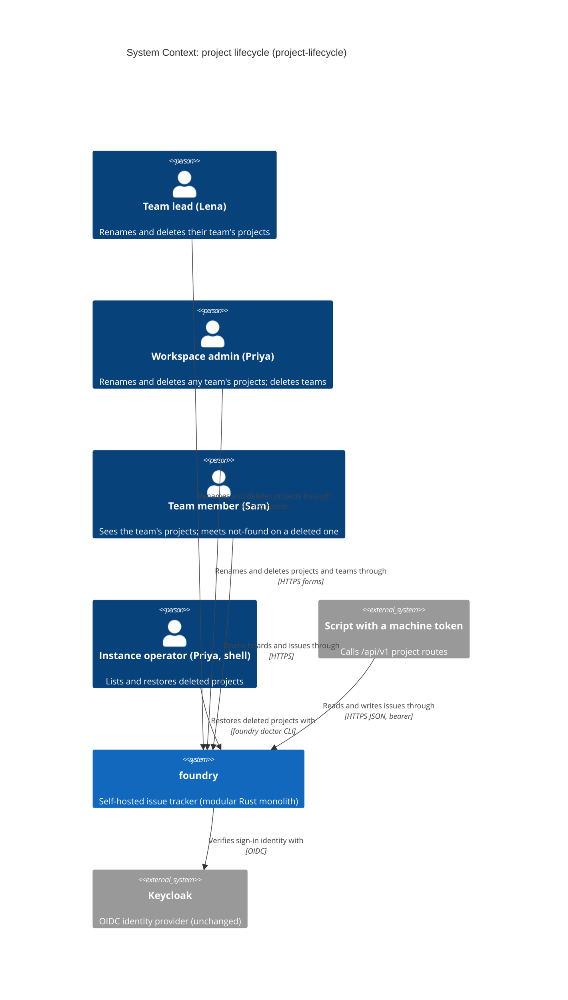
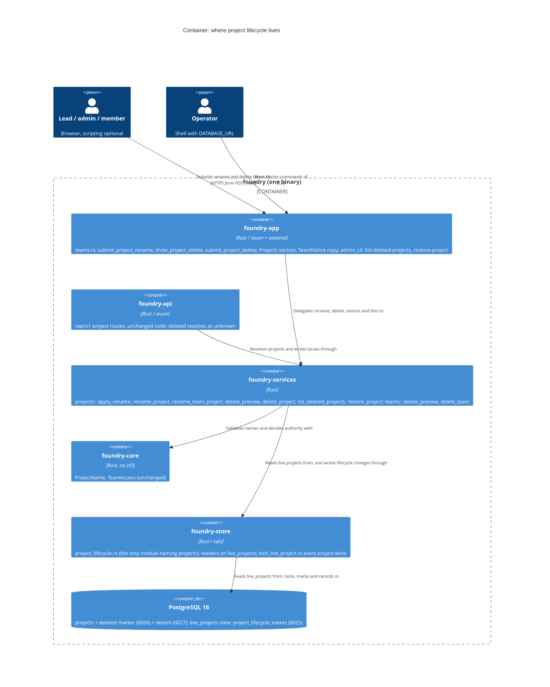
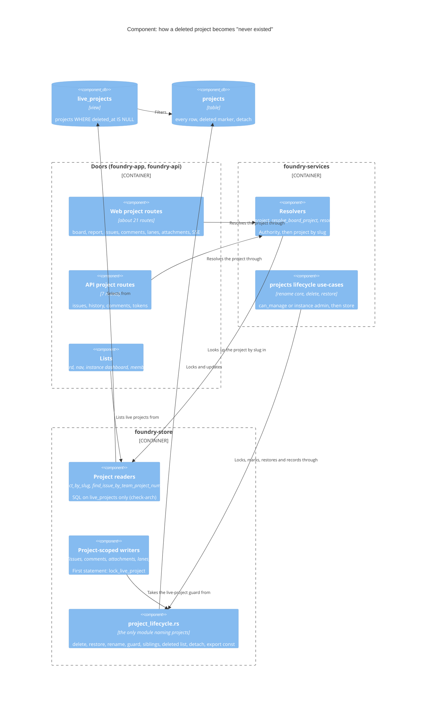

<!-- markdownlint-disable MD024 -->
# Feature Delta: project-lifecycle

A team's lead, or a workspace admin, can rename a project and delete it from
inside its team. Create and read already ship (`/team/{team_slug}/projects/new`
and the board). Today only an instance super-admin can rename a project, from
`/admin/instance/workspaces`, and nothing can delete one: a project lives until
psql removes it, and a team that holds one can never be deleted
(team-lifecycle OQ-4, TL-KPI-5). A delete here is a **soft delete**: the project
disappears for everyone, nothing under it is erased, and the instance operator
can bring it back.

## Wave: DISCUSS

Product owner: Luna (nw-product-owner) | Date: 2026-10-12 | Feature type:
user-facing | Walking skeleton: none (brownfield; every surface it extends
ships) | UX depth: lightweight, happy path plus the main refusals and races |
Research depth: comprehensive (user) | JTBD: yes, a new job | Density: lean,
Tier-1 [REF] only, `expansion_prompt = ask-intelligent` | Requirements
readiness: two decisions locked by the user (D-A, D-B), the rest explored here.

### [REF] Prior Wave Consultation

| Artifact | Status | Note |
|---|---|---|
| `docs/product/jobs.yaml` | ✓ | `job-instance-project-rename` (the super-admin's door, drift), `job-project-naming` (one rule on both doors), `job-team-lifecycle` (team create/rename/delete; its delete refuses while projects exist). None covers a team retiring its own project. A new job, `job-project-lifecycle`, is appended. |
| `docs/product/journeys/*` | ✓ | Three journeys (theme, issue-card-delete, card-drag-drop). `journey-issue-card-delete.yaml` is the closest shape (a delete with a confirm that counts). `journey-project-lifecycle.yaml` is added, because this feature has a delete and a restore whose emotional arc matters. team-lifecycle added none. |
| `docs/product/personas/persona-instance-operator.yaml` | ✓ | Priya Raman: instance operator with shell access (the restore door's user), workspace admin of Canzan Labs, member of Backend. Gains `also_referenced_by` and the job id only. Marco (`persona-team-member-foil`) is the 404 foil. |
| `docs/product/outcomes/registry.yaml` | ✓ | OUT-1 (instance project rename, slug-stable), OUT-19 (the project-name rule), OUT-20 (DB name triggers), OUT-24..26 (team lifecycle). This feature amends OUT-1 and OUT-25 and adds new rows **at DISTILL**, as team-lifecycle did. |
| `docs/product/kpi-contracts.yaml` | ✓ | `team-lifecycle` TL-KPI-5 ("admins who try to delete a team with projects hit the refusal; above 0 is evidence for project delete or move") is this feature's demand signal. A `project-lifecycle` key is appended at DISTILL. |
| `docs/feature/team-lifecycle/feature-delta.md` (all waves) | ✓ | **The format precedent.** D4 (slugs are identity), D5 (uniform 404), D8 (GET confirm + POST), D11 (tenancy from the session), D12 (copy locked), D15 (byte-equal rename writes nothing), OQ-4 (refuse a team delete while it has projects), OQ-6 (`team_lifecycle_events`), INV-TL-1 (no lost project). Followed section for section. |
| `docs/evolution/2026-10-12-team-lifecycle.md` | ✓ | Follow-up "OQ-4 (b)/(c): project delete or move" is **partly closed** here (delete; move stays out). Lesson 1 (check collision examples against the real `slugify`) applied: every slug in this document was derived by hand from `slugify`'s lowercase-and-hyphen rule. Lesson 5 (tenancy column in authz outlines) applied: the matrix names Hugo, a Globex admin. |
| `docs/evolution/2026-10-10-team-membership.md` | ✓ | D9 (managing a team grants no board access), DDD-3 (`TeamAccess::of`, now with `Administer`). Project rename and delete use `Manage`, not `Administer` (D-B). |
| `docs/feature/project-name-rule/feature-delta.md` | ✓ | D2 the rule (trim, non-empty, no refused character, at most 256, unique within the team), D11 the refusal shapes, the copy is `ProjectNameError`'s `Display`. Reused unchanged. |
| `docs/feature/instance-admin-project-rename/feature-delta.md` | ✓ | D1 display name only (slug, key prefix, issue keys unchanged), D5 uniform 404, D7 the accepted duplicate-label race. That door stays; this feature adds the team's own door beside it. |
| `docs/product/architecture/brief.md`, `adr-project-rename-001/002`, `adr-team-lifecycle-002/003`, `adr-issue-delete-002` | ✓ | "Names are labels; slugs are identity"; rename is a services use-case; delete refusal under `FOR UPDATE`; the audit table pattern; GET+POST confirm. Read for grounding, not changed. |
| DIVERGE (`docs/feature/project-lifecycle/diverge/*`), DISCOVER, `docs/product/vision.md` | ⊘ | Do not exist. Grounded in the user's locked decisions (D-A, D-B), the team-lifecycle follow-up and code reading. **Recorded risk** (see Wave Decisions), as in every precedent. |

No contradiction with prior evidence. One tension is surfaced, not resolved:
team-lifecycle's INV-TL-1 says "no project row is ever removed by a team
delete", and its D9 says a team delete never destroys a project the admin was
not shown. Once a project can be soft-deleted, a team whose only projects are
deleted must either stay undeletable or do something with those rows. That is
OQ-1.

### [REF] Lifecycle inventory (code-grounded)

| Fact | Source |
|---|---|
| `projects(id, team_id → teams ON DELETE CASCADE, workspace_id, name, slug, key_prefix ^[A-Z]{2,6}$, next_issue_number, UNIQUE(team_id, slug), UNIQUE(workspace_id, key_prefix))`. No deleted marker exists. | `0001_init.sql:51-62` |
| Everything under a project cascades from it: `issues` (0001), `comments` (0004), `issue_attachments` stored inline (0005), `issue_change_events` (0013), `lanes` (0015). | migrations |
| Soft-delete precedent: `comments.deleted_at` + `deleted_by` (0006), hidden from the live list, restored by `foundry doctor restore-comment <uuid>` (`admin_cli.rs:446`, exit 0 restored / 2 bad uuid / 3 DB / 4 not restorable). A 90-day GC purges tombstoned comments (`gc_tombstoned_comments`). | `0006`, `admin_cli.rs`, `lib.rs:3116` |
| Project rename today: `POST /admin/instance/projects/{project_id}/rename`, instance admin only, `ProjectName` rule, byte-equal is a no-op, `UPDATE projects SET name` with **no lock and no record**. | `lib.rs:4298-4360`, `foundry-services/src/projects.rs:89-127` |
| Project delete: **none** in production code (`DELETE FROM projects` appears in acceptance fixtures only). | grep |
| Team delete: `delete_team_if_empty` locks the team `FOR UPDATE`, lists `SELECT name, key_prefix FROM projects WHERE team_id = $1`, refuses on any row, else deletes and records. | `foundry-store/src/teams.rs:589, 740-785` |
| Project addresses. Web: `/team/{t}/project/{p}` (board), `/report` (+ `?format=csv`), `/issues` (create), `/issues/new`, `/search`, `/events` (SSE), `/issues/{n}`, `/issues/{n}/state`, `/edit`, `/delete`, `/comments`, `/comments/{id}` (+ `/edit`), `/lanes/{l}/delete`, `/edit`, `/insert/{side}`, `/move`. API: `/api/v1/teams/{t}/projects/{p}/issues`, `/issues/{n}`, `/history`, `/comments`, `/comments/{id}`, `/tokens`, `/tokens/{jti}`. | `foundry-app/src/lib.rs:564-710`, `foundry-api/src/lib.rs:312-338` |
| Project readers in the store that a deleted marker must reach: `list_projects_for_workspace` (dashboard, nav), `find_project_by_slug`, `find_issue_by_team_project_number`, the issue joins at `lib.rs:1973, 2251, 2315, 2381`, `lanes.rs:302, 361, 664`, `list_projects_for_instance`, `project_rename_context`, `TEAM_PROJECTS_SQL`, `export_workspace`. About 15 sites. | grep `FROM projects` / `JOIN projects` in `src` |
| The team members page has no project list today. It shows **New project** to anyone on the team, **Rename** to `Manage`, **Delete team** to `Administer`. | `templates/team_members.html` |
| `TeamAccess::of(is_admin, role)`: admin → `Administer`, lead → `Manage`, member → `View`. `can_manage` is true for admin and lead. | `foundry-core/src/team_membership.rs:52-76` |
| `team_lifecycle_events(workspace_id, team_id (no FK), team_slug, kind renamed\|deleted, actor_id NOT NULL, name, new_name, created_at)`, kept out of the per-workspace export. | `0023_team_lifecycle_events.sql` |
| Workspace roles can be changed only by hand-written SQL (no `foundry doctor` door). Found 2026-10-12 when the user's Keycloak account had to be made a workspace admin by SQL. | user report; `main.rs:800-973` lists the doctor commands |

### [REF] Persona

- **Lena Park**: lead of Backend in Canzan Labs, a workspace `member` (not an admin). The primary actor: they own Backend's projects day to day. Referenced inline, as in team-lifecycle.
- **Priya Raman** (`persona-instance-operator`): workspace admin of Canzan Labs and member of Backend, and the instance operator with shell access. They act as a workspace admin in the web stories and as the operator in the restore story.
- **Sam Okafor**: a member of Backend (not a lead). They can see Backend's projects and must not be able to rename or delete them.
- **Marco** (`persona-team-member-foil`): signed in, not on Backend. The uniform-404 foil.
- **Hugo Brandt**: workspace admin of Globex, a different workspace on the same instance. The tenancy foil (team-lifecycle lesson 5): an admin elsewhere is a stranger here.

### [REF] JTBD

**job_id: `job-project-lifecycle`** (appended to `docs/product/jobs.yaml`).

One-liner: *When a project on my team no longer fits (its name has drifted, it
was created by mistake, or its work is over), I want to rename it or delete it
myself from the team's page, so our project list matches the work we actually
do, without asking an instance admin, without psql, and without losing a single
issue if I change my mind.*

Job stories:

1. When "Identity Platform" has become the team's access-management work, I want to rename it myself, and every bookmark and every issue key (AUTH-7) should keep working.
2. When "Auth v2 Spike" was created by mistake or its work is over, I want to delete it so it stops cluttering the dashboard, the new-issue picker and the team page, and be told before I commit what disappears.
3. When I deleted a project and realise a week later that one of its issues still mattered, I want it back exactly as it was.
4. When every project of a team is retired, I want to be able to retire the team too (team-lifecycle TL-KPI-5).

Dimensions: **functional**: rename and delete a project from its team's page as
its lead or a workspace admin, under the shipped project-name rule; restore it
through the operator. **Emotional**: deleting stops being frightening, because
nothing is erased. **Social**: the team's project list says what the team
works on now, and nobody has to ask an instance admin to tidy it.

Four forces:

- **Push**: only an instance super-admin can rename a project, from an instance-wide dashboard a lead never sees. No delete exists, so mistaken and finished projects stay on every dashboard, every new-issue picker and every team forever, and a team holding one can never be deleted (TL-KPI-5).
- **Pull**: a **Rename** field and a **Delete project** link next to each project on the team's page, the way the team's own rename and delete already work.
- **Anxiety**: that a delete takes issues, comments and attachments with it for good; that a rename breaks URLs or changes issue keys; that someone without the right can delete a project; that a deleted project still answers on some forgotten URL or through the API.
- **Habit**: asking an instance admin, or psql. The product path must be safer (nothing erased, a restore exists, slugs and keys stay put), not just closer.

### [REF] Scope Assessment: PASS (5 stories, 3 contexts, about 5 days)

| Oversized signal | Fired? | Evidence |
|---|---|---|
| More than 10 user stories | No | 5 |
| More than 3 bounded contexts or modules | No (exactly 3) | the project catalogue (rename, delete, restore, every project-scoped web and API door), teams (the team delete's projects check, OQ-1), the operator CLI (`foundry doctor`) |
| Walking skeleton needs more than 5 integration points | No | No walking skeleton (brownfield). The thinnest slice (01) is one route, one store write, one template section. |
| More than 2 weeks of effort | No | about 5 days |
| Multiple independent outcomes that could ship separately | **Yes** | Rename and delete are independent outcomes |

One of five signals fires, so the verdict is **right-sized**. Rename (slice 01)
could split into its own feature with no rework. The delete-and-hide surface
(slice 02) is the largest piece, because it must close every project address,
and is kept whole on purpose (see Story Map).

### [REF] Locked Decisions

| ID | Decision | Source |
|---|---|---|
| D-A | **Project delete is a soft delete.** The project is hidden. Every address under it answers the uniform 404. Nothing (issues, comments, attachments, change events, lanes, the issue counter) is erased. An admin can restore it. Precedent: `foundry doctor restore-comment <uuid>`. | **User** |
| D-B | **Rename and delete: the team's lead(s) and workspace admins.** The same rule as team rename in v0.14.0 (`TeamAccess` `Manage`). A member, an outsider, a lead of another team, an admin of another workspace, an instance admin who is not a workspace admin and a signed-out visitor get the uniform 404. | **User** |
| D-C | **Out of scope:** moving a project between teams (OQ-4(b) of team-lifecycle), a hard purge, and a cascade delete (OQ-4(c)). | **User** |
| D1 | User-facing feature. JTBD yes. UX depth lightweight. No walking skeleton: every surface it extends ships (board, members page, `TeamAccess`, project rule, doctor CLI). | User |
| D2 | **Rename changes the name only.** `projects.slug` and `key_prefix` never change, so every URL, bookmark and issue key (AUTH-7) keeps working. There is no "change project URL" and no "change key" here. (OQ-2 asks the user to confirm.) | ADR-PROJECT-RENAME-001; team-lifecycle D4; instance-admin-project-rename D1 |
| D3 | **One project-name rule on both rename doors.** The team's new door runs the shipped `ProjectName` rule (OUT-19) with the shipped copy, the project itself excluded from uniqueness, exactly as the instance-admin door does. A byte-equal name writes nothing. A case-only change is a rename. | project-name-rule D2, D11; team-lifecycle D15 |
| D4 | **Every refused request on a new or changed route is the uniform 404**, on both verbs, byte-identical to `resource_not_found_page`: signed out, an unknown team or project slug, another workspace's team, a deleted project, and a caller without the right. A stated reason (a name refusal) is shown only to an authorized actor. | team-lifecycle D5 |
| D5 | **"Hidden" means hidden from everyone, including the person who deleted it and every admin.** After a delete, every web and API address under the project answers exactly as an address that never existed (D4, API: its shipped not-found answer). Every list drops it: the dashboard, the nav, the new-issue project picker, the team page, the instance-admin dashboard, and the team delete's project list (subject to OQ-1). The only ways to see it are the operator CLI (D10) and the database. | D-A; no new oracle |
| D6 | **"Nothing is erased" is exact.** A delete writes the project's deleted marker (who, when) and the record (OQ-3), and changes no other row: issue, comment (live or tombstoned), attachment, change event, lane, outbox row or the issue counter. | D-A |
| D7 | **Delete is a GET confirm page plus a POST, and works with scripting disabled.** The confirm page states the consequence before anything happens: the issue count, that the board, the issues and their keys stop working for everyone, and that nothing is erased and the instance operator can restore it. No typed-name confirmation (OQ-5). | ADR-ISSUE-DELETE-002; team-lifecycle D8 |
| D8 | **The controls live on the team's members page**, in a new **Projects** section. Anyone who can view the team sees each live project as "{name} · {KEY}", linking to its board. A `Manage` caller also sees a prefilled **Project name** field with **Rename**, and a **Delete project** link, per project. The board gains no new control. DESIGN may move them; the copy stays. | PO: the team page is already where the team is managed; a destructive control on the board header was rejected for lanes (board-lane-overflow-menu) |
| D9 | **Tenancy comes from the session.** A project is resolved by (acting workspace, team slug, project slug), live projects only. No workspace or project id is parsed from a web request. | team-lifecycle D11 |
| D10 | **Restore is an operator door, not a web page.** `foundry doctor list-deleted-projects` prints every deleted project; `foundry doctor restore-project <uuid>` restores one against `DATABASE_URL`, with `restore-comment`'s exit codes (0 restored, 2 invalid uuid, 3 database, 4 not restorable). A web restore for workspace admins is a follow-up (OQ-6). | D-A ("precedent: restore-comment") |
| D11 | **A restore puts back exactly what was there.** The same name, slug, key, issue numbers, issue counter, lanes, comments and attachments. Every address answers as it did before the delete. | D-A |
| D12 | **The comment tombstone GC is unchanged.** Comments a user deleted (tombstones) inside a deleted project are purged on their usual 90-day schedule; the project delete neither speeds it up nor pauses it. Live comments are never touched. | PO: the project delete erases nothing *new*; pausing GC would add a special case for no user value |
| D13 | **The per-workspace export includes deleted projects**, marked as deleted. An export is the operator's copy of the data, and D-A says nothing is erased. | PO |
| D14 | **Copy is locked** (DESIGN may change routes, not strings). See [REF] Copy. | PO, for testable ACs |
| D15 | **Routes are proposed, and DESIGN finalizes them.** `POST /team/{team_slug}/project/{project_slug}/rename`, `GET` and `POST /team/{team_slug}/project/{project_slug}/delete`. Plain forms on the shared CSRF layer. Neither collides with a shipped route. | PO, following team-lifecycle D13 |
| D16 | **The instance-admin rename door stays**, unchanged in behaviour except that it never finds a deleted project (uniform 404) and, if OQ-3 is accepted, writes the same rename record. | instance-admin-project-rename D1, D5 |
| D17 | **Notifications queued before a delete are delivered; none arise after it.** A notification already queued when the delete commits reports a change made while the project was live, so it goes out as usual (its link answers 404 until a restore). After the delete no write can reach the project, so no new notification arises. A restore does not replay anything. | PO: holding queued mail would need a new outbox state and a release-on-restore path, for a window of seconds; D6 keeps the queue untouched |

### [REF] Copy (D14)

- Members page, section heading **Projects**. Each row: "{project} · {KEY}" linking to the board. Empty: "{team} has no projects yet." Per row for `Manage`: field **Project name** (prefilled), button **Rename**, link **Delete project**.
- Renamed: "Renamed {old} to {new}." (members page notice).
- Name refusals: the shipped `ProjectNameError` `Display`: "Project name must not be empty" · "Project name must not contain control characters" · "Project name must be at most 256 characters" · "Project name must be unique within the team". Shown in that project row, with the typed text kept.
- Confirm page: heading "Delete {project}?". Then "{project} ({KEY}) has {n} issue(s). After it is deleted, nobody can open its board, its issues or its report, and links to {KEY} issues stop working." Then "Nothing is erased. The instance operator can restore {project} with every issue, comment and attachment." Buttons **Delete project** and **Cancel** (back to the members page).
- Deleted: "Deleted {project}." (members page notice).
- Team delete page, only if OQ-1 is answered (b), when the team has deleted projects and no live ones, one extra line: "{team} also has {k} deleted project(s): {list}. They are kept, but can't be restored after {team} is deleted, and their keys stay taken in {workspace}." The list reads "Prototype Graveyard (PROTO)".
- CLI `list-deleted-projects`, one `key: value` block per project, blank line between blocks, oldest deletion first:
  `project-id: {uuid}` · `workspace: {workspace}` · `team: {team_slug}` · `name: {project}` · `key: {KEY}` · `issues: {n}` · `deleted-at: {RFC 3339 UTC}` · `deleted-by: {email}`. None: `status: none`. Exit 0.
- CLI `restore-project`: stdout `project-id: {uuid}` and `status: restored`, exit 0. Exit 4 with stderr `foundry doctor restore-project: project {uuid} is not deleted — status: not restorable`, or `… not in database — status: not restorable`, or (OQ-1 (b)) `… its team {team_slug} was deleted — status: not restorable`. Exit 2 and 3 as `restore-comment`.
- Pluralization follows the shipped "1 member(s)" style.

### [REF] Open Questions (each has a recommended answer; the stories assume it)

These need the user's answer. Each names the stories it touches.

**Answered by the user, 2026-10-12: every recommendation accepted.** OQ-1 (b): a deleted project no longer blocks a team delete; its row is kept, detached. OQ-2: the slug and key stay fixed on rename. OQ-3: renames, deletes and restores are recorded in the same transaction, on both rename doors. OQ-4: a deleted project's name, slug and key stay taken. OQ-5: no typed-name confirmation. OQ-6: restore is CLI-only. These are now decisions; DESIGN must not reopen them.

- **OQ-1: Does a soft-deleted project still block a team delete? (touches US-PL-05 only)** The options:
  - (a) **Yes, it still blocks.** The refusal names it ("Labs still has 1 project(s): Prototype Graveyard (PROTO), deleted. …"). Zero schema impact on teams, but a team can then never be deleted once it has held any project, because there is no purge (D-C). TL-KPI-5's demand stays unmet.
  - (b) **No, it no longer counts. The team delete keeps the deleted projects' rows, detached from the gone team.** Nothing is erased (D-A holds). A detached project can't be restored, because restoring needs a team and moving is out of scope (D-C): `restore-project` refuses it with exit 4 and the reason, and the data waits for a "restore into a team" follow-up. The confirm page says so before the delete. This needs `projects.team_id` to survive its team (a schema change DESIGN chooses: for example a nullable `team_id` allowed only on deleted rows).
  - (c) No, it no longer counts, and the team delete erases them. Rejected: that is the hard purge and cascade delete that D-C puts out of scope, and it breaks D-A.
  - (d) No, it no longer counts, and the deleted projects move to another team. Rejected: that is a move (D-C).

  *Recommended: (b).* It is the only option that honours D-A (nothing erased), D-C (no purge, no move) and the job's fourth story (a team whose work is all retired can be retired). The cost is a schema change on a core foreign key, an orphaned-restore gap (recorded as a follow-up), and the detached projects' keys staying taken in the workspace for good (stated on the confirm page). If the user picks (a), US-PL-05 shrinks to one refusal-copy change and slice 04 becomes half a day.
- **OQ-2: Do the slug and the key stay fixed on a project rename? (US-PL-01)** *Recommended: yes, both.* This is the shipped behaviour of the instance-admin door (D1 there), team-lifecycle D4 for teams, and the brief's "names are labels; slugs are identity". Changing the key would rewrite every issue id (AUTH-7 → ACCESS-7) in comments, commit messages, emails and bookmarks outside foundry. A "change key" or "change URL" is a separate feature if ever wanted.
- **OQ-3: Are renames, deletes and restores recorded? (US-PL-01, -02, -04)** *Recommended: yes, all three*, in an append-only `project_lifecycle_events`-style record mirroring `team_lifecycle_events`, written in the same transaction as the change, kept out of the per-workspace export:
  - renamed: actor · project · old name → new name · when;
  - deleted: actor · project · name · key · when;
  - restored: "the operator (foundry doctor)" · project · when (the CLI has no signed-in user, so the actor is recorded as the operator).

  And **both** rename doors write it: the shipped instance-admin door joins in, so "who renamed this?" has one answer whichever door was used. No UI in this feature (read with psql). The deleted marker on the project row (who, when) is required either way, because `list-deleted-projects` prints it.
- **OQ-4: Can a new project take a deleted project's name, slug or key? (US-PL-04)** *Recommended: no, not while the project is deleted.* A deleted project keeps its name (case-insensitive, in its team), its derived slug (in its team) and its key (in its workspace). A create or rename that collides gets the shipped copy ("Project name must be unique within the team", "Project key is already in use in this workspace"). This guarantees a restore can never collide (INV-PL-5), keeps every old link and issue id pointing at one project only, and costs no schema change (the rows and unique constraints already stay). The cost: someone reusing "Auth v2 Spike" must pick another name or ask for a restore. Freeing them instead needs partial unique indexes and a restore that can fail or rename on collision. Under OQ-1 (b), a detached project keeps its key in the workspace; its team's names are freed with the team.
- **OQ-5: Is a typed confirmation needed for delete? (US-PL-02)** *Recommended: no.* The GET confirm page plus POST (D7) is the house pattern for team, lane and issue deletes, which are all irreversible. A soft delete is reversible, so the bar is lower, not higher.
- **OQ-6: Is restore CLI-only in this feature? (US-PL-04)** *Recommended: yes.* D-A names `restore-comment` as the precedent, which is an operator CLI. A "Deleted projects" page with **Restore** for workspace admins is a follow-up, built if PL-KPI-6 shows restores are requested often.

**Resolved:** all recommendations accepted 2026-10-12 (see above). If any OQ is answered against its
recommendation, the affected ACs are edited before DESIGN. The DoR table names
the OQs each story depends on.

### [REF] Journey (lightweight: happy path plus main refusals)

Emotional arc, **from clutter to tidy, without fear**: cluttered (a dead spike
on every dashboard and picker; asking an instance admin for a rename) → in
control (the team page lists the team's projects with Rename and Delete) →
wary (a destructive control) → reassured (the confirm page says nothing is
erased and how it comes back) → tidy (the project is gone everywhere) →
relieved (the operator restores it, exactly as it was). The full journey is
`docs/product/journeys/journey-project-lifecycle.yaml`.

```text
[Where]                              [Does]                                        [Sees]                                                              [Feels]
/team/backend/members (Lena, lead)   opens the team page                            Projects: "Identity Platform · AUTH", "Auth v2 Spike · SPIKE"     in control
/team/backend/members                edits Identity Platform to                     "Renamed Identity Platform to Identity & Access."                  confident
                                     "Identity & Access", clicks Rename             /team/backend/project/auth/issues/7 still opens AUTH-7
/team/backend/members                clicks Delete project on Auth v2 Spike         /team/backend/project/auth-v2-spike/delete:                        wary
                                                                                    "Delete Auth v2 Spike? Auth v2 Spike (SPIKE) has 3 issue(s). …
                                                                                     Nothing is erased. The instance operator can restore …"           reassured
/team/backend/project/.../delete     clicks Delete project                          /team/backend/members: "Deleted Auth v2 Spike."                     tidy
/team/backend/project/auth-v2-spike  (Sam, an old bookmark)                         the uniform not-found page                                         (expected)
shell (Priya, operator)              foundry doctor list-deleted-projects           "name: Auth v2 Spike" "key: SPIKE" "issues: 3" "deleted-by: lena@…" focused
shell                                foundry doctor restore-project <uuid>          "status: restored"; the board, SPIKE-1..3 and their comments open  relieved
```

Main refusals and edge paths:

| Step | What happens | Sees |
|---|---|---|
| Sam (member) posts a rename or opens the delete page of Identity Platform | refused | the uniform 404 (D-B, D4) |
| Marco, Hugo (Globex admin), a signed-out visitor, the same | refused | the uniform 404 |
| Lena posts a rename of Reading List (Ops; Lena leads only Backend) | refused | the uniform 404 (lead of another team) |
| Lena renames Identity Platform to "auth v2 spike" while Auth v2 Spike is live, or deleted | refused, text kept | "Project name must be unique within the team" (OQ-4) |
| Lena creates a new project with key SPIKE after the delete | refused | "Project key is already in use in this workspace" (OQ-4) |
| Sam saves an edit to SPIKE-2 from a dialog opened before the delete | refused, nothing changes | the uniform 404 (INV-PL-3) |
| The SPIKE board is open in Sam's tab during the delete | next action refused | the uniform 404 |
| Priya restores a project that is not deleted | exit 4 | "… is not deleted — status: not restorable" |
| (OQ-1 b) Priya deletes team Labs whose only project, PROTO, is deleted | confirm page warns; delete succeeds | "Labs also has 1 deleted project(s): Prototype Graveyard (PROTO). They are kept, but can't be restored after Labs is deleted, and their keys stay taken in Canzan Labs." |

### [REF] Shared Artifacts

| Artifact | Source of truth | Consumers | Risk |
|---|---|---|---|
| `${project}` (name) | `projects.name` | members page row, board heading, nav, dashboard, new-issue picker, confirm page, notices, instance dashboard, CLI | MEDIUM: rename must reach every consumer by reading |
| `${project_slug}` | `projects.slug`, minted once | every `/team/{t}/project/{p}/…` and `/api/v1/…/projects/{p}/…` address, bookmarks | HIGH: rename and restore must not touch it (D2, D11) |
| `${KEY}` and issue ids | `projects.key_prefix`, `issues.number` | issue keys everywhere (AUTH-7), confirm page, CLI | HIGH: never changes (D2); held while deleted (OQ-4) |
| Deleted marker (who, when) | the project row (DESIGN names the columns) | every project reader (D5), CLI list, restore | **HIGH: one missed reader is a leak (INV-PL-2)** |
| `${project_id}` | `projects.id` | CLI `list-deleted-projects` and `restore-project`, the instance-admin rename route, lifecycle records | LOW: never shown in the web UI to non-admins |
| Live project list of a team | `projects` by `team_id`, live only | members page Projects section, team delete check (OQ-1) | HIGH: the team delete's check decides at commit time |
| Issue count | `issues` by `project_id` | confirm page, CLI list | LOW: advisory |
| Acting workspace | session `SessionUser.workspace_id` | every route | HIGH: tenancy (D9) |
| Name-rule copy | `ProjectNameError` `Display` | both rename doors, create | MEDIUM: one source |
| Uniform 404 | `resource_not_found_page`; the API's not-found | every refusal and every deleted-project address | HIGH |

### [REF] Story Map and Slices

Backbone: **See the team's projects → Name one right → Retire one → Bring one
back → Retire the team**

| Slice | Stories | What it adds | Est. | Brief |
|---|---|---|---|---|
| 01 | US-PL-01 | The team page lists the team's projects. A lead or admin renames one; the slug, key and every link stay. | 1 d | `slices/slice-01-rename-project-from-its-team.md` |
| 02 | US-PL-02, US-PL-03 | A lead or admin deletes a project through a confirm page. It vanishes from every list and every web and API address answers the uniform 404, for everyone. Nothing is erased. | 2 d | `slices/slice-02-delete-project-hidden-everywhere.md` |
| 03 | US-PL-04 | The operator lists deleted projects and restores one exactly. A deleted project's name, slug and key stay taken. | 1 d | `slices/slice-03-operator-restores-a-project.md` |
| 04 | US-PL-05 | (OQ-1) A team whose projects are all deleted can be deleted; its deleted projects are kept. | 1 d | `slices/slice-04-retire-a-team-of-retired-projects.md` |

Priority by learning leverage and risk:

1. **01** first. Lowest uncertainty (the rule, the policy and the slug discipline all ship), and it lands the Projects section that 02 hangs its control on. It is dogfooded the same day: Lena-style rename of a real dev project.
2. **02** next. It carries the riskiest assumption: that **every** address of a project can be closed by one deleted marker without missing a reader (INV-PL-2). About 15 store readers and 21 routes. Learning that early costs least. It is 2 days, over the one-day taste test, **on purpose**: shipping the delete before the API and SSE doors are closed would leave a "deleted" project answering on `/api/v1`, which is a leak, and an infrastructure-only "close the other doors" slice is forbidden.
3. **03** third, and **released together with 02** (the user tags releases; slice 02 is not tagged without 03). A delete with no restore is a hard delete in practice for everyone without psql. It holds the second risk: that a restore is exact (INV-PL-4).
4. **04** last. It depends on OQ-1, touches team-lifecycle's proven delete transaction, and has value only once 02 and 03 exist.

Taste tests: no slice ships 4 or more new components. No slice is
infrastructure only. Every slice names what it disproves (see the briefs). Every
dogfood uses dev's real workspaces. No two slices differ only in scale.

### [REF] User Stories

#### US-PL-01: A team's lead renames a project from the team page, and every link and issue key keeps working

`job_id: job-project-lifecycle` | slice 01

##### Elevator Pitch

Before: "Identity Platform" became Backend's access-management work, but only an instance super-admin can rename it, from `/admin/instance/workspaces`, which Lena (Backend's lead) never sees. Lena files a request and waits.
After: on `/team/backend/members`, under **Projects**, Lena edits **Project name** to "Identity & Access" and clicks **Rename** → "Renamed Identity Platform to Identity & Access." The row reads "Identity & Access · AUTH", and `/team/backend/project/auth/issues/7` still opens AUTH-7.
Decision enabled: Lena keeps Backend's project names truthful themselves, knowing no link or issue id changes.

##### Problem

Project names drift as work changes. The only rename door is an instance-wide
super-admin dashboard, so the people who own the project (its team's lead)
cannot fix its name.

##### Who

- A team's lead, or a workspace admin | the team's members page, desktop browser | wants a project's name to say what it is now.

##### Domain Examples

1. **Lead**: Lena renames Identity Platform (AUTH, slug `auth`, minted from its original name "Auth" at creation and never re-derived) to "Identity & Access" → the row reads "Identity & Access · AUTH". `/team/backend/project/auth` and `/team/backend/project/auth/issues/7` still answer 200.
2. **Admin, another team**: Priya (workspace admin, not on Ops) renames Homelab Ops (OPS, slug `homelab-ops`) on `/team/ops/members` to "Homelab Operations" → "Renamed Homelab Ops to Homelab Operations.". The slug stays `homelab-ops`.
3. **Duplicate**: in Ops, Priya renames Reading List (READ) to "homelab operations" → "Project name must be unique within the team", the field keeps "homelab operations", nothing changes.
4. **Case-only and no-op**: "Reading list" → "Reading List" is a rename. Submitting "Reading List" unchanged writes nothing and shows no notice.
5. **Refused**: Sam (member of Backend), Marco, Hugo (Globex admin) and Lena on Ops (lead of Backend only) each post a rename → the uniform 404, nothing changes. Sam sees the Projects list with no Rename or Delete.

##### UAT Scenarios (BDD)

###### Scenario: A team's lead renames a project and every link to it keeps working

- Given Lena leads Backend, which has project Identity Platform (AUTH) at /team/backend/project/auth with issue AUTH-7
- When Lena renames Identity Platform to "Identity & Access" on Backend's page
- Then Lena sees "Renamed Identity Platform to Identity & Access." and Backend's Projects list shows "Identity & Access · AUTH"
- And /team/backend/project/auth and /team/backend/project/auth/issues/7 still open, and the issue is still AUTH-7

###### Scenario: A workspace admin renames a project of a team they are not on

- Given Priya is a workspace admin of Canzan Labs and not on Ops, which has Homelab Ops (OPS)
- When Priya renames Homelab Ops to "Homelab Operations" on Ops's page
- Then Priya sees "Renamed Homelab Ops to Homelab Operations." and the project's address is still /team/ops/project/homelab-ops

###### Scenario: A name already used in the team is refused

- Given Ops has projects Homelab Operations and Reading List
- When Priya renames Reading List to "homelab operations"
- Then Priya sees "Project name must be unique within the team", their text is kept, and Reading List keeps its name

###### Scenario: Submitting the same name changes nothing

- When Lena submits Identity & Access's rename with "Identity & Access" unchanged
- Then Backend's page re-renders with no notice, and nothing is recorded

###### Scenario: Only the team's lead or a workspace admin can rename a project

- Given Sam is a member of Backend, Marco is on no team, and Hugo is a workspace admin of Globex
- When each of them, and a signed-out visitor, submits a rename of Identity Platform
- Then every request answers the uniform not-found page, and the project keeps its name
- And Sam sees Backend's Projects list without a Rename or Delete project control

##### Acceptance Criteria

- [ ] The members page shows a Projects section listing the team's live projects as "{project} · {KEY}" linking to each board, to anyone who can view the team; "{team} has no projects yet." when there are none (scenario 1; D8). (Edit pending DISTILL: link only when the viewer is on the team; see Changed Assumption 2.)
- [ ] A `Manage` caller sees a prefilled Project name field, Rename and Delete project per project; a `View` caller sees neither (scenario 5; D-B, D8).
- [ ] Rename writes the name only, never the slug or key; every shipped address under the slug answers as before; the D14 notice is shown (scenarios 1, 2; D2).
- [ ] The shipped project-name rule and copy apply, the project itself excluded from uniqueness, the input kept, nothing written (scenario 3; D3).
- [ ] A byte-equal name writes nothing and records nothing; a case-only change is a rename (scenario 4; D3).
- [ ] Every caller without `Manage` on the project's team, an unknown or deleted project, a foreign team and a signed-out caller get the uniform 404 with zero writes (scenario 5; D4).
- [ ] (OQ-3) Each effective rename, on this door and on the instance-admin door, is on record: who, which project, old name, new name, when. A refused or byte-equal rename leaves no record.
- [ ] It works with scripting disabled.

##### Outcome KPIs

PL-KPI-1, PL-KPI-4, PL-KPI-5.

##### Technical Notes

- Reuses `ProjectName` (OUT-19), `TeamAccess::can_manage` and the rename use-case of ADR-PROJECT-RENAME-002. DESIGN decides whether both doors share one use-case (recommended: yes, so OQ-3 holds on both).
- The shipped instance-admin rename is check-then-write with no lock (its D7 residual). Whether the new door locks, as `rename_team_with_audit` does, is DESIGN's call (INV-PL-9).
- No schema change unless OQ-3 is accepted (the record).
- Verification: the record AC is checked by a read-only store query (records have no UI).

##### Size

1 day | 5 scenarios | slice 01

#### US-PL-02: A team's lead deletes a project through a confirm page, and nothing under it is erased

`job_id: job-project-lifecycle` | slice 02

##### Elevator Pitch

Before: "Auth v2 Spike" (SPIKE), created by mistake in Backend, sits on every dashboard and in every new-issue picker forever, and no one but psql can remove it. In psql a delete would cascade over its 3 issues, 2 comments and 1 attachment with no way back.
After: on `/team/backend/members`, Lena clicks **Delete project** on Auth v2 Spike → `/team/backend/project/auth-v2-spike/delete` shows "Delete Auth v2 Spike? Auth v2 Spike (SPIKE) has 3 issue(s). … Nothing is erased. The instance operator can restore Auth v2 Spike with every issue, comment and attachment." Clicking **Delete project** lands on `/team/backend/members` with "Deleted Auth v2 Spike.", and the project is gone from the list.
Decision enabled: Lena can retire dead projects without fear, because the delete is reversible and says so.

##### Problem

Mistaken and finished projects accumulate on every dashboard, picker and team
page. There is no product delete, and the only removal (psql) destroys every
issue, comment and attachment under the project.

##### Who

- A team's lead, or a workspace admin | members page, confirm page | removes a project.

##### Domain Examples

1. **Mistaken project**: Lena deletes Auth v2 Spike (SPIKE: 3 issues, 2 comments, 1 attachment `spike-notes.png`) → "Deleted Auth v2 Spike.". Backend's Projects list shows only Identity & Access. The store still holds 3 issues, 2 comments and 1 attachment for SPIKE.
2. **Admin**: Priya deletes Reading List (READ, 0 issues) on Ops → the confirm page reads "Reading List (READ) has 0 issue(s). …"; after the delete, "Deleted Reading List.".
3. **Cancel**: Lena opens the confirm page and clicks **Cancel** → back on Backend's page, nothing changes.
4. **Refused**: Sam (member), Marco, Hugo and Lena on an Ops project each open the delete page and post a delete → the uniform 404, nothing changes.
5. **Double submit**: Lena's second POST of the same delete (a double click) → the uniform 404, because the project is already gone; one delete, one record.

##### UAT Scenarios (BDD)

###### Scenario: A team's lead deletes a project after reading what happens

- Given Lena leads Backend, which has Auth v2 Spike (SPIKE) with 3 issues
- When Lena opens Delete project on Auth v2 Spike
- Then Lena reads "Delete Auth v2 Spike?", "Auth v2 Spike (SPIKE) has 3 issue(s). After it is deleted, nobody can open its board, its issues or its report, and links to SPIKE issues stop working." and "Nothing is erased. The instance operator can restore Auth v2 Spike with every issue, comment and attachment."
- And when Lena confirms, they see "Deleted Auth v2 Spike." and Backend's Projects list no longer shows it

###### Scenario: Deleting a project erases none of its work

- Given Auth v2 Spike has 3 issues, 2 comments, 1 attachment and 4 lanes
- When Lena deletes Auth v2 Spike
- Then the store still holds exactly 3 issues, 2 comments, 1 attachment and 4 lanes for it, unchanged

###### Scenario: Cancelling a delete changes nothing

- When Lena opens Delete project on Auth v2 Spike and chooses Cancel
- Then Lena is back on Backend's page and Auth v2 Spike is still listed

###### Scenario: Only the team's lead or a workspace admin can delete a project

- Given Sam is a member of Backend, Marco is on no team, and Hugo is a workspace admin of Globex
- When each of them, a signed-out visitor, and Lena on Ops's Reading List open the delete page and submit a delete
- Then every request answers the uniform not-found page, and every project still exists

##### Acceptance Criteria

- [ ] The confirm page shows the D14 heading, the issue count and both consequence lines, with Delete project and Cancel (scenario 1; D7).
- [ ] The POST marks the project deleted (who, when) and lands on the members page with "Deleted {project}." (scenario 1; D-A).
- [ ] Every issue, comment (including deleted comments awaiting cleanup), attachment, history entry and lane of the project is still there and unchanged, and the next issue number is unchanged (scenario 2; D6, INV-PL-1).
- [ ] Cancel writes nothing (scenario 3).
- [ ] Every caller without `Manage`, a foreign team, an unknown or already-deleted project and a signed-out caller get the uniform 404 on both verbs with zero writes (scenario 4; D4).
- [ ] (OQ-3) Each delete is on record: who, which project, its name and key, when. A refused or cancelled delete leaves no record.
- [ ] Both pages work with scripting disabled.

##### Outcome KPIs

PL-KPI-1, PL-KPI-2, PL-KPI-5.

##### Technical Notes

- The deleted marker mirrors `comments.deleted_at`/`deleted_by` (0006). Column names and the migration are DESIGN's.
- The confirm page's issue count is advisory (the team-lifecycle INV-TL-3 posture).
- Verification: the "nothing erased" AC is checked by before-and-after store counts of issues, comments, attachments, change events, lanes and outbox rows; the record AC by a read-only store query.

##### Size

0.5 day | 4 scenarios | slice 02

#### US-PL-03: A deleted project answers nowhere, for anyone, on any door

`job_id: job-project-lifecycle` | slice 02

##### Elevator Pitch

Before: there is no delete, so the question never arose. With a delete, any address that forgets the project is deleted keeps serving it: an old board bookmark, an issue link in an email, `/api/v1/teams/backend/projects/auth-v2-spike/issues` from a script, an open live-update stream.
After: after Lena deletes Auth v2 Spike, `/team/backend/project/auth-v2-spike`, `/team/backend/project/auth-v2-spike/issues/2`, `…/report?format=csv` and `/api/v1/teams/backend/projects/auth-v2-spike/issues` all answer 404 with the same "not found" page as `/team/backend/project/no-such-project`, for Lena, Sam and Priya alike (the API answers its own not-found body). Sam's dashboard lists "Identity & Access" only, and the new-issue dialog's project picker no longer offers "Auth v2 Spike".
Decision enabled: Lena chooses to delete instead of leaving a dead project around (or asking Priya to run psql), because a delete removes it from every view Sam and scripts use.

##### Problem

A soft delete that leaves one door open is a leak and a confusion: the project
is "deleted" but still answers, and someone keeps filing issues into it.

##### Who

- Everyone who reaches a project: team members in the browser (Sam), scripts with a machine token, the instance admin's dashboard (Priya).

##### Domain Examples

1. **Bookmarks**: Sam opens their bookmark `/team/backend/project/auth-v2-spike/issues/2` (SPIKE-2) the day after the delete → the uniform 404.
2. **API**: a script with a machine token scoped to Backend GETs `/api/v1/teams/backend/projects/auth-v2-spike/issues` → the API's not-found answer, the same as for `/api/v1/teams/backend/projects/no-such-project/issues`.
3. **Lists**: Sam's dashboard and the new-issue dialog's project picker list Identity & Access only. Priya's `/admin/instance/workspaces` no longer lists Auth v2 Spike under Canzan Labs, and a rename POST to its id answers the uniform 404.
4. **Stale tab**: Sam had SPIKE-2's edit dialog open before the delete. Sam clicks Save → the uniform 404, and SPIKE-2 is unchanged.
5. **Race**: Sam files a new issue on Auth v2 Spike at the same moment Lena deletes it → either the issue is filed and then hidden with the project (and comes back with a restore), or Sam's create answers the uniform 404. Never a 500, never a lost issue.
6. **Notifications already queued**: Sam commented on SPIKE-2 a second before the delete. The email about that comment, already queued, is still delivered (it reports a change made while the project was live); its link answers 404 until a restore. No new notification about SPIKE can arise after the delete, because every write is refused.

##### UAT Scenarios (BDD)

###### Scenario: Every address of a deleted project answers not-found, for everyone

- Given Lena has deleted Auth v2 Spike (SPIKE)
- When Lena, Sam and Priya each open its board, SPIKE-2's page, its report, its CSV export, its new-issue form and its live updates
- Then every request answers the uniform not-found page, byte-identical to an address that never existed

###### Scenario: A deleted project is not reachable through the API

- Given Lena has deleted Auth v2 Spike and a script holds a machine token for Backend
- When the script lists SPIKE's issues, reads SPIKE-2 and posts a comment on it through the API
- Then each call gets the API's not-found answer, the same as for a project that never existed, and nothing is written

###### Scenario: A deleted project disappears from every list

- Given Lena has deleted Auth v2 Spike
- When Sam opens their dashboard and the new-issue dialog, and Priya opens the instance dashboard
- Then none of them lists Auth v2 Spike, and Identity & Access is still listed

###### Scenario: A change sent from a page opened before the delete is refused

- Given Sam opened SPIKE-2's edit dialog before Lena deleted Auth v2 Spike
- When Sam saves a new title
- Then Sam gets the uniform not-found page, and SPIKE-2 is unchanged

###### Scenario: Filing an issue during a delete gets a normal answer, never a server error

- When Sam files an issue on Auth v2 Spike at the same moment Lena deletes it
- Then either Sam's issue exists, hidden with the project, or Sam's request answered the uniform not-found page
- And no request answers a server error

##### Acceptance Criteria

- [ ] Every web route under `/team/{t}/project/{p}/…` (the inventory in [REF] Lifecycle inventory) answers the uniform 404 for a deleted project, on every verb, for every actor including its deleter and workspace admins (scenario 1; D5, INV-PL-2).
- [ ] Every `/api/v1/teams/{t}/projects/{p}/…` route answers the API's shipped not-found answer for a deleted project, with zero writes (scenario 2; INV-PL-2).
- [ ] The dashboard, the nav, the new-issue project picker, the team's Projects list and the instance dashboard omit deleted projects; the instance rename of a deleted project answers the uniform 404 (scenario 3; D5, D16).
- [ ] A write racing or following the delete gets its normal outcome or the uniform 404, never a 500; nothing it wrote before the delete committed is lost (scenarios 4, 5; INV-PL-3). Over 100 repeated delete-versus-issue-create races on real Postgres: 0 responses of 500, 0 lost issues.
- [ ] An open live-update stream on a deleted project sends no further events, and a reconnect answers the uniform 404 (scenario 1).
- [ ] Notifications queued before the delete are delivered as usual; none is produced after it (example 6; D17).

##### Outcome KPIs

PL-KPI-3, PL-KPI-5.

##### Technical Notes

- About 15 store readers and 21 web plus 7 API routes reach a project (inventory). INV-PL-2 is a requirement; the mechanism (one live-project resolution seam, a view, a check-arch rule as team-lifecycle's `team-lifecycle-one-seam`) is DESIGN's.
- Whether an issue create may land in a just-deleted project (and be restored with it) or must be refused under a lock is DESIGN's call within INV-PL-3.

##### Size

1.5 days | 5 scenarios | slice 02 (the address sweep is most of slice 02's 2 days)

#### US-PL-04: The instance operator restores a deleted project exactly as it was

`job_id: job-project-lifecycle` | slice 03

##### Elevator Pitch

Before: a week after Lena deleted Auth v2 Spike, they realise SPIKE-2 still matters. Without a restore, the delete is final for everyone who cannot write SQL.
After: Priya runs `foundry doctor list-deleted-projects` → a block with `name: Auth v2 Spike`, `key: SPIKE`, `issues: 3`, `deleted-by: lena@canzan.dev` and its `project-id`. Then `foundry doctor restore-project <uuid>` → `status: restored`. `/team/backend/project/auth-v2-spike/issues/2` opens SPIKE-2 again, with its comments and attachment.
Decision enabled: Lena and Priya can delete without fear, and Priya can answer "can we get it back?" with yes.

##### Problem

A soft delete is only as safe as its restore. The operator needs to find a
deleted project and bring it back whole, without hand-written SQL.

##### Who

- Priya as the instance operator | a shell with `DATABASE_URL` | restores on a lead's request.
- Lena | asks for the restore and uses the project again.

##### Domain Examples

1. **Restore**: Priya lists the deleted projects, finds Auth v2 Spike (deleted by lena@canzan.dev), restores it → `status: restored`. Backend's page lists "Auth v2 Spike · SPIKE" again; SPIKE-1..3, 2 comments and `spike-notes.png` are back; the next issue filed is SPIKE-4.
2. **Nothing deleted**: on a fresh dev instance, `list-deleted-projects` prints `status: none`, exit 0.
3. **Not deleted**: `restore-project` on Identity & Access's id → exit 4, "… is not deleted — status: not restorable". An unknown uuid → exit 4, "… not in database …". `restore-project not-a-uuid` → exit 2.
4. **Name held**: while Auth v2 Spike is deleted, Lena tries to create "auth v2 spike" in Backend → "Project name must be unique within the team"; and a new project with key SPIKE anywhere in Canzan Labs → "Project key is already in use in this workspace" (OQ-4). So the restore never collides.
5. **Stale bookmark after restore**: Sam's old bookmark to SPIKE-2 opens again.

##### UAT Scenarios (BDD)

###### Scenario: The operator restores a deleted project with everything under it

- Given Lena deleted Auth v2 Spike (SPIKE) with 3 issues, 2 comments and 1 attachment
- When Priya runs list-deleted-projects, then restore-project with its id
- Then the list showed Auth v2 Spike, SPIKE, 3 issues and deleted-by lena@canzan.dev, and the restore printed "status: restored"
- And Backend's page lists Auth v2 Spike again, SPIKE-2 opens at its old address with its comments and attachment, and the next issue filed is SPIKE-4

###### Scenario: The operator is told when there is nothing to restore

- When Priya runs list-deleted-projects on an instance with no deleted project
- Then it prints "status: none" and exits 0

###### Scenario: Restoring a project that is not deleted is refused

- When Priya runs restore-project with Identity & Access's id, with an unknown id, and with "not-a-uuid"
- Then the first two exit 4 with "status: not restorable" and the reason, the third exits 2, and nothing changes

###### Scenario: A deleted project's name and key stay taken until it is restored

- Given Auth v2 Spike (SPIKE) in Backend is deleted
- When Lena creates a project named "auth v2 spike" in Backend, and another named "Spike Two" with key SPIKE
- Then Lena sees "Project name must be unique within the team" and "Project key is already in use in this workspace", and no project is created

##### Acceptance Criteria

- [ ] `list-deleted-projects` prints the D14 block per deleted project, oldest deletion first, or `status: none`; exit 0 (scenarios 1, 2; D10).
- [ ] `restore-project` clears the deleted marker; afterwards every address answers as before the delete, with the same name, slug, key, issue numbers, issue counter, lanes, comments and attachments (scenario 1; D11, INV-PL-4).
- [ ] Not deleted or unknown → exit 4 with the reason on stderr; invalid uuid → exit 2; database unreachable → exit 3; nothing changes (scenario 3).
- [ ] While deleted, the project's name, derived slug and key stay taken, with the shipped copy on create and rename (scenario 4; OQ-4, INV-PL-5).
- [ ] (OQ-3) Each restore is on record as done by the operator, with the project and when. A refused restore leaves no record.

##### Outcome KPIs

PL-KPI-2, PL-KPI-6.

##### Technical Notes

- Mirrors `run_restore_comment` (`admin_cli.rs:446`): live `DATABASE_URL`, thread-isolated runtime, the same exit codes.
- OQ-4 (b), freeing names on delete, would need partial unique indexes and a collision path on restore; the recommendation avoids both.

##### Size

1 day | 4 scenarios | slice 03

#### US-PL-05: A team whose projects are all deleted can itself be deleted, and its deleted projects are kept

`job_id: job-project-lifecycle` | slice 04 | **Written to OQ-1 (b).**

##### Elevator Pitch

Before: team Labs holds one finished project, Prototype Graveyard (PROTO). Today `/team/labs/delete` answers "Labs still has 1 project(s): Prototype Graveyard (PROTO). A team with projects can't be deleted." With slices 02-03 alone, deleting PROTO would not change that, because the deleted row still exists, so Labs could never go.
After: on `/team/labs/delete` Priya reads "Labs has 1 member(s) and no projects. …" plus "Labs also has 1 deleted project(s): Prototype Graveyard (PROTO). They are kept, but can't be restored after Labs is deleted, and their keys stay taken in Canzan Labs." Clicking **Delete team** → `/teams` shows "Deleted Labs.", and PROTO's issues, comments and attachments are still in the store.
Decision enabled: Priya can retire a team whose work is all retired, knowing what they give up (restoring its projects) before they commit.

##### Problem

Team-lifecycle refuses a team delete while the team has any project, because a
delete must never destroy a project. Once projects can be soft-deleted, a team
whose projects are all deleted is blocked forever unless deleted projects stop
counting, and they must survive the team.

##### Who

- Workspace admin | the team delete confirm page | retires a team.

##### Domain Examples

1. **Only deleted**: Labs has PROTO, deleted; Priya deletes Labs → "Deleted Labs."; PROTO's 12 issues are still in the store.
2. **Mixed**: Ops has Homelab Operations (live) and Reading List (deleted) → "Ops still has 1 project(s): Homelab Operations (OPS). A team with projects can't be deleted." The live project is named; the deleted one is not.
3. **Orphan restore**: after Labs is gone, Priya runs `restore-project` on PROTO's id → exit 4, "… its team labs was deleted — status: not restorable". PROTO's rows are unchanged.
4. **Race**: Priya runs `restore-project` on PROTO at the same moment a delete of Labs, confirmed earlier in a browser tab, commits → either PROTO is restored first and the delete is refused naming PROTO, or Labs is deleted first and the restore exits 4. Never a live project lost.
5. **Key held**: after Labs is deleted, a new project with key PROTO in Canzan Labs is still refused (OQ-4).

##### UAT Scenarios (BDD)

###### Scenario: A team whose only project is deleted can be deleted, and the project's work is kept

- Given team Labs has one project, Prototype Graveyard (PROTO), which is deleted and has 12 issues
- When Priya opens Delete team on Labs and confirms
- Then the page said "Labs also has 1 deleted project(s): Prototype Graveyard (PROTO). They are kept, but can't be restored after Labs is deleted, and their keys stay taken in Canzan Labs."
- And Priya sees "Deleted Labs.", and the store still holds PROTO's 12 issues unchanged

###### Scenario: Only live projects block a team delete

- Given Ops has Homelab Operations (OPS), live, and Reading List (READ), deleted
- When Priya opens Delete team on Ops
- Then Priya sees "Ops still has 1 project(s): Homelab Operations (OPS). A team with projects can't be deleted." and no Delete team button

###### Scenario: A deleted project whose team is gone cannot be restored, and is not lost

- Given Labs was deleted while Prototype Graveyard was deleted
- When Priya runs restore-project with Prototype Graveyard's id
- Then it exits 4 with "its team labs was deleted — status: not restorable", and PROTO's rows are unchanged

###### Scenario: A restore racing a team delete never loses a project

- When Priya restores Prototype Graveyard at the same moment as Labs is deleted
- Then either Prototype Graveyard is live in Labs and the delete was refused naming it, or Labs is gone and the restore exited 4
- And no project row and no issue is ever removed

##### Acceptance Criteria

- [ ] The team delete (page and POST) refuses only while the team has a **live** project, naming live ones only, decided at commit time (scenario 2; OQ-1, INV-TL-1 as amended).
- [ ] With deleted projects and no live ones, the confirm page adds the D14 line and the delete succeeds; every row of every deleted project survives (scenario 1; D-A, INV-PL-6).
- [ ] `restore-project` on a project whose team is gone exits 4 with the reason and changes nothing (scenario 3).
- [ ] Over 100 repeated restore-versus-team-delete races on real Postgres: 0 lost projects, 0 lost issues, 0 unmapped errors (scenario 4; INV-PL-6).
- [ ] The team delete record is unchanged in shape (team-lifecycle OQ-6).

##### Outcome KPIs

PL-KPI-2, PL-KPI-7.

##### Technical Notes

- Amends `delete_team_if_empty` (store `teams.rs:740`) and `TEAM_PROJECTS_SQL`, and therefore OUT-25 and ADR-TEAM-LIFECYCLE-002. `projects.team_id → teams ON DELETE CASCADE` cannot stay as is: the deleted rows must survive. The mechanism is DESIGN's.
- If OQ-1 is answered (a): this story becomes "the team delete refusal marks deleted projects as deleted", 0.5 day, 2 scenarios.

##### Size

1 day | 4 scenarios | slice 04

### [REF] System Constraints

Invariant and concurrency requirements for DESIGN. They name the risks and do
not choose mechanisms.

- **INV-PL-1 (nothing erased):** a project delete changes only the project's deleted marker and writes the record. No row of `issues`, `comments`, `issue_attachments`, `issue_change_events`, `lanes` or `outbox` under it is removed or changed, and `next_issue_number` is unchanged (D6).
- **INV-PL-2 (no door left open):** every read or write that reaches a project through a web or API address treats a deleted project exactly as one that never existed, and every list omits it. The only readers that see deleted projects are the operator CLI, the per-workspace export (D13), the uniqueness checks (OQ-4) and the team delete (OQ-1). A new project reader added later must not see deleted projects by default.
- **INV-PL-3 (no 500 from a vanishing project):** a write racing a delete (issue create, edit, state, delete; comment; attachment; lane edit, insert, move, delete; project rename) gets its normal outcome or the uniform 404, never a 500. Anything that committed before the delete is kept and comes back with a restore.
- **INV-PL-4 (exact restore):** after a restore, the project's name, slug, key, issue numbers, issue counter and every row under it equal their state at the delete, and every address answers as before.
- **INV-PL-5 (names held, OQ-4):** while a project is deleted, its case-insensitive name and derived slug stay taken in its team and its key in its workspace, so a restore can never collide.
- **INV-PL-6 (team delete, OQ-1 (b)):** a team delete commits only if the team has no live project at commit time. Its deleted projects survive with every row. A restore racing a team delete either restores first (the delete is refused, naming it) or finds the team gone (exit 4). A project delete racing a team delete in either order leaves no live project destroyed. This amends INV-TL-1 to "no **live** project row, and no row of any project, is ever removed by a team delete".
- **INV-PL-7 (audit atomicity, OQ-3):** a rename, delete or restore record commits or rolls back with its change, and a byte-equal rename writes none.
- **INV-PL-8 (authority at request time):** per request, against current rows. A stale form from a demoted lead, or from a lead removed from the team, gets the uniform 404.
- **INV-PL-9 (rename):** a rename never changes a slug or key. Concurrent renames may leave two case-insensitively equal names only if DESIGN accepts that residual, as ADR-PROJECT-RENAME-002 did; if so, record it.
- No new oracle: every refusal to an unauthorized caller, and every address of a deleted project, is byte-identical to the uniform 404 (D4, D5).

### [REF] Non-Functional Requirements

- **NFR-PL-1 (accessibility):** the Projects section, its Project name fields, Rename buttons and Delete project links, and the confirm page meet the same standard as the shipped team members page and team delete page (no regression; no new standard is introduced). Each Project name field has a visible label that names its project for assistive technology (for example "Project name, Identity Platform"); the tab order is per row (field, Rename, Delete project); **Cancel** returns to the members page with focus at the top of the page, as the team delete's Cancel does.
- **NFR-PL-2 (no slower lists):** the dashboard, the board, the members page and the instance dashboard answer no slower than before the deleted-marker filter, measured by the shipped smoke and acceptance timings (no new budget; a visible regression in the `default` lane is a defect). Homelab scale: tens of projects.
- **NFR-PL-3 (scripting disabled):** every new page and form works with scripting disabled (the shipped lane).
- **NFR-PL-4 (failure is all-or-nothing):** if the database is unreachable or a write fails during a rename, delete or restore, nothing is changed (no partial rename, no delete without its record), the web door shows the shipped error page and the CLI exits 3. No new copy.
- **NFR-PL-5 (record retention, OQ-3):** lifecycle records are kept for as long as their workspace exists, like `team_lifecycle_events` and `workspace_rename_events`. No retention period, no UI.
- **NFR-PL-6 (security):** no new oracle (D4, D5); CSRF on every new POST (the shared layer); tenancy from the session (D9); restore requires `DATABASE_URL`, i.e. operator shell access (D10).

### [REF] Outcome KPIs

Objective: a team keeps its own project list truthful and tidy, and no delete
ever loses work.

| # | Who | Does What | By How Much | Baseline | Measured By | Type |
|---|-----|-----------|-------------|----------|-------------|------|
| PL-KPI-1 | Team leads and workspace admins | Rename and retire their team's projects in the product | 0 project renames requested of an instance admin and 0 hand-written `UPDATE`/`DELETE` on `projects` from the release onward | Every project rename was the instance dashboard or psql; every removal was psql | Operator report at each dogfood | North star (leading) |
| PL-KPI-2 | Project deletes | Erase nothing | 0 rows removed or changed under a deleted project; 100% of rows back after a restore (counts before delete = counts after restore) | Not applicable (no delete) | Acceptance before/after store counts; read-only counts around each dogfood | Guardrail |
| PL-KPI-3 | Deleted projects | Answer nowhere | 100% of the web and API address inventory answers the byte-identical not-found for a deleted project, for every actor | Not applicable | Acceptance outline over the inventory | Guardrail |
| PL-KPI-4 | Callers without the right | Learn nothing and change nothing | 100% of the (actor × verb × project) matrix answers byte-identical 404s with 0 rows written | Not applicable (no routes) | Acceptance authz outline | Guardrail |
| PL-KPI-5 | Renamed and restored projects | Keep every link | 100% of addresses under the slug answer the same status after a rename and after a delete-then-restore; issue keys identical | Not applicable | Acceptance scenarios | Guardrail |
| PL-KPI-6 | Restore requests | Are met by the operator door | Counted only. Above 2 in the first 30 days is evidence for a web restore for workspace admins (OQ-6) | 0 | Operator report | Leading (demand signal) |
| PL-KPI-7 | Teams whose work is all retired | Can be deleted | TL-KPI-5 refusals caused only by deleted projects: 0 | Every team that ever held a project is undeletable | Operator report; acceptance | Leading |

At homelab scale, the KPIs are verified by acceptance scenarios, read-only
store queries and the operator's report, not analytics.

### [REF] DoD

1. All UAT scenarios pass: 5 + 4 + 5 + 4 + 4 = 22. The neighbouring lanes stay green: team-lifecycle (tl-01..04, with OUT-25's amended scenarios if OQ-1 is (b)), team-membership, us-07 project create, project-name-rule, name-db-checks, instance-admin-project-rename, issue-card-delete, board-lane-*, us-10 comments (including tombstone GC), us-11 attachments, us-09 SSE, the API features, keyboard and new-issue dialog, and default.
2. The authz matrix (PL-KPI-4) covers signed out, Marco, a member, a lead of another team, the team's lead, a workspace admin, an instance admin with no workspace-admin row, Hugo (a Globex admin, tenancy column), an unknown slug, a foreign team and a deleted project, on every new route and both verbs.
3. The deleted-project inventory outline (PL-KPI-3) covers every route in [REF] Lifecycle inventory.
4. INV-PL-3 and INV-PL-6 are proven by races on real Postgres, at least 100 runs each, with 0 lost rows and 0 responses of 500.
5. Nothing is written on a refusal (row counts asserted).
6. The pages work with scripting disabled.
7. `cargo xtask check-arch` and `cargo xtask smoke` pass before each commit. `FOUNDRY_XTASK_INCLUDE_DOCKER=1 cargo xtask ci` passes before push. Mutation kill rate is at least 80% on modified files.
8. **Dogfood on dev**, after the user releases (dev auto-deploys release tags; prod is held for approval): rename a real project and reopen an old bookmark; delete a scratch project, check its board, an issue link and an API call answer not-found, take read-only counts; restore it and recheck; (OQ-1 b) delete a scratch team whose only project is deleted.
9. Upgrade: every migration additive and rolling-deploy safe (an old replica that ignores the deleted marker would show deleted projects during a rolling deploy: DESIGN states whether that window is acceptable). Restore compatibility of old dumps is named in DESIGN (team-lifecycle lesson 3).
10. Documentation: a CHANGELOG `[Unreleased]` entry; `brief.md` gains "Project lifecycle" (DESIGN); outcomes registry rows (new, plus OUT-1 and OUT-25 amended) and the `kpi-contracts.yaml` key at DISTILL; `jobs.yaml`, the persona and the journey were done here.

### [REF] Out of Scope

- Moving a project between teams, including restoring a detached project into another team (D-C; follow-up).
- A hard purge of a deleted project, a retention period, a cascade delete (D-C).
- A web restore page, a "Deleted projects" list in the product, or a "deleted" badge anywhere (OQ-6).
- Changing a project's slug, URL or key, and redirects (OQ-2).
- A UI for the lifecycle records (OQ-3: records only).
- Notifications to the team or watchers about a rename or delete.
- Project archive (read-only but visible) as distinct from delete.
- Team-level soft delete.
- **`foundry doctor set-role`** (see Follow-ups).

### [REF] Follow-ups (recorded, not in scope)

- **A `foundry doctor set-role` door.** Workspace roles (`workspace_memberships.role`, admin or member) can be changed today only by hand-written SQL. Found 2026-10-12, when the user's Keycloak account had to be made a workspace admin of their own workspace by SQL. A doctor command (for example `foundry doctor set-role --workspace <name> --email <email> admin|member`), with `grant-super-admin`'s idempotence and the never-leaderless discipline in mind, is its own small feature.
- **Restore into a team** for a project whose team was deleted (OQ-1 (b)'s gap), when move is designed.
- **A web restore for workspace admins** if PL-KPI-6 shows demand (OQ-6).
- **A purge** of long-deleted projects, if storage ever matters (inline attachments are the heavy part).

### [REF] WS Strategy

Brownfield, no walking skeleton (user). Sessions, tenancy, the members page,
`TeamAccess`, the project-name rule, the rename use-case, boards, the API and the
doctor CLI all ship. Slice 01 extends the members page and the rename door;
slices 02-04 build on it. Every slice runs on real adapters (real Postgres, real
router, real session, the real `foundry` binary for the CLI), with no
environment-switched seam.

### [REF] Driving Ports

1. `GET /team/{team_slug}/members` (delta): the Projects section; Rename and Delete project for `Manage`.
2. `POST /team/{team_slug}/project/{project_slug}/rename` (new): US-PL-01.
3. `GET` and `POST /team/{team_slug}/project/{project_slug}/delete` (new): US-PL-02.
4. Every shipped `/team/{t}/project/{p}/…` route and every `/api/v1/teams/{t}/projects/{p}/…` route (delta): the uniform 404 for a deleted project (US-PL-03).
5. `GET /`, the nav, the new-issue project picker, `GET /admin/instance/workspaces`, `POST /admin/instance/projects/{project_id}/rename` (delta): omit or refuse deleted projects; the instance rename writes the record (OQ-3).
6. `POST /team/{team_slug}/projects` (delta): a deleted project's name and key stay taken (OQ-4).
7. `foundry doctor list-deleted-projects`, `foundry doctor restore-project <uuid>` (new): US-PL-04.
8. `GET` and `POST /team/{team_slug}/delete` (delta, OQ-1): only live projects block; deleted ones are kept (US-PL-05).

Routes are proposals (D15). The copy is locked (D14).

### [REF] Pre-requisites

- team-lifecycle has shipped (v0.14.0, live on dev and prod): `TeamAccess::Administer`, `delete_team_if_empty`, `team_lifecycle_events`, the members page's Rename and Delete team.
- These already ship: `ProjectName` and its copy, the instance-admin rename use-case, `resource_not_found_page`, the API not-found, the doctor CLI scaffold (`run_restore_comment`), CSRF and sessions, and the scripting-disabled lane.
- Dev has a scratch project and a scratch team for the dogfoods (create them with the shipped doors if absent).
- The OQs are answered before DESIGN of the slices they touch: OQ-2 and OQ-3 before slice 01; OQ-3 and OQ-5 before slice 02; OQ-4 and OQ-6 before slice 03; OQ-1 before slice 04.

### [REF] DoR Validation

| DoR item | PL-01 | PL-02 | PL-03 | PL-04 | PL-05 | Evidence |
|---|---|---|---|---|---|---|
| 1. Problem in domain language | PASS | PASS | PASS | PASS | PASS | Drifting names with no door for the owner; dead projects everywhere; a half-hidden project; no way back; a team blocked forever |
| 2. Persona specific | PASS | PASS | PASS | PASS | PASS | Lena (lead, not admin), Priya (workspace admin and operator), Sam (member), Marco, Hugo (Globex admin) |
| 3. 3+ domain examples, real data | PASS (5) | PASS (5) | PASS (5) | PASS (5) | PASS (5) | Identity Platform/AUTH-7, Auth v2 Spike/SPIKE (3 issues, 2 comments, spike-notes.png), Homelab Ops/OPS, Reading List/READ, Labs/PROTO |
| 4. UAT 3-7 scenarios | PASS (5) | PASS (4) | PASS (5) | PASS (4) | PASS (4) | Business-outcome titles |
| 5. AC from UAT | PASS | PASS | PASS | PASS | PASS | Each AC cites its scenarios or decisions |
| 6. Right-sized | PASS | PASS | PASS | PASS | PASS | 0.5-1.5 days each, 4-5 scenarios |
| 7. Technical notes | PASS | PASS | PASS | PASS | PASS | Per story, plus INV-PL-1 to INV-PL-9 and NFR-PL-1 to NFR-PL-6 |
| 8. Dependencies tracked | PASS, conditional (OQ-2, OQ-3) | PASS, conditional (OQ-3, OQ-5) | PASS | PASS, conditional (OQ-3, OQ-4, OQ-6) | PASS, conditional (OQ-1) | Every OQ has a recommended answer, and the stories are written to it |
| 9. Outcome KPIs | PASS | PASS | PASS | PASS | PASS | PL-KPI-1 to PL-KPI-7 with targets, baselines and methods |
| job_id + Elevator Pitch | PASS | PASS | PASS | PASS | PASS | `job-project-lifecycle`. Every After line names a real route or CLI command and the exact text seen. |

DoR status: **PASSED on the recommended answers.** Item 8 is conditional on
the user's answers to OQ-1 to OQ-6 (a sequencing rule, not a block: each slice
starts DESIGN once its OQs are answered); US-PL-03 depends on none. Peer
review: see [REF] Peer Review.

### [REF] Wave Decisions

- Feature type: user-facing. No walking skeleton (brownfield). UX depth: lightweight. JTBD: a new job, `job-project-lifecycle`. Research depth: comprehensive, spent on the code-grounded inventory of every project address and reader (the riskiest assumption, INV-PL-2).
- **Risk: no DIVERGE or DISCOVER artifacts.** No `recommendation.md` or `job-analysis.md` exists. The job is grounded in the user's locked decisions, team-lifecycle's follow-up and TL-KPI-5, and code reading, not interviews. Probability medium, impact low (single-operator homelab; the user is the customer). Mitigation: every OQ is put to the user before DESIGN.
- Density: lean, `ask-intelligent`. Triggers evaluated:
  - **Cross-context complexity: fired.** Three contexts (project catalogue, teams, operator CLI). Suggests `alternatives-considered`, mainly for OQ-1.
  - **Multi-stakeholder need: fired.** Five personas (Lena, Priya as admin and as operator, Sam, Marco, Hugo). Suggests `persona-narrative`.
  - **Compliance / regulatory: fired on the term only.** ACs reference an audit record (OQ-3). No regulation is involved.
  - **AC ambiguity: not fired.** "Hidden" (D5) and "nothing erased" (D6) each have one definition, and the address inventory is listed.
  - **WS strategy = D: not fired.**
  - No expansion is rendered. All are offered at handoff.
- Upstream changes: none to DISCOVER (none exists). Partly closes team-lifecycle's follow-up "OQ-4 (b)/(c): project delete or move" (delete only). Amends, at DISTILL and only if OQ-1 is (b), team-lifecycle's INV-TL-1 and OUT-25.
- SSOT updated here: `docs/product/jobs.yaml` (`job-project-lifecycle`), `docs/product/personas/persona-instance-operator.yaml` (reference and job), `docs/product/journeys/journey-project-lifecycle.yaml` (new). The outcomes registry and `kpi-contracts.yaml` are updated at DISTILL, as team-lifecycle did.

### [REF] Peer Review

Reviewer: nw-product-owner-reviewer, 2026-10-12.

- **Iteration 1: rejected pending revisions** (1 critical, 4 high). All were edit-level and are fixed:
  - critical, no NFRs → [REF] Non-Functional Requirements added (accessibility, list latency, all-or-nothing failure, record retention, security);
  - high, KPI ids did not match → the table rows are PL-KPI-1..7, the ids the stories cite;
  - high, technical ACs (store queries, record commits) → ACs restated as outcomes; the verification method moved to Technical Notes;
  - high, US-PL-03 Elevator Pitch → the After line now shows the observable 404 page and lists, and Decision enabled names a decision;
  - high, queued notifications of a deleted project undefined → D17 and US-PL-03 example 6 and AC.
- Medium and low items also applied: US-PL-03 re-estimated at 1.5 days (US-PL-02 0.5 day; slice 02 still 2 days); the detached projects' keys staying taken is stated on the team delete page and in OQ-1 (b)'s cost; `${project_id}` added to Shared Artifacts; the `auth` slug's origin stated; US-PL-05's Before reworded; DoR item 8 worded as conditional; a scenario title reworded; the journey's sample timestamp and refusal failure modes fixed.
- Not applied: a web database-unavailable scenario per write (medium). NFR-PL-4 states the all-or-nothing requirement on the shipped error page; DISTILL may add a scenario.
- Iteration 2 was not run: no critical or high item remained after the fixes, and each fix is mechanical. Max-2-iterations rule respected.

## Wave: DESIGN

Architect: Morgan (nw-solution-architect) | Date: 2026-10-12 | Scope: application | Mode: propose
(orchestrator-dispatched; D-A, D-B, D1-D17 and the user's answers to OQ-1 to OQ-6 are locked) |
Paradigm: OOP (CLAUDE.md, unchanged) | Density: lean, Tier-1 [REF] only | Per-wave review:
nw-solution-architect-reviewer (see [REF] Design Review).

### [REF] Prior Wave Consultation

| Artifact | Status |
|---|---|
| DISCUSS above: D-A, D-B, D-C, D1-D17, OQ-1 to OQ-6 (answered 2026-10-12), INV-PL-1 to INV-PL-9, NFR-PL-1 to NFR-PL-6, US-PL-01 to US-PL-05, DoD | ✓ Story-level wording changes (Changed Assumptions 1-3; 2 follows the user's OQ-U1 answer). No decision reopened. |
| `slices/slice-01..04` | ✓ All four read in full. |
| `docs/product/architecture/brief.md` ("Names are labels; slugs are identity", "Teams, team authority…", "Team lifecycle") | ✓ Extended with a new "Projects: one live view, soft delete and restore" section, plus addenda to the two sections it amends. |
| `adr-team-lifecycle-001..004` | ✓ 002 is amended by ADR-PROJECT-LIFECYCLE-004 (statement order). 003 is the record precedent. 004's `can_manage` is reused with no new arm. |
| `adr-team-membership-003` | ✓ One authority policy, applied in `foundry-services`. Reused. |
| `adr-project-rename-001/002`, `adr-project-name-001/002` | ✓ Slugs are never re-derived. The rule, copy and `classify_rename` are reused. ADR-PROJECT-RENAME-002's write gains a lock and a record (amended by ADR-PROJECT-LIFECYCLE-003). Its duplicate-label residual is kept. |
| `adr-issue-delete-002` | ✓ GET confirm + POST, scripting-free, full-page carrier only. |
| `adr-workspace-rename-001/002` | ✓ Locked audited rename; the audit table stays out of `TENANT_TABLES`. |
| `adr-name-db-001` | ✓ 0020's triggers are on `projects` and unchanged. The view does not affect them. |
| `docs/feature/team-lifecycle/feature-delta.md` DESIGN | ✓ The format precedent, followed section for section. |
| `docs/product/journeys/journey-project-lifecycle.yaml`, `docs/product/jobs.yaml` (`job-project-lifecycle`) | ✓ Step 5's "THE structural checkpoint" is DDD-3. |
| `docs/product/outcomes/registry.yaml` | ✓ Manual scan (see Outcome Collision Check). |
| CodeGraph (`codegraph explore`), the dual-graph MCP | ⊘ This session has no shell and no MCP tools. Code was read with Read/Grep, targeted at the files the brief named. |

Code read:
- `foundry-store`:
  - `lib.rs`: `list_projects_for_workspace` :942, `export_workspace` :1009, `insert_project` :1631,
    `find_project_by_slug` :1712, `insert_issue_with_outbox` :1756, `insert_issue_attempt` :1804,
    `reposition_issue_with_outbox` :1963, `list_project_changes` :2239, `update_issue_details`
    :2311, `issue_edit_view` :2381, `find_issue_by_team_project_number` :2436,
    `find_comment_for_issue` :2590, the comment writers :2765 and :2836, `undelete_comment` :3285,
    the instance-rename deltas :4298-4360 (line numbers re-checked 2026-10-13, after v0.14.1);
  - `attachments.rs` (`insert_attachment` :55, `find_attachment_for_issue` :111),
    `verify_export.rs`, `name_rule_legacy_seam.rs`;
  - `teams.rs` :560-858 (`TEAM_PROJECTS_SQL`, `team_delete_facts`, `delete_team_if_empty`,
    `rename_team_with_audit`);
  - `lanes.rs` :280-380, `verify_export.rs` (grep), `upgrade_warnings.rs`.
- `foundry-services`: `projects.rs` (whole), `issues.rs` :1-610 (`resolve_member_project`,
  `resolve_member_issue`), `lib.rs` :600-715 (`resolve_board_project`), `teams.rs` :555-648,
  `comments.rs` :100-170.
- `foundry-app`: `events.rs` (whole), `nav.rs` :180-211, `admin_cli.rs` :427-540 (`run_restore_comment`),
  `attachments.rs` :172-253, `comments.rs`, `keyboard.rs`, router `lib.rs` :420-800.
- `foundry-api`: `lib.rs` :295-351.
- `xtask/src/check_arch.rs`: `check_app_tenant_scoping` :409, `team-lifecycle-one-seam` :5541-5602,
  `store-natural-key-scoped` :6042-6114.
- `docs/evolution/2026-10-13-fix-issue-attachment-scoping.md` (bugfix v0.14.1, commits
  `ff62b40..7d679a0`).
- Migrations: 0001, 0006, 0009, 0023 (whole); grep of every `projects`/`team_id` reference.

Grep facts:
- 20 SQL sites in `crates/foundry-store/src` name `projects` (22 before v0.14.1, which removed the
  `projects` joins from `update_issue_details` and `issue_edit_view`). Outside the store, two places
  name the table:
  - `foundry-acceptance` fixtures;
  - `foundry doctor backup-verify` (`admin_cli.rs:201-207, 366-374`), which counts every table of
    a restored sandbox with `format!`-built SQL. This is a reviewed exception in rule 1.

  The notifier never reads `projects`.
- Exact `"projects"` string literals under `crates/*/src` (acceptance excluded): `lib.rs:123`
  (`TENANT_TABLES`), `lib.rs:1053` (the export's table label), `verify_export.rs:124`
  (`DIRECT_WORKSPACE_ID_TABLES`), `name_rule_legacy_seam.rs:30` (`NameRuleTable::table`) and
  `admin_cli.rs:207` (`KNOWN_FOUNDRY_TABLES`). Each is settled in [REF] check-arch Rules.
- `format!` SQL in `crates/foundry-store/src`: `lib.rs:1251` and `:2942` interpolate a column list
  (`USER_ROW_COLUMNS`) into a `SELECT` on `users`; `name_rule_legacy_seam.rs:38` interpolates a
  table name into `ALTER TABLE … TRIGGER` (DDL, test-support). None interpolates a table name into
  DML.
- `undelete_comment` (`lib.rs:3285`, behind `restore-comment`) writes `comments`, by comment id
  alone, with no transaction. It gets a transaction and the guard (ADR-PROJECT-LIFECYCLE-002
  decision 2).
- `find_project_by_slug` has 7 production call sites and `find_issue_by_team_project_number` has 5.
  Every one of the about 23 web and 7 API project routes resolves through one of them, or through
  the services resolvers built on them. The 23 are the about 21 in the router plus attachment
  upload and download (`attachments.rs:52-59`), which DISCUSS's inventory missed.
- Before v0.14.1, `download_attachment` ignored `Ok(None)` from its defensive issue lookup and
  served the attachment by (attachment id, workspace). v0.14.1 fixed it: the download
  (`foundry-app/src/attachments.rs:172`) resolves the issue through `resolve_member_issue`, then
  calls `find_attachment_for_issue(attachment_id, issue.issue_id)` and maps `Ok(None)` to
  `resource_not_found_page()` (:207-211). See DDD-32.
- `rename_lane` (`lanes.rs:543`) and `insert_attachment` (store `attachments.rs:55-83`) write with
  no transaction.
- The events route answers a **403 text/plain** "Not a member of team …" for an unknown project
  (`events.rs:99-103`), not the uniform 404. This is Changed Assumption 1.
- Before v0.14.1, three issue lookups (`reposition_issue_with_outbox`, `update_issue_details`,
  `issue_edit_view`) selected by `p.key_prefix = $1 AND i.number = $2` with no workspace
  predicate. v0.14.1 re-keyed all three by `i.project_id = $1` (`lib.rs:1981, 2324, 2389`). Only
  `reposition_issue_with_outbox` still joins `projects` (`:1980`, for the payload's key prefix).
  See DDD-5.
- Shipped comment signatures (v0.14.1): `update_comment_with_outbox(workspace_id, issue_id,
  comment_id, …)` (`lib.rs:2765`), `soft_delete_comment_with_outbox(workspace_id, issue_id,
  comment_id, actor)` (`:2836`), `find_comment_for_issue(comment_id, issue_id)` (`:2590`). The
  services edit passes `issue.issue_id` (`foundry-services/src/comments.rs:156-158`).
  `insert_comment_with_outbox` already takes `project_id` (`:2474`). No code writes
  `issues.project_id` after insert.

### [REF] DDD List (design decisions)

| ID | Decision | Options | Verdict | One-line rationale |
|---|---|---|---|---|
| DDD-1 | **Shape** | Extend the shipped project vertical: `foundry-services::projects` use-cases, one new store module `crates/foundry-store/src/project_lifecycle.rs`, handlers in `foundry-app/src/teams.rs` (they render the members page), CLI in `admin_cli.rs` | **Extend** | ADR-PROJECT-RENAME-002 named `services::projects` "the designated seam for any future project mutations". No new crate or dependency. |
| DDD-2 | **Deleted marker (D-A)** | `projects.deleted_at timestamptz NULL`, `deleted_by uuid NULL → users(id)`, CHECK `projects_deleted_marker_shape` (both or neither) | **Locked** | The 0006 `comments` precedent. `list-deleted-projects` prints both. Migration 0026. |
| DDD-3 | **THE read seam (INV-PL-2)** | (a) view `live_projects`, with every reader on it and only `project_lifecycle.rs` naming `projects`, enforced by check-arch; (b) an app-level resolver only; (c) row-level security; (d) per-reader `deleted_at IS NULL` plus a sweep; (e) rename the table, so the view is called `projects`; (f) move deleted rows to another table | **(a)** | One database definition of "live". The default for a new reader is the view, and naming the base table fails the build outside one reviewed module. (b) misses store-internal joins. (c) is silently bypassed by an owner or superuser role. (d) has no default. (e) ripples into OUT-20's trigger naming and the legacy seam. (f) cascades away children. ADR-PROJECT-LIFECYCLE-001. |
| DDD-4 | **Reader sweep** | See [REF] Reader Inventory: of the 20 SQL sites, 13 move to `live_projects`, 5 move into the module, and the 2 inserts stay | **Locked** | Every door keeps calling the same resolver. A deleted project is `None`, the value an unknown slug already gives. |
| DDD-5 | **Key-prefix issue lookups** | Re-key `reposition_issue_with_outbox`, `update_issue_details` and `issue_edit_view` by the resolved `project_id` | **Shipped in v0.14.1 (`ff62b40..7d679a0`); not DELIVER work** | All three select by `i.project_id = $1` today. This feature only moves `reposition_issue_with_outbox`'s `projects` join to `live_projects` and adds the guard to the two writers (Reader Inventory). |
| DDD-6 | **Delete transaction** | `soft_delete_project`: live row `FOR UPDATE` (scoped to workspace and team) → set the marker → `deleted` record → commit; `NotFound` otherwise | **Locked** | `FOR UPDATE`, not `FOR NO KEY UPDATE`: only it conflicts with the writers' `KEY SHARE`. ADR-PROJECT-LIFECYCLE-002. |
| DDD-7 | **Write guard (INV-PL-3, D17)** | (a) `lock_live_project(tx, id)` (`FOR KEY SHARE` on the live row) as the first statement of every project-scoped writer; (b) accept the race; (c) a DB trigger on child tables; (d) SERIALIZABLE or advisory locks | **(a)** | No write commits after a delete commits. Each writer reuses its shipped not-found outcome. The guard does not serialise writers against each other. "First statement" means the lock precedes every write in the transaction; a writer keyed by issue may first read the immutable `issues.project_id` (see [REF] For Software Crafter). Writer signatures do not change. `rename_lane`, `insert_attachment` and `undelete_comment` (autocommit today) open a transaction. Issue create's guard is its first statement, `UPDATE live_projects` (counter, `FOR NO KEY UPDATE`), with no separate `KEY SHARE`, so it never upgrades its own row lock behind a queued delete. |
| DDD-8 | **Lock order** | team → project → children, on every path | **Locked** | No lifecycle path takes a team lock after a project lock, so there is no deadlock among them. The one exception is outside the lifecycle: `insert_project` takes the team's FK `KEY SHARE` after inserting a row nobody else can see yet. |
| DDD-9 | **Restore transaction (D11, INV-PL-4)** | `restore_deleted_project`: unlocked read → team `FOR KEY SHARE` → project `FOR UPDATE` (still deleted, same team) → clear the marker → `restored` record → commit. Outcomes `Restored`, `NotDeleted`, `NotFound`, `TeamGone { team_slug }` | **Locked** | Clearing the marker is the whole restore, because nothing can write a deleted project. The team lock orders it against a team delete (ADR-PROJECT-LIFECYCLE-004). |
| DDD-10 | **Operator doors (D10)** | `foundry doctor list-deleted-projects` and `restore-project <uuid>` → `services::projects::{list_deleted_projects, restore_project}` → store. `run_restore_comment`'s runtime and exit codes. Typed outcomes, no SQL in `admin_cli.rs` | **Locked** | The operator shell is the authority (NFR-PL-6). The CLI goes through services, so check-arch's seam clause stays uniform. |
| DDD-11 | **GC and queued mail (D12, D17)** | `gc_tombstoned_comments`, the outbox and the notifier are unchanged. A restore replays nothing | **Locked** | The guard (DDD-7) is what makes "none arises after it" exact. Consequence of D12, stated rather than hidden: a tombstoned comment that passes its 90-day window while the project is deleted is purged, so INV-PL-4's "every row equals its state at the delete" excludes such tombstones (see Changed Assumptions). |
| DDD-12 | **Confirm page (D7)** | `GET …/delete` reads the live project and `count_issues_in_project`, with no lock. Read-only path. The POST decides | **Locked** | The team-lifecycle INV-TL-3 posture: the count is advisory. |
| DDD-13 | **Record table (OQ-3)** | (a) one `project_lifecycle_events` table, `kind` renamed\|deleted\|restored, `actor_id` NULL only for `restored` (shape CHECK), no FK to `projects`/`teams`; (b) widen `team_lifecycle_events`; (c) three tables | **(a)** | It outlives the project, and the shape CHECK keeps it typed. Migration 0025, slice 01. ADR-PROJECT-LIFECYCLE-003. |
| DDD-14 | **Record versus export** | Not in `TENANT_TABLES` (still ten) or `KNOWN_FOUNDRY_TABLES`; in every whole-instance dump. `UPGRADE_WARNING_0025` | **Locked** | ADR-WORKSPACE-RENAME-002, and the 0023 warning mechanism (user decision 2026-10-11). |
| DDD-15 | **Rename write** | `rename_project_with_audit`: live row `FOR NO KEY UPDATE` → byte-equal `Unchanged` → `UPDATE … SET name` (never slug or key) → `renamed` record (`clock_timestamp()`) → commit | **Locked** | Exact old name under the lock. Totally ordered against delete. Replaces `update_project_name`. |
| DDD-16 | **Two doors, one core (D3, D16, OQ-3)** | A private `apply_rename` (live context → siblings including deleted → `classify_rename` → write) behind two gates: `rename_project` (instance admin, unchanged signature) and `rename_team_project` (`TeamAccess::can_manage`) | **Locked** | One rule, one copy, one write and one record on both doors. The gates differ in inputs, so they stay two thin functions. |
| DDD-17 | **Uniqueness (OQ-4, INV-PL-5, INV-PL-9)** | Siblings include deleted projects, on create and on both rename doors. Check-then-write; the duplicate-label race between *different* projects is an accepted residual | **Accepted residual** | ADR-PROJECT-RENAME-002 posture. Slug and key are held by the unique indexes, which include deleted rows, so a restore never collides. |
| DDD-18 | **Authority (D-B) and gate order** | session (none → 404) → `team_access_facts` by (session workspace, team slug) → `can_manage` → the live project by (team, slug) → the verb. Every refusal before the verb is `resource_not_found_page()`. No new `TeamAccess` arm | **Locked** | team-membership DDD-5, ADR-TEAM-LIFECYCLE-004 decision 3. Authority is read once per request (INV-PL-8). |
| DDD-19 | **Detach schema (OQ-1 (b))** | `team_id` nullable, `detached_from_team_id uuid NULL` (no FK), CHECK `projects_team_or_detached` (live ⇒ has team; detached ⇒ deleted and names its team). FK stays `CASCADE` | **Locked** | The rejected options were `SET NULL` + CHECK (it breaks workspace delete by firing order), dropping the FK, a team tombstone, and a holding team. Migration 0027. ADR-PROJECT-LIFECYCLE-004. |
| DDD-20 | **Team delete order (INV-PL-6, amends ADR-TEAM-LIFECYCLE-002)** | team `FOR UPDATE` → live projects (fresh statement; any → `HasProjects`, live only) → **detach every remaining row of the team** → `DELETE FROM teams` → record (shape unchanged) → commit | **Locked** | The cascade reaches no project. A live row slipping through is a loud 23514, never a silent loss. |
| DDD-21 | **Team delete page** | `team_delete_facts` gains `deleted_projects` and `workspace_name`. Live projects → refusal naming live only. None live and deleted > 0 → confirm plus the D14 "also has" line | **Locked** | D14 copy, read with no lock (advisory). |
| DDD-22 | **check-arch** | Three new rules (see [REF] check-arch Rules): `project-lifecycle-live-reads`, `project-lifecycle-write-guard`, `project-lifecycle-one-seam`. They run beside the shipped `store-natural-key-scoped` (v0.14.1), which every new `live_projects` query must also pass | **Locked** | Structural layer of Earned Trust. Each rule has injected-violation gold tests. Rule 1's reviewed exemptions are listed by name. |
| DDD-23 | **Routes (D15 finalised)** | `POST /team/{team_slug}/project/{project_slug}/rename` (field `name`); `GET` and `POST /team/{team_slug}/project/{project_slug}/delete` | **Locked as proposed** | No collision: the issue delete is `…/issues/{n}/delete`. Plain forms on the shared CSRF layer. |
| DDD-24 | **Statuses** | See [REF] Statuses | **Locked** | 404 for every unauthorized refusal, 422 for name refusals, 200 re-render otherwise. The team delete's 409 now names live projects only. |
| DDD-25 | **Members page Projects section (D8)** | `TeamMembersView` gains `projects: Vec<TeamProjectRow { name, slug, key }>` from `list_team_projects` (live, by name then key). **Project name**, **Rename** and **Delete project** render for `can_manage`. A row links to its board only when the viewer is on the team | **Locked (OQ-U1 = (b), the user, 2026-10-12)** | An admin who is not on the team would otherwise get a board link that 404s, and fix-hide-unreachable-boards forbids offering one (Changed Assumption 2). The `TeamMembersView` already carries `on_team`, so the rule is a template condition. Copy is unchanged. |
| DDD-26 | **Copy home (D14)** | The new members-page and confirm strings are `TeamNotice` variants in `foundry-app` (one copy enum per crate, team-membership DDD-18). Name refusals stay `ProjectNameError::Display`. The CLI strings are constants in `admin_cli.rs`, with byte tests | **Locked** | Same homes as the team-lifecycle copy. |
| DDD-27 | **Write responses** | Rename → 200 members page (with notice, or none for a no-op). Delete → 200 members page with "Deleted {project}.". No post-redirect-get | **Locked** | team-lifecycle DDD-22. A reload re-POSTs harmlessly: a rename is a no-op, and a delete meets the 404. |
| DDD-28 | **Probe** | `Store::probe` requires `project_lifecycle_events` (slice 01), `projects.deleted_at` and the `live_projects` view (slice 02), `projects.detached_from_team_id` (slice 04) | **Locked** | The 0018 and 0023 precedent: a write path that needs the schema refuses readiness without it. |
| DDD-29 | **Migrations and rolling deploy** | 0025 (slice 01), 0026 (slice 02), 0027 (slice 04), each additive and self-checked. `UPGRADE_WARNING_0025` and `_0026` (a pre-0025 or pre-0026 dump no longer restores with `--clean` over the database: 0025 adds FKs, and the 0026 view depends on `projects`). Rolling-deploy window accepted (see Quality Attributes) | **Locked** | team-lifecycle DDD-24, and the user's 2026-10-11 decision on 0023. |
| DDD-30 | **Logging** | Refusals and race outcomes log nothing. A 23514 from the detach backstop logs one `error` with the team id (it means a broken invariant). No names in logs | **Locked** | team-lifecycle DDD-25. |
| DDD-31 | **Export (D13)** | No change in what is selected. The export's `projects` query moves into `project_lifecycle.rs` as a `const`. `to_jsonb(t.*)` carries `deleted_at`, `deleted_by` and (slice 04) `detached_from_team_id`, which is the "marked as deleted". `verify-export` checks `projects` by `workspace_id` only, so detached rows pass | **Locked** | Zero new export code. `TENANT_TABLES` stays at ten. |
| DDD-32 | **Attachment download (INV-PL-2)** | (a) `Ok(None)` from the issue lookup → `resource_not_found_page()`, and the attachment looked up by (attachment id, resolved issue id); (b) rely on the differential oracle | **Shipped in v0.14.1 (`ff62b40..7d679a0`); not DELIVER work** | Before v0.14.1 the download served an attachment through any project slug of a team the caller was on, and the unknown-slug answer was the same leak, so (b) could not see it. The download now uses `find_attachment_for_issue` (`foundry-app/src/attachments.rs:207-211`). This feature keeps the direct acceptance assertion for a deleted project's attachment. ADR-PROJECT-LIFECYCLE-001 decision 5. |

### [REF] Reader Inventory (DDD-4)

| Store site (re-checked 2026-10-13, after v0.14.1) | Consumer | After |
|---|---|---|
| `list_projects_for_workspace` (`lib.rs:942`) | dashboard "Your projects", nav Board link, new-issue project list | `live_projects` |
| `find_project_by_slug` (`:1712`) | board, report (+ CSV), search, new-issue modal, SSE, the services resolvers (issues, lanes, board), API | `live_projects` |
| `find_issue_by_team_project_number` (`:2436`) | issue page, comments, attachment upload and download, issue delete, history, API comments | `live_projects`. Every call site already maps `None` to not found (download since v0.14.1). |
| `find_attachment_for_issue(id, issue_id)` (store `attachments.rs:111`), `find_comment_for_issue(id, issue_id)` (`:2590`) | attachment download; comment view, edit, delete | unchanged: they read no `projects`, and the issue id comes from the live resolver above (v0.14.1) |
| `list_projects_for_instance` (`:4298`) | instance dashboard (OUT-2) | `live_projects` |
| `project_rename_context` (`:4322`) | instance rename door | `live_projects` (deleted id → `NotFound` → 404, D16) |
| issue counter `UPDATE` (`:1824`) | issue create | `UPDATE live_projects … RETURNING` |
| `reposition_issue_with_outbox` join (`:1980`) | move | `live_projects` (inside the guarded transaction) |
| `update_issue_details` (`:2311`), `issue_edit_view` (`:2381`) | edit, edit form | no `projects` SQL since v0.14.1 (`WHERE i.project_id = $1`). The writer gains only the guard. The reader changes nothing: its `project_id` comes from `resolve_member_project`, which reads the view. |
| `list_project_changes` join (`:2259`) | report | `live_projects` |
| comment sub-selects (`:2789`, `:2853`) | comment edit, delete | `live_projects` (the guard ran first) |
| `lanes.rs:302, 361, 664` | lane fate, lane internals | `live_projects` (inside a guarded transaction) |
| `list_team_projects` (new) | members page Projects section | `live_projects` |
| `TEAM_PROJECTS_SQL` (`teams.rs:589`) | team delete page and POST | module; live list from `live_projects`, deleted list from `projects` |
| `list_team_sibling_projects` (`:4343`) | create, both rename doors (OQ-4) | module, sees deleted |
| export `projects` (`:1053-1054`) | per-workspace export (D13) | module `const` (label and SQL), sees deleted |
| `count_projects_by_name` (`:2416`) | acceptance only | module, sees every row |
| `update_project_name` (`:4360`) | instance rename | removed; `rename_project_with_audit` in the module |
| `insert_project` (`:1649`), bootstrap seed (`:3661`) | create, bootstrap | unchanged (`INSERT` creates a live row) |
| new: `soft_delete_project`, `restore_deleted_project`, `list_deleted_projects`, `lock_live_project`, detach | lifecycle | module |

### [REF] Authorization Matrix

`Manage` = workspace admin or lead of this team (`TeamAccess::can_manage`). "On team" = any role on
the team. The tenancy column (team-lifecycle lesson 5) is Hugo, a Globex admin.

| Route | Signed out | Marco (on no team) | Sam (member) | Lena (lead, own team) | Lena on an Ops project (leads Backend only) | Priya (workspace admin) | Instance admin only | Hugo (Globex admin) | Unknown / foreign / deleted project |
|---|---|---|---|---|---|---|---|---|---|
| `GET /team/{t}/members` | 404 | 404 | Projects list (links, no controls) | list + **Project name**, **Rename**, **Delete project** | as Ops member or 404 (per team) | list + controls; a row links to its board only if Priya is on the team (OQ-U1 = (b)) | 404 | 404 | deleted projects are absent |
| `POST /team/{t}/project/{p}/rename` | 404 | 404 | 404 | rename | 404 | rename | 404 | 404 | 404 |
| `GET /team/{t}/project/{p}/delete` | 404 | 404 | 404 | confirm | 404 | confirm | 404 | 404 | 404 |
| `POST /team/{t}/project/{p}/delete` | 404 | 404 | 404 | delete | 404 | delete | 404 | 404 | 404 |
| `POST /admin/instance/projects/{id}/rename` (shipped) | shipped | 404 | 404 | 404 | 404 | 404 unless instance admin | rename (records) | 404 | deleted id → 404 |
| every shipped `/team/{t}/project/{p}/…` and `/api/v1/teams/{t}/projects/{p}/…` | shipped | shipped | shipped | shipped | shipped | shipped | shipped | shipped | **deleted ≡ never existed**, byte-identical, every verb, every actor |
| `GET`/`POST /team/{t}/delete` (shipped, amended) | 404 | 404 | 404 | 404 | 404 | confirm / refusal (live only) / delete | 404 | 404 | n/a |
| `foundry doctor list-deleted-projects`, `restore-project` | operator shell with `DATABASE_URL` only | | | | | | | | |

"Lena on an Ops project": Lena posting to `/team/ops/project/reading-list/…` is refused, because
`can_manage` is computed for Ops, where Lena is not lead.

Further rows and notes:
- **Attachment upload and download** (`POST …/issues/{n}/attachments`,
  `GET …/issues/{n}/attachments/{id}`) are in the "every shipped" row. For a deleted project they
  answer the uniform 404 for every actor, asserted directly (the download is scoped by issue since
  v0.14.1, DDD-32).
- **`GET /admin/instance/workspaces`** (instance admin only, as shipped) lists no deleted project.
  Every other actor gets the shipped refusal.
- **INV-PL-8, a stale form.** A lead who was demoted, or removed from the team, after loading the
  members page posts a rename or delete: the uniform 404 with zero writes. Authority is read per
  request (DDD-18). The same holds for an admin demoted to member who is not on the team.

### [REF] Statuses

| Route | Outcome | Status and body |
|---|---|---|
| `POST /team/{t}/project/{p}/rename` | renamed | 200, members page, "Renamed {old} to {new}.", the row shows the new name |
| | byte-equal | 200, members page, no notice, no record |
| | name refusal (any `ProjectNameError`) | 422, members page, the `Display` copy in that project's row, typed text kept, nothing written |
| | not `Manage`, unknown, deleted, foreign team, signed out, deleted mid-request | 404 uniform, 0 rows |
| `GET /team/{t}/project/{p}/delete` | `Manage`, live | 200 full-page confirm (heading, count line, nothing-erased line, **Delete project** button, **Cancel** link to `/team/{t}/members`) |
| | anyone else, unknown, deleted | 404 uniform |
| `POST /team/{t}/project/{p}/delete` | deleted | 200, members page, "Deleted {project}." |
| | not `Manage`, unknown, already deleted (double submit), signed out | 404 uniform, 0 rows |
| `GET /team/{t}/delete` (amended) | admin, live projects | 200 refusal naming live projects only, no **Delete team** |
| | admin, no live projects | 200 confirm, plus the D14 "also has {k} deleted project(s)" line when k > 0 |
| `POST /team/{t}/delete` (amended) | no live project at commit | 200 `/teams`, "Deleted {team}.", deleted projects detached |
| | live project at commit | 409, the refusal naming live projects only |
| Every shipped project route, deleted project | any verb, any actor | byte-identical to the same route with a never-existed project slug |
| Any project-scoped write racing a delete | guard first / delete first | the write's normal outcome (kept, hidden, restorable) / that route's not-found, never 500 |
| `restore-project` | restored / not deleted, unknown, team gone / bad uuid / database | exit 0 / 4 / 2 / 3, stdout and stderr per D14 |
| `list-deleted-projects` | some / none / database | exit 0 blocks / exit 0 `status: none` / exit 3 |
| Any POST without a CSRF token | shipped `csrf_middleware` | its response, outside the 404 matrix |

### [REF] Contract Shapes (Principle 12)

| Component | Shape | Universe / assertion |
|---|---|---|
| `classify_rename`, `TeamAccess::of` | pure function (unchanged) | the shipped property suite |
| `projects::rename_team_project`, `projects::rename_project` (via `apply_rename`) | bounded-change through `rename_project_with_audit` only | refusals: every table byte-identical |
| `projects::delete_project` | bounded-change through `soft_delete_project` only | refusals: every table byte-identical |
| `projects::restore_project` | bounded-change through `restore_deleted_project` only | refusals: every table byte-identical |
| `teams::delete_preview` (amended) | read-only | zero rows changed |
| `export_workspace` (unchanged) | read-only, `REPEATABLE READ READ ONLY` transaction; universe: the ten tenant tables of one workspace, **deleted and detached projects included** (D13) | the shipped export gold tests, plus a deleted project present with `deleted_at` set |
| `projects::delete_preview`, `list_team_projects`, `list_deleted_projects`, `team_delete_facts` | read-only; no write method on the path | zero rows changed (row-count snapshot) |
| `lock_live_project` | read plus row lock; writes nothing | returns `bool`; no row changed |
| `rename_project_with_audit` | bounded-change: one `projects.name` + one record | `Unchanged`/`NotFound`: both tables byte-identical; `slug`, `key_prefix` never change |
| `soft_delete_project` | bounded-change: `deleted_at`, `deleted_by` of one row + one record | every other table, and every other column of the row, byte-identical (row checksum of `issues`, `comments`, `issue_attachments`, `issue_change_events`, `lanes`, `outbox`) |
| `restore_deleted_project` | bounded-change: clears the two marker columns + one record | refusal outcomes: every table byte-identical; `Restored`: equals the pre-delete snapshot, minus tombstoned comments the D12 GC purged meanwhile |
| `delete_team_if_empty` (amended) | bounded-change: the team row and its declared cascade + `team_id`/`detached_from_team_id` of **every row with `team_id = $team`** (each a deleted project after the live check; a live row is refused by `projects_team_or_detached`) + one record | `HasProjects`/`NotFound`: byte-identical; the `projects` row count never decreases |
| Migrations 0025, 0027 | additive DDL | no existing row changed (0027's CHECK only reads) |
| Migration 0026 | additive DDL + a view | no existing row changed |

No new external dependency, so there is no new driven adapter. Earned Trust is the substrate gold
tests named in ADR-PROJECT-LIFECYCLE-001 to -004, the three migration self-checks, the probe lines,
the three new check-arch rules, and the shipped `store-natural-key-scoped` rule
(`xtask/src/check_arch.rs:6042-6114`, v0.14.1).
- `store-natural-key-scoped` judges every SQL literal in `crates/foundry-store/src`. A filter on
  `key_prefix`, `slug` or `number` must compare `workspace_id`, `team_id` or `project_id` with a
  bind parameter in the same `OR`-branch and parenthesis level, not only inside a subquery.
- DELIVER constraint: every new or rewritten `live_projects` query that filters on `slug` or
  `key_prefix` binds `team_id` or `workspace_id` that way (for example `find_project_by_slug`'s
  `team_id = $1 AND slug = $2`). The view does not change what the rule sees. No planned query
  conflicts with it.

**Architect exception to Principle 12 (d) capability injection and (e) read/write port split,
accepted by the user (OQ-U2, 2026-10-12).**
- **What is not done.** The new use-cases take `&Store`, the codebase's single driven port, which
  exposes reads and writes together. Every shipped `foundry-services` use-case has this shape
  (`teams::*`, `projects::*`, `issues::*`). No narrow per-use-case capability trait is introduced,
  and `delete_preview` is not on a separate read-only port.
- **Why.** Splitting `Store` into capability traits is a cross-cutting refactor of every vertical,
  and introducing it for one feature would create a second idiom beside the shipped one.
- **Mitigations in this design:**
  - Each read-only use-case (`delete_preview`, `list_team_projects`, `list_deleted_projects`,
    `team_delete_facts`) is declared read-only and asserted by a zero-rows-changed test.
  - Every lifecycle write is reachable only through one named store method, and
    check-arch `project-lifecycle-one-seam` (ii) keeps the doors from calling those methods.
  - Rule 2 keeps every child write guarded.
- **Accepted residual.** `&Store` on the read-only use-cases (`delete_preview`,
  `list_deleted_projects`, `list_team_projects`, `team_delete_facts`) is the accepted Principle 12
  (d)/(e) residual. Nothing in the type system stops them from writing. Only the zero-rows-changed
  tests enforce it.
- **Follow-up, not in scope:** a capability split of `Store` (read ports per aggregate, plus a
  write port per use-case family).

### [REF] check-arch Rules (DDD-22)

1. **`project-lifecycle-live-reads`** (slice 02, ADR-PROJECT-LIFECYCLE-001 decision 7). The rule
   scans every `.rs` under `crates/*/src` except `crates/foundry-acceptance` and
   `crates/foundry-store/src/project_lifecycle.rs`.
   - It looks at every string literal (normal or raw, multi-line) that contains an SQL keyword.
   - In those, the table name `projects` is a violation in any form: bare, quoted or
     `public.`-qualified, after `FROM`, `JOIN` or `UPDATE`, in a comma join, after a line break, or
     in a sub-select.
   - `INSERT INTO projects` is the one exception.
   - `live_projects` and `project_lifecycle_events` never match.
   - Route strings carry no SQL keyword and are out of scope.
   - Comments are not scanned.
   - **Exact-literal clause.** An exact `"projects"` string literal outside the module is also a
     violation (a table name handed to `format!`-built SQL). Reviewed exemptions, named by file and
     enclosing item (not by line), each a table-name label with no SQL:
     - `crates/foundry-store/src/lib.rs`, const `TENANT_TABLES` (:123): the export and manifest
       table list;
     - `crates/foundry-store/src/verify_export.rs`, const `DIRECT_WORKSPACE_ID_TABLES` (:124): the
       offline archive verifier, which reads JSON, not the database;
     - `crates/foundry-store/src/name_rule_legacy_seam.rs`, fn `NameRuleTable::table` (:30): the
       test-support seam that switches the name-rule triggers off by table name, already fenced
       from the doors by check-arch `name-rule-legacy-seam`;
     - `crates/foundry-app/src/admin_cli.rs`, const `KNOWN_FOUNDRY_TABLES` (:207): `backup-verify`
       counts every row of a restored sandbox, deleted projects included.

     Not exempted: the export's `("projects", "SELECT … FROM projects t …")` entry
     (`lib.rs:1053-1054`) moves into `project_lifecycle.rs` as one `const`, label and SQL together
     (DDD-31). This list is settled here, before rule 1 turns on (slice 02, step 3). Any other
     exact literal fails the build.
2. **`project-lifecycle-write-guard`** (slice 02, ADR-PROJECT-LIFECYCLE-002 decision 7). In
   `crates/foundry-store/src`, every function body that writes `issues`, `comments`,
   `issue_attachments`, `lanes` or `issue_change_events` must call `lock_live_project(`, **with or
   without `.begin()`**.
   - "Writes" means SQL `INSERT INTO`, `UPDATE` or `DELETE FROM` on those tables, with rule 1's
     lexical rules (case, quotes, `public.`, line breaks). A function with such a literal is a
     **direct writer**.
   - It also means a call to any **transaction-taking helper** that writes: a function with a
     transaction or connection parameter whose body writes, directly or through another such
     helper. A first pass computes that set, which includes `renumber_column`,
     `delete_issues_with_outbox`, `move_cards_to_destination` and `record_issue_change`. A call to a
     function that opens its own transaction is not in this set and is not a write in the caller.
   - **`format!` clause, DML only.** A `format!` or `concat!` template in the store that contains
     `INSERT INTO`, `UPDATE` or `DELETE FROM` followed by an interpolation in the table position is
     a violation: the rule cannot see the table. Out of scope: DDL (`name_rule_legacy_seam.rs:38`,
     `ALTER TABLE {t} … TRIGGER`, a test-support switch, not a guarded write) and column-list
     interpolation (`lib.rs:1251, 2942`, `SELECT {USER_ROW_COLUMNS} FROM users`). No store `format!`
     builds DML today.
   - Exempt: the transaction-taking helpers themselves (their callers are in scope).
   - **`insert_issue_attempt`** is a direct writer: it opens its own transaction and takes no
     transaction parameter, so it is not a helper. It is exempt from the `lock_live_project(` call
     **only while** its first SQL literal is `UPDATE live_projects` (its counter is its guard).
     Its caller `insert_issue_with_outbox` (`lib.rs:1756`, calls at :1773 and :1785) holds no SQL
     and calls no transaction-taking helper, so it is outside rule 2. It is covered because each of
     its two calls runs one whole guarded attempt.
   - Allow-list: `gc_tombstoned_comments` (D12) and `insert_project` (a new project).
     `undelete_comment` is guarded, not allow-listed.
3. **`project-lifecycle-one-seam`** (slice 01, extended in 02 and 03; the `OneSeamRule` of
   team-lifecycle):
   - (i) SQL writes on `projects`, `live_projects` or `project_lifecycle_events` only under
     `crates/foundry-store/src` (and the acceptance harness);
   - (ii) the store writers `rename_project_with_audit(` (01), `soft_delete_project(` (02) and
     `restore_deleted_project(` (03) have no call site under `crates/{foundry-app,foundry-api}/src`.

Each rule ships with injected-violation gold tests (one per clause, plus a clean-tree pass and a
missing-`crates/` failure), in the `team_lifecycle_one_seam_tests` idiom.
- Rule 1's gold tree includes a comma join, a line break between `FROM` and the name, and
  `public.projects` (all flagged), plus a route string and `INSERT INTO projects` (neither flagged).
  For the exact-literal clause: each of the four exempted items passes; the same `"projects"`
  literal in any other const or fn of the same file is flagged; the export label left in `lib.rs`
  is flagged.
- Rule 2's gold tree includes:
  - an unguarded autocommit `INSERT INTO issue_attachments` (flagged);
  - a `format!("UPDATE {t} …")` (flagged), and the legacy seam's `format!("ALTER TABLE {t} …")`
    (not flagged);
  - `insert_issue_attempt` with an `INSERT` before its `UPDATE live_projects` (flagged);
  - the caller case: a function that calls a self-transacting guarded writer twice, the retry
    shape of `insert_issue_with_outbox` (not flagged); the same caller with an inline
    `INSERT INTO issues` (flagged); a caller that calls a transaction-taking writing helper with
    no `lock_live_project(` (flagged).

### [REF] Data Model and Migration Plan

Highest shipped migration: `0024_team_name_rule.sql`. Three new ones follow, in slice order.

| Migration | Slice | Content | Self-check | Rolling-deploy / upgrade |
|---|---|---|---|---|
| `0025_project_lifecycle_events.sql` | 01 | Table `project_lifecycle_events` (ADR-PROJECT-LIFECYCLE-003 decision 1), shape CHECK, two indexes | 11 columns, the shape CHECK, no FK to `projects` or `teams` | Additive. Old replicas never write it. `UPGRADE_WARNING_0025` (new FKs to `workspaces` and `users`). |
| `0026_project_soft_delete.sql` | 02 | `projects.deleted_at`, `deleted_by` (FK `users`), CHECK `projects_deleted_marker_shape`, `CREATE VIEW live_projects AS SELECT * FROM projects WHERE deleted_at IS NULL` | the view's column list equals the table's; the CHECK is installed | Additive. Old replicas ignore the marker (window accepted, below). `UPGRADE_WARNING_0026` (the view depends on `projects`, so `--clean` of an older dump cannot drop the table). |
| `0027_project_detach.sql` | 04 | `team_id DROP NOT NULL`; `detached_from_team_id uuid NULL` (no FK); CHECK `projects_team_or_detached`; `CREATE OR REPLACE VIEW live_projects` | view parity again; the CHECK is installed; `projects_team_id_fkey` is still `ON DELETE CASCADE` | Metadata change plus a tens-of-rows CHECK scan. v0.14.x replicas refuse more team deletes (stricter), and only a hand-typed id reaches a detached row's NULL `team_id`. |

Slice 03 needs no migration: the `restored` kind is in 0025's CHECK from the start.

Rule for every later migration that adds a `projects` column: recreate `live_projects` in the same
migration. The parity self-check and `Store::probe` make a forgotten one a refused boot.

### [REF] Component Decomposition (per slice)

| Slice | Component | Path | Change |
|---|---|---|---|
| 01 | Migration 0025; `UPGRADE_WARNING_0025`; probe line | `crates/foundry-store/migrations/0025_project_lifecycle_events.sql`, store `upgrade_warnings.rs`, `lib.rs` | CREATE / EXTEND |
| 01 | Module `project_lifecycle.rs`: `rename_project_with_audit` + `ProjectRenameWrite`; `list_team_sibling_projects` (moved); `list_team_projects` (reads `projects` until 0026, then `live_projects`); `update_project_name` removed | `crates/foundry-store/src/project_lifecycle.rs`, `lib.rs` | CREATE / EXTEND |
| 01 | `projects::{apply_rename (private), rename_team_project}`; `rename_project` re-pointed at the core; `TeamMembersView.projects` | `crates/foundry-services/src/projects.rs`, `teams.rs`, `lib.rs` | EXTEND |
| 01 | `submit_project_rename`; `TeamNotice::{ProjectRenamed, NoProjectsYet}`; Projects section with per-row form; route | `crates/foundry-app/src/teams.rs`, `views.rs`, `templates/team_members.html`, `lib.rs` | EXTEND |
| 01 | check-arch `project-lifecycle-one-seam` (i), (ii) for `rename_project_with_audit` | `xtask/src/check_arch.rs` | EXTEND |
| 02 | Migration 0026; `UPGRADE_WARNING_0026`; probe lines | migrations, store | CREATE / EXTEND |
| 02 | Reader sweep ([REF] Reader Inventory) | store `lib.rs`, `lanes.rs`, `teams.rs` | EXTEND |
| 02 | `lock_live_project`; the guard in the about eleven writers, signatures unchanged (comment and attachment writers derive `project_id` from the issue inside their transaction; `undelete_comment` from comment → issue → project); `soft_delete_project` + `ProjectDeleteOutcome` | store `project_lifecycle.rs`, `lib.rs`, `lanes.rs`, `attachments.rs`, `issue_delete.rs` callers | CREATE / EXTEND |
| 02 | `undelete_comment` returns a typed outcome that tells a deleted project apart (its argument is unchanged), so `run_restore_comment` names it without SQL; the one caller is `admin_cli.rs:513` | store `lib.rs`; app `admin_cli.rs` | EXTEND |
| 02 | `projects::{delete_preview, delete_project}` | services `projects.rs`, `lib.rs` | EXTEND |
| 02 | `show_project_delete`, `submit_project_delete`; `project_delete.html` (full page, extends `base.html`); `TeamNotice::{ProjectDeleted, ProjectDeleteHeading, ProjectDeleteCount, ProjectDeleteNothingErased}`; **Delete project** link; routes | app `teams.rs`, `views.rs`, `templates/`, `lib.rs` | EXTEND / CREATE template |
| 02 | check-arch `project-lifecycle-live-reads`, `project-lifecycle-write-guard`; one-seam (ii) gains `soft_delete_project` | `xtask` | EXTEND |
| 03 | `list_deleted_projects` + `DeletedProjectRow`; `restore_deleted_project` + `ProjectRestoreOutcome` | store `project_lifecycle.rs` | EXTEND |
| 03 | `projects::{list_deleted_projects, restore_project}` | services | EXTEND |
| 03 | `run_list_deleted_projects`, `run_restore_project`; `main.rs` dispatch; CLI copy constants | app `admin_cli.rs`, `main.rs` | EXTEND |
| 03 | one-seam (ii) gains `restore_deleted_project` | `xtask` | EXTEND |
| 04 | Migration 0027; probe line | migrations, store | CREATE / EXTEND |
| 04 | `delete_team_if_empty` amended (DDD-20); `team_delete_facts` gains `deleted_projects`, `workspace_name`; the project SQL moves into the module | store `teams.rs`, `project_lifecycle.rs` | EXTEND |
| 04 | `teams::delete_preview` (live-only refusal; confirm carries deleted list) | services `teams.rs` | EXTEND |
| 04 | `TeamNotice::TeamAlsoHasDeletedProjects`; `team_delete.html` line | app `teams.rs`, `templates/team_delete.html` | EXTEND |

No slice ships more than four new components. Slice 02's four are the view, the guard, the delete
write and the confirm page. There is no new crate and no new dependency.

### [REF] Driving Ports

1. `GET /team/{team_slug}/members` (delta): the Projects section.
2. `POST /team/{team_slug}/project/{project_slug}/rename` (new, slice 01).
3. `GET` and `POST /team/{team_slug}/project/{project_slug}/delete` (new, slice 02).
4. Every shipped `/team/{t}/project/{p}/…` and `/api/v1/teams/{t}/projects/{p}/…` route (delta by
   store reads only, slice 02).
5. `GET /`, the nav, `GET /admin/instance/workspaces`, `POST /admin/instance/projects/{id}/rename`
   (delta: live reads; the instance rename writes the record from slice 01).
6. `POST /team/{team_slug}/projects` (unchanged code; OQ-4 holds because the siblings include
   deleted projects).
7. `foundry doctor list-deleted-projects`, `foundry doctor restore-project <uuid>` (new, slice 03).
8. `GET` and `POST /team/{team_slug}/delete` (delta, slice 04).

### [REF] Driven Ports and Adapters

`foundry_store::Store` (Postgres 16 via sqlx) is the only driven port.
- New: `rename_project_with_audit`, `list_team_projects`, `soft_delete_project`,
  `lock_live_project` (`pub(crate)`), `list_deleted_projects`, `restore_deleted_project`.
- Moved: `list_team_sibling_projects`.
- Removed: `update_project_name`.
- Changed: 13 reader SQL sites (view), about 11 writers (guard; argument lists unchanged),
  `undelete_comment`'s return type, and `delete_team_if_empty` and `team_delete_facts`.
- Schema: one table (0025), two columns, a CHECK and a view (0026), one column and a CHECK (0027).

External integrations: none new. Keycloak is unchanged, so **no contract tests** are needed.

### [REF] Technology Choices

None new. The Rust workspace toolchain, axum, askama, sqlx 0.8 and Postgres 16 (pinned). The
Postgres facts relied on, each proven by a gold test:
- `FOR UPDATE` conflicts with `FOR KEY SHARE`, and `FOR NO KEY UPDATE` does not;
- at READ COMMITTED, a locking `SELECT` or an `UPDATE` that waited re-evaluates its predicate
  against the committed version, so a guard or the counter finds no live row after a delete;
- a simple view is automatically updatable, and `UPDATE … RETURNING` and row locks pass through it
  to the base row;
- `CREATE VIEW … AS SELECT *` fixes its column list at creation (hence the parity checks);
- `UNIQUE (team_id, slug)` treats NULL `team_id` values as distinct;
- the RI cascade of `DELETE FROM teams` touches no `projects` row once the detach has run.

Enforcement: three new check-arch rules plus the shipped `store-natural-key-scoped`, three
migration self-checks, the probe, the shape CHECKs
(`projects_deleted_marker_shape`, `projects_team_or_detached`,
`project_lifecycle_events_kind_shape`), and the exhaustive `TeamAccess` match.

### [REF] Decisions Table

| ID | Locked decision |
|---|---|
| DDD-1 | Extend the project vertical; one new store module `project_lifecycle.rs` |
| DDD-2 | `projects.deleted_at` + `deleted_by`, shape CHECK (0026) |
| DDD-3 | `live_projects` view is the read seam; only the module names `projects` |
| DDD-4 | 13 reader SQL sites move to the view, 5 into the module, 2 inserts stay |
| DDD-5 | Key-prefix issue lookups re-keyed by `project_id`: **shipped in v0.14.1 (`ff62b40..7d679a0`); not DELIVER work** |
| DDD-6 | Delete = live row `FOR UPDATE` → marker → record |
| DDD-7 | Every project-scoped writer starts with `lock_live_project` (`FOR KEY SHARE`) |
| DDD-8 | Lock order team → project → children |
| DDD-9 | Restore = team `KEY SHARE` → project `FOR UPDATE` → clear the marker → record |
| DDD-10 | CLI `list-deleted-projects`, `restore-project` through services; restore-comment's exits |
| DDD-11 | GC, outbox and notifier unchanged; restore replays nothing |
| DDD-12 | Confirm count advisory; GET read-only |
| DDD-13 | `project_lifecycle_events` (0025), three kinds, shape CHECK, no FK to projects or teams |
| DDD-14 | Record table not in `TENANT_TABLES`; `UPGRADE_WARNING_0025` |
| DDD-15 | `rename_project_with_audit`: `FOR NO KEY UPDATE`, byte-equal no-op, name only, record |
| DDD-16 | One rename core, two authority gates |
| DDD-17 | Siblings include deleted; duplicate-label race accepted |
| DDD-18 | `can_manage`; team-membership gate order; uniform 404 |
| DDD-19 | `team_id` nullable, `detached_from_team_id`, CHECK `projects_team_or_detached` (0027) |
| DDD-20 | Team delete: lock → live check → detach every remaining row → delete → record |
| DDD-21 | Team delete page: live-only refusal; "also has deleted" line |
| DDD-22 | check-arch `project-lifecycle-live-reads`, `-write-guard`, `-one-seam`; four named exact-literal exemptions; shipped `store-natural-key-scoped` applies to new view queries |
| DDD-23 | `POST …/project/{p}/rename`, `GET`/`POST …/project/{p}/delete` |
| DDD-24 | 404 refusals, 422 name refusals, 200 otherwise; team delete 409 live-only |
| DDD-25 | Projects section; a row links to its board only when the viewer is on the team (OQ-U1 = (b)) |
| DDD-26 | New copy in `TeamNotice`; CLI copy constants |
| DDD-27 | 200 re-render, no PRG |
| DDD-28 | Probe requires 0025, 0026 and 0027 objects per slice |
| DDD-29 | 0025, 0026, 0027; upgrade warnings for 0025 and 0026; rollout window accepted |
| DDD-30 | Refusals and races log nothing; the detach backstop logs an error |
| DDD-31 | Export unchanged in scope; the whole row marks deleted |
| DDD-32 | Attachment download honours `None` and is keyed by the resolved issue: **shipped in v0.14.1 (`ff62b40..7d679a0`); not DELIVER work** |

### [REF] Reuse Analysis

| Existing component | File | Overlap | Decision | Contract shape / universe / assertion |
|---|---|---|---|---|
| `find_project_by_slug`, `find_issue_by_team_project_number`, `resolve_member_project`, `resolve_board_project`, `resolve_member_issue` | store `lib.rs`; services `issues.rs`, `lib.rs` | Project resolution for every door | REUSE; the store SQL reads the view | read-only; deleted ⇒ `None`; differential acceptance outline over the route inventory |
| `list_projects_for_workspace`, `list_projects_for_instance` | store `lib.rs` | Lists | REUSE; reads the view | read-only; deleted absent |
| `classify_rename`, `ProjectName`, `ensure_unique_among` | services `projects.rs`, core | The rule | REUSE unchanged | pure; the shipped property suite |
| `rename_project` (instance door) | services `projects.rs` | Rename use-case | EXTEND (delegates to the shared core) | bounded-change via `rename_project_with_audit` |
| `update_project_name` | store `lib.rs:4360` | Rename write | REPLACE by `rename_project_with_audit` | bounded-change; unlocked write removed |
| `rename_team_with_audit`, `team_lifecycle_events` (0023) | store `teams.rs`, migration | Locked audited rename, record table | REUSE idiom; NOT EXTENDED (sibling table) | ADR-PROJECT-LIFECYCLE-003 alternatives |
| `delete_team_if_empty`, `team_delete_facts`, `TEAM_PROJECTS_SQL` | store `teams.rs` | Team delete | EXTEND (DDD-20, DDD-21) | bounded-change; `projects` count never decreases |
| `TeamAccess::can_manage`, `team_access_facts`, `resolve_access` | core, store, services | Authority | REUSE unchanged | pure table; no new arm |
| `comments.deleted_at` / `deleted_by` (0006), `undelete_comment`, `run_restore_comment` | migration, store, `admin_cli.rs` | Soft-delete marker, restore CLI | REUSE idiom (columns, exit codes, thread-isolated runtime) | CLI exit-code table |
| `count_issues_in_project` | store `lib.rs:2404` | Confirm count | REUSE unchanged | read-only |
| `insert_issue_attempt`'s `ProjectNotFound` and every writer's not-found outcome | store | Race refusal | REUSE (the guard returns into them) | each writer's shipped not-found → `ServiceError::NotFound` |
| `resource_not_found_page`, `ensure_csrf_cookie`, `csrf_middleware`, the API not-found | app, api | 404, CSRF | REUSE unchanged | D4 oracle |
| `TeamNotice`, `members_page_with_status`, `team_delete.html` | app `teams.rs` | Copy, rendering | EXTEND | byte tests per new string |
| Issue-delete GET + POST confirm | ADR-ISSUE-DELETE-002 | Confirm shape | REUSE idiom (full-page carrier only) | scripting-disabled lane |
| `OneSeamRule`, `scan_one_seam`, `call_sites` | `xtask/src/check_arch.rs` | Seam guards | EXTEND (new subjects) | injected-violation gold tests |
| `find_attachment_for_issue`, `find_comment_for_issue`, `store-natural-key-scoped` (v0.14.1) | store `attachments.rs`, `lib.rs`; `xtask/src/check_arch.rs` | Child lookups scoped by parent; natural-key scope rule | REUSE unchanged | read-only; the shipped scoping tests and gold tests |
| `upgrade_warnings.rs` | store | Restore-compat warning | EXTEND (two constants) | the shipped `tests/team_lifecycle_migrations.rs` idiom |
| `export_workspace`, `verify_export` | store | D13 | REUSE unchanged in behaviour | the existing export gold tests stay green with the new columns |

CREATE NEW, each with no existing alternative:
- `live_projects` (0026): no definition of "live" exists.
- `project_lifecycle_events` (0025): no record outlives a project today.
- `project_lifecycle.rs`: the one module allowed to see deleted projects. Its existence is the rule.
- `lock_live_project`: no writer guard exists.
- `soft_delete_project`, `restore_deleted_project`, `list_deleted_projects`, `list_team_projects`:
  no project delete, restore, deleted list or per-team list exists.
- `project_delete.html`: no project confirm page exists.
- Three check-arch rules: new subjects.

Zero unjustified CREATE NEW.

### [REF] Outcome Collision Check

`nwave-ai outcomes check-delta` was **not run** (no shell). A manual scan of
`docs/product/outcomes/registry.yaml` (OUT-1 to OUT-26) for project, rename, delete, restore, soft,
audit and record finds **no collision**. No row covers a project delete or restore. Related:
- OUT-1 (instance rename): **amended**. It now writes a record, and a deleted id is not found.
- OUT-2 (instance list): **amended**. It omits deleted projects.
- OUT-25 (team delete refuses with projects): **amended**. Only live projects refuse; deleted ones
  are detached.
- OUT-19 (the name rule): reused, with siblings including deleted projects.
- OUT-11 (GET + POST confirm), OUT-17 and OUT-24..26 (audited lifecycle siblings).

DISTILL runs the CLI, adds the rows and applies the amendments (OQ-D2).

### [REF] C4 System Context (L1, delta)



### [REF] C4 Container (L2, delta)



### [REF] C4 Component (L3, the read and write seam)



### [REF] Quality Attributes / NFRs

- **Integrity.**
  - INV-PL-1 and INV-PL-4: the delete writes two columns and one record. The guard makes every
    other row unwritable to product writes while the project is deleted, so the restore is exact
    (DDD-6, DDD-7, DDD-9). The one exception is D12's tombstone GC: a tombstoned comment that passes
    its 90-day window while the project is deleted does not come back (DDD-11).
  - INV-PL-2: one view, one module, one rule (DDD-3, DDD-22).
  - INV-PL-3: the guard plus each writer's shipped not-found outcome (DDD-7).
  - INV-PL-5: the unique indexes include deleted rows, and the siblings include deleted projects
    (DDD-17).
  - INV-PL-6: lock order, the detach of every remaining row, and the CHECK backstop (DDD-19, DDD-20).
  - INV-PL-7: same-transaction records and the shape CHECK (DDD-13).
  - INV-PL-9: the slug and key are never written, and the duplicate-label residual is accepted
    (DDD-17).
- **Security.** One policy (`can_manage`) and one gate order. Every refusal is
  `resource_not_found_page()` byte for byte. Tenancy comes from the session only (D9): project ids
  reach the store from the resolution, never from a web request, except on the shipped
  instance-admin door. A deleted project answers exactly as a never-existed one (no oracle). Restore
  needs operator shell access. The cross-workspace key-prefix lookups (DDD-5) and the attachment
  download leak (DDD-32) were closed by v0.14.1, and `store-natural-key-scoped` keeps them closed.
- **Reliability.** No racing writer answers 500 (DDD-7). The probe refuses readiness without each
  slice's schema. NFR-PL-4: every lifecycle write is one transaction, so a failure changes nothing.
  The web door shows the shipped error page, and the CLI exits 3.
- **Performance (NFR-PL-2).** The view is inlined by the planner, so its plans are the base-table
  plans plus a `deleted_at IS NULL` filter on rows already found through `projects (team_id, slug)`
  and the PK. At tens of projects, no index is added. The guard is one PK lookup with a row lock per
  write. The no-regression check is the shipped `default` lane timing (DoD 7).
- **Auditability.** Exactly one record per effective rename, delete and restore, on both rename
  doors.
- **Deployability.**
  - Three forward-only migrations.
  - **Rolling-deploy window (DoD 9), accepted.** Until the last v0.14.x replica is replaced, it reads
    `projects` and serves a project deleted through a new replica. Its writes to that project land,
    hidden, and come back with a restore. Its unlocked instance-admin rename could rename a deleted
    project with no record, which is an INV-PL-4 and INV-PL-7 exception limited to the window.
    Nothing is lost. The window is the rollout. The CHANGELOG says: do not delete or rename projects
    while this release rolls out.
  - **Rollback floor:** v0.14.0 runs on the new schema. After a rollback, deleted projects become
    visible again (nothing lost), and detached ones stay unreachable.
  - **Old dumps (team-lifecycle lesson 3):** a whole-instance dump taken before 0025 or 0026 cannot
    be restored with `pg_restore --clean` over the upgraded database. Restore it into a fresh
    database instead. `UPGRADE_WARNING_0025` and `_0026` are logged once at upgrade. A dump taken
    after 0027 restores into a fresh database normally: the CHECKs are satisfied, and the view is
    created after its table.
- **Maintainability.** "Who may see deleted projects" is one file. "What live means" is one view.

### [REF] Test Seams (for DISTILL / DELIVER)

- **Core:** none new (the `TeamAccess` and `ProjectName` tables are unchanged).
- **Store, real Postgres (`postgres:16`):**
  - `tests/project_lifecycle.rs`:
    - view parity (0026, 0027);
    - the guard after a held then committed delete, and after a rolled-back one;
    - negative control: a delete with `FOR NO KEY UPDATE`;
    - a table-driven run of every guarded writer against a held delete;
    - the at-least-100-run delete-versus-issue-create barrier race (0 unmapped errors, 0 lost
      issues);
    - the delete checksum snapshot (INV-PL-1);
    - restore equals the pre-delete snapshot, scoped to live rows plus tombstones inside their GC
      window, and the next number is unchanged (INV-PL-4, Changed Assumption 3);
    - `undelete_comment` on a comment in a deleted project returns its project-deleted outcome
      with nothing written;
    - every restore outcome;
    - rename atomicity, chaining and no-op;
    - rename versus delete, both orders;
    - each shape CHECK.
  - `tests/team_delete.rs` (extended):
    - the detach CHECK refuses a live row;
    - a team with only deleted projects is deleted and every row survives;
    - a mixed team is refused, naming live projects only;
    - the at-least-100-run restore-versus-team-delete barrier race (0 lost projects, 0 lost issues,
      0 unmapped errors);
    - the negative control from ADR-PROJECT-LIFECYCLE-004;
    - the shipped delete-versus-create race stays green;
    - a workspace delete cascades live, deleted and detached projects.
- **check-arch:** the gold tests per rule ([REF] check-arch Rules).
- **Acceptance:**
  - the Authorization Matrix on every new route and both verbs, with row counts;
  - the Statuses table;
  - the **differential inventory outline** (PL-KPI-3): for every route in the inventory, every
    verb and every actor (Lena, Sam, Priya, a machine token), the response for the deleted project
    equals the response for a never-existed slug, byte for byte. Attachment download is also
    asserted directly: the uniform 404 for a deleted project's attachment id (scoped by issue
    since v0.14.1, DDD-32);
  - the before-and-after store counts (PL-KPI-2);
  - the CLI exit codes and copy, through the real `foundry` binary (rebuilt before the lane);
  - one HTTP-level delete-versus-create race run several times (the 100-run guarantee sits at
    store level, as in team-lifecycle).

### [REF] Open Questions (for DISTILL / DELIVER)

- **OQ-D1 (DISTILL):** pin the Statuses table, and the differential oracle per route. The events
  route is the known exception to "uniform 404" (Changed Assumption 1). The `team_not_found_page`
  copies in `keyboard.rs` and `comments.rs` that the brief noted are gone: v0.14.1 replaced them
  with `resource_not_found_page()` (no `team_not_found_page` remains under `crates/`). DISTILL
  re-verifies the inventory and lists any other route whose unknown-project answer differs from
  `resource_not_found_page`.
- **OQ-D2 (DISTILL):** run `nwave-ai outcomes check-delta`. Add rows for project rename from the team
  page, project delete (soft, hidden everywhere), project restore and the project record. Amend
  OUT-1, OUT-2 and OUT-25.
- **OQ-D3 (closed in DESIGN):** `insert_attachment` and `rename_lane` open a transaction and take
  the guard (DDD-7).
- **OQ-D4 (DELIVER, slice 02):** a read-only count on dev and prod before 0026, of projects per
  workspace. Record it in the CHANGELOG note. The second count (key prefixes shared across
  workspaces) is answered: the v0.14.1 evolution doc records one workspace per environment at
  release (0 attachments, 0 comments), so no prefix was shared and DDD-5's ambiguity was never
  live. Re-count only if a second workspace has been created since.
- **OQ-D5 (closed in DESIGN):** rule 1 scans SQL-bearing string literals, not comments, so the doc
  comments at `lanes.rs:353`, `lib.rs:1737` and `lib.rs:4357` that quote old SQL do not fail the
  build. Update them when their code changes.
- **OQ-D6 (DISTILL):** acceptance steps that assert "nothing erased" read the base table `projects`
  (fixtures may; the rule exempts `foundry-acceptance`). Steps that assert "hidden" go through the
  product doors, never SQL.

### [REF] Open Questions for the user (DESIGN)

**Answered by the user, 2026-10-12.** OQ-U1: (b), a project row links to its board only when the viewer is on the team; DDD-25 is locked on (b). OQ-U2: accepted; the use-cases take the shared `&Store`, and a `Store` capability split is a follow-up. The two shipped-code leaks DDD-5 (key-prefix issue lookups without a workspace filter) and DDD-32 (attachment download through any project slug of the team) shipped separately as bugfix v0.14.1 (`ff62b40..7d679a0`, in prod); DELIVER builds on the fixed code and keeps only what the view and guard still need.

- **OQ-U1: Board links on the Projects section for a workspace admin who is not on the team (D8).
  Answered: (b).**
  D8 says each project row links to its board "for anyone who can view the team". The board gate is
  team membership (team-membership D9), so for Priya on Ops, who is a workspace admin but not an Ops
  member, the link answers the uniform 404. fix-hide-unreachable-boards forbids offering a board
  that 404s. D8 also says "DESIGN may move them; the copy stays", but whether the link shows is a
  product behaviour, so it is put to the user. Options:
  - (a) Keep D8 as written: a link that 404s for that admin.
  - (b) **Chosen:** the same "{project} · {KEY}" text, linked only when the viewer is on the
    team (team-lifecycle DDD-21's `on_team` rule, already used for **New project**). The controls
    are unchanged.
  - (c) Widen the board gate for workspace admins. This changes team-membership D9 and is out of
    scope.

  DDD-25 and Changed Assumption 2 are locked on (b). DISTILL pins "linked only when the viewer is
  on the team".
- **OQ-U2: Accept the Principle 12 (d)/(e) exception? Answered: accepted.** The new use-cases take
  the shared `&Store` port, as every shipped use-case does. There is no per-use-case capability
  trait and no separate read-only port (see [REF] Contract Shapes, "Architect exception"). A
  `Store` capability split is a follow-up.

### [REF] Changed Assumptions

1. **The live-update address of a deleted project.** Original (US-PL-03 scenario 1 and AC 5; slice
   02 AC 2): *"every request answers the uniform not-found page"* (including "its live updates"),
   and *"a reconnect answers the uniform 404"*.

   New: every address of a deleted project answers **byte-identically to the same address with a
   never-existed project slug**, for every actor and verb. On every route whose unknown-project
   answer is the uniform 404, that is the uniform 404, unchanged. The events route
   (`/team/{t}/project/{p}/events`) answers an unknown project with its shipped **403 text/plain
   "Not a member of team …"** (`events.rs:99-103`). A deleted project gets exactly that answer.

   Rationale: D5 and INV-PL-2 define "hidden" as "exactly as an address that never existed", and
   changing a shipped route's refusal is outside this feature. A 404 on the events route for
   deleted projects only would itself be an oracle. Making the events route answer the uniform 404
   for every refusal is a separate, small follow-up if wanted. DISTILL edits the two ACs and the
   scenario wording.

   **An already-open stream.** The events handler resolves the project once, at connect
   (`events.rs:96`), and the stream is not closed by a delete. Mechanism: after the delete commits,
   the guard makes sure no new outbox row about the project arises. An outbox row committed
   **before** the delete may still reach an open stream. That is the D17 posture for queued mail: it
   reports a change made while the project was live. US-PL-03 AC 5's "sends no further events"
   therefore reads "sends no event about a change made after the delete". Closing open streams on
   delete is not designed (there is no project-deleted event).
2. **Board links on the Projects section.** Original (US-PL-01 AC 1; D8): *"lists the team's live
   projects as "{project} · {KEY}" linking to each board, to anyone who can view the team"*.

   New: the row reads "{project} · {KEY}" for anyone who can view the team, and it is a link to the
   board **only when the viewer is on the team**. A workspace admin who is not on the team (Priya on
   Ops) sees the same text, unlinked, plus the controls. Copy is unchanged.

   Rationale: the board gate is team membership (team-membership D9), so the link would 404 for that
   admin. fix-hide-unreachable-boards forbids offering a board that 404s. This is team-lifecycle
   DDD-21's `on_team` rule. **Decided: the user chose OQ-U1 = (b), 2026-10-12.** DISTILL edits
   AC 1 to "linked only when the viewer is on the team".
3. **INV-PL-4 and the tombstone GC (D12).** Original (INV-PL-4; US-PL-04 AC 2): *"after a restore,
   the project's … issue numbers, issue counter and every row under it equal their state at the
   delete"*.

   New: every row equals its state at the delete, **except tombstoned comments that passed their
   90-day GC window while the project was deleted**. D12 (locked) keeps the GC running unchanged, so
   those tombstones are purged as usual. Live comments are never touched.

   This reopens no decision. It states the consequence D12 already chose, which INV-PL-4's wording
   did not carve out. DISTILL scopes the restore's "exact" assertion to live rows plus tombstones
   inside the window. US-PL-04 AC 2, INV-PL-4, INV-PL-1 and **PL-KPI-2** ("0 rows removed or changed
   under a deleted project") are edited to carry the same tombstone carve-out.
4. **The rolling-deploy window is a bounded exception to INV-PL-2, -3, -4 and -7** (DoD 9 asked
   DESIGN to state it). Until the last v0.14.x replica is replaced, an old replica:
   - serves a project deleted through a new replica;
   - writes into it;
   - can rename it without a record.

   Nothing is lost. The window is the rollout, and the CHANGELOG says not to delete or rename
   projects during it. Listed here so the user sees it at sign-off.
5. **Inventory.** The DISCUSS route inventory omits attachment upload and download
   (`attachments.rs:52-59`). They are added to the differential outline. The download's scoping fix
   (DDD-32) already shipped in v0.14.1, so this feature changes nothing in that route. This is a
   correction to the inventory, not a story change.

No other story's acceptance intent changes. Clarifications, with no AC edit:
- D13's "marked as deleted" is the row's own `deleted_at` and `deleted_by` (and, after a team
  delete, `detached_from_team_id`) in `projects.jsonl`.
- INV-PL-3's race outcomes are exactly two: committed before the delete (kept, hidden, restorable)
  or the route's not-found.

Following the house precedent (lean layout), no separate `upstream-changes.md` is created. DISTILL
applies the edits.

### [REF] For Acceptance Designer

- **Pinned seams:**
  - the Authorization Matrix and the Statuses table;
  - the D14 strings, byte-exact (`TeamNotice` and the CLI constants), plus the `ProjectNameError`
    copy shown in the project's row;
  - the confirm page DOM: heading, count line, nothing-erased line, **Delete project** button,
    **Cancel** link to the members page, and no typed-name field (OQ-5);
  - the members page Projects section: rows by name then key, controls only for `can_manage`,
    per-row tab order (field, Rename, Delete project), and a visible label naming the project
    (NFR-PL-1). A row links to its board only when the viewer is on the team (OQ-U1 = (b)): Priya
    on Ops sees the "{project} · {KEY}" text unlinked, plus the controls.
  - the team delete page's extra line and its live-only refusal.
- **The INV-PL-2 outline is differential**, not "expect 404". For each inventory route, verb and
  actor, compare the deleted project's response with a never-existed slug's response on the same
  route. The inventory is DISCUSS [REF] Lifecycle inventory plus the two attachment routes: about
  23 web and 7 API. Attachment download is also asserted to answer the uniform 404 for a deleted
  project's real attachment id, because the differential alone could not see a DDD-32-style leak
  (fixed in v0.14.1; the direct assertion keeps it fixed).
- **Lists:** the dashboard, nav Board link, new-issue project list, members page and instance
  dashboard omit the deleted project and keep the others.
- **Nothing erased (PL-KPI-2):** read-only counts of `issues`, `comments` (live and tombstoned),
  `issue_attachments`, `issue_change_events`, `lanes` and `outbox` for the project, plus its
  `next_issue_number`, before the delete, after the delete and after the restore. These are fixture
  SQL on the base table.
- **Records:** checked by a read-only query on `project_lifecycle_events` (kind, actor, names), on
  both rename doors. There is none for a no-op or a refusal.
- **CLI:** through the real, prebuilt `foundry` binary (memory: rebuild before the lane), with
  `DATABASE_URL`. Exits 0, 2, 3 and 4, and stdout and stderr per D14.
- **Races:** one HTTP-level delete-versus-create scenario and one restore-versus-team-delete
  scenario, each run several times. The 100-run guarantees are store gold tests.
- **Changed Assumptions 1-3** edit US-PL-03 scenario 1 and AC 5, slice 02 AC 2, US-PL-01 AC 1
  (OQ-U1 = (b)), and US-PL-04 AC 2, INV-PL-4, INV-PL-1 and PL-KPI-2. Changed Assumption 5 adds the
  two attachment routes to the outline.

### [REF] For Software Crafter

- **Start with the module.** Create `crates/foundry-store/src/project_lifecycle.rs` in slice 01 and
  move `list_team_sibling_projects` into it unchanged. Every later "sees deleted" SQL goes there and
  nowhere else.
- **Slice 02 order:**
  1. 0026 and probe;
  2. `lock_live_project` and its gold tests;
  3. the reader sweep, with check-arch rule 1 turned on last to prove the sweep complete;
  4. the guard in every writer, with rule 2 and the table-driven gold test;
  5. `soft_delete_project`;
  6. the doors.
- **The guard is the first statement of the writer's transaction.** That means `lock_live_project`
  runs before any write in the transaction. A writer keyed by issue may first read the issue's
  `project_id`: `issues.project_id` is never written after insert, so that read cannot go stale.
  On `false`, or when the pre-read finds no row, return the writer's existing not-found outcome. Do
  not add a new error variant.
  - Writers that already take `project_id` (`reposition_issue_with_outbox`,
    `update_issue_details`, `insert_comment_with_outbox`, the lane writers) guard it directly.
  - The comment writers keep the shipped v0.14.1 signatures: `update_comment_with_outbox(
    workspace_id, issue_id, comment_id, …)` and `soft_delete_comment_with_outbox(workspace_id,
    issue_id, comment_id, actor)`. Inside the transaction: `SELECT project_id FROM issues WHERE id
    = $issue_id`, then `lock_live_project`, then the `UPDATE`. `insert_attachment` does the same
    from its `issue_id`.
  - `undelete_comment(comment_id)` keeps its argument and gains a transaction: comment → issue →
    project (one read of `issues.project_id` through the comment's `issue_id`), then
    `lock_live_project`, then the `UPDATE`. Its return becomes a typed outcome with a
    project-deleted case, so `run_restore_comment` exits 4 and names the reason without SQL. Its one
    caller is `admin_cli.rs:513`.
  - No argument list changes, so the callers in `crates/foundry-app/tests/comment_scoping.rs` and
    `crates/foundry-store/tests/comment_attachment_issue_scoping.rs` need no change. No test calls
    `undelete_comment`.
  - `rename_lane`, `insert_attachment` and `undelete_comment` become transactional.
  - Issue create takes no separate guard: its counter `UPDATE live_projects` is the guard.
- **Attachment download:** no change. v0.14.1 already scopes it by the resolved issue (DDD-32).
- **Natural keys:** every new or rewritten `live_projects` query that filters on `slug` or
  `key_prefix` binds `team_id` or `workspace_id` in the same `OR`-branch and parenthesis level.
  This is a DELIVER rule, stricter than the shipped `store-natural-key-scoped` check, which also accepts `project_id` and fails the build only when no scope column is bound.
- **Locks:** the delete is `FOR UPDATE`, the rename `FOR NO KEY UPDATE`, the guard `FOR KEY SHARE`,
  and the restore takes team `KEY SHARE` and then project `FOR UPDATE`. The team delete keeps
  `FOR UPDATE` on the team and detaches **every** remaining row of the team (no `deleted_at` filter;
  the CHECK is the backstop). Never take a team lock after a project lock.
- **Records** use `clock_timestamp()`. The delete's record `created_at` equals the marker's
  `deleted_at`.
- **Rename:** both doors call the private `apply_rename`. `rename_project` keeps its signature and
  its `is_instance_admin` gate. `update_project_name` is deleted.
- **CLI:** mirror `run_restore_comment`'s runtime and exit mapping, call `Services`, and write no
  SQL in `admin_cli.rs`. List oldest deletion first (`deleted_at`, then `id`).
- **View:** any migration that adds a `projects` column recreates `live_projects`. 0027 does.
- Paradigm: OOP (`nw-software-crafter`). Mutation kill rate ≥ 80% on modified files, per feature.

### [REF] Handoff

- **DISTILL:** For Acceptance Designer above; OQ-D1, OQ-D2, OQ-D6; Changed Assumptions 1-5. OQ-U1
  is answered (b): US-PL-01 AC 1 reads "linked only when the viewer is on the team".
- **DEVOPS:**
  - Three forward-only migrations: 0025 (slice 01), 0026 (slice 02), 0027 (slice 04).
  - Probe deltas per slice. `UPGRADE_WARNING_0025` and `_0026`.
  - CHANGELOG notes:
    - the rolling-deploy window (do not delete or rename projects during the rollout);
    - old-dump restore into a fresh database;
    - OQ-D4's projects-per-workspace count.
  - Not in this release's notes: the attachment-download and key-prefix fixes (DDD-32, DDD-5)
    already released in v0.14.1.
  - Slice 02 is not tagged without slice 03 (DISCUSS release rule).
  - No new external integration, so no contract tests.
  - Paradigm OOP.
- **ADRs:**
  - `docs/product/architecture/adr-project-lifecycle-001-live-projects-view-is-the-read-seam.md`
  - `adr-project-lifecycle-002-soft-delete-write-guard-and-restore.md`
  - `adr-project-lifecycle-003-project-lifecycle-events-and-one-rename-core.md`
  - `adr-project-lifecycle-004-team-delete-detaches-deleted-projects.md` (amends ADR-TEAM-LIFECYCLE-002)

### [REF] Design Review

Reviewer: nw-solution-architect-reviewer, 2026-10-12 and 2026-10-13. Max two iterations. **Not
approved within two iterations: escalated to the user**, who answered OQ-U1 and OQ-U2; a third
review ran on 2026-10-13. Approval status: **approved** (iteration-3 re-check, 2026-10-13).

- **Iteration 1: rejected pending revisions** (0 critical, 4 high). Every finding was revised:
  - **H1, the write-guard hole.** `rename_lane` and `insert_attachment` were autocommit. Both are
    now transactional and guarded, and rule 2 covers every writer.
  - **H2, the attachment download leak.** DDD-32 was added and the attachment routes joined the
    inventory.
  - **H3, D8 reopened.** It was escalated as OQ-U1.
  - **H4, D12 versus INV-PL-4.** Changed Assumption 3; the "by construction" claims were corrected.
  - **Mediums and lows.** Rollout renames; the counter lock upgrade (issue create's counter
    `UPDATE` is its guard); rule 1's lexical gaps; contract shapes; the "never collides" and lock
    order qualifications; the authorization rows.
- **Iteration 2: rejected pending revisions** (0 critical, 5 high, 6 medium, 1 low). These were
  revised after the review, and **no third review ran** (max-2 rule):
  - **F1, transitive helpers.** Rule 2 now computes the transaction-taking writers in a first pass,
    so `renumber_column` and the rest are covered.
  - **F2, `undelete_comment`.** It is guarded: `restore-comment` inside a deleted project exits 4.
  - **F3, the backup-verify `format!` count.** Rule 1 now flags an exact `"projects"` literal, with
    one reviewed exception (`KNOWN_FOUNDRY_TABLES`, a restored sandbox). The grep fact is corrected.
  - **F4.** DDD-25, the matrix and the pinned seams are now marked pending OQ-U1.
  - **F5, Principle 12 (d)/(e).** Recorded as an architect exception, escalated as OQ-U2.
  - **F6, PL-KPI-2.** Added to Changed Assumption 3.
  - **F7.** The restore-equality test claims are scoped.
  - **F8.** Rule 2 inherits rule 1's lexical rules.
  - **F9.** The `insert_issue_attempt` exemption is conditional on its first statement, with a gold
    test.
  - **F10.** The rolling-deploy window is listed as a Changed Assumption (numbered 4 since
    iteration 3).
  - **F11, open streams.** The mechanism is stated (D17 posture), and US-PL-03 AC 5 is reworded in
    Changed Assumption 1.
  - **F12.** Contract-shape rows were added for the use-cases and the export.
- **Iteration 3: rejected pending revisions** (0 critical, 3 high, 8 medium, 2 low). Every finding
  was revised:
  - **H1, exact-literal and `format!` clauses hit shipped store code.** Rule 1 lists four reviewed
    exemptions by file and item; the export entry moves into the module; rule 2's `format!` clause
    is DML-only, so the legacy seam's `ALTER TABLE` is out of scope. Gold tests added. Settled
    before rule 1 turns on.
  - **H2, comment-writer signatures.** The shipped `(workspace_id, issue_id, comment_id, …)`
    signatures stay. The guard derives `project_id` from the issue inside the transaction;
    `undelete_comment` derives comment → issue → project. "First statement" is defined. No test
    caller changes.
  - **H3, shipped work.** DDD-5 and DDD-32 are marked shipped in v0.14.1 in the DDD list and the
    Decisions table. The re-key and download instructions are removed. The Reader Inventory names
    `find_attachment_for_issue` and `find_comment_for_issue`, and only `reposition`'s join moves.
    Code facts are in the past tense.
  - **M1, stale OQ-U1 text.** (b) is marked decided everywhere, slice 01 included.
  - **M2, OQ-D1.** The `team_not_found_page` copies are gone since v0.14.1; DISTILL re-verifies.
  - **M3, line numbers.** Re-checked against the source after v0.14.1.
  - **M4, `insert_issue_attempt`.** Stated as a direct writer; its caller is outside rule 2's
    transitive set, with a caller-case gold test.
  - **M5, `store-natural-key-scoped`.** Added to DDD-22, Earned Trust and the crafter notes, with
    the binding constraint for `live_projects` queries.
  - **M6, DEVOPS handoff.** The v0.14.1 items are removed; OQ-D4's second count is answered from
    the evolution doc.
  - **M7, ADR tense.** ADR-001 and ADR-002 describe the pre-fix code as "before v0.14.1".
  - **M8, slice 02 live updates.** The slice notes that its AC is superseded by Changed
    Assumption 1.
  - **L1.** Changed Assumptions renumbered 1-5 in order; references updated.
  - **L2.** The `&Store` residual on the read-only use-cases is recorded; OQ-U2 marked accepted.
- **Answered by the user (2026-10-12):** OQ-U1 = (b), and OQ-U2 accepted. Nothing is open for the
  user.
- **Iteration 3 re-check: approved** (0 critical, 0 high, 0 medium). Six low text fixes were applied
  after it: two ADR-002 sentences (the `Ok(false)` read, exit 4 is new), two stale line citations,
  the DISCUSS OQ "pending" line, a DISTILL pointer on US-PL-01 AC 1, and the natural-key rule
  worded as stricter than the shipped check. DISTILL may start.
