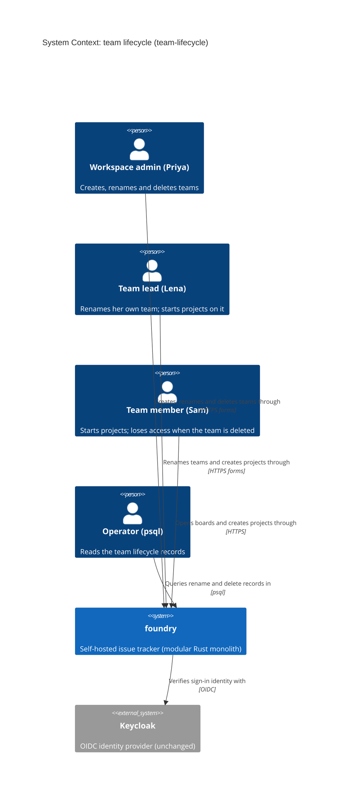
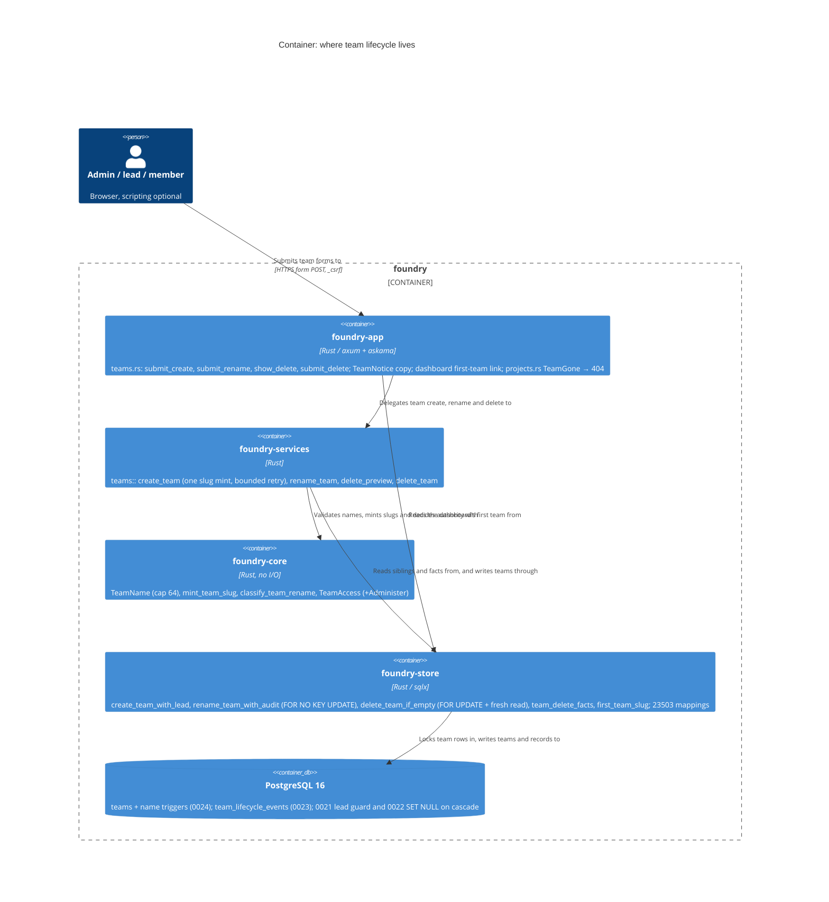

<!-- markdownlint-disable MD024 -->
# Feature Delta: team-lifecycle

A workspace admin can create a team, rename it, and delete it, from the product.
Today the only production writer of `teams` is bootstrap (the first workspace's
"General"). Every workspace provisioned from `/admin/instance/workspaces` has
zero teams, so nobody there can be put on a team, create a project, or open a
board. This is the "team create, rename and delete" follow-up recorded by
team-membership (D14, evolution doc 2026-10-10).

## Wave: DISCUSS

Product owner: Luna (nw-product-owner) | Date: 2026-10-11 | Feature type:
user-facing (Decision 1) | Walking skeleton: brownfield, judged against the
existing structure (Decision 2, see WS Strategy) | UX depth: lightweight, happy
path plus the main refusals (Decision 3) | JTBD: yes, new job (Decision 4) |
Density: lean, Tier-1 [REF] only, `expansion_prompt = ask-intelligent` |
Requirements readiness: rough idea, explored here (user).

### [REF] Prior Wave Consultation

| Artifact | Status | Note |
|---|---|---|
| `docs/feature/team-membership/feature-delta.md` (all waves) | ✓ | D5 uniform 404, D10 tenancy from the session, D13 idempotent writes, D15 copy style, the Authorization Matrix, `TeamAccess::of`, DDD-6 to DDD-12. This feature extends that matrix and reuses its policy unchanged. |
| `docs/evolution/2026-10-10-team-membership.md` | ✓ | Its follow-up "Team create, rename and delete" is closed by this feature. OQ-D9 (user delete of a sole lead) stays open and is unrelated. |
| `docs/product/architecture/brief.md` | ✓ | "Names are labels; slugs are identity" (governs rename, D4), the project-name rule (governs the team-name rule, D6), and "Teams, team authority and the never-leaderless guard". The guard section says a future team delete meets the 0021 trigger and that the cascade exemption covers it. |
| `adr-team-membership-001/002/003` | ✓ | 001: the lead guard exempts a team that is being deleted, so a cascade is allowed. 002: `default_team_id` clears itself `ON DELETE SET NULL (default_team_id)`. 003: `TeamAccess` (admin → Manage, lead → Manage, member → View). |
| `adr-project-name-001/002` | ✓ | One value object on every door, the shared refused-character predicate, "unique" defined as a case-insensitive name or a derived slug that collides, and a fallback mint plus bounded retry for names that slugify to nothing. |
| `adr-project-rename-001/002` | ✓ | Slugs are minted once and never re-derived. Rename is a services use-case. The duplicate-label race was accepted there. |
| `adr-workspace-name-001` | ✓ | The copy is the error's `Display`. A check-arch literal rule. |
| `adr-issue-delete-001/002`, `adr-board-lane-002` | ✓ | Delete confirm is a GET+POST pair that works without scripting, and the confirm page counts consequences. The lane delete binds at confirm time, its count is advisory, and the FK guards the race. |
| `docs/product/jobs.yaml`, `personas/persona-instance-operator.yaml` | ✓ | No job covers team lifecycle. `job-team-membership` starts from an existing team. A new job, `job-team-lifecycle`, is appended. The persona gains only `also_referenced_by` and the job id. |
| House format: team-membership DISCUSS and `slices/slice-0N-*.md` | ✓ | Followed. |
| `docs/product/vision.md`, DISCOVER / DIVERGE artifacts | ⊘ | Do not exist. Grounded in the team-membership follow-up, code reading and the user's scope. This is a recorded risk, as in every precedent. |

No contradiction with prior evidence.

### [REF] Lifecycle inventory (code-grounded)

| Fact | Source |
|---|---|
| `teams(id, workspace_id, name, slug, UNIQUE(workspace_id, slug))`. There is no name uniqueness and no name rule (no `TeamName`, no 0019/0020-style trigger on `teams.name`). | `0001_init.sql`; `foundry-core/src` has `WorkspaceName`, `ProjectName`, `name_chars::is_refused_name_char` and `slugify` only |
| A team delete cascades to `projects`, and from them to `issues`, `lanes`, `issue_change_events`, `comments` and `issue_attachments` (stored inline as bytea). It also cascades to `team_memberships` (the 0021 guard is exempt) and to `machine_tokens.scope_team_id`. `workspaces.default_team_id` is set to NULL. | `0001`, `0004`, `0005`, `0007`, `0013`, `0015`, `0021`, `0022` |
| **No project delete or move exists** in production code. | grep `DELETE FROM projects`: acceptance fixtures only |
| The only production `INSERT INTO teams` is `seed_initial_workspace` (General/`general`, bootstrap user as lead). `provision_workspace` writes the workspace, admin user, admin membership and invite, and **no team**. | `foundry-store/src/lib.rs:3583`, `:2674` |
| Project create (`/team/{team_slug}/projects/new`, `POST /team/{team_slug}/projects`) is gated on being on the team. The members page has no link to it. The dashboard's empty state links to the hardcoded `/team/general/projects/new`. | `lib.rs:565-568`; `templates/team_members.html`; `templates/dashboard_root.html:14` |
| `/teams` shows the team list for an admin even when it is empty (an empty `<ul>`). Admins also see the default-team form there. | `templates/teams_index.html` |
| `workspace_rename_events` is an append-only record (actor · old → new · when), written in the rename's transaction and cascading with its workspace. | `0018_workspace_rename_events.sql` |

### [REF] Persona

- **Priya Raman** (`persona-instance-operator`): instance admin, and workspace admin of Canzan Labs. She provisioned the workspaces herself (persona file), including **Homelab**, which has zero teams today.
- **Lena Park**: lead of Backend in Canzan Labs, a workspace `member` (not an admin). She is the lead actor for rename (OQ-1). Referenced inline, as in team-membership.
- **Sam Okafor**: a Member of Backend only. He is the person whose only team disappears.
- **Marco** (`persona-team-member-foil`): signed in, no rights. He is the uniform-404 foil.

### [REF] JTBD

**job_id: `job-team-lifecycle`** (appended to `docs/product/jobs.yaml`).

One-liner: *When the way my workspace's work is split changes (a new workspace
with no teams, a team whose name no longer fits, a team created by mistake), I
want to create, rename or delete teams myself, so every workspace can reach a
board and its team list matches how we actually work, without psql and without
losing a project by accident.*

Job stories:

1. When I provision a workspace and its admin signs in to find no team, I want to create the first team, so a project and a board can exist there at all.
2. When a team's work changes ("Backend" becomes "Platform Engineering"), I want to rename it, and everyone's bookmarks and board links should keep working.
3. When a team was created by mistake ("Bakcend") or has wound down, I want to delete it, and be told exactly what goes with it, and never lose a project I didn't know about.

Dimensions: **functional**: create, rename and delete a team from `/teams` and its members page, under one name rule. **Emotional**: a provisioned workspace stops being a dead end, and deleting stops being frightening. **Social**: a team's name says what the team does today.

Four forces:

- **Push**: provisioned workspaces have zero teams and no path to one. Every team beyond bootstrap's General was created in psql, with no name rule, so a NUL, a 500-character name or a duplicate is possible there.
- **Pull**: a "New team" form, a rename field and a "Delete team" button, the way every team tool works.
- **Anxiety**: one delete cascades to every project, issue, comment and attachment of the team. A rename breaks URLs. Two teams could end up with the same name.
- **Habit**: psql works for one operator. The product path has to be safer (it never destroys an unseen project, it keeps slugs), not just prettier.

### [REF] Scope Assessment: PASS (5 stories, 3 contexts, about 4.5 days)

| Oversized signal | Fired? | Evidence |
|---|---|---|
| More than 10 user stories | No | 5 |
| More than 3 bounded contexts or modules | No (exactly 3) | teams (lifecycle and authz), the project catalogue (the delete refusal, the create race, the "New project" link), machine tokens (the cascade, stated on the confirm page) |
| Walking skeleton needs more than 5 integration points | No | Slice 01: one route pair, one store write (team plus lead row), one link on the members page, one dashboard link |
| More than 2 weeks of effort | No | about 4.5 days |
| Multiple independent outcomes that could ship separately | **Yes** | Create, rename and delete are independent outcomes |

One of five signals fires, so the verdict is **right-sized**. Every slice ships on
its own, and rename (slice 04) could split into its own feature with no rework.

### [REF] Locked Decisions

| ID | Decision | Source |
|---|---|---|
| D1 | User-facing feature. JTBD yes. UX depth lightweight. Walking skeleton brownfield: slice 01 is the thinnest end-to-end path (see WS Strategy). | User (Decisions 1-4) |
| D2 | **Create and delete are for workspace admins of the acting workspace only.** A lead or member who requests either gets the uniform 404. An instance admin gets no implicit right and acts as a workspace admin, as in team-membership OQ-1. Rename is OQ-1. | User suggestion, PO endorses |
| D3 | **The creator becomes the new team's Lead**, written atomically with the team. A team is never born leaderless, so the never-leaderless guard protects it from the first commit. The creator can create a project on it at once, because project create is gated on being on the team. Board authz is unchanged (team-membership D9). | PO: without it, an admin creates a team they cannot use, and an unled team escapes INV-1 |
| D4 | **Rename changes the name only. The slug never changes.** Every URL (`/team/{slug}/members`, `/team/{slug}/project/{p}`), bookmark and token scope keeps working. There is no "change team URL" in this feature. | Brief "Names are labels; slugs are identity"; ADR-PROJECT-RENAME-001 |
| D5 | **Every refused request on a new or changed route is the uniform 404**, on both verbs and byte-identical to `resource_not_found_page`. That covers being signed out, an unknown slug, another workspace's team, and a caller without the right. A stated reason (a name refusal, or "still has projects") is shown only to an authorized actor, who already sees the team. | Team-membership D5, DDD-8 |
| D6 | **One team-name rule** on both doors (create, rename), as a `foundry-core` value object like `WorkspaceName` and `ProjectName`. It trims, then refuses empty, then any character from the **shared** refused-character predicate, then names over the cap (OQ-2). "Unique within the workspace" means a case-insensitive name match with a sibling, or a non-empty derived slug equal to a sibling's stored slug (the project rule's definition). The copy is the error's `Display`. | ADR-PROJECT-NAME-001, ADR-WORKSPACE-NAME-001 |
| D7 | **The slug is minted once, at create, and is never empty.** It is `slugify(name)`, or the fallback (OQ-3) when that is empty. It is never re-derived. | ADR-PROJECT-NAME-002, D4 |
| D8 | **Delete is a GET confirm page plus a POST**, and works with scripting disabled. The confirm page states every consequence before anything happens: the member count, a warning if the team is the workspace default, and the count of machine tokens scoped to it. | ADR-ISSUE-DELETE-002; the lane two-fate confirm |
| D9 | **A team delete never destroys a project or issue that the admin was not shown and did not choose to destroy.** This holds under concurrency (INV-TL-1). The policy that satisfies it is OQ-4. | PO: data-loss guardrail, independent of OQ-4 |
| D10 | **After a delete:** the workspace default clears itself if it pointed at the team (schema fact), and members on no other team land on the shipped no-team copy. Scoped machine tokens are deleted with the team. The slug is free for a later create. Authz is per request, so an old bookmark to a reused slug only reaches the new team for people on it. | Schema facts; team-membership D9 and INV-6 |
| D11 | **Tenancy comes from the session.** A team is resolved by (acting workspace, slug). No workspace id is parsed from the request. | Team-membership D10 |
| D12 | **Copy is locked** (DESIGN may change routes, not strings). See [REF] Copy. | PO, for testable ACs |
| D13 | **Routes are proposed, and DESIGN finalizes them.** `POST /teams` (create), `POST /team/{team_slug}/rename`, `GET` and `POST /team/{team_slug}/delete`. All are plain forms on the shared CSRF layer. | PO, following `/team/{slug}/…` and ADR-ISSUE-DELETE-002 |
| D14 | **A new team can reach a board in one more click.** The members page shows "New project" (to the shipped `/team/{slug}/projects/new`) to anyone on the team. The dashboard's "create your first project" link targets a team the caller is on (the first by name) instead of the hardcoded `general`. | PO: in a provisioned workspace the hardcoded link is a 404. The walking skeleton needs this. |
| D15 | **A rename that changes nothing writes nothing.** A byte-equal name is not a write: no event, and a re-render with no notice. A case-only change ("ops" → "Ops") is a real rename. | ADR-WORKSPACE-NAME-001 / 0018 precedent |
| D16 | **A create is not deduplicated by name.** A double-submit of the create form gets the uniqueness refusal on the second POST. That is harmless and needs no special case. | PO |

### [REF] Copy (D12)

- Created: "Created {team}. You're its lead."
- Name refusals (`Display`): "Team name must not be empty" · "Team name must not contain control characters" · "Team name must be at most 64 characters" · "Team name must be unique within the workspace"
- Renamed: "Renamed {old} to {new}."
- Admin with no teams, on `/teams`: "This workspace has no teams yet. Create one to start a project."
- Confirm page: heading "Delete {team}?". Then "{team} has {n} member(s) and no projects. They lose access to {team}. This can't be undone." When the team is the default: "{team} is the default team for new members. After it is deleted, new members will join no team." When tokens are scoped to it: "{k} machine token(s) scoped to {team} will stop working." Buttons **Delete team** and **Cancel**.
- Refused (projects, OQ-4): "{team} still has {n} project(s): {list}. A team with projects can't be deleted." The list reads "Identity Platform (AUTH), Homelab Ops (OPS)". There is no **Delete team** button.
- Deleted: "Deleted {team}."
- Labels: the form button is **Create team** and the field is **Team name**. On the members page: **Rename**, **Delete team**, **New project**. Plurals follow the shipped "General · 1 member" style.

### [REF] Open Questions (each has a recommended answer; the stories assume it)

- **OQ-1: May a team's lead rename their own team?** *Recommended: yes.* Rename uses `TeamAccess` `Manage` (workspace admin, or lead of this team), with no new arm. Renaming is reversible and loses nothing, and leads already manage membership. Create and delete stay admin-only (D2).
- **OQ-2: The team-name length cap?** *Recommended: 64 Unicode scalars.* Team names show in lists, headings, copy and token labels. 24 (workspace) is tight for "Platform Engineering Guild", and 256 (project) is far wider than any team name. 64 makes no legacy name non-compliant, because the rule applies only to new writes.
- **OQ-3: The fallback slug for names that slugify to nothing** ("インフラ", "運用", "🚀")? *Recommended: `team`, then `team-2`, `team-3`, …, the lowest free suffix from 2*. This is the project rule's mechanism with `team` in place of the key prefix, which teams lack. A concurrent create that takes the same fallback is retried a bounded number of times and never reported as a duplicate name (ADR-PROJECT-NAME-002 decision 3). Transliteration and UUID fragments were rejected there and are rejected here.
- **OQ-4: Deleting a team that has projects.** The options:
  - (a) refuse while the team has any project;
  - (b) a confirm page listing every project and issue count, then cascade, perhaps with the name typed to confirm;
  - (c) move the projects to another team first.

  *Recommended: (a) refuse.* It is the only option with zero data-loss risk. There is no undo, trash or archive (ADR-ISSUE-DELETE-001), so a cascade would destroy every issue, comment and inline attachment of every project, on one click by one admin. (c) needs a project move, which does not exist and changes issue keys, URLs and authz (a separate feature). The cost is that a team with projects cannot be deleted from the product until a project delete or move exists, which is recorded as a follow-up. The main jobs (a typo team, a team that never started) are covered. (b) remains the designated next step if KPI-TL-5 shows real demand.
- **OQ-5: Should a provisioned workspace get a first team automatically?** *Recommended: no, not in this feature.* With create shipped, the provisioned admin sees "This workspace has no teams yet. Create one to start a project." on `/teams`, which is one path for existing and future workspaces alike. An auto-"General" names a team nobody chose, and existing zero-team workspaces would still need the create path. This can be revisited as its own decision if dogfood shows every admin creating "General" anyway.
- **OQ-6: Do create, rename and delete record an event?** *Recommended: yes for rename and delete, and no for create.* Following `workspace_rename_events`, each records one append-only row in the same transaction as the write:
  - rename: actor · old name → new name · when;
  - delete: actor · name · slug · when.

  The record must outlive the team, so it is workspace-scoped and keeps the name and slug as text. It has no UI in this feature (it is read with psql or the per-workspace export). Create is evident from the team's first lead, and it destroys nothing.
- **OQ-7: Should the database refuse a bad team name, as 0019/0020 do for workspaces and projects?** *Recommended: yes.* Apply the shared `foundry_name_rule_violation` function to `teams.name` at cap 64, on insert and on a name change only, so legacy names stay. It lands with slice 03. Seeds and fixtures that write `teams` directly (about 40 acceptance sites) use compliant names already.

**Resolved by the user (2026-10-11):** every OQ takes its recommended answer. OQ-1 (a lead may rename their own team), OQ-4 (refuse delete while the team has projects), OQ-6 (audit records for rename and delete) and OQ-7 (a DB name rule at cap 64) were answered by the user; OQ-2 (cap 64), OQ-3 (`team`, `team-2`, … fallback) and OQ-5 (no auto first team) were taken by the orchestrator on the recommendation. DoR item 8 passes for every story with no block.

**Resolved by the user:** pending. If any OQ is answered against its recommendation, the affected ACs are edited before DESIGN. Each OQ names the story it touches in the DoR table.

### [REF] Journey (lightweight: happy path plus main refusals)

Emotional arc, **from dead end to tidy**: stuck (a provisioned workspace has no
team, and "create your first project" is a 404) → in control (one form, a team
with her as lead) → productive (a project and a board on it) → confident
(renames keep every link; a delete says what goes and refuses to lose a project).

```text
[Where]                          [Does]                                     [Sees]                                                         [Feels]
/teams (Homelab, admin)          opens Teams                                "This workspace has no teams yet. Create one to start a project." stuck
/teams                           types "Ops", clicks Create team            /team/ops/members: "Created Ops. You're its lead."             in control
                                                                            "Priya Raman · priya@canzan.dev · Lead"
/team/ops/members                clicks New project                         /team/ops/projects/new (shipped form)                          productive
/team/ops/projects               creates "Homelab Ops" (OPS)                /team/ops/project/homelab-ops board (200)                      productive
/team/ops/members                renames to "Homelab Ops Team", Rename      "Renamed Ops to Homelab Ops Team." URL still /team/ops/…       confident
/team/bakcend/members            clicks Delete team                         "Delete Bakcend? Bakcend has 1 member(s) and no projects…"     wary
/team/bakcend/delete             clicks Delete team                         /teams: "Deleted Bakcend."                                     confident
```

Main refusals and edge paths:

| Step | What happens | Sees |
|---|---|---|
| Lena (lead, not admin) posts a create, or opens `/team/backend/delete` | refused | the uniform 404 (D2, D5) |
| Marco posts a rename on Backend | refused | the uniform 404 (D5) |
| Create "backend" while Backend exists | refused, form keeps the text | "Team name must be unique within the workspace" |
| Create "インフラ" | created | slug `team` (OQ-3), URL `/team/team/members` |
| Delete Backend, which has Identity Platform (AUTH) | refused, nothing changes | "Backend still has 1 project(s): Identity Platform (AUTH). A team with projects can't be deleted." |
| Lena creates a project on Ops while Priya's Ops confirm page is open, then Priya confirms | refused, nothing changes | the projects refusal, naming Lena's project (INV-TL-1) |
| Delete Ops, the workspace default | confirm page warns; after delete the default is "No team" | the default warning line |

### [REF] Shared Artifacts

| Artifact | Source of truth | Consumers | Risk |
|---|---|---|---|
| `${team}` (name) | `teams.name` | `/teams`, members page heading, copy, nav, token scope labels | MEDIUM: rename must reach every consumer by reading, never by caching |
| `${team_slug}` | `teams.slug`, minted once (D7) | every `/team/{slug}/…` URL, bookmarks | HIGH: rename must not touch it (D4) |
| Acting workspace | session `SessionUser.workspace_id` | every route | HIGH: the tenancy boundary (D11) |
| Project list of the team | `projects` by `team_id`, at commit time | confirm page, refusal copy, INV-TL-1 | HIGH: confirm-page counts are advisory; the commit-time check is binding |
| Default team | `workspaces.default_team_id` | `/teams` select, confirm warning, newcomer placement | MEDIUM: clears itself (schema) |
| Scoped token count | `machine_tokens.scope_team_id` | confirm page | LOW: advisory |
| Name-rule copy | the team-name error's `Display` (D6) | create and rename refusals | MEDIUM: one source, two doors |
| Uniform 404 | `resource_not_found_page` | every refusal (D5) | HIGH |

### [REF] Story Map and Slices

Backbone: **Start a team → Use it → Name it right → Retire it**

| Slice | Stories | What it adds | Est. | Brief |
|---|---|---|---|---|
| 01 (walking skeleton) | US-TL-01 | Admin creates a team on `/teams` and becomes its lead, then creates a project on it. **Unblocks provisioned workspaces.** | 1 d | `slices/slice-01-admin-creates-team.md` |
| 02 | US-TL-02, US-TL-03 | Admin deletes a team through a confirm page. A team with projects is refused, including a project created mid-confirm. | 1.5 d | `slices/slice-02-delete-team-never-loses-a-project.md` |
| 03 | US-TL-04 | The full team-name rule: control characters, the cap, the non-Latin fallback slug, the concurrent same-name create, and the DB rule (OQ-7). | 1 d | `slices/slice-03-team-name-rule-and-fallback-slug.md` |
| 04 | US-TL-05 | An admin or a lead renames a team. The slug and every link stay. | 1 d | `slices/slice-04-rename-team-keeps-its-urls.md` |

The walking skeleton covers "Start a team" and "Use it". "Name it right" and
"Retire it" are not needed for the provisioned-workspace dead end, so they stay
below the line.

Priority by learning leverage:

1. **01** first. It resolves the zero-team dead end, is dogfooded the same day on a provisioned dev workspace, and settles creator-as-lead (D3) and the D14 links.
2. **02** next. It carries the riskiest assumption: that a delete can be guaranteed never to destroy a project, including one created while the confirm page is open (INV-TL-1). Learning that early costs least. It is 1.5 days, over the one-day taste test, **on purpose**: the projects refusal is the safety net of delete and must never ship without it, and an infrastructure-only slice is forbidden.
3. **03** hardens the rule both doors share, before the second door (rename) arrives. It holds the second-riskiest assumption: that the project fallback-slug mechanism transfers to teams, which have no key.
4. **04** last. It has the lowest uncertainty (no slug change, the shipped policy), and it reuses 03's rule and parity.

Taste tests: no slice ships 4 or more new components. No slice is infrastructure
only: the race guarantee rides inside slice 02's user value. Every slice names what
it disproves (see the briefs). Every dogfood uses dev's real workspaces. No two
slices differ only in scale.

### [REF] User Stories

#### US-TL-01: A workspace admin creates a team, becomes its lead, and can start a project on it

`job_id: job-team-lifecycle` | slice 01

##### Elevator Pitch

Before: in Homelab, a workspace provisioned from `/admin/instance/workspaces`, Priya's `/teams` is an empty list, and the dashboard's "create your first project" link answers 404. Nothing in the product creates a team.
After: on `/teams`, type "Ops" in **Team name** and click **Create team** → `/team/ops/members` shows "Created Ops. You're its lead." and "Priya Raman · priya@canzan.dev · Lead". Then **New project** → create "Homelab Ops" (OPS) → `/team/ops/project/homelab-ops` shows the board.
Decision enabled: Priya can organise Homelab's work into teams and start boards there without psql.

##### Problem

Every provisioned workspace has zero teams. Its admin cannot put anyone on a team
or create a project, and the dashboard advertises a project link that 404s.

##### Who

- Workspace admin | `/teams`, desktop browser | wants a first or an additional team.

##### Domain Examples

1. **First team (dogfood)**: in Homelab (zero teams), Priya creates "Ops" → slug `ops`, she is Lead, `/teams` lists "Ops · 1 member", and she creates "Homelab Ops" (OPS) from **New project**.
2. **Second team**: in Canzan Labs, Priya creates "Design" next to General, Backend and Ops. She becomes Design's lead, and Lena (not on it) does not see Design on her `/teams`.
3. **Duplicate**: Priya types "backend" in Canzan Labs → "Team name must be unique within the workspace", and the field keeps "backend".
4. **Empty**: "   " → "Team name must not be empty".
5. **Refused**: Lena (lead of Backend, not admin) posts a create → uniform 404, and no team is written. A non-admin sees no create form on `/teams`.

##### UAT Scenarios (BDD)

###### Scenario: A workspace admin creates the first team of a workspace and leads it

- Given Priya is workspace admin of Homelab, which has no teams
- When she opens Teams, enters "Ops" and creates it
- Then she sees "Created Ops. You're its lead." on Ops's members page, listing "Priya Raman · priya@canzan.dev · Lead"
- And Teams lists "Ops · 1 member"

###### Scenario: The new team's lead starts a project and opens its board

- Given Priya has just created Ops in Homelab
- When she follows New project and creates "Homelab Ops" with key OPS
- Then the Homelab Ops board opens, and her dashboard lists "OPS Homelab Ops"

###### Scenario: A name already used in the workspace is refused

- Given Canzan Labs has team Backend
- When Priya creates a team named "backend"
- Then she sees "Team name must be unique within the workspace", her text is kept, and Canzan Labs still has one team called Backend

###### Scenario: An admin of a workspace with no teams is told how to start

- Given Homelab has no teams
- When Priya opens Teams
- Then she sees "This workspace has no teams yet. Create one to start a project." and the create form

###### Scenario: Only a workspace admin can create a team

- Given Lena leads Backend but is not a workspace admin
- When Lena submits a team create, and Marco does too
- Then both answer the uniform not-found page, and no team is created

##### Acceptance Criteria

- [ ] A workspace admin's create writes one team and one Lead row for the creator together, and lands on the new members page with the D12 copy (scenario 1; D3).
- [ ] The members page shows **New project** to anyone on the team. The dashboard's empty-state project link targets a team the caller is on, and never a team they are not on (scenario 2; D14).
- [ ] An empty name or a non-unique name (case-insensitive name, or a colliding derived slug) is refused with the D12 copy, the input is kept, and nothing is written (scenario 3; D6).
- [ ] An admin on a workspace with no teams sees the empty-state copy and the form. A non-admin sees no form (scenario 4).
- [ ] A non-admin, signed-out or instance-admin-only caller gets the uniform 404 with zero rows written (scenario 5; D2, D5).
- [ ] It works with scripting disabled.

##### Outcome KPIs

KPI-TL-1, KPI-TL-2, KPI-TL-4.

##### Technical Notes

- A new `foundry-core` team-name value object, sharing `is_refused_name_char`. Slice 01 needs at least the empty and unique arms. DESIGN may land every arm here, and slice 03 then proves the rest.
- The slug is `slugify(name)`. An empty slugify result is refused in slice 01 ("must not be empty" is wrong copy for it, so DESIGN may simply land OQ-3 here).
- INV-TL-7 (team and lead row are atomic). No schema change is expected.

##### Size

1 day | 5 scenarios | slice 01

#### US-TL-02: A workspace admin deletes a team after a confirm page that says exactly what goes

`job_id: job-team-lifecycle` | slice 02

##### Elevator Pitch

Before: a team created by mistake ("Bakcend") stays in every list forever, unless someone runs psql, and in psql nothing says what a delete would cascade to.
After: on `/team/bakcend/members`, click **Delete team** → `/team/bakcend/delete` shows "Delete Bakcend? Bakcend has 1 member(s) and no projects. They lose access to Bakcend. This can't be undone." Click **Delete team** → `/teams` shows "Deleted Bakcend.", and Bakcend is gone from the list.
Decision enabled: Priya can tidy away dead teams, knowing beforehand who and what is affected.

##### Problem

Mistaken and wound-down teams accumulate. The only removal is psql, which
cascades silently to projects, issues, memberships and tokens.

##### Who

- Workspace admin | members page, confirm page | removes a team.
- Sam Okafor | a member whose only team is deleted.

##### Domain Examples

1. **Typo team**: Priya deletes "Bakcend" (1 member, Sam; no projects) → "Deleted Bakcend.". Sam's next dashboard shows "You're not on any team yet — ask a workspace admin to add you."
2. **Default team**: Ops is Canzan Labs's default. Its confirm page adds "Ops is the default team for new members. After it is deleted, new members will join no team." After the delete, `/teams` shows "No team" selected.
3. **Scoped token**: Design has 1 machine token scoped to it. The confirm page adds "1 machine token(s) scoped to Design will stop working."
4. **Cancel**: **Cancel** returns to the members page, and nothing changes.
5. **Refused**: Lena (lead of Backend) opens `/team/backend/delete` → uniform 404. Marco posts a delete → uniform 404.

##### UAT Scenarios (BDD)

###### Scenario: A workspace admin deletes a team that has no projects

- Given Canzan Labs has team Bakcend with member Sam Okafor and no projects
- When Priya opens Delete team on Bakcend, reads "Delete Bakcend? Bakcend has 1 member(s) and no projects. They lose access to Bakcend. This can't be undone." and confirms
- Then she sees "Deleted Bakcend." and Teams no longer lists Bakcend

###### Scenario: A member whose only team is deleted lands on the no-team page

- Given Sam Okafor's only team was Bakcend, and Priya has deleted it
- When Sam opens his dashboard
- Then he sees "You're not on any team yet — ask a workspace admin to add you."

###### Scenario: Deleting the default team warns first and leaves no default

- Given Ops is Canzan Labs's default team and has no projects
- When Priya opens Delete team on Ops
- Then the page also says "Ops is the default team for new members. After it is deleted, new members will join no team."
- And after she confirms, the default team on Teams is "No team"

###### Scenario: Only a workspace admin can delete a team

- Given Lena leads Backend and is not a workspace admin
- When Lena opens Backend's delete page and submits a delete, and Marco submits one too
- Then every request answers the uniform not-found page, and Backend still exists

##### Acceptance Criteria

- [ ] The confirm page shows the D12 heading, the member count, the default warning (only when it is the default) and the scoped-token line (only when there are such tokens). It has **Delete team** and **Cancel** (scenarios 1, 3; D8).
- [ ] The POST deletes the team, its memberships and its scoped tokens, then shows "Deleted {team}." on `/teams` (scenario 1; D10).
- [ ] Members on no other team see the shipped no-team copy. Members still on other teams keep them (scenario 2).
- [ ] A deleted default reads as "No team" afterwards (scenario 3; D10).
- [ ] A non-admin or signed-out caller, an unknown slug or a foreign team gets the uniform 404 on both verbs, and nothing is deleted (scenario 4; D2, D5).
- [ ] (OQ-6) One delete record (actor · name · slug · when) commits with the delete. Checked by a read-only store query.
- [ ] Both pages work with scripting disabled.

##### Outcome KPIs

KPI-TL-3, KPI-TL-4, KPI-TL-5.

##### Technical Notes

- The cascade is allowed by 0021's exemption for a team being deleted (INV-TL-8). Its regression guard stays green.
- The confirm page's member and token counts are advisory (as the lane delete's card count is). The project check is binding (US-TL-03).

##### Size

1 day | 4 scenarios | slice 02

#### US-TL-03: A team that has projects is never deleted, even if a project appears while the confirm page is open

`job_id: job-team-lifecycle` | slice 02

##### Elevator Pitch

Before: a team delete in psql silently destroys every project, issue, comment and attachment of the team. There is no undo.
After: on `/team/backend/delete`, Priya sees "Backend still has 1 project(s): Identity Platform (AUTH). A team with projects can't be deleted." and there is no **Delete team** button. A confirm sent from a page opened before Lena created a project gets the same refusal, and nothing is deleted.
Decision enabled: Priya can delete teams without fearing she will lose a board, and she knows which projects keep a team alive.

##### Problem

Delete is the one irreversible lifecycle action, and the schema cascades from a
team to all its work. No project delete or move exists to empty a team first.

##### Who

- Workspace admin | confirm page | must never lose work by accident.

##### Domain Examples

1. **Has projects**: Backend has Identity Platform (AUTH) → refusal naming AUTH, and no Delete button.
2. **Two projects**: Ops has Homelab Ops (OPS) and Reading List (READ) → "Ops still has 2 project(s): Homelab Ops (OPS), Reading List (READ). A team with projects can't be deleted."
3. **Stale confirm**: Priya opens Design's confirm page (no projects). Lena then creates "Brand Refresh" (BRAND) on Design. Priya confirms → the refusal naming BRAND, and Design and BRAND are intact.
4. **Race**: Priya's delete and Lena's project create on Design commit at the same moment → either the project exists and Design is refused, or Design is deleted and Lena's create answers the uniform 404. A project is never created and then destroyed.

##### UAT Scenarios (BDD)

###### Scenario: A team with a project shows why it cannot be deleted

- Given Backend has project Identity Platform (AUTH)
- When Priya opens Delete team on Backend
- Then she sees "Backend still has 1 project(s): Identity Platform (AUTH). A team with projects can't be deleted." and no Delete team button

###### Scenario: A confirm sent from a page opened before a project appeared is refused

- Given Priya opened Design's delete page while Design had no projects
- And Lena has since created project Brand Refresh (BRAND) on Design
- When Priya confirms the delete
- Then she sees "Design still has 1 project(s): Brand Refresh (BRAND). A team with projects can't be deleted." and Design and Brand Refresh still exist

###### Scenario: A delete racing a project create never destroys the project

- Given Design has no projects
- When Priya deletes Design at the same moment as Lena creates Brand Refresh on it
- Then either Design still exists with Brand Refresh, or Design is gone and Lena's create answered the uniform not-found page
- And no project row is ever destroyed by the delete

##### Acceptance Criteria

- [ ] The confirm page and the POST both refuse while the team has any project, with the D12 copy listing every project as "Name (KEY)", and nothing changes (scenarios 1, 2; OQ-4, D9).
- [ ] The refusal is decided at commit time, not from the page (scenario 2; INV-TL-1).
- [ ] Over 100 repeated delete-versus-create races on real Postgres: 0 projects destroyed, 0 responses of 500 (scenario 3; INV-TL-1, INV-TL-2).
- [ ] The refusal is shown only to a workspace admin. Everyone else gets D5's 404.

##### Outcome KPIs

KPI-TL-3.

##### Technical Notes

- INV-TL-1 and INV-TL-2 are requirements for DESIGN. The mechanism is DESIGN's choice (lane-002's FK guard and team-membership's row lock are the house precedents).
- The status for the refusal (409, as DDD-8) is DESIGN's choice.

##### Size

0.5 day | 3 scenarios | slice 02

#### US-TL-04: Every team name follows one rule, and a name in any script gets a working URL

`job_id: job-team-lifecycle` | slice 03

##### Elevator Pitch

Before: a team name typed in psql can hold a NUL, a bidi override or 500 characters, and a name like "インフラ" would mint an empty, unreachable slug.
After: on `/teams`, **Create team** with "インフラ" → `/team/team/members` shows "Created インフラ. You're its lead."; with "Platform\u{202E}Ops" → "Team name must not contain control characters"; with 65 characters → "Team name must be at most 64 characters".
Decision enabled: Priya can name teams in any language and trust that every team has a working page and an honest name.

##### Problem

Without one rule, team names drift from the workspace and project rules, and
non-Latin names make teams unreachable.

##### Who

- Workspace admin | `/teams` create form (and the rename field, slice 04).

##### Domain Examples

1. **Non-Latin**: "インフラ" → slug `team`. Then "運用" → slug `team-2` (OQ-3).
2. **Control**: "Platform" followed by U+202E and "Ops" → refused with the control copy. So is a pasted tab.
3. **Cap**: a 64-character name is created, and a 65-character one is refused (OQ-2).
4. **Collision by slug**: with Backend existing, "Backend!" (which slugifies to `backend`) → "Team name must be unique within the workspace". *(Corrected at DISTILL: the example read "Back-End", but `slugify` keeps the hyphen, so "Back-End" derives `back-end` and is unique.)*
5. **Race**: two admins create "Infra" at the same moment → one is created, and the other sees the uniqueness copy, never a 500. The same holds for two concurrent "インフラ" creates: one team, one uniqueness refusal. Two concurrent creates of *different* non-Latin names ("インフラ" and "運用") both succeed, as `team` and `team-2`. *(Corrected at DISTILL from DESIGN Changed Assumption 1.)*

##### UAT Scenarios (BDD)

###### Scenario: A name with no Latin letters gets a working team page

- Given Canzan Labs has no team with slug "team"
- When Priya creates "インフラ", then "運用"
- Then their members pages are /team/team/members and /team/team-2/members, and each opens

###### Scenario: Control characters and over-long names are refused

- When Priya creates a name containing U+202E, and a 65-character name
- Then she sees "Team name must not contain control characters" and "Team name must be at most 64 characters", and no team is created

###### Scenario: A name whose URL would collide is refused

- Given Backend exists
- When Priya creates "Backend!"
- Then she sees "Team name must be unique within the workspace"

###### Scenario: Two admins creating the same name at once get one team

- When two workspace admins create "Infra" at the same moment
- Then exactly one Infra team exists, and the other admin sees "Team name must be unique within the workspace"

###### Scenario: The database refuses a bad team name from any caller

- When a team name containing U+0001 (or U+202E, or 65 characters) is written directly in psql
- Then the write is refused by the team-name rule with SQLSTATE 23514 and the named arm (OQ-7)
- *(Corrected at DISTILL from DESIGN Changed Assumption 2: Postgres refuses a NUL in `text` with 22021 before any rule runs; the app doors refuse a pasted NUL as a control character.)*

##### Acceptance Criteria

- [ ] Every arm of D6 gives its D12 copy on create, with the shared predicate (a core property test shows the same verdict as the workspace and project rules) (scenarios 2, 3).
- [ ] An empty slugify result mints `team`, then `team-N` with the lowest free N from 2, never `""` (scenario 1; OQ-3).
- [ ] Concurrent same-name creates give one team and one uniqueness refusal, for a Latin and a non-Latin name alike. Concurrent creates of different non-Latin names both succeed, as `team` and `team-2`. 0 responses of 500 over 100 runs (scenario 4; INV-TL-4). *(Corrected at DISTILL, DESIGN Changed Assumption 1.)*
- [ ] (OQ-7) A new or changed `teams.name` that breaks a pure arm is refused by the database with 23514 and the named arm (shown with U+0001, U+202E and 65 characters; a NUL never reaches the rule, 22021). Legacy rows are untouched (scenario 5). *(Corrected at DISTILL, DESIGN Changed Assumption 2.)*

##### Outcome KPIs

KPI-TL-6.

##### Technical Notes

- This mirrors ADR-PROJECT-NAME-001/002 and name-db-checks (0019/0020). A migration is needed only for OQ-7.

##### Size

1 day | 5 scenarios | slice 03

#### US-TL-05: A team is renamed, and every link to it keeps working

`job_id: job-team-lifecycle` | slice 04

##### Elevator Pitch

Before: Backend became the platform team, but its name can only change in psql, and the board links people bookmarked depend on whether psql also touched the slug.
After: on `/team/backend/members`, edit **Team name** to "Platform Engineering" and click **Rename** → "Renamed Backend to Platform Engineering." The heading changes, and `/team/backend/project/auth` still opens the Identity Platform board.
Decision enabled: Priya (or Lena, Backend's lead) can keep team names truthful without breaking anyone's links.

##### Problem

Team names go stale as work shifts, and a rename must never become a URL
migration.

##### Who

- Workspace admin, or the team's lead (OQ-1) | members page.

##### Domain Examples

1. **Admin**: Priya renames Backend to "Platform Engineering". `/teams` lists "Platform Engineering · 3 members" at `/team/backend/members`.
2. **Lead**: Lena renames Backend herself → the same result (OQ-1).
3. **Case-only**: "ops" → "Ops" → "Renamed ops to Ops." (D15).
4. **No-op**: submitting "Backend" unchanged → no write, no event, no notice (D15).
5. **Collision**: renaming Ops to "general" → "Team name must be unique within the workspace". After General is renamed "Platform", creating "General" is still refused, because its derived slug `general` is taken (D6, accepted).
6. **Refused**: Sam (member) and Marco post a rename → uniform 404.

##### UAT Scenarios (BDD)

###### Scenario: A workspace admin renames a team and its links keep working

- Given Backend has project Identity Platform at /team/backend/project/auth
- When Priya renames Backend to "Platform Engineering"
- Then she sees "Renamed Backend to Platform Engineering." and Teams lists "Platform Engineering"
- And /team/backend/members and /team/backend/project/auth still open

###### Scenario: A team's lead renames their own team

- Given Lena leads Backend and is not a workspace admin
- When Lena renames Backend to "Platform Engineering"
- Then she sees "Renamed Backend to Platform Engineering."

###### Scenario: A rename to a name already in use is refused

- When Priya renames Ops to "general"
- Then she sees "Team name must be unique within the workspace" and Ops keeps its name

###### Scenario: Submitting the same name changes nothing

- When Priya submits Backend's rename form with "Backend" unchanged
- Then the page re-renders with no notice, and nothing is recorded

###### Scenario: Someone without the right cannot rename a team

- When Sam Okafor (a member of Backend) and Marco submit a rename of Backend
- Then both answer the uniform not-found page, and Backend keeps its name

##### Acceptance Criteria

- [ ] Rename writes the name only, never the slug, and shows the D12 copy. Every shipped URL under the slug answers as before (scenario 1; D4).
- [ ] Rename runs the same rule as create, with the same copy (the team itself is excluded from the uniqueness check) (scenario 3; D6).
- [ ] A workspace admin, or this team's lead, may rename (OQ-1). A member, an outsider or a signed-out caller gets the uniform 404 (scenarios 2, 5; D5).
- [ ] A byte-equal name writes nothing. A case-only change is a rename (scenario 4; D15).
- [ ] (OQ-6) One rename record (actor · old → new · when) commits with the rename. Checked by a read-only store query.

##### Outcome KPIs

KPI-TL-2, KPI-TL-4, KPI-TL-6.

##### Technical Notes

- Rename uses `TeamAccess` `Manage` with no new arm (ADR-TEAM-MEMBERSHIP-003). INV-TL-5 and INV-TL-6.

##### Size

1 day | 5 scenarios | slice 04

### [REF] System Constraints

These are invariant and concurrency requirements for DESIGN. They name the risks and
do not choose mechanisms.

- **INV-TL-1 (no lost project):** a team delete commits only if the team has no project at commit time. A project create racing it either commits first, and the delete is refused with the projects copy, or finds the team gone and gets the uniform 404. No project row is ever removed by a team delete (D9).
- **INV-TL-2 (no 500 from a vanished team):** any write racing a delete gets the team's normal outcome or the uniform 404, never a 500. That covers an add, role or remove, the default-team set, a rename, and a project create. A token mint scoped to the team answers the token form's shipped 422 `scope_team_not_in_workspace` (its normal outcome for a team that is not one of the workspace's), never a 500. *(Corrected at DISTILL, DESIGN Changed Assumption 3.)* A newcomer accept or a Keycloak first sign-in racing the delete of the default team still succeeds (team-membership D17).
- **INV-TL-3 (confirm-time truth):** the confirm page's counts are advisory. The commit-time state decides (the lane-delete precedent).
- **INV-TL-4 (create uniqueness under concurrency):** concurrent creates of the same name, or of names with the same derived slug, give exactly one team, and the loser gets the uniqueness copy. Concurrent fallback-slug creates both succeed with distinct slugs (bounded retry, ADR-PROJECT-NAME-002).
- **INV-TL-5 (rename races):** a rename can never change or corrupt a slug. Whether two concurrent renames, or a rename and a create, may leave two teams with case-insensitively equal names is DESIGN's call. ADR-PROJECT-RENAME-002 accepted that residual for projects. If DESIGN accepts it, record it.
- **INV-TL-6 (authority at request time):** per request, against current rows. A stale form from a demoted lead or a removed admin gets the 404.
- **INV-TL-7 (born led):** a team row and its creator's Lead row commit together. No reader ever sees the new team without a lead.
- **INV-TL-8 (lead guard compatibility):** a team delete is never refused by 0021's lead guard (its cascade exemption). A rename touches no `team_memberships` row.
- **INV-TL-9 (audit atomicity, if OQ-6):** a rename or delete record commits or rolls back with its write, and survives the team's deletion.
- No new oracle: every refusal to an unauthorized caller is byte-identical to the uniform 404 (D5).

### [REF] Outcome KPIs

Objective: every workspace can reach a board, team names stay truthful, and no
team delete ever loses work.

| # | Who | Does What | By How Much | Baseline | Measured By | Type |
|---|-----|-----------|-------------|----------|-------------|------|
| TL-1 | Workspaces with at least one member | Have at least one team | 0 zero-team workspaces on dev 1 day after the slice-01 dogfood (prod after approval) | dev and prod: every workspace provisioned from `/admin/instance/workspaces` (counted at the slice-01 dogfood) | Read-only query: workspaces with no `teams` row | North star |
| TL-2 | The operator | Creates and renames teams without psql | 0 hand-written `INSERT`/`UPDATE` on `teams` from the release onward | Every team beyond bootstrap's General was psql | Operator report at each dogfood | Leading |
| TL-3 | Team deletes | Destroy no project | 0 projects removed by a team delete. 0 lost projects and 0 responses of 500 over 100 delete-versus-create races | Not applicable (no delete path exists) | Race scenarios on real Postgres, plus a read-only project count before and after each dogfood delete | Guardrail |
| TL-4 | Callers without the right | Learn nothing and change nothing | 100% of the (actor × verb × team) matrix answers byte-identical 404s with 0 rows written | Not applicable (no routes) | Acceptance authz outline | Guardrail |
| TL-5 | Admins who try to delete a team with projects | Hit the refusal | Counted only, with no target. If it is above 0 in the first 30 days, it is evidence for a project delete or move feature (OQ-4) | 0 | Operator report | Leading (demand signal) |
| TL-6 | Renamed teams | Keep every link working | 100% of shipped URLs under the slug answer the same status after a rename. 100% verdict parity of create and rename on the rule | Not applicable | Acceptance scenarios, plus a core property test | Guardrail |

At homelab scale, the KPIs are verified by acceptance scenarios, read-only
store queries and the operator's own report, not analytics.

### [REF] DoD

1. All UAT scenarios pass: 5 + 4 + 3 + 5 + 5 = 22. The neighbouring lanes stay green: team-membership (tm-01..06), us-07 project create, project-name-rule, name-db-checks, member invites, keycloak-sso (46), fix-hide-unreachable-boards, dashboard-enhancements, machine-token-admin, and default.
2. The authz matrix (KPI-TL-4) covers being signed out, Marco, a plain member, a lead (allowed to rename if OQ-1 is accepted; refused to create and delete), a workspace admin, an instance admin with no workspace-admin row, an unknown slug and a foreign team, on every new route and both verbs.
3. INV-TL-1, -2 and -4 are proven by races on real Postgres, at least 100 runs each, with 0 lost projects and 0 responses of 500.
4. Nothing is written on a refusal (row counts asserted).
5. The pages work with scripting disabled.
6. `cargo xtask check-arch` and `cargo xtask smoke` pass before each commit. `FOUNDRY_XTASK_INCLUDE_DOCKER=1 cargo xtask ci` passes before push. Mutation kill rate is at least 80% on modified files.
7. **Dogfood on dev**, after the user releases (dev auto-deploys release tags; prod is held for approval). In a provisioned workspace with zero teams, create a team and a project and open its board. Rename a team and re-open an old bookmark. Delete a typo team, and see a team with a project refused. Record KPI-TL-1 baselines (read-only) on dev and prod.
8. Upgrade: two migrations. 0023 (slice 02) is additive (the lifecycle record). 0024 (slice 03) adds the two `teams` name triggers and **replaces** the shared `foundry_enforce_name_rule()` with an identical body plus one HINT line (`teams` → `TeamName`). Both are rolling-deploy safe, and the CHANGELOG migration notes say so. *(Corrected at DISTILL, DESIGN Changed Assumption 4.)*
9. Documentation: a CHANGELOG `[Unreleased]` entry. `brief.md`'s Teams section gains "Team lifecycle" (DESIGN). An outcomes registry row is added at DISTILL. `jobs.yaml` and the persona were done here.

### [REF] Out of Scope

- Project delete, archive, or move between teams. A cascade delete of a team with projects (OQ-4 (b) and (c) are follow-ups).
- Changing a team's slug or URL, and redirects from old slugs (D4).
- Undo, trash or archive for teams.
- Auto-creating a first team on provisioning or backfilling zero-team workspaces (OQ-5).
- Team management by an instance admin who is not a workspace admin. A `/api/v1` or `foundry doctor` team command.
- A UI for rename or delete records (OQ-6 records only).
- Notifications to members of a renamed or deleted team.
- Team descriptions, avatars and settings beyond the name.
- Workspace delete.

### [REF] WS Strategy

Brownfield (Decision 2, judged against the structure). Sessions, tenancy, `/teams`,
members pages, `TeamAccess`, project create and boards already ship. The missing
piece is any product path into `teams`, so slice 01 is the walking skeleton:
`/teams` → **Create team** → members page as Lead → **New project** → board. It runs
on real adapters only (real Postgres, real router, real session), with no
configurable or environment-switched seam (not strategy D). Slices 02-04 extend it.

### [REF] Driving Ports

1. `GET /teams` (delta): the create form and the empty-state copy for a workspace admin.
2. `POST /teams` (new): create (US-TL-01, US-TL-04).
3. `GET /team/{team_slug}/members` (delta): the **Rename** field and button for Manage, **Delete team** for a workspace admin, and **New project** for anyone on the team.
4. `POST /team/{team_slug}/rename` (new): US-TL-05.
5. `GET /team/{team_slug}/delete` (new): the confirm page, or the projects refusal.
6. `POST /team/{team_slug}/delete` (new): delete, or the projects refusal.
7. `GET /` (delta): the empty-state project link targets a team the caller is on (D14).
8. `GET /team/{team_slug}/projects/new` and `POST /team/{team_slug}/projects` (unchanged): the walking skeleton's second half and the INV-TL-1 race partner.
9. `GET /team/{team_slug}/project/{project_slug}` (unchanged): the rename bookmark check.

Routes are proposals (D13). The copy is locked (D12).

### [REF] Pre-requisites

- team-membership has shipped (v0.13.0: `/teams`, members pages, `TeamAccess`, the 0021 guard with its cascade exemption, and 0022's self-clearing default). It is live on dev, and prod is awaiting approval.
- These already ship: `slugify`, `name_chars::is_refused_name_char`, the `ProjectName`/`mint_project_slug` precedent, `foundry_name_rule_violation` (0019), project create, `resource_not_found_page`, CSRF and sessions, and the scripting-disabled lane.
- Dev has at least one workspace provisioned from `/admin/instance/workspaces` with zero teams for the slice-01 dogfood. If it has none, Priya provisions "Homelab" there first.
- The OQs must be answered before DESIGN of the slices they touch: OQ-2, OQ-3 and OQ-7 before slice 03 (OQ-3 before slice 01 if DESIGN lands the fallback there); OQ-4 before slice 02; OQ-1 before slice 04; OQ-6 before slices 02 and 04. OQ-5 blocks nothing.

### [REF] DoR Validation

| DoR item | TL-01 | TL-02 | TL-03 | TL-04 | TL-05 | Evidence |
|---|---|---|---|---|---|---|
| 1. Problem in domain language | PASS | PASS | PASS | PASS | PASS | Zero-team provisioned workspaces; typo teams; cascading psql delete; drifting names; stale names |
| 2. Persona specific | PASS | PASS | PASS | PASS | PASS | Priya (instance admin and workspace admin), Lena (lead, not admin), Sam (only team), Marco |
| 3. 3+ domain examples, real data | PASS (5) | PASS (5) | PASS (4) | PASS (5) | PASS (6) | Homelab/Ops/OPS, Canzan Labs Backend/AUTH, Bakcend, インフラ/運用, Brand Refresh (BRAND) |
| 4. UAT 3-7 scenarios | PASS (5) | PASS (4) | PASS (3) | PASS (5) | PASS (5) | Business-outcome titles |
| 5. AC from UAT | PASS | PASS | PASS | PASS | PASS | Each AC cites its scenarios or decisions |
| 6. Right-sized | PASS | PASS | PASS | PASS | PASS | 0.5-1 day each, 3-5 scenarios |
| 7. Technical notes | PASS | PASS | PASS | PASS | PASS | Per story, plus INV-TL-1 to INV-TL-9 |
| 8. Dependencies tracked | PASS (OQ-3) | PASS (OQ-6) | PASS (OQ-4) | PASS (OQ-2, OQ-3, OQ-7) | PASS (OQ-1, OQ-6) | Every OQ has a recommended answer, and the stories are written to it |
| 9. Outcome KPIs | PASS | PASS | PASS | PASS | PASS | KPI-TL-1 to TL-6 with targets, baselines and methods |
| job_id + Elevator Pitch | PASS | PASS | PASS | PASS | PASS | `job-team-lifecycle`. Every After line names a real route or UI action and the exact text seen. |

DoR status: **PASSED on the recommended answers**. Item 8 passes with a block
until the user answers OQ-1 to OQ-4, OQ-6 and OQ-7 (OQ-5 blocks nothing). Per-wave
peer review was not invoked. The consolidated review runs at the end of DISTILL.

### [REF] Wave Decisions

- Feature type: user-facing. Walking skeleton: slice 01, brownfield. UX depth: lightweight. JTBD: a new job, `job-team-lifecycle`.
- Density: lean, `ask-intelligent`. Triggers evaluated:
  - **Cross-context complexity: fired.** Three bounded contexts: teams, the project catalogue (the delete refusal and race, the New project link), and machine tokens (the cascade). Suggests `alternatives-considered`, mainly for OQ-4.
  - **Multi-stakeholder need: fired.** Four personas across the stories (Priya, Lena, Sam, Marco). Suggests `persona-narrative`.
  - **Compliance / regulatory: fired.** The US-TL-02 and US-TL-05 ACs reference an audit record (OQ-6). No regulation is involved, only the term. Suggests `journey-deep-dive` (user-facing).
  - **AC ambiguity: not fired.** The uniqueness AC shared by US-TL-01, -04 and -05 has one definition (D6) and one copy string. The surprising case (a renamed General still blocks a new "General") is written down as an example.
  - **WS strategy = D: not fired.**
  - No expansion is rendered. All are offered at handoff.
- Upstream changes: none to DISCOVER (none exists). This closes team-membership's "Team create, rename and delete" follow-up (D14).

## Wave: DESIGN

Architect: Morgan (nw-solution-architect) | Date: 2026-10-11 | Scope: application | Mode: propose
(orchestrator-dispatched; every OQ resolved to its recommendation, D1-D16 locked) | Paradigm: OOP
(CLAUDE.md, unchanged) | Density: lean, Tier-1 [REF] only, no expansion menu (DESIGN declares no
ask-intelligent triggers) | Per-wave review: not invoked. The consolidated review runs at the end of
DISTILL. The contested decision, the delete race mechanism, carries its proof and negative controls
in ADR-TEAM-LIFECYCLE-002.

### [REF] Prior Wave Consultation

| Artifact | Status |
|---|---|
| DISCUSS above: D1-D16, OQ-1 to OQ-7 (resolved 2026-10-11), INV-TL-1 to INV-TL-9, US-TL-01 to US-TL-05 | ✓ Two contradictions found and resolved (Changed Assumptions 1, 2). |
| `slices/slice-01..04` | ✓ All four read in full. |
| `docs/product/architecture/brief.md`: "Names are labels; slugs are identity", "Teams, team authority and the never-leaderless guard" | ✓ Extended: "Team lifecycle" under the Teams section. |
| `adr-team-membership-001/002/003` | ✓ The lead guard's cascade exemption (fact 2), the self-clearing default, and `TeamAccess` (amended by ADR-TEAM-LIFECYCLE-004). |
| `adr-project-name-001/002` | ✓ Value object, shared predicate, uniqueness definition, one mint, bounded retry. Reused. |
| `adr-project-rename-001/002` | ✓ Slugs never re-derived. The accepted duplicate-label race is reused for INV-TL-5. |
| `adr-workspace-name-001`, `adr-workspace-rename-001/002` | ✓ Copy is the `Display`. Locked, audited rename transaction. Audit table kept out of `TENANT_TABLES`. |
| `adr-name-db-001` | ✓ The trigger idiom and 0019's functions are reused at cap 64. |
| `adr-issue-delete-001/002` | ✓ GET confirm + POST, scripting-free. |
| House format: team-membership DESIGN section | ✓ Followed. |
| `docs/product/outcomes/registry.yaml` | ✓ Manual scan (see Outcome Collision Check). |
| `docs/feature/team-lifecycle/discuss/*`, `spike/findings.md` | ⊘ Lean layout. No spike. |

Code read:
- `foundry-core`: `lib.rs` (`slugify` :283, module list), `name_chars.rs`, `project_name.rs`,
  `team_membership.rs` (`workspace_name.rs` via ADR-WORKSPACE-NAME-001).
- `foundry-store/src/teams.rs`: whole file.
- `foundry-store/src/lib.rs`: `TENANT_TABLES` :113, `probe` :214, `list_projects_for_workspace`
  :911, `is_on_any_team` :935, `rename_workspace_with_audit` :1483, `find_team_by_slug` :1567,
  `insert_project` :1621, the seed team insert :3583, `list_team_sibling_projects` :4277.
- `foundry-services/src/teams.rs` (whole), `projects.rs` :125-276 (`create_with_retry`),
  `tokens.rs` :110-190, `lib.rs` :195-272.
- `foundry-app/src/teams.rs` (whole), `signin.rs` :420-493, `admin_tokens.rs` :250-291, router
  `lib.rs` :565, :773-786; templates `teams_index.html`, `team_members.html`, `dashboard_root.html`.
- `xtask/src/check_arch.rs`: `team-membership-one-seam` :5091-5237, the one-source rules
  :4208/:4528, `name-rule-legacy-seam` :4804.
- Migrations: `0001` (teams, projects), `0007` :31, `0019` (functions), `0020`, `0021`, `0022`.

Grep facts:
- No `INSERT INTO`, `UPDATE` or `DELETE FROM teams` exists in any crate `src` except
  `foundry-store` (the seed) and `foundry-acceptance` (fixtures).
- No `fn slugify(` call derives a team slug at render time. The one app call,
  `admin_tokens.rs:284`, normalises typed input (OQ-D4).
- `TeamAccess` is matched only inside `team_membership.rs`. Every other caller uses its predicates.
- Psql-style team deletes exist in `delete_team_by_hand` and two store tests. The one whole-workspace
  delete is `feature_recipient_notification_preferences.rs:1705`.

### [REF] DDD List (design decisions)

| ID | Decision | Options | Verdict | One-line rationale |
|---|---|---|---|---|
| DDD-1 | **Shape** | Extend the shipped `teams` vertical: core rule and policy, `foundry-services::teams` use-cases, store methods in `store/src/teams.rs`, `foundry-app/src/teams.rs` handlers | **Extend** | team-membership DDD-1 built this vertical for exactly these verbs. No new crate, module family or dependency. |
| DDD-2 | **Team name value object (D6, OQ-2)** | (a) `foundry_core::TeamName` + `TeamNameError` (`Display` = D12 copy), `TEAM_NAME_MAX_CHARS = 64`, over the shared `is_refused_name_char` and a uniqueness helper extracted from `ProjectName`; (b) `ProjectName` with a cap parameter; (c) a services-side free function | **(a)** | Three small value objects over two shared helpers: one predicate, one uniqueness definition, one copy source per rule. ADR-TEAM-LIFECYCLE-001. |
| DDD-3 | **Slug mint (D7, OQ-3)** | `foundry_core::mint_team_slug(name, workspace_slugs)`: `slugify(name)` if non-empty, else the lowest free of `team`, `team-2`, …; the suffix search is extracted from `mint_project_slug` | **Locked** | One pure, total mint. Lands in slice 01 (the empty-slug case needs no wrong copy); slice 03 proves it. |
| DDD-4 | **Create use-case (D3, INV-TL-4, INV-TL-7)** | `teams::create_team`: admin check → `TeamName::try_new` → per attempt: siblings → `ensure_unique_among` → mint → `Store::create_team_with_lead`; a derived-slug 23505 is `NotUnique`; a fallback 23505 is retried (≤3 attempts) | **Locked** | ADR-PROJECT-NAME-002's mechanism with `team` as the base. It is the one place a team slug is minted. |
| DDD-5 | **Born led** | `create_team_with_lead`, one transaction: (1) creator's admin row `FOR KEY SHARE` (none → `NotAdmin`); (2) `INSERT teams`; (3) `INSERT team_memberships … 'lead'`; commit | **Locked** | INV-TL-7. Step 1 is DDD-10's idiom: a concurrent workspace removal cannot leave a lead outside the workspace. |
| DDD-6 | **DB name rule (OQ-7)** | (a) `teams_name_rule_on_insert` / `_on_rename` over 0019's functions at `'64'`, plus `CREATE OR REPLACE` of `foundry_enforce_name_rule()` adding the `'teams' → 'TeamName'` HINT arm; (b) reuse the trigger function unchanged (HINT would read `foundry_core::teams`); (c) a CHECK | **(a)** | The verdict function is reused unchanged. Only the HINT label needs the table. (c) is ADR-NAME-DB-001's rejected option. |
| DDD-7 | **Delete mechanism (D9, INV-TL-1)** | (a) `Store::delete_team_if_empty`: `SELECT … teams … FOR UPDATE` → (new statement) list projects → `DELETE FROM teams` → record; (b) projects FK `RESTRICT`/`NO ACTION`; (c) a `BEFORE DELETE ON teams` trigger; (d) one `DELETE … WHERE NOT EXISTS`; (e) `FOR NO KEY UPDATE` + check | **(a)** | `FOR UPDATE` conflicts with the FK `KEY SHARE` that every project insert takes, and the check runs in a fresh statement after the lock. (b) breaks the cascading workspace delete. (c) is the designated backstop. (d) and (e) are pinned negative controls. ADR-TEAM-LIFECYCLE-002. |
| DDD-8 | **Delete statement order** | (1) lock team (ws-scoped; none → `NotFound`); (2) projects by name, key (any → `HasProjects{(name,key)…}`); (3) `DELETE FROM teams`; (4) record; (5) commit | **Locked** | (2) after (1) is what makes the read exact. The team row is gone before the RI cascade reaches `team_memberships`, so 0021 is exempt (INV-TL-8). |
| DDD-9 | **INV-TL-2 mappings** | 23503 by constraint name. `projects_team_id_fkey` → `ProjectInsertError::TeamGone` → 404. `team_memberships_team_id_fkey` → `AddTeamMemberOutcome::TeamGone` → 404. `workspaces_default_team_same_workspace` → 404. `machine_tokens_scope_team_id_fkey` → the shipped 422 `scope_team_not_in_workspace` | **Locked** | Every writer that waits behind the delete lock answers its normal "no such team" outcome, never a 500. |
| DDD-10 | **Confirm page (D8, INV-TL-3)** | `GET /team/{slug}/delete` reads `Store::team_delete_facts(team_id)` with no lock: member count, `is_default`, scoped-token count, projects. Projects present: 200 refusal page, no button. POST decides by DDD-8 alone | **Locked** | Counts are advisory. A stale confirm gets the 409 refusal naming the new project. |
| DDD-11 | **Audit table (OQ-6, INV-TL-9)** | (a) one `team_lifecycle_events` (`kind` renamed\|deleted, `team_id` with no FK, `team_slug`, `name`, `new_name`, `actor_id`, a shape CHECK), workspace-scoped `ON DELETE CASCADE`; (b) FK to teams `SET NULL`; (c) two tables | **(a)** | It outlives the team with its correlation id. Typed by a CHECK. ADR-TEAM-LIFECYCLE-003. Migration 0023. |
| DDD-12 | **Audit vs export** | Not in `TENANT_TABLES` (stays ten); not in `KNOWN_FOUNDRY_TABLES`; in every whole-instance `pg_dump` | **Locked** | ADR-WORKSPACE-RENAME-002: a departed actor would dangle in the membership-bounded `users` closure. |
| DDD-13 | **Rename write (D4, D15)** | `Store::rename_team_with_audit`: `SELECT name … FOR NO KEY UPDATE` (ws-scoped) → byte-equal = `Unchanged` → `UPDATE teams SET name` (never slug) → record → commit | **Locked** | Exact old name under the lock. Serialises against delete (`FOR UPDATE`), not against adds or project creates. |
| DDD-14 | **Rename classification and race (INV-TL-5)** | `classify_team_rename(raw, current, siblings_without_self)`: trim → no-op → `try_new` → `ensure_unique_among`. Uniqueness is check-then-write; duplicate *labels* under a concurrent rename or create are accepted | **Accepted residual** | ADR-PROJECT-RENAME-002 posture. Identity (the slug) cannot be corrupted. The record's old name stays exact (DDD-13). |
| DDD-15 | **Authority (D2, OQ-1)** | (a) `TeamAccess` gains `Administer` (admin); `can_manage` = Manage\|Administer; `can_delete` = Administer; create uses `is_workspace_admin` (as `/teams/default`); (b) explicit `facts.is_workspace_admin` in delete | **(a)** | One table still answers every team verb. No shipped behaviour changes. ADR-TEAM-LIFECYCLE-004 (amends ADR-TEAM-MEMBERSHIP-003). |
| DDD-16 | **Gate order** | session (none → 404) → create: `is_workspace_admin`; team routes: facts by (session ws, slug) → access predicate → verb. Every refusal before the verb is `resource_not_found_page()` | **Locked** | team-membership DDD-5, unchanged. D5, D11. |
| DDD-17 | **Routes (D13 finalised)** | `POST /teams` (on the shipped `/teams` GET route), `POST /team/{team_slug}/rename` (field `name`), `GET`/`POST /team/{team_slug}/delete` | **Locked as proposed** | Plain forms on the shared CSRF layer. One full-page carrier each (the members page is full-page, so no htmx fragment is needed). |
| DDD-18 | **Statuses** | See [REF] Statuses | **Locked** | 404 for every unauthorized refusal, 422 for name refusals (the project and workspace rename precedent), 409 for "still has projects" (team-membership DDD-8), 200 re-render otherwise, with no post-redirect-get (DDD-9 there). |
| DDD-19 | **check-arch** | (a) new `team-lifecycle-one-seam`: (i) no SQL `INSERT INTO`/`UPDATE`/`DELETE FROM` `teams` or `team_lifecycle_events` outside `foundry-store` (and `foundry-acceptance`) src; (ii) `create_team_with_lead(`, `rename_team_with_audit(`, `delete_team_if_empty(` have no call site in `foundry-app`/`foundry-api` src. (b) new `team-name-one-source`: the `"Team name must` literal appears only in `foundry-core` | **Locked** | Reuses `team_memberships_writes` (generalised over the table name), `call_sites`, and the one-source scanner. One injected-violation gold test per clause. The shipped JOIN example `UPDATE teams SET name … FROM team_memberships` becomes a flagged `teams` write in the new rule's test. |
| DDD-20 | **Copy home (D12)** | Name refusals: `TeamNameError::Display` (core). Every other D12 string (Created, Renamed, Deleted, no-teams-yet, the confirm heading and lines, the projects refusal and its list format) is a `TeamNotice` variant in `foundry-app`, with byte tests | **Locked** | The DDD-18 precedent of team-membership, plus the core rule for the two-door name copy. |
| DDD-21 | **D14 links** | Members page: **New project** when `on_team` (`facts.role.is_some()`). Dashboard: `is_on_any_team` → `Store::first_team_slug(ws, user) -> Option<String>` (`ORDER BY t.name, t.slug LIMIT 1`); `on_a_team` = `Some`; the empty-state link is `/team/{slug}/projects/new` | **Locked** | The link can only name a team the caller is on. An admin not on the team sees no **New project** (project create would 404). |
| DDD-22 | **Write responses** | Create → 200 members page of the new team with "Created {team}. You're its lead.". Rename → 200 members page with the notice. Delete → 200 `/teams` with "Deleted {team}.". Refusals re-render with the input kept | **Locked** | team-membership DDD-9 (no PRG, no flash storage). A reload re-POSTs harmlessly: create meets the uniqueness refusal (D16), and delete meets the 404 (the team is gone). |
| DDD-23 | **Probe** | `Store::probe` requires `team_lifecycle_events`' columns (from slice 02). Unchanged for 0024 | **Locked** | 0018 precedent for a table written in a transaction. ADR-NAME-DB-001 decision 5 for triggers. |
| DDD-24 | **Migrations and rolling deploy** | 0023 (slice 02): table, CHECK, index, additive. 0024 (slice 03): two triggers, the trigger-function HINT arm, self-check | **Locked** | Old replicas never write the audit table. Their only `teams` writer is bootstrap's compliant "General". Rollback floor = v0.13.0: neither migration changes anything an older binary reads. |
| DDD-25 | **Logging** | Refusals log nothing. A 23503 mapping logs nothing (an expected race). A 0021 or 0024 trigger refusal on a store path logs one `warn` with the team id. Slug-contention exhaustion logs one `error` with no name | **Locked** | team-membership DDD-20 / project-name-rule DDD-13: no personal data in logs. |

### [REF] Authorization Matrix

`Manage` = workspace admin or lead of this team. `Administer` = workspace admin. "On team" = any
role on the team.

| Route | Signed out | Marco (not on team) | Sam (member) | Lena (lead, not admin) | Priya (workspace admin) | Instance admin only | Unknown/foreign slug |
|---|---|---|---|---|---|---|---|
| `GET /teams` | 404 | own teams / no-team copy | own teams | own teams | all teams + **create form** (+ empty-state copy when none) + default select | own teams | n/a |
| `POST /teams` | 404 | 404 | 404 | 404 | create | 404 | n/a |
| `GET /team/{slug}/members` | 404 | 404 | list + **New project** | list + controls + **Rename** + **New project** | list + controls + **Rename** + **Delete team** (+ **New project** if on team) | 404 | 404 |
| `POST /team/{slug}/rename` | 404 | 404 | 404 | rename | rename | 404 | 404 |
| `GET /team/{slug}/delete` | 404 | 404 | 404 | 404 | confirm / refusal | 404 | 404 |
| `POST /team/{slug}/delete` | 404 | 404 | 404 | 404 | delete / 409 | 404 | 404 |

An admin of **another** workspace (Hugo, Globex) is not a refused caller of `POST /teams`: tenancy comes from the session (D11), so his create makes a team, led by him, in **his own** workspace, and Canzan Labs gains nothing and lists nothing. *(Note added at DISTILL, correction 6.)*

### [REF] Statuses

| Route | Outcome | Status and body |
|---|---|---|
| `POST /teams` | created | 200, the new team's members page, "Created {team}. You're its lead." |
| | name refusal (any `TeamNameError`) | 422, `/teams` re-rendered with the `Display` copy and the input kept |
| | not admin, signed out | 404 uniform, 0 rows |
| | fallback slug lost every retry | 500, logged (not reachable at homelab scale) |
| `POST /team/{slug}/rename` | renamed | 200, members page, "Renamed {old} to {new}." |
| | byte-equal | 200, members page, no notice, no record |
| | name refusal | 422, members page with the copy and the input kept |
| | not Manage, unknown, vanished mid-request | 404 uniform |
| `GET /team/{slug}/delete` | admin, no projects | 200 confirm page (heading, member line, default line if default, token line if tokens > 0, **Delete team** + **Cancel**) |
| | admin, projects | 200 refusal page ("{team} still has {n} project(s): {list}. …"), no **Delete team** |
| | anyone else, unknown | 404 uniform |
| `POST /team/{slug}/delete` | deleted | 200 `/teams` with "Deleted {team}." |
| | projects at commit | 409, the refusal page, nothing changed |
| | not admin, unknown, already gone | 404 uniform |
| `POST /team/{slug}/projects` (shipped) | team deleted under the create | 404 uniform (new `TeamGone` mapping) |
| Any POST without a CSRF token | refused by the shipped `csrf_middleware` | its response, outside the 404 matrix (as on every shipped route) |

### [REF] Contract Shapes (Principle 12)

| Component | Shape | Universe / assertion |
|---|---|---|
| `TeamName::try_new`, `ensure_unique_among`, `mint_team_slug`, `classify_team_rename`, `TeamAccess::of` | pure function | example tables plus a property test (TeamName's control verdict equals ProjectName's and WorkspaceName's for every scalar) |
| `teams::delete_preview` (GET), `list_teams`, `team_members` | read-only. The GET use-case has no write method on its path | zero rows changed (row-count snapshot) |
| `create_team_with_lead` | bounded-change: exactly one `teams` row + one `team_memberships` lead row, or none | refusal: `teams` and `team_memberships` byte-identical |
| `rename_team_with_audit` | bounded-change: one `teams.name` + one `team_lifecycle_events` row | `Unchanged`/`NotFound`: both tables byte-identical; `teams.slug` never changes (asserted on every rename) |
| `delete_team_if_empty` | bounded-change: one `teams` row and its declared cascade (its `team_memberships`, its scoped `machine_tokens`, `workspaces.default_team_id` → NULL) + one record | `HasProjects`/`NotFound`: every table byte-identical; `projects` row count never decreases (the race test's oracle) |
| Migration 0023 | additive DDL | no existing row touched |
| Migration 0024 | DDL + function replace | no existing row scanned or changed; 0019/0020 parity tests stay green |

No new external dependency, so there is no new driven adapter. Earned Trust is the substrate-fact
gold tests named in ADR-TEAM-LIFECYCLE-001/002/003, plus the DDD-23 probe line and 0024's self-check.

### [REF] Component Decomposition (per slice)

| Slice | Component | Path | Change |
|---|---|---|---|
| 01 | `TeamName`, `TeamNameError`, `TEAM_NAME_MAX_CHARS`, `mint_team_slug`; extract the uniqueness and lowest-free helpers from `project_name.rs` | `crates/foundry-core/src/team_name.rs`, `project_name.rs`, `lib.rs` | CREATE / EXTEND |
| 01 | `list_team_siblings(ws)`, `create_team_with_lead` + `TeamCreateOutcome {Created, DuplicateSlug, NotAdmin}`, `first_team_slug` (replaces `is_on_any_team`) | `crates/foundry-store/src/teams.rs`, `lib.rs` | EXTEND |
| 01 | `teams::create_team`; `TeamError` gains `InvalidName(TeamNameError)` and `SlugContention`; `TeamMembersView.on_team`; `Services::create_team` | `crates/foundry-services/src/teams.rs`, `lib.rs` | EXTEND |
| 01 | `submit_create`; `TeamNotice::{Created, NoTeamsYet}`; create form + empty state on `/teams`; **New project** on the members page; dashboard link | `crates/foundry-app/src/teams.rs`, `views.rs`, `signin.rs`, `templates/teams_index.html`, `team_members.html`, `dashboard_root.html` | EXTEND |
| 01 | `/teams` gains `.post(teams::submit_create)` | `crates/foundry-app/src/lib.rs` | EXTEND |
| 01 | check-arch `team-name-one-source`; `team-lifecycle-one-seam` (i) and (ii) for `create_team_with_lead`; gold tests | `xtask/src/check_arch.rs` | EXTEND |
| 02 | Migration 0023; probe line | `crates/foundry-store/migrations/0023_team_lifecycle_events.sql`, store `lib.rs` | CREATE / EXTEND |
| 02 | `TeamAccess::Administer`, `can_delete` (three table rows change) | `crates/foundry-core/src/team_membership.rs` | EXTEND |
| 02 | `team_delete_facts`, `delete_team_if_empty` + `TeamDeleteOutcome`; 23503 mappings in `insert_project`, `add_team_member`, `set_default_team`, `insert_machine_token`; race gold tests | store `teams.rs`, `lib.rs`, `tests/team_delete.rs` | EXTEND / CREATE test |
| 02 | `teams::{delete_preview, delete_team}`; `CreateProjectError::TeamGone`; token mint mapping | services `teams.rs`, `projects.rs`, `tokens.rs`, `lib.rs` | EXTEND |
| 02 | `show_delete`, `submit_delete`; `TeamNotice` delete copy; `team_delete.html`; **Delete team** link; `projects::submit_create` maps `TeamGone` → 404; routes | app `teams.rs`, `projects.rs`, `views.rs`, `templates/team_delete.html`, `lib.rs` | EXTEND / CREATE template |
| 02 | check-arch (ii) gains `delete_team_if_empty` | `xtask/src/check_arch.rs` | EXTEND |
| 03 | Migration 0024; extend `name_rule_in_database.rs` parity to `teams` at 64; create-race tests; `NameRuleTable::Teams` only if a fixture needs a pre-rule name (OQ-D5) | `migrations/0024_team_name_rule.sql`, store tests | CREATE / EXTEND |
| 04 | `rename_team_with_audit` + `TeamRenameWrite`; `classify_team_rename`, `teams::rename_team`; `submit_rename`; Rename form (prefilled); `TeamNotice::Renamed`; route; check-arch (ii) gains `rename_team_with_audit` | store `teams.rs`, services `teams.rs`, app `teams.rs`, `team_members.html`, `lib.rs`, `xtask` | EXTEND |

No slice ships more than four new components. No new crate and no new dependency.

### [REF] Driving Ports

1. `GET /teams` (delta): the create form and the no-teams copy for a workspace admin.
2. `POST /teams` (new).
3. `GET /team/{team_slug}/members` (delta): **New project**, **Rename**, **Delete team** per the matrix.
4. `POST /team/{team_slug}/rename` (new, slice 04).
5. `GET` and `POST /team/{team_slug}/delete` (new, slice 02).
6. `GET /` (delta): the empty-state link targets `first_team_slug`.
7. `POST /team/{team_slug}/projects` (delta, slice 02): `TeamGone` → 404. `POST /teams/default`,
   `POST /team/{slug}/members`, and the token mint (delta, slice 02): their 23503 mappings.

### [REF] Driven Ports and Adapters

`foundry_store::Store` (Postgres 16 via sqlx) is the only driven port.

- New methods: `list_team_siblings`, `create_team_with_lead`, `first_team_slug`,
  `team_delete_facts`, `delete_team_if_empty`, `rename_team_with_audit`.
- Extended: `insert_project` (`TeamGone`), `add_team_member` (`TeamGone`), `set_default_team`
  (`TeamGone`), `insert_machine_token` (23503), `probe`.
- Replaced: `is_on_any_team` by `first_team_slug` (one caller, `signin.rs`).
- Schema: one table (0023), two triggers and one function replacement (0024).

External integrations: none new. Keycloak is unchanged, so **no contract tests** are needed.

### [REF] Technology Choices

None new. The Rust workspace toolchain, axum, askama, sqlx 0.8, and Postgres 16 (pinned). The
Postgres facts relied on, each proven by a gold test:
- `FOR UPDATE` conflicts with an FK `KEY SHARE`, and `FOR NO KEY UPDATE` does not;
- at READ COMMITTED, a statement after a lock wait sees the predecessor's commit, but a
  single-statement `DELETE … WHERE NOT EXISTS` keeps its starting snapshot (the RI cascade does not);
- an RI cascade runs after its parent row's deletion is visible (0021 fact 2);
- the default FK constraint names reported with 23503;
- U+0000 is refused in `text` with 22021 before any trigger.

Enforcement: `cargo xtask check-arch` (DDD-19), the exhaustive `TeamAccess` match, the 0024
triggers, and the 0023 shape CHECK.

### [REF] Decisions Table

| ID | Locked decision |
|---|---|
| DDD-1 | Extend the shipped `teams` vertical; no new crate |
| DDD-2 | `foundry_core::TeamName`, cap 64, shared predicate, shared uniqueness helper |
| DDD-3 | `mint_team_slug`: derived, else `team`, `team-2`, … |
| DDD-4 | `teams::create_team` is the one slug mint; bounded retry on a fallback clash only |
| DDD-5 | `create_team_with_lead`: admin row `KEY SHARE` → team → lead, one transaction |
| DDD-6 | 0024: `teams_name_rule_on_insert`/`_on_rename` at `'64'`; HINT arm added to `foundry_enforce_name_rule()` |
| DDD-7 | Delete = team row `FOR UPDATE`, then a fresh project read; refuse on any project |
| DDD-8 | Delete order: lock → projects → `DELETE FROM teams` → record → commit |
| DDD-9 | 23503 by constraint → `TeamGone`/404 (project, member, default) and 422 (token) |
| DDD-10 | Confirm page counts are advisory; POST decides; stale confirm → 409 |
| DDD-11 | `team_lifecycle_events` (0023), no FK to teams, shape CHECK |
| DDD-12 | Audit table not in `TENANT_TABLES` / `KNOWN_FOUNDRY_TABLES` |
| DDD-13 | `rename_team_with_audit`: `FOR NO KEY UPDATE`, byte-equal no-op, name only, record |
| DDD-14 | Rename uniqueness is check-then-write; duplicate-label race accepted |
| DDD-15 | `TeamAccess::Administer`; `can_delete`; create via `is_workspace_admin` |
| DDD-16 | Gate order of team-membership DDD-5; every refusal the uniform 404 |
| DDD-17 | `POST /teams`, `POST /team/{slug}/rename`, `GET`/`POST /team/{slug}/delete` |
| DDD-18 | 404 refusals, 422 name refusals, 409 projects, 200 otherwise |
| DDD-19 | check-arch `team-lifecycle-one-seam` + `team-name-one-source` |
| DDD-20 | Name copy in `TeamNameError`; all other copy in `TeamNotice` |
| DDD-21 | **New project** when on the team; dashboard link via `first_team_slug` |
| DDD-22 | 200 re-render, no PRG |
| DDD-23 | Probe requires the 0023 table |
| DDD-24 | 0023 (slice 02), 0024 (slice 03); rolling-deploy safe |
| DDD-25 | Refusals and race mappings log nothing; no names in logs |

### [REF] Reuse Analysis

| Existing Component | File | Overlap | Decision | Justification |
|---|---|---|---|---|
| `name_chars::is_refused_name_char` | `foundry-core/src/name_chars.rs` | Refused set | REUSE unchanged | The one predicate (ADR-PROJECT-NAME-001). |
| `ProjectName::ensure_unique_among` | `foundry-core/src/project_name.rs:78` | Uniqueness definition | EXTEND (extract a crate-private helper both call) | A second copy is the drift the project rule removed. |
| `mint_project_slug` lowest-free search | `project_name.rs:129` | Fallback suffix | EXTEND (extract a helper) | Same algorithm, different base (`team` vs the key). |
| `slugify` | `foundry-core/src/lib.rs:283` | Derived slug | REUSE unchanged | Minted once (D7). |
| `create_with_retry` / `FALLBACK_SLUG_ATTEMPTS` | `foundry-services/src/projects.rs:187-276` | Bounded retry | REUSE idiom (same constant value, 3) | The loop shape is mirrored. Generalising across two use-cases with different refusal types costs more than about 20 lines. |
| `foundry_name_rule_violation`, `foundry_enforce_name_rule()` | `0019` | DB rule | REUSE (verdict unchanged; trigger function gains one HINT arm) | ADR-NAME-DB-001's one-function design. |
| `TeamAccess` / `resolve_access` / `team_access_facts` | core `team_membership.rs`, services `teams.rs:324`, store `teams.rs:164` | Authority | EXTEND (one level, one predicate) | One policy (ADR-TEAM-MEMBERSHIP-003). The facts read already returns `role`, so `on_team` is free. |
| `is_workspace_admin` | store `lib.rs:2600` | Create gate | REUSE unchanged | The precedent for workspace-level team settings. |
| `add_team_member`'s `FOR KEY SHARE` idiom | store `teams.rs:284` | Creator still in workspace | REUSE idiom in `create_team_with_lead` | Same INV-5 argument. |
| `lock_team_and_read_standing` | store `teams.rs:138` | Team-row lock | NOT REUSED for delete | It takes `FOR NO KEY UPDATE`, which is exactly the wrong strength for delete (ADR-002 trap (a)). Rename reuses the strength, not the helper (it reads the name, not a standing). |
| `rename_workspace_with_audit` | store `lib.rs:1483` | Locked audited rename | REUSE idiom | Same transaction shape, team table. |
| `workspace_rename_events` (0018) | migration | Audit record | NOT EXTENDED; new sibling table | Different aggregate. Its rows cascade with the workspace and carry no slug or kind. |
| `find_team_by_slug`, `is_team_member` | store `lib.rs:1567`, `:1599` | Team lookups | REUSE unchanged | Boards and project create keep them. |
| `is_on_any_team` | store `lib.rs:935` | Dashboard team state | EXTEND (replaced by `first_team_slug`, `Some` ⇔ true) | One caller. The link needs the slug, and two reads would be redundant. |
| `insert_project`, `ProjectInsertError` | store `lib.rs:1621`, `:3499` | Project create | EXTEND (`TeamGone`) | INV-TL-2. |
| `set_default_team`, `insert_machine_token` | store `teams.rs:429`, `lib.rs:3260` | Child writers | EXTEND (23503 mapping) | INV-TL-2. |
| `is_lead_rule_refusal` | store `teams.rs:127` | Constraint-named error mapping | REUSE idiom (a sibling `is_fk_violation(err, constraint)`) | Same pattern. |
| `teams::list_teams`, `team_members`, `members_view` | services `teams.rs` | Page models | EXTEND | Create, rename and delete return these re-read models (DDD-22). |
| `TeamNotice`, `teams_page`, `members_page_with_status`, `refusal` | app `teams.rs` | Copy, rendering, 404 | EXTEND | One copy enum per crate (team-membership DDD-18). |
| `resource_not_found_page`, `ensure_csrf_cookie`, `csrf_middleware` | app | 404, CSRF | REUSE unchanged | D5 oracle. |
| `team-membership-one-seam` helpers (`team_memberships_writes`, `call_sites`), one-source scanner | `xtask/src/check_arch.rs:5192`, `:4276` | Seam and copy guards | EXTEND (generalise the table name) | Same mechanism, new subjects. |
| Issue-delete GET+POST confirm | ADR-ISSUE-DELETE-002 | Confirm shape | REUSE idiom (full-page carrier only) | The members page is a full page, so there is no fragment carrier. |
| 0021 lead guard, 0022 SET NULL | migrations | Cascade behaviour | REUSE unchanged | Proven to exempt and to clear (ADR-TEAM-MEMBERSHIP-001/002 facts). |

CREATE NEW, each with no existing alternative:
- `foundry_core::team_name`: no team-name type exists, and the copy differs from `ProjectName`'s.
- `team_lifecycle_events` (0023): no record outlives a deleted parent today.
- Migration 0024: the triggers are per table by design.
- `team_delete.html`: no team confirm page exists.
- Two check-arch rules: new subjects.
- Store methods `create_team_with_lead`, `delete_team_if_empty`, `rename_team_with_audit`,
  `team_delete_facts`, `list_team_siblings`: no team writer exists beyond the seed, and no team
  read lists siblings or counts delete consequences.

Zero unjustified CREATE NEW.

### [REF] Outcome Collision Check

`nwave-ai outcomes check-delta docs/feature/team-lifecycle/feature-delta.md` was **not run**:
this session has no shell. A manual Tier-1 scan of `docs/product/outcomes/registry.yaml` (OUT-1 to
OUT-23) for the keywords team, create, rename, delete, slug, name rule and audit finds **no
collision**. No row covers team create, rename or delete. Related, not duplicates:
- OUT-19 / OUT-18: the project and workspace name rules (siblings of the team-name rule).
- OUT-20: the DB name rule, which gains `teams` at 64 (an amendment, not a new row).
- OUT-17: the audited workspace rename (same shape, different aggregate).
- OUT-1, OUT-7: label-only renames, slug stable.
- OUT-11: the GET+POST delete confirm.
- OUT-22: the lead guard, whose cascade exemption the delete relies on.
- OUT-23: the default team clearing itself.
- OUT-21: the members page, which gains controls.

DISTILL runs the CLI and adds the rows (OQ-D2).

### [REF] C4 System Context (L1, delta)



### [REF] C4 Container (L2, delta)



### [REF] Quality Attributes / NFRs

- **Integrity.**
  - INV-TL-1 holds by the FK `KEY SHARE` that every project insert already takes, against the
    delete's `FOR UPDATE` (DDD-7/8).
  - INV-TL-2 holds by the 23503 mappings (DDD-9).
  - INV-TL-7 holds by one transaction (DDD-5).
  - INV-TL-8 holds by 0021's exemption (DDD-8).
  - INV-TL-9 holds by the same-transaction record with no FK to teams (DDD-11).
  - The slug is never written after create (DDD-13; check-arch keeps `UPDATE teams` in the store).
- **Security.** One policy (DDD-15) and one gate order (DDD-16). Every refusal is
  `resource_not_found_page()` byte for byte. Tenancy comes from the session only. Delete is admin-only
  in the policy table.
- **Reliability.** No racing writer answers 500 (DDD-9). The probe refuses readiness without 0023.
- **Performance.** Each page and write is a constant number of indexed reads on `teams (workspace_id,
  slug)`, `projects (team_id, slug)` and the memberships PK. The delete lock is held for a
  four-statement transaction.
- **Auditability.** Exactly one record per effective rename and per delete, outliving the team.
- **Deployability.** Two forward-only migrations, rolling-deploy safe (DDD-24).

### [REF] Test Seams (for DISTILL / DELIVER)

- **Core:**
  - `TeamName` arm order and boundaries: 64 and 65, astral, padded.
  - The control verdict equals `ProjectName`'s and `WorkspaceName`'s for every scalar (property).
  - `mint_team_slug`: derived; `team`; `team-2` when `team` is taken; lowest free (`team`, `team-3`
    taken gives `team-2`).
  - `classify_team_rename`: no-op before refusals; case-only is a rename.
  - `TeamAccess` six-row table with `Administer`.
- **Store, real Postgres:**
  - `tests/team_delete.rs`: the ADR-002 facts, both negative controls, and the at-least-100-run
    delete-versus-create barrier race (0 projects lost, 0 unmapped errors). Delete of a sole-lead
    team succeeds. The default is nulled. Scoped tokens are gone.
  - Each 23503 mapping, triggered by a held lock and a barrier.
  - `tests/team_create.rs`: same-name, fallback-same-name and fallback-different-name races (at
    least 100 runs). Create versus the creator's workspace removal.
  - Rename: atomicity with an unknown actor, chained old names, no-op writes nothing, slug unchanged.
  - 0024: arms, legacy-row survival, parity at 64.
- **Acceptance:**
  - The Authorization Matrix on every route and verb, with row-count assertions.
  - The Statuses table.
  - One HTTP-level stale-confirm scenario and one HTTP race scenario, run several times, not 100.
    The 100-run guarantee sits at store level (team-membership OQ-D3 precedent).

### [REF] Open Questions (for DISTILL / DELIVER)

- **OQ-D1 (DISTILL):** pin the Statuses table. A CSRF-less POST stays the middleware's response.
- **OQ-D2 (DISTILL):** run `nwave-ai outcomes check-delta`. Add rows:
  - team create (operation);
  - "a team delete never destroys a project" (invariant, `related: [OUT-22, OUT-23, OUT-11]`);
  - team rename (operation, `related: [OUT-17, OUT-1]`).

  Amend OUT-20 for `teams` at 64.
- **OQ-D3 (DISTILL):** the dashboard's `first_team_slug` lookup-error path. Proposed: keep today's
  fail-open `on_a_team = true` and render the empty-state sentence without the link. It never
  links a team the caller is not on.
- **OQ-D4 (future, recorded):** `admin_tokens::resolve_scope` resolves a typed team *name* by
  `find_team_by_slug(slugify(raw))`. After a rename, or for a fallback-slug team, a typed name no
  longer resolves and gets the shipped 422. The UI picker submits ids, so no shipped flow breaks.
  A follow-up should resolve by stored slug or by case-insensitive name. Out of scope (D4 guarantees
  URLs and existing token scopes, which bind by id).
- **OQ-D5 (DELIVER):** extend `NameRuleTable` with `Teams` only if a fixture needs a pre-0024 team
  name. The about 40 acceptance sites use compliant names (DISCUSS OQ-7).
- **OQ-D6 (DELIVER, before slice 03 ships):** read-only counts on dev and prod of team names that
  break the rule, and of case-insensitive duplicate team names per workspace. Both are expected to be
  0. Record them in the CHANGELOG migration note for 0024 (legacy rows stay).
- **OQ-D7 (DELIVER):** the shipped `team-membership-one-seam` gold test uses `UPDATE teams SET name
  … FROM team_memberships` as a non-violation. It stays a non-violation there, and becomes the
  positive case of `team-lifecycle-one-seam` (i).

### [REF] Changed Assumptions

1. **Concurrent creates of the same non-Latin name.** Original (US-TL-04 Domain Example 5 and slice
   03 AC 4): *"Two concurrent "インフラ" creates both succeed, as `team` and `team-2`."* and
   *"Concurrent "インフラ" creates both succeed."*

   New: two concurrent creates of the **same** name give one team, and the other caller sees "Team
   name must be unique within the workspace". Two concurrent creates of **different** non-Latin names
   ("インフラ" and "運用") both succeed, as `team` and `team-2`.

   Rationale: D6 makes a case-insensitive name match a refusal, and sequentially the second
   "インフラ" is refused. The example would make the outcome depend on timing, and INV-TL-4's first
   clause already says same-name creates give exactly one team. ADR-PROJECT-NAME-002's retry re-runs
   the sibling check, which yields exactly this. DISTILL writes the race scenario with two different
   non-Latin names. The intent ("a fallback race never shows a false duplicate") is unchanged.
2. **NUL in the DB-rule scenario.** Original (US-TL-04 scenario 5 and slice 03 AC 5): *"A psql INSERT
   with a NUL in `teams.name` is refused with SQLSTATE 23514."*

   New: a psql write with U+0001 (or U+202E, or 65 characters) is refused with 23514 and the named
   arm (`teams_name_no_control_chars`, `teams_name_max_64_chars`). A NUL is refused earlier by
   Postgres itself (22021: U+0000 cannot be stored in `text`, ADR-NAME-DB-001), and an app door
   refuses it as a control character before any write.
3. **INV-TL-2, token mint.** Original: *"any write racing a delete gets the team's normal outcome or
   the uniform 404, never a 500. That covers … a token mint scoped to the team"*.

   New: the token mint answers its shipped 422 `scope_team_not_in_workspace`. That is its normal
   outcome for a team that is not one of the workspace's, and the token admin surface has no
   uniform-404 shape for a form field. It is never a 500.
4. **DoD 8 migrations.** Original: *"an additive migration only, if OQ-6 or OQ-7 needs one"*.

   New: two migrations. 0023 (slice 02) is additive. 0024 (slice 03) adds triggers and **replaces**
   the shared `foundry_enforce_name_rule()` with an identical body plus one HINT arm. Both are
   rolling-deploy safe, and the CHANGELOG notes say so.

No other story's acceptance intent changes. Changes 1 and 2 edit one example and one AC each.
Following the house precedent (lean layout), no separate `upstream-changes.md` is created. DISTILL
applies the two edits.

### [REF] Handoff

- **DISTILL:** the pinned seams are:
  - the Authorization Matrix and the Statuses table;
  - the `TeamNameError` and `TeamNotice` strings (D12, byte-exact);
  - the confirm page's DOM (heading, member line, conditional default and token lines, **Delete
    team** / **Cancel**, refusal with the "Name (KEY)" list ordered by name then key);
  - the members page controls per the matrix;
  - Changed Assumptions 1-2.

  See OQ-D1 to OQ-D3.
- **DEVOPS:**
  - Two forward-only migrations: 0023 in slice 02, 0024 in slice 03.
  - A probe delta (0023).
  - CHANGELOG notes covering the rolling-deploy window (an old replica's project create racing a
    delete may answer 500, and loses nothing) and OQ-D6's counts.
  - No new external integration, so no contract tests.
  - Paradigm OOP (`nw-software-crafter`).
- **ADRs:**
  - `docs/product/architecture/adr-team-lifecycle-001-team-name-rule-and-create-use-case.md`
  - `adr-team-lifecycle-002-delete-refuses-while-projects-exist.md`
  - `adr-team-lifecycle-003-team-lifecycle-events-and-rename-transaction.md`
  - `adr-team-lifecycle-004-team-access-administer-arm.md`

## Wave: DISTILL

Acceptance designer: Quinn (nw-acceptance-designer) | Date: 2026-10-11 | Language: Rust (`[lang-mode] rust`, cucumber-rs 0.21, store and use-case tests on testcontainers `postgres:16-alpine`) | Rigor: `adr-025-scaffolded-red` (every scenario `@pending`, the walking skeleton included, and classified RED; DELIVER only un-pends) | Density: lean, Tier-1 [REF] only | Policy: inherit (`docs/architecture/atdd-infrastructure-policy.md`; one Driving row appended for the team lifecycle pages) | State-delta port: the driver's typed universe (`support/team_lifecycle.rs::assert_state_delta`, over team-membership's), the repo's Rust reading of Mandate 8 | `[policy-mode] inherit` `[port-mode] inherited`.

### [REF] Prior Wave Consultation and reconciliation

| Artifact | Status |
|---|---|
| This file: DISCUSS (D1-D16, OQ-1 to OQ-7 and "Resolved by the user (2026-10-11)", INV-TL-1 to INV-TL-9, US-TL-01 to US-TL-05, KPIs, DoD) and DESIGN (DDD-1 to DDD-25, Authorization Matrix, Statuses, Contract Shapes, Component Decomposition, Test Seams, OQ-D1 to OQ-D7, Changed Assumptions 1-4) | + read in full |
| `slices/slice-01..04` | + read; slice 03's ACs corrected (below) |
| ADR-TEAM-LIFECYCLE-001/002/003/004, `docs/product/architecture/brief.md` (Teams, "Names are labels; slugs are identity") | + read |
| `docs/product/kpi-contracts.yaml`, `docs/product/outcomes/registry.yaml` (OUT-1 to OUT-23), `docs/architecture/atdd-infrastructure-policy.md` | + read; TL-KPI-1..6 and OUT-24..26 added, OUT-20 amended, one policy row |
| House precedent: the team-membership DISTILL (six feature files, `feature_team_membership*.rs`, `support/team_membership.rs`, `team_lead_guard.rs`, `workspace_default_team.rs`, `distill/red-classification.md`, the registration in `src/lib.rs`, `tests/acceptance.rs`, `support/mod.rs`, `world.rs`); name-db-checks (the operator's "database prompt" door) and project-name-rule (the `[N×c]` / `[U+XXXX]` name marks); `create_project_use_case.rs` (use-case races) | + read and followed |
| Code read: `foundry-app` `projects.rs` (create, `team_not_found_page`), `signin.rs` (dashboard), `session.rs` (`/workspace/switch`), templates `teams_index.html`, `team_members.html`, `dashboard_root.html`, `partials/delete_issue_modal.html` (Cancel is an anchor); `foundry-store` `teams.rs`, `provision_workspace`, `insert_project`, `insert_machine_token`, `probe`; `foundry-services` `teams.rs`, `tokens.rs::mint_token`; migrations 0007, 0011, 0019 | + read |
| `docs/feature/team-lifecycle/{discuss,design,devops}/wave-decisions.md` | - not present (lean layout; reconciled inside this file) |
| DEVOPS wave | - none. **Warning**: no DEVOPS wave ran; the house lanes are the environment (default lane; `FOUNDRY_ACCEPTANCE_TAGS=team-lifecycle`; store and use-case tests need Docker; no browser or compose lane) |

**Reconciliation passed — 0 unresolved contradictions.** Every DISCUSS decision was checked against DESIGN. DESIGN raised four contradictions itself and resolved them as Changed Assumptions 1-4; DISTILL applies them as written (below) and found no other. D13's proposed routes are DESIGN's DDD-17 unchanged. Two DISCUSS wording points, neither a decision conflict: the stale line "**Resolved by the user:** pending" under the OQs is superseded by the "Resolved by the user (2026-10-11)" paragraph above it; and US-TL-03's "Lena's create answered the uniform not-found page" holds only for the insert-time branch (see Upstream notes).

### [REF] DESIGN corrections applied

| # | Where (edited in place) | Correction (DESIGN Changed Assumption) |
|---|---|---|
| 1 | US-TL-04 Domain Example 5; US-TL-04 AC 3; slice 03 IN (Concurrency) and AC 4 | Two concurrent creates of the SAME name give one team and the uniqueness refusal, for "Infra" and for "インフラ" alike. Two concurrent creates of DIFFERENT non-Latin names ("インフラ", "運用") both succeed, as `team` and `team-2` (CA 1). Scenarios 36-38; `team_lifecycle_use_cases.rs` races 1-3. |
| 2 | US-TL-04 scenario 5 and AC 4; slice 03 AC 5 | Postgres refuses U+0000 in `text` (22021) before any trigger, so the database refusal is shown with U+0001, U+202E and 65 characters, with 23514 and the named arm; the app doors refuse a pasted NUL as a control character (CA 2). Scenarios 33 (`[NUL]` row), 39-40; the GREEN substrate test `a_nul_in_a_team_name_is_refused_by_postgres_itself_before_any_rule`. |
| 3 | INV-TL-2 | A token mint racing a delete answers the token form's shipped 422 `scope_team_not_in_workspace`, never a 500 (CA 3). `a_token_mint_racing_a_team_delete_answers_the_shipped_422` (RED today: it answers `Internal`). |
| 4 | DoD 8 | Two migrations: 0023 (additive) and 0024 (two triggers, and a REPLACE of the shared `foundry_enforce_name_rule()` with an identical body plus one HINT line) (CA 4). `team_lifecycle_migrations.rs`. |
| 5 | US-TL-04 Domain Example 4 and scenario 3; slice 03 AC 3; feature files 03 (scenario 35) and 04 (scenario 46); `team_lifecycle_use_cases.rs` and `team_create.rs` | **Raised in DELIVER 01-01 (2026-10-11), not a DESIGN assumption.** The collision example "Back-End" was a false premise: the shipped `foundry_core::slugify` keeps a hyphen between alphanumerics, so "Back-End" derives `back-end`, a different case-insensitive name AND a different address from Backend, and is correctly unique. Replaced everywhere by "Backend!", which differs case-insensitively but derives `backend` (slugify drops the trailing non-alphanumeric). The intent is unchanged: a colliding derived slug gives `NotUnique` with the D12 copy. (`deliver/roadmap.json` still quotes "Back-End"; that file is DELIVER's.) |
| 6 | Authorization Matrix (note under the table); feature file 01 (scenario 9 and the new scenario 9a) | **Raised in DELIVER 01-03 (2026-10-11).** Scenario 9's Hugo row expected his `POST /teams` to get the uniform 404, but Hugo is an admin of Globex and the acting workspace comes from his session (D11), so he legitimately creates "Platform" in Globex; refusing him would also refuse Priya's walking-skeleton create in Homelab. The row is removed from the outline (signed out, Marco, Sam, Lena and Ines stay as they were) and its intent, cross-tenant isolation, is its own scenario 9a: Hugo's create lands in Globex only (200, "Created Platform. You're its lead.", one Globex team led by him in the state delta), and Priya's teams page does not list it. |

### [REF] Scenario list

Four feature files under `crates/foundry-acceptance/tests/features/`, one per slice: `team-lifecycle-01-create-team.feature` (`@tl-01`), `-02-delete-team` (`@tl-02`), `-03-team-name-rule` (`@tl-03`), `-04-rename-team` (`@tl-04`). Every feature carries `@team-lifecycle @tl-0N @real-io`; every scenario carries `@pending`, a story tag and a `@contract-shape:` tag. Each file has one Background built from team-membership's steps (Canzan Labs as the original workspace with its teams and boards, the roster, Globex/Payments led by Hugo Weber, and Ines Duarte as an instance admin who is not a workspace admin). **54 scenarios, 95 rows** with outline rows expanded (scenario 9a was added in DELIVER 01-03, correction 6; the numbering below is otherwise DISTILL's).

| File | Scenarios | Rows | `@error` | `@edge` | error + edge |
|---|---|---|---|---|---|
| 01 | 12 | 20 | 4 (9 rows) | 6 (9 rows) | 10 of 12 |
| 02 | 18 | 28 | 9 (19 rows) | 5 (5 rows) | 14 of 18 |
| 03 | 12 | 25 | 6 (18 rows) | 4 (5 rows) | 10 of 12 |
| 04 | 12 | 22 | 6 (14 rows) | 4 (6 rows) | 10 of 12 |
| **All** | **54** | **95** | **25 (46%); 60 of 95 rows (63%)** | **19** | **44 of 54 (81%); 85 of 95 rows (89%)** |

| # | File | Scenario | Tags | Rows |
|---|---|---|---|---|
| 1 | 01 | Priya starts Homelab's first team, leads it, and opens its first board | @walking_skeleton @driving_port @us-tl-01 @kpi @contract-shape:bounded-change | 1 |
| 2 | 01 | A workspace admin adds a team next to the others and leads it, and only its people see it | @us-tl-01 @driving_port @kpi @contract-shape:bounded-change | 1 |
| 3 | 01 | A new team's lead is sent from the dashboard to that team's project form, not to one she cannot use | @us-tl-01 @edge @kpi @contract-shape:unbounded-preservation | 1 |
| 4 | 01 | A member of a team with no projects is sent to that team's project form | @us-tl-01 @edge @contract-shape:unbounded-preservation | 1 |
| 5 | 01 | Everyone on a team is offered New project, and an admin who is not on it is not | @us-tl-01 @edge @contract-shape:unbounded-preservation | 4 |
| 6 | 01 | A name already used in the workspace is refused, and the text is kept | @us-tl-01 @error @contract-shape:unbounded-preservation | 2 |
| 7 | 01 | An empty name is refused | @us-tl-01 @error @contract-shape:unbounded-preservation | 1 |
| 8 | 01 | Sending the create form a second time makes no second team | @us-tl-01 @edge @kpi @contract-shape:unbounded-preservation | 1 |
| 9 | 01 | Only a workspace admin can create a team | @us-tl-01 @error @kpi @contract-shape:unbounded-preservation | 5 |
| 9a | 01 | Another workspace's admin creates a team in their own workspace only, and Canzan Labs never sees it | @us-tl-01 @edge @kpi @contract-shape:bounded-change | 1 |
| 10 | 01 | An instance admin who is not a workspace admin is not offered the form either | @us-tl-01 @edge @contract-shape:unbounded-preservation | 1 |
| 11 | 01 | A create sent without the page's token is turned away, and nothing changes | @us-tl-01 @error @contract-shape:unbounded-preservation | 1 |
| 12 | 02 | The delete page says exactly what goes with the team, and changes nothing | @us-tl-02 @driving_port @contract-shape:unbounded-preservation | 1 |
| 13 | 02 | A workspace admin deletes a team that has no projects | @us-tl-02 @kpi @contract-shape:bounded-change | 1 |
| 14 | 02 | A member whose only team was deleted lands on the no-team page, and one with another team keeps it | @us-tl-02 @edge @contract-shape:unbounded-preservation | 1 |
| 15 | 02 | Deleting the default team warns first and leaves no default | @us-tl-02 @kpi @contract-shape:bounded-change | 1 |
| 16 | 02 | A team's machine tokens are named on the delete page and go with the team | @us-tl-02 @contract-shape:bounded-change | 1 |
| 17 | 02 | Cancel goes back to the team, and nothing changes | @us-tl-02 @edge @contract-shape:unbounded-preservation | 1 |
| 18 | 02 | After a team is deleted its name and address can be used again, and only the new team's people reach it | @us-tl-02 @edge @contract-shape:bounded-change | 1 |
| 19 | 02 | Only a workspace admin may open a team's delete page | @us-tl-02 @error @kpi @contract-shape:unbounded-preservation | 6 |
| 20 | 02 | Only a workspace admin may delete a team | @us-tl-02 @error @kpi @contract-shape:unbounded-preservation | 6 |
| 21 | 02 | Another workspace's team and a team that does not exist look the same from Canzan Labs | @us-tl-02 @error @kpi @contract-shape:unbounded-preservation | 1 |
| 22 | 02 | A delete sent without the page's token is turned away, and nothing changes | @us-tl-02 @error @contract-shape:unbounded-preservation | 1 |
| 23 | 02 | A confirm sent again for a team already deleted finds nothing, and changes nothing | @us-tl-02 @edge @contract-shape:unbounded-preservation | 1 |
| 24 | 02 | An add sent from a members page opened before the team was deleted finds nothing | @us-tl-02 @error @contract-shape:unbounded-preservation | 1 |
| 25 | 02 | A team with a project shows why it cannot be deleted | @us-tl-03 @driving_port @error @kpi @contract-shape:unbounded-preservation | 1 |
| 26 | 02 | Every project of the team is named, by name and key | @us-tl-03 @edge @contract-shape:unbounded-preservation | 1 |
| 27 | 02 | A delete sent for a team that has a project is refused, and nothing is lost | @us-tl-03 @error @kpi @contract-shape:unbounded-preservation | 1 |
| 28 | 02 | A confirm sent from a page opened before a project appeared is refused | @us-tl-03 @error @kpi @contract-shape:unbounded-preservation | 1 |
| 29 | 02 | A delete racing a project create never destroys the project | @us-tl-03 @error @kpi @concurrency @contract-shape:bounded-change | 1 |
| 30 | 03 | A name with no Latin letters gets a working team page | @us-tl-04 @driving_port @contract-shape:bounded-change | 1 |
| 31 | 03 | A second name with no Latin letters gets the next free address | @us-tl-04 @contract-shape:bounded-change | 1 |
| 32 | 03 | The fallback address is the lowest free one | @us-tl-04 @edge @contract-shape:bounded-change | 1 |
| 33 | 03 | A name that breaks the rule is refused with its reason, and nothing is created | @us-tl-04 @error @contract-shape:unbounded-preservation | 6 |
| 34 | 03 | A name of exactly 64 characters is accepted | @us-tl-04 @edge @contract-shape:bounded-change | 2 |
| 35 | 03 | A name whose address or letters would collide is refused | @us-tl-04 @error @contract-shape:unbounded-preservation | 3 |
| 36 | 03 | Two admins creating the same name at once get one team | @us-tl-04 @error @kpi @concurrency @contract-shape:bounded-change | 1 |
| 37 | 03 | Two admins creating the same name with no Latin letters at once get one team | @us-tl-04 @error @concurrency @contract-shape:bounded-change | 1 |
| 38 | 03 | Two admins creating different names with no Latin letters at once both get a team | @us-tl-04 @edge @concurrency @contract-shape:bounded-change | 1 |
| 39 | 03 | A team name typed at the database prompt that breaks the rule is refused under the rule's name | @us-tl-04 @error @adapter-integration @contract-shape:unbounded-preservation | 5 |
| 40 | 03 | A team renamed at the database prompt to a name that breaks the rule is refused | @us-tl-04 @error @adapter-integration @contract-shape:unbounded-preservation | 2 |
| 41 | 03 | A team name the app would accept is stored at the database prompt exactly as typed | @us-tl-04 @edge @adapter-integration @contract-shape:bounded-change | 1 |
| 42 | 04 | A workspace admin renames a team and every link to it keeps working | @us-tl-05 @driving_port @kpi @contract-shape:bounded-change | 1 |
| 43 | 04 | A team's lead renames her own team | @us-tl-05 @kpi @contract-shape:bounded-change | 1 |
| 44 | 04 | A change of letter case is a real rename, and a team never collides with itself | @us-tl-05 @edge @contract-shape:bounded-change | 1 |
| 45 | 04 | Submitting the same name changes nothing and records nothing | @us-tl-05 @edge @contract-shape:unbounded-preservation | 1 |
| 46 | 04 | A rename to a name already in use is refused, and the team keeps its name | @us-tl-05 @error @contract-shape:unbounded-preservation | 2 |
| 47 | 04 | A rename that breaks the rule is refused with the same words as a create | @us-tl-05 @error @contract-shape:unbounded-preservation | 3 |
| 48 | 04 | A renamed team's old address still holds its old name's place | @us-tl-05 @edge @contract-shape:unbounded-preservation | 1 |
| 49 | 04 | Rename is offered to the team's lead and to a workspace admin; Delete team only to the admin | @us-tl-05 @edge @contract-shape:unbounded-preservation | 3 |
| 50 | 04 | Someone without the right cannot rename a team | @us-tl-05 @error @kpi @contract-shape:unbounded-preservation | 6 |
| 51 | 04 | A rename aimed at another workspace's team or at a team that does not exist is refused the same way | @us-tl-05 @error @kpi @contract-shape:unbounded-preservation | 1 |
| 52 | 04 | A lead who has since been made a member cannot rename from a page she opened as a lead | @us-tl-05 @error @contract-shape:unbounded-preservation | 1 |
| 53 | 04 | A rename sent without the page's token is turned away, and nothing changes | @us-tl-05 @error @contract-shape:unbounded-preservation | 1 |

Coverage, story by story: US-TL-01 → 1-11 (DISCUSS scenario 1 → 1; 2 → 1, 3, 5; 3 → 6; 4 → 1, 10; 5 → 9; D14 → 3, 4, 5; D16 → 8); US-TL-02 → 12-24; US-TL-03 → 25-29; US-TL-04 → 30-41; US-TL-05 → 42-53. Every UAT scenario of DISCUSS maps to at least one scenario here and every Acceptance Criterion to at least one assertion. The DISCUSS DoD counted 22 UAT scenarios; DISTILL adds the authorization matrix, the controls, the boundaries, the races and the operator's door.

Pinned by these scenarios:

- **The Statuses table (OQ-D1)**: 200 for a create, rename or delete that goes through, the confirm page, the "still has projects" page and the byte-equal no-op ("she sees", "the delete page says", "with no notice"); **422** for every name refusal, with the input kept ("is refused with …, and her text … is kept"); **409** for a delete with a project at commit time ("is told", 27, 28); the **uniform 404, byte-identical to a page that never existed**, for every refusal on both verbs; the shipped CSRF layer's **403** for a tokenless POST (11, 22, 53), outside the 404 matrix.
- **The D12 / DDD-20 copy**, byte for byte through the decoded page text: Created, the four `TeamNameError` strings, Renamed, the no-teams-yet line, the confirm heading, member line, default line and token line, the projects refusal for one and two projects (by name then key), Deleted, the shipped no-team dashboard line, and the "{team} · {n} member(s)" plurals.
- **The Authorization Matrix (KPI-TL-4)**: signed out, Marco (on no team), Sam (a member), Lena (a lead: allowed to rename her own team, refused create and delete, refused rename of a team she does not lead), Ines (an instance admin who is not a workspace admin), Hugo (Globex's admin, refused on Canzan Labs's teams; his own create lands in Globex only, 9a), an unknown slug and Globex's team, on `POST /teams`, `GET` and `POST /team/{slug}/delete` and `POST /team/{slug}/rename`; the members page controls per role (5, 49). Every refusal row asserts the byte-identical 404, an unchanged universe, and a control proving the hidden door or team exists.
- **Create**: born led (D3, the delta names the lead row), **New project** on the members page and the dashboard link to a team the caller is on (D14: 1, 3, 4, 5), the provisioned-workspace dead end (1, 3: Homelab is seeded as `provision_workspace` leaves it, and Priya reaches it through the shipped `/workspace/switch`).
- **Delete**: the confirm page's three consequences (12, 15, 16), the refusal while projects exist as a 200 page on GET (25, 26) and a 409 on POST (27), including a project created after the confirm page was opened (28) and a concurrent create (29, 5 runs); the default clears (15), the only-team member lands on the no-team page while a member with another team keeps it (14), scoped tokens go (16), the slug is reusable and the old address reaches only the new team's people (18), one delete record (13, 15, 16), a stale confirm after the delete and a stale add after the delete (23, 24).
- **Rename**: name only at the same address with every link working (42), a lead's rename (43), a case-only change is a rename and a team never collides with itself (44), a byte-equal name is a no-op with no record (45), the same rule and copy as create (46, 47), a renamed team's old derived slug still blocks its old name (48), a lead demoted since she opened the page is refused (52), one rename record (42-44).
- **Name rule**: control and bidi characters, tab and NUL at the app door, 64 / 65 scalars in Latin and CJK, empty, case-insensitive and slug-colliding uniqueness, the non-Latin fallback `team` / `team-2` and the lowest free address (30-35); the database rule on hand-typed SQL for insert and rename, every arm including `trimmed`, and "never stricter" (39-41).
- **OQ-D3 / DESIGN Test Seams**: the HTTP races repeat 5 times each (29, 36-38); the 100-run proofs are at store and use-case level.

### [REF] WS strategy

Architecture of Reference (project-level), not a per-feature A-D choice: driving ports real (the in-process axum router with the shipped session and CSRF layers, spawned through `InProcHarness::spawn_with_oidc` by team-membership's Background), driven-internal real (Postgres 16, per-scenario schema), driven-external faked over a real socket (the Keycloak OIDC double, present but not exercised by this feature). The one walking skeleton (scenario 1, `@walking_skeleton @driving_port`) is the slice-01 dogfood: Homelab, as `/admin/instance/workspaces` leaves it (no team), its admin switches to it, follows Teams from the dashboard, reads "This workspace has no teams yet…", creates Ops, is its Lead, follows **New project**, creates Homelab Ops (OPS), and its board opens and her dashboard lists it.

**The skeleton is `@pending` at hand-off, not GREEN**, as in team-membership: none of its routes exists, and DISTILL wires no route. **DELIVER step 01-01 un-pends scenario 1 first** and makes it green before anything else in slice 01. The suite stays green at hand-off because every other scenario is `@pending` too.

### [REF] Adapter coverage

| Adapter | `@real-io` scenario | Covered by |
|---|---|---|
| `foundry_store::Store` on Postgres 16 (driven internal; the only driven port, DESIGN) | YES | every scenario (per-scenario schema); store gold tests on their own containers |
| Migration 0023 (`team_lifecycle_events`, shape CHECK) and the probe line | YES | 13, 15, 16, 42-44 (the record in the delta); `team_lifecycle_migrations.rs` (additive, shape, probe), `team_delete.rs` / `team_rename.rs` (atomicity, outlives the team) |
| Migration 0024 (teams name triggers, the shared function's HINT arm) | YES | 39-41 (`@adapter-integration`, the operator's door); `team_lifecycle_migrations.rs` (arms, legacy survival, parity, re-run) |
| 0021 lead guard's cascade exemption, 0022's self-clearing default (shipped, relied on) | YES | 13-16, 18 (a led team deletes; the default clears); `team_delete.rs` (hand cascade, sole lead) |
| Project create (shipped door, the INV-TL-1 race partner) | YES | 1, 28, 29; `team_delete.rs` (`insert_project` → `TeamGone`) |
| Machine tokens (shipped table; the token mint's 23503 mapping) | YES | 16 (scoped token goes); `team_lifecycle_use_cases.rs` (mint racing a delete → 422) |
| Keycloak OIDC provider (driven external) | not exercised | DESIGN: no change to Keycloak; no contract test |

No row is missing. DESIGN adds no new external integration.

### [REF] Driving adapter coverage

| Route (DESIGN Driving Ports) | HTTP scenarios |
|---|---|
| `GET /teams` (create form, no-teams-yet copy) | 1, 2, 10, and every create "from the teams page" |
| `POST /teams` | 1, 2, 6-9, 11, 18, 30-38, 48 |
| `GET /team/{team_slug}/members` (New project, Rename, Delete team) | 1, 5, 12-17, 25, 26, 42, 49, and every write "from the page" |
| `POST /team/{team_slug}/rename` | 42-48, 50-53 |
| `GET /team/{team_slug}/delete` | 12-17, 19, 21, 23, 25, 26, 28 |
| `POST /team/{team_slug}/delete` | 13-16, 18, 20-24, 27-29 |
| `GET /` (the first-project link, D14) | 1, 3, 4, 14 |
| `POST /team/{team_slug}/projects` and `GET …/projects/new` (shipped; `TeamGone` → 404) | 1, 3, 4, 28, 29 |
| `GET /team/{team_slug}/project/{project_slug}` (unchanged) | 1, 27, 28, 42 |
| `POST /workspace/switch`, `POST /teams/default`, `POST /team/{slug}/members` (shipped) | 1, 3 / 15 / 24 |
| The operator's database prompt (OQ-7) | 39-41 |

Every route DESIGN names has at least one scenario through its HTTP door; writes made "from a page" submit the page's own form, so a route that exists but is not wired into its page fails.

### [REF] Scaffolds (Mandate 7)

| File | Marker | What DELIVER does |
|---|---|---|
| `crates/foundry-core/src/team_name.rs` (new; `pub use TeamName, TeamNameError, TEAM_NAME_MAX_CHARS` in `lib.rs`) | `SCAFFOLD: true`; `TeamNameError` is real (the use-case test matches on it), its `Display` and `TeamName::try_new` / `ensure_unique_among` panic `Not yet implemented -- RED scaffold (team-lifecycle 01-01: …)` | 01-01: the rule over the shared predicate and the extracted uniqueness helper, the D12 `Display`, `mint_team_slug` (not scaffolded: no test names it), check-arch `team-name-one-source` |
| `crates/foundry-store/src/teams.rs` (a new section; re-exports in `lib.rs`) | `SCAFFOLD: true`; `TeamCreateOutcome`, `TeamDeleteFacts`, `TeamDeleteOutcome`, `TeamRenameWrite` are real; `list_team_siblings`, `create_team_with_lead`, `first_team_slug` (01-01), `team_delete_facts`, `delete_team_if_empty` (02-01), `rename_team_with_audit` (04-01) panic | per DESIGN Component Decomposition; plus 02-01's 23503 mappings in `insert_project`, `add_team_member`, `set_default_team` (no shipped enum changed at DISTILL; the store tests name the new outcome `TeamGone` through `Debug`) |
| `crates/foundry-services/src/teams.rs` (a new section) | `SCAFFOLD: true`; `CreateTeamError`, `CreatedTeam` are real; `create_team` panics | 01-01: the use-case (admin check, rule, ≤3 attempts); 03-01 proves the races. DESIGN has `TeamError` gain `InvalidName`/`SlugContention`: folding `CreateTeamError` into it is DELIVER's choice (the use-case test changes with it) |

No app scaffold and no route: the acceptance steps reach the product only over HTTP, so no route, handler, template or service symbol is referenced before it exists. Nothing in production calls the new methods, so no shipped behaviour changes. Signatures are DISTILL's working choice (DESIGN pinned their names and outcomes, not their parameter types): the store takes `name: &str` and `slug: &str`, so the store tests do not depend on the core rule.

### [REF] Test placement

- Acceptance: the four `.feature` files above; steps in `crates/foundry-acceptance/src/steps/feature_team_lifecycle.rs` (60 step definitions), registered in `src/lib.rs` and force-linked in `tests/acceptance.rs` like every precedent; the driver in `src/support/team_lifecycle.rs`; one World field `tl: TlState`. **Reused unchanged** from team-membership: the Background (three steps), "she sees", "she is told", "the answer is the page that never existed", "the answer is turned away as a forged form", "… opens the teams page", "… follows Teams from her dashboard", "… opens X's members page", "… asks for the members page of X", "… opened X's members page earlier", "… adds X to Y from the page she opened earlier", "… has made X a lead/member of Y", "… has set X as the default team for new members", "the teams page shows X as the default team…", "X's dashboard says …", "X's teams page still lists Y", "X's members page lists …". Eleven of team-membership's driver helpers became `pub` (`harness`, `http`, `ts`, `seed_workspace`, `seed_project`, `cookie_for`, `actor_key`, `into_answer`, `form_at`, `team_slug`, `require_ok`) and its 409 message was made neutral; no behaviour changed.
- Store: `crates/foundry-store/tests/team_delete.rs`, `team_create.rs` (DESIGN's names), `team_rename.rs`, `team_lifecycle_migrations.rs`; use-case: `crates/foundry-services/tests/team_lifecycle_use_cases.rs` (the retry lives in the use-case; the `create_project_use_case.rs` precedent).
- Unit tests (`TeamName` arms and the parity property, `mint_team_slug`, `classify_team_rename`, the `TeamAccess` table with `Administer`, the `TeamNotice` bytes) are DELIVER's (DESIGN Test Seams, Core).

### [REF] Pre-requisites

- DESIGN's driving ports and the DOM the driver reads (DDD-17, DDD-20, DDD-21, DDD-22): the create form on `/teams` posts `name` to `/teams`; the members page has a **New project** link (`/team/{slug}/projects/new`), a **Delete team** link (`/team/{slug}/delete`) and a Rename form posting `name` to `/team/{slug}/rename`, prefilled with the current name; the confirm page's first `h1` is "Delete {team}?", its Delete team button sits in a form posting to `/team/{slug}/delete`, and **Cancel is a link back to the members page** (the issue-delete full-page precedent); name refusals re-render the form with `name` holding the input; the dashboard's link text stays "create your first project"; the members page `h1` is the team name and its notice is `.notice`. DISTILL pinned the Cancel link and the field name `name` on create; DESIGN pinned the rest.
- Shipped: sessions and CSRF, `/workspace/switch`, `resource_not_found_page` (the router fallback serves it too), team-membership v0.13.0 (`/teams`, members pages, `/teams/default`, `TeamAccess`, 0021, 0022), project create.
- Environment: no DEVOPS wave; the default acceptance lane and the store and use-case tests need Docker (testcontainers). No browser, compose or pg-client lane is involved; "scripting disabled" holds by construction (plain forms driven over HTTP, no script).

### [REF] RED classification

`docs/feature/team-lifecycle/distill/red-classification.md`. Acceptance: 95 rows, **92 MISSING_FUNCTIONALITY, 3 GREEN_ALREADY guards (an admin not on a team is offered no New project; a member is offered neither Rename nor Delete team; the database never refuses a name the app accepts), 0 BROKEN**, 0 ambiguous or unmatched steps. Store and use-case: 42 tests, **34 MISSING_FUNCTIONALITY (scaffold panic, RED gate, the `TeamGone` assertion, or the token mint's 500), 8 GREEN now and not ignored (six Postgres substrate facts and the two negative controls), 0 BROKEN**. Every refusal scenario is RED on its control, never green by an unrouted 404 or 405.

### [REF] Store and use-case gold tests

| Test | Pending until |
|---|---|
| `team_delete.rs`: `FOR UPDATE` blocks a project insert; `FOR NO KEY UPDATE` does not; a read after the lock wait sees the committed project; the four FK constraint names on 23503 (`projects_team_id_fkey`, `team_memberships_team_id_fkey`, `workspaces_default_team_same_workspace`, `machine_tokens_scope_team_id_fkey`); a led team's hand delete cascades its rows and tokens and clears only its default | GREEN now (substrate facts, ADR-002 Earned Trust) |
| `team_delete.rs`: **NEGATIVE CONTROL (a)** `FOR NO KEY UPDATE`, check, delete → the project committed in between is LOST; **NEGATIVE CONTROL (b)** one `DELETE … WHERE NOT EXISTS (projects)` waiting on the create's `KEY SHARE` → the committed project is LOST | GREEN now (each must keep losing the project) |
| `team_delete.rs`: confirm facts (members, default, tokens, projects; no write); a delete with exactly its cascade and one record; refused with every project by name then key and nothing changed; foreign or unknown → `NotFound`; an unwritable record rolls the delete back (atomic); the record outlives the team; a delete waiting on a create refuses naming the new project; a create, an add and a default set waiting on a delete answer `TeamGone`; **the 100-run delete-versus-project-create barrier race: 0 lost projects, 0 unmapped errors** | 02-01 |
| `team_create.rs`: born led (one team, one lead row, nothing else); a non-admin, a foreign admin or an unknown user creates nothing; a taken slug is `DuplicateSlug` with nothing written; **100-run same-slug race: one team, one lead**; **100-run create versus the creator's workspace removal: never a lead outside the workspace** | 01-01 |
| `team_rename.rs`: name only, slug and team rows untouched, one record with the locked old name; byte-equal writes nothing, case-only renames; foreign or unknown → `NotFound`; an unwritable record rolls the name back; **100-run concurrent renames record chained old names**; **100-run rename versus delete is totally ordered** (the delete record carries the new name, or the rename is `NotFound`) | 04-01 |
| `team_lifecycle_migrations.rs`: Postgres refuses U+0000 with 22021 before any rule | GREEN now |
| `team_lifecycle_migrations.rs`: 0023 additive over a schema at 0022 holding rows; the shape CHECK refuses incoherent records, no FK to teams, cascades with the workspace; **the probe refuses a schema without `team_lifecycle_events`** | 02-01 |
| `team_lifecycle_migrations.rs`: 0024 arms on insert and rename (`no_control_chars` ×2, `max_64_chars`, `not_empty`, `trimmed`; HINT names `foundry_core::TeamName` and 64; no DETAIL), 64 CJK accepted; a legacy name is never scanned and survives an other-column and a same-value write, but not a rename to another bad name; workspaces keep their rule and HINT (the replaced function), both triggers enabled, the body re-runs cleanly | 03-01 |
| `team_lifecycle_use_cases.rs`: creator is lead at the derived address; non-admin → `NotFound`; empty / control / 65 → their `TeamNameError`; a colliding derived slug → `NotUnique` | 01-01 |
| `team_lifecycle_use_cases.rs`: `team`, then `team-2`; **100-run "Infra" ×2 → one team, one `NotUnique`**; **100-run "インフラ" ×2 → one team, one `NotUnique`**; **100-run "インフラ" vs "運用" → both, at `team` and `team-2`** | 03-01 |
| `team_lifecycle_use_cases.rs`: a token mint racing a delete answers the shipped 422 (today `Internal`) | 02-01 |

### [REF] Mandate compliance and completeness

- **CM-A (Mandate 1)**: acceptance enters only through HTTP doors (the routes above) and the operator's SQL door; store tests through public `Store` methods, migrations and SQL; use-case tests through `foundry_services::teams::create_team` and `tokens::mint_token`. No step imports an app, service or store type.
- **CM-B (Mandate 2, Pillar 1)**: the Gherkin speaks of teams, members pages, leads, delete pages, projects, machine tokens, the default team and the database prompt. Statuses, routes, SQL and selectors live in the driver. (The one technical noun, "machine token", is the product's own label on `/admin/tokens`.)
- **CM-C (Mandate 3)**: 1 walking skeleton + 53 focused scenarios.
- **CM-E (Mandate 8)**: every `When` captures the universe (team-membership's plus every team's name and address, project, machine token and lifecycle record); every write's `Then` is a fail-closed state delta (`assert_state_delta(world, &[Change…])`), and a delete's cascade is derived from the before-image and must be named in the Gherkin when it carries tokens or the default.
- **CM-F/CM-H (Mandates 9, 11)**: layer 3, example-only; sad paths enumerated as named examples; no PBT. The 100-run races are repeated examples, not generated inputs; the `TeamName` parity property is a DELIVER unit test (layer 1).
- **CM-G (Mandate 10)**: no Tier B. The journeys chain (Pillar 2: "has created", "has deleted", "opened … earlier", "has renamed") but the input space that matters is a closed set of arms and actors, covered by the outlines; the state space that matters (concurrency) is covered by the store and use-case races.
- **Pillar 3**: production composition root (`spawn_app` through `InProcHarness::spawn_with_oidc`), only the identity provider faked.
- **Mandate 12 (Rust reading)**: (1) the typed vocabulary lives in `support/team_lifecycle.rs` (`RecordKind`, `Record`, `Universe`, `Change`, `DbAnswer`, `DeleteRace`, `CreateRace`, `TlState`) over team-membership's (`Actor`, `Answer`, `TeamRef`, `TeamRole`), the house's equivalent of `domain_types.py`; (2) the driver's services take these types; (3) every step body is one statement, a call into the driver, with no control flow; (4) **step-reuse ratio (informational): 236 step lines over 60 new step definitions = 3.9×**, with team-membership's Background and 16 of its phrases reused unchanged.
- **Completeness (15 items): 15 of 15, COMPLETE.** C1a (a workspace with no teams; a team with no projects; a team with no lead) · C1b (one project vs two; 64 vs 65 scalars) · C2a (team: absent → created (led) → renamed* → deleted → its slug free again; documented in the feature headers and INV-TL-1..9) · C2b (illegal event per state: delete with a project, rename or delete of a deleted team, re-create of a live name) · C3 (0, 1, 2 projects; 0 and 1 scoped tokens; default or not) · C4a (double create submit, byte-equal rename, stale confirm after delete) · C4b (create, rename and delete of an unknown team) · C5a (actor × verb × team matrix; members-page controls per role) · C5b (managing or deleting grants no board; an admin not on a team is offered no New project) · C6a (empty, control, bidi, tab, NUL, over-long, case and slug collisions, unknown and foreign slugs) · C6b (each declared answer: 200, 422, 409, 404, 403) · C6c (refusals byte-identical; races assert never a 5xx) · C7a (an unwritable record rolls the write back, store) · C7b (stale pages after a delete, a project appearing after the confirm page, a demoted lead's page) · C7c (HTTP races ×5, store and use-case races ×100). No SPECIFICATION_AMBIGUITY blocker.

### [REF] Outcomes registry

`nwave-ai outcomes check` before this wave: **NO COLLISIONS** for all three. Appended by hand in the OUT-21..23 shape (the `register` command re-flows every entry, as name-db-checks and team-membership recorded): **OUT-24** (operation: a workspace admin creates a team, born led, under the one rule, with a never-empty, never-changing address; related OUT-19, OUT-20, OUT-21, OUT-22), **OUT-25** (invariant: a team delete never destroys a project, under any concurrency; related OUT-11, OUT-22, OUT-23, OUT-24), **OUT-26** (operation: an admin or the team's lead renames a team, address and links unchanged, recorded; related OUT-1, OUT-17, OUT-21, OUT-24). **OUT-20 amended** (as DESIGN said): `teams.name` joins at cap 64, 0024 replaces the shared trigger function with the TeamName HINT arm (`amended_by`, inputs widened, `related` gains OUT-24). `kpi-contracts.yaml` gains `team-lifecycle` (TL-KPI-1 to 6, instruments linked to these scenarios and tests, all `owed`).

### [REF] Recommended un-pend order

1. **01-01** (slice 01): scenario 1 first (the skeleton); core `TeamName` + `mint_team_slug`, store `create_team_with_lead` / `list_team_siblings` / `first_team_slug`, services `create_team`, `POST /teams`, New project, the dashboard link → `team_create.rs` and the 01-01 use-case tests; then 2-11. check-arch `team-name-one-source` and `team-lifecycle-one-seam` (i)/(ii).
2. **02-01** (slice 02, store): migration 0023, the probe line, `TeamAccess::Administer`, `team_delete_facts`, `delete_team_if_empty`, the 23503 mappings (project, member, default, token) → `team_delete.rs`, the 0023 / probe migration tests, the token mint test. The 100-run race is the slice's learning hypothesis: stop if it ever loses a project.
3. **02-02** (slice 02, web): the confirm page, Delete team, Cancel, the routes → 12-29.
4. **03-01** (slice 03): migration 0024 and `name_rule_in_database.rs` parity extended to teams (its `all_four_enabled` becomes six) → the 0024 tests and the 03-01 use-case races; then 30-41.
5. **04-01** (slice 04): `rename_team_with_audit`, `classify_team_rename`, the Rename form and route → `team_rename.rs`; then 42-53.

Burn-down: `grep -cE '^\s*@.*@pending' crates/foundry-acceptance/tests/features/team-lifecycle-0*.feature` = 53 at DISTILL (54 scenarios after 9a), 0 at the end; `grep -c '^#\[ignore = "pending: team-lifecycle'` over the five gold-test files = 34 now, 0 at the end.

### [REF] Upstream notes (no user decision needed)

- **Project create on a vanished team has two 404 bodies.** DESIGN's Statuses give "404 uniform (new `TeamGone` mapping)" for a project create whose team is deleted under it. That holds at insert time. A create that arrives after the delete committed stops earlier, at the shipped `find_team_by_slug` lookup, whose 404 is `projects.rs::team_not_found_page` ("Team not found", not `resource_not_found_page`). Scenario 29 and the DISCUSS wording ("answered the uniform not-found page") are therefore asserted as "the create found no team": status 404, never a 5xx. Making the lookup branch uniform too is a one-line DELIVER choice; if DESIGN wants it, scenario 29 can then assert byte-identity.
- **Store and use-case signatures** were not pinned by DESIGN beyond names and outcomes. DISTILL chose `create_team_with_lead(ws, creator, name: &str, slug: &str) -> TeamCreateOutcome::{Created{team_id}, DuplicateSlug, NotAdmin}`, `team_delete_facts(team) -> TeamDeleteFacts`, `delete_team_if_empty(ws, team, actor) -> TeamDeleteOutcome`, `rename_team_with_audit(ws, team, actor, new_name: &str) -> TeamRenameWrite`, and `teams::create_team(store, principal, raw) -> Result<CreatedTeam, CreateTeamError>`.
- **`name_rule_in_database.rs`** pins exactly the four 0019/0020 triggers; it goes red when 0024 lands unless DELIVER 03-01 extends it (DESIGN Component Decomposition already says so).
- **The `trimmed` arm**: 0019's verdict has a fourth arm, `trimmed`, which DESIGN's Changed Assumption 2 did not list. Scenario 39 pins `teams_name_trimmed` for a hand-typed " Platform" (the app door trims, so only the database meets it).
- **The record's "when"** (OQ-6: actor · name · slug · when) is `created_at DEFAULT now()`; the scenarios assert actor, kind, slug, name and new name, not the timestamp.
- **OQ-D3 (the dashboard's lookup-error path)** stays a DELIVER unit concern: an acceptance scenario cannot make the read fail.
- **Persona choices**: DISCUSS's Bakcend has one member (Sam); the scenarios give it two (Sam, whose only team it is, and Tomás, who is also on Ops), so one scenario proves both D10 outcomes. Lena leads Design (the stale-confirm and race partner). Ines Duarte is the new "instance admin, not a workspace admin" persona of the matrix.

### [REF] End-of-DISTILL review (four reviewers in parallel)

| Reviewer | Wave | Verdict | Findings and resolution |
|---|---|---|---|
| nw-product-owner-reviewer | DISCUSS | approved | 0 blockers, 0 high, 2 low. DoR 10/10 for all 5 stories; the four DESIGN corrections applied consistently across DISCUSS, slice 03 and DISTILL; 0 cross-wave contradictions. Lows: no DEVOPS wave (recorded above, house lanes are the environment); OQ-D3's lookup-error path is a DELIVER unit concern (recorded in Upstream notes). |
| nw-solution-architect-reviewer | DESIGN | approved | 0 findings. Every DDD traced to a scenario, a scaffold or a gold test; the delete mechanism and both negative controls confirmed; the two-404-bodies upstream note accepted. |
| nw-platform-architect-reviewer | DEVOPS (none; environment and test infrastructure) | approved (cycle 2) | Cycle 1: needs_revision. 2 blockers and 3 highs asked DISTILL to execute migration and race tests whose production code is DELIVER's, or overlooked `team_delete.rs`. Answered with the rigor profile and the evidence: RED gates are honest, the 7 substrate and negative-control tests run GREEN, team-membership had the same shape. Cycle 2: 0 findings. DELIVER conditions recorded: the CHANGELOG migration notes for 0023/0024, the 100-run races green per slice, and the KPI baselines and dogfoods. |
| nw-acceptance-designer-reviewer | DISTILL | approved | 0 blockers, 0 high, 0 low. Contract-shape tags complete; the walking skeleton is user-centric; refusal controls keep the refusals honest; the state deltas fail closed; 0 BROKEN. |

### [REF] Lanes and gates at hand-off (`@pending` restored, 2026-10-11)

| Lane / gate | Result |
|---|---|
| Default acceptance lane (`env -u FOUNDRY_ACCEPTANCE_TAGS cargo test -p foundry-acceptance --test acceptance`, `foundry` rebuilt and warmed first) | **GREEN**: 85 features, 983 scenarios, 6537 steps, all passed (the 53 team-lifecycle scenarios are `@pending`) |
| `FOUNDRY_ACCEPTANCE_TAGS=team-lifecycle` | 0 scenarios (all pending); with `@pending` lifted: 95 rows, 92 RED, 3 GREEN guards, 0 BROKEN, 0 ambiguous steps |
| `cargo test -p foundry-store --test team_create --test team_delete --test team_rename --test team_lifecycle_migrations` | 0 / 7 / 0 / 1 passed, 5 / 10 / 6 / 6 ignored; `--include-ignored`: 27 RED, 0 BROKEN |
| `cargo test -p foundry-services --test team_lifecycle_use_cases` | 7 ignored; `--include-ignored`: 7 RED, 0 BROKEN |
| `cargo build --workspace --tests` | clean |
| `cargo clippy --workspace --all-targets -- -D warnings` | clean |
| `cargo fmt --all -- --check` | clean |
| `cargo xtask check-arch` | PASSED (DDD-19's `team-lifecycle-one-seam` and `team-name-one-source` rules are DELIVER 01-01's) |

Only the containers these runs started were created, and none was left behind. Nothing committed or pushed.
