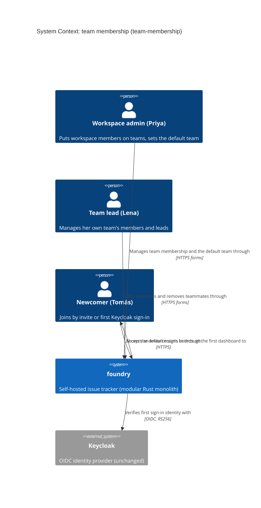
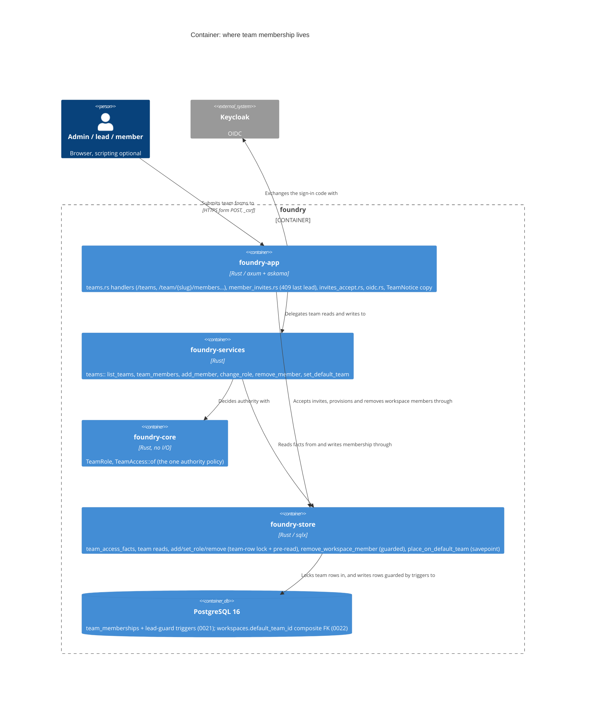
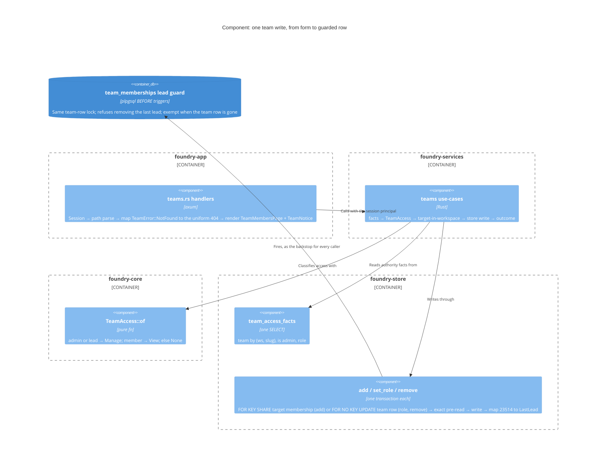

<!-- markdownlint-disable MD024 -->
# Feature Delta: team-membership

A workspace admin, or a team's lead, can see who is on a team and put a workspace
member on it, change a member's role, or take someone off it. A team can never
be left without a lead. A workspace can also name a default team, so people who
join through an invite or a Keycloak sign-in land on a team and can open its
boards. Today nothing in the product adds anyone to a team. This is the "way to
join teams" follow-up recorded by fix-hide-unreachable-boards (2026-10-09).

## Wave: DISCUSS

Product owner: Luna (nw-product-owner) | Date: 2026-10-09 | Feature type:
user-facing (Decision 1) | Walking skeleton: brownfield, judged against the
existing structure (Decision 2, see WS Strategy) | UX depth: lightweight, happy
path and main refusals (Decision 3) | JTBD: yes, new job (Decision 4) | Density:
lean, Tier-1 [REF] only, `expansion_prompt = ask-intelligent`.

### [REF] Prior Wave Consultation

| Artifact | Status | Note |
|---|---|---|
| `docs/product/jobs.yaml` | ✓ | No job covers team membership. `job-sso-signin` is the closest: it gets the operator signed in, and this job gets her to the board once she is. A new job, `job-team-membership`, is appended (see JTBD). |
| `docs/product/personas/persona-instance-operator.yaml` | ✓ | Priya Raman is reused as the workspace admin. Marco is reused as the authz foil. One evidenced characteristic is added (two accounts since SSO), plus `also_referenced_by` and `pains_addressed_to_date`. |
| `docs/product/journeys/*.yaml` (theme-adoption, issue-card-delete, card-drag-drop) | ✓ | Format skimmed. No SSOT journey is created: UX depth is lightweight, the same as the name-rule precedents. |
| `docs/product/architecture/brief.md` | ✓ | `establish_session` resolves the acting workspace and fails closed with none. OIDC provisioning creates one password-less `member` in the instance's original workspace (keycloak-sso D3a). The brief does not describe teams or team authz. Code is the source for those (below). |
| `docs/evolution/2026-10-09-fix-hide-unreachable-boards.md` | ✓ | This is the motivating incident. Its Follow-ups name "a workspace-admin 'add to team' action, or a default-team policy". This feature does both. Its second follow-up (link a Keycloak identity to an existing account) stays out of scope. |
| `docs/feature/name-db-checks/feature-delta.md`, `docs/feature/project-name-rule/feature-delta.md` | ✓ | House format, tone and level of detail. |
| `docs/product/vision.md`, `docs/project-brief.md`, `docs/stakeholders.yaml` | ⊘ | Do not exist. |
| DISCOVER / DIVERGE artifacts | ⊘ | None. Grounded in the incident, code reading and the user's decisions. This is a recorded risk, as in every precedent. |

No contradiction with prior evidence.

### [REF] Membership inventory (code-grounded)

| Fact | Source |
|---|---|
| `team_memberships(team_id, user_id, role IN ('lead','member'), PK(team_id, user_id))`, `teams(…, UNIQUE(workspace_id, slug))`, `workspace_memberships(…, role IN ('admin','member'))` | `crates/foundry-store/migrations/0001_init.sql` |
| The only production writers of `team_memberships`: bootstrap (`seed_initial_workspace`, the first user becomes `lead` of team General/`general`) and `foundry doctor add-test-user` (`Store::grant_all_memberships`, every workspace and team, as `member`) | `foundry-store/src/lib.rs:3489`, `:2937` |
| Invite-accept (`create_member_and_consume`) and Keycloak provisioning (`provision_federated_member`, oldest workspace) write a workspace membership only | `lib.rs:454`, `:548`; `oidc.rs:259` |
| **`provision_workspace` creates no team.** A workspace provisioned from `/admin/instance/workspaces` has zero teams, so nobody can be put on a team there and no project can be created. Out of scope (no team create, D14), but it bounds the default-team questions. | `lib.rs:2644` |
| `POST /workspace/members/remove` deletes the `workspace_memberships` row only. The person's `team_memberships` rows stay, including a `lead` row. | `member_invites.rs:248`, `lib.rs:2967` |
| The board and every project route are gated on `Store::is_team_member` within the acting workspace. A refusal is the uniform 404 (`resource_not_found_page`). | `lib.rs:1569`; routes `lib.rs:563-709` |
| The `lead` role grants nothing today. No handler reads it. | grep: no reader |
| Workspace-admin surfaces gate on `is_workspace_admin` and resolve the workspace from the session. A refusal is the uniform 404. | `member_invites.rs:310-340` |
| The dashboard shows "You're not on any team yet — ask a workspace admin to add you." when `is_on_any_team` is false. The quick actions are shown to everyone, and the targets gate server-side. | `templates/dashboard_root.html:12, 29-41` |

### [REF] Persona

- **Priya Raman** (`persona-instance-operator`) is workspace admin of Canzan Labs and a member of team Backend there (per the persona file). Since Keycloak provisioning she has **two accounts**: her bootstrap password account and a provisioned SSO account with a different email. In the dogfood, the bootstrap account is `jeffabailey@gmail.com` and the SSO account is `jeff@unintelligent-design.us` on dev. Both can show the same display name.
- **Lena Park**: lead of team Backend, a workspace `member` (not admin). She is the team-lead actor (US-TM-05). She is referenced inline, as prior features did, and is not added to the personas file (no evidence beyond her role).
- **Tomás Rivera**: a newcomer joining Canzan Labs through an invite (US-TM-06) or through Keycloak (US-TM-07).
- **Marco** (`persona-team-member-foil`): signed in, wrong team or no rights. He is the uniform-404 foil.

### [REF] JTBD

**job_id: `job-team-membership`** (appended to `docs/product/jobs.yaml`).

One-liner: *When someone in my workspace cannot open a team's boards, I want to see
who is on the team and put them on it, or have newcomers land on a team
automatically, so everyone reaches the boards they belong on without me
opening psql or running a test-user command.*

Job stories:

1. When my own SSO account shows "You're not on any team yet", I want to put it on team General from the product, so I can open Sandbox with it.
2. When a teammate joins Backend's work, I want to add them to Backend myself as its lead, without waiting for a workspace admin.
3. When the people leading a team change, I want to promote or demote leads and remove people, and trust that the team is never left with nobody in charge.
4. When I invite someone, or they sign in with Keycloak for the first time, I want them to land on our default team, so their first page is a board, not a dead end.

Dimensions: **functional**: put a workspace member on a team, change their role, or take them off, from one page per team, and default newcomers onto a team. **Emotional**: stop being told to "ask a workspace admin" when you are the workspace admin. **Social**: a teammate's first sign-in shows them the team's boards, not a polite refusal.

Four forces:

- **Push**: no product path writes `team_memberships`. The incident left a provisioned account on no team. The dashboard now says "ask a workspace admin to add you", but no admin can. The workarounds are psql, or `foundry doctor add-test-user`, which puts a user on every team in every workspace.
- **Pull**: a members list per team, with an Add control, the way every team tool works.
- **Anxiety**: leaking which teams exist to people outside them. Locking a team out of its own management by removing or demoting its last lead. Two leads demoting each other at once.
- **Habit**: `add-test-user` and psql work for a single operator. The product path must be scoped (one team, one person) and safer, not just prettier.

### [REF] Scope Assessment: PASS (7 stories, 3 contexts, about 5.5 days), with a separable half

| Oversized signal | Fired? | Evidence |
|---|---|---|
| More than 10 user stories | No | 7 |
| More than 3 bounded contexts or modules | No (exactly 3) | team membership and authz (new pages), invite onboarding (`invites_accept`), federated provisioning (`oidc` + `provision_federated_member`) |
| Walking skeleton needs more than 5 integration points | No | Slice 01 touches a route pair, two store reads, one store write and the dashboard link |
| More than 2 weeks of effort | No | about 5.5 days |
| Multiple independent outcomes that could ship separately | **Yes** | Managing membership (slices 01-04) and defaulting newcomers (slices 05-06) are independent outcomes |

One of five signals fires, so the verdict is **right-sized**. The default-team half
(slices 05-06) is genuinely separable: it depends only on slice 01. If the user
prefers, it splits into its own feature with no rework (OQ-10). Either way, every
slice ships alone.

### [REF] Locked Decisions

| ID | Decision | Source |
|---|---|---|
| D1 | User-facing feature. JTBD yes. UX depth lightweight. Walking skeleton judged brownfield: slice 01 is the thinnest end-to-end path over the existing stack (see WS Strategy). | User (Decisions 1-4) |
| D2 | **Who may add.** A workspace admin may add any member of the acting workspace to any team in it. A team lead may add workspace members to their own team. Nobody else may. | User |
| D3 | **In scope:** add, remove, change role (lead ⇄ member), a members page per team, and a default team for new members (invites and Keycloak). | User |
| D4 | **Dogfood.** On dev, signed in as `jeffabailey@gmail.com` (workspace admin, lead of General), add `jeff@unintelligent-design.us` to team General through the product. Then, signed in with Keycloak as that account, `/team/general/project/sandbox` answers 200 with the Sandbox board. It answers 404 today. | User |
| D5 | **Every refused request on the new team routes is the uniform 404**, on both verbs and byte-identical to `resource_not_found_page`. This covers being signed out, an unknown team slug, a team in another workspace, a caller without the right, and a target user who is unknown or not a member of the acting workspace. A refusal never says whether the team or the person exists. | Repo convention (lane routes, `/workspace/invites`) |
| D6 | **Never leaderless.** No write made through this feature may leave a team that has a lead with none. Removing or demoting the last lead is refused **with a stated reason**, not a 404 (the actor is authorized and already sees the team), and nothing changes. This must hold under concurrent requests (System Constraints, INV-1 to INV-6). | User |
| D7 | **Only current workspace members can be added.** Bringing in a new person stays with `/workspace/invites`. A person is always added as **Member**. Making them a lead is a separate role change. | PO: keeps add a one-choice action; promote is deliberate |
| D8 | **People are shown by display name and email** on every row, every candidate in the Add list, and every message. The incident's two accounts can share a display name. Only the email tells them apart. | PO, evidence from the incident |
| D9 | **Board authz is unchanged.** Team membership is still the only gate for boards. Managing a team (as workspace admin) grants no board access to it. | PO: one authz model, the one fix-hide-unreachable-boards made visible |
| D10 | **Tenancy comes from the session.** The team is resolved by (acting workspace, slug), exactly as the board does it. No workspace id is parsed from the request. | Repo convention (LAYER-1e) |
| D11 | **Who sees the members page.** A workspace admin sees it for every team in the workspace, and a team member (lead or member) sees it for their own team. Only a workspace admin or the team's lead sees the controls (Add, role change, Remove). A plain member sees the list read-only. Everyone else gets D5's 404. | PO: teammates already see each other's names on issues, so the list leaks nothing new to them |
| D12 | **One teams index, `/teams`**, linked as "Teams" from the dashboard quick actions. A workspace admin sees every team in the acting workspace. Anyone else sees only their own teams, and a member on no team sees today's no-team copy. | PO: the admin needs a way in. Without it, D4 depends on typing a URL. |
| D13 | **Writes are idempotent and need no confirm dialog.** Re-adding someone already on the team, or setting the role they already hold, changes nothing and says so. Remove and role change are single POSTs that re-render the page with the result. Both are reversible by the same actor, or by a workspace admin. | PO: reversible, low-blast-radius actions |
| D14 | **No team create, rename or delete. No team names.** The teams that exist today are the ones managed. | User (name rules out of scope) |
| D15 | **Copy is locked** (DESIGN may change routes, not strings). The strings are: "Added {name} ({email}) to {team} as a member." · "{name} ({email}) is already on {team}." · "{team} needs at least one lead. Make someone else a lead first." · "Everyone in this workspace is already on {team}." · "{name} ({email}) is now a lead of {team}." / "… is now a member of {team}." · "Removed {name} ({email}) from {team}." · "New members will join {team}." / "New members join no team." Role labels are "Lead" and "Member". | PO, for testable ACs |
| D16 | **Routes are proposed, and DESIGN finalizes them:** `GET /teams`, `GET /team/{team_slug}/members`, `POST /team/{team_slug}/members` (add), `POST /team/{team_slug}/members/{user_id}/role`, `POST /team/{team_slug}/members/{user_id}/remove`, and `POST /teams/default` (slice 05). All take double-submit `_csrf` and sit on the shared layer. They work with scripting disabled (plain forms; htmx optional). | PO, following the `/team/{slug}/…` convention |
| D17 | **Default-team writes are best-effort for the newcomer.** An invite accept or a Keycloak sign-in is never refused, and never fails, because of the default team. At worst the newcomer lands on no team, which is today's behaviour. | PO: the default is a convenience, and sign-in is critical |

### [REF] Open Questions (for the user; each has a recommended answer)

- **OQ-1: Are instance admins covered?** *Recommended: no.* An instance admin manages team membership by being a workspace admin of that workspace, as with `/workspace/invites` today. An implicit instance-admin bypass would make a workspace's team pages reachable to someone with no row in that workspace, which is a new cross-tenant path. The dogfood is unaffected, because the bootstrap account is also workspace admin.
- **OQ-2: Who may remove and change roles?** *Recommended: the same actors as add (D2).* A workspace admin may act on any team, and a lead on their own team. A lead may demote or remove another lead, or themselves, because leads are peers, and D6 protects the last one. Stories US-TM-03 to US-TM-05 are written to this answer.
- **OQ-3: Where is the default team configured?** *Recommended: on `/teams`.* One select, "Default team for new members", visible and usable by a workspace admin only (D5 for anyone else), listing the workspace's teams plus "No team".
- **OQ-4: One default per workspace?** *Recommended: yes, at most one per workspace, and unset on upgrade.* Unset means behaviour is unchanged. The dogfood sets General on dev. (Auto-defaulting the bootstrap team was considered. It is rejected because it silently changes who can see boards on upgrade.)
- **OQ-5: Do invites and Keycloak provisioning apply it equally?** *Recommended: yes.* Both create a workspace membership today, and both add the newcomer to the default team as **Member**, in the same transaction as the workspace membership. A Keycloak sign-in that links an existing account creates no membership, so it adds no team. Keycloak provisioning targets the original (oldest) workspace, so only that workspace's default applies to it.
- **OQ-6: What if the default team is deleted?** *Recommended: the setting clears itself, and newcomers land on no team (today's copy).* A newcomer is never refused (D17). There is no team delete today, so this guards a future feature and hand-written SQL. A default that points at another workspace's team must be impossible.
- **OQ-7: Can an invite pick a specific team instead?** *Recommended: not in this feature.* Invites use the workspace default. A per-invite team changes the invite record, the invite form and the accept path. That is a follow-up if newcomers often need a non-default team (KPI-2 shows it).
- **OQ-8: Does setting a default backfill existing no-team members?** *Recommended: no.* Those members are added on the members page. A backfill would grant board access to people nobody chose.
- **OQ-9: Workspace removal and teams.** `POST /workspace/members/remove` leaves the person's team rows, including a `lead` row. That can strip a team of its only real lead, outside D6. *Recommended:* removing someone from a workspace also removes their team memberships in it. It is refused, with D15-style copy naming the team ("{name} ({email}) is the last lead of {team}. Make someone else a lead first."), when they are any team's last lead. If accepted, this goes in slice 03 as US-TM-04 AC 6. If declined, members pages list only current workspace members, and DESIGN defines "lead" for INV-1 as "a lead who is still a workspace member".
- **OQ-10: Keep the default team in this feature, or split it out?** *Recommended: keep.* You asked for it, slices 05-06 depend only on slice 01, and they ship separately anyway. Splitting means renaming them into a new feature id and changes nothing else.

**Resolved by the user (2026-10-09):** every OQ takes its recommended answer.
- OQ-1: instance admins are not covered implicitly; they act as workspace admins (orchestrator, on the recommendation).
- OQ-2: leads are peers. A lead may demote or remove any lead on their team, including themselves, unless that leaves the team leaderless.
- OQ-3 to OQ-8: accepted as written (one default per workspace on `/teams`, unset on upgrade; invite and Keycloak provisioning apply it equally as Member; a deleted default clears itself; no per-invite team; no backfill).
- OQ-9: accepted. Workspace removal also removes the person's team rows and is refused when they are any team's last lead; it lands in slice 03 (US-TM-04 AC 6).
- OQ-10: keep the default team in this feature.

So slices 05-06 are unblocked, and DoR item 8 passes for US-TM-06 and US-TM-07.

### [REF] Journey (lightweight: happy path plus main refusals)

Emotional arc, **from locked out to in charge**: stuck and faintly absurd ("ask a
workspace admin", and she is one) → oriented (the Teams page shows General and
who is on it) → in control (one Add, a sentence naming exactly who was added) →
relieved (the SSO account opens Sandbox).

```text
[Where]                          [Does]                                       [Sees]                                                         [Feels]
/ (SSO account)                  signs in with Keycloak                       "You're not on any team yet — ask a workspace admin..."        stuck
/ (bootstrap account)            clicks Teams                                 /teams: "General · 1 member"                                   oriented
/team/general/members            reads the list                               "Jeff Bailey · jeffabailey@gmail.com · Lead"                   oriented
                                 picks "Jeff Bailey — jeff@unintelligent-     "Added Jeff Bailey (jeff@unintelligent-design.us) to           in control
                                 design.us" in Add a member, clicks Add       General as a member." + a new "Member" row
/ (SSO account)                  reloads                                      Your projects: SBX Sandbox                                     relieved
/team/general/project/sandbox    opens it                                     the Sandbox board (200)                                        relieved
```

Main refusals and edge paths:

| Step | What happens | Sees |
|---|---|---|
| Marco opens `/team/general/members` (not admin, not on General) | refused | the uniform 404 (D5) |
| Lena (Backend lead) posts an add to `/team/general/members` | refused | the uniform 404 (D2, D5) |
| Forged `user_id` of someone outside Canzan Labs | refused | the uniform 404 (D5, D7) |
| Everyone is already on the team | no candidates | "Everyone in this workspace is already on General." |
| Stale page in a second tab re-adds the same person | no change | "Jeff Bailey (jeff@unintelligent-design.us) is already on General." |
| Demote or remove the only lead | refused, nothing changes | "General needs at least one lead. Make someone else a lead first." |

### [REF] Shared Artifacts

| Artifact | Source of truth | Consumers | Risk |
|---|---|---|---|
| `${team_slug}`, `${team}` (name) | `teams.slug`, `teams.name`, resolved by (acting workspace, slug) | URLs, headings, D15 copy | LOW: shipped |
| `${name}`, `${email}` | `users.display_name`, `users.email_display` | rows, Add list, D15 copy | MEDIUM: both are needed (D8) |
| Role label ("Lead" / "Member") | `team_memberships.role` | rows, role control, D15 copy | LOW |
| Add candidates | members of the acting workspace minus the team's members | Add list | MEDIUM: must be computed in the acting workspace only (D10) |
| Acting workspace | session (`SessionUser.workspace_id`) | every new route | HIGH: the tenancy boundary |
| Default team (slice 05) | one per-workspace setting (DESIGN picks the shape) | `/teams`, invite accept, Keycloak provisioning | HIGH: must belong to the same workspace (OQ-6) |
| Uniform 404 | `resource_not_found_page` | every refusal (D5) | HIGH: byte-identity is the non-enumeration guarantee |
| No-team copy | `dashboard_root.html` | dashboard, `/teams` for a member on no team | LOW: unchanged string |

### [REF] Story Map and Slices

Backbone: **Find the team → See who is on it → Change who is on it → Change who leads it → Default newcomers**

| Slice | Stories | What it adds | Est. | Brief |
|---|---|---|---|---|
| 01 (walking skeleton) | US-TM-01, US-TM-02 | `/teams` index, members page, workspace-admin Add. **Resolves the incident.** | 1 d | `slices/slice-01-members-page-and-admin-add.md` |
| 02 | US-TM-03 | Workspace admin promotes and demotes. Last-lead demote is refused under concurrency. | 1 d | `slices/slice-02-change-role-never-leaderless.md` |
| 03 | US-TM-04 | Workspace admin removes someone. Last-lead removal is refused (and workspace removal, if OQ-9). | 0.5-1 d | `slices/slice-03-remove-from-team.md` |
| 04 | US-TM-05 | A team lead does add, role change and remove on their own team only. | 0.5-1 d | `slices/slice-04-team-lead-manages-own-team.md` |
| 05 | US-TM-06 | Workspace admin picks a default team, and an invitee who accepts lands on it. | 1 d | `slices/slice-05-default-team-for-invites.md` |
| 06 | US-TM-07 | A Keycloak-provisioned newcomer lands on the default team. | 0.5 d | `slices/slice-06-default-team-for-keycloak.md` |

The walking skeleton (slice 01) covers the first three backbone activities.
"Change who leads it" and "Default newcomers" are not needed for the incident's
end-to-end flow, so they stay below the line.

Priority by learning leverage:

1. **01** first. It is the incident, it is dogfooded the same day (D4), and it settles the new authz surface (a workspace admin acting on a team they are not on) that every later slice reuses.
2. **02** next. It carries the riskiest assumption: that "never leaderless" can be guaranteed under concurrent demotes (INV-1 to INV-3). Learning that early costs least, and 03 and 04 reuse the mechanism.
3. **03** reuses 02's invariant for a second verb. It is the natural place for OQ-9.
4. **04** widens the actor set from workspace admin to team lead for three verbs that already ship. That is low uncertainty, but it is what makes the `lead` role mean something.
5. **05 and 06** come last. They are blocked on OQ-3 to OQ-8 and depend only on 01, so they can move earlier, or split out (OQ-10), the moment those questions are answered. 05 comes before 06 because it adds the setting, and 06 only reads it.

Taste tests: no slice ships 4 or more new components. No slice is infrastructure
only: the invariant rides in slice 02's user value. Every slice names what it
disproves (see the briefs). Every dogfood uses the dev instance's real accounts.
No two slices differ only in scale (invite and Keycloak are different doors with
different transactions).

### [REF] User Stories

#### US-TM-01: A workspace admin sees every team and who is on it, with their roles

`job_id: job-team-membership` | slice 01

##### Elevator Pitch

Before: a workspace admin has no page that says which teams exist or who is on them. The only answer is psql.
After: on `/`, click **Teams** → `/teams` shows "General · 1 member". Click General → `/team/general/members` shows "Jeff Bailey · jeffabailey@gmail.com · Lead".
Decision enabled: who is missing from the team and needs adding.

##### Problem

Priya's SSO account is told to "ask a workspace admin", and she is the workspace
admin, but she has no page that shows teams or their members.

##### Who

- Workspace admin | dashboard, desktop browser | wants to see who can open a team's boards.
- Team member (lead or member) | wants to see who else is on their team.

##### Domain Examples

1. **Admin, dogfood**: `/teams` on dev lists "General · 1 member". `/team/general/members` lists "Jeff Bailey · jeffabailey@gmail.com · Lead".
2. **Admin not on the team**: Priya (admin of Canzan Labs, on Backend only) opens `/team/ops/members` and sees Ops's rows, but still gets the 404 on Ops's boards (D9).
3. **Plain member**: Lena's teammate Sam Okafor (Backend, Member) sees `/teams` listing only "Backend · 3 members", and the Backend list with no Add, role or Remove controls.
4. **Refused**: Marco (Canzan Labs member, not on Backend) gets the uniform 404 from `/team/backend/members`. So does `/team/no-such-team/members` and a team slug from another workspace.
5. **No team**: the SSO account on no team opens `/teams` and sees "You're not on any team yet — ask a workspace admin to add you."

##### UAT Scenarios (BDD)

###### Scenario: A workspace admin finds a team and sees its members and roles

- Given Priya is workspace admin of Canzan Labs, where team General has lead "Jeff Bailey" (jeffabailey@gmail.com)
- When Priya follows Teams from the dashboard and opens General
- Then she sees "General · 1 member" on the teams page
- And the members page shows "Jeff Bailey · jeffabailey@gmail.com · Lead"

###### Scenario: A workspace admin sees the members of a team she is not on, but still cannot open its boards

- Given Priya is workspace admin and is not on team Ops
- When she opens Ops's members page, then an Ops board
- Then she sees Ops's members, and the board answers the uniform not-found page

###### Scenario: A team member sees their own team's members without management controls

- Given Sam Okafor is a Member of Backend and not a workspace admin
- When Sam opens Teams, then Backend's members page
- Then the teams page lists only Backend, and the members page shows no Add, role or Remove control

###### Scenario: People outside a team cannot learn that it exists

- Given Marco is a Canzan Labs member who is not on Backend
- When Marco opens Backend's members page, an unknown team's members page, and another workspace's team's members page
- Then all three answer the same uniform not-found page

##### Acceptance Criteria

- [ ] The dashboard shows a "Teams" quick action. `/teams` lists every team of the acting workspace for a workspace admin, and only the caller's teams otherwise, each with its member count (scenarios 1, 3; D12).
- [ ] The members page lists each member as display name · email · role, with leads first and then by name (scenario 1; D8).
- [ ] A workspace admin reaches any team's members page in the workspace. That gives no board access (scenario 2; D9, D11).
- [ ] A plain member sees the list read-only. No management control is rendered (scenario 3; D11).
- [ ] Signed out, not on the team and not admin, unknown slug, or another workspace's team: the answer is byte-identical to the uniform 404 (scenario 4; D5).

##### Outcome KPIs

KPI-4.

##### Technical Notes

- Reads only. No schema change. The team is resolved by (session workspace, slug) (D10).

##### Size

0.5 day | 4 scenarios | slice 01

#### US-TM-02: A workspace admin puts a workspace member on a team, and that member can open the team's boards

`job_id: job-team-membership` | slice 01

##### Elevator Pitch

Before: Jeff's SSO account `jeff@unintelligent-design.us` sees "You're not on any team yet — ask a workspace admin to add you.", and `/team/general/project/sandbox` answers 404. No admin can fix it in the product.
After: as workspace admin on `/team/general/members`, choose "Jeff Bailey — jeff@unintelligent-design.us" under **Add a member** and click **Add** → see "Added Jeff Bailey (jeff@unintelligent-design.us) to General as a member." Signed in with Keycloak as that account, `/team/general/project/sandbox` shows the Sandbox board.
Decision enabled: the person can now work on the team's boards, so nobody needs psql or `foundry doctor add-test-user`.

##### Problem

Invite-accept and Keycloak provisioning add only a workspace membership. The
only tools that put someone on a team are psql and a test-user command that puts
them on every team.

##### Who

- Workspace admin | members page | puts one person on one team.

##### Domain Examples

1. **Dogfood (D4)**: on dev, `jeffabailey@gmail.com` adds `jeff@unintelligent-design.us` to General. That account's dashboard then lists "SBX Sandbox", and the board opens.
2. **Same display name**: the Add list shows "Jeff Bailey — jeff@unintelligent-design.us". The bootstrap "Jeff Bailey — jeffabailey@gmail.com" is not offered, because it is already on General (D8).
3. **Nobody to add**: on Backend, where all 4 Canzan Labs members already are, the Add list is replaced by "Everyone in this workspace is already on Backend."
4. **Stale tab**: Priya adds Tomás to Backend in one tab, then clicks Add for Tomás again in an older tab → "Tomás Rivera (tomas.rivera@canzan.dev) is already on Backend." One row.
5. **Forged**: a POST naming a Globex user's id (not in Canzan Labs) gets the uniform 404, and no row is written (D5, D7).

##### UAT Scenarios (BDD)

###### Scenario: A workspace admin adds a member to a team, and the member can open the team's board

- Given "jeff@unintelligent-design.us" is a Canzan Labs member on no team, and General has project Sandbox
- When the workspace admin adds "Jeff Bailey — jeff@unintelligent-design.us" to General
- Then she sees "Added Jeff Bailey (jeff@unintelligent-design.us) to General as a member."
- And the members page shows that account as Member
- And signed in as that account, the dashboard lists Sandbox and its board opens

###### Scenario: Only workspace members who are not on the team are offered

- Given General has "jeffabailey@gmail.com" as lead, and the workspace also has "jeff@unintelligent-design.us"
- When the workspace admin opens General's members page
- Then Add a member offers "Jeff Bailey — jeff@unintelligent-design.us" and nobody already on General

###### Scenario: Adding someone already on the team changes nothing and says so

- Given Tomás Rivera is already on Backend
- When the workspace admin submits Tomás again from an older page
- Then she sees "Tomás Rivera (tomas.rivera@canzan.dev) is already on Backend." and Backend still has one row for him

###### Scenario: Someone outside the workspace cannot be added

- When the workspace admin submits an add to Backend naming a user who is not a Canzan Labs member
- Then the answer is the uniform not-found page and Backend's members are unchanged

###### Scenario: A non-admin cannot add anyone to a team they do not lead

- Given Marco is a Canzan Labs member who is not a workspace admin and does not lead General
- When Marco submits an add to General
- Then the answer is the uniform not-found page and nothing changes

##### Acceptance Criteria

- [ ] A workspace admin's Add writes one `member` row and shows the D15 copy. The added person's dashboard lists the team's projects, and its board answers 200 (scenario 1; D4).
- [ ] The Add list is exactly (acting-workspace members) minus (team members), each shown as name — email. When it is empty, the D15 copy replaces it (scenario 2; D7, D8).
- [ ] A re-add is idempotent and shows the "already on" copy (scenario 3; D13).
- [ ] A target outside the acting workspace, an unknown id, or a caller who is neither admin nor this team's lead gets the uniform 404, with zero rows written (scenarios 4, 5; D5).
- [ ] Without scripting, Add is a plain form POST followed by a re-rendered page.

##### Outcome KPIs

KPI-1, KPI-4, KPI-5.

##### Technical Notes

- No schema change. CSRF on the shared layer. Authz is evaluated at request time, never from the rendered page (INV-6).
- INV-5: the add commits only if the target is still a workspace member.

##### Size

0.5 day | 5 scenarios | slice 01

#### US-TM-03: A workspace admin changes who leads a team, and a team can never lose its last lead

`job_id: job-team-membership` | slice 02

##### Elevator Pitch

Before: the `lead` role exists only in the database. Nothing in the product shows it, sets it or protects it.
After: on `/team/backend/members`, click **Make lead** on "Sam Okafor · sam.okafor@canzan.dev · Member" → see "Sam Okafor (sam.okafor@canzan.dev) is now a lead of Backend." Later, **Make member** on Sam, by then the only lead, shows "Backend needs at least one lead. Make someone else a lead first."
Decision enabled: hand a team's leadership to someone else, safely, in two clicks.

##### Problem

When a team's leadership changes, the only path is psql, and nothing stops a
team from ending up with no lead.

##### Who

- Workspace admin | members page | reassigns leadership.

##### Domain Examples

1. **Promote**: Sam (Member) → "Make lead" → "Sam Okafor (sam.okafor@canzan.dev) is now a lead of Backend." Backend now has Lena and Sam as leads.
2. **Hand over**: Lena is then demoted → "Lena Park (lena.park@canzan.dev) is now a member of Backend." Sam is the only lead.
3. **Last lead**: demoting Sam, now the only lead → "Backend needs at least one lead. Make someone else a lead first." Nothing changes.
4. **Concurrent**: Lena and Sam are the only two leads, and two requests demote each of them at the same instant. Exactly one succeeds. The other gets the last-lead copy. Backend ends with exactly one lead.
5. **No-op**: "Make lead" on someone who already is a lead → "… is now a lead of Backend." with no write (D13).

##### UAT Scenarios (BDD)

###### Scenario: A workspace admin promotes a member to lead

- Given Backend has lead Lena Park and member Sam Okafor
- When the workspace admin makes Sam a lead
- Then she sees "Sam Okafor (sam.okafor@canzan.dev) is now a lead of Backend." and both are listed as Lead

###### Scenario: A workspace admin hands leadership over by demoting the previous lead

- Given Backend has leads Lena Park and Sam Okafor
- When the workspace admin makes Lena a member
- Then Lena is listed as Member and Sam as Lead

###### Scenario: The last lead cannot be demoted

- Given Sam Okafor is Backend's only lead
- When the workspace admin makes Sam a member
- Then she sees "Backend needs at least one lead. Make someone else a lead first." and Sam is still Lead

###### Scenario: Two leads demoted at the same time leave the team with one lead

- Given Lena Park and Sam Okafor are Backend's only leads
- When both are demoted at the same moment
- Then exactly one demotion succeeds, the other shows the last-lead message, and Backend has exactly one lead

###### Scenario: Someone without the right cannot change a role

- When Marco submits a role change on Backend
- Then the answer is the uniform not-found page and no role changes

##### Acceptance Criteria

- [ ] Promote and demote write the role and show the D15 copy. A same-role submit writes nothing (scenarios 1, 2; D13).
- [ ] A demote that would leave a team that has a lead with none is refused with the D15 copy and writes nothing (scenario 3; D6).
- [ ] Under concurrent demotes of the last two leads, the team ends with exactly one lead, over 100 repeated races (scenario 4; INV-1, INV-2).
- [ ] An unauthorized caller gets the uniform 404 (scenario 5; D5).

##### Outcome KPIs

KPI-3, KPI-4.

##### Technical Notes

- INV-1 to INV-4 are requirements for DESIGN. The mechanism is DESIGN's choice. The race scenario must run against real Postgres.

##### Size

1 day | 5 scenarios | slice 02

#### US-TM-04: A workspace admin takes someone off a team, without leaving it leaderless

`job_id: job-team-membership` | slice 03

##### Elevator Pitch

Before: someone who left a team's work keeps its board access forever, unless psql removes it.
After: on `/team/backend/members`, click **Remove** on "Tomás Rivera · tomas.rivera@canzan.dev · Member" → see "Removed Tomás Rivera (tomas.rivera@canzan.dev) from Backend." Tomás's next request to `/team/backend/project/auth` answers the uniform 404.
Decision enabled: board access matches who actually works on the team.

##### Problem

Removal is the other half of add. Without it, every add is permanent, and it
is the second way, after a demote, that a team can lose its last lead.

##### Who

- Workspace admin | members page | removes access.

##### Domain Examples

1. **Remove member**: Tomás is removed from Backend. His dashboard drops "AUTH Identity Platform", and the AUTH board answers 404.
2. **Remove one of two leads**: Lena is removed. Sam remains the only lead.
3. **Last lead**: removing Sam, the only lead → "Backend needs at least one lead. Make someone else a lead first."
4. **Concurrent**: removing Lena and demoting Sam at the same instant, when they are the only leads → exactly one succeeds.
5. **Last team**: removing Tomás from his only team → his dashboard shows "You're not on any team yet — ask a workspace admin to add you."

##### UAT Scenarios (BDD)

###### Scenario: A workspace admin removes a member, who loses access to the team's boards

- Given Tomás Rivera is a member of Backend, which has project Identity Platform (AUTH)
- When the workspace admin removes Tomás from Backend
- Then she sees "Removed Tomás Rivera (tomas.rivera@canzan.dev) from Backend."
- And Tomás's dashboard no longer lists AUTH, and the AUTH board answers the uniform not-found page

###### Scenario: The last lead cannot be removed

- Given Sam Okafor is Backend's only lead
- When the workspace admin removes Sam
- Then she sees "Backend needs at least one lead. Make someone else a lead first." and Sam is still on Backend as Lead

###### Scenario: A removal and a demotion at the same time leave the team with a lead

- Given Lena Park and Sam Okafor are Backend's only leads
- When Lena is removed and Sam is demoted at the same moment
- Then exactly one of the two succeeds, and Backend has exactly one lead

###### Scenario: Someone without the right cannot remove anyone

- When Marco submits a removal from Backend
- Then the answer is the uniform not-found page and Backend is unchanged

##### Acceptance Criteria

- [ ] Remove deletes the row and shows the D15 copy. The removed person's next board request is the uniform 404 (scenario 1).
- [ ] Removing the last lead is refused with the D15 copy, and nothing changes (scenario 2; D6).
- [ ] A concurrent removal and demotion of the last two leads ends with exactly one lead (scenario 3; INV-1, INV-3).
- [ ] An unauthorized caller gets the uniform 404 (scenario 4; D5).
- [ ] Removing someone not on the team (stale page) changes nothing and re-renders the list (D13).
- [ ] (OQ-9 accepted) `POST /workspace/members/remove` also removes the person's team rows in that workspace, and is refused with the OQ-9 copy when they are any team's last lead.

##### Outcome KPIs

KPI-3, KPI-4.

##### Technical Notes

- Reuses slice 02's invariant mechanism. OQ-9 widens the scope to the shipped workspace-removal route.

##### Size

0.5-1 day | 4 scenarios | slice 03

#### US-TM-05: A team lead manages their own team, and only their own team

`job_id: job-team-membership` | slice 04

##### Elevator Pitch

Before: Lena leads Backend in name only. Adding a teammate means asking Priya, the workspace admin.
After: as Lena on `/team/backend/members`, choose "Tomás Rivera — tomas.rivera@canzan.dev" and click **Add** → see "Added Tomás Rivera (tomas.rivera@canzan.dev) to Backend as a member." The same request to `/team/general/members` answers the uniform 404.
Decision enabled: Lena staffs her own team without waiting for an admin.

##### Problem

The `lead` role grants nothing today. A lead cannot shape their own team.

##### Who

- Team lead, not a workspace admin | their team's members page.

##### Domain Examples

1. **Add**: Lena adds Tomás to Backend.
2. **Promote and step down**: Lena makes Sam lead, then makes herself a member → "Lena Park (lena.park@canzan.dev) is now a member of Backend." Her controls disappear on the next page.
3. **Other team**: Lena opens `/team/general/members` (she is not on General) → uniform 404. A POST there → uniform 404.
4. **Member of another team, not its lead**: Lena is a Member of Ops. On `/team/ops/members` she sees the list read-only, and a POST there gets the uniform 404.
5. **Demoted mid-session**: after Priya demotes Lena, Lena's open page posts an add → uniform 404 (INV-6).

##### UAT Scenarios (BDD)

###### Scenario: A team lead adds a workspace member to their own team

- Given Lena Park leads Backend and is not a workspace admin
- When Lena adds "Tomás Rivera — tomas.rivera@canzan.dev" to Backend
- Then she sees "Added Tomás Rivera (tomas.rivera@canzan.dev) to Backend as a member."

###### Scenario: A team lead hands over leadership and steps down

- Given Lena Park and Sam Okafor are Backend members and Lena is its only lead
- When Lena makes Sam a lead, then makes herself a member
- Then Sam is the only lead and Lena sees Backend's members without management controls

###### Scenario: A team lead cannot manage a team they do not lead

- Given Lena leads Backend, is a Member of Ops, and is not on General
- When Lena submits an add, a role change and a removal on Ops and on General
- Then every request answers the uniform not-found page and nothing changes

###### Scenario: A lead who was demoted cannot act from a page opened earlier

- Given Lena had Backend's members page open as a lead, and has since been made a member
- When Lena submits an add from that page
- Then the answer is the uniform not-found page and nothing changes

##### Acceptance Criteria

- [ ] A lead can add, change roles and remove on their own team, under the same D6 rule and D15 copy as a workspace admin (scenarios 1, 2; D2, OQ-2).
- [ ] A lead acting on any other team gets the uniform 404, whether or not they are a member of it (scenario 3; D5, D11).
- [ ] Authority is checked at request time (scenario 4; INV-6).

##### Outcome KPIs

KPI-4, KPI-5.

##### Technical Notes

- This widens the authz predicate of slices 01-03 from "workspace admin" to "workspace admin or lead of this team". It adds no new route.

##### Size

0.5-1 day | 4 scenarios | slice 04

#### US-TM-06: A workspace admin picks a default team, and an invited newcomer lands on it

`job_id: job-team-membership` | slice 05

##### Elevator Pitch

Before: every invitee's first page says "You're not on any team yet — ask a workspace admin to add you."
After: on `/teams`, set **Default team for new members** to General and click **Save** → see "New members will join General.". Tomás accepts his invite at `/invites/accept` → his first dashboard lists "SBX Sandbox".
Decision enabled: invite people without a follow-up trip to the members page.

##### Problem

Every newcomer needs a second, manual admin action before foundry is useful
to them. The incident shows that it is easily missed.

##### Who

- Workspace admin | teams page | sets policy once.
- Newcomer | accepts an invite | expects to land on a board.

##### Domain Examples

1. **Set**: Priya sets General → "New members will join General."
2. **Invite**: Tomás accepts the invite to Canzan Labs → he is a Member of General, and his dashboard lists Sandbox.
3. **Unset**: with "No team" → "New members join no team." Tomás then lands on today's no-team copy (OQ-4).
4. **Default gone**: if the default team no longer exists, Tomás still gets his account and lands on no team. The accept never fails (D17, OQ-6).
5. **Refused**: Lena (lead, not admin) submits the default-team form → uniform 404. A team id from Globex → uniform 404.

##### UAT Scenarios (BDD)

###### Scenario: A workspace admin sets the default team

- When Priya sets General as Canzan Labs's default team
- Then she sees "New members will join General." and the teams page shows General selected

###### Scenario: An invited newcomer lands on the default team

- Given General is Canzan Labs's default team, with project Sandbox
- When Tomás Rivera accepts his invite to Canzan Labs
- Then Tomás is a Member of General and his first dashboard lists Sandbox

###### Scenario: Without a default team, a newcomer lands as today

- Given Canzan Labs has no default team
- When Tomás accepts his invite
- Then he is on no team and sees "You're not on any team yet — ask a workspace admin to add you."

###### Scenario: A missing default team never blocks joining

- Given Canzan Labs's default team no longer exists
- When Tomás accepts his invite
- Then his account is created, he is signed in, and he is on no team

###### Scenario: Only a workspace admin can set the default, and only to a team of the workspace

- When Lena submits the default-team form, and Priya submits a Globex team as the default
- Then both answer the uniform not-found page and the default is unchanged

##### Acceptance Criteria

- [ ] A workspace admin sets or clears the default from `/teams`, with the D15 copy (scenario 1; OQ-3, OQ-4).
- [ ] Invite accept adds the newcomer to the default team as Member, atomically with the workspace membership (scenario 2; OQ-5).
- [ ] With no default, or a missing default, the behaviour is today's, and accept never fails because of it (scenarios 3, 4; D17, OQ-6).
- [ ] A non-admin, or a team outside the workspace, gets the uniform 404 (scenario 5; D5).
- [ ] Existing no-team members are not backfilled (OQ-8).

##### Outcome KPIs

KPI-1, KPI-2.

##### Technical Notes

- Needs one per-workspace setting (a schema change). DESIGN owns the shape and the "default deleted" behaviour (OQ-6). Rolling deploy: an older replica ignores the setting, so a newcomer there lands on no team, which is today's behaviour.
- OQ-3 to OQ-8 resolved to the recommended answers (2026-10-09); the ACs stand.

##### Size

1 day | 5 scenarios | slice 05

#### US-TM-07: A newcomer provisioned by a Keycloak sign-in lands on the default team

`job_id: job-team-membership` | slice 06

##### Elevator Pitch

Before: a first Keycloak sign-in with the provision role creates a workspace member on no team. This is exactly the incident.
After: with General as default, a first sign-in through **Sign in with Keycloak** as `tomas.rivera@canzan.dev` → the dashboard lists "SBX Sandbox", and `/team/general/project/sandbox` shows the board.
Decision enabled: turn on Keycloak provisioning for the team without a manual follow-up per person.

##### Problem

Keycloak provisioning is the door the incident came through. Slice 05 covers
invites, and this slice covers this door.

##### Who

- Newcomer with the Keycloak provision role | first sign-in.

##### Domain Examples

1. **Provisioned**: Tomás's first Keycloak sign-in creates his account in Canzan Labs (the original workspace) and puts him on General as Member.
2. **Linked, not provisioned**: Priya's existing bootstrap account signs in through Keycloak with the same email → it links as today, and no team row is added (OQ-5).
3. **No default**: provisioned onto no team, as today.
4. **Default gone**: provisioned, signed in, on no team. Never refused (D17).

##### UAT Scenarios (BDD)

###### Scenario: A newcomer's first Keycloak sign-in lands them on the default team

- Given General is the default team of the original workspace, and Keycloak provisioning is on
- When Tomás signs in with Keycloak for the first time
- Then Tomás is a Member of General and the Sandbox board opens

###### Scenario: Linking an existing account adds no team

- Given Priya's existing account is not on Ops, and Ops is the default
- When Priya signs in with Keycloak using the same email
- Then she is signed in and is still not on Ops

###### Scenario: A missing or unset default never blocks a first sign-in

- Given the original workspace has no default team, or its default team no longer exists
- When Tomás signs in with Keycloak for the first time
- Then he is provisioned and signed in, on no team

##### Acceptance Criteria

- [ ] Provisioning adds the default-team Member row atomically with the workspace membership (scenario 1; OQ-5).
- [ ] Linking an existing account writes no team row (scenario 2).
- [ ] An unset or missing default never refuses or fails the sign-in (scenario 3; D17). The keycloak-sso lane (46) stays green.

##### Outcome KPIs

KPI-1, KPI-2.

##### Technical Notes

- Inside `provision_federated_member`'s transaction. The keycloak-sso acceptance lane uses its Keycloak harness.
- OQ-5 and OQ-6 resolved to the recommended answers (2026-10-09).

##### Size

0.5 day | 3 scenarios | slice 06

### [REF] System Constraints

Invariant and concurrency requirements for DESIGN. They name the risks and do not
choose mechanisms.

- **INV-1 (never leaderless):** after any committed write through this feature (demote, remove, and workspace removal if OQ-9 is accepted), every team that had at least one lead still has at least one. A team that already has no lead (legacy, or made in psql) is not refused for unrelated writes, and promoting someone there is allowed.
- **INV-2 (mutual demotion):** two leads demoting each other, or both being demoted by anyone, at the same time must not both succeed when they are the last two. A read-check-then-write without serialization fails this.
- **INV-3 (mixed verbs):** a concurrent remove and demote, or two removes, on the last two leads are under the same guarantee.
- **INV-4 (self-action):** a sole lead demoting or removing themselves is the same refusal. Self-action is not exempt.
- **INV-5 (add vs workspace removal):** an add commits only if the target is still a member of the acting workspace at commit time. Nobody may end up on a team of a workspace they are not in.
- **INV-6 (authority at request time):** authz is evaluated per request against current rows. A rendered control proves nothing (a stale page from a demoted lead gets a 404).
- **INV-7 (default team in the same workspace):** a workspace's default team is always one of its own teams or none, including after a team is deleted by any means.
- **INV-8 (store level):** INV-1 must hold for any future caller of the membership writes, not only these handlers. DESIGN decides whether the database or one service seam enforces it.
- No new oracle: every refusal is byte-identical to the uniform 404 (D5). The last-lead refusal is shown only to an authorized actor.
- No schema change in slices 01-04, unless DESIGN's INV-1 mechanism needs one.

### [REF] Outcome KPIs

Objective: every workspace member who should reach a team's boards can, without
psql or a test-user command, and no team is ever left without a lead.

| # | Who | Does What | By How Much | Baseline | Measured By | Type |
|---|-----|-----------|-------------|----------|-------------|------|
| 1 | Workspace members (in workspaces that have at least one team) | Are on at least one team | 0 members on no team on dev and prod, 1 day after slice 01 dogfood (and stays 0 for newcomers once slice 05-06 defaults are set) | dev: at least 1 (`jeff@unintelligent-design.us`). prod: unknown, counted at slice-01 dogfood | Read-only query: workspace members with no `team_memberships` row in that workspace | North star |
| 2 | Newcomers (invite or Keycloak provisioning) when a default is set | Open a board on their first session | 100% | 0%: no path exists | Acceptance scenarios (US-TM-06/07), plus dogfood with one real newcomer on dev | Leading |
| 3 | Teams | Never lose their last lead through the product | 0 teams with no lead made by a feature write; 0 double-success in 100 repeated concurrent races | Leaderless teams today: counted at dogfood (expected 0) | Read-only query `teams` without a `lead` row, plus the race scenarios | Guardrail |
| 4 | Callers without the right | Learn nothing and change nothing | 100% of the (actor × verb × team) authz matrix answers byte-identical 404s with 0 rows written | Not applicable (no routes) | Acceptance authz outline | Guardrail |
| 5 | The operator | Manages membership without psql or `add-test-user` | 0 hand-written `team_memberships` writes from the release onward | Every membership change since bootstrap was psql or `add-test-user` | Operator report at each dogfood | Leading |

At homelab scale, the KPIs are verified by acceptance scenarios and read-only
store queries, not analytics.

### [REF] DoD

1. All UAT scenarios pass: 4 + 5 + 5 + 4 + 4 + 5 + 3 = 30. The neighbouring lanes stay green: fix-hide-unreachable-boards, dashboard-enhancements, navigation-bar, member invites (30 + 18), keycloak-sso (46), us-07, mwt slices, and default.
2. The authz matrix (KPI-4) covers signed-out users, Marco, a lead of another team, a plain member, a workspace admin, an unknown slug and a foreign team, on every new route, both verbs. Every refusal is byte-identical to the uniform 404.
3. INV-1 to INV-6: race scenarios on real Postgres, repeated at least 100 times, with 0 leaderless outcomes.
4. Nothing is written on a refusal (row counts asserted).
5. The pages work with scripting disabled (the scripting-disabled lane).
6. `cargo xtask check-arch` and `cargo xtask smoke` pass before each commit. `FOUNDRY_XTASK_INCLUDE_DOCKER=1 cargo xtask ci` passes before push. Mutation kill rate is at least 80% on modified files.
7. **Dogfood (D4)**, on dev (it auto-deploys release tags), the same day: add `jeff@unintelligent-design.us` to General as `jeffabailey@gmail.com`. Then the Keycloak session's `/team/general/project/sandbox` answers 200, and the dashboard lists Sandbox. Record the KPI-1 and KPI-3 baselines with read-only queries on dev and prod. Prod is verified after approval.
8. Upgrade: slices 01-04 need no migration. Slice 05's migration is additive, rolling-deploy safe (an older replica ignores the default), and its CHANGELOG migration notes say so.
9. Documentation: a CHANGELOG `[Unreleased]` entry for Teams, the members page and the default team. `brief.md` gains a "Teams and team authz" paragraph (DESIGN). An outcomes registry row is added at DISTILL. `jobs.yaml` and the persona were done here. The fix-hide-unreachable-boards evolution doc's first follow-up is marked closed in this feature's evolution doc.

### [REF] Out of Scope

- Team create, rename, delete, and team name rules (D14). Workspaces provisioned with zero teams stay without teams.
- Self-service join, leave or request-to-join. Inviting directly onto a specific team (OQ-7).
- Linking a Keycloak identity to an existing account, and showing the signed-in account (the incident's second follow-up).
- Instance-admin team management (OQ-1). An `/api/v1` or `foundry doctor` membership command (`add-test-user` is unchanged).
- Workspace role changes (admin ⇄ member).
- Notifications or email to the person added or removed. A membership audit trail.
- Backfilling existing no-team members onto a default (OQ-8).
- Granting board access through workspace admin (D9).
- Changing the dashboard's no-team copy, or its hardcoded `/team/general/projects/new` link.

### [REF] WS Strategy

Brownfield (Decision 2, judged against the structure). Sessions, tenancy, teams,
the board gate and the uniform 404 already ship. What is missing is any path into
`team_memberships`, so slice 01 is the walking skeleton. It is the thinnest
end-to-end path: dashboard → `/teams` → members page → Add → the member opens the
board. It runs on real adapters only (real Postgres, real router, real session),
with no configurable or environment-switched seam (not strategy D). Slices 02-06
extend it.

### [REF] Driving Ports

1. `GET /teams` (new): the teams index (D12). In slice 05, it also holds the default-team form.
2. `GET /team/{team_slug}/members` (new): the members page (D11).
3. `POST /team/{team_slug}/members` (new): add (US-TM-02, US-TM-05).
4. `POST /team/{team_slug}/members/{user_id}/role` (new): promote and demote (US-TM-03).
5. `POST /team/{team_slug}/members/{user_id}/remove` (new): remove (US-TM-04).
6. `POST /teams/default` (new, slice 05): set or clear the default team.
7. `GET /` (delta): a "Teams" quick action.
8. `POST /invites/accept` (delta, slice 05) and the Keycloak callback `oidc::CALLBACK_PATH` (delta, slice 06): default-team placement.
9. `POST /workspace/members/remove` (delta, only if OQ-9 is accepted).
10. `GET /team/{team_slug}/project/{project_slug}` (unchanged route): now reachable for added members. This is the dogfood check.

Routes are proposals (D16). The copy is locked (D15).

### [REF] Pre-requisites

- v0.12.0 (fix-hide-unreachable-boards) has shipped: the membership-filtered project list, `is_on_any_team`, and the no-team copy.
- These already ship: `is_workspace_admin`, `is_team_member`, `find_team_by_slug`, `resource_not_found_page`, CSRF and sessions, and the scripting-disabled lane.
- Dev has `FOUNDRY_OIDC_PROVISION_ROLE` set, and the SSO account exists there as a workspace member on no team (the incident state, which the D4 dogfood needs).
- OQ-1 and OQ-2 are answered before slice 01 and slice 02 DESIGN respectively (the stories assume the recommended answers). OQ-9 must be answered before slice 03, and OQ-3 to OQ-8 before slice 05.

### [REF] DoR Validation

| DoR item | 01 | 02 | 03 | 04 | 05 | 06 | 07 | Evidence |
|---|---|---|---|---|---|---|---|---|
| 1. Problem in domain language | PASS | PASS | PASS | PASS | PASS | PASS | PASS | Each Problem section: "ask a workspace admin" with no admin path; permanent adds; lead means nothing; newcomers dead-end |
| 2. Persona specific | PASS | PASS | PASS | PASS | PASS | PASS | PASS | Priya (two accounts), Lena (lead, not admin), Sam, Tomás, Marco |
| 3. 3+ domain examples, real data | PASS (5) | PASS (5) | PASS (5) | PASS (5) | PASS (5) | PASS (5) | PASS (4) | dev accounts `jeffabailey@gmail.com` and `jeff@unintelligent-design.us`, General/Sandbox, Canzan Labs Backend/AUTH |
| 4. UAT 3-7 scenarios | PASS (4) | PASS (5) | PASS (5) | PASS (4) | PASS (4) | PASS (5) | PASS (3) | Business-outcome titles |
| 5. AC from UAT | PASS | PASS | PASS | PASS | PASS | PASS | PASS | Each AC cites its scenarios or decisions |
| 6. Right-sized | PASS | PASS | PASS | PASS | PASS | PASS | PASS | 0.5-1 day each, 3-5 scenarios |
| 7. Technical notes | PASS | PASS | PASS | PASS | PASS | PASS | PASS | Per story, plus INV-1 to INV-8 |
| 8. Dependencies tracked | PASS | PASS | PASS (OQ-2) | PASS (OQ-2, OQ-9) | PASS (OQ-2) | **PASS with a block** (OQ-3 to OQ-8) | **PASS with a block** (OQ-5, OQ-6) | All open questions listed with recommended answers |
| 9. Outcome KPIs | PASS | PASS | PASS | PASS | PASS | PASS | PASS | KPI-1 to KPI-5 with targets, baselines and methods |
| job_id + Elevator Pitch | PASS | PASS | PASS | PASS | PASS | PASS | PASS | `job-team-membership`. Every After line names a real route or UI action and the exact text seen. |

DoR status: **PASSED for slices 01-04**, which are ready for DESIGN on the
recommended answers to OQ-1, OQ-2 and OQ-9. **Slices 05-06 pass with a block**
until OQ-3 to OQ-8 are answered. Per-wave peer review was not invoked. The
consolidated review runs at the end of DISTILL.

### [REF] Wave Decisions

- Feature type: user-facing. Walking skeleton: slice 01, brownfield. UX depth: lightweight. JTBD: a new job, `job-team-membership`.
- Density: lean, `ask-intelligent`. Triggers evaluated:
  - **Cross-context complexity: fired.** Three bounded contexts (team membership and authz, invite onboarding, federated provisioning). Suggests `alternatives-considered`.
  - **Multi-stakeholder need: fired.** Five personas across the stories (Priya, Lena, Sam, Tomás, Marco). Suggests `persona-narrative`.
  - **AC ambiguity: not fired.** The last-lead AC shared by US-TM-03, -04 and -05 has one locked copy string and one invariant. The default-team ACs are written to the recommended answers and blocked on the OQs, rather than left ambiguous.
  - **Compliance / regulatory: not fired.** No regulatory terms appear, and the audit trail is explicitly out of scope.
  - **WS strategy = D: not fired.**
  - Neither expansion is rendered. Both are offered at handoff.
- Upstream changes: none to DISCOVER (none exists). This closes the first follow-up of `docs/evolution/2026-10-09-fix-hide-unreachable-boards.md`.

## Wave: DESIGN

Architect: Morgan (nw-solution-architect) | Date: 2026-10-09 | Scope: application | Mode: propose (orchestrator-dispatched; all OQs resolved to recommendations, D1-D17 locked) | Paradigm: OOP (CLAUDE.md, unchanged) | Density: lean, Tier-1 [REF] only, no expansion menu (DESIGN declares no ask-intelligent triggers) | Per-wave review: invoked (trigger: security-boundary change, a new authority path, and a contested concurrency ADR). Result: conditionally approved, 0 critical, 1 high. The high issue (DDD-11 statement order) was resolved by pinning the five-statement order and its rationale in DDD-11. Mediums resolved: the facts-read projection is pinned in DDD-16, and the user-delete consequence is recorded as OQ-D9. Orphan count stays OQ-D4 (expected 0; a large count would surface there before slice 02 ships).

### [REF] Prior Wave Consultation

| Artifact | Status |
|---|---|
| DISCUSS above: D1-D17, OQ-1 to OQ-10 resolved, INV-1 to INV-8, US-TM-01 to US-TM-07 | ✓ No contradiction. Four refinements (Changed Assumptions 1-4). |
| `slices/slice-01..06` | ✓ All six read in full. |
| `docs/product/architecture/brief.md` | ✓ Extended in this wave: "Teams, team authority and the never-leaderless guard" under Application Architecture. |
| `adr-name-db-001`, `adr-workspace-rename-001`, `adr-board-lane-002`, `adr-board-lane-003`, `adr-project-name-001` | ✓ Trigger idiom (23514 + named arm, `SET search_path FROM CURRENT`, re-runnable body, probe-unchanged rationale), locked-read transaction, `FOR UPDATE` serialisation with the SERIALIZABLE and advisory-lock rejections, use-case placement. All reused. |
| `adr-oidc-001/002/003` | ⊘ Not reopened. Provisioning was read from code (`oidc.rs::callback`/`provision`, `Store::provision_federated_member`) and from the brief's keycloak-sso addenda. Nothing here touches the crate boundary, the state carrier or discovery. |
| House format: `name-db-checks`, `project-name-rule` DESIGN sections | ✓ |
| `docs/product/outcomes/registry.yaml` | ✓ Manual Tier-1 scan (see Outcome Collision Check). The CLI was not run: no shell in this session. |
| `docs/feature/{id}/discuss/*`, `spike/findings.md` | ⊘ Lean layout. No spike. |

Code read: `foundry-store/src/lib.rs`:
- `probe` :210, `create_member_and_consume` :454, `provision_federated_member` :548
- `list_projects_for_workspace` :881, `is_on_any_team` :905, `find_team_by_slug` :1537, `is_team_member` :1569
- `is_workspace_admin` :2570, `provision_workspace` :2644, `grant_all_memberships` :2937, `remove_workspace_member` :2967
- `team_belongs_to_workspace` :3195, `TeamRow` :3277, `seed_initial_workspace` :3455, `TENANT_TABLES` :109

Also `migrations/0001_init.sql` (whole), `0010` and `0019` (head).

`foundry-app/src/`:
- `member_invites.rs` (whole)
- `lib.rs` router :382-740
- `oidc.rs` :160-300
- `invites_accept.rs` :130-180
- `signin.rs` dashboard :395-490
- `nav.rs` :1-140
- `projects.rs` :160-190 (the `Services::new(state.store.clone())` idiom)
- `bootstrap.rs::resource_not_found_page` :407
- `templates/dashboard_root.html`

`foundry-services/src/lib.rs` :1-370 and `workspaces.rs` :1-120. `xtask/src/check_arch.rs`: LAYER-1e :388-455, provisioned-marker scanner :1095-1150, `project-name-one-source` :4526-4580.

Grep facts:
- No production `DELETE FROM` or `UPDATE` of `team_memberships` exists anywhere, fixtures included.
- The only whole-workspace delete is the recipient-notification-preferences acceptance step (`feature_recipient_notification_preferences.rs:1705`).
- No store read lists teams or team members today.
- `POST /workspace/members/remove` has no UI form. It is a scripted, plain-text endpoint used by two acceptance lanes.

### [REF] DDD List (design decisions)

| ID | Decision | Options | Verdict | One-line rationale |
|---|---|---|---|---|
| DDD-1 | **Shape** | (a) extend the modular monolith with a `teams` vertical: a pure policy in `foundry-core`, use-cases in `foundry-services::teams`, store methods, an app handler module; (b) handlers straight to store, as `member_invites.rs` does | **(a)** | Four verbs share one policy and one invariant. The use-case seam (ADR-PROJECT-NAME-001) is where both get a single home. No new crate, no new dependency. |
| DDD-2 | **Routes (D16 finalised)** | `GET /teams`, `POST /teams/default`, `GET /team/{team_slug}/members`, `POST /team/{team_slug}/members` (body `user_id`), `POST /team/{team_slug}/members/{user_id}/role` (body `role=lead\|member`), `POST /team/{team_slug}/members/{user_id}/remove` | **Locked as proposed** | Follows `/team/{slug}/…` and the GET+POST-on-the-shared-layer idiom. All are plain HTML forms with no htmx, so the scripting-disabled lane is native. `{user_id}` is taken as a `String` and parsed in the handler. A non-UUID is the uniform 404, never axum's 400 (lane `{side}` precedent, DD6). |
| DDD-3 | **One authority policy** | (a) pure `foundry_core::TeamAccess::of(is_workspace_admin, Option<TeamRole>) → {None, View, Manage}`, fed by one `Store::team_access_facts(ws, slug, user)` read, applied only inside `foundry_services::teams`; (b) a gate per handler; (c) a store boolean | **(a)** | One six-row truth table for four verbs. Slice 04 changes one arm (`Some(Lead)`: View → Manage). See ADR-TEAM-MEMBERSHIP-003. |
| DDD-4 | **Authz matrix** | See [REF] Authorization Matrix | **Locked** | D2, D5, D9, D11, D12, OQ-1. |
| DDD-5 | **Gate order (every team route)** | session (none → 404) → facts by (session workspace, slug) (none → 404) → `TeamAccess` (GET needs View, POST needs Manage, else 404) → parse `{user_id}` (bad → 404) → target is a member of the acting workspace (else 404) → verb | **Locked** | Every refusal before the verb is byte-identical to `resource_not_found_page()` (D5). Signed out is a 404, not a sign-in redirect (D5 lists it). Tenancy comes only from `SessionUser.workspace_id` (D10). |
| DDD-6 | **Never leaderless (INV-1 to INV-4, INV-8)** | (a) store `FOR NO KEY UPDATE` on the team row(s) in id order, an exact pre-read, a typed `LastLead`, **plus** a `BEFORE` row trigger taking the same lock as the backstop for any caller; (b) store lock only; (c) trigger only; (d) SERIALIZABLE with retry; (e) an advisory lock; (f) a deferred constraint trigger | **(a)** | The serialised fresh-snapshot read is exact, and the trigger makes INV-8 hold for psql and future code. The name-rule precedent put "every caller" rules in triggers, and lane-002 rejected (d) and (e). See ADR-TEAM-MEMBERSHIP-001. Migration 0021 (slice 02). |
| DDD-7 | **What counts as a lead** | (a) any `team_memberships` row with `role = 'lead'`, after 0021 deletes orphan team rows (users no longer in the team's workspace); (b) only leads who are still workspace members (the trigger joins `workspace_memberships`) | **(a)** | One definition everywhere: the trigger, the pre-read, the members list and the counts. Orphans confer nothing and are expected to be 0. OQ-9 accepted the rule that applies here. (b) makes a membership-row delete silently de-lead a team. |
| DDD-8 | **Last-lead refusal shape (D6)** | Team routes: **409**, the members page re-rendered with "{team} needs at least one lead. Make someone else a lead first.", zero writes. `POST /workspace/members/remove`: **409 `text/plain`** with "{name} ({email}) is the last lead of {team}. Make someone else a lead first.", zero writes, no `member_removed` notification | **Locked** | The actor is authorized and sees the team, so this is a stated reason, not a 404 (D6). The workspace-removal route already answers in plain text (200 "member removed", 400, 404), so the refusal keeps its shape. |
| DDD-9 | **Other write outcomes (D13)** | 200 with the members page re-rendered and the D15 copy for: Added, AlreadyOn, RoleChanged, RoleUnchanged (same copy as changed, no write), Removed. Stale target (in the workspace, not on the team) on role or remove: 200 re-render, no copy, no write. No post-redirect-get | **Locked** | Every write is idempotent, so re-POSTing on reload is harmless, and a re-render carries the message without session flash storage. The re-render recomputes `TeamAccess` after the write, so a lead who demotes themselves loses the controls on that response (US-TM-05 example 2). **Amended 2026-10-15 (user decision):** a caller who removed *themselves* and whom the post-write re-read finds without View (a lead who is not a workspace admin, another lead remaining) gets their teams list — the page the "Teams" nav opens — with "You left {team}." at 200, no post-redirect-get, instead of the uniform 404. A workspace admin who removes themselves keeps View and gets the members page as before; the last-lead refusal (DDD-8) is unchanged. |
| DDD-10 | **INV-5 (add vs workspace removal)** | Add transaction: `SELECT … FROM workspace_memberships WHERE (ws, target) FOR KEY SHARE` (none → `NotWorkspaceMember` → 404), then `INSERT … ON CONFLICT DO NOTHING` (0 rows → `AlreadyOn`). Workspace removal locks that row `FOR UPDATE` **first** | **Locked** | KEY SHARE conflicts with the removal's row lock. If the add holds it, the removal waits, then sees and deletes the new team row. If the removal holds it, the add's lock read finds no row and refuses. Nobody is left on a team of a workspace they are not in. |
| DDD-11 | **OQ-9 workspace removal** | `Store::remove_workspace_member` EXTENDED into one transaction, in exactly this statement order: (1) `SELECT … FROM workspace_memberships WHERE (ws, user) FOR UPDATE` (none → `NotMember`); (2) `SELECT t.id … FOR NO KEY UPDATE OF t` on the person's teams in W, `ORDER BY t.id`; (3) the sole-lead read ordered by team name, giving `LastLead{team}` with rollback; (4) `DELETE FROM team_memberships` for the person in W's teams (trigger-checked); (5) `DELETE FROM workspace_memberships`. Returns `Removed{…} \| NotMember \| LastLead{team_name}` | **Locked** | Step 1 comes first so a concurrent add (DDD-10) has either committed before step 4's fresh snapshot or is refused. Step 5 comes last so the person is still a member while the trigger checks step 4. The same lock and trigger as DDD-6 (slice 03's hypothesis holds by construction). The handler keeps its admin gate and email lookup. It notifies only on `Removed`, and a `NotMember` stays the 404. |
| DDD-12 | **Default-team schema** | (a) `workspaces.default_team_id UUID NULL` + `teams UNIQUE (workspace_id, id)` + `FK (id, default_team_id) → teams (workspace_id, id) ON DELETE SET NULL (default_team_id)`; (b) a separate `workspace_default_teams` table; (c) `teams.is_default` + a partial unique index | **(a)** | INV-7 and OQ-6 become schema facts, the setting is one cell, and `TENANT_TABLES` is untouched. (b) moves the fixed-ten export set. (c) needs a two-row write protocol. See ADR-TEAM-MEMBERSHIP-002. Migration 0022 (slice 05). |
| DDD-13 | **Default placement (OQ-5, D17)** | One private store helper `place_on_default_team(tx, ws, user)` (`INSERT … SELECT default_team_id … ON CONFLICT DO NOTHING`, role `member`). It is called right after the `workspace_memberships` INSERT in `create_member_and_consume` and in `provision_federated_member`'s `Created` branch, **inside a savepoint**. Any error rolls back the savepoint, logs a `warn` (ids only) and lets the outer transaction commit | **Locked** | It is atomic with the membership when it succeeds and can never fail the accept or sign-in. Not called on the `Existing` (link) branch or the first-admin invite path. The invite's single-use guard (step 1) and expiry are untouched. |
| DDD-14 | **Setting the default** | `POST /teams/default`, admin only (else 404). The form field `team` = a team slug resolved in the acting workspace, or empty for "No team". One `UPDATE workspaces`. Unknown slug → 404, no write. Copy "New members will join {team}." / "New members join no team." on a 200 re-render of `/teams` | **Locked** | Slug, not id: D10's resolution idiom, no UUID parsed from the body. A foreign workspace's team is unreachable by construction, and the composite FK backs it (Changed Assumptions 2). |
| DDD-15 | **Probe** | `Store::probe` refuses readiness without `workspaces.default_team_id` (from slice 05). Unchanged for 0021 | **Locked** | Probe precedent 0017/0018: the new code reads the column on `/teams` and both newcomer doors. The 0021 trigger is a backstop the app does not depend on (ADR-NAME-DB-001 decision 5). |
| DDD-16 | **Read models** | `team_access_facts(ws, slug, user)` → `Option<{team_id, team_name, team_slug, is_workspace_admin: bool, role: Option<TeamRole>}>`: one SELECT from `teams` (by `workspace_id, slug`) with an `EXISTS` admin subquery and a `LEFT JOIN team_memberships` on (team, user), so `role` is NULL when the user is not on the team; `list_teams(ws, scope: All \| MemberOf(user))` → slug, name, member count, by name; `list_team_members(team)` → user id, display name, email, role, ordered leads first, then display name, then email; `list_team_candidates(ws, team)` → workspace members not on the team, by display name then email; `default_team(ws)` → `Option<(slug, name)>` | **Locked** | The Add list is computed in the acting workspace only (Shared Artifacts, D10). The member count is the team's row count (DDD-7 makes rows = members). |
| DDD-17 | **Views and templates** | `views::TeamsIndexPage { nav, csrf, is_admin, on_a_team, teams, default_form, notice }` → `teams_index.html`; `views::TeamMembersPage { nav, csrf, team_slug, team_name, can_manage, members, candidates, notice }` → `team_members.html`, both ``, `NavSection::Home` via `NavContext::home_for`. Dashboard: a "Teams" `<li>` in Quick actions, first item | **Locked** | Rows render "{name} · {email} · {Lead\|Member}". Candidate options render "{name} — {email}" (D8). Controls are rendered only when `can_manage`. The empty-candidates copy replaces the Add form. `/teams` with no team and not admin renders the shipped no-team string unchanged. |
| DDD-18 | **Copy home (D15, OQ-9)** | One presentation enum in `foundry-app` (for example `TeamNotice`) whose `Display` holds the eleven strings (D15's ten plus OQ-9's), used by `teams.rs` and `member_invites.rs`; byte-exact unit tests | **Locked** | One crate, one type. A check-arch copy rule is not warranted: a single door, and DISTILL pins the bytes. |
| DDD-19 | **check-arch `team-membership-one-seam`** | (a) no SQL `INSERT INTO`/`UPDATE`/`DELETE FROM team_memberships` in any `.rs` under `crates/*/src` except `crates/foundry-store/src` (`foundry-acceptance` and `tests/` excluded as fixtures); (b) `add_team_member(`, `set_team_role(`, `remove_team_member(` have no call site under `crates/{foundry-app,foundry-api}/src`. One injected-violation gold test per clause | **Locked** | (a) keeps every membership write behind the store, the lock and the trigger. (b) keeps every write behind the use-case and its policy (ADR-003). It reuses `call_sites` and the provisioned-marker SQL scanner. |
| DDD-20 | **Logging** | Refusals (404, last-lead) log nothing. A placement failure logs one `warn` with the workspace and user ids, never the email. A trigger 23514 mapped by the store (never expected on store paths) logs one `warn` with the team id | **Locked** | Precedent DDD-13 of project-name-rule: no personal data in logs. |
| DDD-21 | **Migrations and rolling deploy** | 0021 (slice 02): orphan cleanup with `RAISE NOTICE` count, the function, two triggers, comments, a re-runnable body. 0022 (slice 05): the constraint, column and FK, additive | **Locked** | Old replicas never remove a lead (no pre-feature code path writes team rows except inserts), so they never meet 0021. An old replica ignores `default_team_id`, and its accept lands the newcomer on no team (today's behaviour). Rollback floor = the previous release: neither migration changes anything an older binary reads. |
| DDD-22 | **Authority timing (INV-6)** | Facts are read once per request, at the start of the use-case. No in-transaction re-check of the actor | **Locked** | INV-6 asks for per-request evaluation against current rows. The remaining window is the milliseconds between the read and the write, for reversible actions. This matches project-create's accepted posture (ADR-PROJECT-NAME-001 item 6). |
| DDD-23 | **Lead acting on a workspace admin** | No special case. A lead may demote or remove anyone on their team, a workspace admin included | **Locked** | Leads are peers (OQ-2), and the admin can reverse it. This answers slice 04's learning hypothesis ("any verb needs a special case"): none does. |

### [REF] Authorization Matrix

`Manage` = workspace admin of the acting workspace, or lead of this team (lead arm from slice 04). `View` = on the team. Anything else, including an instance admin with no workspace-admin row (OQ-1), is the uniform 404.

| Route | Signed out | Not on team, not admin (Marco) | Member of team | Lead of team (from slice 04) | Workspace admin | Unknown or foreign slug |
|---|---|---|---|---|---|---|
| `GET /teams` | 404 | own teams, or no-team copy | own teams | own teams | all teams + default select | n/a |
| `POST /teams/default` | 404 | 404 | 404 | 404 | write | unknown `team` slug → 404 |
| `GET /team/{slug}/members` | 404 | 404 | list, read-only | list + controls | list + controls | 404 |
| `POST /team/{slug}/members` | 404 | 404 | 404 | add | add | 404 |
| `POST …/members/{user_id}/role` | 404 | 404 | 404 | role | role | 404 |
| `POST …/members/{user_id}/remove` | 404 | 404 | 404 | remove | remove | 404 |
| `GET /team/{slug}/project/{p}` (unchanged) | shipped | 404 | board | board | **404 unless on team** (D9) | 404 |

Target refusals on the three POSTs: a malformed `{user_id}`, an unknown user, or a user not in the acting workspace → 404 with zero writes (D5, D7). A valid workspace member who is not on the team → 200 stale re-render for role and remove (DDD-9). For add, that is the normal case.

### [REF] Contract Shapes (Principle 12)

| Component | Shape | Universe / assertion |
|---|---|---|
| `TeamRole::parse`, `TeamAccess::of` | pure function | six-row example table; an unknown role string is refused |
| `teams::list_teams`, `teams::team_members` (GET use-cases) | read-only. The read use-cases are separate functions with no write method on their path | zero rows changed (row-count snapshot) |
| `add_team_member` | bounded-change: at most one `team_memberships` INSERT (`member`) | refusal or `AlreadyOn`: table byte-identical |
| `set_team_role` | bounded-change: at most one `team_memberships.role` | `LastLead` / `RoleUnchanged` / stale: table byte-identical |
| `remove_team_member` | bounded-change: at most one `team_memberships` DELETE | `LastLead` / stale: table byte-identical |
| `remove_workspace_member` (extended) | bounded-change: the person's team rows in W plus one `workspace_memberships` row | `LastLead` / `NotMember`: both tables byte-identical |
| `set_default_team` | bounded-change: one `workspaces.default_team_id` | refusal: `workspaces` byte-identical |
| `place_on_default_team` | bounded-change inside the caller's transaction: at most one `team_memberships` row for the new user | savepoint failure: the account and workspace membership still commit |
| Migration 0021 | bounded-change: deletes orphan team rows only, then installs DDL | non-orphan rows byte-identical (store migration test) |

No new external dependency, so no new driven adapter. Earned Trust is the substrate-fact gold tests in ADR-TEAM-MEMBERSHIP-001 and -002, plus the DDD-15 probe line.

### [REF] Component Decomposition (per slice)

| Slice | Component | Path | Change |
|---|---|---|---|
| 01 | `TeamRole`, `TeamAccess` (lead arm = View until 04), example tests | `crates/foundry-core/src/team_membership.rs`, re-exported from `lib.rs` | CREATE (no team types exist) |
| 01 | `team_access_facts`, `list_teams`, `list_team_members`, `list_team_candidates`, `add_team_member` (DDD-10) + outcome enums | `crates/foundry-store/src/lib.rs` (or a `teams.rs` submodule, crafter's choice) | EXTEND |
| 01 | `teams::{list_teams, team_members, add_member}`, `TeamError`, outcomes; `Services` delegations | `crates/foundry-services/src/teams.rs`, `lib.rs` | CREATE module / EXTEND |
| 01 | Handlers `show_teams`, `show_members`, `submit_add`; `TeamNotice` copy | `crates/foundry-app/src/teams.rs` (WHY-NEW-FILE header, as `member_invites.rs`) | CREATE |
| 01 | `TeamsIndexPage`, `TeamMembersPage`; templates; dashboard "Teams" `<li>` | `crates/foundry-app/src/views.rs`, `templates/teams_index.html`, `templates/team_members.html`, `templates/dashboard_root.html` | EXTEND / CREATE |
| 01 | Three routes on the shared layer | `crates/foundry-app/src/lib.rs` `build_router` | EXTEND |
| 01 | check-arch `team-membership-one-seam` (a) and (b) for `add_team_member`, gold tests | `xtask/src/check_arch.rs` | EXTEND |
| 02 | Migration 0021 (orphan cleanup, `foundry_team_keeps_a_lead()`, two triggers) | `crates/foundry-store/migrations/0021_team_lead_guard.sql` | CREATE |
| 02 | `set_team_role` (lock, pre-read, 23514 mapping) + substrate-fact gold tests + the 100-run race | `crates/foundry-store/src/lib.rs`, `crates/foundry-store/tests/team_lead_guard.rs` | EXTEND / CREATE test |
| 02 | `teams::change_role`; handler `submit_role`; route | services `teams.rs`, app `teams.rs`, `lib.rs` | EXTEND |
| 02 | check-arch (b) gains `set_team_role` | `xtask/src/check_arch.rs` | EXTEND |
| 03 | `remove_team_member`; `remove_workspace_member` → transactional with outcome enum (DDD-11) | `crates/foundry-store/src/lib.rs` | EXTEND |
| 03 | `teams::remove_member`; handler `submit_remove`; route; `submit_remove_member` maps `LastLead` → 409 text | services `teams.rs`, app `teams.rs`, `member_invites.rs`, `lib.rs` | EXTEND |
| 03 | check-arch (b) gains `remove_team_member` | `xtask/src/check_arch.rs` | EXTEND |
| 04 | `TeamAccess::of` lead arm → Manage (one arm + table rows) | `crates/foundry-core/src/team_membership.rs` | EXTEND |
| 05 | Migration 0022; `Store::probe` line; `default_team`, `set_default_team`, `place_on_default_team` helper; `create_member_and_consume` calls it in a savepoint | `migrations/0022_workspace_default_team.sql`, `crates/foundry-store/src/lib.rs` | CREATE / EXTEND |
| 05 | `teams::set_default_team`; handler `submit_default`; `/teams` select; route | services `teams.rs`, app `teams.rs`, `teams_index.html`, `lib.rs` | EXTEND |
| 06 | `provision_federated_member` `Created` branch calls the helper in a savepoint | `crates/foundry-store/src/lib.rs` | EXTEND |

No slice ships more than four new components (DISCUSS taste test). No new crate and no new dependency.

### [REF] Driving Ports

1. `GET /teams` (new): index + default select (admin, slice 05).
2. `POST /teams/default` (new, slice 05).
3. `GET /team/{team_slug}/members` (new).
4. `POST /team/{team_slug}/members` (new): add.
5. `POST /team/{team_slug}/members/{user_id}/role` (new, slice 02).
6. `POST /team/{team_slug}/members/{user_id}/remove` (new, slice 03).
7. `GET /` (delta): the "Teams" quick action.
8. `POST /invites/accept` (delta, slice 05) and `oidc::CALLBACK_PATH` (delta, slice 06): placement inside the store transaction. No handler change.
9. `POST /workspace/members/remove` (delta, slice 03): 409 `text/plain` on `LastLead`. It deletes team rows on `Removed`.
10. `GET /team/{team_slug}/project/{project_slug}` (unchanged): newly 200 for added members, and 404 again after removal (no session refresh, because the gate reads rows per request).

### [REF] Driven Ports and Adapters

`foundry_store::Store` (Postgres 16 via sqlx) is the only driven port.

New methods:
- `team_access_facts`
- `list_teams`
- `list_team_members`
- `list_team_candidates`
- `add_team_member`
- `set_team_role`
- `remove_team_member`
- `default_team`
- `set_default_team`

Extended:
- `remove_workspace_member`
- `create_member_and_consume`
- `provision_federated_member`
- `probe`

The private helper `place_on_default_team` is shared by the two newcomer paths. The schema adds two triggers (0021) and one FK (0022).

External integrations: Keycloak, unchanged (the shipped keycloak-sso lane, 46, is the contract guard). No new external integration, so **no new contract tests** are needed.

### [REF] Technology Choices

None new. Rust workspace toolchain, axum, askama, sqlx 0.8 on Postgres 16 (`postgres:16-alpine` pinned in the harness and in production), `thiserror`. Postgres-feature dependencies, each proven by a gold test:
- the plpgsql BEFORE ROW trigger visibility rule;
- the `FOR NO KEY UPDATE` / `FOR KEY SHARE` conflict table;
- `ON DELETE SET NULL (column_list)`, which needs Postgres 15 or later; an older server fails migration 0022 loudly.

Enforcement: `cargo xtask check-arch` (DDD-19), the exhaustive `TeamAccess` match, and the 0021 trigger.

### [REF] Decisions Table

| ID | Locked decision |
|---|---|
| DDD-1 | `teams` vertical across core (policy), services (use-cases), store, app; no new crate |
| DDD-2 | D16 routes as proposed; plain forms; `{user_id}` parse failure = uniform 404 |
| DDD-3 | One pure `TeamAccess::of(admin, role)`; one facts read; applied only in `foundry_services::teams` |
| DDD-4 | Authorization Matrix above |
| DDD-5 | session → (ws, slug) facts → access → path id → target in workspace → verb; all refusals uniform 404 |
| DDD-6 | Team-row `FOR NO KEY UPDATE` (id order) + exact pre-read + typed `LastLead`; 0021 BEFORE trigger, same lock, 23514 `team_memberships_team_keeps_a_lead` |
| DDD-7 | Lead = a lead row; 0021 deletes orphan team rows first |
| DDD-8 | Last-lead: 409 members page with D15 copy; workspace removal: 409 text/plain with OQ-9 copy, no notification |
| DDD-9 | Other outcomes 200 re-render, no PRG; stale target re-renders without copy; access recomputed after the write |
| DDD-10 | Add takes `FOR KEY SHARE` on the target's workspace membership; workspace removal locks it `FOR UPDATE` first |
| DDD-11 | `remove_workspace_member` is one guarded transaction returning `Removed \| NotMember \| LastLead{team}` |
| DDD-12 | `workspaces.default_team_id` + `teams UNIQUE (workspace_id, id)` + composite FK `ON DELETE SET NULL (default_team_id)`; 0022 |
| DDD-13 | `place_on_default_team` helper, savepoint, both newcomer doors, never on link or first-admin |
| DDD-14 | `POST /teams/default` takes a slug or empty; admin only; one UPDATE |
| DDD-15 | Probe checks `default_team_id`; unchanged for 0021 |
| DDD-16 | Five reads; members ordered leads first, then name, then email |
| DDD-17 | `TeamsIndexPage`, `TeamMembersPage`; dashboard "Teams" first quick action |
| DDD-18 | One `TeamNotice` copy enum in foundry-app |
| DDD-19 | check-arch `team-membership-one-seam` (a) SQL writes only in store, (b) team-write methods not called from app/api |
| DDD-20 | Refusals log nothing; placement failure warns with ids only |
| DDD-21 | 0021 (slice 02) + 0022 (slice 05); rolling-deploy safe |
| DDD-22 | Authority read once per request |
| DDD-23 | No special case for a lead acting on a workspace admin |

### [REF] Reuse Analysis

| Existing Component | File | Overlap | Decision | Justification |
|---|---|---|---|---|
| `is_workspace_admin` | `foundry-store/src/lib.rs:2570` | Admin fact | REUSE for `/teams` and `/teams/default`; its predicate is inlined into `team_access_facts` | The facts read needs admin and role in one round trip. Same SQL predicate, `ROLE_ADMIN`. |
| `find_team_by_slug` / `TeamRow` | `:1537`, `:3277` | (ws, slug) → team | REUSE idiom; method unchanged | Boards keep using it. `team_access_facts` adds the two authority facts the team pages need. |
| `is_team_member` | `:1569` | Membership fact | REUSE unchanged (boards, D9) | Board authz is deliberately unchanged. The team pages need the role, which it does not return. |
| `team_belongs_to_workspace` | `:3195` | Team-in-workspace check | NOT REUSED | The default form resolves a slug in the session workspace (DDD-14), and the composite FK enforces INV-7. |
| `is_on_any_team`, `list_projects_for_workspace` | `:905`, `:881` | Dashboard team state | REUSE unchanged | They read rows per request, so an add or remove shows on the next dashboard with no change. `/teams` reuses `is_on_any_team` semantics through `list_teams(MemberOf)` being empty. |
| `grant_all_memberships`, `seed_initial_workspace` | `:2937`, `:3455` | Team-row writers | UNCHANGED | Inserts only; never meets the 0021 trigger. Bootstrap leaves the default unset (OQ-4). |
| `remove_workspace_member` | `:2967` | Workspace removal | EXTEND (DDD-11) | OQ-9 widens this exact method. A second removal method would let the old one keep leaving lead rows. |
| `create_member_and_consume`, `provision_federated_member` | `:454`, `:548` | Newcomer transactions | EXTEND (DDD-13) | OQ-5 requires placement in their transaction. One shared private helper. |
| `Store::probe` | `:210` | Schema substrate check | EXTEND (DDD-15) | The 0017/0018 idiom. |
| `member_invites::submit_remove_member` | `foundry-app/src/member_invites.rs:248` | Workspace removal door | EXTEND (409 arm) | Same gate, same lookups; one new outcome arm. |
| `member_invites::require_workspace_admin` | `member_invites.rs:314` | Admin gate | NOT REUSED | Team routes gate inside the use-case (ADR-003). The workspace-name lookup it bundles is not needed. |
| `signin::ensure_csrf_cookie`, `bootstrap::resource_not_found_page`, `NavContext::home_for` | `signin.rs`, `bootstrap.rs:407`, `nav.rs:83` | CSRF mint, uniform 404, rail | REUSE unchanged | The byte-identical 404 is the D5 oracle guarantee. |
| `Services` + use-case module idiom | `foundry-services/src/lib.rs:35`, `workspaces.rs`, `projects.rs` | Use-case seam | EXTEND (new `teams` module + delegations) | ADR-PROJECT-NAME-001 placement. No team use-case exists. |
| `dashboard_root.html` Quick actions | `templates/dashboard_root.html:31` | Dashboard links | EXTEND (one `<li>`) | D12. The no-team string is unchanged. |
| Lane `FOR UPDATE` serialisation | ADR-BOARD-LANE-002/003, `delete_lane_with_fate` | Per-aggregate lock | REUSE idiom | Same READ COMMITTED + row-lock argument, applied to the team row. |
| Name-rule trigger idiom | `0019`/`0020`, ADR-NAME-DB-001 | "Every caller" DB rule | REUSE idiom | 23514, a named constraint, `SET search_path FROM CURRENT`, a re-runnable body, probe unchanged. |
| `users.active_workspace_id … ON DELETE SET NULL` | `0010` | Self-clearing pointer | REUSE idiom | A composite FK is added for INV-7. |
| check-arch `call_sites`, `OneSourceRule`, provisioned-marker SQL scanner | `xtask/src/check_arch.rs:1102`, `:4536` | Seam and SQL-write guards | EXTEND (new rule reusing the helpers) | Same mechanism, new subject. |

CREATE NEW, each with no existing alternative:
- `foundry_core::team_membership`: no team-role or authority type exists.
- `foundry_services::teams`: no team use-case exists.
- `foundry-app/src/teams.rs`: no team page exists. It differs from `member_invites.rs` in authz (team-scoped, two levels) and route family.
- Two templates.
- Migrations 0021 and 0022.
- One check-arch rule.

Zero unjustified CREATE NEW.

### [REF] Outcome Collision Check

`nwave-ai outcomes check-delta docs/feature/team-membership/feature-delta.md` was **not run**: this session has no shell. A manual Tier-1 scan of `docs/product/outcomes/registry.yaml` (OUT-1 to OUT-20) for the keywords team, membership, lead, default, invite and provision finds **no collision**. No OUT row covers team membership, team authority, a default team or newcomer placement. The nearest is **OUT-5** (*"A board always keeps at least one lane"*). It has the same last-X-refusal shape but a different aggregate, so it is related, not a duplicate. DISTILL runs the CLI and adds the rows (OQ-D2).

### [REF] C4 System Context (L1, delta)



### [REF] C4 Container (L2, delta)



### [REF] C4 Component (L3: the team-membership write path)



### [REF] Quality Attributes / NFRs

- **Security (D5, D10, OQ-1).** One policy (DDD-3) and one gate order (DDD-5). Every refusal is `resource_not_found_page()` byte-for-byte. Tenancy comes from the session only, and `{user_id}` is verified as a member of the acting workspace before any write. Board authz is unchanged (D9). check-arch (b) stops a door from writing without the policy.
- **Integrity.** INV-1 to INV-4 and INV-8 hold through the lock, the exact read and the trigger (DDD-6). INV-5 holds through the workspace-membership row lock (DDD-10). INV-7 holds through the composite FK (DDD-12). Every write is idempotent (D13).
- **Reliability (D17).** Placement runs in a savepoint and never fails an accept or a sign-in. The probe refuses readiness without the 0022 column.
- **Performance.** Every page is a constant number of indexed reads: the PK `(team_id, user_id)` and `UNIQUE (workspace_id, slug)`. The team-row lock is per team, held only for a two-to-four-statement transaction, and does not block adds or project creates (`NO KEY` vs `KEY SHARE`).
- **Testability.** The policy is pure. The substrate facts are proven at store level. The race runs 100 times at store level.
- **Deployability.** Two forward-only migrations. Rolling-deploy safe (DDD-21).

### [REF] Test Seams (for DISTILL / DELIVER)

- **Core:** `TeamAccess::of` over all six inputs (the slice 01 table, then the slice 04 table, which differs in exactly one row). `TeamRole::parse("lead"/"member"/"Lead"/"")`.
- **Store, real Postgres (`foundry-store/tests/team_lead_guard.rs`):**
  - Sole-lead demote → `LastLead`, row unchanged.
  - Two-lead demote → ok.
  - One statement demoting both leads → 23514 named `team_memberships_team_keeps_a_lead`.
  - Deleting a team or workspace with a lead → succeeds (cascade exemption).
  - Promote in a leaderless team → ok.
  - An add during a demote is not blocked (`NO KEY` vs `KEY SHARE`, with a timeout assertion).
  - **The race:** two connections, a barrier, demote/demote and remove/demote of the last two leads, at least 100 iterations, exactly one success and zero 500-class errors each time.
  - INV-5: add vs workspace removal raced both ways, never an orphan.
  - 0021: orphans deleted, non-orphans byte-identical.
  - 0022: foreign default → 23503; team delete nulls only the default; workspace delete with a default set succeeds; a placement forced to fail inside the savepoint leaves the account and membership committed.
- **Acceptance:** the KPI-4 authz matrix (above) on every route, both verbs, with row-count assertions. One HTTP-level concurrency scenario per INV-2/INV-3 (run several times, not 100; the 100-run guarantee sits at store level, OQ-D3).

### [REF] Open Questions (for DISTILL / DELIVER)

- **OQ-D1 (DISTILL):** pin the statuses: 404 for every refusal, 409 for last lead (page, and text for workspace removal), 200 otherwise. A tokenless POST is refused by the shipped `csrf_middleware` before any handler runs. That is the middleware's response, outside the 404 matrix, as on the lane routes.
- **OQ-D2 (DISTILL):** run `nwave-ai outcomes check-delta`. Add the OUT rows: an operation (manage team membership, input shapes as DDD-2), an invariant (a team never loses its last lead, `related: [OUT-5]`), and an operation (newcomer placement on the default team).
- **OQ-D3 (DISTILL):** DoD 3's "100 repeated races" is satisfied at store level, where the race is deterministic with a barrier. Acceptance carries one HTTP race scenario per verb pair, repeated a few times, not 100 (`ab-test-needs-repeats` lesson: lanes are flaky under load).
- **OQ-D4 (DELIVER, before slice 02 ships):** read-only count on dev and prod of orphan team rows (`team_memberships` whose user has no `workspace_memberships` row in the team's workspace). It is expected to be 0. Record it in the CHANGELOG migration note for 0021.
- **OQ-D5 (DELIVER):** the LAYER-1e detector flags `*_in_workspace(` calls that take a parsed UUID. Name the new store methods without that suffix, and keep the session `workspace_id` as the first argument (DDD-16 names comply).
- **OQ-D6 (DELIVER):** the shipped recipient-notification-preferences "workspace is deleted" scenario is now the regression guard for the trigger's cascade exemption. It must stay green.
- **OQ-D7 (DELIVER):** confirm `export_workspace_gold` does not pin the `workspaces` row's key set (0022 adds `default_team_id`).
- **OQ-D9 (future features, recorded):** a user hard-delete (`users … ON DELETE CASCADE`) of a sole lead will be refused by the 0021 trigger, because the team row still exists. No user delete exists. That feature must remove or reassign leadership first (ADR-TEAM-MEMBERSHIP-001, Consequences).
- **OQ-D8 (DISTILL):** a lead removing or demoting a workspace admin on their team is allowed (DDD-23). Include one scenario so the absence of a special case is pinned.

### [REF] Changed Assumptions

1. Original (DISCUSS DoD 8): *"Upgrade: slices 01-04 need no migration. Slice 05's migration is additive, rolling-deploy safe (an older replica ignores the default), and its CHANGELOG migration notes say so."* New: slice 02 ships migration **0021** (the lead-guard triggers, plus a one-time deletion of orphaned team rows). Slice 05 ships **0022** (additive, as stated). DISCUSS anticipated this ("No schema change in slices 01-04, unless DESIGN's INV-1 mechanism needs one"). INV-8 is why it does: a store-only guard protects only the callers that remember it.
2. Original (US-TM-06 slice-05 AC): *"Lena (not admin), or a Globex team id → uniform 404, and the default is unchanged."* New: *"Lena (not admin), or a team that is not one of Canzan Labs's teams → uniform 404, and the default is unchanged."* The form submits a team **slug**, resolved in the acting workspace (D10), so a Globex team cannot be named at all. The composite FK makes a cross-workspace default impossible for every caller. The intent and the observable refusal are unchanged.
3. Original (DISCUSS Membership inventory): *"`POST /workspace/members/remove` deletes the `workspace_memberships` row only. The person's `team_memberships` rows stay, including a `lead` row."* New: from slice 02, migration 0021 deletes any such leftover rows once (OQ-9's accepted rule applied to legacy data, expected count 0, OQ-D4). From slice 03, the route removes them as part of the removal and refuses a last lead with a **409 `text/plain`** body carrying the OQ-9 copy (the route's existing plain-text response family). It sends no `member_removed` notification on refusal.
4. Original (D16): *"They work with scripting disabled (plain forms; htmx optional)."* New: plain forms only. No htmx is used on these pages, and each write re-renders the full page (no post-redirect-get, which the idempotent writes of D13 make safe). This narrows an option and changes no AC.

No story's acceptance intent changes, so no separate `upstream-changes.md` is created (lean layout, house precedent).

### [REF] Handoff

- **DISTILL:** pinned seams are the eleven `TeamNotice` strings (D15 + OQ-9), the statuses (OQ-D1), the Authorization Matrix, the DOM of `team_members.html` (rows "{name} · {email} · {role}", candidate options "{name} — {email}", controls only when `can_manage`), and `/teams` "{team} · {n} member(s)". See OQ-D1, D2, D3, D8.
- **DEVOPS:** two forward-only migrations (0021 slice 02, 0022 slice 05) with CHANGELOG notes, a probe delta (0022 column), Postgres 15 or later required (pinned 16). No new external integration, so no new contract tests. Paradigm OOP (`nw-software-crafter`).
- **ADRs:** `docs/product/architecture/adr-team-membership-001-never-leaderless-lock-and-trigger.md`, `adr-team-membership-002-default-team-column-composite-fk.md`, `adr-team-membership-003-one-team-authority-policy.md`.

## Wave: DISTILL

Acceptance designer: Quinn (nw-acceptance-designer) | Date: 2026-10-09 | Language: Rust (`[lang-mode] rust`, cucumber-rs 0.21, store tests on testcontainers `postgres:16-alpine`) | Rigor: `adr-025-scaffolded-red` (every scenario `@pending` and classified RED; DELIVER only un-pends) | Density: lean, Tier-1 [REF] only | Policy: inherit (`docs/architecture/atdd-infrastructure-policy.md`; one Driving row appended for the team pages) | State-delta port: the driver's typed universe (`support/team_membership.rs::assert_state_delta`), the repo's Rust reading of Mandate 8, as in the precedents | `[policy-mode] inherit` `[port-mode] inherited`.

### [REF] Prior Wave Consultation and reconciliation

| Artifact | Status |
|---|---|
| This file: DISCUSS (D1-D17, OQ-1 to OQ-10 and "Resolved by the user", INV-1 to INV-8, US-TM-01 to US-TM-07, KPIs, DoD) and DESIGN (DDD-1 to DDD-23, Authorization Matrix, Contract Shapes, Component Decomposition, Test Seams, OQ-D1 to OQ-D9, Changed Assumptions 1-4) | + read in full |
| `slices/slice-01..06` | + read (learning hypotheses and dogfood steps) |
| `docs/product/architecture/brief.md` ("Teams, team authority and the never-leaderless guard"), ADR-TEAM-MEMBERSHIP-001/002/003 | + read |
| `docs/product/kpi-contracts.yaml`, `docs/product/journeys/*.yaml` (format) | + read; no team-membership entry existed (added below); no SSOT journey (DISCUSS: UX depth lightweight) |
| `docs/product/outcomes/registry.yaml` | + read (OUT-1 to OUT-20) |
| House precedent: `name-db-checks.feature` + `feature_name_db_checks.rs`, `fix-hide-unreachable-boards.feature` + `feature_fix_hide_unreachable_boards.rs`, `src/lib.rs` and `tests/acceptance.rs` registration, `@pending` filtering and `FOUNDRY_ACCEPTANCE_TAGS`, `support/harness.rs` (sessions, CSRF), member-invites issue/accept, keycloak-sso-provisioning (Keycloak double, `begin/finish_federated_sign_in`), `issue-card-delete/distill/red-classification.md` | + read |
| Store gold-test precedent: `tests/list_projects_for_workspace.rs`, `tests/name_rule_in_database.rs` (staged migrations, RED gates), `tests/provision_federated_member.rs` | + read |
| `docs/feature/team-membership/{discuss,design,devops}/wave-decisions.md` | - not present (lean layout; reconciled inside this file) |
| DEVOPS wave | - none. **Warning**: no DEVOPS wave ran; the house lanes are the environment (default lane; `FOUNDRY_ACCEPTANCE_TAGS=team-membership`; no browser or Docker-compose lane needed) |

**Reconciliation passed — 0 contradictions.** Checked every DISCUSS decision against DESIGN. DESIGN's four Changed Assumptions are refinements DISCUSS anticipated (0021 in slice 02, "unless DESIGN's INV-1 mechanism needs one"; the default form names a slug, so "a Globex team id" becomes "a team that is not one of Canzan Labs's", same refusal; OQ-9's team-row removal; plain forms only). D5 (every refusal is the uniform 404) and D6 (the last-lead refusal is a stated reason) agree with DDD-8's 409. The 409 `text/plain` on `POST /workspace/members/remove` keeps that route's shipped plain-text family, consistent with OQ-9's copy.

### [REF] Scenario list

Six feature files under `crates/foundry-acceptance/tests/features/`, one per slice: `team-membership-01-members-page-and-add.feature` (`@tm-01`), `-02-change-role` (`@tm-02`), `-03-remove` (`@tm-03`), `-04-team-lead` (`@tm-04`), `-05-default-team-invites` (`@tm-05`), `-06-default-team-keycloak` (`@tm-06`). Every feature carries `@team-membership @tm-0N @real-io`; every scenario carries `@pending`, a story tag and a `@contract-shape:` tag. One Background per file (Canzan Labs as the instance's original workspace with General/Sandbox, Backend/Identity Platform, Ops/Runbooks; the roster; Globex/Payments led by Hugo Weber). **57 scenarios, 87 rows** with outline rows expanded.

| File | Scenarios | Rows | `@error` | `@edge` | error + edge |
|---|---|---|---|---|---|
| 01 | 17 | 26 | 8 | 6 | 14 of 17 |
| 02 | 11 | 16 | 6 | 3 | 9 of 11 |
| 03 | 10 | 15 | 5 | 2 | 7 of 10 |
| 04 | 9 | 15 | 3 | 3 | 6 of 9 |
| 05 | 7 | 11 | 2 | 3 | 5 of 7 |
| 06 | 3 | 4 | 1 | 1 | 2 of 3 |
| **All** | **57** | **87** | **25 (44%)** | **18** | **43 of 57 (75%); 73 of 87 rows (84%)** |

| # | File | Scenario | Tags | Rows |
|---|---|---|---|---|
| 1 | 01 | Jeff puts his own Keycloak account on General, and it opens the Sandbox board | @walking_skeleton @driving_port @us-tm-02 @kpi @contract-shape:bounded-change | 1 |
| 2 | 01 | A workspace admin finds a team and sees who is on it, leads first | @us-tm-01 @driving_port @contract-shape:unbounded-preservation | 1 |
| 3 | 01 | A workspace admin sees the members of a team she is not on, but still cannot open its board | @us-tm-01 @edge @contract-shape:unbounded-preservation | 1 |
| 4 | 01 | A team member sees their own team, without any way to change it | @us-tm-01 @edge @contract-shape:unbounded-preservation | 1 |
| 5 | 01 | Someone on no team is told so on the teams page | @us-tm-01 @edge @contract-shape:unbounded-preservation | 1 |
| 6 | 01 | Someone who may not see a team's members gets the page that never existed | @us-tm-01 @error @kpi @contract-shape:unbounded-preservation | 4 |
| 7 | 01 | Another workspace's team and a team that does not exist look the same from Canzan Labs | @us-tm-01 @error @kpi @contract-shape:unbounded-preservation | 1 |
| 8 | 01 | A signed-out visitor learns nothing from the teams page | @us-tm-01 @error @contract-shape:unbounded-preservation | 1 |
| 9 | 01 | A workspace admin puts a member on a team, and the member can open the team's board | @us-tm-02 @kpi @contract-shape:bounded-change | 1 |
| 10 | 01 | Only workspace members who are not on the team are offered, each by name and address | @us-tm-02 @edge @contract-shape:unbounded-preservation | 1 |
| 11 | 01 | When everyone is already on the team, there is nobody to add | @us-tm-02 @edge @contract-shape:unbounded-preservation | 1 |
| 12 | 01 | Adding someone already on the team, from an older page, changes nothing and says so | @us-tm-02 @edge @contract-shape:unbounded-preservation | 1 |
| 13 | 01 | Someone who is not a Canzan Labs member cannot be added | @us-tm-02 @error @kpi @contract-shape:unbounded-preservation | 3 |
| 14 | 01 | Someone without the right cannot add anyone to a team | @us-tm-02 @error @kpi @contract-shape:unbounded-preservation | 5 |
| 15 | 01 | An add aimed at another workspace's team or at a team that does not exist is refused the same way | @us-tm-02 @error @kpi @contract-shape:unbounded-preservation | 1 |
| 16 | 01 | Someone who left the workspace cannot be added from a page opened before they left | @us-tm-02 @error @contract-shape:unbounded-preservation | 1 |
| 17 | 01 | An add sent without the page's token is turned away, and nothing changes | @us-tm-02 @error @contract-shape:unbounded-preservation | 1 |
| 18 | 02 | A workspace admin makes a member a lead | @us-tm-03 @driving_port @contract-shape:bounded-change | 1 |
| 19 | 02 | A workspace admin hands leadership over by making the previous lead a member | @us-tm-03 @contract-shape:bounded-change | 1 |
| 20 | 02 | The last lead cannot be made a member | @us-tm-03 @error @kpi @contract-shape:unbounded-preservation | 1 |
| 21 | 02 | Making a lead a lead again changes nothing and says so | @us-tm-03 @edge @contract-shape:unbounded-preservation | 1 |
| 22 | 02 | A role change for a workspace member who is not on the team changes nothing | @us-tm-03 @edge @contract-shape:unbounded-preservation | 1 |
| 23 | 02 | Two leads made members at the same moment leave the team with exactly one lead | @us-tm-03 @error @kpi @concurrency @contract-shape:bounded-change | 1 |
| 24 | 02 | A team that has no lead can be given one | @us-tm-03 @edge @contract-shape:bounded-change | 1 |
| 25 | 02 | Someone without the right cannot change a role | @us-tm-03 @error @kpi @contract-shape:unbounded-preservation | 4 |
| 26 | 02 | A role change naming someone outside the workspace, or no one, is refused | @us-tm-03 @error @kpi @contract-shape:unbounded-preservation | 3 |
| 27 | 02 | A role that does not exist is refused, and nothing changes | @us-tm-03 @error @contract-shape:unbounded-preservation | 1 |
| 28 | 02 | A role change aimed at another workspace's team is refused the same way | @us-tm-03 @error @contract-shape:unbounded-preservation | 1 |
| 29 | 03 | A workspace admin takes a member off a team, and the member loses its board at once | @us-tm-04 @driving_port @kpi @contract-shape:bounded-change | 1 |
| 30 | 03 | Taking one of two leads off a team leaves the other in charge | @us-tm-04 @contract-shape:bounded-change | 1 |
| 31 | 03 | The last lead cannot be taken off the team | @us-tm-04 @error @kpi @contract-shape:unbounded-preservation | 1 |
| 32 | 03 | Removing someone who has already left the team, from an older page, changes nothing | @us-tm-04 @edge @contract-shape:unbounded-preservation | 1 |
| 33 | 03 | A removal and a demotion at the same moment leave the team with exactly one lead | @us-tm-04 @error @kpi @concurrency @contract-shape:bounded-change | 1 |
| 34 | 03 | Someone without the right cannot take anyone off a team | @us-tm-04 @error @kpi @contract-shape:unbounded-preservation | 4 |
| 35 | 03 | A removal naming someone outside the workspace, or no one, is refused | @us-tm-04 @error @kpi @contract-shape:unbounded-preservation | 3 |
| 36 | 03 | Removing someone from the workspace also takes them off its teams | @us-tm-04 @driving_port @contract-shape:bounded-change | 1 |
| 37 | 03 | A lead who shares the lead with someone else can be removed from the workspace | @us-tm-04 @edge @contract-shape:bounded-change | 1 |
| 38 | 03 | The last lead of a team cannot be removed from the workspace | @us-tm-04 @error @kpi @contract-shape:unbounded-preservation | 1 |
| 39 | 04 | A team lead puts a workspace member on her own team | @us-tm-05 @driving_port @kpi @contract-shape:bounded-change | 1 |
| 40 | 04 | A team lead hands leadership over and steps down | @us-tm-05 @contract-shape:bounded-change | 1 |
| 41 | 04 | A team lead takes a teammate off her team | @us-tm-05 @contract-shape:bounded-change | 1 |
| 42 | 04 | A team's only lead cannot step down or leave it | @us-tm-05 @error @kpi @contract-shape:unbounded-preservation | 2 |
| 43 | 04 | A team lead can take a workspace admin off her team | @us-tm-05 @edge @contract-shape:bounded-change | 1 |
| 44 | 04 | A team lead can make a workspace admin on her team a member again | @us-tm-05 @edge @contract-shape:bounded-change | 1 |
| 45 | 04 | A team lead cannot change a team she does not lead | @us-tm-05 @error @kpi @contract-shape:unbounded-preservation | 6 |
| 46 | 04 | A team lead sees a team she is only a member of without any way to change it | @us-tm-05 @edge @contract-shape:unbounded-preservation | 1 |
| 47 | 04 | A lead who has since been made a member cannot act from a page she opened as a lead | @us-tm-05 @error @contract-shape:unbounded-preservation | 1 |
| 48 | 05 | A workspace admin picks the default team for new members, and no one already here is moved | @us-tm-06 @driving_port @contract-shape:bounded-change | 1 |
| 49 | 05 | A workspace admin clears the default team | @us-tm-06 @edge @contract-shape:bounded-change | 1 |
| 50 | 05 | An invited newcomer lands on the default team and opens its board | @us-tm-06 @kpi @contract-shape:bounded-change | 1 |
| 51 | 05 | Without a default team, an invited newcomer lands as today | @us-tm-06 @edge @contract-shape:bounded-change | 1 |
| 52 | 05 | A default team that no longer exists never stops a newcomer joining | @us-tm-06 @error @contract-shape:bounded-change | 1 |
| 53 | 05 | Only a workspace admin can set the default, and only to one of Canzan Labs's teams | @us-tm-06 @error @kpi @contract-shape:unbounded-preservation | 5 |
| 54 | 05 | Only a workspace admin is offered the default team setting | @us-tm-06 @edge @contract-shape:unbounded-preservation | 1 |
| 55 | 06 | A newcomer's first Keycloak sign-in lands them on the default team | @us-tm-07 @driving_port @kpi @contract-shape:bounded-change | 1 |
| 56 | 06 | Signing in with Keycloak to an existing account adds no team | @us-tm-07 @edge @contract-shape:unbounded-preservation | 1 |
| 57 | 06 | An unset or missing default never stops a first Keycloak sign-in | @us-tm-07 @error @contract-shape:bounded-change | 2 |

Coverage, story by story: US-TM-01 → 2-8; US-TM-02 → 1 (the dogfood), 9-17; US-TM-03 → 18-28; US-TM-04 → 29-35, with OQ-9 → 36-38; US-TM-05 → 39-47, with OQ-D8 → 43-44 (a lead takes a workspace admin off her team, and makes one a member again); US-TM-06 → 48-54; US-TM-07 → 55-57. Every UAT scenario of DISCUSS maps to at least one scenario here, and every Acceptance Criterion to at least one assertion. The DISCUSS DoD counted 30 UAT scenarios; DISTILL adds the authorization matrix, the targets, the controls and the edges.

Pinned by these scenarios:

- **OQ-D1 statuses**: 200 for every write that goes through, and for a no-op or a stale target (DDD-9); **409** for a last lead (the members page with "{team} needs at least one lead. Make someone else a lead first.", and `text/plain` "{name} ({email}) is the last lead of {team}. Make someone else a lead first." on `POST /workspace/members/remove`); the **uniform 404, byte-identical to a page that never existed**, for every refusal on both verbs; and a tokenless POST is the shipped CSRF layer's **403** ("CSRF token missing or mismatched"), outside the 404 matrix (scenario 17).
- **The D15 copy**, byte for byte, through the decoded page text: all eleven strings appear in a `Then` (Added / already on / now a lead / now a member / Removed / needs at least one lead / Everyone … already on / New members will join / New members join no team / the OQ-9 last-lead string / the shipped no-team string).
- **The Authorization Matrix (KPI-4)**: signed out, Marco (not on the team), Sam (a plain member), Lena (a lead of another team; slice 04 widens her own team to Manage), Hugo (another workspace's admin), an unknown slug and a foreign slug, on `GET` members and on the three POSTs plus `POST /teams/default`; targets that are malformed, unknown or in another workspace; an unknown role. Every row asserts the byte-identical 404, an unchanged universe, and a control proving the hidden team exists.
- **The default team for both newcomer doors**: placement as Member (50, 55), no default (51, 57a), a deleted default (52, 57b), never refused or failed (D17), linking an existing account places no one (56), no backfill (48), the setting refused to non-admins and to slugs outside the acting workspace (53).
- **The dogfood shape (D4)** is the walking skeleton (1): an SSO-provisioned account on no team, added to General by the bootstrap account, opens Sandbox in the same session (no re-sign-in).
- **OQ-D3**: the HTTP races (23, 33) repeat 5 times each; the 100-run proof is at store level.

### [REF] WS strategy

Architecture of Reference (project-level), not a per-feature A-D choice: driving ports real (the in-process axum router with the shipped session and CSRF layers), driven-internal real (Postgres 16, per-scenario schema), driven-external faked over a real socket (the Keycloak OIDC double, `support::oidc_issuer`). The one walking skeleton (scenario 1, `@walking_skeleton @driving_port`) is the D4 dogfood: dashboard → Teams → General's members page → Add → the added account's dashboard lists Sandbox and its board opens.

**The skeleton is `@pending` at hand-off, not GREEN.** None of its routes exists (it stops at "no Teams quick action on the dashboard"), and DISTILL wires no route. This follows the house precedent recorded in `fix-hide-unreachable-boards.feature`: its defect scenario was `@pending` in step 01-01, RED captured, and un-pended by the step that made it pass. **DELIVER step 01-01 un-pends scenario 1 first** and makes it green before anything else in slice 01. The rest of the suite stays green at hand-off because every other scenario is `@pending` too.

### [REF] Adapter coverage

| Adapter | `@real-io` scenario | Covered by |
|---|---|---|
| `foundry_store::Store` on Postgres 16 (driven internal; the only driven port, DESIGN) | YES | every scenario (per-scenario schema); store gold tests on their own containers |
| Migration 0021 (lead-guard triggers, orphan cleanup) | YES | `team_lead_guard.rs` (trigger refusal, cascade exemption, orphan cleanup on a schema staged at 0020) |
| Migration 0022 (`workspaces.default_team_id`, composite FK) | YES | `workspace_default_team.rs` (23503 on a foreign default, delete clears only the default, workspace delete) |
| Keycloak OIDC provider (driven external, faked over a real socket, RS256) | YES | 1, 10 (provisioned account), 55-57 (first sign-in placement), 56 (link) |
| Invite issue and accept (shipped doors) | YES | 50-52 |
| Notifier (`member_removed`, recorded by `DeliveryRecorder`) | YES | 38 (no notice on a refused removal) |

No row is missing. DESIGN adds no new external integration.

### [REF] Driving adapter coverage

| Route (DESIGN Driving Ports) | HTTP scenarios |
|---|---|
| `GET /teams` | 2, 4, 5, 8, 48 (select), 54 |
| `POST /teams/default` | 48, 49, 53 |
| `GET /team/{team_slug}/members` | 1, 2, 3, 4, 6, 7, 10, 11, 39, 46, and every control |
| `POST /team/{team_slug}/members` (add) | 1, 9, 12-17, 39, 45, 47 |
| `POST /team/{team_slug}/members/{user_id}/role` | 18-28, 40, 42, 44, 45 |
| `POST /team/{team_slug}/members/{user_id}/remove` | 29-35, 41-43, 45 |
| `GET /` (the "Teams" quick action; projects after an add or remove) | 1, 2, 9, 29, 50, 51, 55 |
| `POST /invites/accept` (placement) | 50, 51, 52 |
| `oidc::CALLBACK_PATH` (placement; link) | 1, 10, 55, 56, 57 |
| `POST /workspace/members/remove` (OQ-9) | 16 (precondition), 36, 37, 38 |
| `GET /team/{team_slug}/project/{project_slug}` (unchanged) | 1, 3, 9, 29, 50, 55 |

Every route DESIGN names has at least one scenario through its HTTP door; writes made "from a page" submit the page's own form, so a route that exists but is not wired into its page fails.

### [REF] Scaffolds (Mandate 7)

| File | Marker | What DELIVER does |
|---|---|---|
| `crates/foundry-store/src/teams.rs` (new; `pub mod teams` + re-exports in `lib.rs`) | `SCAFFOLD: true`; `add_team_member`, `set_team_role`, `remove_team_member`, `default_team`, `set_default_team` panic `Not yet implemented -- RED scaffold (team-membership NN-NN: …)`; `AddTeamMemberOutcome`, `SetTeamRoleOutcome`, `RemoveTeamMemberOutcome` are real | 01-01: `add_team_member` (DDD-10); 02-01: `set_team_role` + migration 0021 (DDD-6); 03-01: `remove_team_member` + extend `remove_workspace_member` (DDD-11); 05-01: `default_team`, `set_default_team` + 0022 + `place_on_default_team`. Add the reads (DDD-16) as needed. Signatures are DISTILL's working choice; if DELIVER changes one, it changes the store tests with it |
| `crates/foundry-core/src/team_membership.rs` (new; `pub use TeamRole`) | `SCAFFOLD: true` (the module lacks `TeamAccess`) | 01-01: `TeamRole::parse`, `TeamAccess::of` with the six-row example table (ADR-003) |
| `crates/foundry-store/tests/team_lead_guard.rs::remove_from_workspace` | `SCAFFOLD: true` | 03-01: map the extended `remove_workspace_member` outcome (`Removed \| NotMember \| LastLead { team }`) instead of today's row count |

No app scaffold: the acceptance steps reach the product only over HTTP, so no route, handler, template or service symbol is referenced before it exists. Production behaviour is unchanged (nothing calls the new store methods). `grep -rn "SCAFFOLD: true" crates/` lists the three; zero should remain after DELIVER.

### [REF] Test placement

- Acceptance: the six `.feature` files above; steps in `crates/foundry-acceptance/src/steps/feature_team_membership.rs` (Background, slices 01-04) and `feature_team_membership_default_team.rs` (slices 05-06), registered in `src/lib.rs` and force-linked in `tests/acceptance.rs` like every precedent; the driver in `src/support/team_membership.rs`; one World field `tm: TmState`. Reused unchanged: `support::harness` (sessions), `support::oidc_issuer` and `feature_keycloak_sso_provisioning::{begin,finish}_federated_sign_in`, the shipped invite doors.
- Store: `crates/foundry-store/tests/team_lead_guard.rs` (DESIGN's name) and `tests/workspace_default_team.rs`, real Postgres per test (the `list_projects_for_workspace.rs` / `name_rule_in_database.rs` idiom, staged migrations for 0021's cleanup).
- Unit tests (`TeamAccess::of`, `TeamRole::parse`, the `TeamNotice` bytes) are DELIVER's (Test Seams, Core).

### [REF] Pre-requisites

- DESIGN's driving ports and pinned DOM (DDD-2, DDD-17): row text "{name} · {email} · {Lead|Member}"; the Add form posting `user_id` from `select[name=user_id]` with options "{name} — {email}" to `/team/{slug}/members`; role forms posting `role` to `…/{user_id}/role`; Remove forms posting to `…/{user_id}/remove`; the "Teams" dashboard link; `/teams` rows "{team} · {n} member(s)" linking to the members page; the default form posting `team` (slug, or empty for "No team") to `/teams/default` with the current default selected.
- Shipped: sessions and CSRF, `resource_not_found_page` (the uniform 404 the router fallback also serves), member invites, keycloak-sso provisioning (`FOUNDRY_OIDC_PROVISION_ROLE` semantics through `with_provision_role`), v0.12.0's membership-filtered dashboard.
- Environment: no DEVOPS wave; the default acceptance lane and the store tests need Docker (testcontainers). No browser, compose or pg-client lane is involved.

### [REF] RED classification

`docs/feature/team-membership/distill/red-classification.md`. Acceptance: 87 rows, **85 MISSING_FUNCTIONALITY, 2 GREEN_ALREADY guards (51 and the "no default" row of 57, both D17's floor), 0 BROKEN**. Store: 31 tests, **27 MISSING_FUNCTIONALITY (scaffold panic, RED gate or assertion), 4 GREEN now and not ignored (two Postgres substrate facts, two no-default guards), 0 BROKEN**. Every refusal scenario is RED on its control, never green by an unrouted 404.

### [REF] Store gold tests

| Test | Pending until |
|---|---|
| `team_lead_guard.rs`: sole-lead demote → `LastLead`, nothing written; promote / no-op repeat / hand-over; role change for someone not on the team; promote in a leaderless team; one statement demoting both leads → 23514 `team_memberships_team_keeps_a_lead`; hand delete of the last lead refused; team and workspace delete with a lead (cascade exemption); **100-run demote/demote race**; 0021 deletes orphans only | 02-01 |
| `team_lead_guard.rs`: sole-lead remove → `LastLead`; remove and repeat; **100-run remove/demote and remove/remove races**; workspace removal leaves that workspace's teams only; workspace removal of a sole lead → `LastLead("backend")`, nothing written; **100-run workspace-removal/demote race**; **100-run add/workspace-removal race (INV-5)** | 03-01 |
| `team_lead_guard.rs`: an add is not blocked by the team lock; a read after the lock wait sees the holder's commit (ADR-001 Earned Trust 3, 4) | GREEN now |
| `workspace_default_team.rs`: foreign default → 23503 `workspaces_default_team_same_workspace`; deleting the default clears only it; workspace delete with a default; set / read / clear; no backfill; invite accept places as member; a sabotaged placement never fails the accept | 05-01 |
| `workspace_default_team.rs`: first provisioning places on the original workspace's default only; linking places no one; a sabotaged placement never fails provisioning | 06-01 |
| `workspace_default_team.rs`: with no default, an invite accept and a first provisioning place no one | GREEN now |

### [REF] Mandate compliance and completeness

- **CM-A (Mandate 1)**: acceptance enters only through HTTP doors (the routes above); store tests enter through public `Store` methods, migrations and SQL (the operator's door for INV-8). No step imports an app or service type.
- **CM-B (Mandate 2, Pillar 1)**: the Gherkin speaks of teams, members pages, leads, the default team, invites and Keycloak sign-ins. Statuses, routes, SQL and selectors live in the driver.
- **CM-C (Mandate 3)**: 1 walking skeleton + 56 focused scenarios.
- **CM-E (Mandate 8)**: every `When` captures the universe (every team row, workspace row, account, team, default team); every write's `Then` is a fail-closed state delta (`assert_state_delta(world, &[Change…])`), so a refusal or a no-op proves zero writes and an accepted write proves exactly its declared rows.
- **CM-F/CM-H (Mandates 9, 11)**: layer 3, example-only; sad paths enumerated as named examples; no PBT. The 100-run races are repeated examples, not generated inputs.
- **CM-G (Mandate 10)**: no Tier B. The journeys chain (Pillar 2: "has added", "has made … a lead", "opened … earlier") but the input space is a closed roster and a closed verb set, covered by the outlines; the state space that matters (concurrent lead removal) is covered by the store races.
- **Pillar 3**: production composition root (`spawn_app` through `InProcHarness::spawn_with_oidc`), only the identity provider faked.
- **Mandate 12 (Rust reading)**: (1) the typed vocabulary lives in `support/team_membership.rs` (`TeamRole`, `WorkspaceRole`, `Actor`, `Target`, `TeamName`, `Forged`, `FromPage`, `Race`, `Universe`, `Change`, `Answer`), the house's equivalent of `domain_types.py`; (2) the driver's services take these types; (3) every step body is one statement, a call into the driver, with no control flow; (4) **step-reuse ratio (informational): 263 step lines over 72 step definitions = 3.65×** (491 steps executed across the 87 rows = 6.8×); 72 new definitions, plus reuse of the Keycloak sign-in legs and the harness.
- **Completeness (15 items): 15 of 15, COMPLETE.** C1a (no team on the teams page; nobody to add; a team with no lead) · C1b (the last lead: two leads → one → refused) · C2a (state: absent → Member ⇄ Lead → absent, per team; documented in the feature headers and INV-1) · C2b (illegal event per state: demote or remove the only lead; role change or remove for someone absent; re-add someone present) · C3 (teams page with 0, 1 and 3 teams; Add list with 0 and 6 people) · C4a (re-add, same-role write, stale remove) · C4b (remove or role change for someone never on the team) · C5a (actor × verb × team matrix; default set / unset / deleted × invite / Keycloak / link) · C5b (managing a team grants no board access, scenario 3) · C6a (garbled id, unknown id, foreign id, unknown role, unknown slug) · C6b (each declared answer: 404, 409 page, 409 text, 403 CSRF) · C6c (refusals byte-identical; races assert never a 500) · C7a (a failed placement inside the savepoint, store) · C7b (stale pages after a workspace removal or a demotion, INV-5/INV-6; the savepoint's partial rollback) · C7c (HTTP races ×5, store races ×100). No SPECIFICATION_AMBIGUITY blocker.

### [REF] Outcomes registry

`nwave-ai outcomes check` against the registry before this wave: **NO COLLISIONS** for all three. Appended by hand in the OUT-20 shape (the `register` command re-flows every entry, as name-db-checks recorded): **OUT-21** (operation: see and manage a team's membership through the one authority policy; related OUT-22), **OUT-22** (invariant: a team never loses its last lead, any door, concurrently; related **OUT-5**, OUT-21), **OUT-23** (operation: the default team and newcomer placement; related OUT-21). `kpi-contracts.yaml` gains `team-membership` (TM-KPI-1 to 5, instruments linked to these scenarios, all `owed`).

### [REF] Recommended un-pend order

1. **01-01** (slice 01): scenario 1 first (the skeleton); then 2-17; store: nothing new (the add's race is 03-01's). check-arch DDD-19 (a)/(b) with `add_team_member`.
2. **02-01** (slice 02): migration 0021 and `set_team_role` → the 02-01 store tests (the 100-run race is the slice's learning hypothesis: stop if it ever ends with zero leads); then 18-28.
3. **03-01** (slice 03): `remove_team_member`, the extended `remove_workspace_member` (switch the store test's `remove_from_workspace`) → the 03-01 store tests; then 29-38.
4. **04-01** (slice 04): the lead arm of `TeamAccess::of` → 39-47.
5. **05-01** (slice 05): migration 0022, the setting, invite placement → the 05-01 store tests; then 48-54 (51 is a guard that must stay green).
6. **06-01** (slice 06): provisioning placement → the 06-01 store tests; then 55-57 (57's first row is a guard).

Burn-down: `grep -cE '^\s*@.*@pending' crates/foundry-acceptance/tests/features/team-membership-0*.feature` = 57 now, 0 at the end; `grep -c '#\[ignore = "pending: team-membership' crates/foundry-store/tests/{team_lead_guard,workspace_default_team}.rs` = 17 + 10 now, 0 at the end.

### [REF] Upstream notes (no user decision needed)

- **An unknown role value** (`role=owner`) has no status in DESIGN. Scenario 27 pins the uniform 404 under D5 ("every refused request on the new team routes"). If DESIGN meant a 400, change scenario 27.
- **The store write signatures** were not pinned by DESIGN (DDD-16 pins only the reads). DISTILL chose `add_team_member(workspace, team, user)`, `set_team_role(team, user, TeamRole)`, `remove_team_member(team, user)`, `default_team(workspace) -> Option<(slug, name)>`, `set_default_team(workspace, Option<team>)`.
- **Role control markup**: DESIGN pins the route and the `role` field, not whether the control is a button or a select. The driver submits the row's role form with `role` set, which works for either.
- **Persona choices**: DISCUSS's examples make Sam the sole lead in the last-lead examples; the scenarios use Lena, Backend's lead in the Background (same rule). In slices 05-06 Tomás is the newcomer, so he is not in those rosters.
- **The 0022 universe**: until 0022 exists, the driver reads every default as unset, so slices 01-04 do not depend on slice 05's migration.

### [REF] Lanes and gates at hand-off (`@pending` restored, 2026-10-09)

| Lane / gate | Result |
|---|---|
| Default acceptance lane (`env -u FOUNDRY_ACCEPTANCE_TAGS cargo test -p foundry-acceptance --test acceptance`, `foundry` rebuilt and warmed first) | **GREEN**: 79 features, 896 scenarios, 5907 steps, all passed (the 57 team-membership scenarios are `@pending`) |
| `FOUNDRY_ACCEPTANCE_TAGS=team-membership` | 0 scenarios (all pending); with `@pending` lifted: 87 rows, 85 RED, 2 GREEN guards, 0 BROKEN |
| `cargo test -p foundry-store --test team_lead_guard --test workspace_default_team` | 2 passed, 17 ignored / 2 passed, 10 ignored; `--include-ignored`: 27 RED, 0 BROKEN |
| `cargo build --workspace --tests` | clean |
| `cargo clippy --workspace --all-targets -- -D warnings` | clean |
| `cargo fmt --all -- --check` | clean |
| `cargo xtask check-arch` | PASSED (DDD-19's `team-membership-one-seam` rule is DELIVER's, with `add_team_member`) |

Only the containers these runs started were created, and none was left behind.

### [REF] End-of-DISTILL review (four reviewers in parallel)

| Reviewer | Wave | Verdict | Findings and resolution |
|---|---|---|---|
| nw-product-owner-reviewer | DISCUSS | approved | 0 findings. DoR 8/8 for all 7 stories; 0 contradictions with DESIGN or DISTILL. |
| nw-solution-architect-reviewer | DESIGN | approved | 0 findings. Every DDD traced to a scenario or store test. Notes for DELIVER: OQ-D4 orphan count before slice 02 ships; OQ-D7 (`export_workspace_gold` and the 0022 column). |
| nw-platform-architect-reviewer | DEVOPS (none) | conditionally approved | High: "OQ-D2 outcome rows not in the registry" → **already resolved in this wave** (OUT-21, OUT-22, OUT-23 appended; `outcomes check` NO COLLISIONS; see Outcomes registry). Low (DELIVER 05-01): add the DDD-15 probe line. Low: keep the recipient-notification-preferences "workspace is deleted" scenario green as OQ-D6's guard (green in the default lane above). |
| nw-acceptance-designer-reviewer | DISTILL | approved | 0 blockers, 0 high, 0 low. Contract-shape tags complete; walking skeleton user-centric; controls keep refusals honest. |

## Wave: DELIVER

Crafter: nw-software-crafter (OOP, CLAUDE.md), orchestrated through DES | Dates: 2026-10-10 |
Roadmap: `deliver/roadmap.json` (12 steps, `ecd08ae`) | Log: `deliver/execution-log.json` (all 12
steps RED → GREEN → COMMIT, PASS) | Finalized: 2026-10-10, evolution doc
`docs/evolution/2026-10-10-team-membership.md` | Feature dir PRESERVED | **Nothing pushed or
deployed** (the user said no pushes or releases until told).

### [REF] Implementation summary

| Step | What landed | Commit |
|---|---|---|
| 01-01 | Walking skeleton (scenario 1, the D4 shape): `TeamRole`, `TeamAccess::of`, `team_access_facts`, the list reads, `add_team_member` (DDD-10), `/teams`, the members page, Add, the dashboard "Teams" quick action | `11785f0` |
| 01-02 | `/teams` scoped to own teams for non-admins, the shipped no-team copy, read-only list for members, admin view grants no board (D9), uniform-404 refusals | `2e9a5f8` |
| 01-03 | Add list ("{name} — {email}"), empty-list copy, idempotent re-add, target and caller refusals, CSRF 403; check-arch `team-membership-one-seam` (a)/(b) | `3643a45` |
| 02-01 | Migration 0021 (orphan cleanup, `foundry_team_keeps_a_lead()`, two `BEFORE` triggers); `set_team_role` (team lock, exact pre-read, 23514 → `LastLead`); 100-run demote/demote race | `021cd47` |
| 02-02 | `teams::change_role`, `POST …/{user_id}/role`, Make lead / Make member; 409 last-lead page | `6118e23` |
| 03-01 | `remove_team_member`; `remove_workspace_member` as DDD-11's five-statement transaction (`Removed \| NotMember \| LastLead{team}`); 409 `text/plain` on `POST /workspace/members/remove` | `1ec818f` |
| — | Removal-guard hardening (acceptance designer): guard-dropped and injected-refusal store tests | `eda1755` |
| 03-02 | `teams::remove_member`, `POST …/{user_id}/remove`, Remove; immediate board loss | `a41fd2c` |
| 04-01 | `TeamAccess::of` lead arm View → Manage; no route, handler or store change | `ea653cf` |
| 05-01 | Migration 0022 (`default_team_id`, composite FK `ON DELETE SET NULL (default_team_id)`); probe line; `default_team`, `set_default_team`, `place_on_default_team` (savepoint) in invite accept | `ca34629` |
| 05-02 | `teams::set_default_team`, `POST /teams/default`, the admin-only select on `/teams` | `ab637e5` |
| 06-01 | Placement in `provision_federated_member`'s `Created` branch only | `42096e9` |
| 06-02 | CHANGELOG `[Unreleased]`, burn-down (0 `@pending`, 0 ignored, 0 `SCAFFOLD: true`), mutation report | `16608ee` |

Escalations, each resolved through the acceptance designer (the test owner), never by the crafter
editing tests outside its step: the `name_rule_in_database.rs` version pin (`>= 19` → `IN (19,
20)`); `DISABLE TRIGGER` in a hardening test (banned by check-arch DDD-12b) → `DROP TRIGGER`; the
0022 probe line vs `probe_schema_scoping.rs`'s healthy schemas (a `workspaces(id,
default_team_id)` table added to the healthy sides only); the 02-01 and 03-01 mutation survivors
(killed by fault-injection and guard-dropped store tests); the trigger's own lock (SQL M1, proven
by a 100-run hand-typed SQL race).

### [REF] Files modified

| Category | Files |
|---|---|
| Core (policy) | `crates/foundry-core/src/team_membership.rs`, `crates/foundry-core/src/lib.rs` |
| Store | `crates/foundry-store/src/teams.rs`, `crates/foundry-store/src/lib.rs` (`remove_workspace_member`, `create_member_and_consume`, `provision_federated_member`, `probe`) |
| Migrations (new) | `crates/foundry-store/migrations/0021_team_lead_guard.sql`, `crates/foundry-store/migrations/0022_workspace_default_team.sql` |
| Services | `crates/foundry-services/src/teams.rs`, `crates/foundry-services/src/lib.rs` |
| App | `crates/foundry-app/src/teams.rs`, `crates/foundry-app/src/views.rs`, `crates/foundry-app/src/lib.rs` (routes), `crates/foundry-app/src/member_invites.rs` (409 arm) |
| Templates | `crates/foundry-app/templates/teams_index.html`, `team_members.html` (new), `dashboard_root.html` |
| Architecture rules | `xtask/src/check_arch.rs` (`team-membership-one-seam`) |
| Store tests | `crates/foundry-store/tests/team_lead_guard.rs`, `workspace_default_team.rs` (un-ignored, hardened); `name_rule_in_database.rs`, `probe_schema_scoping.rs` (escalations) |
| Acceptance | the six `crates/foundry-acceptance/tests/features/team-membership-0*.feature` (un-pended; header comments updated at finalize). Step definitions and driver unchanged since DISTILL |
| Docs | `CHANGELOG.md`, `deliver/*`, finalize: this section, `docs/evolution/2026-10-10-team-membership.md`, `docs/product/architecture/brief.md`, `docs/product/kpi-contracts.yaml` |

### [REF] Scenarios green

- team-membership: **57 of 57 scenarios, 87 of 87 rows** (tm-01 26, tm-02 16, tm-03 15, tm-04
  15, tm-05 11, tm-06 4). 0 `@pending` left.
- Store: `team_lead_guard.rs` 27/27 and `workspace_default_team.rs` 13/13, 0 ignored (DISTILL's
  31 plus the acceptance designer's added and hardening tests; re-run at finalize).
- Full CI: 1219/1219 scenarios across 92 features, 8285 steps; workspace tests 523 passed.

### [REF] DoD check (against DISCUSS DoD)

| # | DoD item | Status | Evidence |
|---|---|---|---|
| 1 | All UAT scenarios pass; neighbouring lanes green | PASS | 87/87 rows; full CI 1219/1219 (every neighbour lane included) |
| 2 | Authz matrix, byte-identical 404 | PASS | every `@error @kpi` outline in tm-01..05, each with a control proving the hidden team exists |
| 3 | INV-1 to INV-6 races at least 100 times, 0 leaderless | PASS | store races 100 runs each (demote/demote, remove/demote, remove/remove, workspace-removal/demote, add/workspace-removal) + the 100-run SQL race; HTTP races 5 runs each (OQ-D3) |
| 4 | Nothing written on a refusal | PASS | fail-closed `assert_state_delta` on every write scenario |
| 5 | Pages work with scripting disabled | PASS (by construction) | plain HTML forms, no script in `teams_index.html` or `team_members.html` (Changed Assumption 4); every scenario drives the forms over HTTP with no browser. No team-membership scenario runs in the browser lanes |
| 6 | check-arch, smoke per commit; full CI before push; mutation at least 80% | PASS | each step's gates in the log; full CI green; mutation 100% of viable on every Rust file (SQL hand tables 11/11 and 8/9) |
| 7 | D4 dogfood on dev; KPI-1 and KPI-3 baselines | **OWED** | nothing deployed. The acceptance walking skeleton is the HTTP-level stand-in |
| 8 | Upgrade notes | PASS (amended) | 0021 and 0022 (Changed Assumption 1), both rolling-deploy safe, CHANGELOG migration notes with rollback SQL |
| 9 | Documentation | PASS | CHANGELOG `[Unreleased]`; brief.md Teams section (DESIGN, inventory at finalize); OUT-21..23; `jobs.yaml` and the persona; the fix-hide-unreachable-boards follow-up "a way to join teams" closed in the evolution doc |

### [REF] Demo evidence

The acceptance scenarios are the HTTP-level demo. They drive the production composition root
through the real router, sessions, CSRF and Postgres, with only Keycloak faked over a real socket.
Scenario 1 is the D4 dogfood in shape: an SSO-provisioned account on no team is added to General
by the bootstrap account and opens Sandbox in the same session. **The live dogfood is owed**:
the D4 dogfood on dev and the slice-02, -05 and -06 dogfoods, once the user allows a release.

### [REF] Quality gates

| Gate | Result |
|---|---|
| DES integrity | all 12 steps have complete traces |
| Roadmap review | conditionally approved; 1 blocker and 2 highs overruled with evidence (scenario ownership is by name; the tm-01 lane in 02-01 is a labelled regression check; the cascade exemption is also proven in `team_lead_guard.rs`) |
| Adversarial review | APPROVED; 0 blocker/high/medium; 1 low (H8) |
| Mutation | 100% of viable mutants on every Rust production file changed; 0021 11/11; 0022 8/9 (H8 survives: not equivalent, needs a log-capturing test) |
| Full CI | `FOUNDRY_XTASK_INCLUDE_DOCKER=1 cargo xtask ci` in one uninterrupted run: 1219/1219 scenarios, 92 features, 8285 steps; 523 workspace tests |
| Environment | ~1,500 leaked `zswp-oracle` containers from another session stopped with the user's approval; `RUST_TEST_THREADS=1` and cargo-mutants `-j 1` under load 30-100; PortNotExposed/PoolTimedOut flakes on untouched tests rerun |

### [REF] Pre-requisites (for release)

- **OQ-D4**: the read-only orphan team-row count on dev and prod before 0021 ships (expected 0;
  query in the CHANGELOG).
- Postgres 15 or later for 0022 (dev and prod run 16).
- The user's go-ahead to push and release. Then the D4 dogfood, the KPI-1 and KPI-3 baselines,
  and the slice-02, -05 and -06 dogfoods on dev; prod after approval.
